# 苏黎世联邦理工《大数据｜Big Data - ETH Zurich - Fall 2024》中英字幕（deepseek - P44：-44-13. Graph databases (2_3) -.zh_en - GPT中英字幕课程资源 - BV1sHPKeoEJU

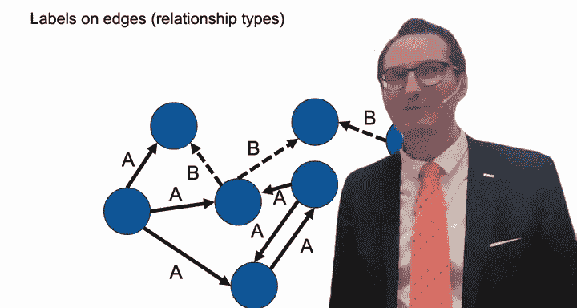

Welcome back， everybody。 So let's continue our exploration。 So these are the labels on the。

 on the edges。😊。

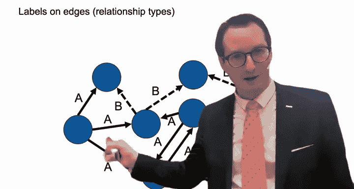

Now here's the link again with relational tables if you want to actually implement relational tables on top of your graph database。

You could basically use。

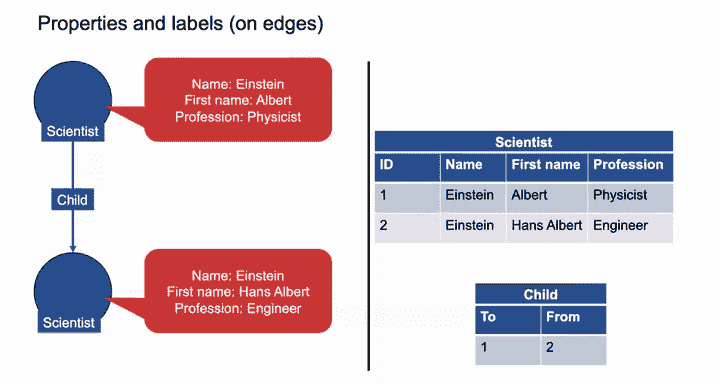

A link like this that is essentially a memory pointer as what you have between a foreign key and a primary key in there。

 That shouldn't surprise you， because this is how I started the whole story， right。

 We want to avoid having to join the tables by using an inmeory pointer。

 So now we have a note that is a person and another note。

 that is another person And we have a relationship type child that goes from Albert to Hunt Alberts right。

 for whom is that clear。

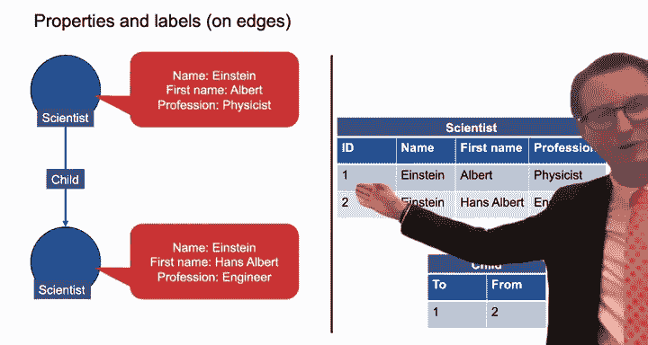

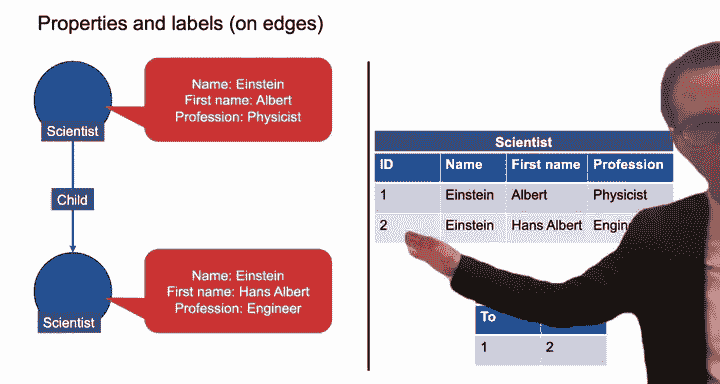

Very good。 Alright。 So this is how we can map。 And so what you now see is that a relational table can easily be implemented on top of the labeled property graph。

 just like a relational table can easily be implemented in a document store， right， So there's。

 there's a straightforward mapping and it's not byjective because the other direction doesn't work。

 You cannot easily convert any labeled property graph to relational tables like that。😊。

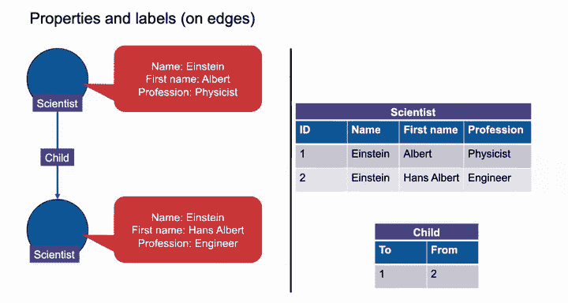

Alright， now the scary part， the type system。 Well， actually。

 it's not scary because we've covered that already a few weeks ago。 So the。

 the goal that I have here is to make you see that is the same thing once over once again。

I love these mappings， because since the students stopped asking for such tables that actually love doing them。

😊，So what do I have here， what you already know the second and thought column， right。

 That's Python and Jsonic that we've seen before。 These are some of the types。

And then we have this first column。 that is cipher。 cipher is the query language in neoalge。

 That's a query language that works on labeled property graphs。Not surprisingly。

 it has atomic types integer flood string Bo date time time date duration and old points。

 that is actually new。 That is the support for Gi。 So geographic information systems。

 It's actually also handling the notion of spatial location。 I O。

 special location with the points in space， right， So these are like graphical coordinates coordinates on the earth。

 for example， But in fact， Mongodi also has that。 I mean， you you。

 you have plenty of system that also have this。 But this is basically the only original team here that you've already seen Nobody should be surprised by that。

 And by the weight maps。 So in yellow， you have the atomic types in blue hellello list hello map。

 we know them， right， array and objects in Jason。😊，Le and in Python。 No surprise here at all。

 But we have a new path right here。 And that is the path that is specific to the label property graph。

 It shouldn't surprise you that because we have a graph， we have node。 We have edges。

 And then we have paths。 paths are basically just a set of nodes connected by edges， right。

 A path on the graph。 But these are the two primary citizens of of the graph。

 we call an edge or relationship。 It's a Ne matter of the immunology。 Okay And of course。

 that doesn't have any equivalent in Jason Jsoni or in Python。 you might be tempted to say， yes。

 that's the parent childil in the in the trees， right， But be careful because。

Even though in theoretical computer science， a tree is just a special graph that doesn't have any cycle。

 that is not how the tree shape relates to the graph shape in the case of databases。

 So be careful about that。 right， So this is why I didn't make any any equivalent in Jsononic or in or in Python。

So now this is the type systems。 So what you manipulate in a labeled property graph。

 specifically Nethj with the spher language is basically mostly in this list with with me。Right。

 that shouldn't be so new to you， except for nodes， relationships and paths。

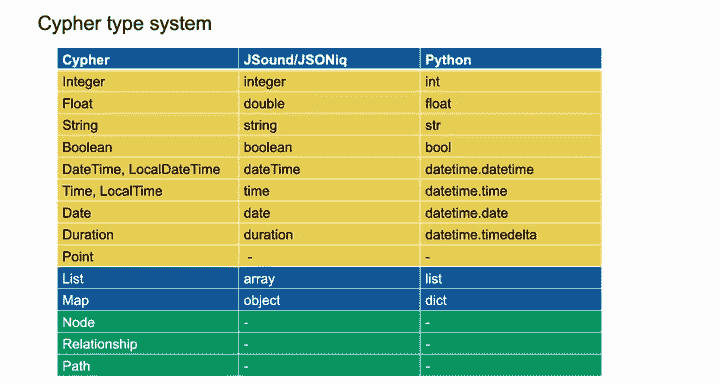

Okay。😊。

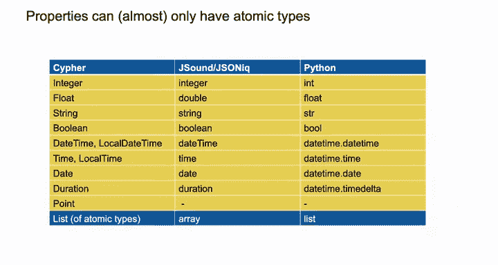

Now， what can you have in properties inside of the nodes or inside the labels， What can you， Because。

 yes， edges can also have properties。 I， I forgot to mention that。

 but they do exactly the same way as for the nodes。

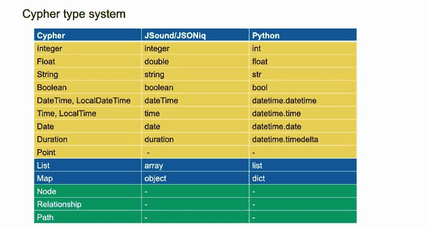

So what can you have in properties when it has to be flat。 So not surprisingly。

 some of that goes away， and we only have the atobic types that are left。

 But I told you there is an exception。 So now I'm about to tell you the exception。 The exception is。

Hmogeneous lists of atomic types， a list of integer， a list of strings， a list of bullans。

 a list of dates， a list of points。 All of that is fine in a property。

 This is the only nestedness that is a in a property。 A from that， everything is flat。😊。

For whom is that here。Right， very good。 So this is a subset。

 But although you can only have that in a property。

 if you look at the query language in itself during your querying。

 you can encounter all of these types of order， right， But in the storage， in the properties。

 you can only have this。😊。

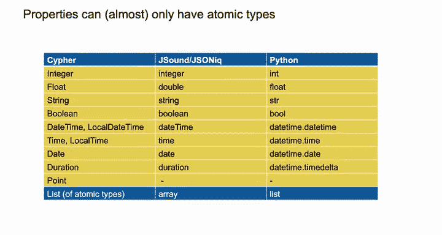

All right。Now， I told you， I'm going to keep connecting that to the rest of the lecture。

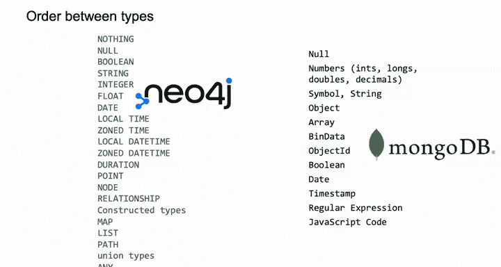

So here I connected Cypher to Jsononic and to Python。 Now。

 I'm going to connect Neo4ge with Mongo D B。 And that has absolutely nothing to do with any shape。

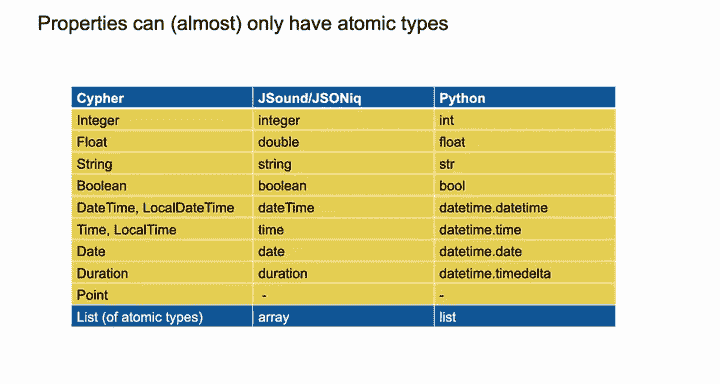

Do you remember that in Mongodibi， if you want to compare two values of different types。

 it's going to work。 And the way it works is that Mongodib has an order of the types。

 completely arbitrary， but there is an another who remember that。Okay。

It's the same thing with Nealge。 Nealge also has an order on the types。

 and it also is capable of comparing across types。Now， I told you， this is completely arbitrary。 So。

 of course， the order that you have in Neo 4j has absolutely nothing to do with the order you have in Mongo D。

 But who cares？ It's only a matter of documentation， right。

 And you don't even need to learn that by half。 The only thing you need to know is that。

Values with different types can be compelled。Okay， so yeah， that's what I wanted to say。

 And it turns out that the Ne4 J order in the types is， as is on the left。 and Mongos on the right。

 So just notice that it， they have nothing to do with each other。ok。😊，Something else。

That is also across shapes。And it's good to take a step back。It's what we do with nurses。So in SQL。

 the Ns， some people see them as absent values。 Some people see them as special values。

 I warn you that in Jason， some people make a difference and some people don't with an absent value in an object or with an explicit nu。

 in Jasononic， we make a difference。 We have the empty sequence。 and we have the nu。In Ne4j。

 there is also the concept of null， but the null， in Ne4j behaves。 you should see it as a sQL null。

 or as a Jsonic empty sequence。 This is how you should think of of a Ne4j null。

 right So whenever you hear a null here in Ne4j， think of the empty sequence in in Jsonic。

 So what it means concretely because null is the absence of value value。

 I'm gonna get it other time value instead of value。

 So the way you do that is that you basically allow any data type to have a value of null， right。

 just like in SQL， if you have a column that is that is declared as accepting nus。

 any type can have null as a value， but it actually means that there's no value。

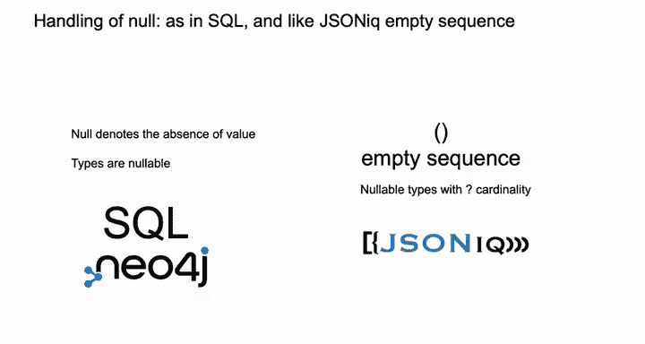

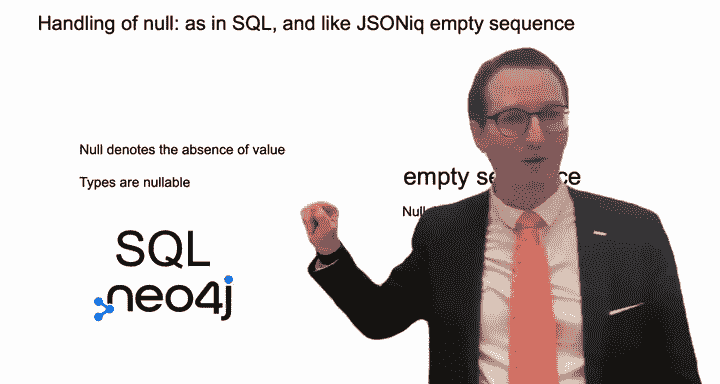

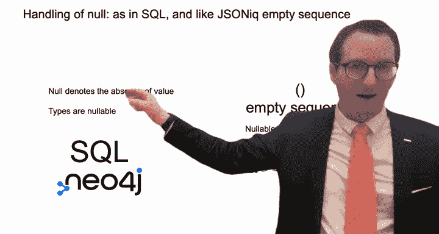

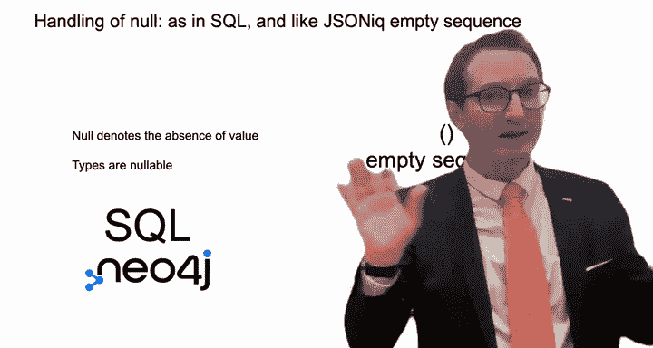

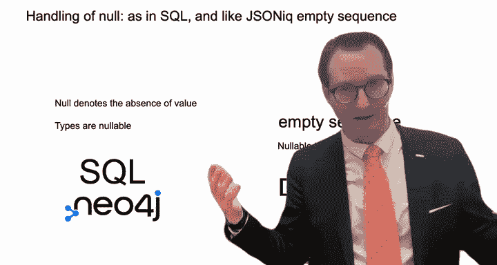

We say that the type is nillable or noable， right， Niable and noable are the two terms you see。

 right， How do you say that the type is nillable in Jsonic。

 But in the sense of the empty sequence is the question mark。

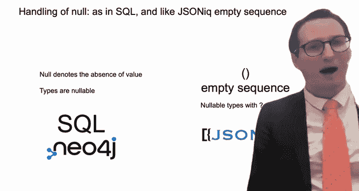

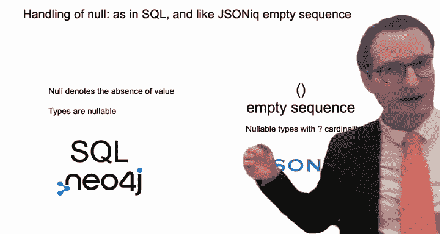

So if you say integer， it has to be exactly an integer sequence of one integer。

 If you say integer a question mark， it could be the empty sequence or a sequence of one integer。

 So that would be the equivalent of Jsononic or a notable type that would be a question mark after other type that says it's either absent or it's an integer。

 So whom is that here。

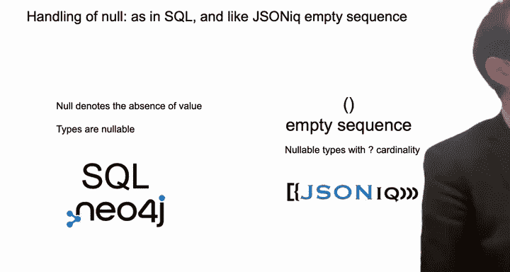

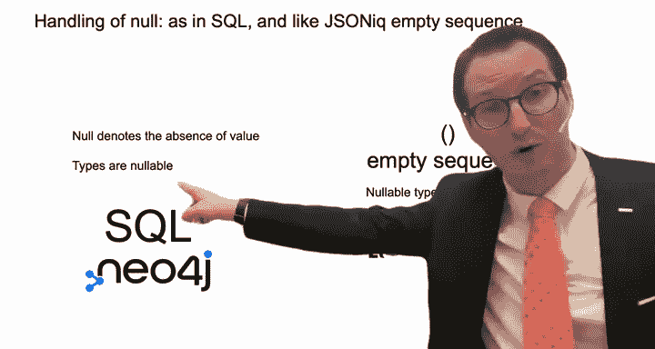

Okay， so what there is to remember here， that is a very general consideration beyond just Json Xi or anything else。

 People have two ways of looking at Ns。 They either look at it as a special value or they look at it as the absence of value。

 These are the two paradigms。 whenever you need you learn the language or a system。

 Look at what they do with Ns。 It's either or maybe theres a third way。 I don't know。

 but typically it's one of the two。Okay， so I just wanted to have mentioned that。

Then I'm following up on something I said earlier。 Do we remember that I said the only exception in the property of something that's not atomic is a homogeneous list of values。

 of atomic values。I said homogeneous， why did I say that。

 Because they don't have to be homogeneous studies is， in general， in neoology。

 They only have to be homogeneous in their properties。And that is， again。

 not new to you because we've already seen heterogeneous list before all the time in that lecture。

 We've seen them in Jsonique。 We've seen them in Mongo Db， all over other place。

 And we also have them in in inpher， right， So2，3， true blah blah， blah is is also a list。

 I should actually maybe have put some square brackets in there。

 because they actually do know the list， just like in Python， where they call a list is in fact。

 an array， right， So I probably should have added square brackets around here。😊。

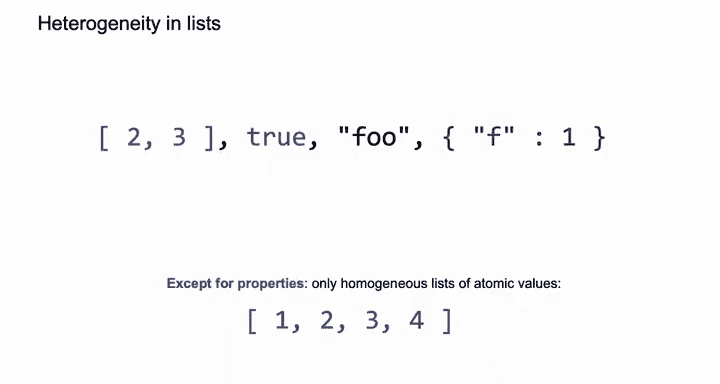

And this is an example of homogeneous list of atomic values with 1，2，3，4。

 And here I did put the square brackets on both sides。 Okay， so this is heterogeneous。

 and this is homogeneous。 work agree。

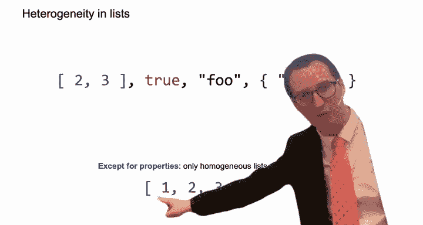

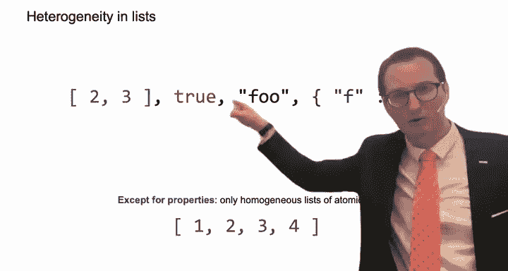

Right， so again， in the language， you can do that in the properties。

 you have to have something homogeneous and flats。Okay， now the maps。Also not new to you。

 A map is basically adjacent object。Except that they don't use the J syntax。

 So at least they relax it a little bit because you might have noticed that there are no quotes here。

 They， they don't quote the keys。

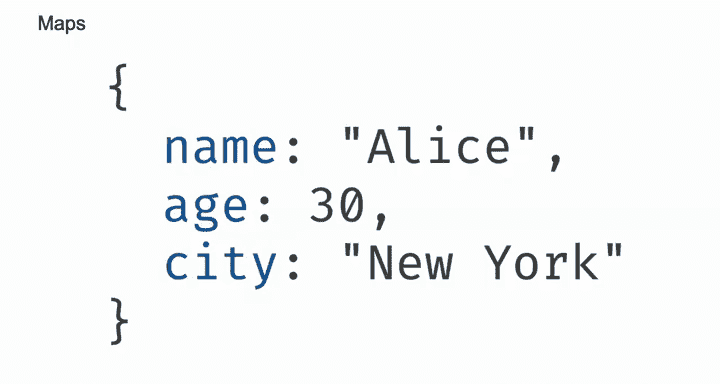

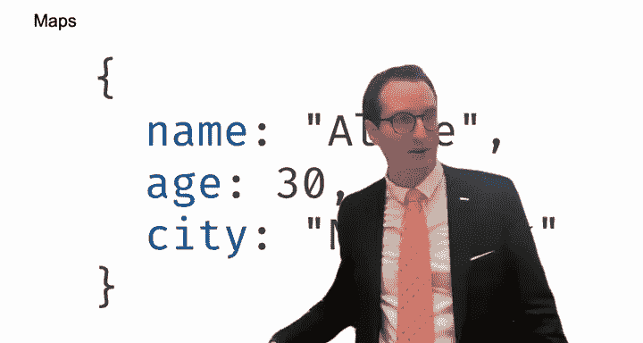

I war you that in some Json implementation， some libraries accepted if you don't quote keys in Mongo Db。

 you don't have to quote keys in Neo4 J， you don't quote keys either。

 I actually don't know if they would even accept quotes。

 Maybe they don't even accept any quotes around the keys。 would be nice to test it actually。

 But anyway， this is what it looks like。 It's it looks in after Jason。

 the only exception is the keys are not quoted。 So this is an example of of a map。

 And you realize what is a map。 It's actually the set of properties of a node， right。

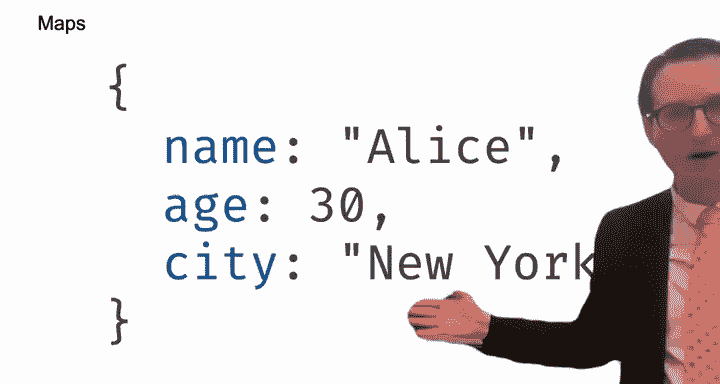

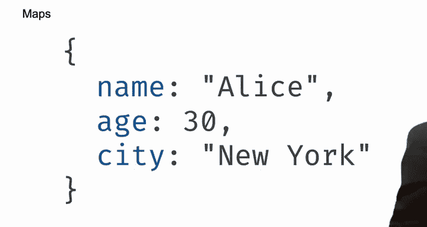

But again， it's the same idea as here。In the actual storage of the properties of the node。

 you have to have homogeneous values in your list and flat。

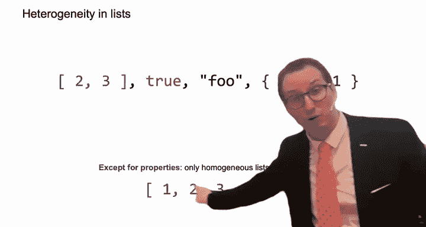

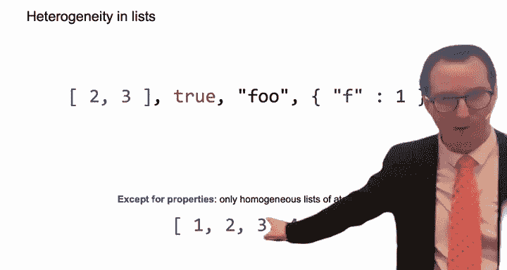

Maps in general， can actually be nested。 You could have a map。 And inside the value。

 there's another map。 and inside， theres another list。 and inside， there's a map and so on。

 That's absolutely possible。 And you can have heterogeneous nested maps。

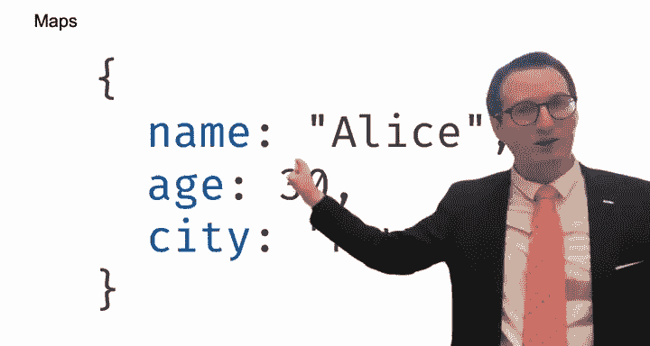

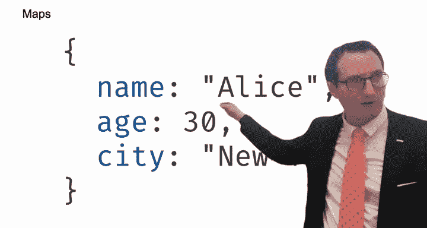

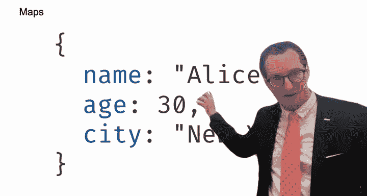

However， if that map is actually the properties of the node， then it has to be flat。

 You have to have only atomic values in here or homogeneous list of atomic values。

 But who is that here。

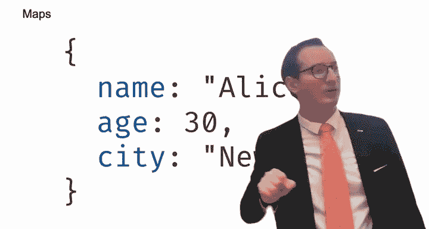

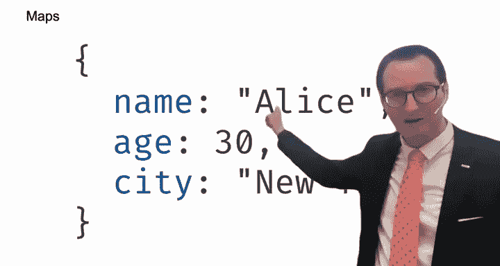

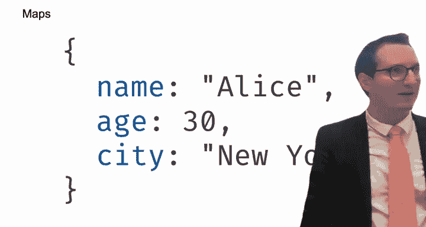

Right， so always keep in mind。 there is what the language generally allows you to manipulate。

 and there is what you are allowed to store as properties in a node， which is more restrictive。Okay。

 so this is an example of nestedness。 That's an example of a list that is heterogeneous。

 and that contains a nested map， an object that contains a nested array that contains a nested object。

 yes。😊。

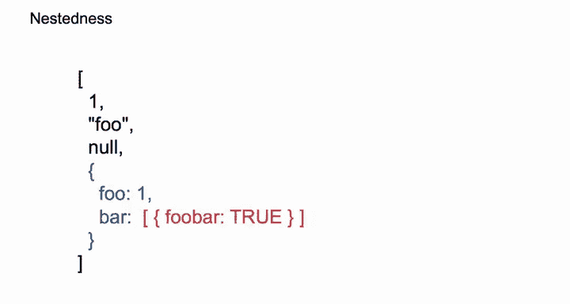

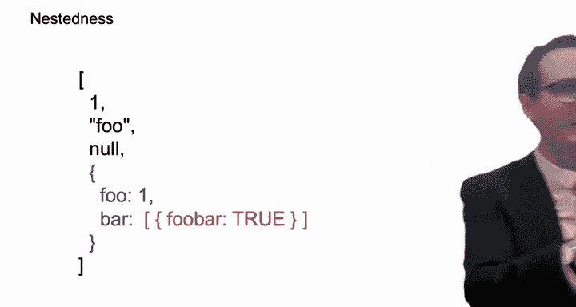

If you're only allowed to have these flat heterogeneous lists as properties and are not allowed to use。

 for example， an object in a property。What use cases do heterogeneous lists or objects and nested objects even have in the query language if you cannot use them？

Or it just gives you flexibility in the querying。 Basically just。

 it just makes the language even more flexible。 So when you query the data。

 it gives you more freedom。 But then you can query something that is not allowed like what。Why。

 I see what you mean。 Well， imagine that you're looking。

 I don't know at at at nodes that have properties that are integers and some other nodes are properties that are strings and you want to union that altogether。

 Maybe Then you're going to have a mix of strings and integers， for example。 right， I。 Thank you。

 Yeah， Thank you。 I would basically ask the question the other way around。

 Why would you prevent the user from doing that， right。

 that that would be an unnecessary restriction of the freedom of the user。

 You want to be as flexible as possible。Yeah， and the motivation is the same as in Jsonique。

 basically， it's exactly the same idea。Okay。😊，Alright， so these are the maps。

 This is an example of a nested nest， something you would never see in the actual properties of a node。

 But during the querying， you can absolutely have that。You can also navigate。

 So now we are slowly moving into the language itself， right。

 I was talking about the models so far about the other types and atomic types and structural types and so on。

Now， this is no longer about the type system。 This is really about navigating。

 That shouldn't surprise you because now you've already learned Jsononic， right。

 So this is very similar。 Dots bar。 that's like an object lookup in Jsononic looks exactly the same。

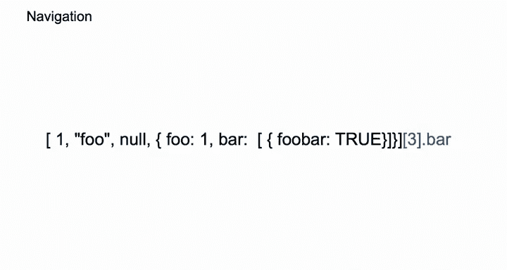

Here you have this to access the array。 The only difference is that in Jsononic。

 you have the outer level sequences， and then the arrays for nesting。

 This is how you achieve parallellyism in in cipher。 You don't have this notion of sequences。

 We see that you have them in the query language with the clauses that will come back to。

 But the list， they cannot become enormous like sequences in Jsononic。 So as a consequence。

 they dont， they don't need to distinguish between the single and double square brackets。

 So this is they just use a single square bracket for accessing the position in an array。 So3。

 what's more is they start counting at0， That's another difference with Jsononic that starts at one。

 But it doesn't matter， right， Who cares， You know， there's a convention at 0。

 Theres a convention at one。 It doesn't matter。 You just look look up the documentation and and see what it does。

 right it really the same。 So since it's at at0 here，0，1 to3。 So that would be the object。 and then。

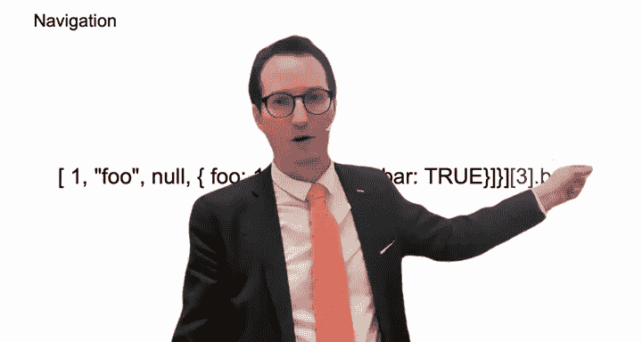

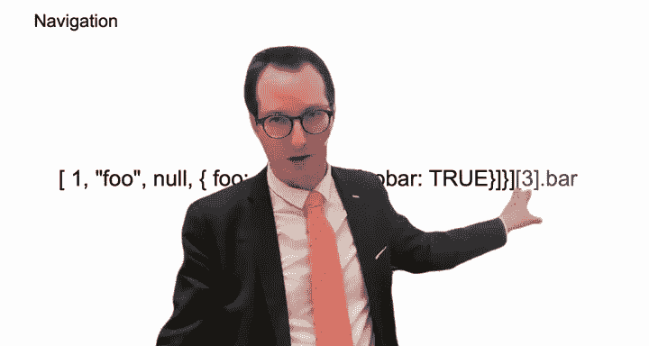

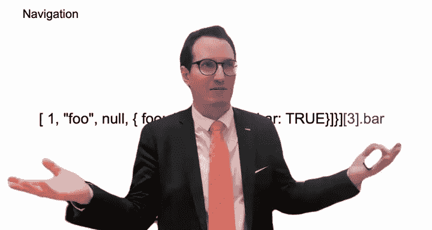

Dot bar accesses the So it returns actually， this array of this list right there。

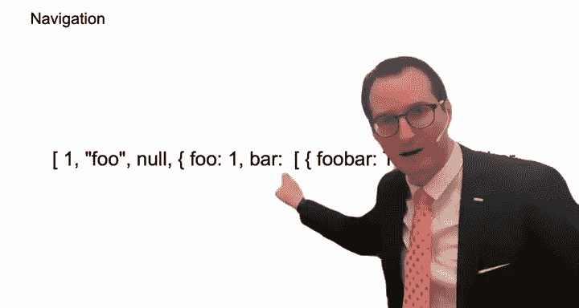

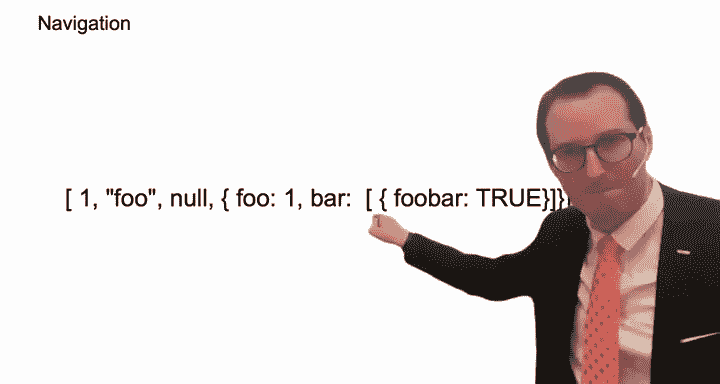

Okay， who sees that it's similar to Jsononic。Okay。But， it stops。Ats the sequence path。

 because here we are looking at only one single list and only one single object。

 There is not this notion of navigating multiple objects。

Or large sequence of arraysin or objects like we have in Ges that we don't have。

 It's done in another way， also with the clauses。He'll come back to it with the unwind clause。

All right。No。This here is actually not a spher query。 You， you can try to en just that。

 You're gonna get an error。And here it's a bit closer to SQL in the spirit。 In SQL， you。

 if you want to do a simple calculation， you have to put it in a select statement。

 Who remember of that。You need to write select and then followed by what you want。嗯。

Guess how they call select in。cipher。Hinジ。They could it。

What's the last clause in a flower expression in Jsonic。Reome。 they could eat retailome。In your mind。

 consider that return and select is the same thing。 It's just a matter of synonyms， right， in SQd。

 it's called select in Jsonic and in neoal J。 And actually， in many modern languages。

 now we tend to call it return instead of select。 So this is called return。 And just like in SQl。

 you say select， blah， blah， blah。 And you just say return， blah， blah， blah， right。

 And that actually works that you can put in in。😊，In your shell of a neoal。

So let's dive a little bit into that。 because now we start touching the close。

 So we might as well continue a little bit。 There's no graphs yet， but it doesn't matter。

Now we have this with cloth。

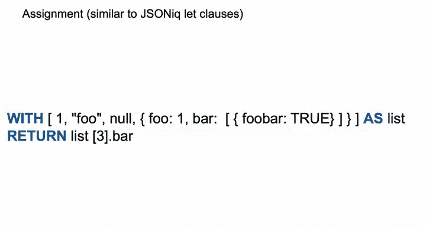

Right， that is close right there now。

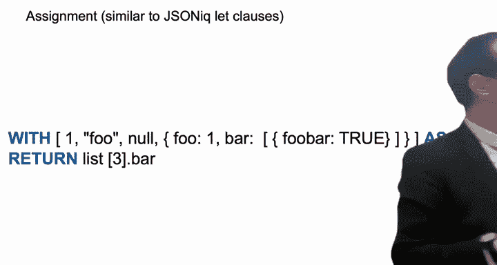

Somebody last week asked about the sequel with cloth。 Be careful。

 This is not the same as the sequel with cloth。 It's actually closer to a jaonic lead clause in the spirit。

 I would explain why。嗯。So here， if you say with blah， bh bla， bla， blah， blah。

 blah as list returns list3 bar。 So it navigates and and returns this。 In fact。

 this is the same thing as in Jonic， let list column equals that return list double square brackets。

3 dot bar。😊。

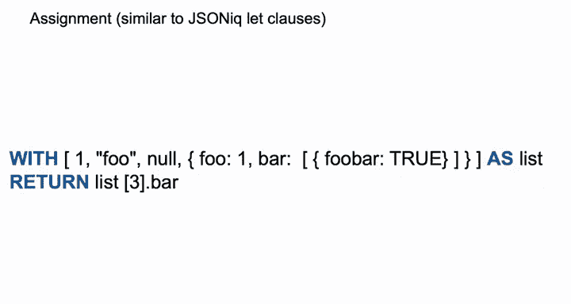

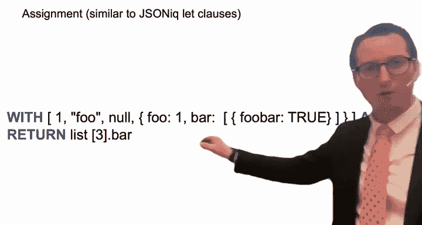

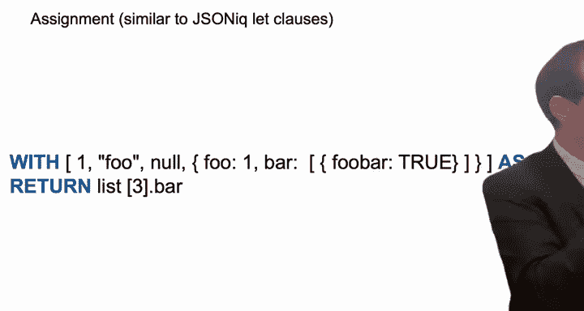

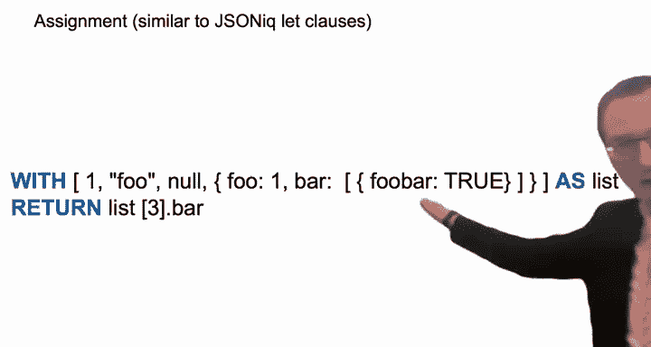

Who sees that。Right， it's the same thing as the lead closed for this very query right here。

Why is it different。From SQL， it's different from SQL because the width clause right here is working on a single node of topper or a single assignment。

 right。In SQL， when you use the width clause， you width with an entire table。Right。

 for whom is that clear。Right， so that is the difference with sQcal。

 So you really have to see the width a bit similar to a LED close。By the way， I didn't say last week。

 but the Jsononic LED clause is also powerful enough to store an entire table efficiently。

 I just didn't talk too much about it。 but the LED clause in Jsononic also encompasses the SQL with clause ands the neo4j with clause。

😊，Alright， so now here's a simple example with one as a return a plus1。

 which is equivalent in Jsonic to let a colon equals one return Do a plus1。No。Just like in Jsonic。

And just like actually， with the sQel with the clause， I can say with with return。

 So look at what I'm doing here， basically assigning one to a， and then a plus1， which is 2 to B。

 And then B plus 2。 and that query returns。😊。

Oh right， Okay， so one plus one plus2。So what did I do， I changed with with retail。

 This is the same thing in Jsononic as let let Re， right， I told you in Jsonic。

 you have a generic order of the clauses in SQ， it's very restrictive。😊，Now， you might object。 O。

 yes， but in SQL 2， I can have multiple width and so on。 Yes。

 but the difference in SQL is going to become clear because in SQL。

 you cannot entangle the width with other clauses。 And here we will see that we can entangle the width with other clauses。

 just like we can entangle the lead clauses with other clauses in Jsonic。

 So this is much closer to Jsonic than it is to SQL， as we will see。😊。

What did I do in here with this little red Cross that basically tells you that doesn't work。

I basically have a let A equals  one， and a let B equals a plus1 right here。

 And I'm trying to access a。 but a actually comes from where from the width class two levels above。

There is a certainty， And this is here where it， it actually slightly diverges from Jsononic。

Is that the moment。I use another with clause。 I'm forgetting about all the variables that were bound before。

 all so about A， I no longer see a。

So this query is going to return on an error for that reason。 After the second with clause。

 you only see B。How do I do it if I want to continue to see A。Well。

 I need to just add it to the second with clause。 So in my second with clause。

 I really need every time I have a with clause to list everything I want to keep。

 So it could be the list of all of those from above。 you want to keep。

 You can throw away those you no longer need。 And then you， you may， you might add another one。

 Okay in Jsononic， you would just need the let B， and you don't need to repeat the A。

 But in neo Cypher， you need to repeat the A。 This is a site subtlety。 But in fact。

 it's it's all equivalent in in terms of tu completeness。😊。

Okay， for whom is that clear。All right。呃。Okay。Now， I could also， by basically。

 if I start playing like a Lego game， what prevents me from creating a list right here with one and 2。

 right， That's the least returning1 and 2。😊。

No。With， if with is kind of like doette clause plus minus this subtle difference here。

 If width is like doette clause， what would be the equivalent of a fork clause。In Jsononic。

 I could use a forclo， for example， to iterate over the elements of an array， right。

 I could say if let dollar A be some array and let Do B， B the array unboxed with a square brackets。

Well， the equivalent of the forkclo is the unwind clause in here。 So if I say with blah， bh， bla。

 blah， blah as a that's basically or lists or an array containing three objects or maps。

Right。

If I say unwind A as B， sorry for the syntax highlighting here that I forgot。

 unwind A as B is basically going to now duplicate this three times and attach B to this and then this and then this。

That's exactly what the folkclo does in Jsonique， remember。

So that's yet another argument for saying that because you've learned Jsonique。

 that is actually going to be very easy to learn。 exactly the same principles。

 just different cosmetics， different lipsticks， different names。 but it's all the same principles。

 Okay， so now this is going to return as basically3 three results。 Who1 for2 and then43。

 Who see that。Who doesn't see that。Who sees that。Okay， I like that better。 Okay。

 making sure everybody is following。Now， this is how it's different again from SQL。

 because in SQelella， you can have multiple width， but you cannot entangle them with where group by and order by and so on。

 Do you remember that in Jsononic， I told you you can have a flower expression with 20 or  Foxy clauses in any order。

 the only constraints are it has to start with either forette， and it has to end with return。

 Apart from that， you can do whatever you want in any order。 Remember that。😊，Okay， well。

 I have good news。 The same thing is true in neo4ge。 So that's again。

 one part where it's actually just like Jsononic。 And that's an example where I have with unwind with return。

 which is like a LED4 LED in Jsonic LED4 LED return。

 So look at what it does with Blalah blah bla A unwinds A as B is going to create three binding for B。

 then you have B dot 2 plus one。 that's for every one of the incoming binding。

 So the first one is going to to be 1 plus1， then  two plus1， then3 plus one， right， So I have2，3，4。

 And then just for the fun of it， because I like Lego games。😊。

I wrapped it again into， into a list， just like we could do it in Jonic2。

 And now I'm returning three singleton lists， one list with2， one list with  three。

 one list with four。 Who see that。

Okay， so really， this here is very similar to Jsonic。 right， This is really， really the same idea。

 And in fact， you see now a growing number of languages that are adopting this approach who out of the Google SQL pipe syntax。

😊，They made a lot of PR about it a couple of weeks ago， on social media。

Nobody saw the Google SQl P syntax。Okay， well， the Google SQL pipe syntax is exactly this。 again。

 the same thing。Oh， you saw it okay， awesome。So basically。

 if you want to learn the Google SQL pipe syntax， you don't need to。 You already know it。

 It's exactly this idea that many， many of the modern query languages have basically an arbitrary sequence of clauses in any order with this idea that the bindings flow all the way down from close to close。

 right。And by the way， the reason why this is taking over is that the people who came up with these Soonic flower expressions actually come from the Xque flower expressions。

 which is a W3 C standard that， and the people who designed this and S in the working room are some of the same people that design SQel。

 So there is absolutely no randomness in there。 It's really the wisdom and the experience that accumulated over the years。

 and that is now pecolulating into all the modern query languages that you see today。

 So this is really a pattern that is going to probably emerge in many， many languages。

 this idea of the flexibility in the order of the closest。😊，He has even more flexibility。

 I'm not throwing a wear clothes。 We also have wear clothes。And again， unlike SQL。

 the wear clothes can go anywhere。 You can have 10 wear clothess if you want。

 completely arbitrarily intertwined with the other clothes。Okay。Alright， so that's the appetizer。

 But now you might tell me， okay， I haven't seen any， seen any graphs so far， right。

 All we did is just something similar to simple values and values and lists and， and and objects。

So where are the graphs then where here they come。嗯。Now。

 the important part of the of the spher language。Is basically。Related to graph patterns。

You have this graph that is basically your database。

 and you want to recognize patterns in this graph， and then you want to extract data from these patterns。

 This is the core and the most important parts of the thecipher language。So here's how it works。

 It's beautifully visual。 Then we'll move in we'll move to Askky arts。

 But before we move to ask key art， like the language actually looks like I first show you some animations。

😊，So， on the left。Here， you have the actual database。

I cheated a little bit because I used colors instead of the labels。 In fact。

 blue and yellow would be labels on the nose。 And I also cheated with the lines because dash and full is actually relationship types。

 I just wanted to make it more visual for you， right？ But let's say that my where am I yeah。

 my user basically wants to identify a pattern with three notess。

 I put them in gray because it doesn't matter if they're yellow or blue。

 But what I want is a dashed line here。 So a relationship of the dashed type and a relationship of the full type。

😊。

Do you see someone in here who sees that pattern。

Who sees multiple occurrences of that pattern。Very good。 See if you pay attention。

 you see it right here， you see it right here， you see it right here。

 you see it where I think that's pretty muy， so。😊。

Here， here， here。 These are examples。 So basically。

 the interpretation is that if you're looking for that pattern。

 you should get back these three things， right， now that's a visual thing。

 So how do you actually transform that into an actual query result。

 Because here I'm just drawing some nice colors on on a slide， But， in fact。

 this is captured with the types I told you about before， Do you remember the path type。

And the node type and the relationship type。You can also have them in the variables in your query language in the with clothes and so on。

So these are actually first class citizens of the， of the query language。 alright。Now。

 I'm going to start giving actual names to the dash lines and full lines。

 So let me call the dash line A and the full line B to make it more explicit and slowly move to the language。

 So I'm looking for the pattern on A B。 And， and basically， that's how I do it。😊，I told you the。

 the query language itself is beautiful ASci art。 Who heard of ASci art。Right， some of you， Okay。

 it's basically a way to draw nice pictures， but just with aski characters on the。

 on the command lines。 Well， this is how it works in the language。 It's basically a visual of this。

 but just written in Askci art。 So you have some node。 You give it a name Alpha just doesn't matter。

 It's like a variable name。

Connected to a nodes that we call beta connected to a nodes that we call gamma。

What's more over that edge right here， you see with a little bit of imagination， again。

 askingki asked， that's an a row that has a label。

The label is a after the column。 And here the label is B。

 So I'm basically looking for three nodes that I will call alpha beta and gamma。

 such that the relationship type between alpha and beta is a and the relationship type between beta and gamma is B。

 That is exactly the same thing that I had here， and what's going to happen when you do that is that it's going to find the older patterns three times as we see here。

 And for every one of these three times is going to assign alpha beta and gamma of type node because they are nodes。

 And then you can query them with the language with all the older feature of the language with with me。

😊。

Alright。😊，Now， you can do more things。 It's actually quite cool。

 You can also restrict your pattern more by saying I want better to be yellow。

 That means the I want the node beta to have at least one label called yellow。😊，We have a comment on。

 on the ASI art on the， on Zoom。It's a bit likeIs there any theoretical connection between matching over linear strings and matching over the brass。

 yes。That would be my answer。 Yeah， if you look at that。 So， yes。

 this you can go in the direction of reshift。 And this is when you see that this is massively more expressive than SQL for that kind of thing。

 because now you can basically implement multi joints。

 What would have been a lot of joins in a relational database。

 You can just just with a few characters say that you want a path of length between one and 4。

 and you can basically match it just like a regular expression。 That's exactly the spirit。😊，没了。ok。😊。

Alright， so this is how you basically ask for it to be yellow。

 Notice that the labels are after other column。 So that's the label of the node after other column。

 That's the label of an edge after other column， we just didn't give any variable on the left。

 we could have。 And D after other column， yellow after other column。

 so the label is after other column。

I can also specify instead of the label。 I can specify a filter on the property。

 I can specify name Einstein。😊。

And this is now going to specifically look for patterns such that the first node has the property Einstein associated with name。

Very similar to Mongo D B， right in the period right So here again。

 a connection in the style that you have here。 you can also do both if you want to， at the same time。

 require a node to have a specific label blue and a specific property name equal to E TH。

 then you're going to find the pattern when you both have blue here and name E TH， right。

 So this is introducing restrictions。 You have a question。 So when do we have to add a colon。

 is it only when we have when we're restricting on a label because yes， if you don't have a label。

 you don't need the column。 The moment you want to filter on a label。

 you need to add a column before the label to basically say that this is a label。

Okay， otherwise， you would confuse it with the variable if， if you don't put like here。

 if you don't put any color on here， you just say， a。

 then that wouldn't be a label that would be the name you give to the edge。

Just like here it's the name you give to the node， you call the node alphapha。

And here， if you didn't have the colon， you would just be calling that H A and calling that H B in terms of variables in the language。

But if you have the column that says that it's filtering those edges that have the type A and those edges that have the type B。

Just like here on the left of the column， That's the name of the variable that you want to connect the node to。

 On the right of the column。 That's the label that you want to filter。

Does it make sense。 Yeah， I was just mainly confused because on the previous slide when you were filtering on the properties。

 you didn't have a colon。 So just had alpha and then exactly， But because that's not a label。 Yeah。

 exactly。 Y， it's a property。 And when you have both， you have the column before the label。

 and then you don't have any column before the property。

Okay。Very good。 But It's nice that you go into， into the details。😊，All right。

So now because you appreciate ASci art so much， It also allows you to re the edges。 This is the。

 the power of the language。 So you can even say that you want alpha to go to beta to go to Gamma and Delta to go to Gamma。

 right， So you can also have a reversed edge like this。 By the way， the， the。

 the new lines don't matter here。 You could also have it in a single line。

 that will find this pattern。 Who sees that this is basically the same pattern。😊。

very good。All right。And that you can even add more。 So it's， it's completely arbitrary， right。

 So you can go from A to B and then from Delta and then from Delta to Al and so on。

 Who sees that it's the same。

Notice what happens here。 I'm reusing the same variable here and here。

 which means that here I really want an undirected cycle。

 I really want to come back to alpha in here。

给。So this is very important。 Of course， now you're gonna tell me this is linear R because it's it's text。

 right， So it it's not going to capture all patterns。 It's not problem at all。

 If you want more complex pattern， you can just use more clauses and more filtering in a different way。

 right？ But if you have a path undirected path with arbitrary directions。

 you can really just write it in a single pattern like this。Okay， now the regx like aspect of it。

 if I want to pass between alpha and beta of length between one and 4。

 this is how you do it very powerful。Imagine doing that in SQL。For just for a few seconds。

 who would be scared if I imagine I if you at the exam， do that with SQL。I'm not going to do it。

 right， You would be scared， but you see the power of the language。

 Basically that here with just a few lines， you can do it。

 This is the reason why when you use a query language。

 you really have to make sure the query language corresponds to the shape of your data and corresponds to your use case。

 If you use the wrong query language。 If your data has a certain shape。

 but you use the query language that is designed for another shape。 You will make it work。

 It's alteringcomplete。 but it's going to be like putting a square pe into a wrong hole。

 That's really the the idea D here。If you were to specify a pattern that is an underspecified cycle。

 will the same cycle be picked up multiple times starting different points in the cycle？I think so。

 So if you have different ways to attach the， oh， do you mean if I have。And undirected。

 do I have an example here。No， I don't。嗯。Do you mean if you connect here A And B。

 but without your row， like N B， A， B directly connected without specifying the direction。

Whether it's going to attach both ways。 I that the question， I think so yeah， Yeah。

 So I think it's going to attach it in the two ways。

 It's looking for all the combinations of alpha beta gamma that give you that pattern。

 And then there will be multiple multiple bindings， multiple matches。😊，I'm looking at you。

 but actually， it's the the the fashion on Zoom that I'm waiting for to say if that that solve the question。

Yes， exactly。 Thank you。

Alright。😊，So， yes， what did I do here？ Yes， it's the match close。

 So what do we do with these patterns。 Well， you put them in the match clothes。

Because if you put that ASI art inside the match clause。

 it's going to generate variable binding just like in Jsononic like any clause does。

 and it's going to assign alpha， Pita and gamma in every possible binding in turn to every match。

 And then for every match is going to return gamma。

 It's exactly like the Jsonic way of hand the flow expression。

 except that match doesn't exist in Jsononic at all right。

 So match is just specific to graph databases， and it's just creating the binding out of the pattern matches in the graph。

 or whom is that clear。😊。

All right。And now match is yet another clause。 You can mix it up with the we and wear and， you know。

 all of these other clothes。Alright， okay， so here's an example of match and where。

 So here you're basically saying that you're matching this pattern on alpha beta gamma。

 where alpha name equals Einstein。 This is equivalent。

 to what I did before specifying in inside here。 the object name Einstein。 You agree。

 All I did is I took it out from here and put it instead in the work clause。 It's equivalent。

 It's just two ways of doing the same thing。😊。

Who see that。Right， so what I mean is when I did it before here。

I could either have put the filter directly inside the pattern， or I can。

Remove it from the pattern and instead put it in a workclo。 After all that， it does the same thing。

Now， match with wear returns。 So you see you you just combine and combine and combine。

 It works exactly like Gsononic， yes。没对。嗯。The optimizer does whatever it wants。

 What the query language gives you is its declarative。 It says what you want。

It might be that when you give this query to a Ne4 J。

 it figures out that it actually would be faster if it did it in， in this way。

It does whatever it want。 The only thing is that it shouldn't be， you shouldn't notice， right。

 It can do whatever you want as long as you don't notice the difference in the ri。

 You will just notice that it's faster。Does it answer the question， Asome。

 that's the beauty of a declarative language。😊，Allright。

 And here's an example where you have match with where return。 actually。

 you can do whatever you want now。

And again， one more resemblance with Jsonique， Do you remember that I told you in Jsonique。

 the flower expressions can be described formally and mathematically with tupper streams that are basically streams of variable binding。

 Do you remember that。😊，Where I told you that you can。

 you can view them as physical data frames in between each clause。 Who remembers that。

I had tons of slides about that。 where between the4 and the lead。

 I showed you a data frame and then be between the let and the where I showed you a data frame and so on。

It's exactly the same thing here。 And again， there's no coincidence here。

 It's just the way that modern query languages are going with these sequences of clauses。

 and in between the clauses， this is much more beautiful than SQL because you don't have that in SQL in these modern query languages。

 you can mathematically described what's in between the clauses。

 And this is why you can connect the clauses in a generic way。

 and not as in SQL only as a fixed select from where group by having auto by the middle offset。

 right。😊，So this formalism of the topper streams， it's not called like Latin Ne4j。

 but it's the same thing is absolutely fundamental to all the modern query languages。

All right。Now， just like in SQL and in Mongodb。And in Jsonic， actually， even though we。

 we didn't fully advertise it yet， you can update the data。

How do you update the data in a graph database by creating nodes。

 by creating paths between the nodes。 And that's what the create clause does。 If you say create。

Einstein， scientist， Einstein， Albert， atar University， blah， blah， blah。

 This is basically a sequence of patterns。 I basically have three patterns in here。

Well。I have Einstein that is， again here and Einstein Merha visited D T H。 What am I saying here。

 I have a note with this properties and label。 I have another node with this label。😊。

And property。 And I have an edge。

With the relationship I visited between my two node。

If you say that。It's declarative that you save that to to Neal J。 It's like， is it Captain Kirk。

 Make it so。Or is it peak out。 Yeah， I don't remember it curve of pick out。 But anyway。

 if you give that to neo4 J， it will just make it so。 So after that， after blueing that。

 if you do a match， you will actually find these nodes that you've just created。😊。

Another one is mech。 Merch is a bit subtle。 It's like， create。

Except that if the nodes are already there， then it's not going to duplicate them。

 It's just reusing the ones that are seen here。 If everything is in here。

 Merd would actually modify nothing， right， So Mer is really the idea of creating。

Only what is not there yet， okay。And then it's followed by your return clause because merge does not only make sure that what wasn't there exist。

 It also binds the variables so that subsequent clauses can then access them so you can have merge and then with unwind match with where and so on and so on and then return。

So for the matching， maybe you already mentioned it， but。Does it have to be an exact match。

 So let's say if there was another node that also had an additional property job。呃。

Is it sufficient if name and first matches or does it also need to not have the property job。

 No it is sufficient。This is unlike Mongodibi。 So in Mongodibi， it would be an exact match here。

 it's really just sufficient to have the property。 It's not going to make sure it doesn't have any other properties。

 Yeah， as far as I remember。Okay， but it's good to be aware of this because what you're discussing here is basically all the cosmetics of the language。

And if you're aware of the design decisions that a language can have。

 then when you learn a new language， you already know which questions to ask， how are nerves handled。

 What are the data types， Is it homogeneous， Is it heterogeneous。

 Does it have flower expression like Cs and so on and so on and so on。 So this is this is the I D。

 right。Alright， and so there's many， many， many， many。

 many other clauses other you already know that one limit， you already know that one delete。

 you already know we have it in SQL2。 So you see union， we have it in SQL as well。 Okay。

 so this is this is the the general idea have plenty， plenty of clauses。

 Now you can just look at the documentation and use these clauses to to to play with the language。

 Okay。😊。

That I'm leaving for tomorrow is going to be the physical implementation of Ne4j。

 like I do every week， first the logical， the query language。

 Then we go into physical implementation。 I'm not going to go much into the details。

 I just want to say a few high level things。And then if time permits。

 I'll tell you a bit about RDF tomorrow。You will be able in the exercises to play with Ne4j。

 It's very easy to create an account and use it or download it and just use it。 You have a shell。

 You can type your queries， but don't worry， you won't have practical assignments of Ne4j at the exam。

 Maybe theoretical questions， but you won't have to actually could in the Ne4j Cypher。

 Thank you very much。 everybody。 And I see you tomorrow at 9 AM for continuing。😊。

