# 苏黎世联邦理工《大数据｜Big Data - ETH Zurich - Fall 2024》中英字幕（deepseek - P45：-45-13. Graph databases (3_3) -.zh_en - GPT中英字幕课程资源 - BV1sHPKeoEJU

Welcome， everybody in the lecture hall， welcome everybody on Zoom。

 welcome everybody from the futureture。So after the lecture yesterday。

 To told me that when I say I'm going to now switch to the physical architecture。

 there was react like， not again。 And so I promise I'm going to keep it short and sweet because。

 in fact， we've already seen a lot of physical architectures in the lecture。

 So it's there's nothing really very new and a little bit that's new。

 We are not going to get too deep into it。😊，So first， no surprise， we replicate a little bit。

 It's a little bit like in Mongo D B， that we have multiple servers that replicate the functionality of the。

 of the graph。That was in the early versions of Neo4j that there was no shing。

 They just had multiple machines and all the machines worked on all the data。

 And so what you can achieve with that is that when multiple people read the same data。

 they can just be spread all over all the machines。 so you can do some load balancing。

 just like for a website。😊，For writing， you have a word where people are only allowed to update。

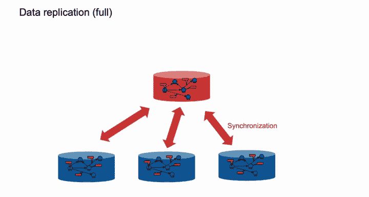

This database right here。 and then it propagates to the other ones。 But then at some point。

 they also made it possible to to write all of other plays。

 But then you have the C A P FM that kicks in and all the difficulties that have to do with that。

 right， So similar to Mongo D B， we replicates for the same data on multiple machines。

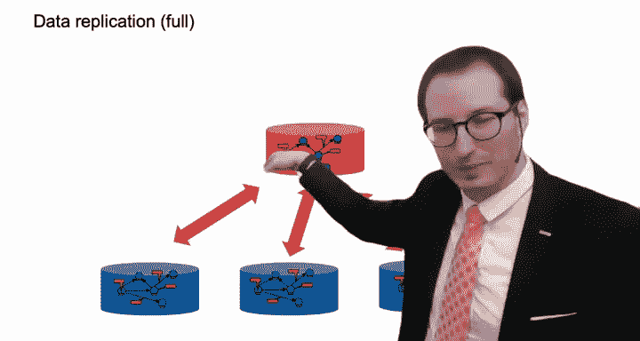

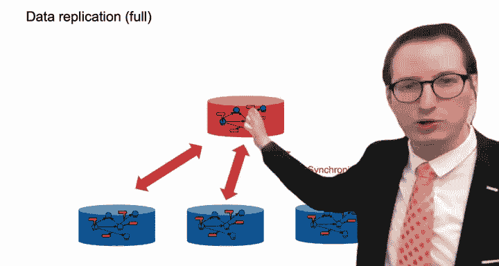

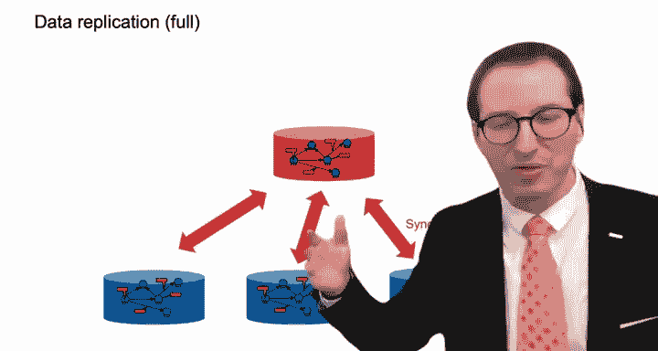

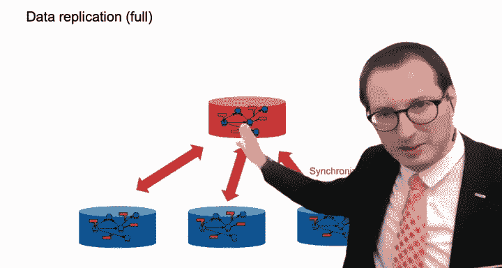

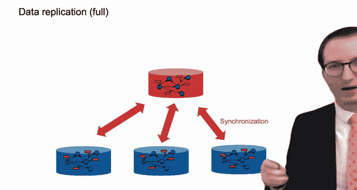

Now， whether not the sharding， right， there's replication， and then there is a partee。

 So the sharding， that is actually a difficult problem。 When I started teaching big data。

 it wasn't solved yet。 So I just had to say， you know。

 sharding is not not solved and we cannot sh graph databases。 but this actually changed。

 A lot of things have happened in the past few years。

 and the first people that Im aware of that actually solved it is the oracle team with PGX D PgX is the name of their graph database just like Ne4j。

 and PG X D D for distribute it and they actually managed to spread it and shard it over our multiple machines。

 They even gave a guest lecture on PGXD several times。😊，So the trick here is that。

You part the data similar to how we did it for tables or trees。

 you spread it all over other the cluster， but the difficulty for graph databases is that you need to be able to efficiently traverse through paths in the graph。

 So the way you do it is that when you sh the machines。

 you don't share it in a way that doesn't overlap right for trees， you just don't overlap。

 you strictly separate。 you have your partitions， you spread them。For graph databases， when you。

 you arrange that there is a bit of overall， it means that parts of the graph are actually across multiple machines。

 And then what happens is that you travel the graph， and you arrive to a path that is in another lab。

 And for that overall， you then jump to the other machine and then continue there。

 a little bit like in some I think Apple， when you move your mouth to the corner of the screen。

 And then it just moves to another computer， right， So similar to that。 So it's not easy at all。

 There's a lot of performance aspects based on the patterns of the queries and so on。 So very。

 very complex。 But it is solved。 And now Ne4j also started sharding。

 and most of the graph databases database providers are actually providing a way to sh the data。😊。

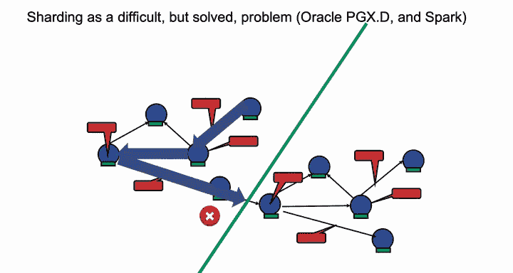

嗯。Okay， so that's what I'm about to say about shing， it is now considered to have been addressed。Now。

 what about the physical storage， You know， like for document stores， for example。

 it's done with Bi that we store the data。

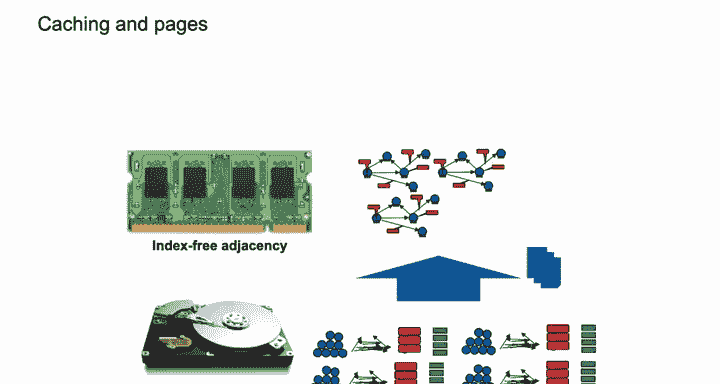

Well， here， you need to look at the memory and at the disc In the memory。

 I told you about this index free adjacency。 That means that you have pointers in memory。

 So it means that the labeled property graph。😊。

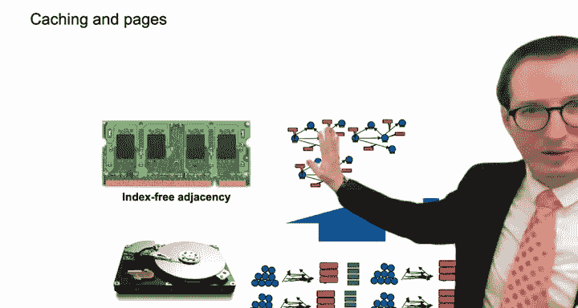

That that is in the memory。

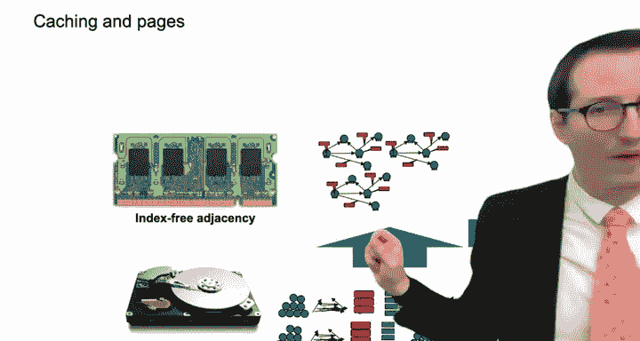

Is actually just。Actual memory pointers， all the edges。 And you， you。

 you basically have to visualize something similar to， you know。

 Java classes where you have objects that points to each other and that have a complex structure in the memory。

 But this is all efficiently stored in memory。 And the graph that you see here is very close to the actual graph of points that you that you get in the memory of the computer。

 Well Who is that here。😊。

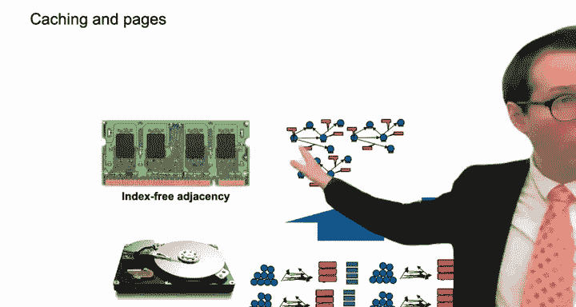

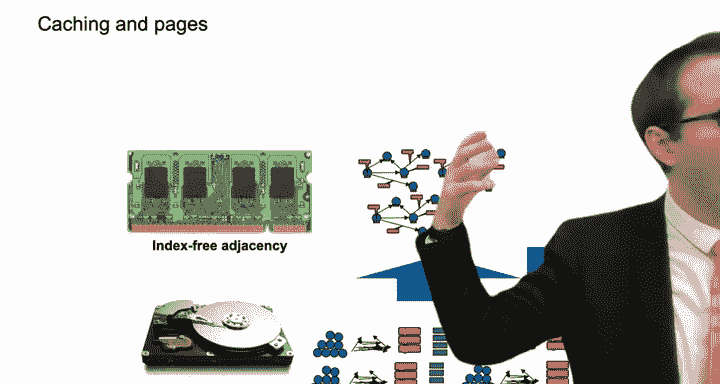

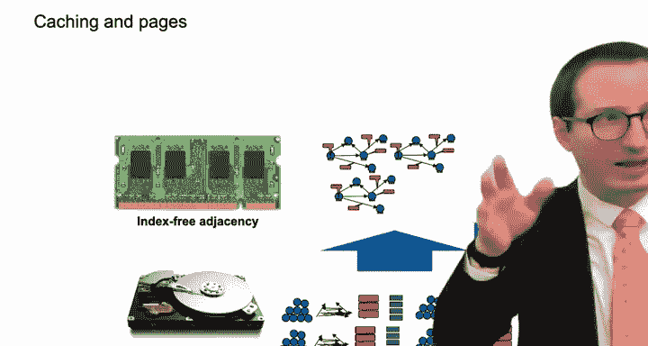

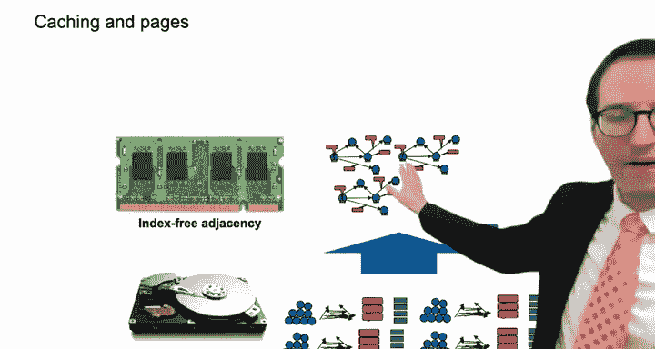

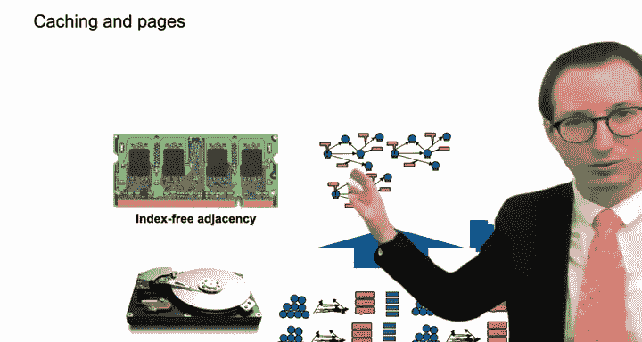

Okay， very good。

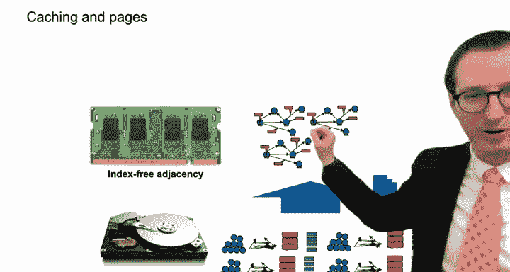

Alright， And then you have all kinds of tricks in order to efficiently move over between the all the places that you can go for a single node。

 You can consider all the edges。 If you have an edge。

 you can consider all the nodes on both sides of the edge and so on。 So there's nothing really。

 you know， if you know object oriented programming， then that gives you a good visual of that。

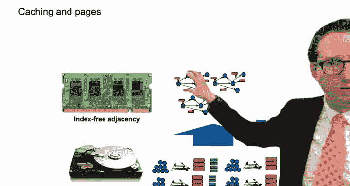

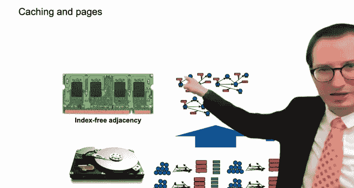

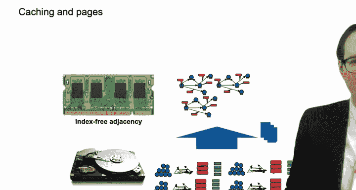

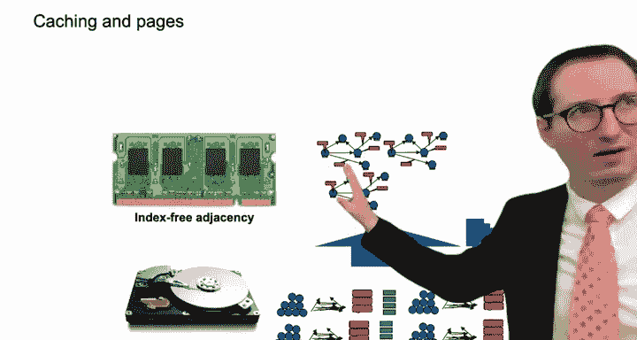

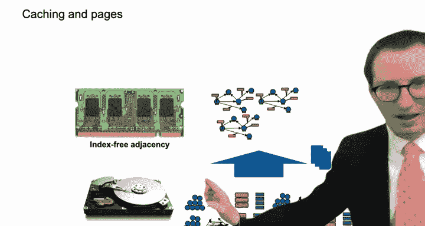

Now， when you store it on the disk for the long term durability of the data。

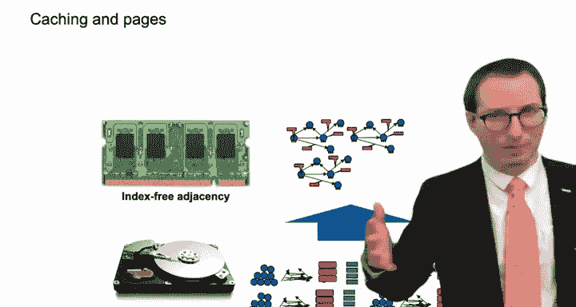

You store everything separately。You have the nodes。 You have the edges， You have the properties。

 You have the labels and so on。 And so do I have it here。 Yes， exactly。

 So you have what's called the node store。 It's a bunch of files that just all the nodes。

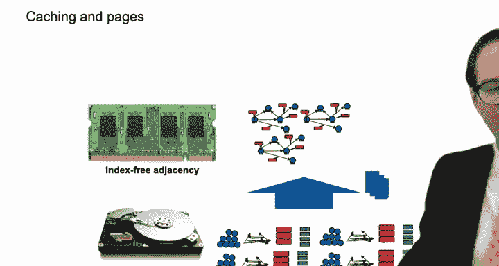

And then a bunch of files that store the edges， the relationships。

 and then a bunch of files that store the properties that the the nodes and edges have except the strings and the arrays。

 So the these things。 So these are the homogeneous lists of of the atomic items， atomic values。

 And these are the strings。 These are handled separately because they they can actually be very dynamic in size。

 But all the other atomic values， the properties atomic values they are in the same file。

 And then you have a label store， right， So this is really very nicely。

 It's so Swiss to do it like this。 it all who knows Uus vary like tidying apart。 no longer okay。

 So it basically means you tidy everything up withs the nodes with the nodes。

 the relationships with the relationships， the properties with the properties。

 the labels with the labels， right。😊。

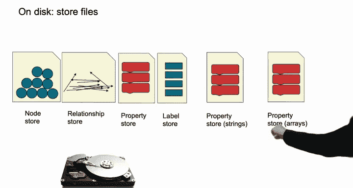

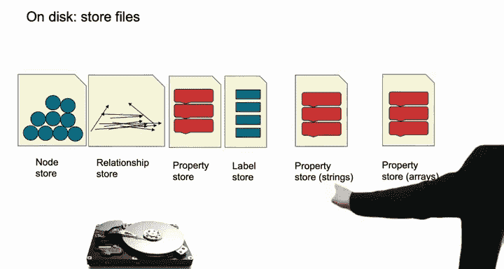

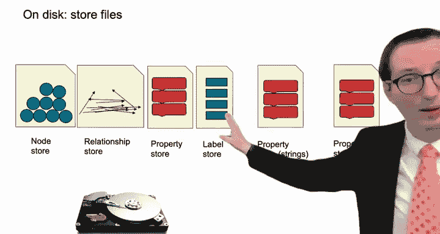

And when you， when you load it from this， then you reconstruct this graph in the memory。

 And then again， you persist it back to this when you put it there， okay。

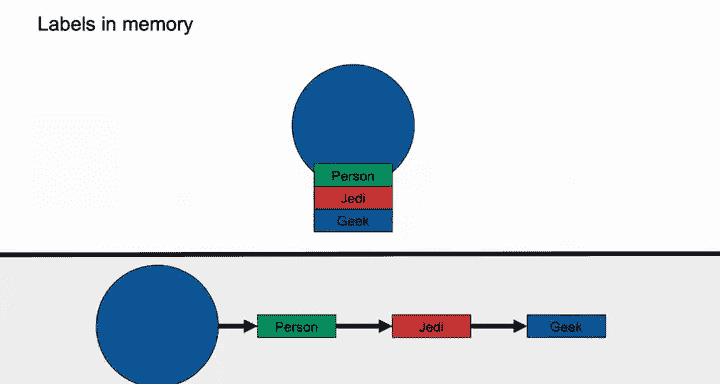

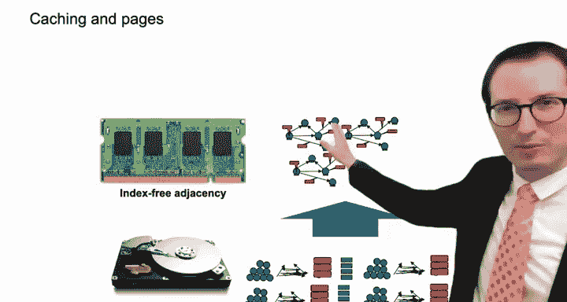

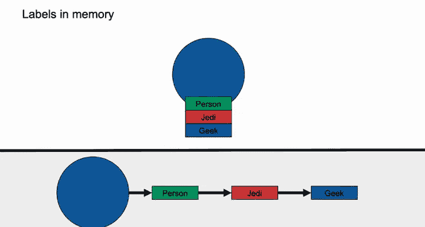

Now， to give you an example of what there is in memory， for example。

 when you have multiple labels associated with a node， it's just a linked list。

 right that you that you go through whenever you you query dynamic。 And then when you have edges。

 you basically have these doubly linked list in all of the edges that go out of a node and come to an the direction doesn't matter。

 And then you have these doubly linked list that allow you to iterate over all the possible ways you can exit and enter a node to whom does that make sense。

😊。

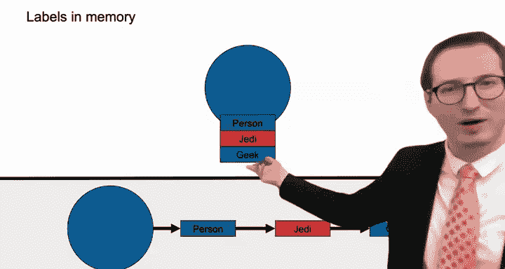

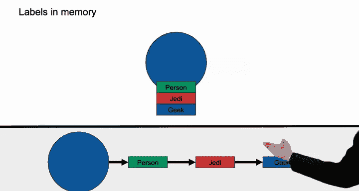

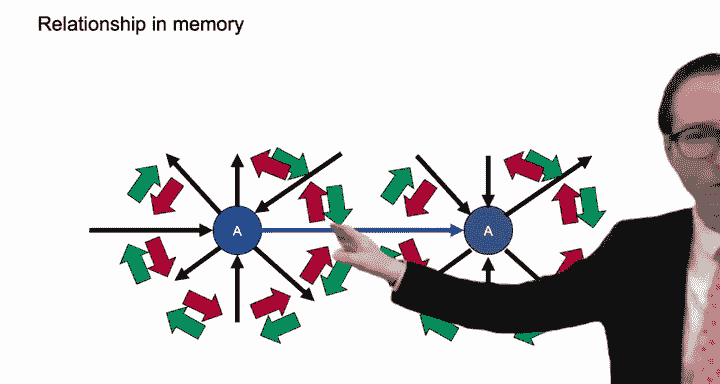

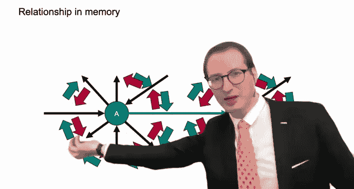

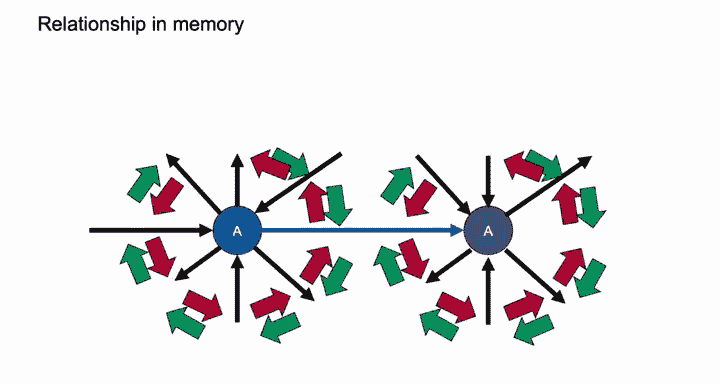

Right， very good。 And so this is used as a primitive for executing cipher on top of that。

 When you look for a pattern， you use all of these。

 these structures theory memory to find the pattern。😊。

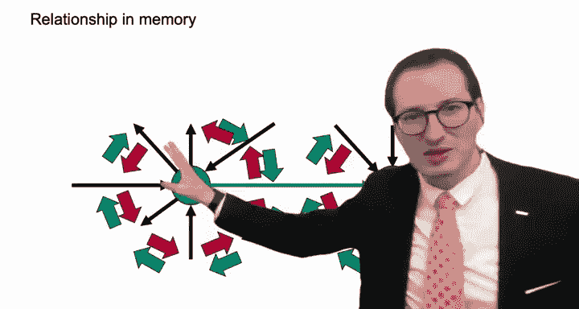

And what I shortly mentioned yesterday is that on top of that。

 you can also have index structures that accelerate finding， for example。

 the nodes that have a specific property that you can have with hashing Ds or tree inds。

 right to do not have to search for the entire graph and directly spot the nodes that have specific properties。

😊。

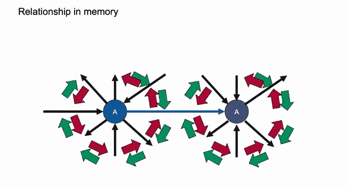

Okay。And that's what I'm going to say about the physical。

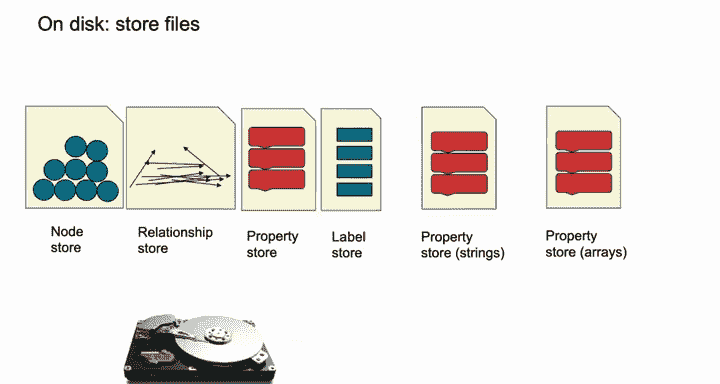

levelvel。And what I want to conclude with on Neo4j is with absolutely excellent news。

 And that is between last year and this year。 This is actually new。 It didn't exist last year。

 That is need not in that final final form。 I told you that for trees。 There are many， many。

 many languages and we still haven't consolidated for tables， It is consolidated。 That thats sQL。

 And for graphs， people at last rich an agreement。 So there are two standout。

 but they are both meaningful。 So first， there is the GQL stand out。 That is， in fact。

 cipher standard advertiseized。 If you want to put it that way， right。

 So it's basically an agreement between many industry players to harmonize their query languages。

 and a lot of what is in GQL actually comes from from cipher that I told you。 So essentially。

 you basically learned GQL。 you can actually go to that blog post right here。😊，It's。

 it's a very good。 that gives you a good feeling of how things actually work。

 because Neo4j basically announced that it's been standardized。

 And what they told their users is that they are going to smoothly evolve。

 cipher to basically align it with the standout。 So that at the end。😊。

They will essentially support the， the， the G Q stand， but they will do it smoothly because。

 of course， their users already have a code base in cipher。 So this is going to to be done over time。

 Alright， so this is G Q L。 That is essentially the standard I cipher。嗯。

Not to be confused with Graph Ql。 Graphql has nothing to do with graphs。 I have no。

 no idea why they call it that way。 Graphql is about trees。

 This is the 26th query language for trees， But this is really something different here。

 It's its G QL is really specifically for graphph database。Then we have SQL slash P GQ。嗯。😊。

This is basically an extension of SQL。 So it's just the SQL language that select from where and so on。

 the language you all know。Extend it with pattern matching。 Pat matching is the AskciR。 right。

 This is really the core of what makes a graph database。A graphraph database like the top use case。

 And so SQL PgQ is basically just that you extend SQL with graph pattern matching。

 So it is good for the people who are still in the environment of a relational database。

 But they also want to to deal with with with graphs。

 And so what I would expect to happen is that products like Postgresql or my SQL or the really typical relational database management systems that they start supporting graph types they add to the to the to their system。

 some some way to support graphs。 In fact， in a similar way that Postgresql objects in a array。

 right， now in in the latest versions， actually do have some SQL extensions that deal with with Jasonson Json types。

 right So these are the two these are the two big sound。

 And that is something that I am really delighted about。

 because this is this is exactly what we wish for that we have one sound out and then all the industry player。

😊，Players focus and， and aligned to the， to the standout。Okayep。Any questions so far about Neofaly？

Who is with me。Okay， alright， so then I move on to something different， which is the。Oh。

 before I do that， just to mention， there is also。

A spark implementation of graph database。 It's called the graph X。 And that's on top of stack。

 So just so you know， and if you want to take a look， you can。

 because you're already familiar with Sp。 You're already familiar with， with graph database。

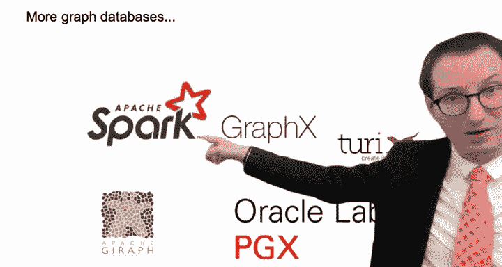

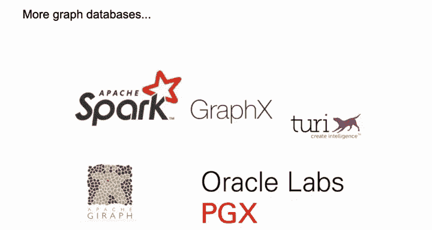

Alright， so that was about labeled property graphs。

Now I'm going to turn over to the second paradigm of graph databases， which is triple stores。

 and RDF is the known standout for that who has ever heard of RDF。Okay， so some of you。

 but not not everybody。 All right， so。

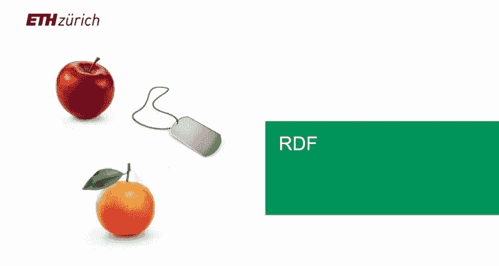

It's a W3 C standout， So it's a standout just like HML H TTP， XML， X query and so on。 So in the W3 C。

And the best way that I think I can introduce it is the question that one of you asked over on Zoom yesterday。

 Why do we have labels on nodes and why don't we use properties like the labeled property graph is basically。

Too complex。 And we can simplify it further without any loss of generality。 In fact。

 that's exactly what tripled stars do。The idea is that when you have in the labeled property graph a node with like。

 let's say，10 properties。嗯。In a triple store， you will shredd it further taking each property apart and make it 10 edges and 10 nodes。

 So instead of all the properties in a single node。

 you just decompose it further into an even more fine grained graph。

 So it means that in a triple store， you just have node and edges and labels on the edges and this is it。

 This is it。 And its really just more fine grains that than a labeled property graph。😊。

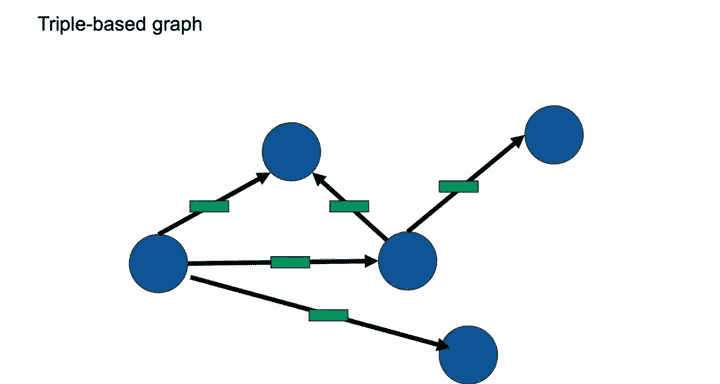

So now it means we just need these three ingredients， Note edges， N labels。

 and the labels are on the， on the edges。

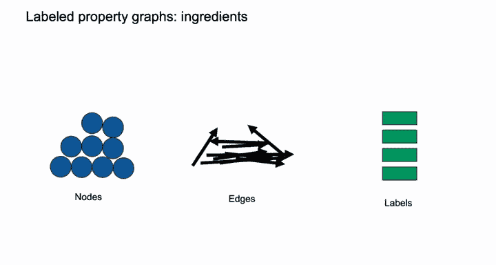

And so the reason that this paradigm is called a Tri store。Is that everything in there。

 just like in Jesica， everything is a sequence of items here。

 everything is a triple with a subject or property and an object。

 You can think of them of as basic English sentences with a subject of ver and an object like E Zri is located in Switzerland。

 This is a triple。 And this is basically to say that when you have a triple store。

 it is just an absolutely enormous list of， let's say， a billion triples like that。

 And when you take the billion tripleers together， they form a graph。

 because the subject and the object， of course， will also have further edges going to them and coming from them。

 right， So in fact， this is all organized in in a very big graph the one that looks like this， right。

 So you see here， I have five tripleers in this graph over here。😊。

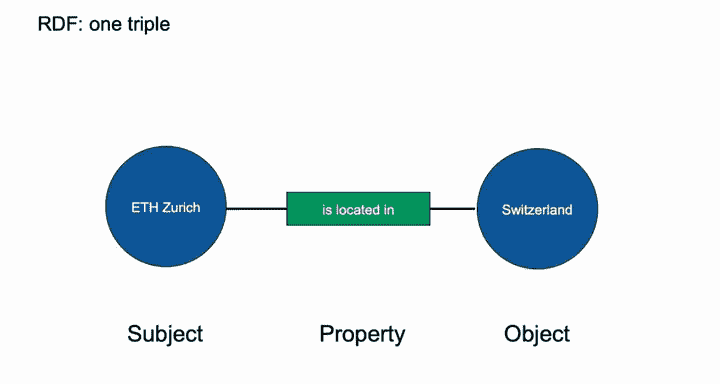

Okay， so this is why it's called the triple store。

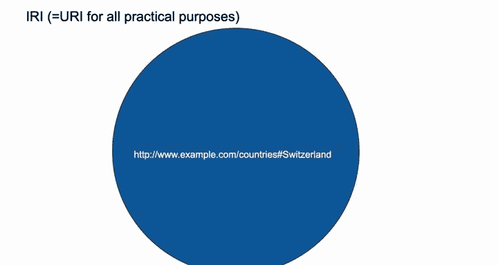

Now。What about the， the names of the of the nodes and and the labels。So let me tell you。

 there are three possibilities。 In fact， the first possibility。

一思。To use U eyes。 Remember， U eyes， this is what identifies a resource。

 We saw it previously for namespaces， also for rest APIs and so on。And so basically， it's W 3 C。

 and they are the ones， basically standardized the web。

 So when they needed to find a way to give a name to the nodes and to the edges in the。In RD F。

They basically thought， let's just eat our dog food and let's just use your eyes， right。嗯。

As a parentheesis， normally today， we are supposed to say I R I。 That's the official name。

 I never hear anybody say I R I ever。 So it seems that nobody actually started using that terminology。

 Most people still say you are I， right， So I tend to also say you are I because of that。

 But don't be surprised， but you can consider that it's the same thing。

 It's just just these these long string that start with a scheme very often H T TP。All right。

 so we identify all of the many of the nodes with the UI like this。😊。

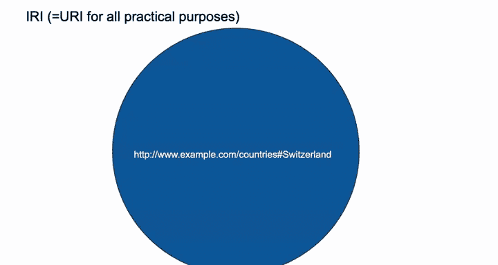

The same goes for the properties， so for the edges， we label them also with the URs for for example。

 this URI is the UI of is located in， right？

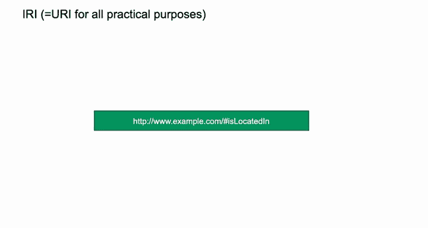

Then what I can have for the further node is also instead of a UI。

 a literal that could be a number that could be a string， that could be a date。 For example。

 you could say a Switzerland has a population of 8 million。

 And then the object node doesn't have a UI just has a number 8 million right So this is then called a literal。

And here you have， because， again， that Do3 C， they standard as X M L and so on。

 So all of these lits follow the X M Mche as stand out。 It's the same as in Jsonic。

 the same atomic type。 So that's also you already know， I don't need， I don't need to cover it again。

😊。

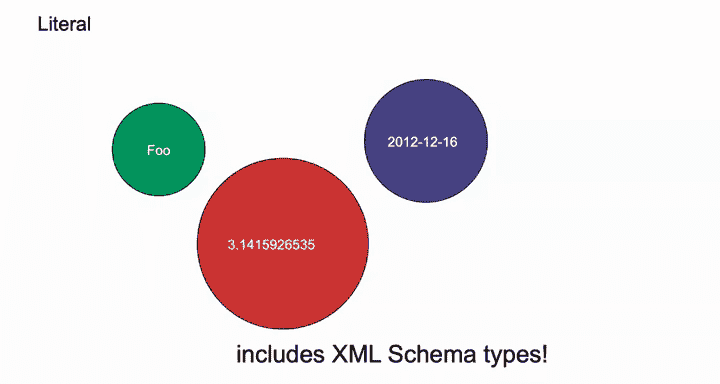

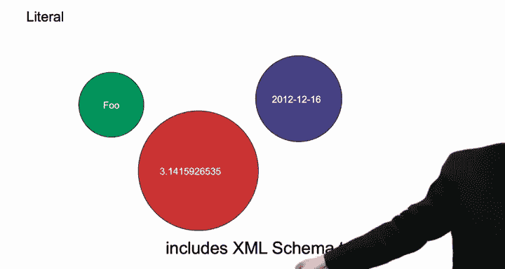

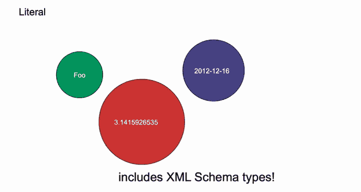

And the third way that you can that you can build a node is to just leave it blank。

 You basically have a node， but you don't give it any name or you don't give it any lital。

 For example， that would be the the the ground on which ETH is built right you don't need to give it any just ETH is built on ground of something It's just placeholder for the ground and that ground is a subset of Switzerland that we call a blank node。

 right。That can also be used as a placeholder for data you don't have yet， right。

 You just know it exists。 You just put a blank node in there。

 and then you can still give it a name later。

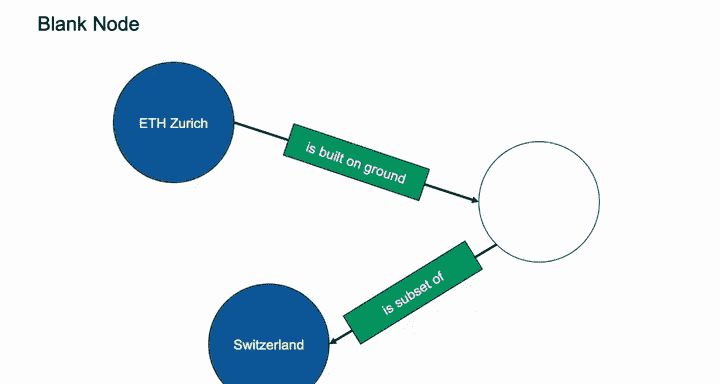

Okay， so your eyes to give them names， it's like naming people。 then you have the litals。

 all the atomic schema types， and then you have the blank notess。

And when you look at what goes where， basically， a subject can be a UI or a bank node。

 but you cannot have a subject that is aiteral。 So you cannot say8 million is the population of Switzerland。

 You really have to say Switzerland has a population of 8 million really has to go in the object。

 So the subject is either a UI or blank。

The property must be a U I， right， So the verb of the sentence must always be a U I。

And then the object can be anything。 right， So you， you， you can say E T H is bid on that ground。

 That is a blank node， or E T H has a number of students of 23000。 the need a little role。

 or E T H is in Switzerland。 And that's a U R I， right the U I of Switzerland。

But whom is that clear。Right， so this is the essence of， of RD F。Now， I directly gave you the model。

 the data model of RD F。 It also has a syntax， also not a surprise。

 We know we have that for every shape， right， we have syntax for trees， X， M and Jason。

 We have syntax for tables like C SV。 And so not surprisingly， we have syntax for these these troers。

 Well， in fact， we don't have just one。 We have many， many different syntaxes。

 but they all follow the same model。😊，I'm giving you first the most popular one that is called Tel。

 I think it's a pretty cool name。😊，And it shouldn't surprise you that in a totalactile file。

 it's just。A list of tripleers。 So on every line， you have a triple subject verb object。

 subject property object， subject property object。 and imagine a very。

 very large where you just list your tripleers。 and then you pass that and you reconstruct the graph in memory。

 right。No。A subtlety， because here you might you might be wondering why these prefixes and so on。

 we've seen them before in XmL。 These are called H names， right。

 We have a prefix and a local name and the prefix is attached to a namespace。

 right that we've already seen before。 However， there is something that would make the all the XmL people scream。

😊，In the way that the Tri store people use queue names， when they have a Q name。

 they do not see it as a pair with a namespace and a local name where the namespace is represented by a prefix。

Instead， what they do is they， they really concatenate together the name space with the。

 with the local name。So when they have this Ge is located。It really means for them。

 this geo is located。Right here is really H T TP dot dot do example dot com slash geography。

 Shap is located。 They really paste together that with that And get again a U I， right So for them。

 the Q names are also U I。 So don't be confused by that。 This is just how they do it。

 And so that is the reason why I said that this is， in fact， to the triple of people A U I。

 This is a U I that would be E T H Z dot C H slash sha self。😊。

Then here， this is blah， blah， blah geography sha population。 That's also a U I。

 And here it's a literal， right。Whos with me。Alright。

 and so you have a point just like at the end of every sentence。

 you just conclude your triple with a point。 Then you have shortcuts。

 because when you build your graph， you might have node that have a lot of properties。

 You don't need to repeat them。 You can repeat them， of course， that you don't have to。 So。

 for example， we can say that E T H is located in Switzerland and in Europe。

 And then I just put a co there that that says that it's located in these two places。

 So it means you have two tripleers。 But in that triple， you repeat the subject and the property。

 Then if you put a semicolon instead of， of a co。

Then you reuse just the subject。 So here it means E T H repeat it here has a population of 25000。

 For whom is that here。

All right。Very good。 So now very quickly， you don't need to worry too much about that。

 This is the JO syntax。 It's just a different taste， but it does the same thing you have here。

 you TPT factor all the all those that have the same subject into the same object in J L。

 That's the name of the syntax。 here you have the subject。 And here property object， property object。

 property object。 And then if you have triplepers with a different subject。

 you just do it with another object。😊。

Right， so that's the Json syntax。 And then the X， M S syntax。 It's always again， the same thing。

 You have the subject right here。 property， object， property， object， the U I， property literal。

 when it's a literal， you just put it in there， okay。

Do not focus too much about the details of the syntax。

 What I want you to see is just that there are three different syntaxes。

That basically represents the list of tripers。 Doctor Json L D， R D F over X M L。

 There's even more than that， but I don't want to scare you with even more in Texases。Alright。

 and here is just what I told you that for the triple stock people。

 when they see a queue name like that， what they actually do is they take geo。

 they take that and glue it really with the local name that came that come from here。

 They really glue it together。 This is the reason why very often they end their namespaces with a sharp sign with the intent that the local name is basically glues to the sharp sign。

 and that makes it a fragment of of some some Sha eye。😊，Okay。So， this is。The RDF model。

 these are the syntaxes to represent RDF troers。And then you， of course， have a query language。

 just like we have SQl， Jsonique， cipher， G Q well。Where in the world of triple stars。

 the language is called sparkkle。Do not confuse sparkkle with spark sQl。 That's not the same thing。

 Spkle is really specific to triple source， right。And Stall looks。Like this。

 you don't need to learn it or anything。 again， that's just for your information to give you an impression of what it looks like。

You basically can select patterns。 It's very similar to the pattern matching of cipher。

 But in terms of tripers， you basically see the trippers you need， I want something。

 whatever located in Switzerland。 And I want to select it。 So this year is going to locate to。

 to find everything located in Switzerland。 right in cipher， we would have done it with Sosky art。

And then you can have something more complex。 Like here， you have S must be located in C。

And C must be located in America。 And then you select S。

Again， in cipher， you would have had ASci arts， right， But you see， who see its equivalent。

To ask out， right， It's just a different， different way。And you can have them more clothes。

 You can have something more complex。 You also have other clothes or body the meat and so on， right。

So what do we learn here， Well， when people try to build a query language。

 they tend to use clauses just like SQL。 So this this shouldn't surprise you that it actually also is yet another language that uses same the same paradigm with all these clauses。

Okay。

Oh， by the way， because some people ask because we see so many languages。😊，At the exam。

Theres only four。 There's Postgql， right in SQL queries against Postgql。 There is spice back。Right。

 writing Spk Spk jobs with Python with the Spark API。There is backl。That's the F well。 So you。

 with data frames。Knowing that if you don't like Sp SQl。

 you can also use data frame transformations instead。 that's no problem。 So basically the same thing。

 So Sps SQl， and then Jsononic， just these four for these four。

 you will have it installed on the exam machines。 You will have exam questions asking you to。

 to answer questions。Alll the rest， big Mongo D B， cipher， and so on and so on。

 That's only going to be theoretical questions。 Or， you know， we might show you some codes。

 not going， of course， into advanced details and ask you questions。

 but you will not be asked to write anything in these languages， right。

 so you don't have to worry too much。Pos G Q L Sql， pi Spk， Sp Sq， Jsonic。

 And that suits what you expected to to good。Alright。

 so I hope that it removes a bit of your stress because in so many languages。

 some of you might might have wondered what's going to arrive at the exam。Okay。😊，嗯。Now， yes。哎也，没变。

你就睡去的。Couldn't we just use a subset of Cyd query since triplets are in some sense。

 a subset of labeled property graphs？That's reverberated a little bit like me。Me。😮，Yes。

 so you can think of it in this way。 You could also imagine that you would use cipher in order to query troers because cipher is as much at least as powerful。

 Abutely， you could imagine to do that。 Then you just need to ask yourself。

 is cipher not over dimension for for for tripers。 It's a good question to ask。

 Maybe some people manage to actually take GQL cipher or GQL and glue it in a way with triple cellss in a way that is more intuitive。

 than using just as subset。 But this is absolutely good thinking。

 You can absolutely imagine that you you could use cipher to query tripleers。 I think it makes sense。

😊，Just to be clear， cipher。 So now consider it GQL and Sparkle are two standouts。

 Spkle is a W3 C standout and GQL， I think is a niceO standout， I think。😊。

Think it had I had it on the screen。Sts back you think it's A。

呃。Yes， no I see。 no， I don't know。 It's I， I though is the the sequL1， yeah。Okay。But anyway。

 two stone bells。All right。In practice， I mean， now， you know， it's a Lego game， the。

 the whole architecture。 So technically， it's a common thing to do to try to adapt a language to a different environment and see if you manage to to map it。

 So that's intellectually。 it's a very interesting thing to do as well。😊，Any other questions so far。

ok。So now， let's go to the parts that can give a lot of headaches。 But again， I shortened it to。

 and you don't need to worry long too much。 It just to tell you what people are actually doing with。

 with RVF。嗯。😊，You know that if I tell you artificial intelligence today。

You're probably going to think machine learning， chat G T， L L Ms， right。But that is actually recent。

 If you go a few decades back， it wasn't so clear that artificial intelligence would actually it be in the direction of machine learning because back then。

 we didn't have the computing resources。And so， another approach。To artificial intelligence。

Where's basically based on systems like the triple source。 It's to use this as a knowledge base。

 because if you consider every triple is basically a piece of information。

 just like the sentences you would have in chat GT， right。

So an alternative to using machine learning for AI was to start information in a knowledge graph and categorize the data as what is called an ontology。

 and then use it to reason on the on the triple store。 And people are still working on that， because。

 in fact， the reasoning is still an unsolved problem in artificial intelligence， right。

 J GPT is very good at talking， but it's not good yet at reasoning。 And so this is still an approach。

 It might be not as popular as as L M。 but it is still something that attracts the attention of the attention of many people。

😊，嗯。So， now。Why do we need to actually。why do we need to to put some rules in the use of the RDF。

Well， R D F just allows you to do anything。 It just allows you to say a subject or property object with any U R eyes。

 with any literals， with any with any blank notes。 So basically。

Nobody would prevent me from putting in my triple star Schitz who hi hassh Shoki， right。

 I could do that。 But the thing is， it doesn't mean anything。

And so the idea of an extra layer on top of RDF is to organize the meaning of the triples that we put in there。

 And so what people did is that they designed the concept of class， the concept of property。

 like class can be countries， people， universities， groups， fields。

 like if you go in mathematics and so on and so on。 So we have classes， We have properties。

And then we use the tripers in order to express formal statements about that。 For example。

 we could say that E TH has the type school。 We basically hear categorized E TH in the class of schools。

 right So then you can even go into category theory and so on when you do that sort of things in mathematics。

 but basically once you have a knowledge base like this。

 like imagine an absolutely gigantic trippers don't imagine that people manage to do that at the scale of chat GPT。

 that they actually manage to have billions or trillions or quadllions of triples like that。😊。

That contain a formal representation of older the knowledge of humankind。

 And then you can use it in order to do entailments like reasoning on the data， right， for example。

 this is a synloggeism。 All men are mortal。 Socras is a man。 Their false Socraates is mortal。

 Then you can do reasoning。

So this is the kind of the other AI that that we have out there。

Okay， that was actually my last slide now just to tell you that this layer on top of RDF with the classes and properties and so on is called all now all2。

 and it uses RDF。 And I think a lot of people still use the X MM syntax that is still popular， but。😊。

It's just a matter of taste。 this syntax that that you want to use。Alright。

 so I'm done scaring you with with with all of this。 Again。

 the idea here is just to give you this high level of review to know that it's out there to show you that。

In addition to trees and tables， there are also graphs and graphs follow the same idea of data independence with syntaxes。

 query languages and so on。 standardization is very important and yeah， that's pretty much it。

 Now the only thing that is left in the lecture is basically cubes yet another data shape。

 I'm going to present it to you next week on on Tuesday。 On Wednesday。

 there will be a guest lecture by Oracle labs。 I sent an announcement。 Did you get it in Mole。 Yeah。

 so we will have people from Oracle labs telling you about vector databases that is just yet another shapes。

 So graph cubes and vectors。 and and I told them to try to focus a little bit on put it in the context of all these data shapes and and data independence。

 So I'm looking forward to their talk。 It's the first time that that they give it it's relatively new。

 And I hope you。😊，Jo。Now， I would like to use a timed for it。 the remaining ten0 minutes。

 You should have received the Cos evaluation E mail， did you。

So E TH encourages to give you the time during the lecture to actually feel it。

 So now you can just open that email if you haven't already done so and feel the the cost evaluation and then。

😊，At。10， you will be good， good to go。So it's very important to us the cost evaluation because。

We really try to improve the course every year。 You see that you'll probably notice the slides are not even the same as as before because I keep changing them。

 And so I really try to have an open year for all the suggestions of how we can we can keep improving the course basically for the people in a year from now。

 So examples of what came out of that is the textbook right I did the textbook because some students a few years ago ago ask for it consistently in the in the in the cost evaluation and this is how the textbook was born。

不。

By the way， if you're done， you're free to， you're free to leave。

 I'm going to abstain from giving information about the exam today and with next week。

Alright， so I see a lot of you are going。 So thank you everybody。

 goodbye and see you next week You on Tuesday。 Thank you very much。😊。

