# 苏黎世联邦理工《大数据｜Big Data - ETH Zurich - Fall 2024》中英字幕（deepseek - P46：-46-14. Data cubes (1_2) -.zh_en - GPT中英字幕课程资源 - BV1sHPKeoEJU

Welcome， everybody in the lecture hall。 welcomel everybody on Zoom。 welcomel everybody。

 watching us from the future。 So today is the last lecture that I am giving with new material we will look at yet another data shape cubes and tomorrow。

 I sent an announcement that there will be a guest lecture on Ve database this is the fifth data shape that is used for text。

 and next week， no new material we just celebrate the end of the semester together。

 I'll wrap up on the material and well play a big quiz game you against the the T A team。

 So macro there Tovi is there。 So they are training very hard to to to win against you。

 So it's in the who knows icekago wounded the game， the TV show against0。😊。

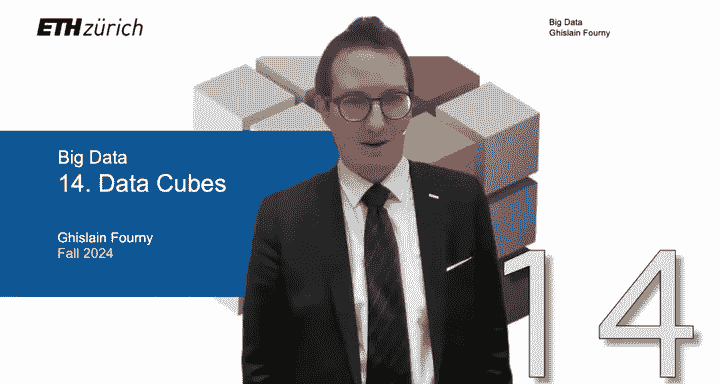

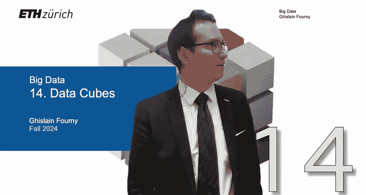

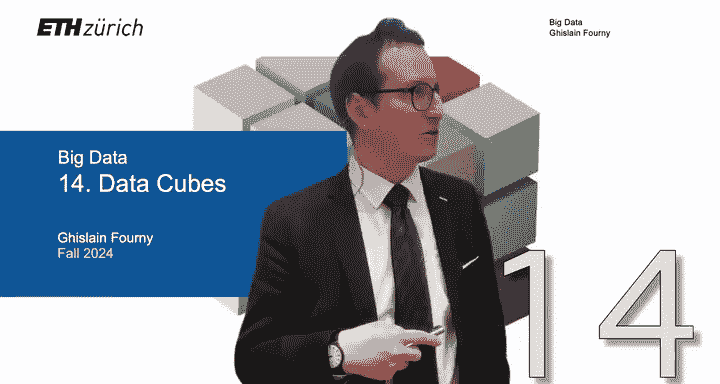

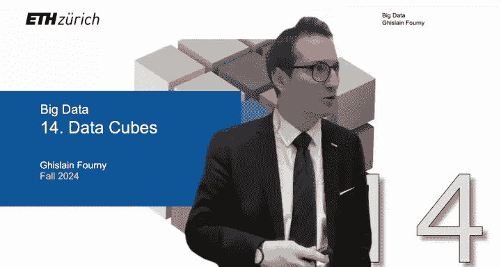

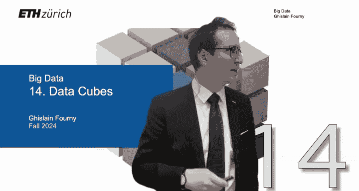

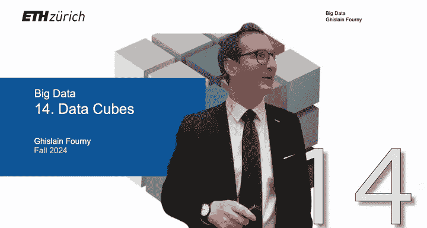

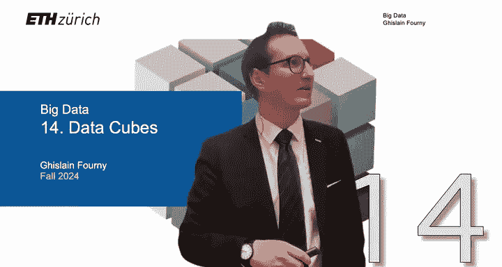

From hurt。 So basically， everybody will stand up。 and then you have to answer as many questions correctly as possible。

 And the last survivor is the the winner。 and then we'll compete against the T A team。

 And you will see how if the T A team holds longer than the longest of you。All right。

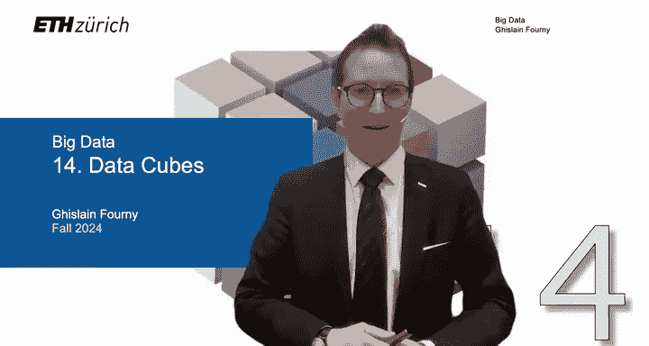

So this is how next week。 So if you hear us on Zoom， please come in presence， if you can。

 because it's so much nicer to be in presence。 And if you win。

 then you get the price also here physically。 So， okay， so let's go into data cubes now。😊。

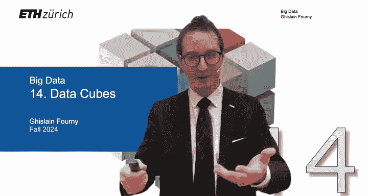

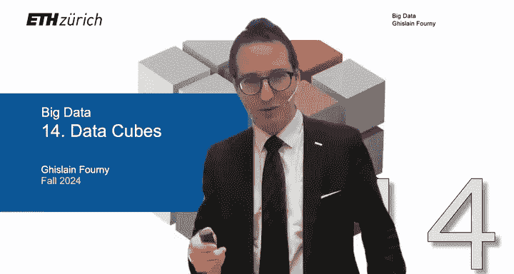

So a bit of history first in big data， we spent most of the lecture。

 actually in the 200s in the 2010s， even though relational databases actually started in the 70s。

1970s， relational tables。 and actually， something happened in between in the 1990s。In the 1990s。

 there were。 so there was more and more computing power。

 And what people realized is that we can use the data that is stored in all these relational datas in order to do some business intelligence。

 Business intelligence means we prepare data and fancy reports with pie shafts and all kinds of plots for the ce executives of the company。

 And then they can make informed decisions， Str decisions about the company。

 So this is what we call business intelligence。 And that actually LED to not only plenty of new products of the market with some competition。

 it also actually LED to a new data shape， data cubes。 and see this is what we will cover。😊。

In this lecture。Before I move on to the logical model for data cubes。

 I want to cover the differences between the two paradigm cubes and the tables and also all up versus O L TP。

 And then we'll go into the logical model and how to manipulate cubes。

 just like we manipulate tables， right， So again， historically fancy yourself in the 1990s。

 Who was actually not born yet in the 1990s。Think many of you， right， who was born in the 1990s。Okay。

 not many。 Alright， so this is basically preh。 So before you were born。

 all of that actually happened。 So what happened is。😊。

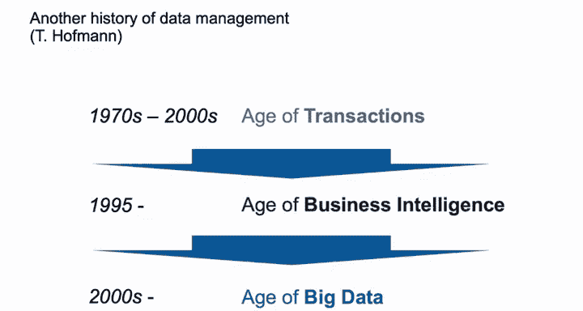

We have a difference of paradigm between these Google relational databases。

That are meant to run the day to day business of a company， right， You have your inventories。

 you have your orders， you have your customers。And the database， as you know， Post GsqL and and like。

 they can be updated in real time。 You can have insert， delete。

 update and so on at the same time as people read them。 It's highly concurrent。

 You can have thousands of people connected to the same database at the same time。

 you can even have a whole website with customers executing product search， for example。

 and and placing orders。😊，This， in fact， I might not have mentioned it， but it's called O L TP。

 who ever heard of O L TP。Some of you， what does it mean。Yes。😊。

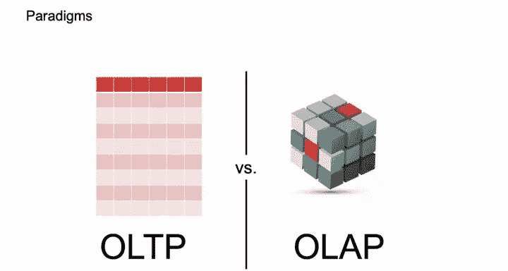

Online transaction processing， exactly。 So this is O N T P。

 That's the day to day business of the company， The Google， the Google。

 the Google relational databases。 Then we have another paradigm called O app。

 Who knows what it means， yes。😊。

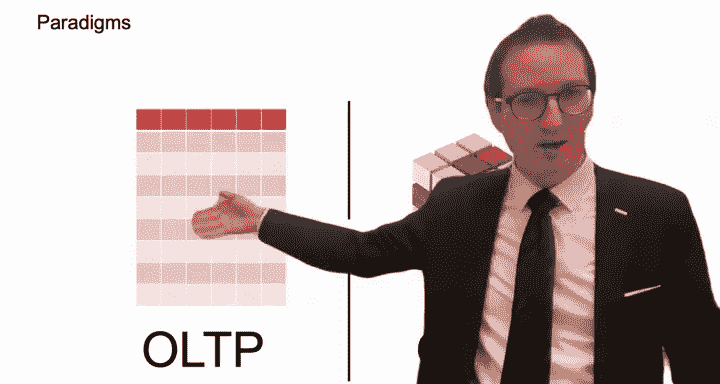

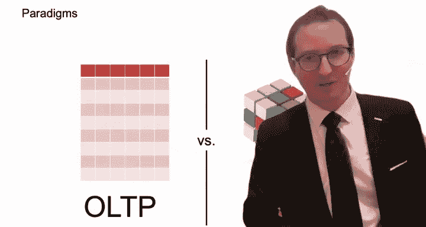

Online analytical processing， exactly。 now， very， very commonly。

 people make this association that O L TP is stable and O app is cubes。

 You might have even helped all app cubes in conjunction。But， in fact。

 this is only historically that they are actually that they have to do to with each other。

 L TP tables or lab cubes。But， in fact， there's more to it。

 And you can have O TP with other shapes than tables。

 and you can have O app with other shapes than data cubes。😊。

So since of L TP is about the day to day business。 We just want to keep records of the inventories。

 the products， the customers and so on。 So we want to be consistent and reliable， right。

 not use any data and so on。 While in O lab we want to analyze the data。

 that's the a analytical and and the super decisions based on data。

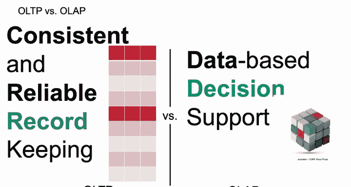

So if there is one most important difference between O L TP and Oup that you should remember。

 it is that O L TP supports a lot of rights， A lot of people modifying the data that's all the visitors on your website placing their orders and diminishishing the inventory。

 hopefully。While in all app， it's lots of read。 We just read data， but we don't modify it。

But now you must be feeling bad， hey， that's what we've been doing almost the entire semester。

 We've been doing all up the entire semester。This is exactly what we've done with pouring data on AGF S。

 and then using map Red， back and so on。 Ma Red was Oap。 PA was Oap。

 Or of every time we just read data without modifying it， you cant。

 you could consider that it fits into Oap。 You just analyze the data。😊，All right， so。

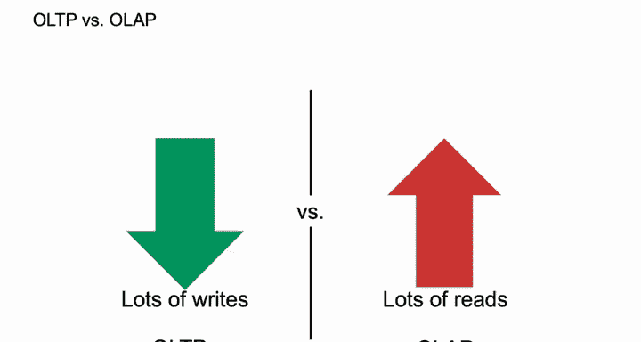

OL TP， because it's a lot of right detail focuses on individual records。 So very。

 if you look at the patterns of access to the data。

 that's something you need to consider when you actually want to pick a system and optimize the system。

呃。In this kind of database， people make queries， but just on a few records。 For example。

 when people look for a products on your website， only 10 will be displayed。 T the first 10， right。

 So it's just 10 records。When a customer places an order。

 you just look specifically at the customer record。

 So this is highly focused on details and individual records that you read or that you modify。In OAP。

 on the other hand， we want to look at consolidated data。

 so we want to scan through the whole data set and aggregate it。Again。

 that should ring a little bit of a bell because this is kind of mapre and spark。

 They kind of do this， right， You， you scan the entire data。 You shuffle it around， and then you。

 you basically extract some derived data set from there， Right， So。

 and the goal of O app is to then extract something that you can use to do your。

 your fancy reports that look a little bit like like this。😊，This was preach a GT by the way。

 This was not done by a generative AI， but by an actual human with creativity both。 alright。

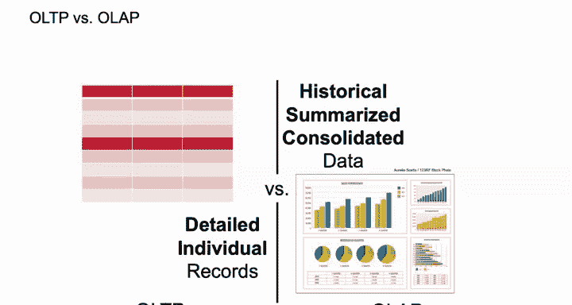

So L T P， I repeat is a lot of small portions of data， specific places we look at While in in O lab。

 we love to join the data to massively aggregate it on very large quantities。

 and we have very heavy queries， not just point queries that just look up our records。😊。

That has consequences。 It means that in O L TP， if you want to keep associating features of the two。

 in L TP， things are usually instance。 And with instance， I mean， a few meiseconds， right。

 within a few millisecond， you can look up queries。 Even if you have a billion records。

 a few millise secondscond are enough to locate one of the records。 If you have inds， Of course。

 we studied in D in Mongo D B， by the way， and Mongo D B is O L TP， if you use it Mongo。

 if you use Mongo D B or storing and writing information。Alright， OAP， on the other hand。

 is slow interactive in the sense that you don't get an answer within milliseconds。

 It might take a few minutes， a few hours or even a few days。

 you might remember when I said with mapre can be a few hours until you。

 you can come back because it needs a lot of time to actually aggregate that data。

 So it starts with a few minutes， some people can even run O app queries in Excel on or spreadsheet software。

 They you got some connectors to this kind of databases， but you need to wait。

 you press a button than it takes a bit of time until the the data is is displayed， right。

 So much slower than Well T P。😊。

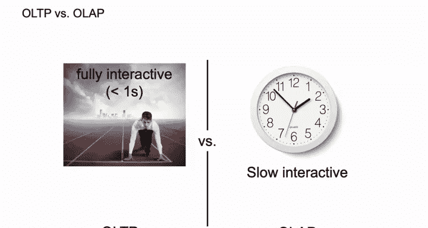

Now， I'm also connecting this to normal forms。 data normalmalization， data de normalmalization。

Because since you know LTP， we want to write a lot of data and we keep updating it。

 The normal forms are important。 You remember that normal forms are because we want to avoid update anomadities in session anomaities and editiontion anomaities。

 right， So if we want to modify the data a lot， we need to keep the high normal forms。

 They are normal form， Boycott normal form and nicely spread the data of our multiple tables where each table does its thing right。

 table for products， table for customers and so on。 Because we want consistency。😊。

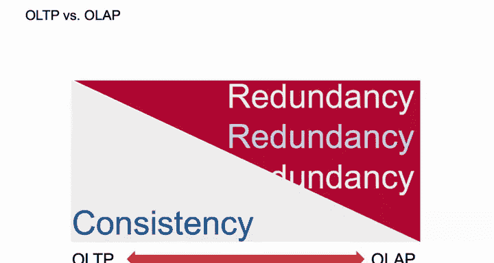

But in order。When we read a lot of data， we don't care to keep it consistent。

 We don't even modify the data。 If it's consistent at the beginning and you don't modify it。

 then it's， it remains consistent。 So it means that we don't care about consistency here。

 we can deormalize the data。 Remember that deormalizing the data means you precomp the joints in a way。

 deormalizing the data means joining the tables into bigger tables。

 And these tables then are no longer in a high normal form。

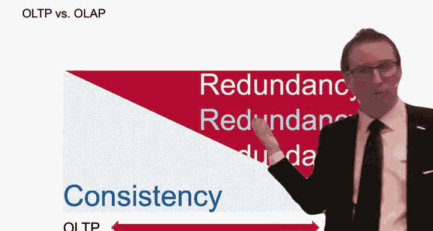

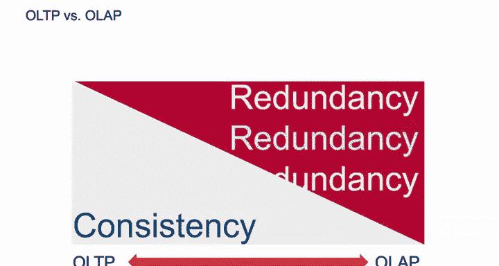

That means， of course， when you do this， that you get redundancy。

 because when you start joining tables and and deormalizing tables。

 a lot of values are going to repeat all of other place， right。

 You're going to have functional dependencies， but we don't care。 And in fact， this is， again。

 something that I've repeated these sets that we don't care in spark or map reduce。

 We just have a data set。 It can even be so deormalized that it's even nested， right。

 not even in the first normal form。😊。

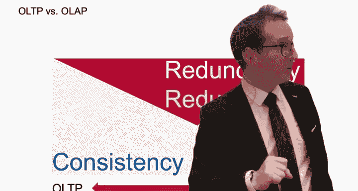

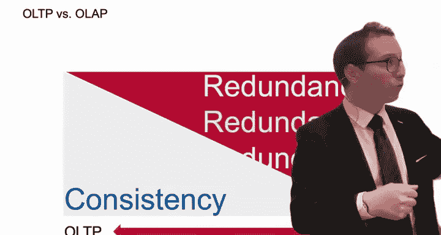

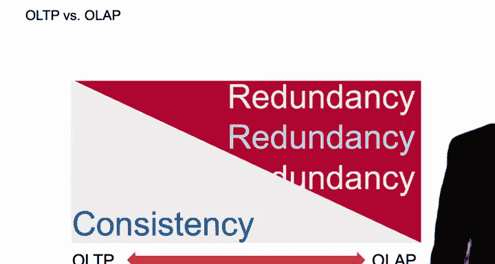

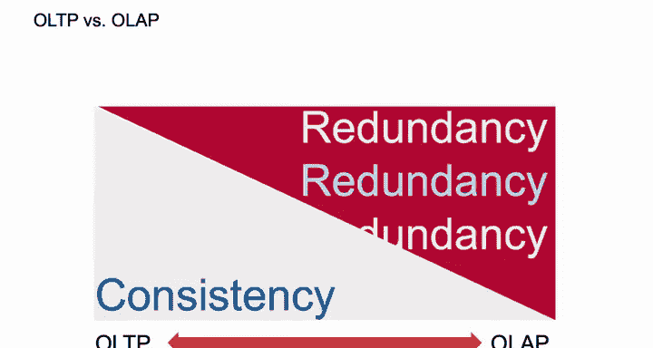

So this is， again， the idea that if you write a lot， you need to keep the data in a high normal form。

 But if you don't modify the data， then you deormalize it。 And， and。

 and that gives you more flexibility because the joins are pre computeutd， right， on the high level。

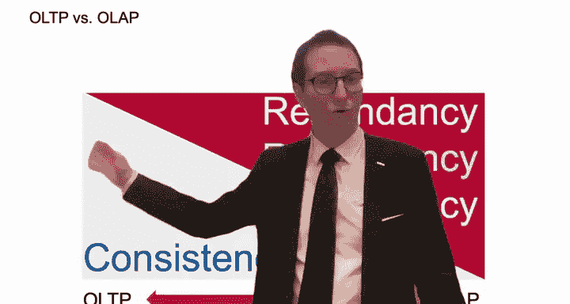

Okay， who's with me。Alright。Now， you can try as an exercise to， to。

 to just go over what we've done during the semester and try to classify it as O L TP O， right。

 Postg U L， that was O L TP， my produce spark that was O Mongo D B， I said it was mostly O L TP。

 if you modify the data access the data use indiceice。 But if you remember the framework。

 the aggregation framework of Mongo D B， you could argue that it's also Oap， right。

 if you use that aggregation framework that resemble a little bit of spark， right。😊。

So you can basically use this spectrum between O L TP and and O app。So， again。

 I explained it independently of shapes。 But just remember that historically， when we say O L TP。

 it's basically started with tables and O lab started with cubes。 So many。

 many people will make this association with tables for O O L TP and Oap for data cubes。😊。

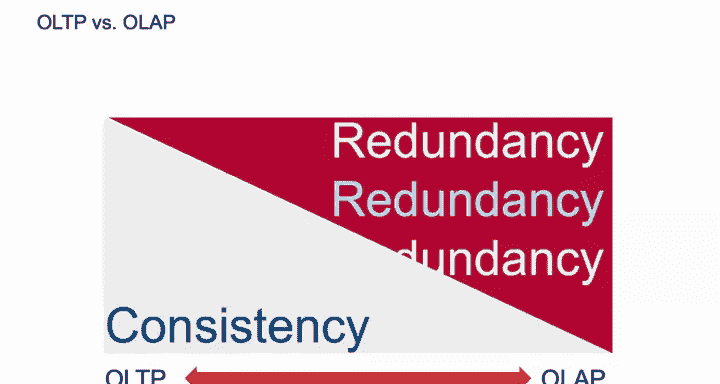

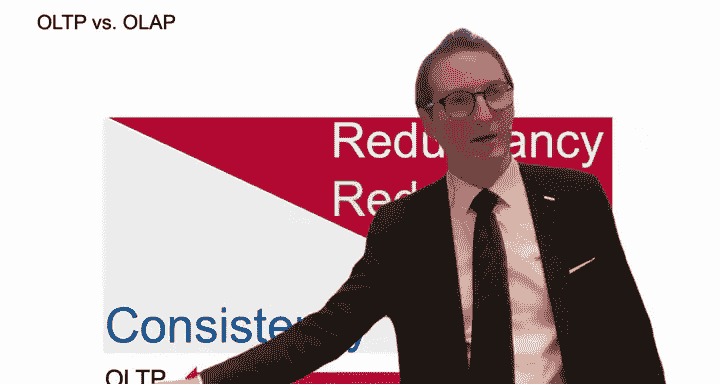

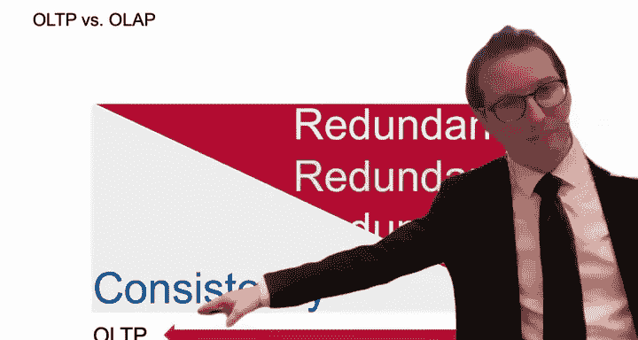

Okay， and this is just a summary。 You can look at it offline。

 but some more of the differences between the two is basically just consequences of the fact that one is for quickly updating the data and maintaining records。

 The other one is for analysing， right， So you can， you can look at。

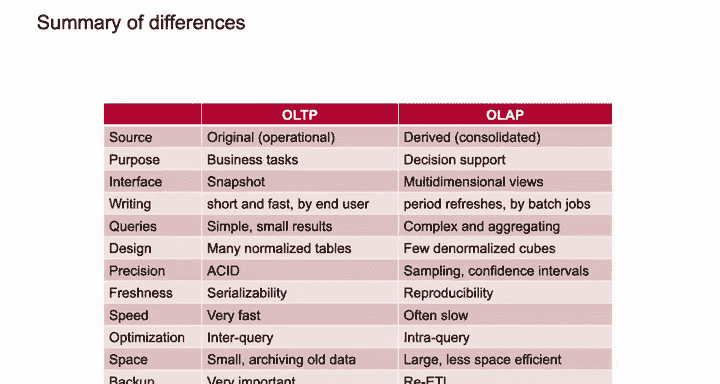

At least。All right。So now that I've told you the difference between O L TP and OAP well start digging into OAP a little bit more。

 Commonly， OAP is explained with four objectives。

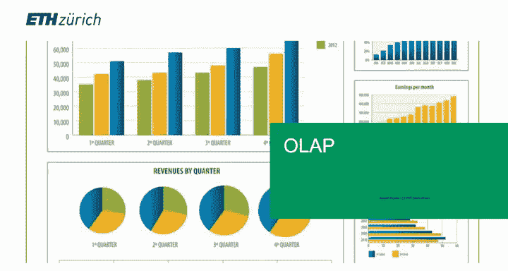

So I'm going to go through all four and explain why they actually matter。

The first subjective is that it's subject oriented。

 What we want to say here is that when OAP appeared in the 90s。

 it was actually made for very specific use cases that company had。

 So it's highly focused on specific use cases。 when use case。

 the typical use case is the sales data and the quantities that you're setting the the performance of the salespeople。

 the the inventories， the expenses， the the revenues and so on。

 nicely organized by region of the world by country by year by quarter and so on。

 So this is highly subject oriented。 So specifically sales data。 But with time， I mean。

 you have other things you can have customer data， you can have product data。

 you can have web analytics when you want to analyze the logs of your website that has been accumulated over time。

 And then the absolute oldest use case ever because。😊。

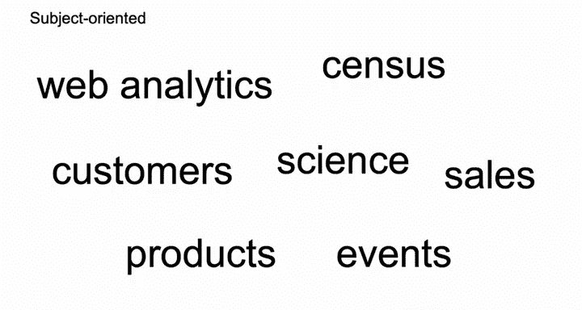

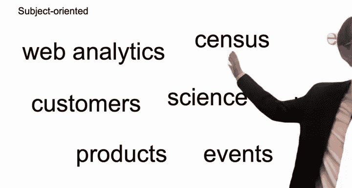

Actually started at the end of the 19th century。 That's the census data。

 You know that this is how computers all started。 Well started a bit before if you。

 if you look at the Pascalline， but which was a Me machine invented by Pascal。

 But at the end of the 19th century， there was the need to organize the， the the， the。

 the census in the US that takes care every 10 years。 And in fact。

 IBM is a very old company that actually was born in this context of， of of。

 of managing and storing the census， the census data。

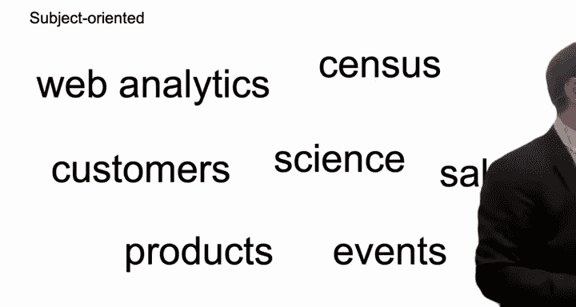

Alright， so that's the first objective。 very specific subjects that that are the typical use cases。

 That's actually great for the companies and the stuffs that were funded back then。

 because for a staff， having a very specific use case that the customers are interested in。

 This makes it this makes it a good good use for the， for the market and to find customers。😊。

The second objectiveive is time variance。 If we deal with the daytoday business。

 we are typically interested in the current data。 The current inventories。

 the current customers and so on。 But if you want to generate fancy reports and make decisions。

 you need to look at the past。 And so for this reason， in all up， time is very important。

 And typically you will look at the past few years， typically all the way to 10 years into the past。

 more than 10 years is quite rare， there are several reasons for that。

 one of the reason is that the data has changed so much even the schema that it's not even realistic anymore to try to still make it work with old data。

 So that might be one of the reasons Another reasons is that you might not be as interested。

 of course， in in that older data， because you want to look at the performance over over a few years。

 Just imagine this one of the use cases also of the data cubes in accounting when you look at the financial report。

 you typically have the balance sheet， the income statement， the cash flow。😊，Statement， typically。

 you look at the current period and the previous period。 So the previous quarter， the previous year。

 and they are displayed besides each other。 right， So time is very， very important in in。

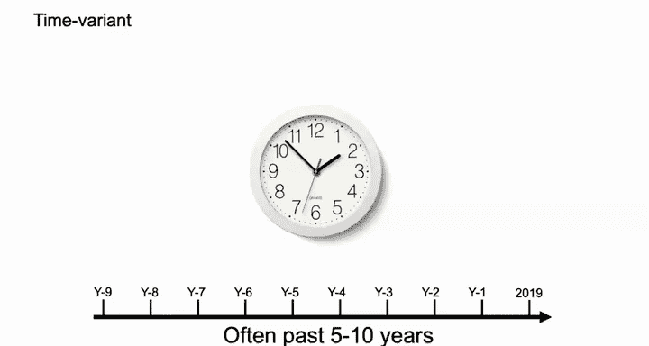

Or up。A third adjective is nonvolatile， but this is just a repetition of what I said。

 It's the idea D that you just load the data and then you freeze it。 You don't touch it anymore。

 You just read it， but you don't modify it。 So this is nonvolatile， right， It just stays as it is。

 And all you do is analyze it。 So you load you access the data and and thats it。 You don't update it。

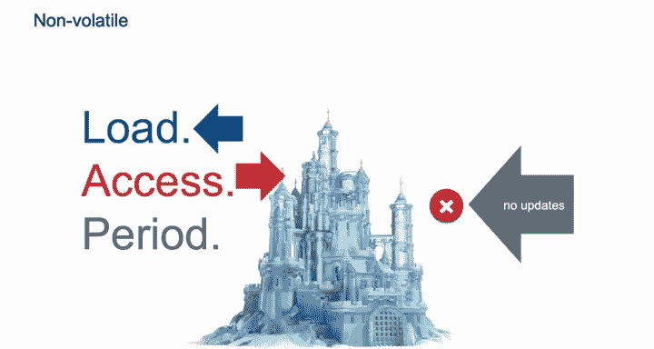

And the fourth objective is integrated because that data that you want to analyze。

 that's all the data that sits in your database systems， in your company。Now。

 if you look at the typical company of， let's say already a certain size。

 they will have plenty of different database， database products and so on。 In fact。

 that's one of the things that makes it quite complicated to manage the data in many companies。

 We also call it data silos because the it's hard to connect the different data sources together。 So。

 for example， you might have ERRP， which is enterprise resource planning CRM。

 which is customer relationship management。 OL TP。 So here I mean here。

 your Google old the Postgql database。 maybe even files lying around。 So this is all the data。That。

 that you have， right in in the company。 So now you might， you might think， okay。

Let's just directly look at the data inqueries。 right， after all， in big data。

 we've seen that you can just if you don't have schemas anymore with some of the languages。

 you can just directly get the data and analyze it。 But if you try to analyze the data。Where it is。

 Just where it is。 and read it in real time。 And you start running very heavy query that takes multiple days。

 Then soon enough， you're going to have angry people knocking at your doors， right。

 because you're slowing down all the systems That just doesn't work。

 You cannot put all that workload on the day to day systems of the company。So instead。

 what you need to do。Is to put it somewhere else。 That's typically called the data warehouse。

 where you put the data that you want to analyze and you need to load that data。

 So you need to take that data and extract， transform and load it。 Come back to these three terms。

Typically， you do it in the night， or at least when nobody's using the systems or in the weekends and you can do it periodically。

 right， every week， every month， you。Pll the data from the systems。

 But what's important is that you don't do it directly here。

 You really do it in your data warehouse separately from the rest， and you're not disturbing anybody。

 right， So I put the wheat again in the flower， this is really because derived， right。

 There is some effort to put it in that in these data cubes。 then you can analyze。

 You can be fancy reports， you can mind the data if you want to use machine learning or or AI and from this place。

 So data warehouse again is is the name。 Let me talk about E， T L Now E T L means extract。

 transform load， I already mention this when I told you that there are two kinds of systems。

 theres the systems like data lake where you just part the data into a I system， and that's it right。

 nochema， And then there is E T L， which other products like Mongo D B Postg Q where you have to manually import the data into the into the data system before you can use it right So that's called E T L。

 And then is going to be stored in a binary。😊。

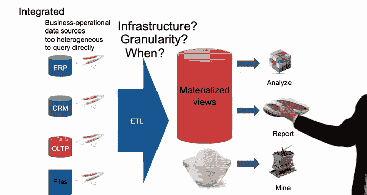

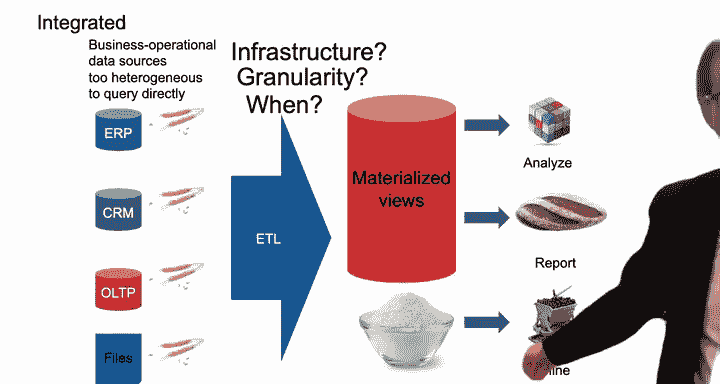

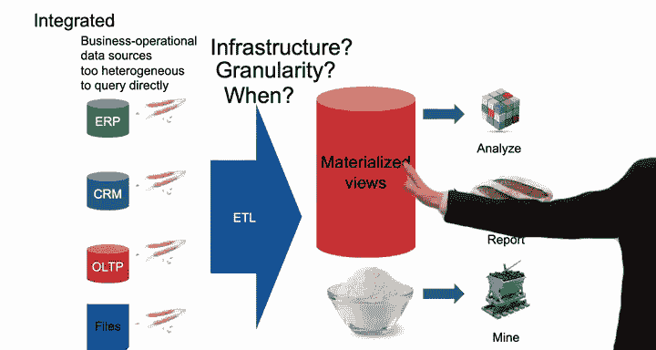

And proprietary formats that is specific to the， to the product， potentially within this is。

 So it means extract。 So you， you， you get the data from where it is。 There's plenty of tools。

 for example， if you want to extract logs in Hadoop， there tools for that。

 you need to basically build gateways between the systems。

 So so a gateway that basically regularly pours the data from your day to day business system into the warehouse。

Then you need to transform the data because you need to turn it into cubes that that you that you want to query That is not easy。

 it requires some effort。 You might filter out the data because you didnt not need all of it。

 You might merge the data join the data， because again， you want to denormalize。

 you might also want to clean up some things like just an example is the the the same things translated in multiple languages。

 for example， the in for the people。 the title like Mr。 Herur and so on。 And this is actually。

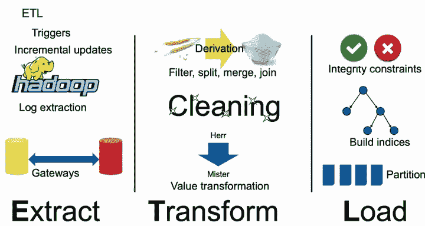

Extremely difficult because this is there are so many things that you need to do here。

 not fully automattable。 So this is typically where you have consulting companies involved that that help you do this。

 especially when you do migrations from a database to to a database who has ever involved into a data migration in any company moving data。

 Some of you， right， So it's very， very difficult。 And yeah， So that's that path right here。

 And then you have a load， which is when you actually have converted it。

 And now you put it into the new system into the data warehouse。

 The data warehouse is going to check that it's the integrity constraints are respected。

 It's going to build indices just similar to the ones we have four tables that we can also have them for cubes And then potentially partition the data。

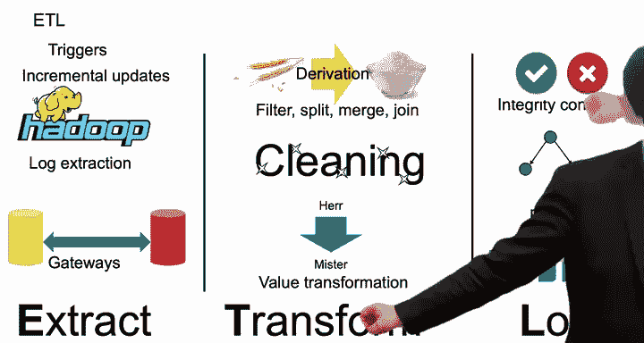

Note that E， T， L is not specific to O up。 You can also E T L into post recur into any system。

 But in the case of Ola， E， T， L is used from the day to day systems。

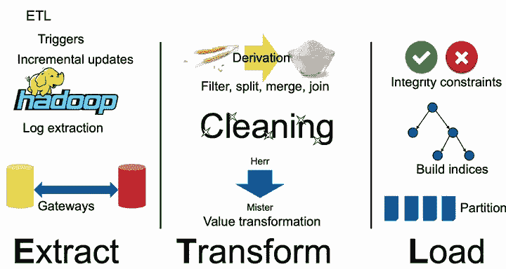

Into the data warehouse。 right， so remember E， T L， and people use it as a verb。

 like you E T L the data into the the system。

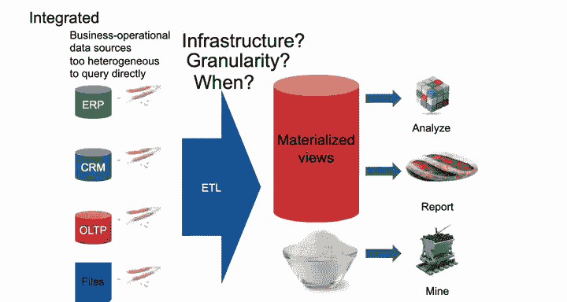

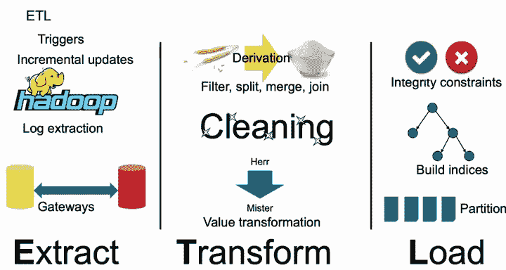

Now， if we look at the market。

A lot of things have happened system in the 1990s， new companies were created like S based Cos and so on。

 And then there was a market consolidation。 So the big players of relational database systems。

 But the small companies So record bought S based， IBM but cos and so on。 Sequl， Microsoft， they。

 I think they have they own analysis services that they that they built and S S A P has Ha。

 So these are the the four big systems today for data warehouses。😊。

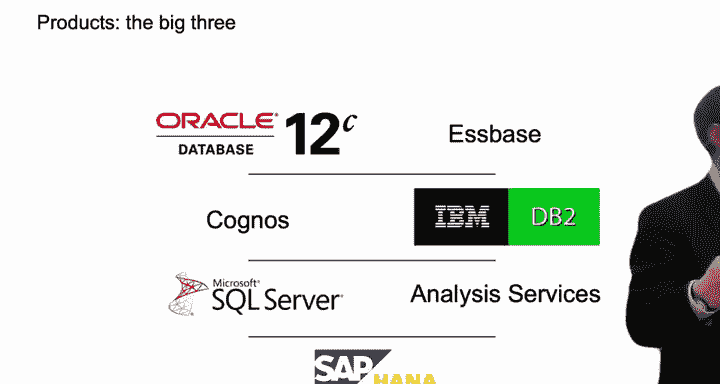

Why is it that a relational database systems company would be interested in buying data cube companies that we' see today because there is a link between tables and cubes。

 as we will see。 And there is a very good reason why it's a very good fit to to use relational databases to start data cubes。

 But I'll come back to that， as to do with the the mapping between data shapes。😊。

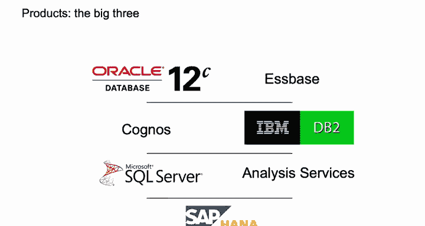

So that was the introduction， Just the very high level。 O versus O L TP and the specifics of O。

 the I D that it's a separate system， highly structured with data cubes that you use to generate your reports。

 separate from the day to day business。 Any questions so far。😊，No， zoom， neither。Okay。

So now we'll go to my favorite part， which is the data model， the logical data model。😊。

And then later， we'll see we look at the physical implementation。 But don't， don't worry。

 it's going to be mostly on top of relational tables， so。

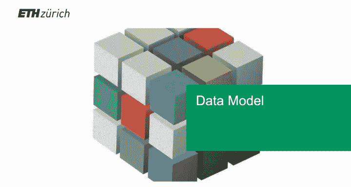

Just so you have an impression。So remember whether。Thethematically elegant and simple framework。

For tables， we can do it by saying that the table is a set of maps， right。

 Then you can say the maps have the same support parts that you， you might have domain integrity。

 relational integrity and so on。So tables can be set on maps。 They have rows。 They have columns。

 Well， let's do the same for cubes。Cube look like this。 This is a three dimensional cube。

 So the idea is that you have dimensions Here。 I have the year， maybe 2025，24，23，22。

 Then you have the product。 Maybe these are the server， the TV， the Sw smartwates and so on。

 Then you have the country。 If it's let's say Switzerland， the Germany， Austria。

 which is called Da So the AC H， right， So what happens is that every one of these dimensions might take on specific values。

 that's called the member。 So there's the 24 member， the 23 member。

 the 22 member is are the members of the dimensions。

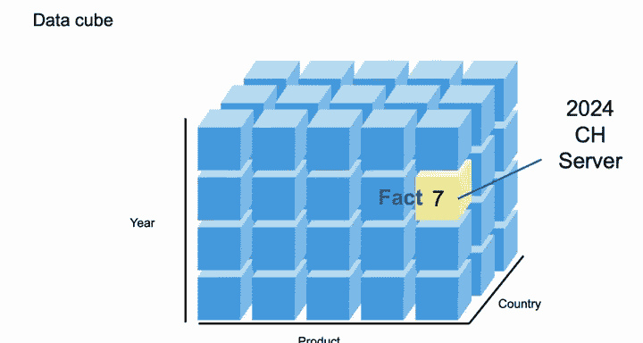

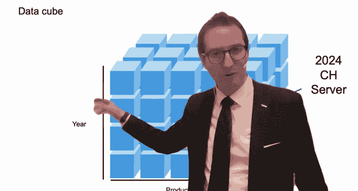

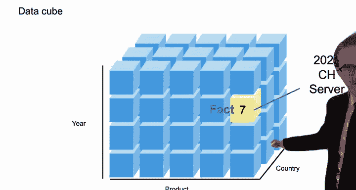

And when you take a combination of these members， for example， the year is 24。

 the product is power and the country is C H。 This intersection。

 this combination gives you a specific location in the cube。 And I highlighted one of them。

 This is a cell in the cube。 It's also called the fact。

 And typically there's a number in there in each one of these cells。

 And that fact tells me that in Switzerland in the year 2024。 I sold。 I sold 7 server。😊。

Is that here for everybody。Right， so imagine that every one of these little cells has some value in it。

And that tag you in which country in each， in which year and for what kind of product the associated quantity。

 right， So typically， these cubes are dense， right， It's not very fast。

 There's a number in pretty much every cell in most of the cases could be 0， of course。

 but its you should see it as something dense。

Now， these are  three dimensions here。 It could be 4，5，6，10。 It can be more。

 Most of you did linear algebra， So it shouldn't surprise you that we can have more dimensions in there。

 It's just that， of course， it becomes difficult to visualize。

 Even three dimensions is not very natural because I had to project that into two dimensions， right。

But luckily， there are alternate representations of cubes that we can use for our human brains that have a hard time visualizing more than two dimensions or three。

So the dimensions can be of plenty of different types。

 but there are a few st out dimensions that you typically have。 One of them is timed the period。

 So the year， the month， the quarter and so on。Another one is who。 So that could be in my example。

 the salespeople like the sales team and every person in the sales team is a member of the salespeople dimension。

 It could also be who in the sense of an entity， for example。

 if you consider the data cubes containing financial data that must be submitted in the US to the Securities and exchange Commission。

 Then who will be the company can be Apple can be Google can be meta can be Nvidia and so on， right。

 So this is also an important dimension。 Another dimension could be where the geographic location can be Germany。

 Europe， the whole world， specific game mind the specific town right。

 So we have a geographic dimension and you have numbers for every location。

 very useful if you want to consolidate the data worldwide if you are a multinational company and you want to have another view in every country of what the data looks like。

😊，嗯。Then there is the currency， which can be a dimension， US dollars， euros。

 rupees Sw francs and so on and so on。Alright， and many， many more。 it's not limited to this。

 But these are just a few of the of the common examples。 I forgot what。

 what is also an important dimension。 What can express the， the what you are actually measuring。

 So in the in the in accounting data cubes that could be revenues expenses， assets。

 noncurrent assets， equity liability and so on。 all of that are what dimensions， right。

 And then it makes sense that if you have for example。

 for a very specific thing like the revenues in 2024 in Switzerland of of let's say dig galaxies in Swiss fncs。

 then you have an associated value value with that。

Okay。So now。As I said， this is a bit complex for our human brain。

 but that's no problem at all because we can just construct it like this。

 Imagine a little baby two years old that just collapses the entire cube and reps everything up still as a tower。

 What you get is a fact stable。 So you basically have every row that is one cell。

And you can see that Germany 22 Peter， that's1000。 Germany 22 Mary， That's $2000 and so on。

 So this is a cell of dimension 2 by 2 by2。 How do I see that？ There are two members here。

 Germany and Switzerland here we have 21 and 22。 Here we have Peter and Mary。

 So two times  two times 2 gives me 8，8 possible combinations。 Who sees this as a 2 by 2 by2 cube。

Right， very good。 And， of course， if there's more dimensions。

 that is much easier because then we just add columns and it's much easier to add a column to a table like this than to try to imagine 4 or five dimensions。

 Okay， now， let me slightly change the coss。 So this is how accountants do it when they have their data cubes。

 They like to add these little square bracket things that says this is a die a member of the location dimension。

 These are members of the period dimension。 These are These are members。😊，The in the US。

 they also call a dimension and axis。 This is the spirit。 You know， Pvoing， as we will see later。

 Do we have a question。 Yeah， So I know we're talking about cube。

 So we should have N by n by N dimension。 but I thought like it's hard to have the same number of years as salesperson。

 for instance。 Oh， no， it doesn't have to。 doesn't have。 You can have three years。

 two dimension not need to be the same。 Ab not Yeah， absolutely。

 it's just an example because that's the simplest cube that I could have is two by two by2。

 You can have a two times  three times 8 cube without any problem。

 There is absolutely no constraint here。 Thank you。 Yeah， thank you for the for the clarification。

Alright， so this is the same thing。 You notice that I moved over the dollars to a specific column here。

 And that's it。 That's my nicely structured fact tables。 That is a set of facts。😊，Last year。

 somebody asked， like， is there an order like a list of facts。 No， there is no order。 It's a set。

 But as I said， we're in Switzerland and in Switzerland， we love it when things are tidy。

 So this is the reason why I nicely organize it like like this， right， But， in fact。

 it's really a set of facts。 And we don't care in which order they are here。Okay。

 now we have the cubes， and we can visualize them as fact tables。Let's start manipulating them。

 The first thing we can do is slice the cube。 Slice the cube is visually exactly what's happening here。

 I'm just taking a slice of the cube。 It means that for a specific dimension。

 I'm extracting all the facts that are associated with a specific number。 like just the year 24。

 and I leave out the year 25，23。 I just leave that out。 I just take the year 24。

 This is called slicing。😊。

So here I'm slicing on location equal Switzerland。 Remember。

 I had my 8 fact in here in my2 by 2 by2 cube。 But if I slice on Switzerland。

 I'm taking half of the cube， just one layer location Switzerland。 And I have four packed left。 Okay。

 everybody with me。😊，喂。On a table， what would that be as a relational algebra operation if you look at it as a table。

Are hear projection， Any other ideas。Sections， so is it selection or projection。Seelection， yeah。

 exactly。 We selected on location equals Switzerland。

We'll see later that this is how we implement it in SQL。

 So the slicing is implemented as a selection on the fact table。 But again， think of it as a cube。

Now， all the locations here are Switzerland and all the currencies are dollars。

 So what we like to do is to take them out of that view and put put them up there。 right。

 Not all of them are Switzerland。😊。

All of them are USD。 So I just put them up there saying locations with online currency。

 USD means all the effects in there they are。 They have these dimension member pairs。

So now I have the only dimensions that vary or axis are period and sales person。Now。

 this is a data cube that has two dimensions because I just sliced on the other two。Two dimensions。

Who finds it easy to visualize two dimensions？ What is a two dimensional cube。It's a table。 Yes。

 or otherwise， you can call it a。A square。 Yes， that is a square。 So if we have a square。

 we don't need to keep it like this in this list of facts。 We just can't display the square， right。

 This is a square，2 by 2， okay。😊。

All I did is went from the fact table to the actual cube。 And again。

 because the cube just have two dimensions， I can organize them like that。

 It's just a reorganization of my four values values organized like in a 2 by2 manner。😊。

This here is called a cross tabulation。So what you want to do is to slice it in such a way that you only have two dimensions left that have varying values in such a way that you can cross tabulate。

 And then you have one dimension here on the row， one dimension on the columns。

 And then you have all the combinations。

These are called diers。 We say that here the salesperson is a dier， and then the period is a dier。

 dier on the columns， dier on the row。 and these are slicers。

This is why you might have heard that when we have data cubes， we slice and dice。

 We already heard of that。 slice and dice。Right， very commonly heard。

 So this is where slicing and dicing comes from。 right。

 We slice specific layers of the cubes in such a way that two varying dimensions remain。

 And then we put one of the rows。

1 on the row，1 on the curtains。 It looks more like this If I really want to do it in a fancy way。

 This is the kind of display that I should be attributed to Charles Soman。

 with a CP in the an accountant in the US He's behind the XBR found out that I will also explain in that regard。

 So very fancy patterns where you see， we have the salespeople here and the period here with two members here and two members there and the slicers over here。

 Who is with me。😊。

Right， okay。Now， how many diers here we have two。 In fact。

 it's also fine to have just one or two have three。 Just one is easy。 You just， only， for example。

 dice here， and then you only have one column。 If you don't have any dier on the column。 right。

 all the same here。 you put your dier here。 And then you have only one row。 So just one dier is fine。

 That's that's easy。 It's a bit boring， but that you can。3 dis。😊。

Now， it seems like， how can we get three dies Because the screen only has two dimensions。

 So that's going to be tough， right， But in fact。There is a trick。 The third dier。

 you can use tabs or sheets for that。 And in fact， this is what spreadsheets software do。

 When you have Excel and you open it， you have two dimensions like the rows and the columns。

 But you have a third dimension， which are the sheets and the spreadsheet。 Okay。

 so this is typically how U eyes can also allow you to have a third dier。

 if you just switch the you switch like as a sheet。 instead of a sheet。

 Ui can also just give you some slider and you just move around the third value。

 and it makes the rest vary。 That's another way A Ui， a user interface can do that。😊，Al。

 and so what you do is that when you want to build a view like that。

 you just say for everyday dimension， do I slice on it or do I dice on it。

 Either it goes to the slicers to select a specific value or you put it on as a dier on the row or as a dier on the cards。

😊。

So that's the first thing。 slicing。Ding。Now I'm going to the next thing we can do with data cubes。

 which is aggregation。Aggregation means that we want to compute totals。 For example。

 I might have here da So Doutsland Germany， Australia， Switzerland。

 And I want to do the sum of that to have my entire company。

 What I do is I merge along that dimension。 You see it's merge here。 And so I go from 3D to 2D。

 What I did is that I squeezed the cube along that dimension， just computing totals。

 That is called an aggregation。 right， Let's do it on， on actual data。 So let's aggregate here。😊。

Exactly along the location。 So let's sum up Germany and Switzerland。

What that means is we need to be careful。 We need to aggregate what matches。

So I'm going to aggregate here，22 Peter with 22 Peterer， right。

 So I want to aggregate that row with that row， Germany plus Switzerland。

 And I'm going to get10 plus 5000， Give me 6000。 Okay， If I put colors in there。

 This is what goes with what。So in yellow， you have 22 Peter in red， you have 22 Mary in blue。

 you have 21 Peter。 and in green， you have 21 me。 And we just want to compute the sum within each color。

 for whom is that clear。Who visualizes the two by2 by two cube。

 And I just squeeze on one of the dimensions like this。 This is what we are doing。 Who sees that。

In 3D okay， many of you， Otherwise， we can think about it。 This is essentially what we are doing。

 And if I want to do it， the squeeze， I just press that button is going to squeeze my cube from a two times two times 2 into just two times 2。

There right， here I have now 6000。 That's the yellow。 The red gives me 2 plus 6。 That's 8000。

 The blue 3 plus 7 gives me 10。 and the green，4 plus 8 gives me 12。Aqui it into just two times 2。

 Look at what happens to my location。 Now it's the whole world。

 I'm not saying it's just Germany and Switzerland it's the whole world， right。

 I could have food more， but just for pedagogical reasons， just these two。Now。

 we've already done that before。 Location is always well in there。

Currentency is always USD。 Let's just move them up to the top， right， So location is the wealth。

Currencies is USD。 Now you can see when you aggregate like that。 You can， then it's。

 it's kind of slicing on the world， right， you， you basically take the entire world by slice to all that。

 You just look at the aggregated value and you ignore the details of Germany or Switzerland。😊。

Alright。 And now this is a fact sta that has how dimensions。2， so we can cross W H。

 So I reorganize these four values，6，8，10 and 12 like this。 where I have。 So these two dimensions。

 sorry， salesperson goes here and period goes there。 And then that's two times2 cube square。

 And I get。😊。

That's。

Okay， so it's not so good。Alright， let's continue。 Let's now compute another total。 So so far。

 I did the total on the whole world。 So these are actually my totals on the whole world。

 But what I did here is that I dropped the details of Germany in Switzerland。

 I'm only looking at the whole wealth here。 What if I would like to compute totals for all salespeople But without throwing them away。

 Well， it's very natural to do。 I just add a thin line in there with the totals。 just。😊。

All salesperss。 then I call it a domain。 It's basically just a member that coverss the entire team。

 right， But I like to call it a domain， and then we sum up， sum up and sum up。

I did not only compute the total for the salespeople。 I also computed the total over all times。

 So this is 10 plus 6， Give me 16，12 plus 8 gives me 20。

 And then I have the grand total across the two dimensions， right。

Now， notice how on the rows， when I have a total typically。

 I put it in bold and add a few lines like the accounting style。

And if I want to do a total on the columns， then you do it with an L shape。

 Do you see that this is an L shape， this cell here。

Right， if you， if you look carefully， this is an L。

Goes down。 So typically， you merge all the way。 And in this way。

 you display very intuitively that this， in fact， is the entire domain， right。

 You have here the the totals of all times。 for whom is that here。Right。

 so it's just a 2 by2 grid with subtoals on the row。

 subtotalles on the column and a grand total on the bottom right up there。Donm there。All right。呃。

Okay。So now what that tells me。Is that if I look at dimensions。

They have members but these members are not flat or they don't have to be flat。 They are， in fact。

 organizing hierarchies， trees， again， trees。 And in indeed， in fact， a dimension here he is a tree。

So the most obvious onewa is the locations。 You have the wealth， then you have Europe， Asia。

 then in Europe， you have Switzerland and Germany in Switzerland。

 you have Zurich Geneva in Zalakika and so on。 So we can have a whole hierarchy of continents。

 countries， regions， continents， towns， Kais and so on and so on。 For who is that here。😊。

Right。And then you can also have hierarchies， even though here it's flat。

 We have just Peter and Mary who are in a team， But you could also imagine multiple teams。

 You could imagine the hierarchy of the company， right。

 with the managers and managers and sub managers and so on， organized as a hierarchy。😊。

The same for the times here， I just put years， but the years can be subdivided in quarters。

 subdivided in months and so on and so on。 So you also get hierarchies。So this is the I D。

 And that is part of the model in， in all up cubes。 you do have hierarchies in the dimensions， right。

No。

Here it was a flat hierarchy where you just have the two values and the sum and two values and the sum。

 So if I want to generalize this to now a whole hierarchy of countries。

 and I want to do it on the columns。

This is the beautiful view that I get out of that。😊，When the sense is view。You at it carefully。

 who's done what's done here。Right， so you see。

I have here all the numbers Sz Zic for Geneva for interlan。

 And then I have this L shape here that tells me that this is the total for Switzerland。

 Then I have Berlin and Ffur。 And here， Germany is above in the hierarchy。

 and then I have this L shape that basically puts the total here。 Then I have Europe。

 Switzerland and Germany。😊。

With a total here。 Then I have Delli in India and Beijing in China， the Totos and Asia。

 I'm over simplifyimpling the world， of course， But just for because it needs to fit on my slides。

 And then the whole world。 And again， it's very common for the， for the。

 the domain to not put member in here。 but domain。 It's just a common。

 common thing to do to just indicate that it's the top level member that is absolutely everything。

 So this is how we do it with these beautiful visuals of L shapes on the cons。😊。

W understand that。Right， very good。 Now， what about the rows。

 Because these are subtoles on a hierarchy on the column on the rows and shapes are not so common。

 that would be strange to the well shapes on the on the rows。😊。

So what we do is you， we use indentation。And this is basically what accountants have been doing for thousands of years。

 Right， So you have this whole hierarchy with Zic Genevaak and Switzerland， Berlin from from Germany。

 And you use these lines to basically show the the totals。Who sees that it's the same thing。

 It's just that this is on the columns and this is on the rows。

 But all I'm doing is computing subtotals and totals。Okay， very good。Now， I use the sun。

 but obviously， you can also use mean max count average。 I mean。

 there are plenty of aggregations that you can use other than some， right。

All right。Okay。Now。It's going to be the break。 And I'm going to finish on that over the break。

 There is one nice thing that we can do， which is called a rollup。😊，In a roll up。

 I basically it's like a curtain that you just lift up。

What if we don't care about the cities， We just want to see the countries。I can do that。

 What if we don't care about their countries， just the continents。 I just remove data from the view。

And now the whole world， this is called roll up。 The opposite is called drill down。

 So here I'm drilling down。 and here I'm rolling up。 for Who is that here。😊。

Very good。 By the way， here， I only have one column left。 So I might as well put it up there。

 This is an example of dicing with only one dier。 Now， I'm only diing on sales peopleop， but I。

 I don't have any dier on the columns anymore。😊。

Okay。At's the break， perfect timing。 So I'd see you in 15 minutes。

 and then we look at the sequ implementation。 Thank you。😊。

