# 苏黎世联邦理工《大数据｜Big Data - ETH Zurich - Fall 2024》中英字幕（deepseek - P47：-47-14. Data cubes (2_2) -.zh_en - GPT中英字幕课程资源 - BV1sHPKeoEJU

Welcome back， everybody。 So now that Ive presented the logical model to you and how we can slice。

 di segregate， roll up， drill down， pivot and so on。

 I'm going to say a few words about the implementation。😊。

High level。 I， I mostly want to focus on an implementation in SQs， but on the high level。

You have two main paradigms for implemented data cubes， orab cubes。 One paradigm is called rollab。

 The other one is called Moab。 In fact， the idea here is very general to any data shape。

 when you want to implement a system for any data shape。 you can either do a native system。

 That's what Ne4j is for graphs。 that's what postweql is to s well。

 that's what Mongodb is two trees so you can do it natively or you can cheat and pull put yourself on top of a node system for example。

 you could implement it's hypothetical because who would do that。

 but you could implement a relational database on top of Mongodb。

 you just store the tables as flat trees， right likewise。

 you could implement also a graph database on top of a relational database like a triple store。

 you could put every triple in a table with three columns so you can either do it on top of a node of shape that。

 of course， you would need to nicely encapsulate and hide from the end user because of data dependence。

😊。

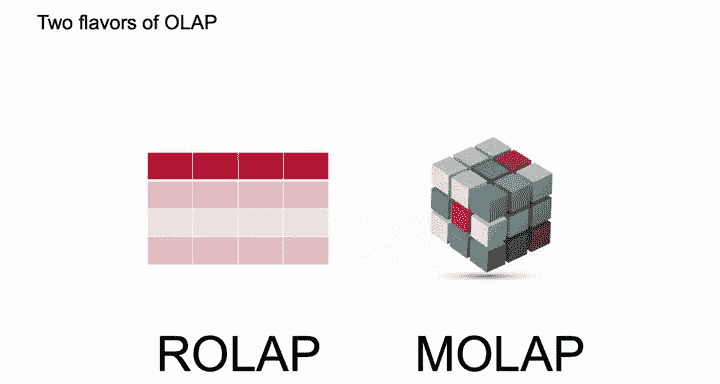

Or you can do it natively。 Mola is kind of the， means multi dimensional。

 orla is kind of the native implementation or data cubes。

 It also allows some spark T T in the process。

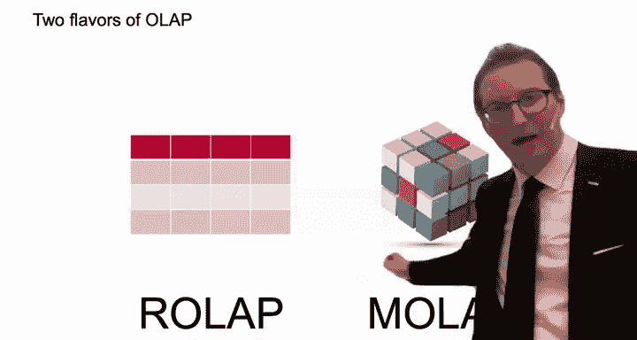

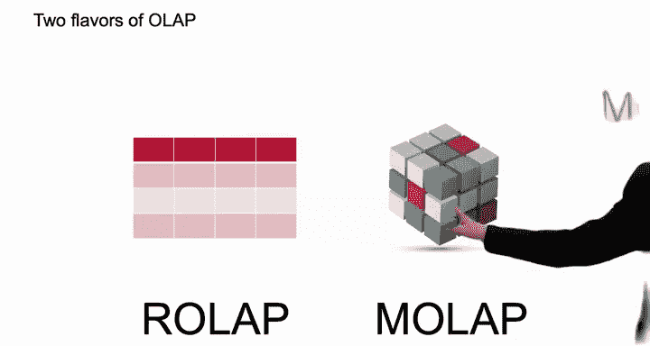

Rollup is the cheating Russian where you just put yourself on top of tables and you compile everything to SQL。

 So this is called roll up。 It's a relational roll up。 And I'm going to focus on rollup。

 I'm not going to， to， to talk about Moap。 But just know that it exists。

 and it's a completely different implementation， entirely native。😊。

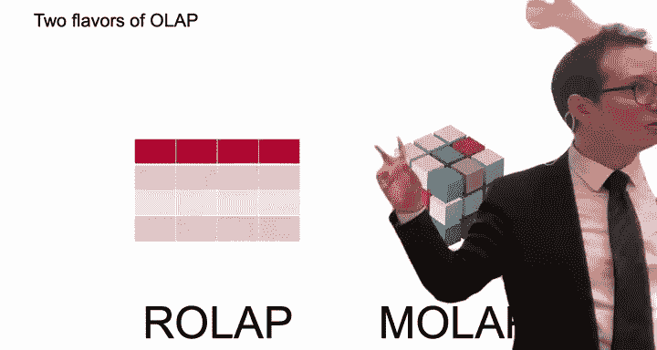

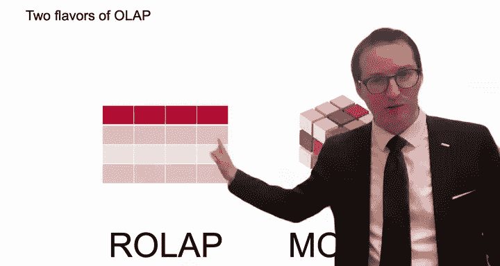

Why hold up， that is actually the reason why some the startups that basically came up with O app cubes in the 90s were purchased by relational database systems companies。

 It's because a fact stable like this that represents a cube。Can， in fact。

 be stored as a relational table in a SQL system。 right， This is the idea why it's very。

 very natural to store a cube like this。 However， what's very important is that it's still a cube on the logical level。

 What you see here is only a physical implementation as a table of the cube。

 So that is is the visualization。 But remember， it's still a cube。 You have to keep it in mind。

 It's not a table。And so the way that you store a cube as a table is one column per dimension by involve them here。

 and then a column for the value at the end。

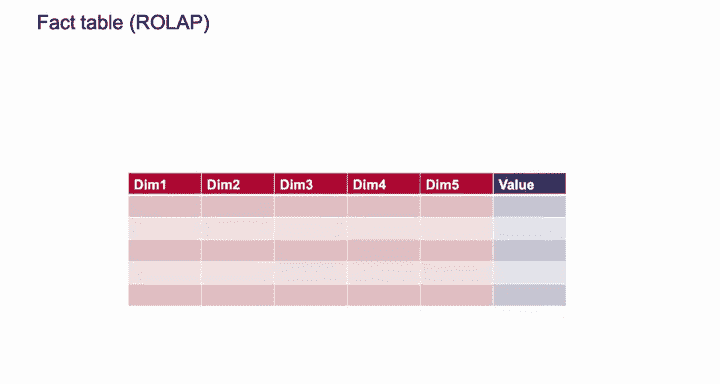

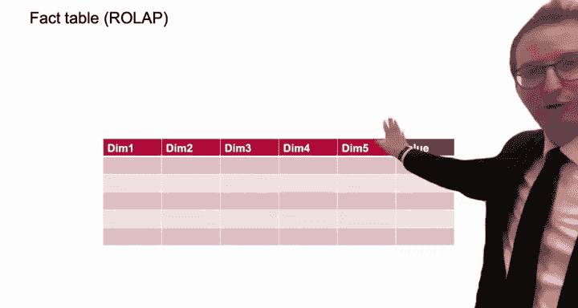

Now， there is another approach that some people take with several value columns， not just one。

 but several。

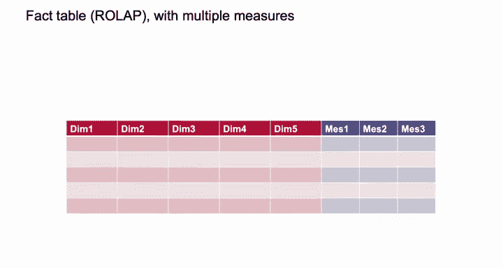

And these value columns basically share the dimensions。

 It means that for all of these combination of dimension， It's a specific position in the cube。

 you can specify multiple things。 And these things are called measures。 For example。

 you could say that for digte galaxies in Switzerland for the year 2024 then the revenues worth such the expenses were such and the profits were such right。

 So these are these are where the measures are。 And they all have in common the the the combinations of dimension。

 And then for another year， another company and so on。 then you would have different expenses。

 profits and and and revenues there。 Who is that here。

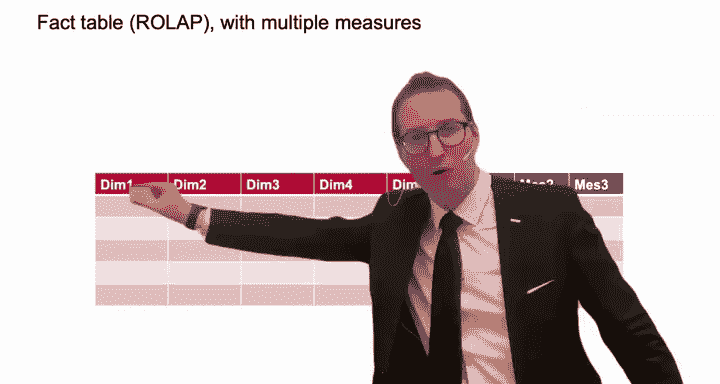

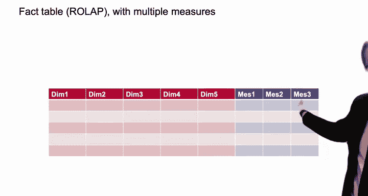

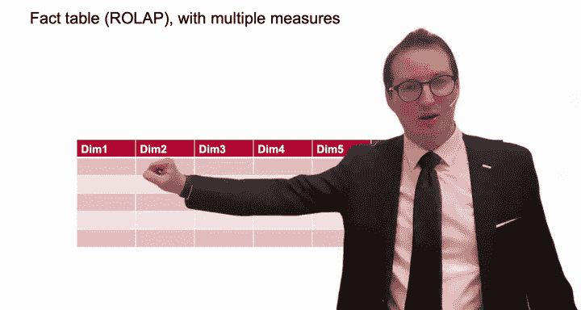

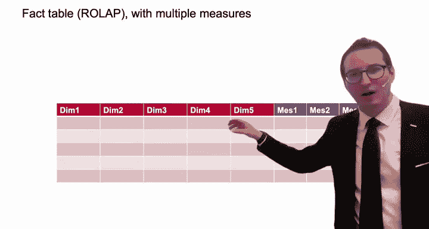

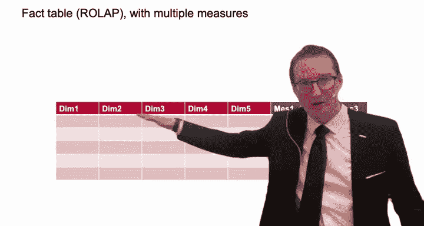

Right， so this is called a measure。 That's a world you will find in a lot of data cube data cube software。

 But， in fact， it doesn't matter because its the same。

 And the reason it's the same is that you can basically convert one into the other。

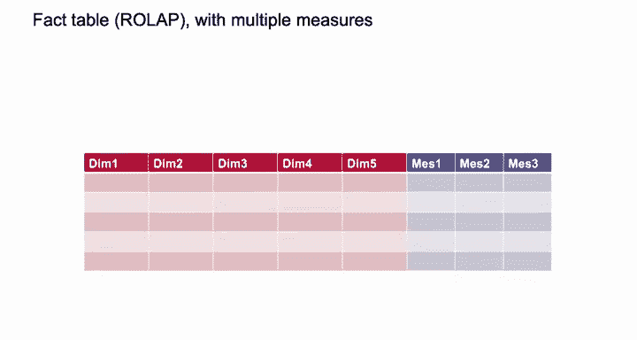

The transformation is called pivotvoing pivot un pivotvo。

 and there are even extensions to the sQL language that do pivot and un pivotvoing。

 It's actually quite simple。 What it does actually is that when you have multiple columns like this like revenue and profit。

 You just， it's the same idea of taking this eight these eight cells。

 and you just stack them again like this。 You just put them on top of each other。

 And you add a column here that you can call measure or concept or whatever。

 And then you say revenue profit， revenue profit。 So you see what happened here， these headers here。

 revenue and profit are basically transformed into members of a new dimension that we call measure。

 But these values are exactly the same right， Who sees that it's the same thing that we can transform one into the other and back。

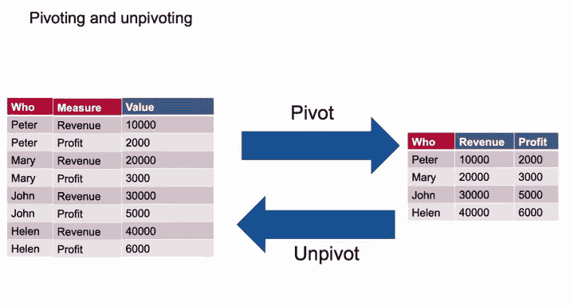

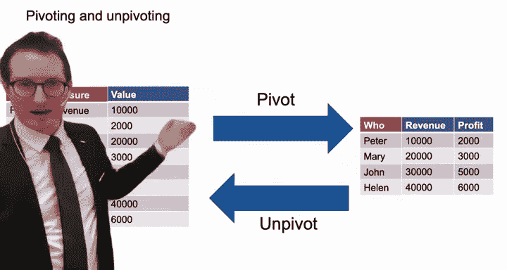

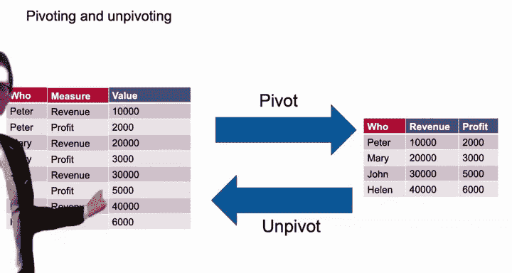

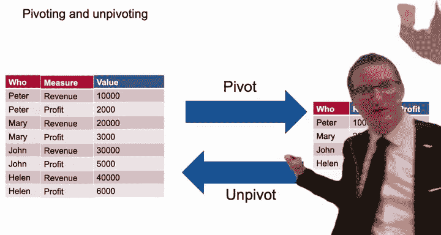

Very good。 So this is called pivototing and on pivotvoing。

 That is the reason why I'm only going to show you with one column。

 because you can just always transform it into just one column。😊。

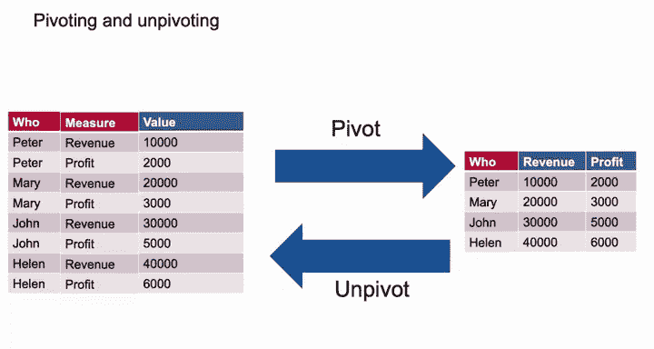

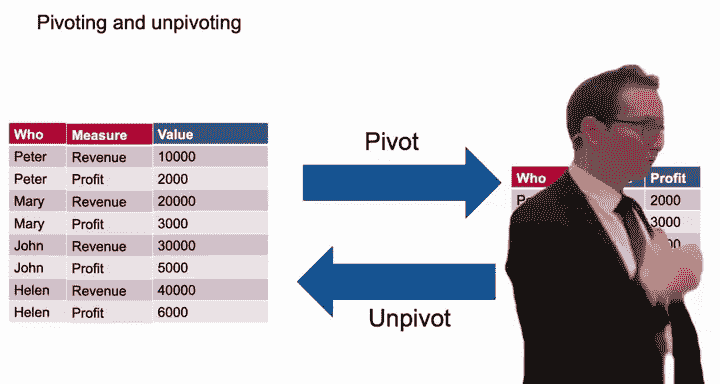

Okay。

The next thing that we have in the rollup implementation is that。You have satellite tables。 Yes。

 there's a question。Or is the previous thing also the same if you have different data types。

系飞个精音。That is an absolutely valid question。 What you would do if you have multiple data types is that you would basically use a special type that it's not in every database。

 You would have a variant。 You could call it a variant type。

Another possibility is to just partition your data by types。

 meaning that you only put together what's the same types or all in jars。

 old strings and then saw them in separate tables。 But the most the most straightforward world way to basically f these to work。

 even if the types are different is a variant type that is basically a way to have polymorph， right。

 which in this lecture we've seen a lot， right， So the the idea of having a messy data that doesn't have a schema。

 right， does it make sense， right， So a variant， you would have a variant column in here。Okay。

Alright。 So now what you typically have a around the effect table are satellite tables。

 typically one satellite table for each dimension， that means。

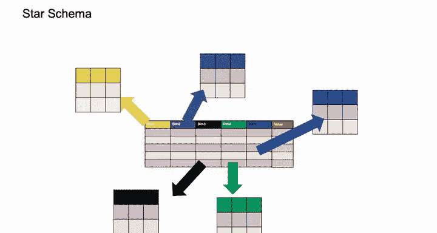

That these members that we have in here below the dimensions are， in fact。

 nothing else than foreign keys that point to the primary keys some satellite table， right here。

 We just point to satellite tables In other world， you can do joins between the satellite tables and the facts table in this way。

 For whom is that here。

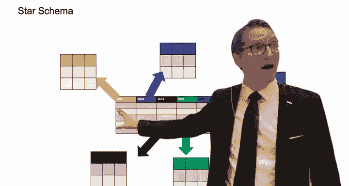

Right， who loves to normalize data in there， like third normal form， fourth normal form。

56 normal form。Do we have any raised hands。Nobody， Oh， I still show you a slide。

 but maybe you you'll not love it as much。 But for the people who really love normalization。

 we have the snowflake schema。 So if you're not happy with just having these satellite tables and you want to further normalize them。

 then you can apply these transformations to split them even more。 That is the snowflake schema。

 right， I suspect that is one of the reasons why the company with that name is called that way。

 right， It's a hint to this。😊，So star schema and snowflake schema。EWho loves to denammalize data。

Okay， very nice。 Let's denmalize data。 then。 So if you're not happy with this。

 So that's the highly normalized data with separate tables。 like here。

 I have a town going to the country， going to the continent。 And you think that's novel hill。

 that's too， that's too complex。 Then you can do the opposite。😊。

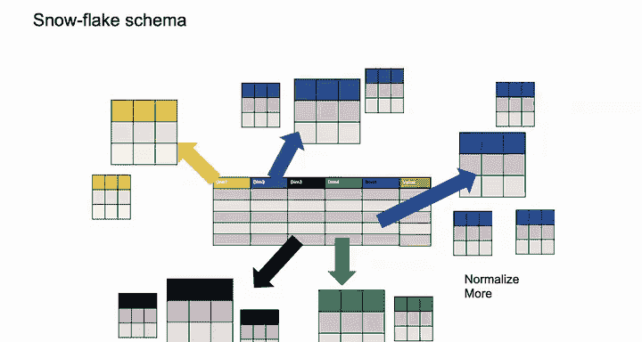

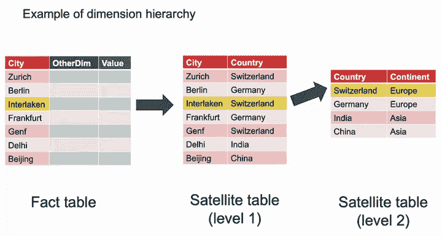

You can basically take all your satellite tables and then squeeze them into the fact table。

 What you get then is a deormalized fact table。 So now for the same dimension。

 not only did do you have the original member， but you have all the columns that came from the satellite table because。

 again， you do a join with the satellite table to denormalize。 And then you get that an example is。

 if I deormalize my fact table for the geographic dimension。😊。

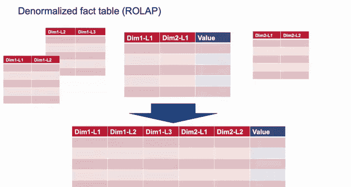

And I had my city。 that was my basically my， my original value。 And then I joined it with this here。

 What I get is an additional country and continent colon。 But they are not other dimensions。

 They are the same dimension。 It's just additional data。😊。

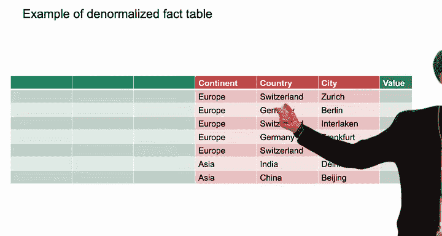

And now you see that we have redundancy， Switzerland， Europe， Europe， Europe， Asia。

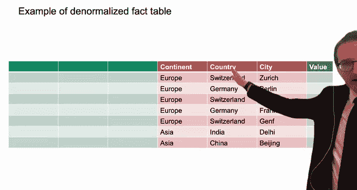

That's how you see it's deormalized。 How you also see it deormalize is you have a functional dependency from the city to the country and you have a functional dependency from the country to the continent。

 How do I see it， Sw on end is only in Europe。 That's a functional dependency。 Who sees that。😊。

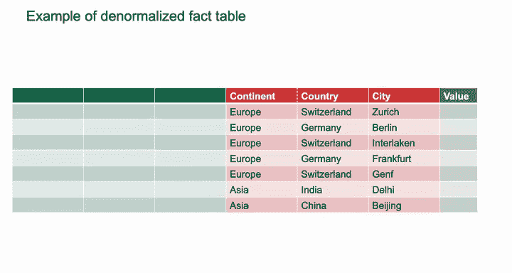

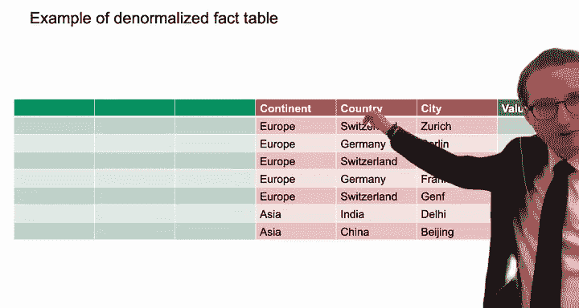

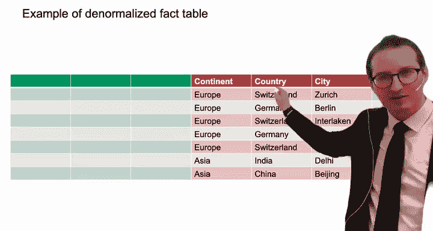

RightSo this is the reason why in that case， my fact table is not denormalized。

 Why would I want to do that Well first， Because I love denormalization。

 But there's another reason you can actually take this kind of fact table。

 which is then a single table， put it in a CV5 and import it into Excel or spreadsheet software。

 And then what you can do is select it entirely menu data summarize with pivotvo table and then you have a very nice。

 I'm not going to call it an install egg because this is an actual feature。

 but then you end up in in a user interface。😊，That allows you to drag and drop your dimensions to dice on the row。

 dice on the color and slice and so on。 And that's really， really convenient for a lot of use cases。

 And so this is why this kind of de normalizedmalized fact table is is very， very practical in。

 in real life to to do quick， quick analysis with spreadsheets。😊。

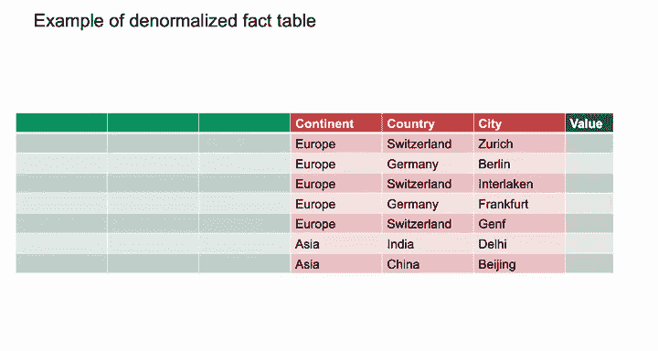

Okay。So now that we've seen that， that's the how we map these cubes to to tables。 And again。

 you see how wet was a tree。

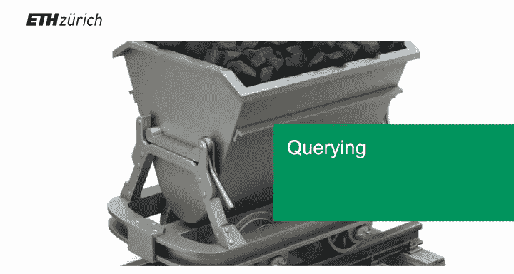

Be a dimension， you have a hierarchy。 That's a tree。 but I represent that tree， not as x or whatever。

 I represent it with functional dependencies In this way。 This is how I represent my hierarchy of。

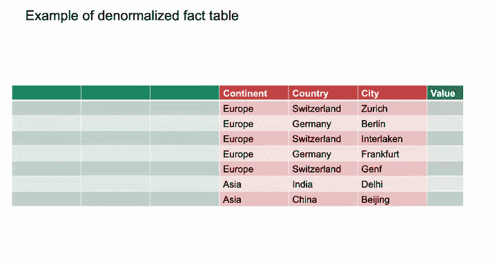

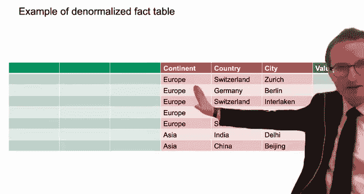

Of。一几次。

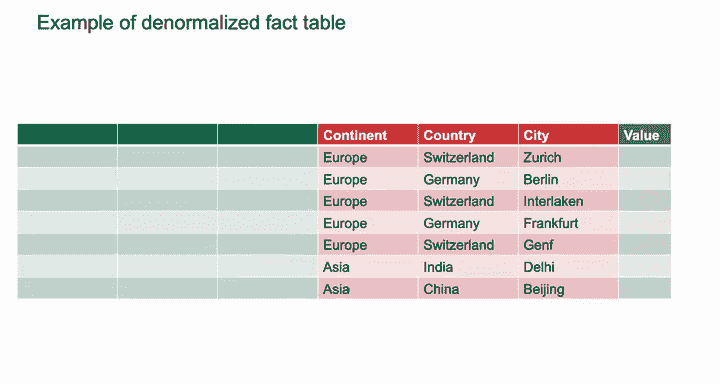

Okay， let's query some data done。Well， there is a language for data cubes。 It's called MDX。

 multidimensional expressions。But you have already been put through so many languages and syntaxes in the lecture that I'm going to spare you the teaching yet another language。

 You don't have to worry， I will just show one or two sides， but that's it。 Instead。

 and that's the reason I'm focusing on all up。 We are just going to use Google old SQ。

 We are basically just going to implement with SQL on the fact table These sing diing aggregation and so on。

 Okay， so again， do not worry about M D X。 You you don't have to learn it。

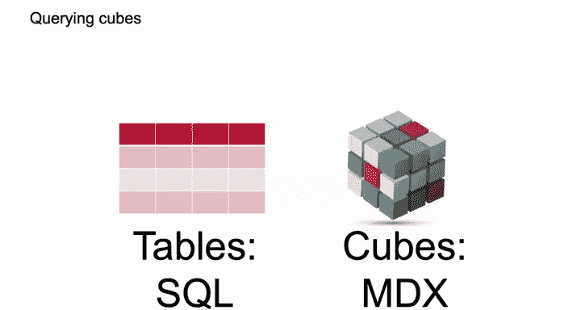

嗯。Alright， so now imagine that I have this data cube that is represented as a fact table。

 So it's a relational table in Postwesql or whatever system you choose。

 And I have these satellite tables。 And you notice that all of these， for example。

 are foreign keys that points to this primary key and you have the year the quarter。

 all of these are foreign keys， of course， in real life， you would have references， not names。

 but that points to here right and then you have the brand enterprise。 Then you have the customer。

 of course here you have a customer I in real life。 but that points to to address phone and so on。

 so these are the fact table and the satellite tables。 Now， obviously。

 if you want to do something useful in SQL， you can join the satellite tables with with the fact table and that you know how to do how do you join in SQL。

 you just put them all in the from class。 Let's say we join the fact table with the satellite table for the time。

 and I have my join predicates。 So I join on the fact that the date。 So。😊。

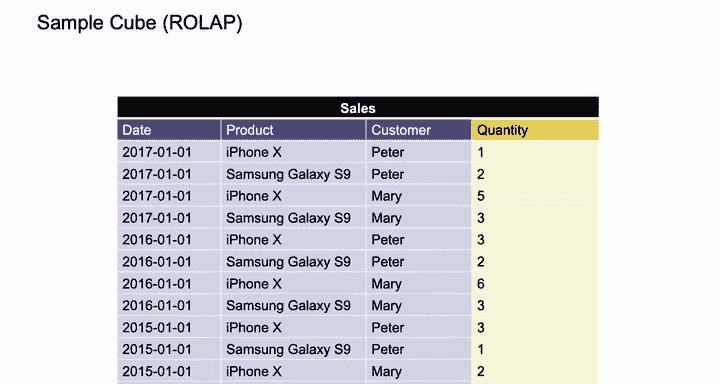

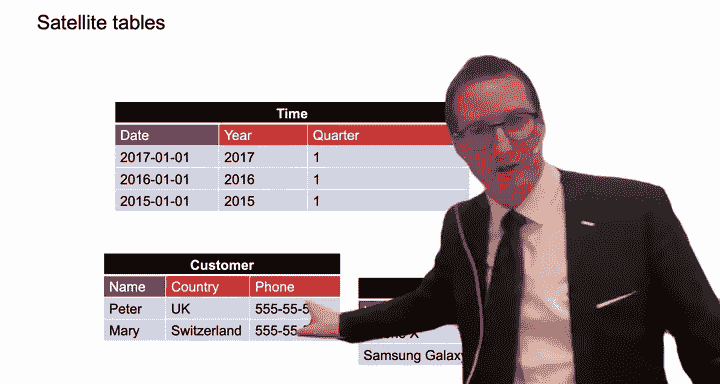

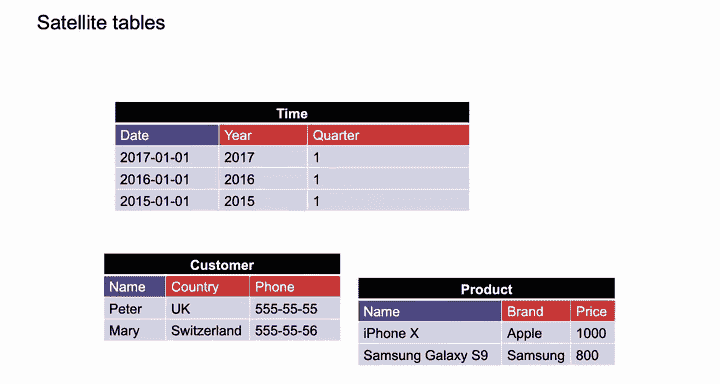

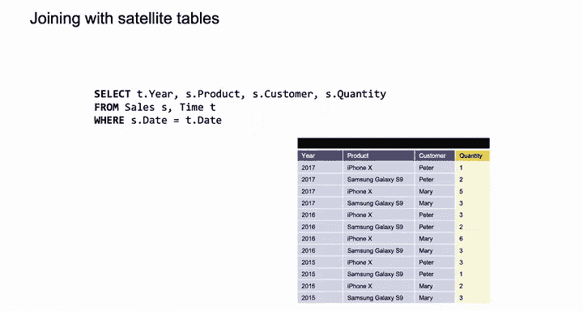

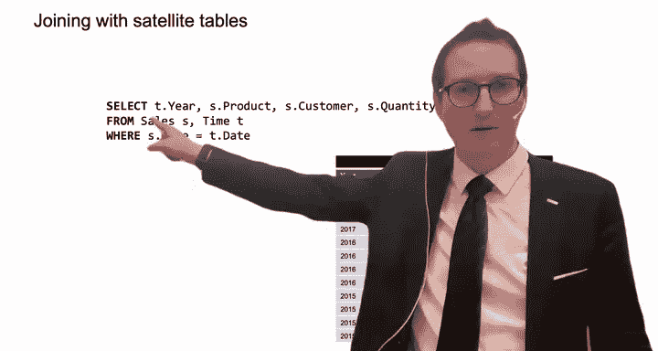

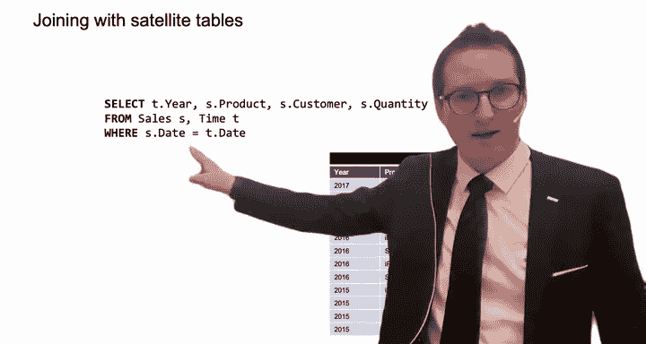

this must match this。 This is my joining predicate。 Okay， for whom is that fear。Right。

 that's just a join。 And now I basically replace the date with the year okay。

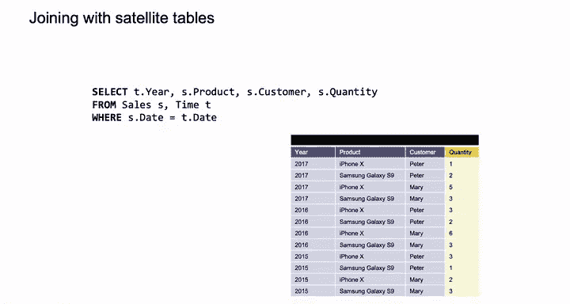

Okay， for this reason， because it's just a join。 I'm going to just now drop the the satellite table。

 I just get rid of it。 And I'm just focusing on one single fact table and everything is in there。

 And it's a normalized fact table， meaning that I I will not have multiple columns for the same for the same dimension。

 right， So one column per dimension No satellites， just plain and simple to focus on that。

 So this is I'm going to take。 This is my fact table。 I have the year， the brand and the customer。

 I only care about the values that are in there。 No satellite。 And this is my quantity。

 without the dimensions of that cube。 Can anybody tell me。😊，Yes。😊，Three times。Two times2 exactly。

 And that's a counter example to you， you asked the question， right， was that was you。

 So this is an example where it's not the same number of members in each dimension。 Okay。

 so three times  two times 2。 and we have 12。 Okay， everything is allright。 That's 12。

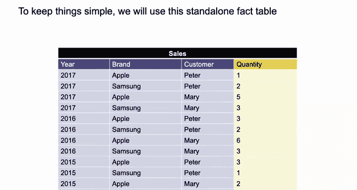

Now， if you want the complete view， when you could just use select style， right。

 But I just explicitly put the columns and then you get the entire effect table。If we want to slice。

 what am am I going to do in SQL to slice。Where exactly， and that easy a。Seelection， exactly。

 That's how I slice。 So you sit straightforward。 This is why it's so easy to actually implement cubes as tables。

 Slicing is done on the fact table with a selection on the fact table。

 And then here I'm basically slicing on the year 2017。😊，But that's only physically selection。

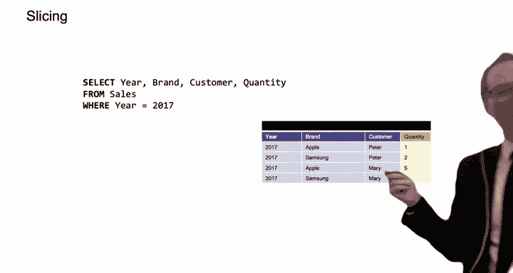

Logically， what is really happening is that I have a 3 by 2 by two cube。

 and I'm taking a slice of it， which is a one times two times2 sub cube。 Who sees that。

W doesn't see that yet。Who sees that。Okay， awesome。 So this is slicing。 I can slice it one more。

 What if now I wanted2 by one by two sub 1 by one by two sub cubes。 So now I also slice on Samsung。

 I'm slicing in two dimensions。😊，And yeah， so that's how you slice。

 You just add your basically prediccate dimension equals member to the work clause， okay。Now。

 let's get back to the complete view。 What about if I want to roll up some dimensions。

Roll up here is all on a thing because I don't have hierarchies in the dimensions。 It's all flat。

 right， I just have 7，1615。 That's flat。 Apple Samsung， it's flat。 Peter Mary， it's flat， right。

 So when you roll up， it's just all on the thing。 either you have the details or you don't。

 So what if I want to aggregate。 And， and forget about the details。

 Let's say for I I don't know which one I'm doing on the next slide， But let me say for。

Across the customers， right， I have a year and a brand， and I want to aggregate on the customers。

 What speak clothes do you think I'm going to use， I see raised hands here。Group by， exactly。

 You do a group by group by on what。关疑。Exactly， you group by anything that you do not want to aggregate on。

 Very precise。 So thank you for， for this。 That's exactly the idea D。

 You put in the group by everything except what you want to aggregate。

 So the the group by basically protect against the aggregation， right。

 and then you aggregate on the rest。 So indeed， if I want to aggregate on the customer。

 Then I just group on the year end brand。 And then I have， as you know。

 you always need to always put your group by is also in the in the projection that that makes sense。

 And then we aggregate on the quantity。 It's a sum but it could be an average， I mean max account。😊。

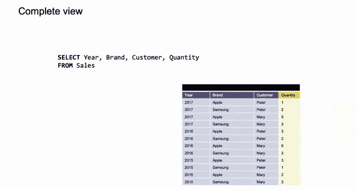

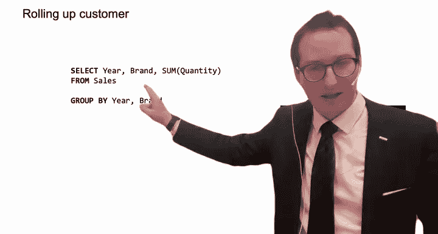

Anything else， You see what happens here。 Now I merged， for example， this two。

1 plus 5 give gives me 6。 So now what happens is that this was a 3 by  two by two cube。

 This is now a 3 by one by 2 cube，3 by 2。

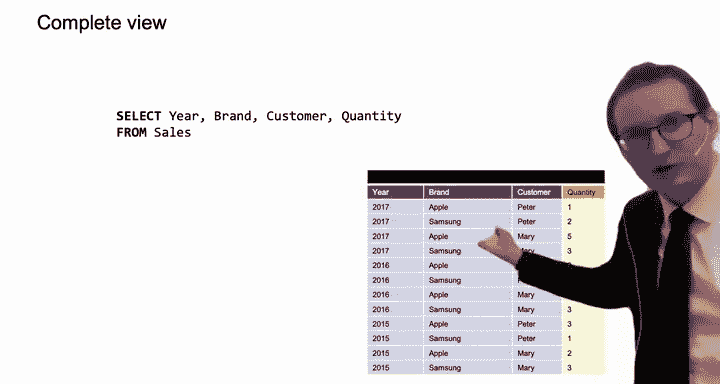

But what happened is that I didn't slice here。 I squeezed a long white dimension to to。

 to some over the the customers who is with me。Right， and this is with a good old group by。

 It's not even new to you， right， So just a group by。Now， if I want to roll up even more。

What do I need to do， You probably sew it quickly。 What if I want to roll up on the brands to。

 not just the customer， but also the brands。 What should I do。Do I need to add it or remove it， yes。

Remove it exactly。 I remove it from group by。 Rem from the group by is going to roll up entirely that dimension。

 And now I just have the year and the quantity。 So now I squeeze。

 I squeezed my cubes in two dimensions。 And I have only one dimension left。

 If I want to finish squeezing it， then I just drop the group by。

 And you know that if you just aggregate without a group by， just aggregate to a single value。

 like the total sum of everything or and so on。 Now， that is the fully rolled up version。

 I rolled up all my dimensions in here wh with me。😊，Okay， so you see。

 we have everything we need in SQL。The opposite， if I want to drill down。

 then I add back to group by whatever I want to drill down right。

 So I just now go back to my ear and bring， okay。Do we have everything we need in SQL。Where。Yes。

 we do。But it's not necessarily going to be convenience。Now， think of。The use case where you want to。

Compute the subtoals。And the grand total。So you have the year and the brand。 let's say， like。

 like this。 And now you want to also have a total on the years for every brand。

 a total on the brand for every year and a grand total on everything。 Well， we already know it's 34。

 right， The， the grand total。How could I do that。Basically。

 I want a SQL query that generates all the data necessary to my cross tabulated view with my two subtotals and grand total。

 I saw some raised hands。Who raised their hands。Anybody any the idea。On zoom， maybe。Okay。

 let's start with a naive I D then。 Why don't we writeite the queries separately。

So I have a first query that gives me the values that are the， the actual values per year and brand。

 right， So these are the， the query in in the most of the numbers in my cross tabulated view。

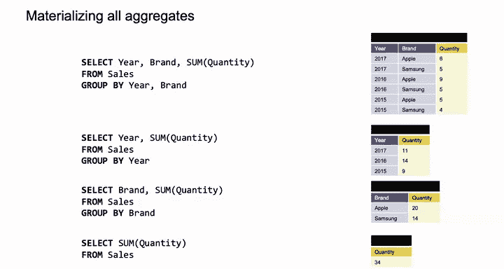

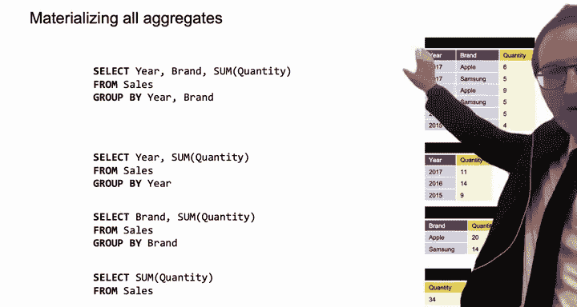

Now， what if years are basically on the columns and brand is on the row。

 then that would be the numbers at the bottom， the subtoals for every year。

 the subtoals summed of other brands。

This would be the subtos on the right。 If I aggregate across here。

 and I have a subtotal for Apple and a subtotal for Samsung。 And this here is the grand total。

Right， who agrees that these four queries， If I execute the four of them。

 that gives me the numbers for my cross tabulated view with the grid of subtotos and grand totalto。

 Who agrees。Who doesn't see it yet。It's fine if you don't， right。

 So let me show you again what I mean with the。

Should be somewhere here。

This one。😊，Basically。

That's the data that I got after I basically aggregated just another example。

 but I basically did an aggregation to get rid of the customers。

 Well don't want to get rid of the customer of the company， but aggregate over other customers。

 And then that gives me four values。 This was my first query that gives me these power values。

 The second query gave me these values， basically aggregated across the salesperson。

 but once for every year。 the third query gives me gave me these two， right， aggregated for all。

 So it's not all times， but all the brands in my example over there。

 And then the grand total that is the the aggregation。

 So basically what you need to see is that I need Fox equall queries for that。

When for here， when for here， when for here here， if I can operate at the right place and here the grand total。

 Who sees that this here。

Gives me。

Exactly what I need。Awesome，So this is the idea， these are my four queries。Now。

 what if I want a single query， Does anybody see a way of doing that in a single query。Complex query。

 but single query。You take a union。 What is in the way of the union here。Take。Exactly， we， so indeed。

 we need to do a union， but you see that the columns are not the same。

 The attributes are not the same。 How can I get the columns to be the same。

Go not select。

To be the same all。Yep。And what do I put in the cells that don't have anything。It's the right idea。

 But what do you put in the DMT cells。Can you have M s in SQl。I see nodding hands。

 What do we put in empty cells。Nurs， exactly。 That's exactly the idea。 So you're absolutely correct。

 This is a union。 and we need to make it fit。 Basically， you see Union Union union。

 But I need to add a nu here， a N here and two Ns here to make it fit into this table here。

 You see now I have my first 6 in here。 Then I have my subtotoles by year in here。

 Then I have my subtos by brand right here。 And I have my grand total N N 34。 Who sees that。😊。

I just took to the union right， and padied with nurse。Now， to bit complex， right。

 If you have to write this every time you want to populate such a such a view， It's cumusom。

 But there's a solution。 There's a better way。 And that is due to an extension of SQL that was Gqed and others。

Introduced， it is called group by grouping sets。That does the same thing。

 It basically is a union of different group buys。 And you say， okay， I won the year and the brand。

 then the year and then the brand， and then the grand total with nothing。

 You see that these four lines here are exactly the four group buys。Right。

 so that's group by grouping sets。 It is just equivalent to a union of four group bys。 Who sees that。

Alright。 But now I have even something better because even that。

 I'm too lazy as a computer scientist to write。 But there is a structure in there。

 Do you see that these are， this is the power sets of ear brand。😊。

These are all the subsets that you can have on our year brand。 Who sees that。Okay。

 so we say group by cube。Like this， group by cube， year brands that does exactly this。Okay。

 so this was an extension that came later into， into SQd and Post U and many products。

Because they have the data cubes in mind， and they have them in mind so much that they actually explicitly write cube in here。

Okay。😊，Great， and that gives you this。 If I take all of these numbers on the right and I display them in my view。

 this is what I get。😊。

So that was the SQL query that gave me the numbers to put in there。Now， SQL did not give me the view。

 SQL doesn't know anything about cubes or even about cross stulation。

 The only thing that I can expect from SQL is that it gives me the number that I。

 the numbers that I put in there。 All the rest， I need to do separately。

 maybe with Python or whatever language I want。 And this is where M D X comes into play because M D X arose you to。

 to directly stay that you want view。 Okay， but we are not talking about M D X。

So， and then you can play and imagine the SQL query。

 if I want to now go to Peter instead of all customers， then I would just add a warehouse close。

 right， Who agrees。In SQL， I just say where customer equals Peter。And that would give me these new。

 these new numbers。Alright， and what did I do here， I pivoted。 So I say now where period equals 2017。

 And here I would have a group by cube group by cube what for generating this group by cube。😊。

Brand and customer， group by cube， brand customer exactly。 And where period equals 2017。

Now， trivia question。

Group by cube doesn't need need to be 2， could be 3， could be 4。

 So if I have n attributes in group by cubes。How many grouping sets do I get。

2 to the power of and your computer scientist is fantastic。 So this is the power set。

 So2 to the power of M exactly。 So here it's2 to put the power of two。

 But that works for any one of them， okay。😊。

Now， let's move to the next bit more difficult。 What if we now have these hierarchies of dimensions and I have my deomalized factor。

 And now I have this whole town， country， continent world and so on。

 So this means that what I want to do in， in， in essence， is basically to have my numbers per city。

And then I also want my numbers per country。 So that's kind of separate where the city is not there。

 And then the numbers by continent。 So these are my subtos now。

 But these are not subtos for a dimension。 These are subtos within a dimension。

 These are intermediate subtos per country per continent and so on。

 And then I will have my grand total on the whole world。

Do you see that we can do the same here， Pat with nerves。Like个ive。Who sees that。Right。

 this is how we can extend the fact table within others。

 And now we can have the values that that that have my sub totals， okay。

So let's take this example here。 It's just a different use case instead of my countries。

 and I have quarter than yes。 So you see how I have a Q1， Q2 Q3， Q4。

 This is how we call the quarters in accounting of 20 then of 21。 then of 22。

 right So far just for those of you who might not know in accounting and typically on on the most of the market authorities like the S。

 there require companies to file their reports， balance sheet income statement and so on every three months。

 And so we say Q to Q3 Q1， Q2 Q3， Q4。

Alright， so now if I do it in SQL。This is what it will look like。

 I basically have my deommalized fact table with year quarter and so on。 So these are my， the。

 the columns that belong to my hierarchy in that period here， Like I had continent country city。

 But now it's year end quarter。

So， I need。Basically， for every quarter。 So group by year quarter that gives me for every quarter。

 then if I just say group by year and I remove quarter。

 that is going to do a partial roll up and gives me gives me the aggregated value per year。

 And if I drop here completely， now I get the whole the whole all times periods。😊。

Right， of course， to simplify here， I assume I didn't have all dimensions because， of course。

 it makes the query more complicated。 But I wanted to show you this。

 that essentially what I get is all of my values per quarters。

 So this is basically all the blue headers here。 Not this， this， not this， this， and not this。

So this is my first query。 My second query gives me a subtotal per year。 So， in my view。

 that would be here。

Here and here。

Here。😊，And then finally， the grand total on the right。 Who sees that。

Now， it is key to see here。In the difference with before。

Is that nowhere do I have just good bigwater？That I don't have。

 Do you see that that's the difference with before。

Because before I was talking about different dimensions。 So I wanted to have all combinations。

 That's what the power said。 But now I'm talking about one dimension。

 but it's the hierarchies within that dimension。 The years， the quarter。

 maybe I wouldn't have the months the days if I wanted to given have an even more elaborate hierarchy。

 So it's very similar。 I can also pat with N。 I can also take the union。

 I can also put the grouping sets。 Yeah quarter quarter and nothing。

But I do not have quarter alone。Okay， because this is a real roll up。

stepep by step on the same dimension。There is also a shortcut for that。

 if you don't want the power set， but you just want to basically go from the right to the left like this。

 This is called Groupai rollup。 Groupai rollup year quarter gives you the really that year quarter just here and nothing。

 It's basically going right to left， w out from the right to the left。

Trivia question， If I have any attributes in group by roll ups， how many grouping sets do I get。And呢。

Any other I than N。And -1， Any other ideas。N plus 1。 Yes， that's the one。 You see there are two here。

 and that's three grouping says because you need to have the empty one as well。 Okay。

 so you see that's linear。 Group by Europe up is linear and group by cube。is。Exponential。Okay。

So this is it。 This is how you do it in SQL。 And you saw this extension group by grouping sets。

 group by cube， group by rollup。 This is made for overlap cubes。Now， just so you see。

 you don't have to learn it。 Don't worry， No language to learn。 but it looks like this。

 So they use these square brackets along the the dimensions and members。

It looks like SQel。 Many people actually start their languages making them look like SQL。

 So it has a select and from， except that here it's not a table。 It's a cube。 This is a cube。

 What is also not in SQL。 and that you have in M X is own columns on rows， This is dicing。

 You're basically dicing on the measures。 So that would revenues profits and so on。

 So that would be the the accounting hierarchy。 and on the on the rows。 you would have the location。

 So the the all the geographic locations。 So this is how you dice。 This is how you slice。

 you would just add a where clause， also in M X that's a where clause。 And here you slice。

 for example， on the sales of MacBook pros， as an example。😊。

Okay。😊，Just so you see how it looks like there is a language called M D X。

 and it's able to dice and slice and aggregate and so on。 And it's it it looks cosmetically。

 It starts by looking like sequel。 This is it。 Don't learn M D， X。😊，By the way， at the exam。

 I'm just repeating， you will have Posgsql Pi Sps Sp SQL or data frame transformations and Jsononic。

 All the rest， it's not going to be practical programming questions just on your screen， right。

 And you you， you really need to focus the learning on Pos Gsql Pi Sps Sp SQL and Jsonic。😊。

Is there a question？We want to have read intensive that。

We stated that we want to have a RET intensive system differentiating ourselves from OTP。

Then why do we use SQL to implement this？Oh it's read on this SQel。 SQL is not writing anything。

 right。But why do we use SQL。I think the best answer is， because we can。I will say because we can。

 again， we are just cheating。 We are just saying， okay。

 we want to implement a data cube system with a language and so on。

 And because the fact tables give us a tabular representations of the cubes。

 we can just cheat and compile everything to SQel on fact table and only implement the difference like dicing that SQL doesn't have。

 Does it make sense。😊，Sequel， in fact。Can also be good at rollup if you don't insert or delete and so on。

 and you put a denormalized table into a SQL database。 You can absolutely group a group by。

 write groupby queries and， and soft and so on and so on。😊。

But if you specifically want to have queries optimized for data cubes。

 you might want to physically enhance the implementation of SQL for that。

 And an example of enhancement of the implementation of SQL。 is that is this when， when you see this。

 the group by grouping sets and so on。 This here is specifically made for cubes。

 And that is an example of the， the the way that the physical implementation of SQL was probably rewritten in order to do that efficiently。

 And you wouldn't have that otherwise。 right， Does it make sense。

And it's not the only way you can also implement a completely native system if you want。

 There is even an implementation on top of Sp。 you。

 you can even do that on top of Sp where you put your fact tables in in in， in a Sp sel， for example。

 or on on if you have massive amounts。Okay。Alright， we have a few minutes left。嗯。I'm going to finish。

With syntax。嗯。Because we've seen that you need syntax to exchange information。

 Why do we need syntax for， for data cubes。Well， again。

 one of the use cases is the financial reports。 The companies are required to file financial reports in pretty much every country in the world。

 or almost the companies have to do that。 There is a reporting authority。

 and they have to do that in the E U， the banks have to submit risk reports to the。

 to the banking authority。In the U N， also Switzerland， actually。

 companies are now required to file sustainability reports。

 also in an electronic format readable by machine。These sustainability reports will， in practice。

 have to be done with X VR L， which I'm going to show you now。

 It's basically a syntax for data cubes。And basically， the filer。

 So the companies produce documents in that syntax， and they upload it to the website of the report。

 the report reporting authority。 or in the case of sustainability report on their own website。

 So the Swiss law， for example， will say that the companies must upload somewhere on their website。

 A sustainability report in a format that is machine wedo。 So this is why we need syntax， right。

 in the end， is going to be a zip file。With that index。In the E U。

 the So X BR is the name of of the syntax。 But the E U has a marketing name called S F。

 European single。 no every time I want to to give the what it stands for。

 European single electronic format。 Yes， E， F， who ever heard of that one。Right。

 so this is a mandatory format for using the E U for。

 for now with companies and soon as so sustainability。

 And it is basically made by the European Securities and Market Authority。

 which has its sit in in Paris。 And basically， what they want is an electronic format。

Of such financial ret。And what you can see here is basically a hierarchy with subtotals。

 turns out to be a balance sheet here。 But do you see here that this is just a hierarchy of the， of。

 of the dimension members。Right， who sees that。Just because you have subtotos and so on。

 and you have the grand totalto over here。 And here you have a dice。

 We dice on the columns on the period。 So this is for the year 2019， and this is for the year 2018。

 right， So this here is a cross tabulated view that the accountants have actually been using for thousands of years。

 actually， even on clay tablets。 They were already doing that sort of things。Alright， and this is。

 in fact， a data cube and this exists in the XBR S syntax。 So it uses all kinds of technologies。

 This is how actually it looks like in the case of the European Union， that the companies， of course。

 companies love to have a fancy looking report， right。

 that's basically they are the big book that they send you at the end of the year。

 the yearly report or it's a P DF， shiny and fancy。😊。

So in order to allow a company to use their shiny and fancy Pfs， but still be machine readable。

 what we do is that we say okay， instead of Pf just use Hl in Hl with CS。

 you can do beautiful presentations it looks very， very very nice。

 but inside that HTMLml you also add tags that basically tell you in a machine readable way where the numbers are about。

 So for example， one of the numbers that appear here， this is H this is an HTML table。

 but with CS it looks beautiful every number here is within a tag that is an XBRl tag inline XBRl in fact。

 and but basically says that this number。😊。

Corresponds to profit loss。 So this is here a measure。 we call it concept in XBRL。

 for a specific context。 So a specific company period and so on。 and a specific unit。

 which I have no idea why is just euros but somehow instead of saying euros。

 they want these fancy I but whatever okay so profit loss in euros。 and for a specific context。

 So the context look like this。 For example， you have the company。

 So that would be an identifier here is the US that's called the central index key so that the identifier of coca Col the real one。

 by the way， it really 21，344 here you have the date on which number is valid。

 And somewhere you have the unit。 It's an niceO stand up。 but basically the three letter。

 And all of that basically the unit and the context is what basically is referenced from here。

 So you see that every number every one of these numbers right here is tagged with the dimensional coordinates within the cube where they are。

This is how a machine can actually read that and actually give and you can use Python or whatever you want to analyze that data without having to automate reading the P F with chat GPT。

 right you can directly really， in a high quality， access the values。😊。

So this is why we mean what with machine readable。 This is a more ancient way of doing that where it was not inside H TM L。

 but just as a list of the facts。 So just that's what's has been going on for now 15 years in the US with the Securities and Exchange Commission。

 But now the Securities and Exchange Commission also accepts the fancy H TM L findings， right。

 So it's also perfectly fine now。😊。

Alright。 so yeah， we have， what I want to show you here is just that D， this is X M L， in fact。

 if you look inside。And one of the reasons。Why I want you to you to spend some time learning X M M and Jason is that because they are used so heavily in even more complex technologies。

If you want to keep your sanitity with that， X， M M and Json needs to be second nature to you。

 You really need to know for your future in in general。

 that is all of you who will work heavily with data。You must be in a situation that X。

 M L and Json are so intuitive that it makes it actually doable to learn some。

 some other technologies that are on top of of X M and Json， right。

 So this is a definition of the assets， for example， and so on。

 I have plenty of useless slides that I have here。 Yes， we also use X， M L to connect the as。😊。

Oh， yes， What I wanted to show you is that。Because its machine readable and every number contains is taggged with the coordinates within the cube。

 A computer can reconstruct views on top of that。 The S calls that interactive data。

 So so beautiful domain。 interactive data basically means that this is the reconstructed view。

 The company never did that。😊，The company just filed in X B，R L these numbers right here。

 packeded with the context or the dimensional coordinate。

 This here is entirely reconstructed by the S E's computer systems。Right， so this is。

 this is the idea。 And that's fully machine readable。 You can， you can analyze it。Okay。Alright。

 do we have any questions。I actually you done。You don't have to learn X VR N， by the way。

 just also to be clear。 I just wanted to say it exists。 And it's top on top of X M L。Any questions。

A small recommendation to you。 if you want to， to exercise on that。Try。To take some fact table。

 deormalized possibility as C SV。Open it in Excel or any spreadsheet software that you bought that。

And select it。Data summarize with pivot table and try to drag and drop the basically。

 let me show you。

Here， so this is the sort of things you can do。In Excel， with that feature。

You can configure you just need to drag and drop customer here。 You drag and drop brand here。

 you drag and drop period here。 you right click， you select 2017。 You can do it all very visually。

 This is the most intuitive way you can learnliccing and dicing。 Try it。 really try it。

 This is this this， this is very practical。

Okay。Any questions。Reading no questions。 Okay， well I have a surprise for you is that I re uploadlauded a new version of the textbook。

 It has a new chapter， Cha， chapterpt 14。 It's almost done。 I'm basically two3 through。

 It contains what I've told you today， basically， But now you have the textbook version。

 and I'm really trying to expand the textbook so that it covers everything。

 So if you want to read it instead of listening to me。 then you can look at the the textbook。😊。

That's it。 I'm going to let you go with two minutes in advance。 tomorrow guest lecture by Oracle。

 Just come and enjoy vector databases， the fifth shape。

 And next week we'll have this big quiz game and wrap up is just again， C of the end of the semester。

 Thank you very much， everybody。 Enjoy your evening。😊，Beual。

