# 苏黎世联邦理工《大数据｜Big Data - ETH Zurich - Fall 2024》中英字幕（deepseek - P48：-48-15. Outlook and quiz game (1_2) -.zh_en - GPT中英字幕课程资源 - BV1sHPKeoEJU

Welcome， everybody in the lecture hall， Niirez。 welcomee， everybody on Zoom。

 welcomecome everybody watching us from the future。

 So today is special because it's the last lecture of the semester。

 So we are going to to celebrate and wrap up a little bit on the on the course material。

 I'm going to tell you a few words about the exam。 I'm going to。😊，Participate even on Zoom。

 you can participate and you will have the opportunity to win。

 So there's one trophy that is going to be attributed to the winner。

 the one of you with the longest streak of correct on。

 and then a second trophy that goes either to the students So probably for the office or to the T team depending on who is going to to hold the the longest。

 So that's what's on the menu today。 and of course。

 you'll have also for the winner some suites and shorts and that I have right here for you。 Allright。

 so that's that's the menu or today。 in this first part。

 I'm going to briefly go well briefly not briefly will take time to do that。

 but go through the material that we saw throughout the semester and hopefully show you that there is some unity in the course material and this all belongs to the same whole that this is also a material。

 even though we concrete exam。😊，ers of technologies and languages and syntaxes。

 But this is really the， the big principles are here to stay for hopefully decades。

 even though new things will be invented， invented as well。All right。😊。

So I'd like to go back to these 10 design principles of the big data that I told you about， so。First。

 I told you many times that we need to learn from the past。 So that's a very big principle。

 not just actually in big data， but in general in life， we have， I think。

 something like 45 billion or 50 billion ancestors who have made a lot of mistake。

 I think 10% of the human beings who have ever been alive are alive today， but 90% are in。

 are in the past。 And so。They made a lot of mistake。

 And instead of just repeating those same mistakes， maybe we can learn from them。

 What it means in the case of big data， the sort of mistakes that people have been doing。

 for example， in the development of relational database management systems that was the first shape that really was used that very large scale in systems and it's very important that when we developed the other shapes like graph cubes vectors and graph cube vectors and trees that we learned from these from from from these。

 right， So data independence is an example and all the mistakes that have been made in query languages in implementation。

 So it's very important。 also for trees there's been mistakes done by the XML community at the very beginning。

 And and when Jason started appearing， we could have learned a lot of things from XML。

 But things did not go very optimal there。 And some of the mistakes were actually。😊，Repeat it。

 So this is an example where it actually makes a difference。

 So do not underestimate what has been done before。

 It's also true for those of you who will do a baby PhD studies later that you should study the literature to see if things have been done before。

So tables， I told you， they are thousands of years old。

 so they are not going to disappear overnight nights。

 This is really the one thing that human beings understand the best。

 even better than pie charts or scattered plots。 Ts are really something universal。

And so they are going to to be here to stay。 However。

 we have new shapes of data that have appeared over time。

 trees have been keeping us busy a lot this semester。

 but there are also graphs and cubes that we saw in the， in the past few weeks。Plus， now。

 the text shape that I consider the fifth shape now is increasingly turning into vectors。

 and the vector seem to be the thing that allows you to manipulate text for those of you who who attended information retrieval。

😊，Right， many of you， you remember in information retrieval。

 we looked at the the cosine and all the the extensions of SQL to do it。

 And maybe some of the things were are familiar in last week's presentation by oracle on on the vector databases。

 because these are some of the same principles。 So now with time。

 I'm really considering replacing that picture of text with actual vectors because this is really slowly turning into into a collection of vectors structures is data shaped。

 But for all these shapes， the principles are really the same。😊，So the second lesson that we。

 that we've learned is to keep the design simple。 when you want to be able to scale up data all the way to petabys。

 Now even petabytes is considered small。 I mean， there， there。

 there's I think Google is now in the exabyte range。 So。😊，We need to simplify。

 We need to have a design that is simple。 And this is one of the reasons why we have， for example。

 these blocks or these simple key value models。 Because then you， when you scale up。

 you scale up in one dimension。 meaning that you don't scale up by increasing the size of the keys or increasing the size of the values。

 No， you scale up by increasing the number of key values。 And that way。

 you only scale up across one dimension。 And that is what allows you to partition and distributed over a cluster。

 So keeping it simple is is very important。 And I， I like this quote by Albert Einstein that everything should be made as simple as possible。

 but not simple。 of course。The third lesson is that we need to modularize the architecture as computer science students。

 That's something that should be completely normal to you， right， that we modularize things。

 Moularizing things really has to do with the fact that our brains are small。In comparison。

 And so we cannot handle everything at the same time。

 If you would try to design an entire database management system as a single big monothic system that handles everything all the way from the。

 from the from the mechanical parts of the hard drive all the way to the LLM with which the user is interacting。

😊，No human can possibly do that。 The only way to do that is to divide it into layers where every layer does its thing。

 right， So there are people who specialize in hardware。 There are people who specialized in encoding。

 there are people specializing in syntax， some people specializing in in models。

 Some people specializing in validation in distributed processing， in query languages， in Ui。

 in LL Ms and so on。 And it's the addition of all of these layers that gives you a working system。😊。

So basically， it means that every one of these layers。

 iss reduced complexity because they just communicate with the layers right above and right below。

 So Sometimes you can short your kit with the need， for example， with map reduce。

 We can short circuit kit that has to remain an exception。

 You should really short your kit with a lot of testimony and be very careful when you。

 when you do that， right， So otherwise， it's always a good idea to just communicate up and down。😊。

But not to not traverse layers， right， So modularize， divideivide and conquer， right， But again。

 as computer scientists， this is something that now hopefully is very natural to you。

Then what what we've seen is that all of these data shapes and not on the tables。

 but all of the data shapes， they all have a paradigm。

 So this is a way that you look at things like everything has rows and columns or everything is nodes and edges or everything cube and so on and so on。

 everything is a tree。 Then you have the data model that is a mathematical formalism that corresponds to a certain shape。

 but there can be several models for the same shape， for example， for trees， you have the J model。

 the Xml models for graphs we saw that there's the property graph model。

 there's the triple store model。 and then you can have syntax that's how you actually store it and transfer it over networks that exist for all shapes。

 query languages also for all shapes by now including vectors you saw the sort of things you can do that you saw last week then。

😊，Have the architecture of the systems， which actually are very similar to each other in terms of the。

 the， the， the way things work。 So they borrow a lot of ideas。 And then there is something that。

We kind of saw a little bit when we mapped cubes to tables， right。

 to remember that we were able to stock cubes in relational databases。 So as tables。

 because of the facts table。 But， in fact， it's not only true for cubes and tables。

 You can do it pretty much from any shape to any shape， except that in some cases。

 it's it's easier to do than than in some other cases。😊。

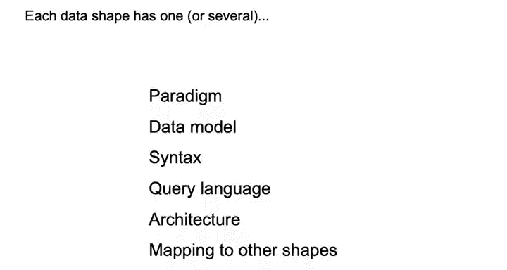

Right， so in terms of data models， we saw that for cubes， you can slice dice aggregate， roller。

 pivot cross tabulate for tables。 You can select project rename group joint sort union for trees。

 You can look up， navigate， normalize， deormalize。 go up and down in the normal forms， validateate。

 select project groups or some of the things from tables。 for graph， you can， find patterns。

 You also can select sort and so on。 And for for text， you can filter map group， aggregate。

 But now I I could even have edit for vectors that you can compute the distance。

 You can convert the words or the documents to embeddings as points in a vector space。

 And then you can you can use the cosine distance and indices to accelerate all of that。😊。

If you have now cubes， you can serialilize them。And you serialize from an in memory representation into back to text。

 So X VR can be used for cubes， C SV for tables， for trees。

 we have a playletho of them X M Jason be and row pros and binary ones for graphs。

 we have R F or XM tu and so on。 And for a bunch of bunch of text as it is。 In fact。

 in the case of text。 if you use a vector representation， then serializing。😊。

Kind of is the decoder part of an NLM， right， You know that an NLM has the the encoder and the decoder and the decoder basically produces the words that you see when you interact with chat GT。

 right， But it gets sterilized as as a text。 So it's kind of its own， its own syntax。

Then what about query languages。We have MDX for cubes。 We have SQL for tables， for trees。

 We still have the problem that we have 35 plus of them and that it's still not standardout as yet。

 but hopefully this is going to come for graphs， I gave you the beautiful news that just in the past few years that was standard out as as GQl。

 which is a niceO standardout， which is kind of cipher but in the standardout version And we have an extension of SQL that is also a niceS standardout。

's called SQL over PGQ and sparkkle that's for the triple store。

 So here we also have languages for a bunch of text or an information retrieval。

 you can use your own code。 But in fact， if you use a vector database or interact with with a language model you can just use natural language。

 that can also be considered a query query language。😊。

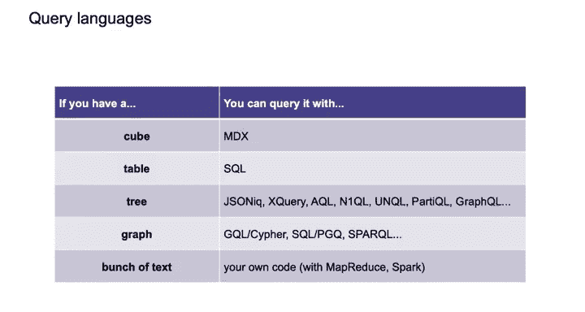

Number 4， we have homogeneity in the large。 This is the idea。

 It's similar to the keeping things simple。Is the idea that when you scale to gigabytes， terabytes。

 betaytes， exabytes。There shouldn't really be anything new， right， It's you。

 you scale in one dimension， and you have to keep it simple。 It has to be homogeneous。

 This is why you can have a table with a billion or a trillion rules。

 You can have a collection of billions， trillions， quite billions of documents and so on。

 But in the very large on the very large。Zoomed out a vision that has to be homogeneous。And。

One of the reasons for that is tied to what happened with the catastrophe。

 We can create an absolute catastrophe of what happened with our storage systems is that we manage。

 we managed to massively scale the scale up the storage。

 We can store a unit of volume billions of times more than we could store 70 years ago。

 But we cannot read it as fast in comparison。 We can still read it 25000 faster。

 but compared to the capacity increase。 This is ridiculous。 And so we are in really。

 really big trouble because we store more data， but now we are not able to read it as fast in production as before。

 And the la C， it's even worse than that。 So the la C， the time it takes to start accessing the data。

 It's a decrease of cost for the la C， the other in increase。 But the factor is ridiculously lower。

 And so this is why we we have to parallelize to solve the discpancy on the left。

 and we have to batch process to solve it。😊，On the， on the right and basically。

 parallellyzing and batch processing that goes very well hand in hand with this homogene in the large。

 The fact that we have absolutely enormous collections of， of a things that look similar on a。

 on a large scale。😊，嗯。And so that's what allows us to basically scale our route and distribute over multiple machines。

 as we've seen throughout the semester。Then we have heterogeneity in the small。

So that's the beauty of big data It variety。 Even though on a very， very large scale。

 you have collections with billions， trillions， quad billionlls。

 Qui trillions of records or objects or whatever it is you have in your data shape。 If you zoom in。

 then you realize theres a diversity of different ways the data can look like。 This is the case in。

 For example， the documents does。 where all the documents in the same collection don't need to look alike。

 They don't have to satisfy the same schema。 you can have a collection of the plenty of documents that have nothing to do with each other。

 Validation is optional。 You can still do it。 You can also do it later。 but you don't have to。

 And so that's the secrets that in the small， you can have heterogeneity。 And then in the large。

 you can have homogeneity for the for the scale up。 And this is how we can cope with real life。

 because in the 70s， there was this paradigm of tables that are highly structured。

 And so you kind of have to。😊，Quz real life data into relational tables。 It worked well for a while。

But then， we started noticing。So this is the reason why why we had to invent systems that could deal with data that is heterogeneous。

 And then when you want to feed it into a machine learning system。

 it's important that you have a way to prepare your data for machine learning that you can prepare clean it up and organize it in in features。

 for example， to learn on top of it， right So we need that flexibility to address this in big data system。

 And so big data system give you the whole spectrum from heterogeneous collections all the way to homogeneous schema validated collections。

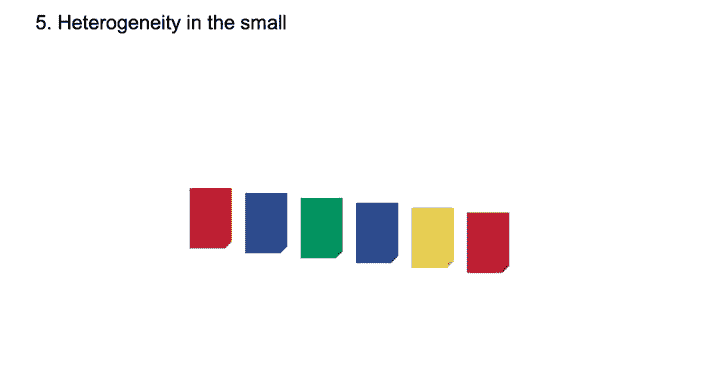

Then we saw that another aspect， aside from heterogeneity is the nested nest。

 The fact that if you deormalize the data， it can be nested。

 And this is when these flat rows that you have in a table。 If you start having tables in tables。

 then you get trees， collections of trees。 So hopefully now this is something that became natural to you that we can generalize tables as collections of trees。

😊。

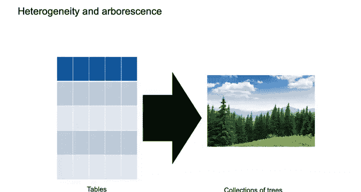

In this way。Then we saw that the， the data that we can have at the leaves of the trees。

 If you have a document installed， this would be the leaves of the tree。

We can have specific atomic types。 And the good news is that。😊，No matter what system you use。

 you're gonna have the same kinds of types。 You just need to learn the new names and see the limitations of every system。

 But now I'm pretty sure I can give you any system or even new system that will be invented in a few years。

 If you look at the documentation， you will， you will you will be in non territory because that will。

 that will anyway be something that looks like this， right， just maybe the names are different。

 But it's pretty much the same everywhere。 So if you have Json Jasonsonki X M S S mass Sql+ Q L Python。

 it's really always the same or the same kinds of of types。

 right So you should be comfortable with any system and you should be able to learn very。

 very quickly。😊，Then when we have this data in the small， it's very。Very often。

 you serialize it more often， actually than relational tables for putting them from download。

 You can download， for example， the federal Office of Statistics， open government data。

 all of that is basically supplied to you in in formats that that look like this。

 And and then you can you can use it back on the other side to pass it back， validate and so on。

 Allright， so this is what it looks like in the small。

 you should know also now that some formats are more efficient than others。 Now。

 you know that if the data is highly heterogeneous， then maybe Jason X M L makes sense。

 But if the data has been validated。 and every document in your collection looks the same and is valid against a specific schema。

 then you can use。Per， exactly。 So you remember well， okay。嗯。And if it's not in Paque。

 you can make it in Paque， right， That's， that should be something automatic that you have。

 You don't the adjacent data set before you start querying it for days。 St it in Paque。

 Con it to Paque。 And then every query is going to be faster。

Then the next lesson is that we want to abstract logical models from the physical representations that be the idea of data independence is really the idea that you don't care how the table is stored on the disk。

 You don't care how the cube is stored。 how anything is really stored。 You just focus on。

 on the model。Sorry， talking too much。So you want to abstract a away again。

 it's because our brain is like this。 We's， it's easier to process things within a logical model to just look at collections of trees or collections of vectors or or tables abstracting away from the physical implementation。

 And then the physical implementation。Can be done with engineers。

 data engineers whose job it is to implement that efficiently， Right， So you， you。

 you divide the work。嗯。So regarding the wrappings between the shapes。

The way I look at this is that when you look at programming languages。

 you've heard of tuuringcompleteness， right。Touringcompteness。

 it basically means that all language are equivalent to each other。 They。

 they have the same expressive power。 They can do all the same things， and you can， you can comp any。

 Comp any language to any other language。 That's the idea of the Turing machine and the computability。

😊，Now。I think theres something equivalent for the data shapes。 It won't be called of course。

 Turing completeness， maybe cut completeness。 I don't know how to call that。😊。

Is orthogonal to the data shape that you use， right？

 And so we've seen that with cubes because we can conduct cubes to tables。

 and then we can store that as a relational table。 And then what you do when you want to build the system that is cube oriented。

 You just need a layer on top of the relational table that hides this and exposes everything as cubes and slice and dies and cross tabulate and so on。

 In fact， we can do the same in a natural way， for example， we can store tables as trees。

 because tables are flat connections of flat trees， right by now， you know。

 trees can be stored as graph efficiently， because a graph is is basically a tree but lowing cycles。

 right， So a tree is a graph that doesn't have cycles。😊，Of course， that's only a mapping because you。

 you would not implement a document store on top of a graph database。

 because now we have native document stores that do that very well。 But if you wanted it to。

 you could construct a tree to to a label property graph or a collection of trees。

 Grs can also be conducted to tables。With tripers like three columns， you know subject object。

 subject property object。And a bunch of text now， I should actually rewrite sort of I。

 I just realized why， when I。Facttures， in fact， Im thinking of tensors。 All right。

 But what I want to say here。Is that。By transitivity。

 any shape can be converted to to any other shape。But then you might think， okay。

 saying that can be trivial because you could all always just serialerize it and putting put it as a single a single set in a table so you could do it in a trivial way。

 And the trick and that I got when I， I had a discussion with Anngeshteggger and she had this brilliant idea of what to formalize it with is basically the idea that you convert a shape to another shape。

😊，But in a way that that is bounded in terms of the complexity that you， you。

 you have a criterion that the， the， the， the complexity of the mapping has to be under a certain bounds。

 and that would basically go in the direction of something like terrain completeness。

 But this is just a general idea that to， to give you an intuition。

 Basically all shapes are equivalent to each other。 And then depending on your specific use case。

 you pick one or the other， depending on the data you have。Al right。Then the idea of the。

 of the the architecture。 and this is the direction in which things are going is that because of data independence。

 what we want to have is a fancy declarative language on top。The ultimate one is the voice。

 Then you have map produce Sp or any framework that basically handles all the distributed processing。

 but that's supposed to be hidden。And then the storage that is also hidden。

Where you actually store the。Start the data。 Alright， so if you look at the language landscape。

There's this idea that you have the family of languages。

 the oldest ones that come from software engineering， right， you had first assembly code。

 Then it evolved into these higher level languages like Java C plus plus Python and so on。

 Then you have the database languages， So the query languages where again。

 you have the equivalent of assembly code versus higher level languages。

 the equivalent of the assembly code would be these Apis in Spk in Mareuce in Poda and so on。

 where you， you explicitly call the transformations。

 But if you want something on a higher level done transformations。

 then you have a fullfl query language like Swell GQ， Json Nik X query M X and so on。

And then so that's what we focused on in this semester。

 Then you have machine learning and artificial intelligence。

 We already have this lowle API like frameworks like， for example。

 Tensor low cares and so on and so on。 But there are people who are working on higher level declarative languages for M。

 that's called declarative M。 So there are several kinds of declarative M。

 there's declarative M to define when you want to build your pipeline how to declaratively say what you want。

 And then there is declarative M to implement the algorithms themselves。

 And this is a very broad area of research with with plenty of people working on this。

 that is more recent and an ongoing。 but I would expect at some point that we also make a lot of progress on the highle languages to do machine learning。

😊，Alright， so that's the， that's the landscape。

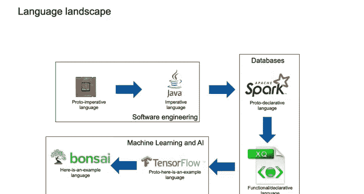

嗯。Then there is this project that has been going on for 20 years。

 and that I told you about the Ruble D B， and that should really be seen with a teaching aim to to show you that all of that can fall under the same h of connecting it all。

 A GFS spark Jason Parkque validation mapping to a distributed processing engine and so on。

 So so this is still this is still ongoing in the future。

 we might my wish because the students who work on Ruble D B。

 they learn a lot on the architecture of these systems。

 I wish it could be turned into a teachable thing in the sense that we could provide you with a mini Ruble D B somehow that every student in the class could a bit work on and just in a mini version of So that's something I have in mind for or later。

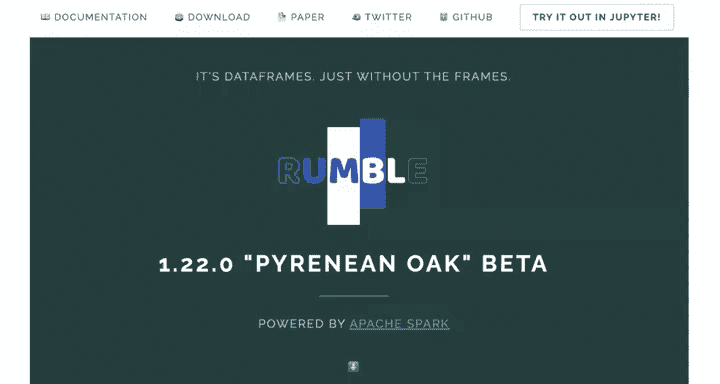

All right， then we learned seven to shut the data， this idea of cutting the data into pieces and spreading it all over place so we can call it chunk block。

 partition， split， and so on。😊。

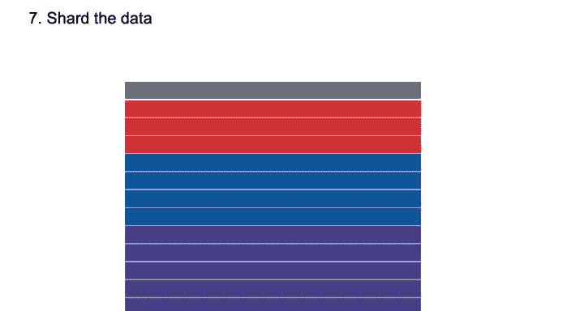

We saw the replication of the data， the idea that the the data， we don't want to lose it。

 So we need to store it multiple times。 So we saw it in HDFS where you store the blocks multiple times。

 replica sets in Mongo Db and so on。Number 9 is the idea that instead of building some fancy supercomputer like you would need for weather forecast in the case of big data。

 what we want instead is a lot of cheap hardware。 And again。

 that has to do with the fact that we want huge collections that are homogeneous that we can partition into chunks and then spread over all of these machines。

 So in， in big data， this is really the way that we that we do it。 Of course， you know。

 by now that this is not how a data center looks like。 These are not computers。 the screen like this。

 Instead， we， we stack them on in racks where these machines are actually just。😊，Flatened cubes。

 can't remember the the name of that。 like these these flat boxes。 Alright。

 we saw also that we have a lot of decentralized architecture in what we cover， not everywhere。

 But very often， there is the notion of a coordination like the name node， the H master and so on。

 and all these worker node that for on which we distribute the data and on which the processing is distributed。

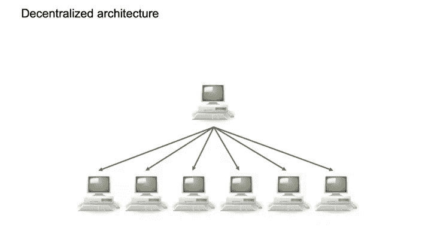

And finally， number 10 is the idea that we like to batch things。

 Baching really means that instead of looking at the records one at a time and processing the records one at a time。

 we process them chunk by chunk instead So this is the idea of batching， batch processing。

 And we also that in each base， this is how we put stuff into the storage layer。

 instead of every time there is an update writing something to disk that would be inefficient。

 we accumulate it in memory。 and then we write it just once on disk when the memory is full。

 And then you see this increasing fossilized the data as soon as we start to to merge all of these files into larger files。

 That's called compaction。 if you remember flush and compact。😊。

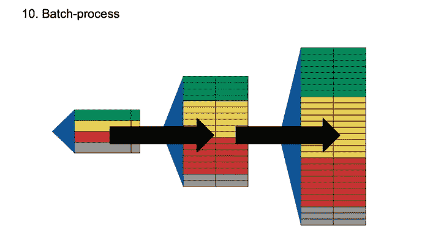

Al， so these are all the， all the lessons。 But what does it give us now for the future。

So in the future， you many of you will probably be faced with projects on diverse levels。

 So some of you will just be given data and you have to store and manage it。

 But now you have you are equipped with the knowledge to make decisions。

 Sometimes all you need to do is learn an existing product。 you join a company。

 They are using that product and you have to learn it。

 Hopefully now it should be easier because you have the general concepts and the general principles。

 So you can very quickly learn products in big data product based on that on that knowledge。 again。

 I insist it doesn't matter that we look specifically as PA or specificallyFs or specifically adjacent or adjacentic because these are just examples of more generic languages and syntaxes and models right So now it should be easy to learn any others。

 Some of you will have to make choices。 There's no fixed product that you have to choose。 Am I going。

To use H GFS， Am I going to use S 3， Will I use a relational database， Will I use a graph database。

 Will I use a document store， Will I use Hb， You have to make these choices。

 And so this is also something that you have not some knowledge to decide on these things。

 And finally， some of you， maybe not all of you， but some of you might even be involved in the design of totally new technologies。

 the ones that will be taught maybe in 10 years in universities。

 things that go beyond what we have seen。 But again。

 you have to stand on the shoulders of giants and and you know。

 reuse older lessons that what have been done in the past you have a feeling for what can be done。

 what cannot be done or and sometimes some of you will make the impossible possible with with brilliant ideas that nobody has thought about before。

😊。

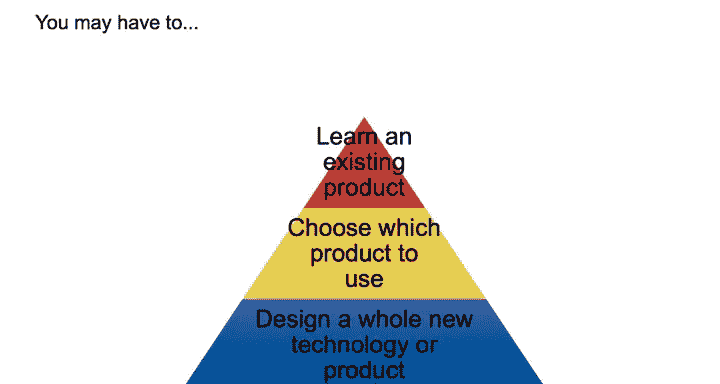

So in order to choose these products and what you need to consider， you always have to ask yourself。

 what is the shape of my data， What's the most natural way to look at my data， Is it cubes， graphs。

 vectors， trees。Tables， that is one of the things you need to look at。 The other thing is。

 how much data do you have， Do you just have a gigabyte of data that fits on a laptop。

 No need for a data center， or are you looking at terabytes or petabytes or exabytes of data。

 Then you need multiple machines。 for terabytes， it depends。 In some cases。

 you can actually process terabytes on the laptop In some other cases。

 you might need a data center if you need to spread the reading of the data over multiple machines。😊。

And then you need to ask yourself， what do you want to do with your data。

 Do you just want to filter it， Do you want to aggregate it， You know， you that also depends on this。

And the reason why this is important is that this is going to affect two things。

 It's going to affect your productivity。 How is it it。

 I it to get to write a query that does what you want。

 That's the difference between an hour or a month of work， writing your query， depending on the。

 the language that you are going to use。And second， the performance。

Is the query going to be executed in one hour or in one week， that also makes a difference。

And its these two together。 Theyre equally important。 productivity and performance。

 Some people focus on one or on the other in academia， There is a tendency to focus on performance。

 But what's the point of executing one something in one second instead of 10。

 if it takes you one week to write the the code， right。

 So you really have to consider productivity and performance together when you make your your design choices。

😊，And then every time you really need to constantly ask you yourself this question。

 are you reinventing the will， Are you just designing yet another language instead of taking one that exists。

 Are you just reinventing a system that people have already invented before。

You cannot imagine the time and the cost that you can save just by looking at what's already been done。

 So avoid reinventing the will。 That's really something， something very important。

 that's especially true if you are in a smaller company where the resources are are are scarce。

Allright。And then finally， as I told you before。Buying more machines or buying bigger machines。

 You really need to ask yourself if you can just optimize。

 if you cannot just optimize your code and write it in a in a better way。

 I've often heard of stuff typess。That managed to squeeze everything on a laptop。

 That makes a big difference when youre at the beginning of the company。

 If you manage to make it work on a single laptop or if you already have to pay a lot of money for for machines in a data center。

 Many use cases fit on a laptop。 It's not an automatic thought that you have to go to a data center。

 Many use cases。 A laptop is enough。All right。So now these definitions should be natural to you。

 again， the idea of parallelizing and batch processing has to do with the discrepancy between the capacity。

 the throughput and the the laancy。So now what's going to happen in the in the future。 So， of course。

 it's very hard to do。 And whenever you try to predict the future， you， you are often wrong about it。

 there is this general principle that in the short term。

 we tend to overestimate what's going to happen。 We。

 we think that autonomous scars are going to be tomorrow。 that an artificial general intelligence。

 We are very close to it。 So we tend to overestimate。 But on the long term。

 we underestimateimate when you look at 20 years，30 years，50 years。

 we tend to underestimate the changes that are that are going to to happen。嗯。

So I make I can make a few tentative predictions。 Some of them I kept。

 but now they are actually got kind of realized。One thing that I hope is going to happen， because。

 again， that's for everybody's sanitity for productivity。Is that all of these APIs， mapre。

 spark pondas and so on。They should disappear into the hidden layers replaced with these high level fancy languages or even natural language。

 So that should be made invisible。 They are very important pieces that are part of the architecture。

 but you shouldn't have as an as the end user to direct the interact with that。

Something else that that is slowly happening is the awareness of the importance of data shapes。

 The fact that that when you have a system， its tables， itss cubes， Its trees。

 Its graphs this is extremely important to to have a consistent model。

 Some systems try to support multiple shapes。 I think one example of that was called the poorly store。

 So it's a database matter than system that is able to support multiple shapes at the same time。

 In fact， they are often for every shape， extensions of SQL that deal with them。

 So SQL is a table language。 but you can extend SQL with data dies for trees。

 for cubes for for vectors。 this is something commonly done。

 Then you have multiple shapes at the same time。😊，My wish is that we are gonna have a standardized query language for every shape of data。

 right， We have this very big success with GQL that finally standardizes the the processing of label property graphs。

 It really needs to happen for trees。 So I taught you Jasononic。

 Maybe it's not the one that that will win， but it's very close and all the languages that process trees。

 They really are very similar to each other。 It's just a matter of standardization。 right。😊，😊。

And I like to， you， you know， X KD， right， So there is one I really like like situation。

 There's 14 competing soundout。 Like I am trying to keep a list of them。 It keeps growing。

 like whenever there's a announcement that somebody else discovered。

 we need a query language for trees and they invented yet another one。 So I just added to the list。😊。

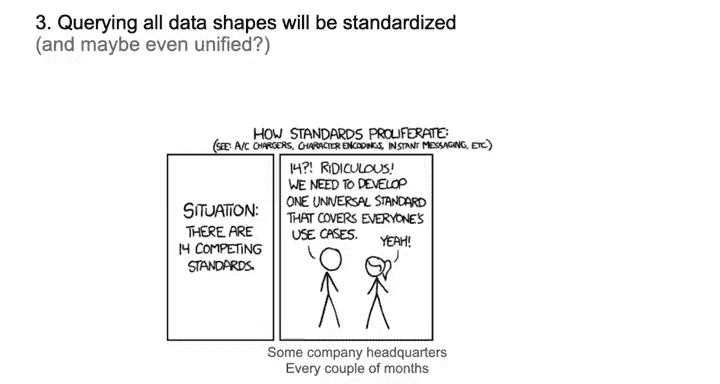

And so there's also people who try to unify them。 But then they。

 they just make these big announcement。 like， yes， the best language ever， A Q L， blah bla， blah。

 blah， blah。 And then you just end up in a situation that you just add one to the list。

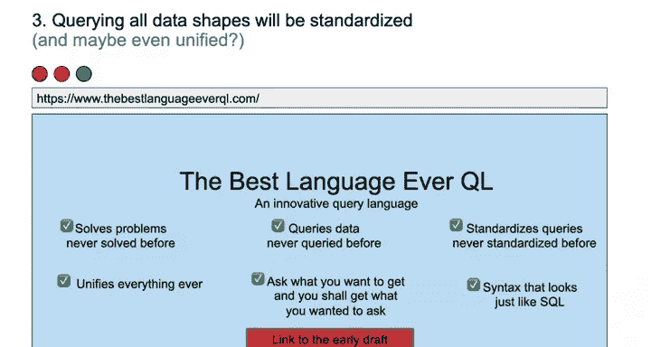

The only way to solve that is not to do it on your own。

 You really need to get people around the table from all the companies who talk to each other， right。

 Xqueries an example of that。 That is that there were like Google no Google IBM oracle Microsoft and so on where around the table This is why I'm teaching you JasonO because that one is very close to the to the Xqueries stand up just a bit more intuitive with Jason didn't want to scale you with X ML。

 But basically， the only way you standard out is by getting people around the table。

 You cannot stand outise on your own in your corner。Alright， but I still dream of that。

 It happened for graphs。 G， Q L。 I have no reasons not to think it's going。

 It's I have no too many negatives here。 I have no reason not to think。That it will will not happen。

 Okay， I'm lost。 I， I think it will happen。 I hope it will happen for a， for for trees。All right。

Then hopefully UI are going to to be more and more used in practice。

 you might have used heardd of no codes。 So some some subs try to to do things in such a way you don't need to code。

At that time， it's not clear if it's going to work or not。 There's still a lot of work ahead。

 to get to that。 But even better than your eyes， we we we would increasingly talk with the machines that I already had seven years ago in my course。

 There was no chat GT。 But now it's becoming clear that this is actually happening with a vector databases and large language models。

 But the one thing that is missing is that we we cannot just have an LLM alone by itself。

 There's hallucinations。 cannot even do a multiplication correctly。

 What we need is the LLM together with some system that is capable or reasoning or of querying you know。

 like so the database systems are still very relevant behind such such a voice system。

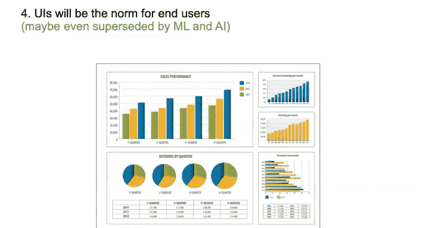

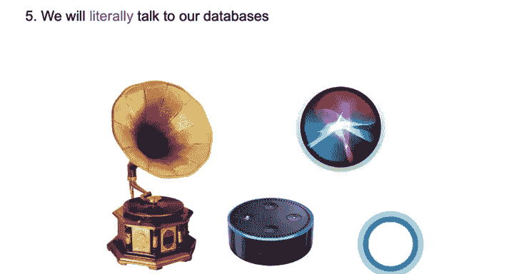

Another prediction is the idea that data can be fully fungible。Just like water or electricity。

In fact， what I mean with that is kind of what is happening with data cubes and triple stars。

 when you have when you have a triple store， you can decompose a graph into triplepers。

 like atoms of data， for cubes， you can also decompose a cube into just the small cells of data。

 And that's the spirit of triple stars and of data cubes XBRN。

 And I think that triple stars and data cubes are very particular。

 because these are the ones which I think the smallest atomic chunks of data you can ever have。

 And when you start having systems with an absolutely gigantic number of very small atoms of information like a set in a cube or or an edge in a graph。

 then you reach what could be considered a fungibility of data where you can have aout standardized way of exchanging data。

😊，There is also， of course the notion of data money properties。 So of course there's all the hype。

 So it's very important not to go into all the hype and to zoom out a little bit on on what's going on So what's really happening with with bit and the blockchain is just that we found a way with a distributed system to keep a register of who owns what。

 this is really the idea of the blockchain。 And in a way that is decentralized and and and in a way that even if you have bad actors that try to connect to the system。

 they can still not overturn the contents of the register right So there is this idea that there is some convergence in there。

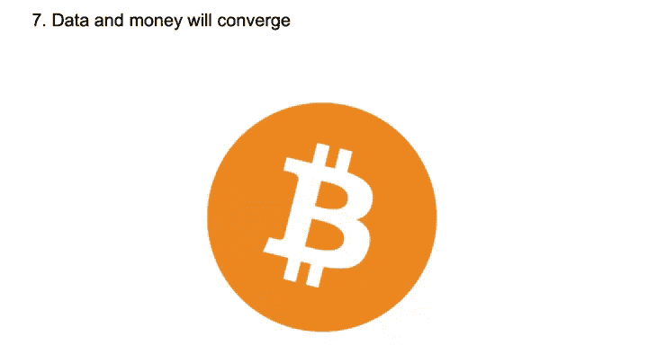

嗯。There is also at the same time， the idea that especially the discussions in the U on data protection in Switzerland that people need to keep control over that data。

 You don't want the data to just be sent everywhere without any control and you might have remembered a few years ago when we all suddenly receive these emails from all the companies that we need to consent on some processing of the data and then all these cookies popups popups that we get in the browsers。

 So this is ongoing that we we try to be careful with that。 And of course。

 that's something that we didn't tackle in discusscourse in big data law and policy maybe a bit more。

 just because you know how to process all of that data doesn't mean you should So you know the idea that all of these knowledge comes with a lot of responsibility and you have to think about the implications of what you are doing and if you're allowed if the data that you're processing it's ethical to。

To process it and of course， legal。

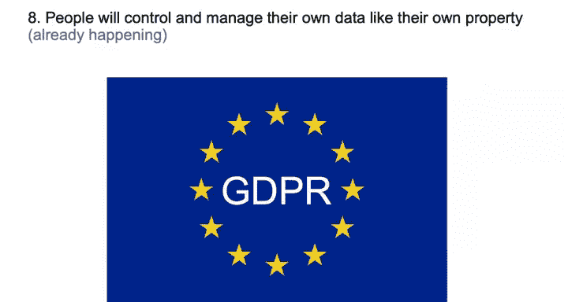

嗯。Then there is the idea of how machine learning fits in the picture。

And so here there are two directions。 And the idea is。

 there's this competition between the ML researchers and the database researchers。

 Is M going to eat databases or are databases going to eat M， And we don't really know at the moment。

 but people try very hard in both directions。So there is the idea that machine learning can be built on top of database management systems。

 That's the case with vector databases， for example。

 that's when instance of artificial intelligence on top of the database management systems。

But there are people who try to do the opposite and who try to to replace all of the single components of the database management system with machine learning。

 An example of that that's at MI I T。 where they are trying to replace the indexds instead of the hush index or or a tree index。

 You have a learned index。 You basically have an index structure that learns how to look up the data。

 So this is an example of that and that might also happen that we get AI enhanced database management systems。

 But， of course， you need to be careful because that might have an impact on the correctness。

 when you start doing that。😊，Then you have quantum computing。 that is yet another hype。

 We are now getting very close to the to the break。

 Whoever heard of quantum computers or understand how that means quantum computing。

 Many of you already。 Well， this is really， really nice。

 So the idea of the quantum computer is really that instead of bits， you have Qbits。 And in fact。

 you can process data in parallel on on superposition of states。 But there' are two catches。

 The first catch is that you， yes， you do it in parallel on multiple states。😊。

But you can only get one of the， of these as results。So that's the first catch。

 The second catch is you don't even get to pick which one。 The。

 the result you get is randomly picked from all of those you could get。

 So these are the two limitations of quantum computing。 But in spite of that。

 we still manage to to get apparently algorithmic complexities that go beyond what classical computers can do。

😊，But the one thing to keep in mind is that in spite of all these announcements that are made by these companies that they can solve in a few seconds。

 something that takes heilions of years。You need to ask yourself， is that problem useful。

 because very， very often what they do is that they solve a problem very specific to quantum。

 but that actually doesn't have yet a real life application。We're going to stop here。

 I just have a few more sites to go， and then we'll proceed to the wins right after the break， right。

 So and respect the the break time。 So see you in 15 minutes at 15 past  three。

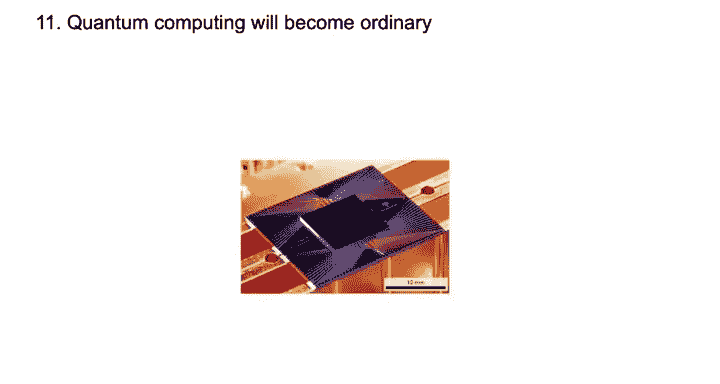