# 苏黎世联邦理工《大数据｜Big Data - ETH Zurich - Fall 2024》中英字幕（deepseek - P49：-49-15. Outlook and quiz game (2_2) -.zh_en - GPT中英字幕课程资源 - BV1sHPKeoEJU

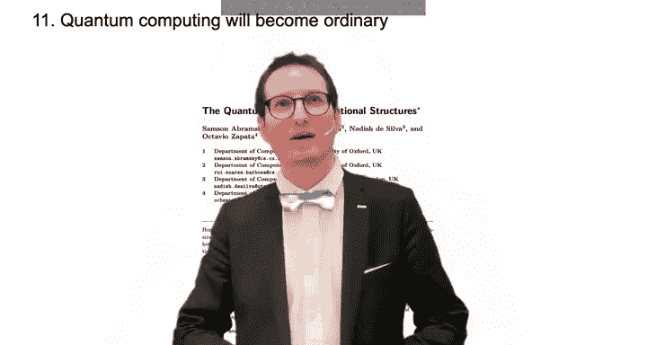

Welcome back， everybody。So I talked a lot in the first hour and I'm going to try now to wrap up on the few slides that are left so that we have time for for the quiz。

 So the last aspect that I wanted to say is that in a way you can treat the universe as a database and as a computer while your database。

 where I have in mind some work at Carnell University by Johannes Geca about the implementation of the real time strategy games like the settler civilization and so on where in fact。

 the updates of the state of the game can be seen as database updates。

 and you can consider it as a database system。 But then if you extrapolate。

 could it be that the world in which we live is actually a virtual reality with a database and so on like to see the universe as as a computer And so these are also just like when you get into philosophy and questions about live the universe and everything。

 then it's kind of interesting to also look at it in this way。 like it's kind of antienttropy。😊。

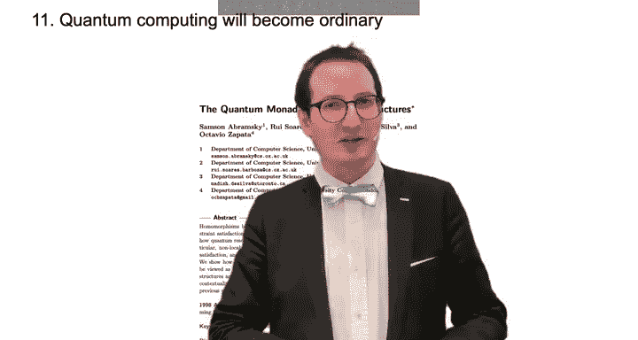

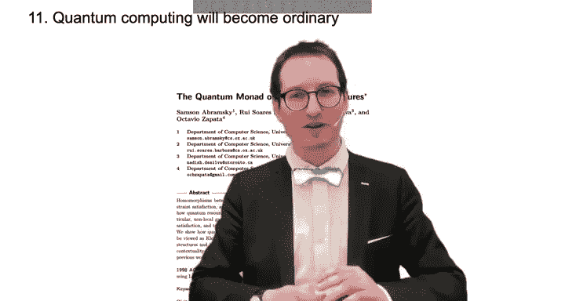

Right because entropy would say normally when the system evolves it just evolves into more and more disorder。

 but in fact， what we are observing with life and civilization is the other type that we keep building structure and so maybe the more we look into millions or billions of years into the future。

 the universe actually becomes more and more structure。

 but anyway now we are getting really out of scope of a database lecture， just foot for。So right now。

 what I would like is an enormous applause for the Ts where they are ring with the mess。😊。

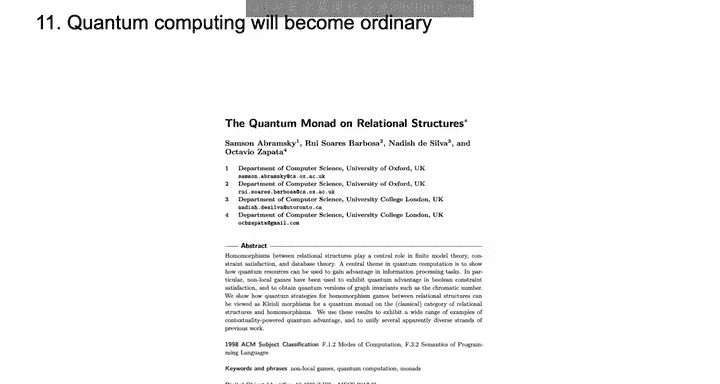

That was a longer plus。Totally dissolved。All right， so。We had a course evaluation。

 So every year it changes one year is going to be the course in itself。 and every other year。

 the exam。 So thank you for fitting it that gives us feedback on things that we can improve in the in the future。

 And so normally， the cost evaluation should be made public。 So I'm showing you the results。

 of course， as a teacher seeing that you actually understood all the stuff that I have been telling you is is the best reward that a teacher can can get。

 the T team also got very very very good evaluation。 So congratulations。

 Some of the Ts even got named in the comments。 So then I forwarded to to the Ts the very nice comments。

 and and I' am sure that it also feels great for them to hear the positive feedback right And also what I like to see is if you're able to explain the material to younger students。

😊，Because that's the best way to learn is to teach， right， already this idea。

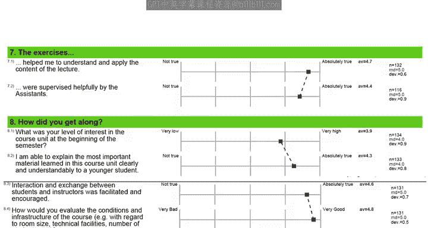

And then these two in the middle， the goal is to be in the middle here the required knowledge and in comparison to the other courses。

 but my personal goal is to be a bit on the left So I'm happy with that what I had in mind is you heard of the packet reform right the idea that we want to give you a bit more air to breathe between the semester and the exams so in 27 there is the ongoing project to bring the exams closer to the end of the semester to have more vacations and so on。

 And part of the packet project is to address the workload of the students。

 So I know that I mean I see it even with with some of the students that I might have supervise that it's a very high workload that you have and and we really have the intention generally at TH to address this and so I'm very mindful of the workload that I put on the student shoulders and to not overwhelm you with too much material one of the aspects of what's going to happen in。

In packet， is that the number of weeks？That they are， for example， in the first semester。

 apart from one more week of break in the middle， is that the。

 the material will go from 13 weeks to 13 weeks， right。

 So there is this desire to compact a bit more to have slightly less and higher quality knowledge。

 So， so yeah， that's what I wanted to say about it。

 I prefer to see it slightly to the left and slightly to the， to the right。

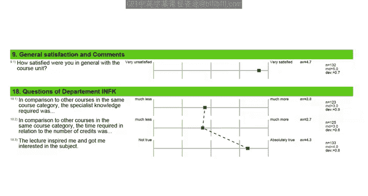

Okay。Then a few words about the exam。So everything you've seen in during the semester is materials。

 So the textbook， the slides， the the theoretical and practical exercises， the click of questions。

 even though， of course， the structure of the click off question is farther away from the exam because the goal is to make you think。

嗯。😊，Oh， what I forgot to say about the evaluation is some of the feedback that we that we took and we address is we are aware of the docker。

 The fact that theres many do， different do。 There is the aim of unifying them。

 We first wanted to do it this semester。 But for some reasons we we had to postpone to next semester。

 But there is this goal of having less doctors and more unified。

 We try to log all of the errors that you have had so that we keep an FAQ of the known problems。

 for the next semester。 So thank you very much for the for the for the feedback。

 So this is on our minds。😊，Some of the weheads did I get as feedback， for example。

 some some people would wish more text on the slide here。

 the idea is really that there's the textbook which was the popular request or a few years ago and the idea is really that the written form to study the textbook the slides is just behind me when I speak right I'm actually packed of the slides when I when I when when I explain things on on the recordings。

 But this confirms that everyone has a different way of taking in information。

 Some people prefer to read it in a quiet room。 Some people prefer to listen Some people prefer to practice。

 And so I'm trying to give you all these variety of of ways to to play and learn the material。

 Allright， what can I say on the exam itself。Is going to be a computer based exam in on an E TH computer。

 So it's not on your own devices。 dont need to worry about that。 E TH devices， Windows， no Docker。

 it's just virtual machines， Everything preinstalled。 and it should just work。

 These will be model questions。 At most 60 questions。 Some of them will be programming questions。

 And I told you it's just going to be Postgql， by Sp， Sp SQL or data frames if you prefer。And J Soik。

The data we give it to you in advance will give you the the Jupyter notebook you're going to have on exam day。

 including the data sets。 It's going to be to be packed。 I think it's already in Docker V4。

 I think we check if it isn't。 But normally in Docker V4。

 you also have the full 2024 notebook that you're going to have at the exam。Alright。

 so most of the questions will be theoretical， but there will be in four of the parts。

 some questions where you ask you to write a query。 We grade the answer。

 We also ask you to copy paste the query， but this is ungraded， right。

 The reason we want the query is to understand if many people give a different answer。

 we need to understand where that came from， and that helped us grade the exam and grant more points。

 if we accept more more answers。So this is the this is the I。 So really， if you can put。

 even though it's in， try to copy paste your queries。

 This is really helpful to to us to to have a trace of that。During the exam。

 if there's any technical problem， raise your hands。

 What typically happens is that there's the Ts that can do the first level support。

 Then there second level support with a team from the E TH digital exams team。

What happens is that we notes down the time and we credit it back to you。

 So if you lose five or 10 minutes because things are frozen or something。

 really raise your hand when that happens so that we can note down the time。

 And then you get it back at the end。 But there is a problem that you can often solve alone is if just a query hangs。

 often especially with Postgres Ql， all you need to do is restart the Jupyter kernel。

 you can just pick it in the menu， restart kernel。 and that that often does the trick， right。

 But if it doesn't Su then the Ts are here for you。

 and and we also a team of of experts of the infrastructure。

 So it's quite a challenge to run an exam for more than 400 people。

 probably is going to be spread over multiple rooms。 but we have a wonderful T A team。

 So So that should all all work well。😊，Alright， and we。

 we'll send you more information by e mail about when we know the， the。

 the location we'll give you the， the， the， the room that each one of you will have in advance to to diminish your your stress。

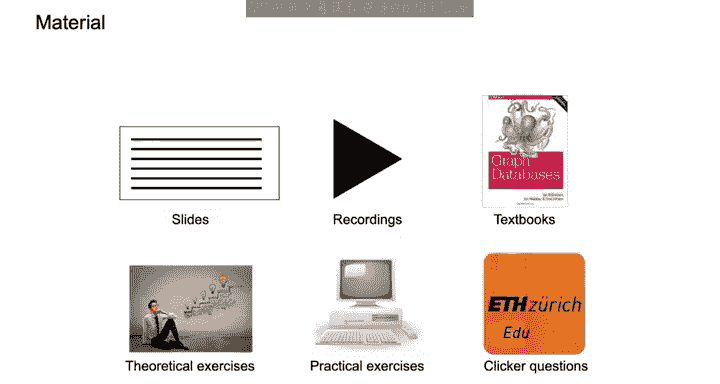

嗯。Alright， and now we can move on。To the to the  queenz。

Do you have any questions on the exam before that。Yes。😊，Maybe regarding the queries。

 is it possible that you have to use a certain kind of language for this particular question or like this one is with a Pi spark or similar。

So it's going to be plus S Q。 So the SQL， Pythons or Py Sp， like you did in the exercises。

 Sp SQL on data frames and Jsononic， these are the four。 Yeah， but is it not， for example。

 forbidden to use Jsononic or some kind of。 Yeah， that's a very good question。 No， no。

 it's not forbidden。 If， if you think that Jsonic is the greatest language in the world and you want to solve instead of P Sp or data frames。

 then use Jsonic。😊，Right， so absolutely， we don't care if the answer is correct。

 The answer is correct。Right， you can also use it to double check， right， if you。

 if you use multiple approaches to to further data。

 the only thing you can't do is solve the Postreq L queries with something else because here。

 you really need to be connected to Postreq where the data is。

 But I think that for the the other three is just adjacent lines file。 So you。

 you can really change use another one。Right， thank you。All right， yes。

So to the extent that Pipark and Spar SQL can both be used for some of the same problems。

 Are we going to be able to choose between the two of those orre going to be required to。

 So the way the exam is formulated， we specifically you for these questions。

 use by Spk for these questions， use Spk a SQel and for these questions use J Soonics。

 we really tell you。But all the spirit of my answer to the other question is。

 if you want to use a different technology on the same data， you can。

 because what we grade is the answer。 We， we don't grade the the the query， but the answer。

 So if somebody found the correct answer using spark s instead of by Sp and the answer is correct。

 and you get the points。 right， That's the spirit。 Gosh， all right。 So。

 so would it make sense then to like memorizes。On the machine。 we it's。

 it's quite tough because we need to actually download and and download the entire documentation。

 We also have the constraint that it has to fit on 50 me that E T H gives us。 But we we。

 we will try to give you the Postql documentation Pis SQl Jsononic。

 So we'll try to have that on the exam machine。 We will show you this documentation in the Mo。

 We'll give it to you in the Mor so that you see what it looks like。

 Just keep in mind that you're not connected to the Internet so you can not use the full text search。

 You cannot search for text。 So it's a good idea to familiarize yourself with the structure of the documentation so that you can easily navigate it。

😊，Alex。So I had a very similar question， does that mean we don't have to learn anything by heart or because you said you will try and I'm traumatized F5 or 60 of ETH？

No， I I I， I don't recommend that you just say， okay， the documentation is there。 I'm not learning。

 That's absolutely not recommended。 Even in real life， it's。

 it's always a good idea to know some things by half。 In fact， I compare that to indices。

 If you have a hash index or a tree index， then a query executes faster。If you learn by heart。

The grammar of the language and you you're able to directly write and know transformations by heart。

 It's as if you have a hash index in your head。And having a hash index in your head aates you solving the exam。

So that's how I would put it。 It is beneficial to learn some things by heart in real life。

 that makes you， that makes you faster。I agree， but do we have the documentation or is it like is it on is like a best。

 you know， you try and if it doesn't work， it doesn't work or is it can we count on it there being documentation not like I guess that's my question。

嗯。I would say you can count on it because the reason why I think I wasn't comfortable saying we will。

 but we try is that I'm currently fighting with getting it under 50 MB。 that's that's the reason。

 But I think that even if it's slightly over it， I can just kick out parts that are relevant to the to the exam。

 So so yes， you'll have documentation on on exam day。 Yeah you very much。 It keeps growing。 I mean。

 it was under 50 MB forSQL。 And then the new option is like 51 or 52。 And I'm like， okay。

 how do I remove one or2 mebyte of that to satisfy。 Yeah。

 you said that we should provide the queries， but they're ungraded if for some reason we forget to provide the query will we still be awarded the points。

Yes， we we we it upgrade graded， even if it's empty， it's still un graded。

 If the solution is correct， If the result is correct， this is what we grade。

Try to respect the formatting。 We tell you like use points instead of command and so on， No spaces。

 We still try to be nice。 We still try to to grant points。

 if it's small things like that by respecting the formatting instructions。

 you make it easier for us to great and to great correctly。 So that that also avoids error。

 So if you can try to respect the formatting instructions that really， really good good thing。Right。

😊，Yes， so maybe again about the documentation。 Is it like its still subset of the documentation or it is isn the entire documentation that is again。

 rather hard to navigate。 It was the entire documentation last year because it was below 50 mebyte boxpar。

 I needed to cut in into several pieces to reach below 50 mebyte So so it might be。

 if it's slightly above， I might remove the irrelevant things。

 but I'm doing my best to have it as as complete as possible。 I mean， if you think of it。

 a lot of the documentation is totally useless less in the context of the exam because the queries we use it's really the some of the core the core path of the language。

Yeah， yeah， you know， we added the documentation。 We give you the。

 the data in advance just to make you feel better in the first years where we had the exam。😊。

There was no documentation。The data sets were not shared in advance。

 The notebook was not shared in advance， and the students did well。

So by giving you the data in advance， the notebook in advance and the documentation。

 we want to diminish your stress。 We don't want to increase your stress even more because now you have to bring out the documentation。

 Right， the goal is really to， to， to， to， to， to diminish your stress and and make you feel more comfortable on。

 on the exam day。Right。不。I mean， I guess this is not the case。 but it was the notebook。

 You have a notebook。 And but you don't have the questions。

 You just have like an introduction to the data set or Yes， exactly。 And you， you sit in advance。

 You can see in the docker。 the previous years， it's very similar， right。

 So the the the notebook is just as an introduction to the data set and some some queries。

 but the exam is in the Moodle。 So the exam only the Moodle count。 The questions are in the moododle。

 and you should give your answers in the Mole。Like it' just to run the queries。 Yep， it's exactly。

 it's just to run the queries。 absolutelyol。 Yeah， alright， Should we move on to the。

 should we move on to the game。Alright， so here's how it works。

 I'm going to ask you plenty of questions in the clicker application。

 I'm going to ask everybody who wants to participate to stand up right now。 So everybody thumb up。

 It's， of course， it's not obligatory。 But everybody who wants to participate。 Stan up on Zoom。

 please raise your hand。😊，Everybody on Zoom who wants to participate， keep your hands raised。

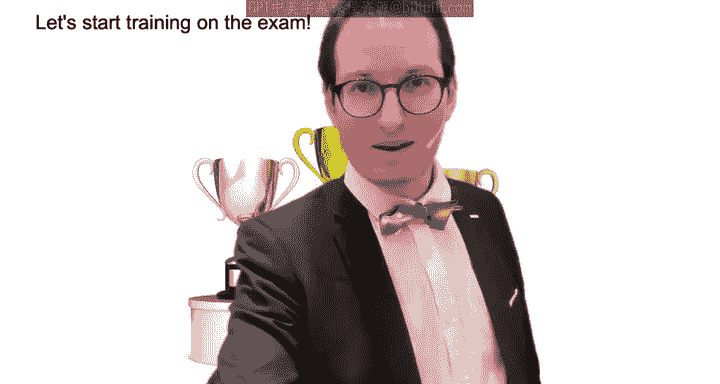

And so what's going to happen now。So I need again the silence so that I can explain。

So here's what's going to happen。 I'm going to ask you questions。

And you have to give correct answers for as long as possible。The。

 the one person that survives the longest， like everybody disappears in between。

 and there's one survivor。 they get the trophy。 The trophy was printed by Maccos。 So Macco。

 you can bring now the， the trophies。 You can show them to the to the room that was done in the student project house。

So one of the trophies goes to the one of you who will。I receive every。嗯嗯。Yeah。

Yes， exactly， so。😀。😊，So this is the trophy。 Yes， exactly。 you can barely read it。

 So it's written a winner of the lecture quiz in Big data，2024。😊。

And the other trophy is because we also have a competition between you and the T A team。

 So now the question is， will the one of you who survive the longest also survive longer than the T A team。

 or do the T A survive longer， the Ts can speak with each other。

 you can you will write your answer in the element chat every time for for regarding your answer And then this goes either to you。

 the students probably meaning that land in the F office if you win， and if the Ts win。

 then this goes to the to the Ts plus。

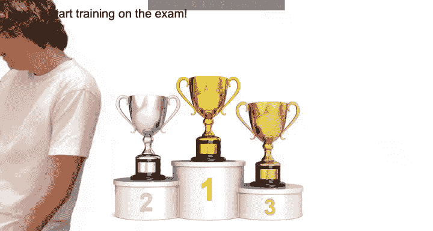

Plus plus plus， I also have these sweets， so chocolate and so on。

 so this goes to the student winner who survives the longest。

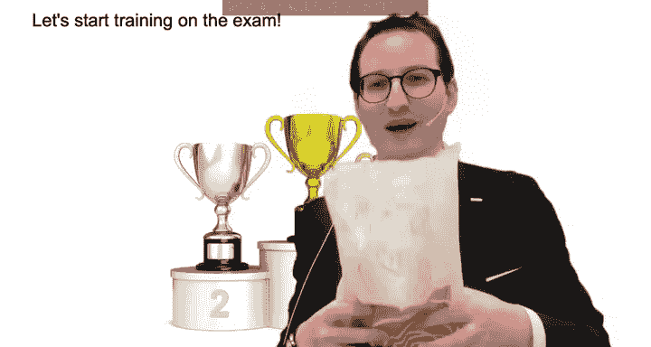

So we are going to start， that's the ice ker Hoed， that's how it's basically called on television。

So， let me go ahead。

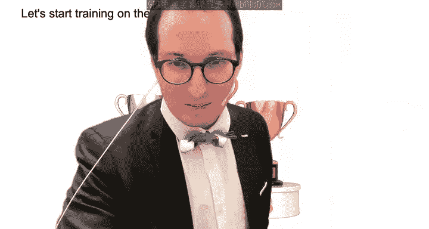

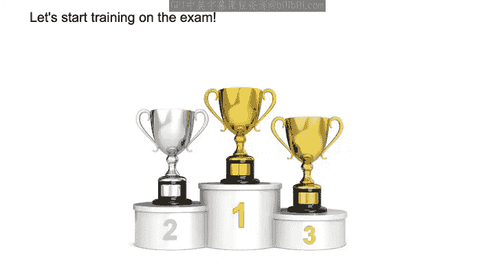

And go there。So you need to connect to the click app。And I'm going to ask the first。Question。对。

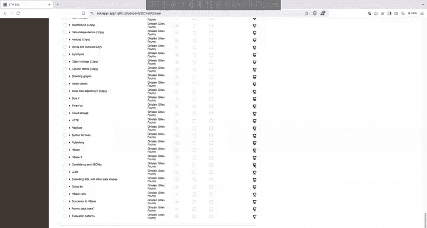

So SQL was still long made for relational ortular integrity， domain integrity， Anaatomic integrity。

 Jsononic relaxes three conditions。😊，呃。Accept relational integrity or accept domain integrity or accept atomic integrity。

 Or none of them。 it relaxes all three。So now you can enter your answer。For the survivor。

 it's all based on trust， right？ It's not like there are a million francs to win。

 So there is no nothing great at stake。 So I trust you that you remain standing if you got it right。

 And and after if you are eliminate it， you can continue to answer， right。

 you can continue to participate， you should just be seated then。So for the T A team。

 you can speak with each other and the data。You wrote it in the element chat。 Allright。 Very good。

 You will understand very soon why we are doing this。You can't know it's in the T A team chat， right。

 yeah。不清。No。All right， so I give a bit more time for the first question to caddyrate so you get the time to open the trigger app。

And as time at Up season will keep acceleratingating and giving less and less time so that we determine a winner。

As everybody onself， does anybody need more time？Alright， no complaints on Zoom。

 So now this is the the tricky part。 So I'm going to basically ask every time the T A。

 have you recorded the answer， You have to be careful not to give you to give me the answer yet。

 because then I stopped the， the the quiz。 and then you can give me the answer。

 So have you recorded the answer。 Yes， so I'm going to close it。 and your answer was。😊。

None of them exactly， it's recorded on the TA team so we can check that this is indeed correct。

So indeed， that the beautiful world of document stores， we relax everything。

So now what happens is that if you got it wrong， you can sit， you should sit。

 and if you got it right， you remain standing。 All right， all based on trust。All right。

 and so on Zoom， if you got it wrong， you just lower your hands， basically。

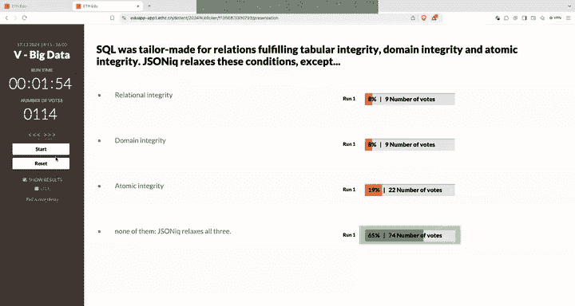

All right。

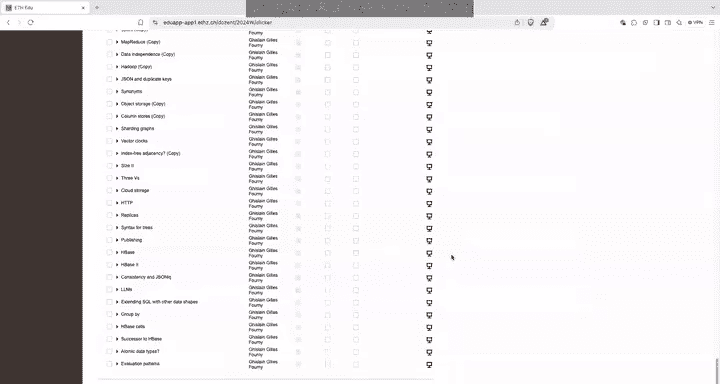

Its not one。You can continue to answer if you're seat， of course。

 but you're just no longer competing for the winning streak。

Which shape of data is most adequate to search for relevant textual contents， tree tables， graphs。

 vectors or cubes。😊，So I give you some documents。And you want to look for other documents that are very close demonally。

Trees， stables， graphs， vectors， or cubes。Yes。当。别。Alright， as everybody until their answer。

 no complaint form off time。 have the T A S entered the answer in the TH chat， yes。😊。

And the answer was vectors。 Yes， indeed。 That was the Oracle gas lecture last week， right。

 is's the idea that you can encode words and documents as emddings in a vector space。

 And then you look for other documents that are very close in that vector space。

 You can use the cosine， the Eucideian distance and so on。😊。

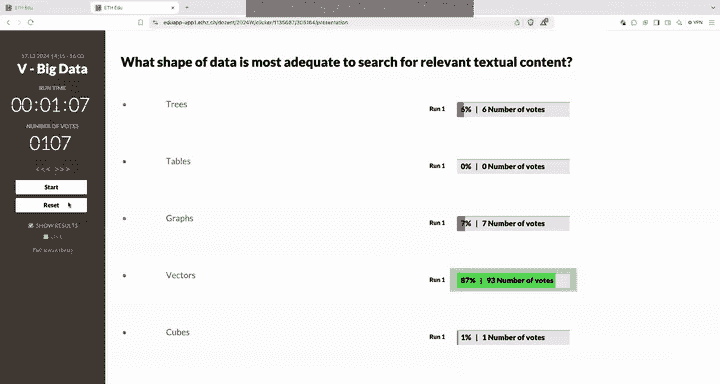

All right， so。Here's another one。

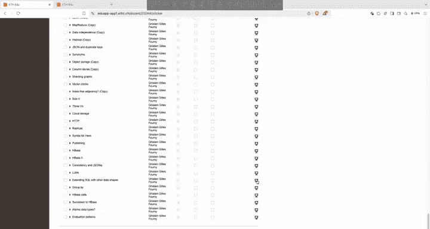

Which ones。Of the following data shapes were superxed in extensions， data types。

 additional clauses and so on to the SQL language， whether standardized or not。Mipper cells per。

Was it trees， graphs， cubes and or vectors。Is it a single selection。Oh， really。 Oh， okay。

 What am I going to do。Okay， so here's what we are going to do you since I trust you anyway on the results。

 you have to think of the combination of the of the of the four in your head and enter one。

 then I'll tell you which one or which ones are correct and you you need to have entered all four correct So your combination of four your subset of the four must be correct once all this question correctly right。

Alright， we'll do it。 We'll do it in the in this way。 But you enter。

 enter one of the one of those in the subset as the correct answer。对。社会。This挺你可以。Thank对。没事没以。我的还你。

Thank。Alright， did everybody have time。Nobody complaining， do the T have answers。 So again， you。

 you should have a subset in your mind in the power set。Of the set of four。

 So you have an answer in the chat。All four of them。

 there is an extension for trees it's arrays and object types in Pa GsQL。

 there is an extension for graphs that sl over PgQ。

 there is an extension for cubes that group by cube group by order and there is an extension for vectors it's the vector data types that you saw last week。

 so all four of them。😊，All right。

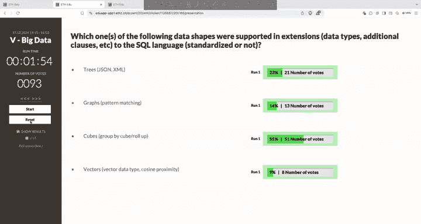

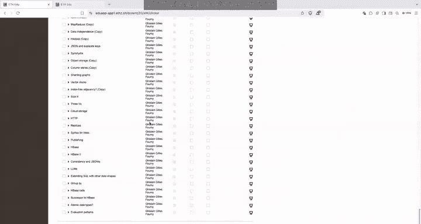

Next question。Which one of the following clauses does not exist？😮，In Postgres， Q L， Group cube。

 goodbye roll up， Group grouping says， goodbye Greece。Which one does not exist。

So this is the particular extension of SQL to support data cubes， as we imagine。One of them does not。

Exists。Has everybody un an answer？Yes， you see no complaints。 Ha the T A team the answer， yes。😊。

And the answer of the T A team is。Goodupby grid。 Yes， don't know why。 it's not marked。

 but cube exists。 Roup exists。 grouping sets exist。 It's good by grid that doesn't exist。

 That's what we saw two weeks ago。Alright， we already have the a diminishing number of the survivors。

 and the sixth。

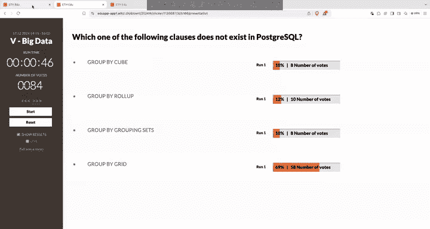

On zoom。

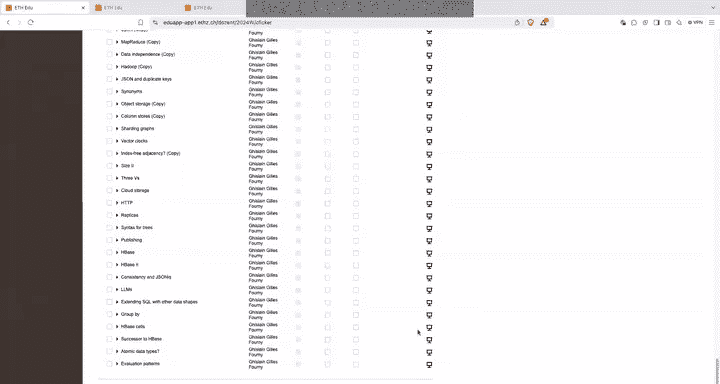

What is the maximum order of magnitudes or the size of data that you can store in a single edge based cell。

 white collar stars without causing performance issues。

Can you go all the way to 100 k to 10 MB to 5 GB or to 5 TB in the same cell。对。块钱。Yeah。

Has everybody entered up the answer， at least everybody who is standing。IHe no complaints。

 has the TT mentor an answer？Yes。😊，And your answer was。10 megabytes， exactly。Alright。

 so typically Jason， XML， videos， and so on。

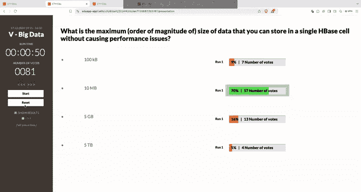

Allright。

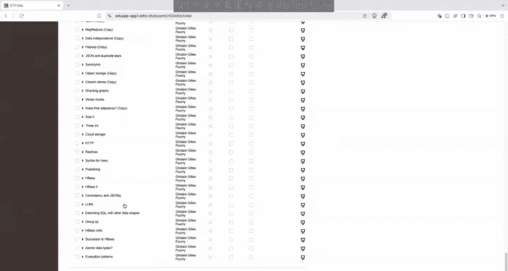

What is the current system used by Google which succeeded Big table。

With support for exabytes of data。In the same system。Is its span spins to all Kubernetes or age base。

对。好。对。Has everybody on the answer？I hear no complaints， has the TATT man an answer？Yes， right？

And your answer is。Spner， exactly。Kubernetes has nothing to do with with Big table， right。

 We are talking about white cotton cells。And age base is the name of the open source version of Big table。

 but this is not what Google uses。Page base is the Hadoop open source version。Of big table。All right。

How many survivors do we have in the room，1，2，3，4，5，6，7，8，9，9 people plus on Zoom。3， so 12 in total。

 And the TA team is also still here。

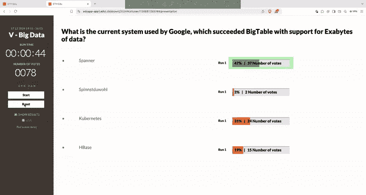

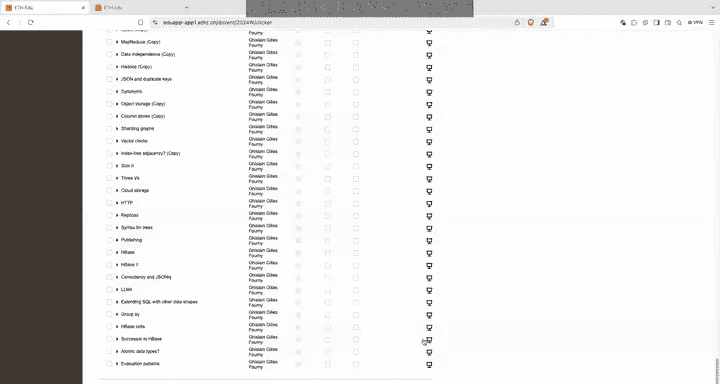

Which of the following is not an atomic data type。String your rate date takes binary。

Which one is not an atomic data type。我知道。对不。不行。Ha everybody entered out an answer？

I see no complaints as the TATTman had an answer。Yes，给。And the answer， oh。Oh， what did they do？

It it said， okay， I clicked on the button。 Well， I trust you on that。 So what did you say。Aray。

 exactly， array is not an atomic value， right？We have1，2，3，4，5，6，7。7 plus 3， so 10。

Which of the following is not a physical evaluation pattern in a query engine like Mugo Dbi。

 materialized execution， streamed execution， party execution， dematealized execution。

One of them is not。One of the physical evaluation patterns to compute the results of an expression。

不什。不是。是。Has everybody answered？Baly those standing。Yes， and the TT motor so。开。De materialriized。

 Allright， indeed， materializes when you store the entire intermediate results。

 stream business like Netflix。 Parette is when you spread it over multiple corer machines。😊。

6ix plus three so 9 survivors。

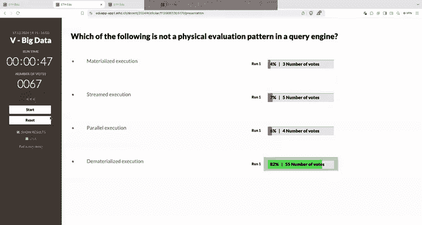

So now I'm going to hit a little bit here。

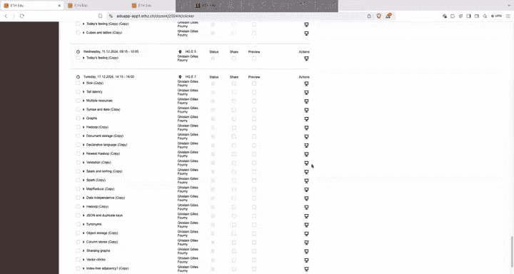

In 2014， Spark broke the gray So Record， which is about sorting 100 terabytes of data。

How much time did it take， Fox back to store 100。Terabytes。Of data。34 seconds， 1。4 minutes。

 23 minutes of three hours。So the gray salt， that's a benchmark for comparing systems。

And every couple of years， there is a system that breaks the recordss。大家好。开起了。

Has everybody entered an answer？And the TA team， too。Are you sure about your answer。

 I'm not sure about your answer， okay。不。Wow， 23 minutes。😮，We have three survivors。

 four Fox survivors in the lecture hall。And on Zoom。Two， so four and2。

 six child div and the TA team is still in the race。The current record was broken in 2016 by Tencent。

 who did it in just a couple of minutes， but Sp was 23 minutes in 2014。好。

Where is Hadoop called Hadoop。Was it randomly produced with a password generator？

Is it a distort of AD， which refers to the aggregation that mapreduce uses while reducing。

Is it a reference to an episode of the Simpsons with a lot of donuts。

 or is it named after the elephantle toy of dog cutting so。好。这这。都是来的。Have you already an answer？Yes。

 the four of you。No complaints on Zoom。 Have you went out an answer。 Are you sure of your answer。Dr。

 Tingson， absolutely。Three survivors in the lecture hall。En to on Zoom。All right。

Is this document valid Jason， Yes， no， not precise enough。 It depends。Have you until the answer？Yes。

😊，You as well and on Zoom too。I realized that I need to plug my computer to power if I don't。

 if I don't want it to suddenly crash。All right。So you won't tell the answer。Yes。

And it's not precise enough because you need a skinote。If you don't have a schema。

 then you cannot say if it's valid or not， right。St3。That's well formed。We say well phone。 Yeah。

 that I said a few times in the lecture that we need to distinguish between well formed and values。

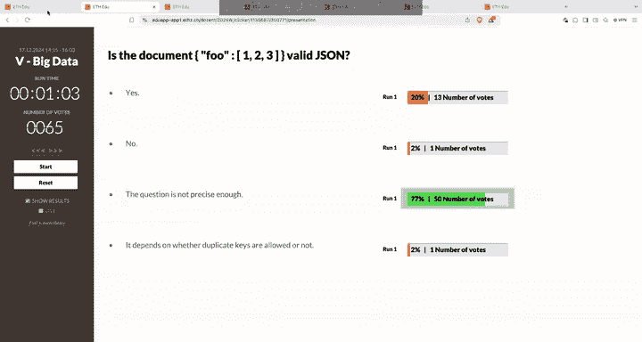

Allright。呃。

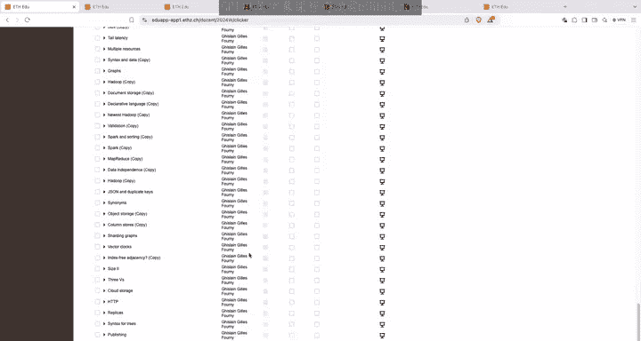

What is index 3 adency。Instead of joins， the data is。

Structured and linked using native pointers or the adjacentsymmetricsymmetric in is indexed on rows and columns。

 Our relational joints are used instead of adjacentsymmetricsymmetrices。

 or it's a technique to sort the documents on a given field for binary research。Index 3 a C。

I'm going to start to maybe limit the time so。To have a winner， Ha everybody answered。Yes。

And the answer is the first one。 Yes， that's on graph database。Wow， two survivors and on zoom， how。

 how many survivors on Zoom？No one。 So it's one of you is going to win， okay。

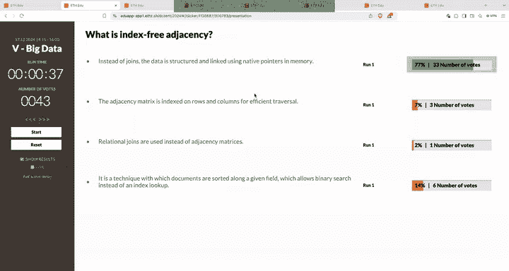

So if you both answer incorrectly， you both stand up again because we need a winner， right。

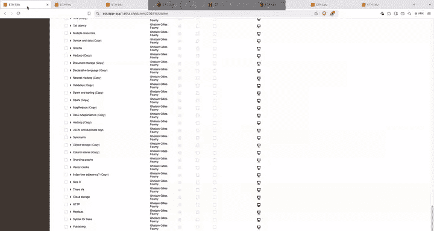

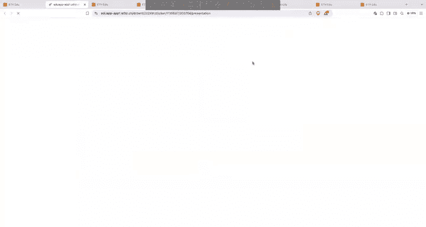

Do document stores havechemas for their documents。You own。Yes。😊，Yes， and yes， okay。So the answer is。

 it can be done and it can even be done later。 right， Did you get it， right。Alright。

Now I have to accelerate a little bit。How do we deal with the allocation across multiple resources。

 CPU， Ra network on a cluster？Is it effective resource fairness， dominant resource fairness。

 dominant resource integrity or effective resource integrity。Youre having an them sir both。

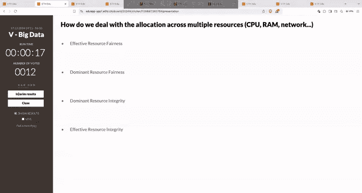

The answer。有事。

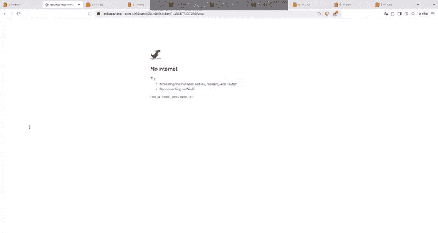

Looking。Doinant resource fairness。Something incredible happens。 We have a student winner。

 So come over here to collect your prize。😊，Oh they are C2。Oh， yes， there are two of them， yes。

I cannot see so far away。 So， all right， So we continue then。

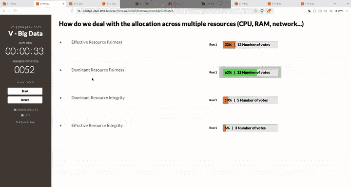

You， you know， the saying there are three kinds of people in the world。

 They are the people who can count。 and there are the people who cannot kill。

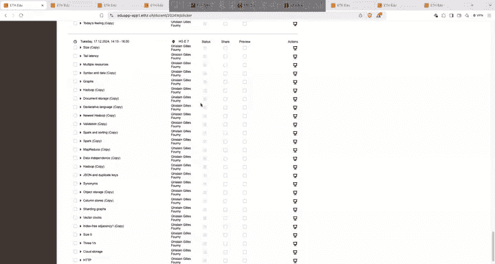

These words are on a high level synonyms， except for one， Which one。So you have 20 more seconds。

 I'm limiting the time now。第爱。All right。Do you have an answer， What was it correct， Yeah。

 did you both correct it correctly。Yeah， alright。 we need to accelerate。

 Theres just a few minutes left。Which one of these languages is not declarative。 You have 10 seconds。

There you go。Zva。Alright。What is a vector clock。20 seconds。What is the vector clock。And。up。Correct。

Still in the game， while， it's going to be difficult to break the tie。

What is the name of Oracle product that Charles graph processing， You have 10 seconds。P，G， D， X。

 G P X， D， G T X， PG X， D。All right。You didn't answer how in time and。What does it look like for you？

Did you unsell both of you？

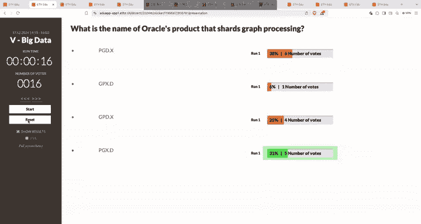

Wow， okay impressive。 So you want to get the T A team。😮。

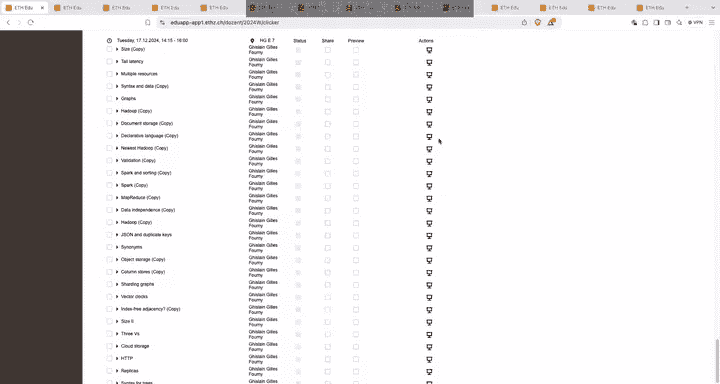

All right， how many bites are there in the Qta bites？You have 15 seconds， Quataabytes。All right。

What does it look like。You got it， right。你个的。Do we have a winner。 Are you still to in game。

 Steve2 in game， Wow， so there's 10 times 3 zeros indeed， that's 10 to the power of 30。 Wow， wow。

 wow。

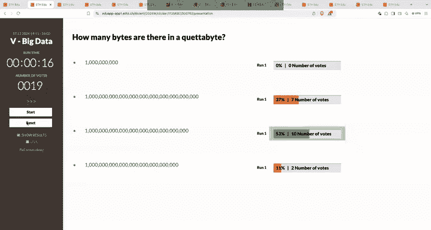

How many petabytes are there in aabytes？These are the same 1 trillion，1 quadrillion，1  Quintillion。

10 seconds left，9，8，7，6，5，4，3，2，1，0。Both of you again。 Wow， this is incredible。

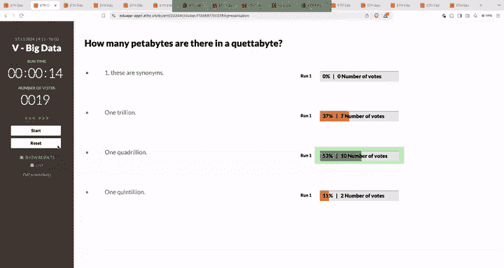

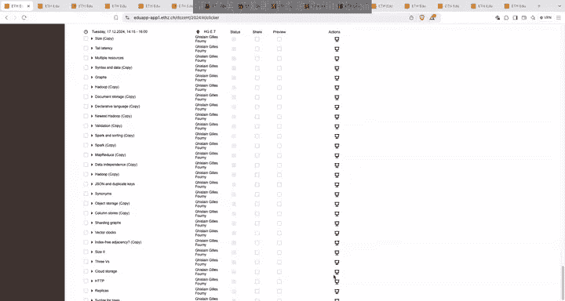

Which of the following is not a cloud storage system of as a service。5， four， three， two，1， zero。

Both of you again， this is oh no。We have arena。Alright。So， bigger plus。So this is your trophy。

 What is your name Marcuss yeah， and this is for you， these are Sw， so big applause， congratulations。

😊，And for the other troph is going to ring soon。 This goes to the F office。

 Is there a first representative here， Yes， so you can display this broadly in the F office as a memory。

 the student one。😊，So this is it。 Thank you everybody for attending all the best for the exam。

 We are here to help in the preparation period with a lot of emotion。 I'm telling you goodbye。

 Thank you。😊，Thank you very much。哇哦。😮，I really appreciate this。 Very glad。

Thank you very much everybody I really had a great time。

 it was an awesome class lot of participation， so thank you very much and we are here for you in the exam preparation period。

😊，Goodbye， Thank you。

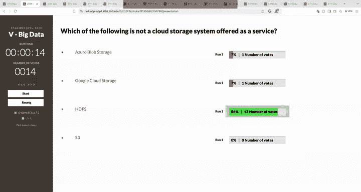