# 苏黎世联邦理工《大数据｜Big Data - ETH Zurich - Fall 2024》中英字幕（deepseek - P4：-04-2. Lessons learned (2_3) -.zh_en - GPT中英字幕课程资源 - BV1sHPKeoEJU

Welcome everybody in the lecture hall on Zoom from the future so today I'm going to continue I'm not sure if I will finish but at least continue this part on the lessons learned about relational database management systems and SQN before that I have two questions no one question the other one is at the end one question for you。

😊，Which is right here。How familiar are you。With relational databases。

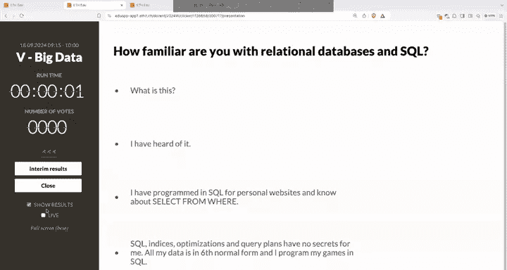

And sequel。So your first reaction might be， what is this。Or you've heard of it。

Or you have programmed in SQL from personal websites and you know about select fromware。

Or SQL indice optimizations and query plans have no secrets for you。

 all your data is in the sixth normal form and you program your games in SQL。Alright。

 so it looks about rights that basically corresponds to the fact that many of you had a bachelor's level lecture on the relational database management systems。

😊，Already and so you are in familiar territory and as I said for everybody else just learn SQL I will rehearse it a little bit with you you'll have exercises SQL is so famous that you can type on a search engine like SQL tutorial and you'll find plenty so it's really really easy to learn。

😊，All right。

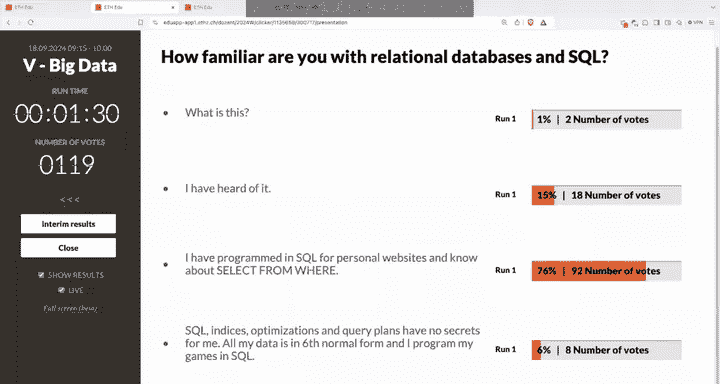

So where were we？I was talking about the relational algebra。

 which is what SQL actually implements and I give you three things that we can do with tables。

 the first thing was selection which is about taking some rows but not all rows projection which is about taking some columns but not all columns and grouping or aggregation which is when you have a large table and you want to compute aggregates right it's typically what the statistical or office contonal or federal is doing with the data。

😊，Well then we have sorting， sorting means that you take a specific column or multiple column and you rearrange the order of the records。

 the order of the row or the business objects， sort it， for example。

 alphabetically and that gives you the same table basically but in a different order of the records。

😊。

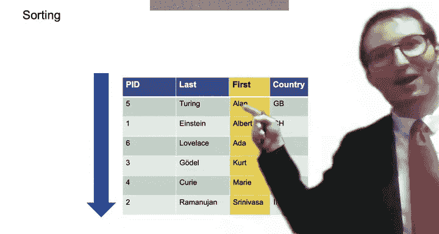

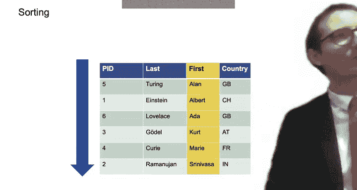

Now， you remember that I told you about the different semantics that the relational model can have。

 depending if you consider lists of records， sets of records or bags of records。 and obviously。

 if you want to sort the records that only make sense if you have a list semantics because the order actually matters。

 if you have sets or bags of records， then sorting will do nothing because the order doesn't matter if you have set allback。

 but most systems that you have like PostreQ， they support sorting because they are based on the list semantics。

😊。

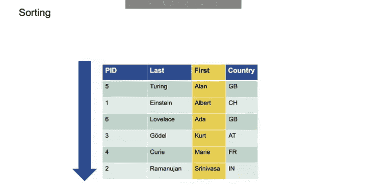

Then we have the catho products。😊，Use at your own risks because this is the best way to crash your computer。

 some do it during the exam， you really need to be careful about what you're doing。😊。

So the Catgen product if you consider， let's take the set semantics。

 So the first table R is a set of two records， two rows。 The second set S is a set of three records。

 and you take the catgen product of that。 That's two times 3。

 So you basically take all the possible combinations of a record from R and a record from S， right。

 So that's two times 3，6 possibilities。😊，Now you can imagine if you have a billion records in the first table and a million records in the second table that's going to give you a quad brilliant records and unless you have a data center then that's going to crash your machine right that cargen products actually very rare it's a primitive operation that we have。

 but it's rare to actually do a cargen product rather what people typically do is they only take a subset of that cartrogen product。

 they only take the ones that match for example， take the columns B and E and you only want to retain the records where B and E are equal。

 that would be the first one and that would be the fifth one right where they are the same and so typically if you join based on B and E for example。

😊，You would only take this one。😮。

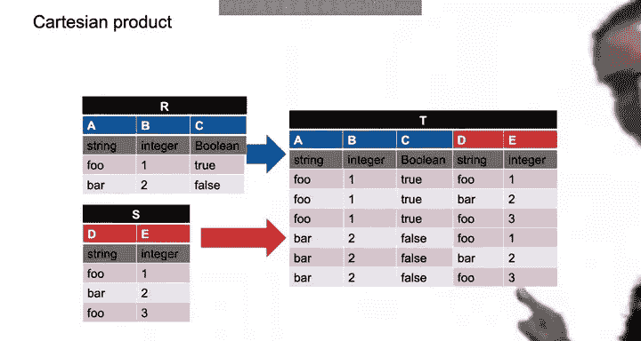

And this one and gets this。 And because B and E are equal， you only retain one of them。

 It doesn't matter to have also E here， because that would be the same values。 That is called a join。

 A join is a fundamental thing to do with tables。 It's very important。

 We see that it's also expensive。 Much more expensive。 That projection and selection。 but we will。

 we will see that。Well now a specialist of algorithmic complexity would tell me no it's not expensive because you can do a join in linear of time with hash tables。

 but there is stillA in practice right in practice， if you actually want to do a join。

 it is a bit more efforts than just a selection or a projection。😊，Okay， so we have joins。😊。

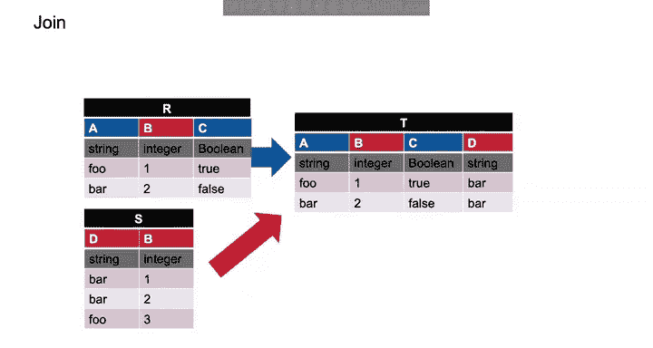

So that's actually the most important primitives， right， projection， selection， aggregation， sorting。

 cagen products， joint， there's many， many others， but these are the most important ones。😊，Now。

There is a whole domain of the database theory called database design theoryory。

Which can be summarize as best practices and avoiding design mistakes。

Maybe some of you already encountered these problems when you try to build the website and you have to figure out the schema of the data that you have。

 imagine it's a web and you have a database with all the products and the customers and the others。

If you don't put the data correctly in the table， you're going to start having problems。

 And these are problems that have to do with the fact that the data is duplicated or stopped several times or you're trying to put too much in the same table and so on。

 These are called anomaities， right？ You can have update data anomaes。

 Did anomamedities in certain anomaities。The summary of that is basically that if you store your data multiple times and you update it。

 you might forget to update it everywhere it's duplicated and then you run into an update new value。

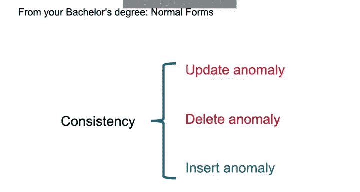

For this reason， there's a whole theory of of a mathematical theory that has been designed to try to help people into good practices and there's a whole bunch of definitions that we have like functional dependencies。

 normal forms and so on， for whom does that ring about。😊。

For many of you if it doesn't and don't worry you'll see why you don't have to worry about this。

 but let me talk about functional dependencies。 imagine I have this table。

 I say that I have a functional dependency between these two columns if the second one depends on the first one how do I see that there is a dependency well every time we have this value in here we always have big data so it's kind of this column is a function of that one right if you know the value here。

 you have a mathematical function that gives you what's going on here that is called a functional dependency and again in functional dance function。

 basically this is a function of this。Fctional， do we have a question over here， yes？😊，应该不司。你就是。是吧。

找子的。Like wear else speak intimate many just to have a function and separatepper。

You want to know the associated that you can just evaluate the upon。Yes。

 so let me repeat in the microphone what you ask if I correctly understood you。

 basically of saying that since this is a function。

 maybe we could just remove that other column that depends on the first one and instead evaluate the function。

 right？😊，It's a good idea， let me tell you more about how we would implement that。

There's two ways to define a function in math， there's something I think it's called extensional and intentional ways to define a function。

 an intentional function， if I'm correct is when you give a formula x maps to x squares。

RightIn that case， you can compute something based on the value。

 The other way of specifying a function is extensional。

 meaning that you have an exhaustive list of all of the values plus what it's associated with。

 This is， in fact， called the table。So if you want to implement what you said you're correct。

 you would basically create an other table with the correspondence between these two and then take it out of that one。

This is exactly what it means to go to a higher normal form and a normal form is exactly about doing what you say of taking this out of that table and putting it somewhere else right so your intuition is correct。

😊，Okay， does it answer your question。Yeahep。All right。So this is a functional dependency。

 Then we have the notion of a super key， What is the super key it's a set of columns such that there is a functional dependency from them to everything。

😊。

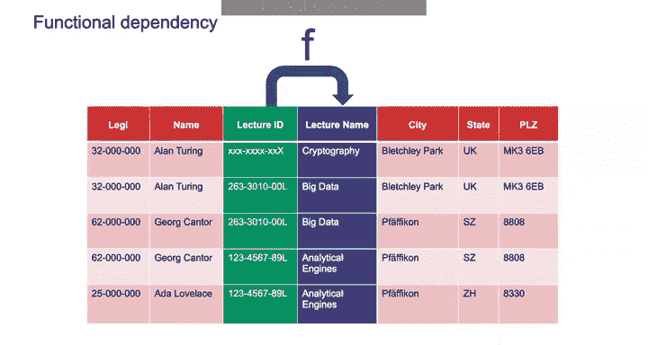

It basically means that all the rest of the table is just a function of these。😊，嗯。

Now we kind of already discussed that yesterday with primary keys right primary key does exactly that where a primary key is basically a super key。

 but it's a super key that is optimal that is minimal because a super key could actually be a super set of a primary key In fact you could take the whole set of columns that would be a super key right so a super key is just。

😊，When you try to find a primary key， you start finding the super keys。

 then you take a minimal super key and that gives you a primary key。 right， So again。

 the super key is a set of columns that determines everything in the table。嗯。😊。

And then you try to find the minimal ones because you might realize that this is too much that there are superfluous columns here so you can remove and realize that only these two are enough right that's a minimal super key。

 you cannot remove anything anymore that's called the candidate key Y candidate it's a candidate top primary key you might have several candidate keys and then you select one of them as the primary key of your table right so super key a minimal super keys a candidate key and one of the candidate keys you decide as the designer this is my primary key that you can define in SQL。

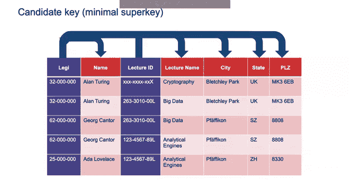

Okay。And why am I saying that， because there can be multiple candidate keys。

 This is also a candidate key。 And the decision is basically yours。

 You basically take the most meaningful one， right。

 So this is probably more meaningful than this one。😊。

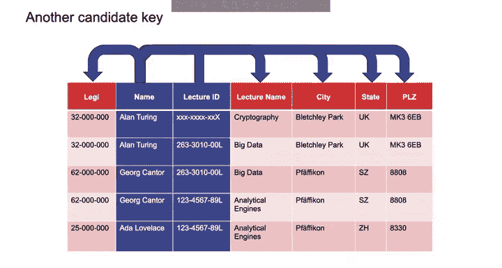

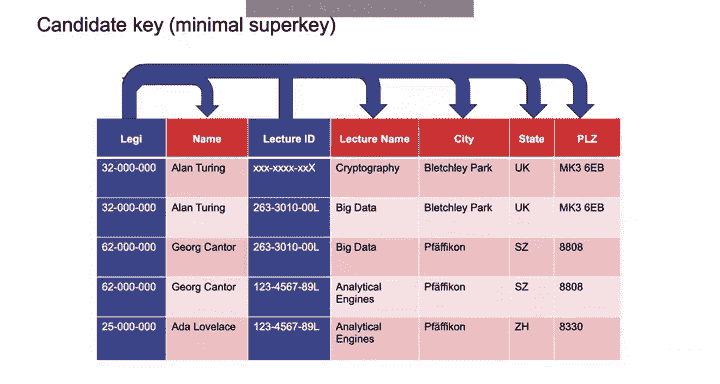

Then you have a lot of theory。 You have the notion of a non prime attribute。

 Prime attributee and so on。 A non prime attribute is basically a attributes that is never in any candidate key。

 right， A prime attribute is something that appears in some candidate key。

 So Le and lecture I D and name would be prime attributes。 C is not a prime attribute。

 It's a non prime attribute。So based on that on this is just some math definitions。

 we define the normal forms and that almost sounds like music right when you have all all the nodes and you know a second。

 a third， a fourth， a fifth and so on， when you have a first normal form， a second normal form。

 a third normal form， a 3。5 normal form， a fourth normal form and so on， goes all the way to sixth。

 maybe people will invent more。

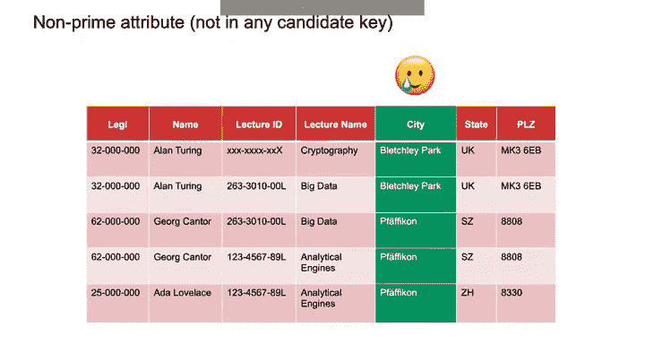

What's the first one， Well the first one， good news， I already told you。

 I just didn't call it that way。 This is atomic consistency。😊。

You remember atomic consistency when you don't have a table in a table in a table。

 where this is also called the first normal form。That's another name for it。

So that's the first level that you might require for good design is to not have nest tables。

 you forbid that you only have pla atomic values， string dates numbers， and so on。

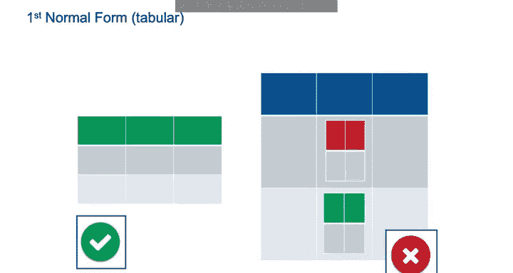

That's the first normal film， that's the counter example that we also saw yesterday that was a counter example of aty consistency。

😊。

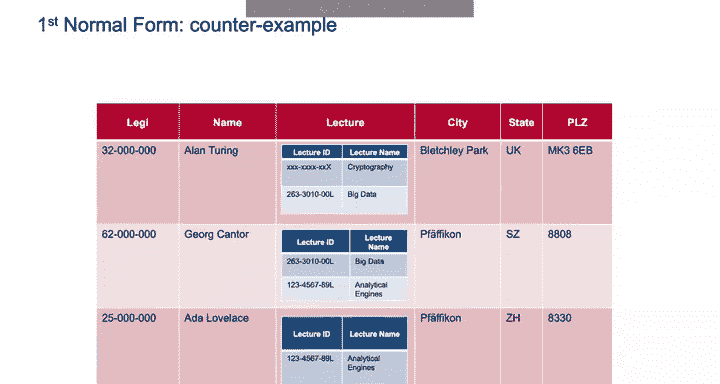

All right， and this is an example of the first normal form， nicely flat。

 like looks like these clay tablets that I showed you or a nice spreadsheets。

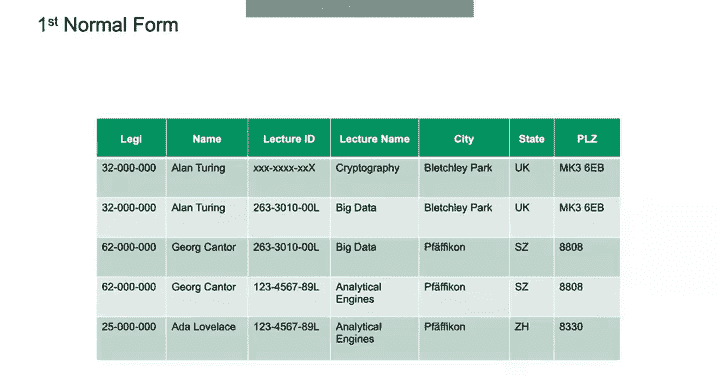

The second normal form。Well， every time we go one， we go by one level。

 we keep introducing more and more and more requirements from that favor。 The second novel form。

 typicallyically it starts at the bachelor's level 2， means that。

You don't have the right to have a functional dependency with a strict subset of a candidate key。

 So it means not the entire candidate key because the entire candidate key would determine everything。

 but you take less than a candidate key。It cannot functionally determine a non prime attributes。

 right， Just take it as a phase definition， phase value。So that is， for example。

 here the case that you have Ley， remember that a candidate key was Ley and lecture ID D。

 If I take Ley that's a strict subset and it functionally determine C。

 it means C is a function of the Le， that is forbidden。😊，In the in the second normal form， right。

 because city is non prime。 It's not in any candidate key。Okay。The third novel form。

Takes it even further， and says。Not just a strict subset of a candidate key。

 even more generally than that， anything that's not a super key。

 that's an even stricter requirements， anything that's not a super key cannot determine functionally a nonpri trie。

 a nonpriate trie cannot be a function of something that's not a super key， right。

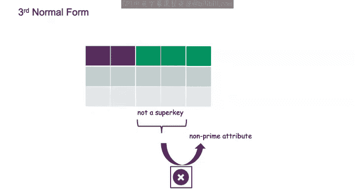

That's an example， for example， city state is not a super key。 It's not even inside a candidate key。

 and that functionally determines the nonpriate attributee， right， the post slide cell。

 the zip code is dependent on the city and the state。 If I give you a city and a state。

 you can give me a zip code， right， Of course， it's another simplification of reality。 I mean， zuric。

 there's multiple multiple zip codes， but just to give you an I， right。

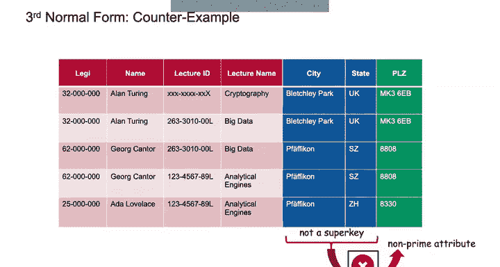

So that's the third normal form。The 3。5 normal form。

 it was called that way because it was figured out that it was between three and four。

 it's also called voice code code is the same Edgar code that I told you about。😊，Even stricter。

 we still have something that's not a super key， but it cannot functionally determine anything。

 Prime， not prime。 We don't care anything。The only thing that can functionally determine something else has to be a super key。

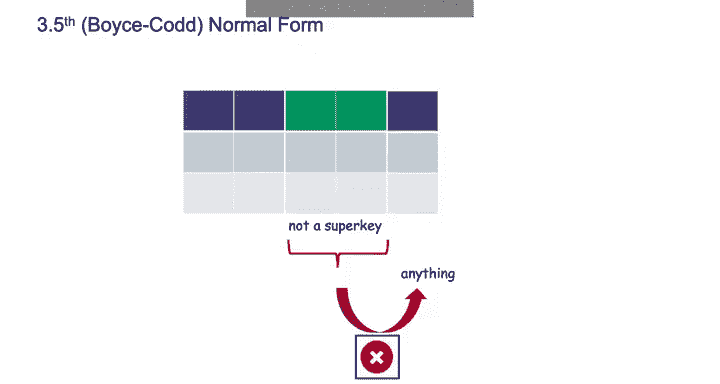

So that's， for example， a counter example that is something that's not a super key that functionality determines。

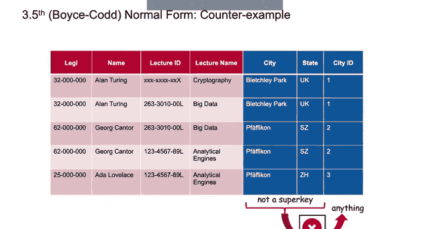

Something else， and that's forbidden。So that's an example of the voice code normal form when I teach big data or information systems to learn computer science students。

 the only when I teach them， so there's the first one of course the atomica is easy。

 but that's the voice code normal form this one is actually easy to understand you cannot have something that is not a super key and that functionally determined something else and I'm coming back to the remark that you made earlier in order to get to these normal forms it's actually quite intuitive to explain。

😊，You just need to make sure that you organize your data in tables and one table does one thing。

 you have one table for your products， you have one table for your customers。

 you have one table for your orders and so on and so on one table for one thing you cannot have a big table that stores too many things that's how you break normal phones and by having one table for everything each table does one thing that's how you get into normal form that's the intuition。

Now that's very complex。 we actually what I told you here。

 we spend several weeks of that on the bachelor's level to actually go through the normal forms。

 you can do a lot of math， a lot of formal proofs with actions and so on， a lot of notations。

 so it can get very scary。😊。

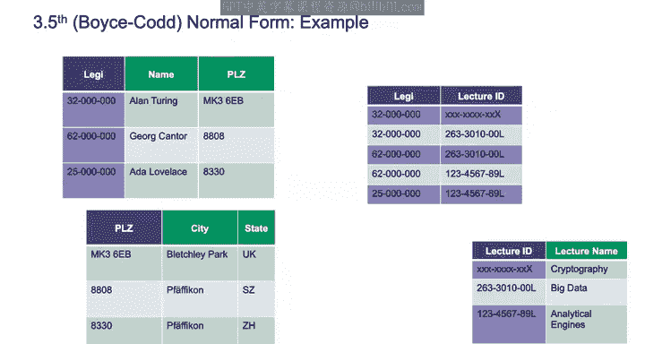

When I have good news from you， especially to those of you who never heard of normal forms before。

Okay， when I have good news？😊，We' are going to drop them， we are throwing them away。😡。

I told you we would breakthroughs in the big data lecture so everything you learned during your bachelor is like all the good design of normal forms in big data we throw it away you will see data that's not in normal form you will see data that is in a huge big table that contains a lot of things you'll have a lot of functional dependencies in there that would be undesirable but in big data we do it and there's a reason why we do it it's in fact because we analyze the data we don't update it or modify it and this is why we don't care about normal forms so much。

Now don't get me wrong I'm not saying that learning normal forms was for nothing that's not what I'm saying it's still very important if you have a database that gets updated all the time like a web right then you need the normal forms but when you analyze the data you can drop them so that's the reason I told you don't worry about normal forms because we actually throwing them away right but in order to throw them away normal forms you at least need to understand that they exist and you need to know that there are reasons why we are throwing them away and I come back to this when we actually do throw them away。

😊，During the semester。There is a name for this， it's called deormalization。

 right we denommalize the data。😊，And by demalalizing the data。

 we are actually going to make it easier to put it on a cluster and query it in the。

 these are all the intuitions I will give you during the semester。

Today is just a general explanation， but we will really take the time during the semester to understand what it means to denommize the data。

To get rid of normal forms， in fact， we can even deormalize all the way to no normalmal form at all I told you we would break the rule also of atomic integrity in this lecture。

 we will see tables in tables in tables in tables， We will see that right We will see that these are trees that I come back later。

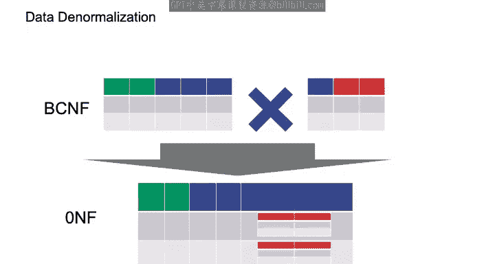

嗯。Okay， so that was the relational algebra， and that was database design theory and the normal forms that we' are anyway going to throw away in this course。

😊，Okay， so now I'm going to SQL， SQL is this language that you really need to learn it because you will see that it will come back in big data technologies as well。

So that's the landscape of languages right you know in software engineering you originally in computers you have these assembly code right the very lowle language and then some languages emerge are like Kbal4 trans C C++ Java Python now which is even more modern so you have this kind of two levels I would call an assembly code a proto imperative language and then you have imperative languages right Java C++ and so on。

 it's a four loops， you know Y loops or that kind of things。

That in software engineering well it turns out that in databases we have exactly that same distinction we have these lowlel ways of querying the data typically with APIs or pro declarative languages I'm thinking of ponds of the MongoDb querying system Apes spark the API all of this is a proto declarative language then we have the highlel languages that are often functional the most important use case for functional programming languages is data queries if you want to query data you want a functional language this is what SQL is SQL right it is a functional language that allows you to query the data in the high level it should really see as something like Java compared to assembly code for the API like pondndas would be assembly code and SQL would be the high level。

😊。

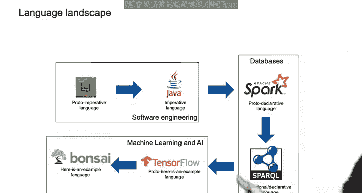

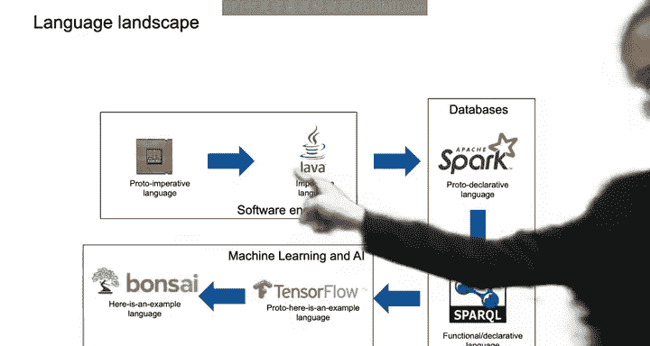

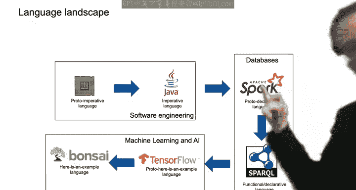

The same good in machine learning you might have heard about p Psyit and Soflow and all of these libraries。

 this would be the assembly code version and you have people who are trying to design highlel querying language for machine learning that you just define your machine learning pipeline on a high level and this is actually starting to emerge a lot as declarative machine learning right it's actually much more complex than it seems。

😊。

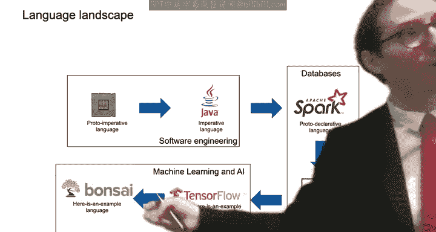

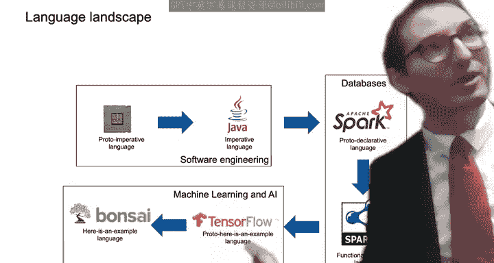

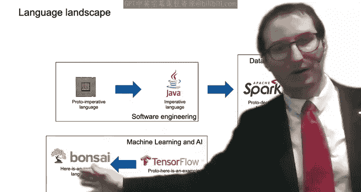

Right， and in this lecture we look at both of these。

 we look at the assembly code of data querying APIs and we look at high level languages。

 but today I tell you about SQL in particular。

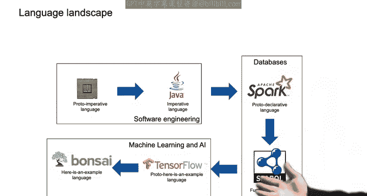

PQl dates actually back to mostly the same periods as the data independence idea right dates back to the the early 1970s。

嗯。😊，The early design was due to Don Chambarlain and Raymond Boyris back then at IBM。By by the way。

 IBM is one of the oldest companies in IT ever， they really existed very early。

 I think it was the time where the US census tried to start automating a little bit the data analysis process that was way before computer even existed right that was very early system mechanical that tried to process this。

😊，All right so this is where SQL was invented SQL actually meant a structured English query language and it was written in this way hereQ UEL structured English query language。

 it was in San Jose in California in the Almaden laboratory it still exists today the name change over time but it actually still exists。

 you need to drive a little bit out of the Silicon Valley a little bit into the desert and then you find the laboratory。

😊。

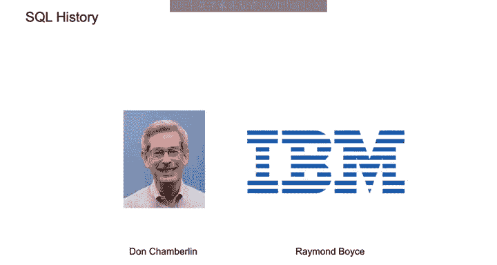

The system itself， which was the first implementation of this relational model was called system R。

 and the first customer was Prat and Whitney， which was in 1977。

 you see it took a couple of years to actually make it there。

But the thing is， I don't I have no， I don't have it here。

 The thing is there was a trademark issue with SQL， they got sued by a company who said， no。

 you cannot call it SQL because that's already your brands that we have。

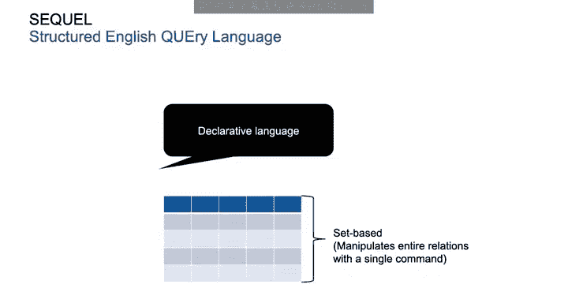

So they had to change it to SQL in order to avoid this trademark issue。

But this is the reason why people say SQL and not SQL， we continue to pronounce it as SQL。

You might at some point start saying SQL just like me。

 I'm seeing it because I was in contact with people who say SQL and then I got used to it。

 but it's the same you can say askQ well SQL， just be aware that it's the same thing， right？

There are means about that， by the way， that people contributed last year。 All right。

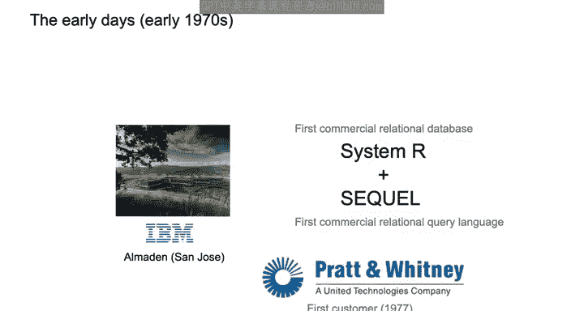

Then you might know Oracle right that's a company it was originally called software development laboratories in 79 relational software and in '82 it was renamed as Oracle that's one of the early ones so you already starting seeing the big players here theres IBM there's Oracle and Microsoft is the third one right the big players in in the relational database management system。

😊，But basically， the reason why all of these companies were created and worked。

Is that it's actually needed by companies and today I think there is not a single company in the world that wouldn't have a database management system and most often a relational database management system also because some of them are free right Posts QL。

 you can just get it for free， but it's just absolutely everywhere。 you cannot avoid that。

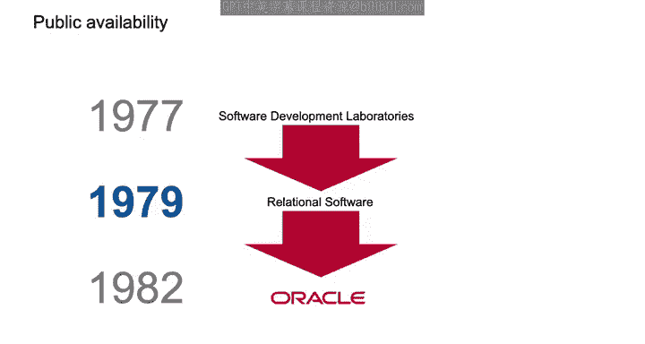

So this language is a declarative language the difference between declarative and imperative is like cooking at home or going to the menza if you cook at home you have to go through the recipe and prepare the foods like budies do that if you go to the menza you just declare the menu that you'd like to have I want a v menu I want the street menu and so on so。

😊，This is called a declarative language。It is also set based。

 basically set based means that you manipulates billions of rows at the same time， right in Java。

 you don't do that in Java， you just manipulate one object at the same time。

 This object might be structures， might be a least behind that。But in SQL。

 you can manipulate billions and billions of rows at the same time。

 That actually feels great when you're sitting in front of of your laptop， Jupi it on a books。

 typing a few line， and then you'll have billions or trillions of rows that get analyzed。

 it's really a great feeling。😊。

对。That's what I told you about the trademarking issue So SQL or SQL， who says SQL？😊，Who says sequin？

Okay， so you see some of you already， you probably started it even before me if you took it in the bachelor's。

 maybe that's also how it was pronounced。

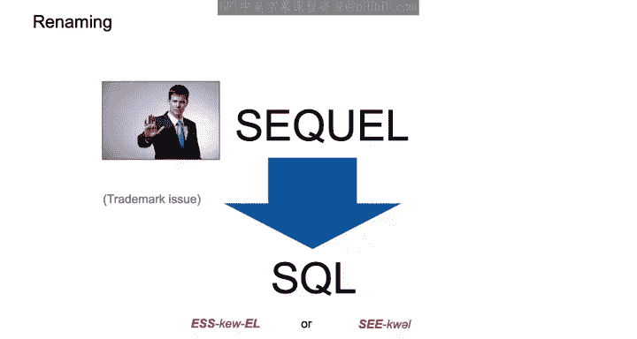

给。嗯。So the idea of the declarative language is that you can separate the logical and the physical execution that rings the band。

 that's data independence。 right， What it means is that。

You have a language SQL and you can implement it in many places。 you can implement it in C+。

 you can implement it in Java in Python in any language you want。

 but the user of SQL will not even notice the difference in SQL。

 So this is really the idea of the physical execution can be swept。

 change for something else Without changing the logical model without changing the algebra Without changing the SQL language。

 This is extremely powerful because it means SQL is a standout。

 You can switch to a different management system， a different database product。

 It's the same language。😊，When I say same， I really mean it like Bail doch or Schitz or doch Truli doch and so on。

 it's really dialect of SQL， they are not exactly the same but you basically understand each other and there is a sequence on that。

 but you will see you still need to read a bit the documentation because there are small variations between the different SQL dialects。

 but it it's really not much。😊，Okay， so for example， and we will do this during the big data lecture。

 you can swap the physical execution from a single machine to a data center now you have1 thousand machines and you still have SQL running on top running from your laptop so this is extremely powerful。

😊。

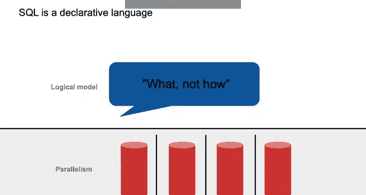

No。It's not only a declarative language， it's also a functional language。

 a functional language basically feels a bit like math。

 it's the idea that you have expressions in a functional language that nest into each other and you evaluate expressions so you basically have a mathematical model that tells you in what sets the values that the expression return live。

😊，And then you define a formal model that explains the semantic of the expression and based on this input you get that output。

 it almost feels like math when you basically define a functional language who knows I don't know a Hascal or Camel。

 any of these right exactly so these are functional languages and and SQL and the query languages with C are actually functional languages。

😊，I think that take a pedagog C when you want to teach functional languages。

 it's probably best to start with a query language because that's usually more intuitive to start learning than the Haskell or Cam and they are actually people who start doing this in high school and at the bachelor's level。

 they start with data science and then do computer science for this reason。😊。

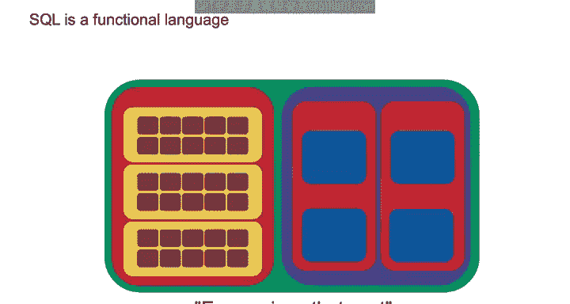

All right， let's get to Squad now。So speak well。😊，Basically consists of mainly the select from where。

 That's the core of it， right， that many people know select from where。

Basically allows you to do selections and projections。

What this does select star means that you keep old columns， the star。From person。

 so person is just the name of the input table and where specifies the selection criteria。

You select the rows on which the last name is crusher Now。

 if you look at the last name that the third column。Only the second records。

Matches right this criterion only this one matches so you take you output this table right here right so this is the output of this query given that persons is this table or who is that here。

So this is where you need to be careful because it can be confusing the selection is not done in the select clause。

 as you might think it's done in the where clause。😊。

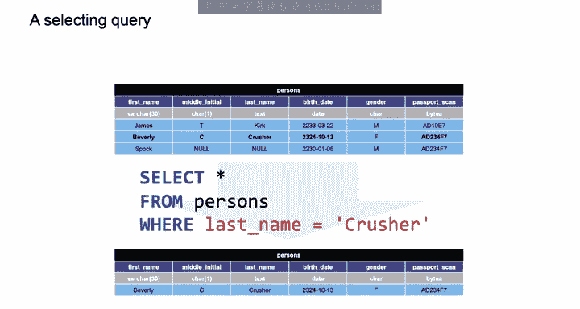

In fact， in the select clause， you project。RightSo you just need to beat a bit of getting used to。

 but here you specify a projection of the column so you select first names and birth date so you would select this one here and this one here and you get these two columns。

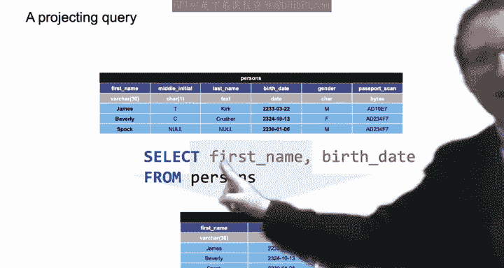

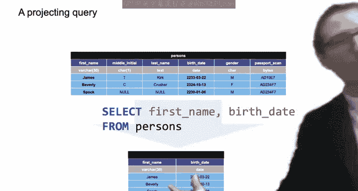

This is what I told you yesterday， right the selection the projection。

 but what's new here is we're doing it with a language， we're doing it with SQL。

 so this is a selection， this is a projection， right。😊。

You start fitting now why it's called a structured English query language。

 because it was designed to be intuitive intuitiveive to actually sound like sound like English。Okay。

😊，Then we can also do some renaming， so this is as who as when so that just changes the name of the occurrence。

By the way just so that I'm clear about what I'm showing here in purple here you have the names of the colors in black you have the name of the table and in gray here you have the types。

 the domains right because it' we have domain integrity so all of that is a string these are just the sQL types v cha cha and so on i'll come back to that right this is a date and so on and the blue in blue we have the actual records。

😊。

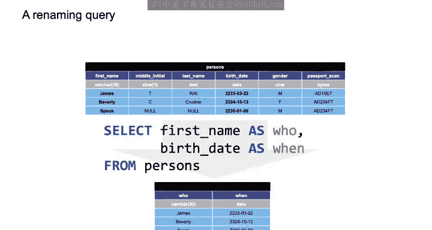

Okay， so this is how we rename with us we can rename。😊，This is how we sort with the order by clause。

 if we say order by birth date， that's going to now order in as sendingending order the birth date。

So now we know fore clauses， select from where or or by。Where is optional or is optional， right。

 but they have to be in this， select from where or the。

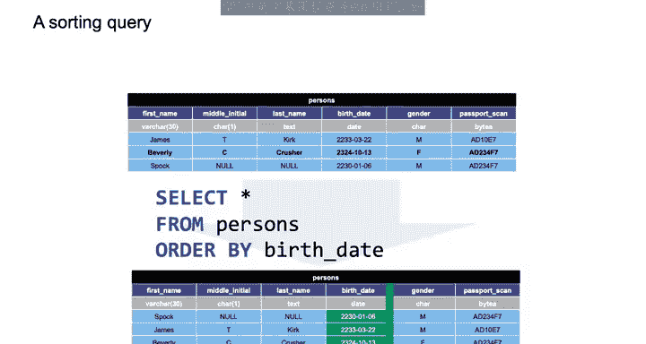

You can also group using group by right so you say select。From persons group by centuries。

 I'm looking at all the unique values of century。 there's only 2。

23 and 24 and then I aggregate the counts。 I am counting how many they are。

 so there's twice 23 and twice 24。 So we have two and2 right This is an aggregation and the group by does that。

 So we have the key here that typically also appears in the outputs right that's the grouping key and that's the non-grouping attributes that is typically aggregated like this right。

😊。

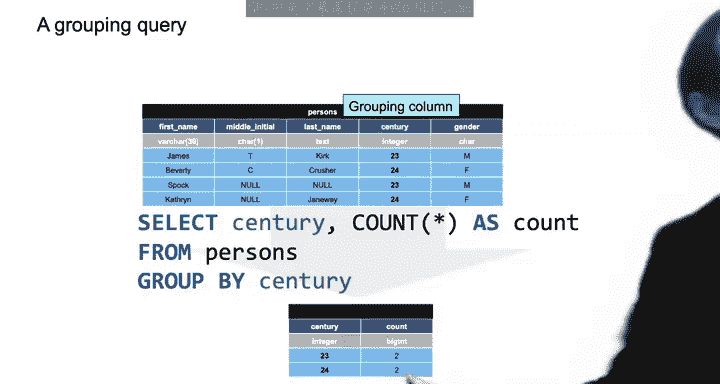

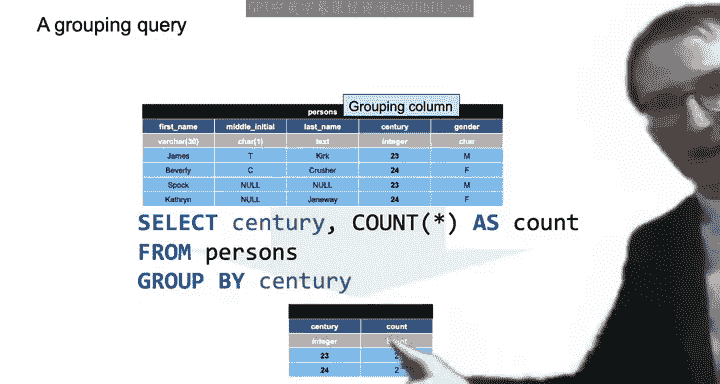

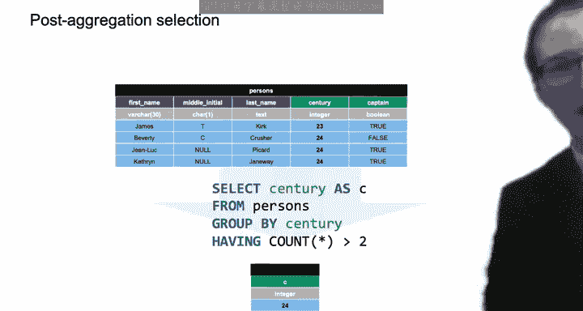

So so far we have select from where group by order by。They are optional。

 but it select from where we buy order or by it has to be in this， cannot be in any other order。Then。

 we have having。Having in fact is like where it's just that it's after other group by clause it could have been called where actually we see in other languages it's also called where but basically it allows you to also filter out some groups and you only keep the groups that have strictly more than two records I change the input right so now we have just once 23 and three records have 24 so the only group that survive is the group with 24 because only 24 has strictly more than two records right so this is why we only keep 24 in there。

😊，So having is like where， but it's after all the goodbye。😊。

So now we have select from where group by having order by。You can have a  query that has them all。

 right？

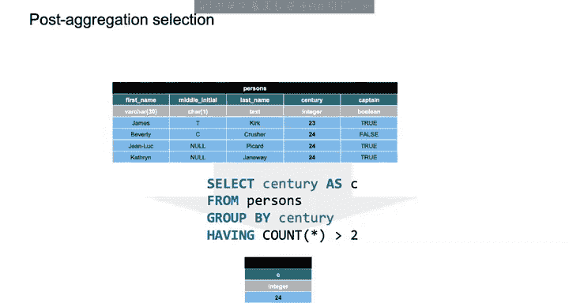

Oh， here you go， select from where Group by having order by and I'm throwing two more in the process。

 it's limited and offset。Lit an offset， think of Google or a search engine。

 What happens when you type a query under Google， you take the you return the first 10 results。

 then you click next， then you have results 11 to 20。It's called paagin N。

 pagin N is done with limited offset。So if you say limit 10 that's going to be giving you the first 10。

 then you say limit 10， offset 10， that's the second page you jump over the first 10 and return 10。

 limit 10 of offset 20 would be the third page。Right and so on， so that's called pagination。

You should only use it with abi， if you don't use all it doesn't make any sense to paginate。

 right because that's a bit unpredictable， so you really need to have abi。

You have to learn this by how， Really， select from where group by having order by the middle of set。

 right， Want to trade it。

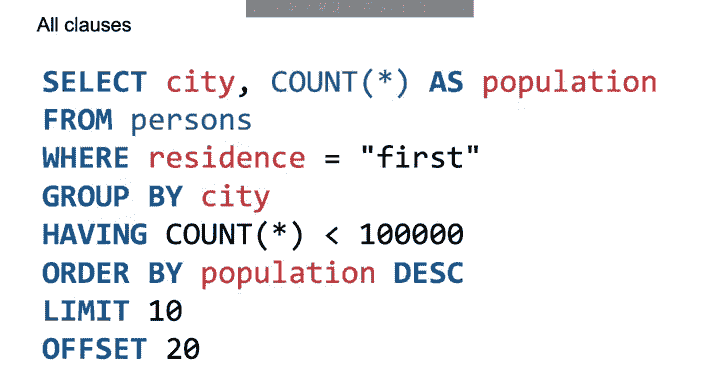

Let's we together， select。From everybody。From where Group A having order Bay limit offset exactly。

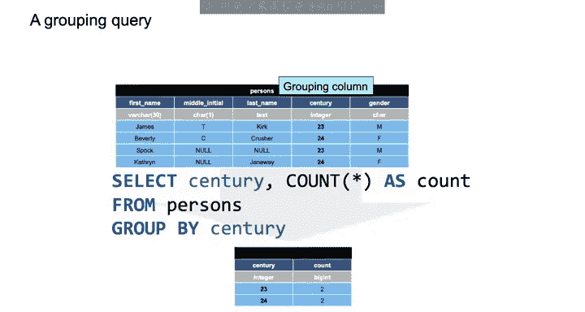

That's it。 It has to be in this order。 We see that the more modern query languages relax a little bit。

 The order can have it in a different order。 But this is really the s order。

 And it's very useful to know it by hat because then you basically already know a lot of the language。

😊。

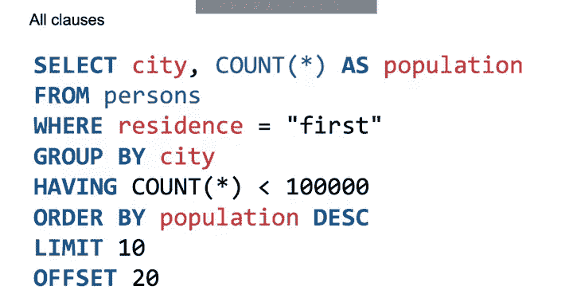

You you can skip them， you don't need them all they optional， but they have to be in this， okay？Now。

 what else can we do？We can take multiple table and merge them。When I say mergech。

 there's different ways of doing that。When way is the union？

So you take a first table that contains a few spaceships。

 Then you take a second table that contains other spaceships， and you take the union of that。Now。

 the union is not a close。 It's not like the select from where goodbyeai and so on。

 rather you need to take a select from where。Qury like this。 Then you take another one。

 and you put union is the in the middle here， you could have the whole thing select from where goodbye having blah。

 blah， blah union select from where and so on and so on， right， So you just put union in the middle。

 So it's not a clause。 It's not like a binary operator。😊，Okay。

 now you notice that3 plus three is5 here y because it eliminates the duplicates on the way。

 you might notice that there is one that appears twice that's the C enterprise C is here and here with the same records。

 so it just eliminates the duplicates on the way。Okay。Then okay， you also have by the way。

 the intersection， it's called intersect， you also have subtraction。

 meaning that you only keep those of the first table that are not in the second table。

 I think it's called accept is it accept or subtract I think it's accept right？We can do guitar。

 I think it's accepts there's union intersect and accepts these are the these are the three。

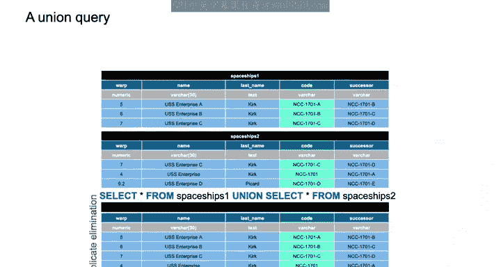

All right。Then we have the joints I told you what the joints are about right it's basically like your cargen product。

 but you only keep the matching records。😊，So how do we do it in SQL when we use the world join。

 so you say persons join spaceships， so you express your intention to join these two tables。

How do we select the records that match when we basically want to match the last name of a person。

That would be right here， That's the last name of the captain。

We want to match sheets with the captain of the ship where we also have the last name here。

 for example， Kirk would go here crusher， she's not a captain Janeway goes here and so on。

 so you basically combine but only with the matches and these are the three matches Kirk has these two ships and Captain Janeway has these ones so we have three matches。

Who is that here？All right， that is a joint。It's called Theta join。

 Why is it called Theta Theta just because we specify manually the matching criteria because it's not the same name here for the two columns。

There's also the concept of natural join。 That's when the two columns have the same name。

 Then you just say join in that seat。 and it just uses the same name。

 the columns with the same name to to match them。But if you specify the criterion。

 then that's called a Fita joint。Now， what about those that don't have any matches when you have the option to keep them？

😡，If you say full out alljo。😮，Then you're saying， okay， we keep a crusher。

And we keep the enterprise price D because there， there's no pickupout on the on the left， right。

 But what it does， it's going to fill the rest of the table with nerves。

 N is a special value that basically means there's nothing， right， It's， it's nu。

So you you just feel the spaceship portion after crusher with N and you feel the person portion of the table with N for enterpriseD that's called the full outer join then you have the left outer join that only does that on one side the right outer join that only does that on the other side and the full outer join does it on both sides so you see it's very very powerful。

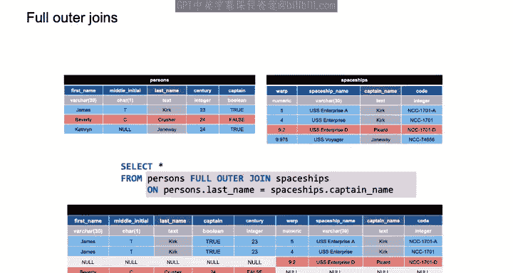

Then you can add natural that I already told you natural is just when it's the same color name。

 so here if you want to join and imagine that I change the name of the attributes on the staffships。

 I also call it last name， then it's the same。Attribute name in that case。

 I don't even need to bother specifying the criterion。 I just put natural。

 It's going to match the colon names。 but be careful because sometimes you might have the same column name but accidentally。

 So you really need to be sure that this is really the only column names that match。

 which is your intention。

OkaySo this is how you join and you join always in the from clause， in the from clause。

 can you can have several tables with joint in the middle。

Okay。😊，And then the magic of functional languages， and that's just like Haskell or Cam and other functional languages。

😊，You can nest them。 It's just like the dream in a dream in the dream。

 the table in the table in the table， where we can have a query in a query in a query。 right， Yes。

 we have a question over here。😊，Yes， absolutely。 so let me say a few words about this so now。

Technically， when you define the notion of of the definition of a table as a set of topers and then you define the rules。

 N is not part of the math， right， N is really something that came up in the practical implementation because it's actually useful。

If you want to now think of how does N fit in these rules that I gave you。

There are two ways to look at it。 there are two ways to look at it。

 The first way to look at it is basically to say thatner is like the absence of value。

 so basically imagine that you have a table that has missing values technically to break the rule of the of the relational integrity。

But you can kind of fix it by just putting nerves everywhere。 it's empty。

 And then you kind of address this issue。So if you consider that null corresponds to no value。

 then you're still breaking the rule， still not relational integrity。

 but the second thing you can do is add Nll to your domain， for example。

 if you have a domain that is integers， you can say your domain is now integer or null。

And then in the top， you explicitly add the null as a value。

 and then you don't break relational integrity。😊，There are the two ways of doing that two schools of thought。

 right either you consider that Nll corresponds to no value at all or you consider that Nll corresponds to a value that is in the domain。

 right？

And absolutely absolutely a right to observe that when you have these nerves filled all over your table。

Then this starts breaking rules in terms of the relational integrity right and again I repeat if you consider that null is the absence of value。

 then this breaks relational integrity。But if you consider that neural is a special value。

 then that doesn't break each， right？Depending how you look at it， for whom does that make sense？

Okay， it's really a practical thing people found out that this was quite convenient to have nerves as a video like this I'll come back to it by the way in a few weeks about Ns and in particular in Jason and what the absence of value。

 the actual presence of a N we will look at all of that in a few weeks very precisely。😊，All right。

 very good question， yes。😊，我看了。Then it chooses them all for the matches， they all have two matches。

Wwhichch is exactly why you need to be careful because sometimes you might not have seen that there's another column with the same name and then it might lead to unpredictable behavior。

 so the natural join you really need to look at the schema and double check that the columns that are the same are the intended ones。

😊，Otherwise， you just use a theta join。Yeah， okay， yes。这算对。

不起。We should try it， you can try it if you want， I think it would work because technically after on there should be anything you want。

 I actually not 100% sure either they allow any expression and evaluate it or they restrict it The condition you have here is actually a very specific one it's called an equijo basically means that the condition is based on the equality between two sides but you can also have joins with more general criteria like greater than smaller than。

😊，Could you try it I would Santa Ters next week， So try to put on true and you see if you get the whole carten product。

 right， maybe even more than the carten product， If it's full out or joint。

 you might also need extra cells with nerves on both sides。 It's a good exercise， right。😊，By the way。

 I don't know everything， I mean it's such a complex product。😊，All right。

I will just ask you one last question and then you're good to go no more questions。Yes。

 one more question。That I would need to look at， I don't have an equal key world in mind。

 we will look it up offline if we find one it it can also be a different dial of the SQel。

 maybe EQ or something so some languages have EQ instead of the equal sign。

 let's take it offline and I'll take a look at equal key worlds。

So before you go。Before好 you go。Please。😔，te你。If you photos。And again， today is a bit special。

 I mean it's a brush up， half of you already saw it for half of you it's new。But basically。

 next week， I'll finish this。 and then we'll actually start the material of the lecture。 Right。

 we we start studying everything。😊，I will do that regularly at the end of lecture this is basically so that I accelerate or slow down if I see that everybody says okay that's I understand everything I can accelerate a bit if I see that many people say less than half and so on then I slow down right and I can answer more questions so this is your way to control the speed of the lecture。

😊，So now it looks about right so thank you very much everybody。

 I'd see you next week in the other lecture hall at 2 pm there is no exercise in this week。

 nothing to worry about。😊，You could try out with the doctorcker if the T A team sends you an E mail。

 but that's it。 Thank you very much。 See you next week。😊。

