# 苏黎世联邦理工《大数据｜Big Data - ETH Zurich - Fall 2024》中英字幕（deepseek - P5：-05-2. Lessons learned (3_3) -.zh_en - GPT中英字幕课程资源 - BV1sHPKeoEJU

Welcome everybody in the lecture hall， welcome everybody on Zoom。Welcome， everybody from the Future。

So the program today。Is that we are going to continue。The SQL brush up。

And then we are going to look at cloud storage。Let me make sure that you can hear me because the audio is not always。

That are well， very good。So we'll start with a few questions to you。

 and Id show you also the Mag box and JSik quickly and then we start with the material。それ me。

Yeah over here yes， so let's answer as quickly as possible。

 this is one that normally you will figure out， I told you about fundamental shapes of data。

So which one of these is not？A fundamental shape of data， cube stables， trees or circles。

So you can either go to the Eddu app from the app store or the Google Play。

 or you can go to Edduap app when。As you can see on the screen here， if you attach upqua。tth。sitch。

So， let's see。You set circles and indeed we will see some circles and rings in dynamo the cloud storage but indeed this is not a fundamental shape of data cubes are a shape of data data cubes are actually very well known in business analytics and papers of course are absolutely fundamental here's another one this one you might not know but at the end of the lecture you will know what data shape does one typically get after denormalizing a table I told you we are going to break all the rules in this lecture and we are going to we are going to drop all of the relational rules。

But in particular， what's going to happen if we drop these all of these rules to get into the world of No SQL。

 do we get cubes， trees， graphs， or texts？啊哈。It turns out。That we get。Trees。

This is what we get if you deormalize the table you're going to get collections of trees and this is what gives the NosQL paradigm。

 but we spend a lot of time on this during this course。Just a question on the。Exam magic box。

 who tried it out and did it work for you？So you know that we set up in the chats， the element chat。

 we set up a channel just for Docker support so if you have any problem now is the moment to test it and let the T team know and they will try to to support you very often is the same kind of problems that。

That people get into。 Okay， so that's actually a good sign that for most of you。

 it worked and for some of you。You just got the trick of deleting the images。

 deleting the containers， then deleting the images and then deleting the volumes。

 and then Docker composeose up。And it works。All right。All right， and some of you have issues。

 please let the T8 team know right go to the Docker support chat or send an email and you will get some support。

What's nice is that now the Apple silicon chip seem to be working a couple of years ago it was。

 this was the ones that were causing problems。

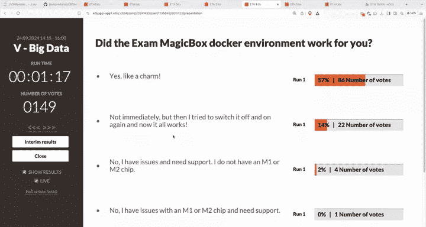

Just so you see what it basically looks like there will be also a tutorial for Jsononic that was a popular demand of the previous years that instead of dropping that onto you in the last week or towards the end of the semester we do it throughout the semester it's just the notebook that you will find there a link that's basically on Github and you just drop it into the notebooks folder in the Jupyter notebook and then it should just work you know this is just connecting to the server rumble is actually part of the Docker it's inside the Docker and then it's connecting to that part basically what happens is that all of the queries that start with percent percent Jsononic it's called the magic in the Jupyter this is going to be shipped to the server and the answer is written there right what's new this year is the syntax highlighting。

Because David Bueru， who was my master's students， did his master'。

 he actually implemented it all and now。When you type Jsonic。

 you will see the highlight of the keywords， right？

Now what you see on my screen is actually a newer version because that's Jupyter labse。

 you should get the update of the Docker soon I think the current docker you have is the older Jupyter notebook the main difference is that it's more convenient to navigate on the left that was also your precessor last semester who had asked to have Jupiter labs and here you'll find all the best exam so it's basically just environments that give you snapshot of what you have at the exam we will also share the 2 full notebook for you so that you will know in advance what environment you will have at the exam right so this is so that you can work on all the best exams as well。

I made a mistake on the exam I told you it's in August because I keep confusing somehow the two period。

 but of course the exam is January， February， right it's in somewhere between the 20th of January and the 14th of February if I'm correct right the date will be known towards November or December。

Is there something else there was also pending questions on the zoom I think there's one question once student asked whether you could explain the greaterd quizzes again。

 yes， so basically we have a bonusish point system， you get an opportunity to have plus 0。

25 points at your exam。And the way this works is that you will get 25 quizzes。

 each quiz if you pass it gives you plus 0。01 points at the exam。😊。

It's stochastic because it's all rounded right So basically it gives you a certain probability of getting a grade increase。

 The way we do it is we take the moodle row grade out of the number of points of the exam。

 then we convert it to an EthH grade but unrounded。 So just a row grade between4 and6。

 but that can be anything。 Then we add the bonus points and then we rounds to the nearest quarter points。

 That's how it works。 So the more bonus points you have。

 the higher the probability is that you're going to get higher ETH grade at the end right so that's the quizzes。

 That's not the same as the exercise sheets and solutions which are totally ungradedd right So this is just an independent of this。

😊，And it was confusing with German with thatpengi and then what happens is that you get the quizzes in Moodle these are Moodle quizzes multiple choice questions completely a computer assisted it doesn't mean that all it's automatic if you disagree with the grading or you think your answer should be accepted then you can engage into a conversation with the T team and give your arguments it's a good exercise also for you you know to argue and explain your reasoning and maybe you convince the TA team to grant points for some answers then of course we grant it to everybody as with the same answer All right did it answer your question。

Yes， okay， and I think it starts this week right Last week there wasn't anything graded。

 I think and this week you get your first your first graded quizzes right so it's going to be two per week typically and you you see the passing grade is given to you and if you you have these points you pass typically what we do。

😊，Is that we allow you one of two attempts if you really want to try again then you need to email the TA team to be able to have more attempts right you will have one week the reason we do that is that we used to give unlimited attempts and then students just use brute force to try out all possible ourselvesseve and t it best and of course we don't want to encourage that the goal of the quies is to follow you too long the material。

Okay。So， yeah， that's。

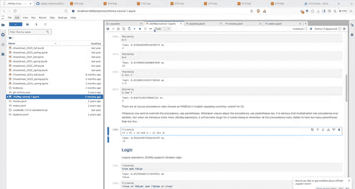

Or the magic box where I wanted to tell you， here's another one。

 what do you think there is in a data center？It's top secret。

 Nobody knows or maybe it's one superb machine that's what we call a supercomp with a00 of CPU。

100 petabyte disks and one petabyte of RamM， or is it 20 of small cheap machines or is some sort of giant quantum computer with an array of 54 qubits。

What do you think？I don't even know if 54 QbitT is giant anymore。

 I think there's bigger quantum computers than that now。Okay， let's see what you said。Yes。

 the majority is indeed correct。 plenty of small cheap machines。 That's the secrets。

Of the data center。And I'd explain， of course， why that is。呃。

Now I realize I should have asked you that question before the other question。

 but now you're probably going to figure it out would easily。

So when we started biating electric cars， how did we design the batteries because you have a scaling problem with the number of batteries。

 right？What do you do， you completely redesign the engine。

 you design a battery that would have more range， you assemble plenty of cheap， widespread standout。

 18650 batteries， hint hint the previous question， or maybe some of you know encounters。Well， okay。

 I think that's a pretty clear majority here。 So you see this is a widespread way of scalingkating up in life。

 It's not just for data center。 It's not just for batteries。

 You just assemble plenty of small and cheap components。And well see that's called the skating outs。

Okay， do I still have questions？For you and Kellyly Mark this one is correct too well not yet this I first need to give the lecture for you to tell me if you understood it。

So。Let me know。

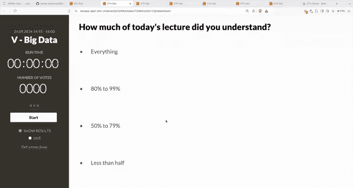

That should be the one。After a while during the semester。

 the PowerPoin5 is staff accumulated dangerously on my machines。And。They get harder to find。

 no that's the one， all right。So where were we well first， this is data independence。

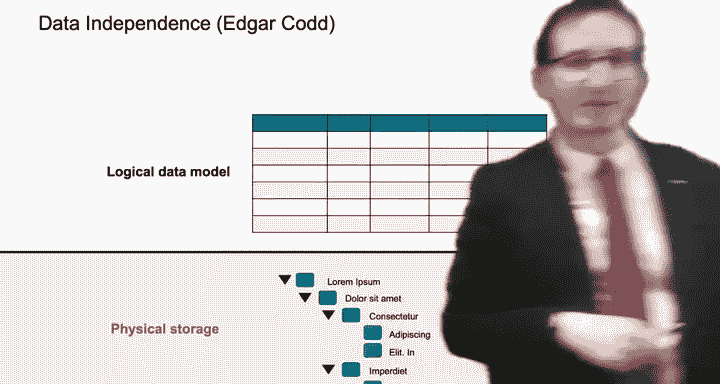

It's very important， it's the idea that we decouple the physical layer from the logical layer and that we look in the case of relational databases。

 we look at tables， we manipulate tables。Everything that you see at the bottom。

 the physical storage is completely hidden from the user， could be a data center。

 could be a quantum computer， could be DNA， could be lit levelszy onar。

 it doesn't matter as long as you get the radiational model on top。

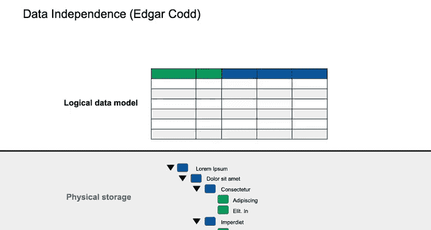

The second thing I told you is that in others when we define the relational table as a collection of toppers collection of records。

 we have three constraints constraints， the first constraints is that all the attributes are the same for all the toppers so that you can assemble it nicely into table shape that's the relational integrity。

 domain integrity means that in every column is the same type of data right we define type during the semester。

 but all intes in a column all dates in another column and so on。

And then the atomic integrity means that you cannot have a table in a table in a table in a table。

You can have objects， as， and so on， insight。And when you have these three rules combined。

 that's the beautiful world of Good old SQL， and if you drop these rules， you get no SQL。

 which we will do during this semester。😊。

Then this is what you had to learn by heart select from where group by having order by limit of sets and you'll get plenty of exercises to learn to write a sQL like this right so it does everything you have the selection in there。

 the projection， the grouping another selection with having and you can order because you have list of upper semantics you can order the records and paginates with limit and offset sets all right。

 so that's sQel。

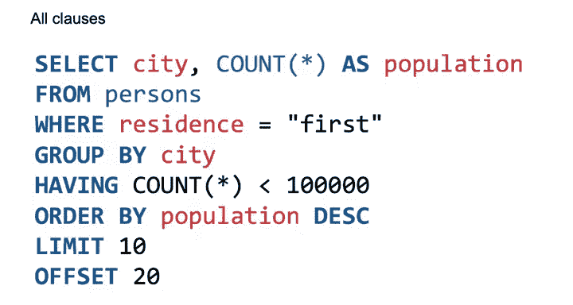

And then SQL is actually much more powerful than just that you can even nest queries in queries in queries so just like you can have tables in tables in tables in tables you break the rules in SQL。

 you can also have queries in queries in queries in queries right so you can nest the select from where inside of a from clause you can also nest them inside of a where clause。

 the typical use case to compute an arc max so you basically have this select from where the value is equal to and then you have a select fromware inside that computes a max that basically is a way to compute an arc max so you can basically nest the select fromwarees into the select from where you can get very。

 very complex and in fact you can be gigantic queries like that there are people who have queries of hundreds of lines like this very easy when you have an advanced use of a SQL all right。

😊，So you should practice， practice， practice， practice。

 take the Jupiter notebook book of this week of exercises and make yourself familiar with SQL it's really a fundamental language any data scientist has to know SQL even every computer scientist。

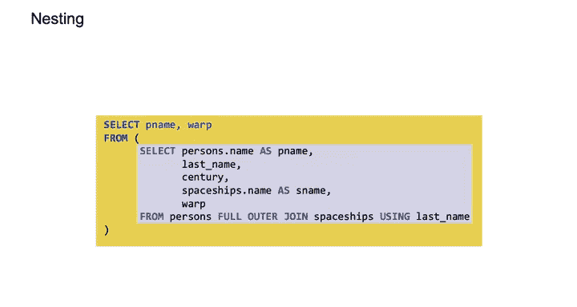

Okay， and we'll see it again during the course。Now what happens when we do the math is that the relational algebra is also known as the Greek letters so for people in finance Greek letters have to do with the options and futures but for computer scientists the Greek letters have to do with sigma for selection gamma for grouping pi for projection and so on we can write a lot of beautiful mathematical formulas that express the transformation that we do in tables but we are fortunate enough that this is just the same thing we do with SQL so SQL is the way to program it and behind that query this is what's actually going on so the relational database management and system is converting your SQel query to some what's called the tree of iterators also called the query plan it might also rearrange things in order to make it faster but because of data independence you don't have to worry about that it's just magic and then it executes and spits out the results to you all right。

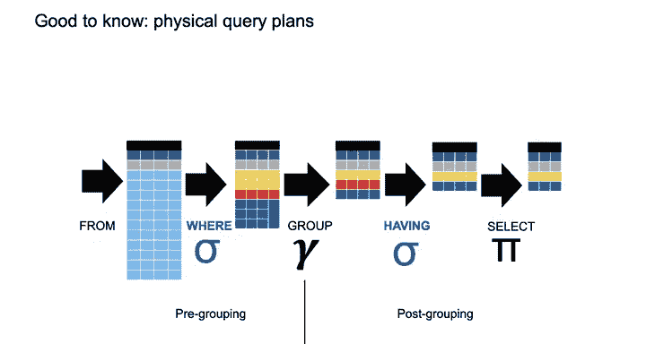

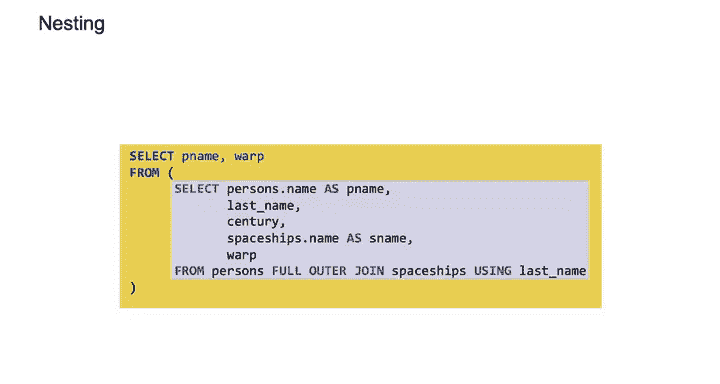

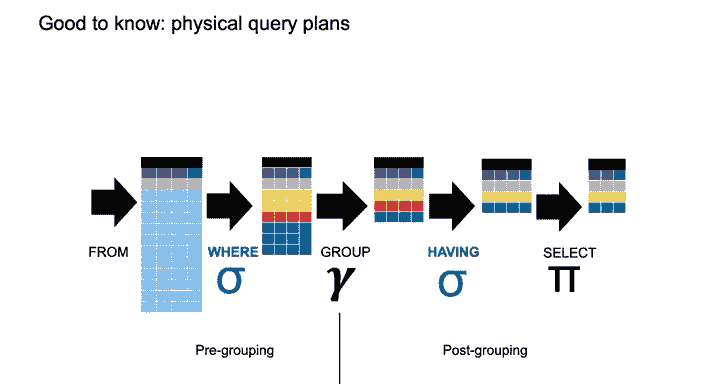

Something thing else that is interesting in the world of Seel is that logic is three valuesd。

 theres true false and unknown。😊，So it means that you can extend these truth tables with a third value unknown。

 it's just common sense， right false。And a node false or。 So here it's or。

 you can do the same with N false。Or unknown is unknown， but false or sorry。

 true or unknown is going to always be true right basically means that a can be replaced with anything and the value is always true right So it's just common sense。

 but basically you have the third added value。 and that's a very important feature of of the sQL language。

 a can kind of be put in perspective with null， right。

 So it's kind of the same plays kind of the same role。

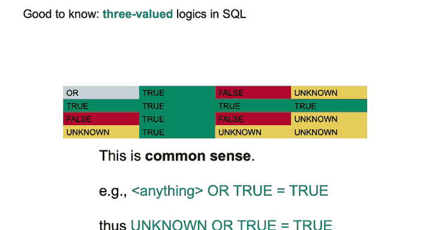

Okay。😊，Then there is a bit of vocabulary dL is data manipulation language that's the very generic name for a query language that manipulates data so this is the selection projection and so on that's DL DDL is about the schema this is when you define the columns and the names of the columns and the types that's called DDL right SQL has both you can both define the columns and you can query the data and insert data so that's kind of the difference between datas and schemas right and we'd also insist on that difference between data and schemas during this course。

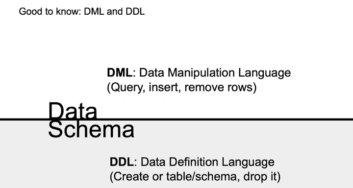

Okay， so DM L， GDL。What it's also good to know I'm really very quickly going over this in a relational database management system what you also have is an index。

 an index is something magic that accelerates the query and you just notice its faster but the results are the same it's similar to what you have at the end of the book where you have an alphabetically sorted list of words and that gives you the pages on which you find these words right you've already seen that it is the same thing we have in a database systems we have these sort of structures that are hidden from the user and they bring a query down from hours of the execution to just milliseconds so it's a extremely powerful。

😊， we look into them again as a brush up in a couple of weeks in the context of document stall。

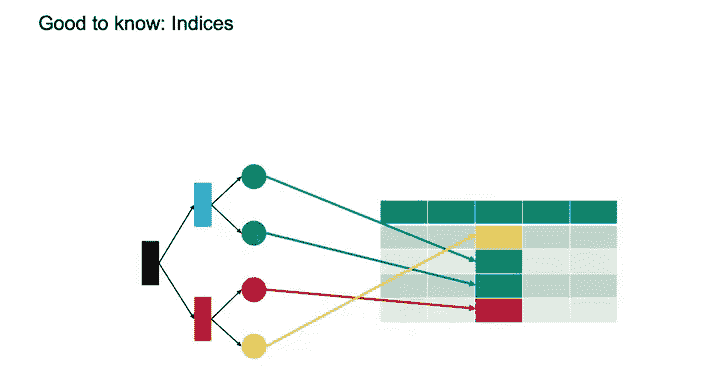

Something else I want to throw at you just like that is the difference between two scenarios that we have in databases。

 we have scenarios where we are read intensive， we read a lot of data。

And scenarios in which we write a lot of data。 The scenario for writing a lot of data is the use case of a web where people keep placing orders。

 So that keeps updating the database when orders are placed and the inventory res that's called OLTP online transaction processing。

And in big data what we see a lot is the systems in which we don't really modify the data。

 you just download your data set and don't touch it。

 you just queries that's also called OLAP online analytical processing and that allows us to basically denormalize the data this is the deormalization we do a lot when we just read without writing into the data that I'll come back to right OLAP might be known in the context of data cubes but it doesn't have to be with data cubes。

Okay， so this is again， this distinction between writing and reading right。

 but again I'd go back to Wis during the semester to explain that。

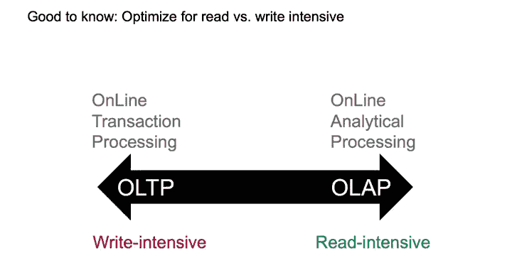

Okay。One more thing I would like to tell you about is that when you have a relational database management system。

😊，Its really is also to avoid situations like you go to the ATM and the amount is ded from your account that you're not getting the bank node this is the sort of thing that can happen if you don't implement the database as well but fortunately in this kind of systems we have some guarantees like in Postgql and all these Google old systems that give you f things atomicity consistency isolation and durability if you look at the initials that ACI that's how you remember it as a nasal breaker so this is these are the fog properties so very quickly this is what they mean atomicity。

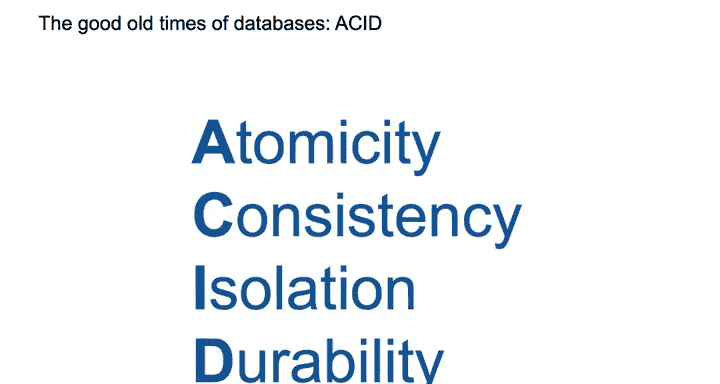

Means that when you have a transaction， either all of it is applied or none of it。

 so either you get the bank notes and it's deleteted from your account or you don't get the bank notes and it's not deleteted from your account。

 that's atomicityity。O on the thing， but you don't get half a weeks only， right。

 It's either or on the thing。 So that's atomy City。 The second one。

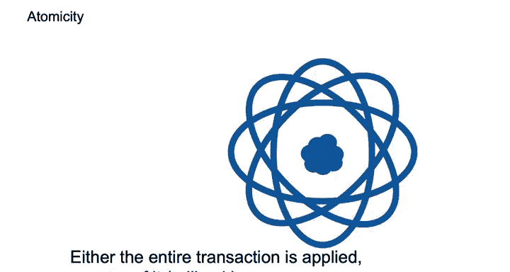

Is consistency， it means that if you have some constraints on your data， the fact， for example。

 that your account balance should be positive or the fact that if you have booking in a plane that no two people are on the same seats。

 you know that kind of things the database also guarantees that that's called consistency and every time you have a transaction at the end it's guaranteed that it's still in a consistency state right that's called consistency。

 then the eye is isolation。

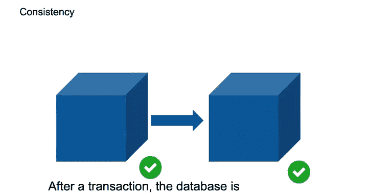

When you log in to a booking system like to book places seats in a flight or in a train。

 it feels like you're alone right there's actually thousands of other people who are connected to the same website and also trying to book seat but it feels like you're the only one on earth on the website if that feels like it then this is because of the isolation guarantee of the database it support thousands of people at the same time connected to the database。

 but it makes you feel like you're the only one how because you do not see what the other people are doing they might change the data but it's made it invisible to you。

So this is called isolation， right？ So this is this is also a very nice feature of the the Google databases。

 they report scale up in this way。 And durability means that if you paid money in order to get a seat about the train。

 then you basically hope that when you actually go to the train on the day you booked it。

 The city is actually there。 and nobodys sitting on it， right That's called durability。😊。

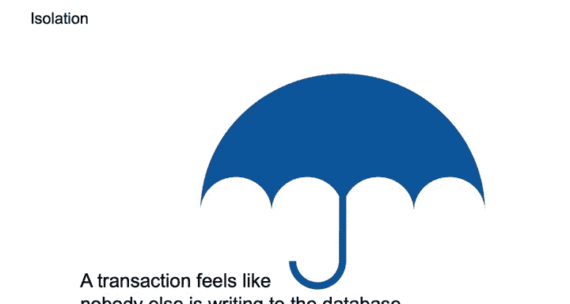

It's broken when， for example， if you have an electricity problem or the computer crashes and so on。

 you lose the data， then you don't have du ability。 yourr ability means if you update the system。

 then that update is going to persist。 It's staying there right That's du ability。

 The four together are called ACI。We will see that in big data it's actually not possible to guarantee these properties anymore it's actually very hard to do on very large scales。

 there are people who try to do it， that's the sort of thing that you can implement on a single computer and that you have in PostgQL but in big data we are going to change the paradigm and actually drop also these kind of properties but I'll come back to it。

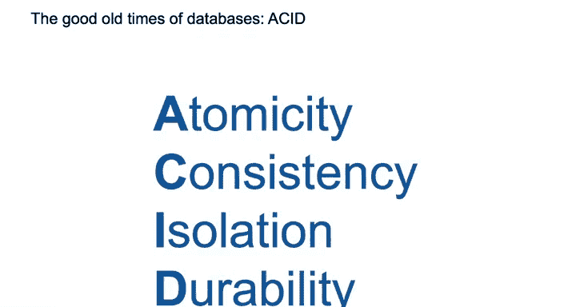

Okay， so that's ACI， that's what PostgsQl gives you out of the box。

So where does that leave us right so this was the brush up on relational database management systems and SQL it's something that is typically taught at the bachelor's level。

 if you do not have such accounts don't worry， just learn SQL。And learn these words on a high level。

 I will anyway come back on it during the course， right？But basically。

 what's now going to happen in a class， you already know we're going to break the rules of the normal forms and so on。

 but most importantly， we're going to look at tables that have lots of rules。

Millions that's still small billions， trillions of rows， we can have quite millionss of rows。

 this is big data or we're going to look at tables that have lots of columns in a typical relational database management system。

 you have a couple of hundreds of columns at most in a tables depicted emitity to 2 55 or 256， right。

But you can also have cases in which you have millions of colorss。

You might have billions of rows and millions of columns， and it's all very spas。

 A lot of those sets are empty。But that's also belonging to big data， right， So lots of rows。

 lots of columns and the third one， the third dimension， lots of nesting。

 you can have a table in a table in the table in the table at  plenty of levels。

 So these are the three ways that we go towards big data on the， lots of rows， lots of columns。

 lots of nesting。 Basically， if you look at the rest of the lecture。

 This is more or less going to be every week。 One of these three or two of these trees， right So。

 for example， object storage is going to be lots of rows。

 So the same for distributed by system syntax， a lot of nesting with X and Json Col storage。

 both of them。 lots of rows and columns， data models will do it with a lot of nesting。

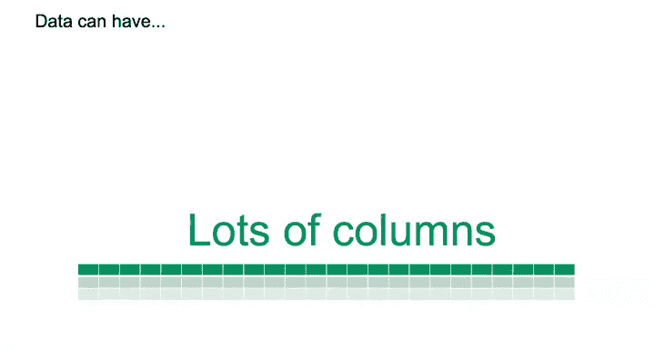

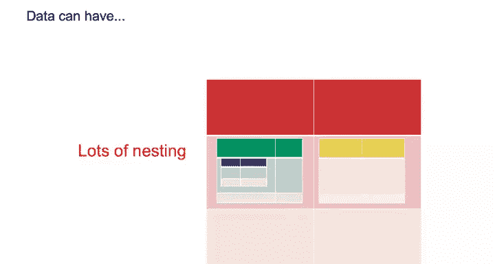

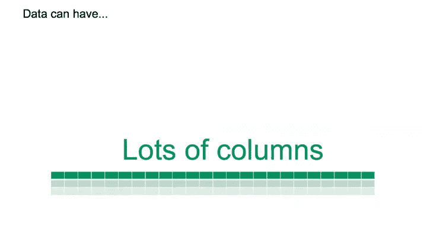

Tables in tables， massive file processing lots of rows document cells lots of nesting。

 but also lots of rows I could also have good data here and the querying for nesting why because without nesting that's basically sL but we'll see how we can extend the querying paradigm when the data can be nested and this is then the language like Jsonic right there's other languages but if you learn Jsonic you'll be able to very easily master the other ones to。

So that's the last slide of the brush up。 And now we are going to get into the real material with cloud storage。

 Do you have any questions， anything。😊，You want to ask。Yes， Roda。 So， let's try with the。

 we have this catchbox。 it's called。So testing so I guess like in this course。

 we consider tables to be more of an abstract data type rather than like an actual concrete data structure that we're using。

 but this is also an abstract data type。That I guess denotes into like sort of this relational notion that you talked about before。

 So there's， I guess two levels of abstraction。That we're considering here that have their own sort of specifications。

You could view it that way so basically it is indeed a logical abstraction。

 the notion of tables you don't find tables in the in the well you do have tables like this right but you don't have relational tables out there so it is really a logical abstraction in our head right but the reason we use it is that it's very natural to most human beings to have structure that looks like that as we sew on clay tablets so it is true that this is a model it's an abstraction and then you have the implementation of that model and the weight so I didn't cover that in here but the weights implemented it is just as five and directories on this right and you put the data in the filess and directories then you pass them back as tables you can do the same thing with trees you can do the same thing with cubes with graphs it works exactly in the same way you really have this abstraction of the view of other data and the physical implementation on this。

Rightright， does it make sense。All right， you're welcome。Anybody yes， questions， Yes。

 I want to ask more about the definition of consistency within the acid model。

 Does this mean that there are like certain like logical predicates that you can say are like a precondition before a transaction that holds on a database and then you do something and then it holds afterward and like what is it that you can actually what like how strong are the things that you can say about a database in these before and after predicates。

So that's the right way to look at it， you can see consistency constraints as preconditions and post conditionsditions that hold。

 but it's not just a pre like when you think of preconditions and post conditionsition， for example。

 in the design by contracts in programming languages。

 you might have different preconditions and post conditionsition。

 depending on the function you look at， right？But here it's an eternal precondition and post position。

 it basically means that whenever you're in between transactions before a transaction after a transaction。

 all of these predicates need to hold right likewise looking at it that the predicate is the right thing to do。

 in fact you have syntax in SQL that allows you to specify these prediicates you can add to your schema a predicate and ask the system to guarantee that predicate for you so you know that when you have a transaction at the end of the transaction the predicate will hold or you will get an error but it will not let it happen that this predicate no longer applies。

Right so just to elaborate on on that when you talk about a consistency definition。

 is there a set of like default predicates that are assumed in that kind of definition in colloquial speech。

 In addition to the user defined predics， exactly。 So I would say yes。

 because if you consider the the the the rest， the fact that you have an instance of the model。

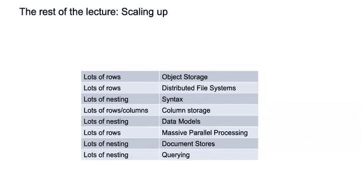

Like this with these re， you can also squeeze them into the predicates if you want。

 you could also consider them built in predicates， right？And just to illustrate that。嗯。

If you do not have data independence， meaning that you go back to the 60s and people write the data as CSV files on their drives。

Then you could break the predicates that it's actually a table by writing nonwell from CSV。

 you might write a CSV file， but you make syntactic errors in that file that you try to write manually。

 but if you use a system that takes care for you， you're guaranteed it never going to create anything that is nonwell forms like this。

 right？So this well formed as guarantee would fall under that would fall under the umbrella of the sea and acid that would that would be part of consistency you could consider it that way you could consider it that way very often when people talk about consistency。

 they very often refer to the additional user defined user defined predicates but I think it's also makes sense to consider the built in constraints as well right so one thing that I could add is that during a transaction。

It might be that temporarily a predicate will not hold。As long as at the end of the transaction。

 it was， but during the transaction， it's permitted to temporary breakup predicates。Right。

Does he answer't answer your question？All right， any other questions？On Zoom。All right。Very nice。

 And that's。Going on to the next part。 Then I just need to stop the recording。

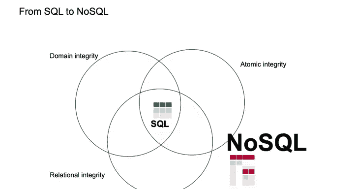

Plinly hear on the other side。

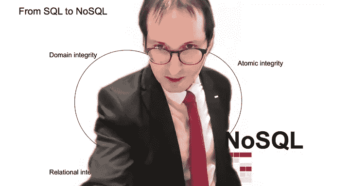