# 苏黎世联邦理工《大数据｜Big Data - ETH Zurich - Fall 2024》中英字幕（deepseek - P6：-06-3. Cloud storage (1_4) -.zh_en - GPT中英字幕课程资源 - BV1sHPKeoEJU

So welcome back， now we are in this third part about cloud storage。So。

I already asked you the question， so。Now what's going to happen is that we are going to start looking at how we solve problems right and one of the problems we want to solve is imagine we want to query data that's astronomic called data that's the map of the universe that was done between 201 2020 I went to the website and I looked at the data and I realized there's 273 terabytes of data that you can download。

And it's in 680，000 directories， 176 million fights。That's a lot of directories and files。

So it has hundreds of millions of thousands galaxies， billions of objects and so on。

 but the first thing you notice in here is that this is so much data that you cannot put it on your laptop。

😊，Right， it doesn't fit。And since a relational database is on a single machine。

 then it means you cannot use that either right so the question we ask is how can we store 200 terabytes of data and 100 million filess。

 how do we do that， how do we store it？😊。

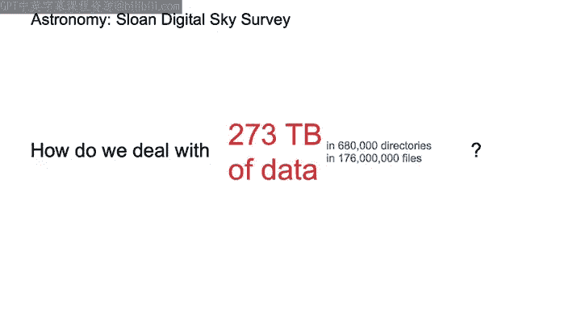

嗯。So we've looked at relational databases。These are on a single machine。

 single machine has omni up to， let's say 30 terabytes。 let's say。 so that's not enough。

 So the first thing we note here is we need several machines。

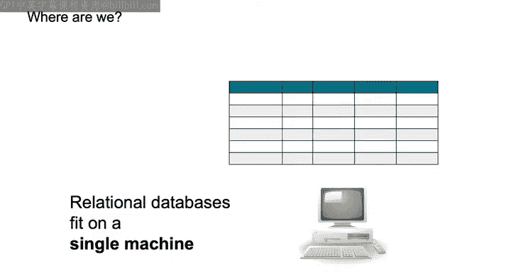

That's in any case。

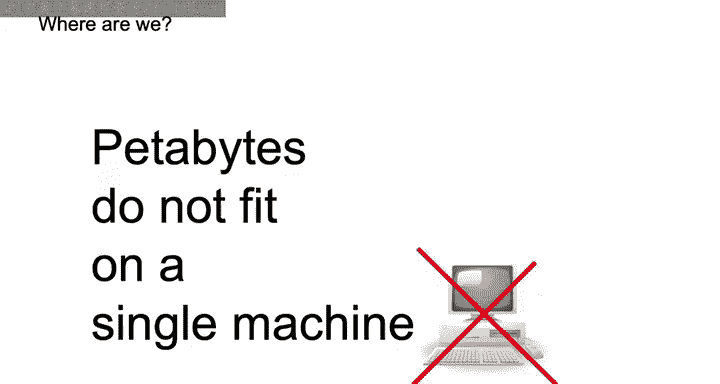

嗯。But I have good news for you， because even though we are going to have to move to something completely different。

 something that is that that has。😊，Never been seen before with the good or relational database management systems。

The good news is we can still reuse a lot of the teachings of these systems。

 so I would say I would be even as bold as to say that 99% of what we've learned can be reused so but I told you on selection projection grouping of team joining。

 it's still going to be there even when you have hundreds of terabytes of data。

A table with rose Col's primary keys when it still exists。

 you can still consider tables like that at this case， even with the three rules implemented。

 that also works。 you can choose to break them， but you can also choose not to break them right so that still makes sense。

 The languages like SQl will see still makes sense。 The notion of declarative language。

 functional language still makes sense as well。 The notion of optimization of query plan。

 the Greek letters， the query plan in the things， the alphabetical list at the end of the book all of that still makes sense That is great news because it means that everything you've been learning in your bachelor's lecture。

😊，And relational databases still makes sense and can be taken to that domain of of big data。

 That is excellent news， right， But there's a few things that we are not going to be able to take to that domain。

 So I already told you， So that's not news normally to you。

 this integrity constraints or relational integrity。 I also call it tabular relational integrity。

 domain integrity， atobic integrity。 We can throw them away right So this will consider systems that don't have them。

 That's no SQL。

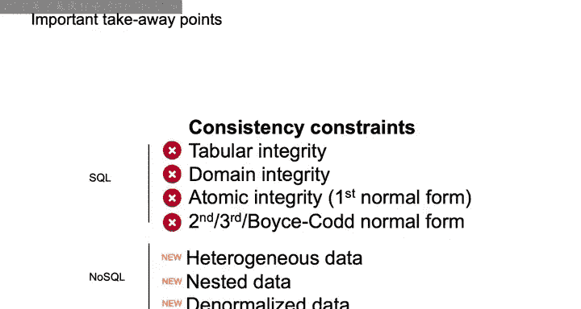

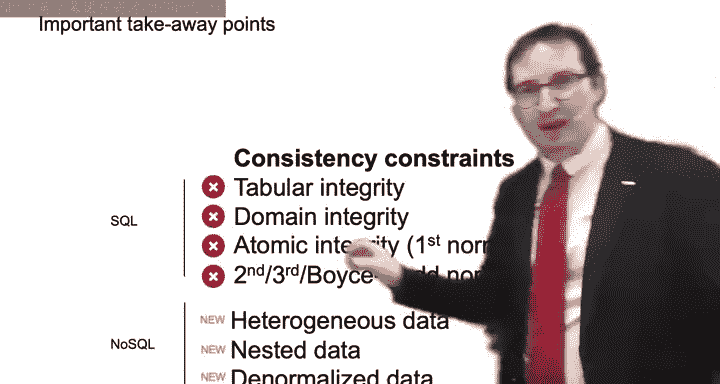

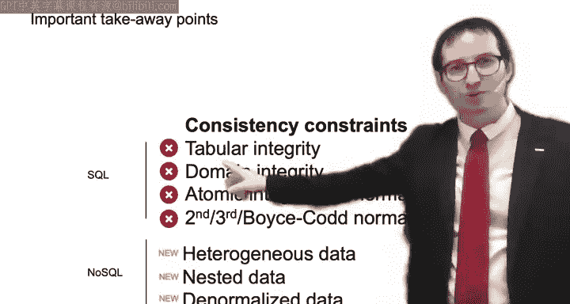

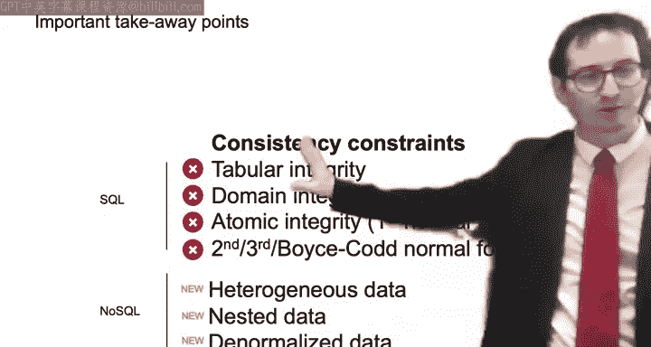

The second normal form， third normal form， boycott normal form， so Bosco is 3。5 normal form。

 all of that can go away， right？

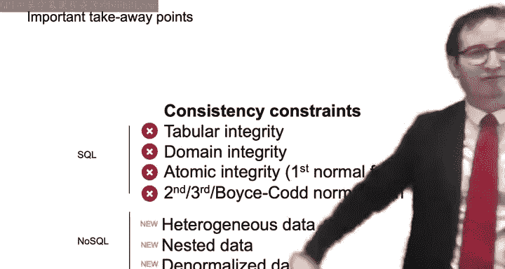

What we have， however， is the notion of heterogeneous data。Data that doesn't even have a schema。

We'll have the notion of nested data that's the one that breaks so heterogeneous data can be seen as breaking the first two things so relational integrity。

 domain integrity then it's heterogeneous nested data can be seen as breaking atomic integrity because you have tables in tables and more generally the notion of denormalized data so that well deormalize you're going to hear it a thousand times during that lecture right we' are going to massively denormalize data right so we'll reuse a lot but there' are a few things that are going to feed a bit different because of the scale that we are going to be looking at。

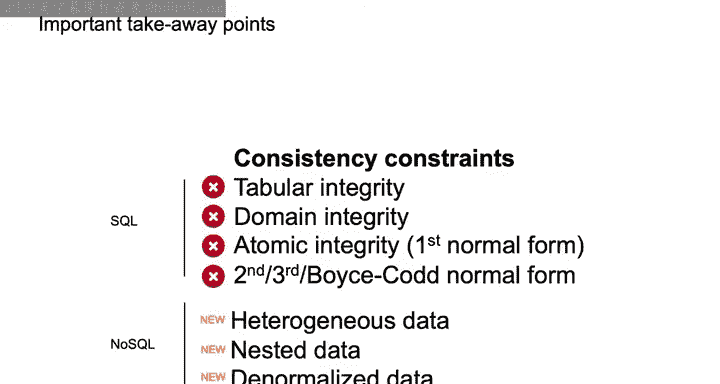

But nevertheless， we will keep in mind a few architectural principles in the way that things are built in the 1970s。

 the relational databases are considered monolithic， mean it's a single piece of software。

 you install in your laptop or your server and that seat on a single machine。

 we are going to rebuild the same thing。

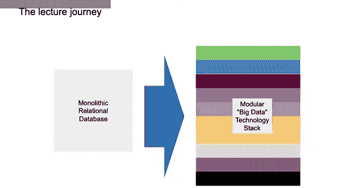

In a modular way， the same thing， but in a way that runs on a data center and we want a lot of things in there。

 we want storage syntax data models validation processing indexing what did I write in there data storess querying user interfaces and so we basically are going in the semester to work our way up that stack and reinvent all of these components in a way that at the end we more or less get the same functionality plus minus so these are the things that might differ but we are going to rebuild that tool stack So today we are going to talk about storage with local systems Hgfs is going to be the week after that S3 Aure B storage we're going to be looking at encoding very quickly that the way when you stock files on storage you can encode them in various way various ways。

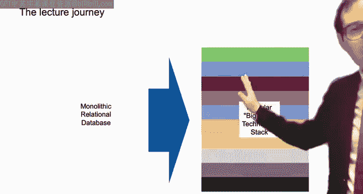

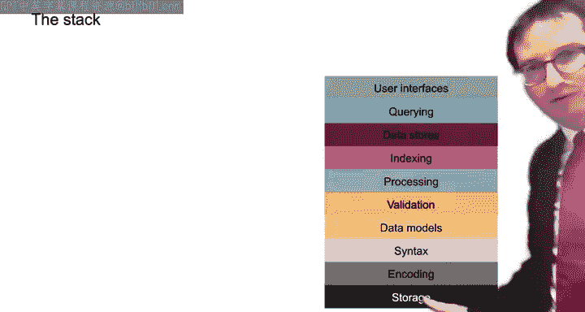

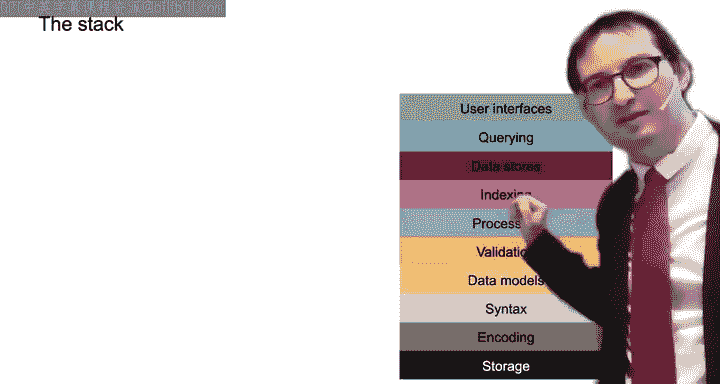

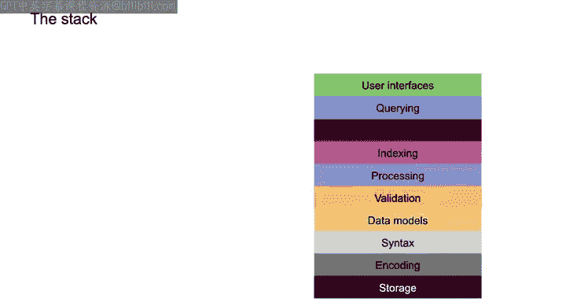

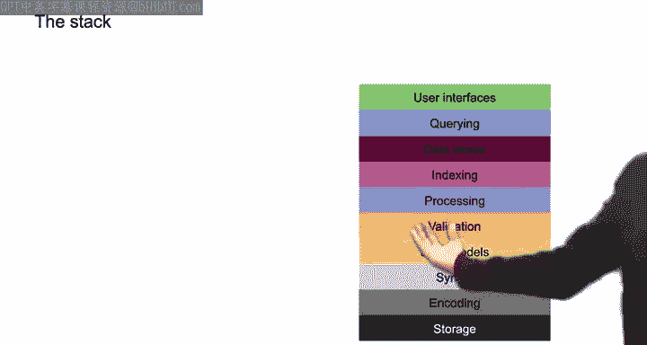

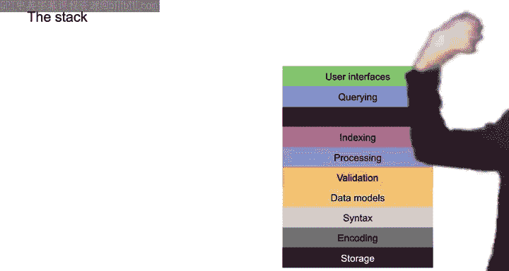

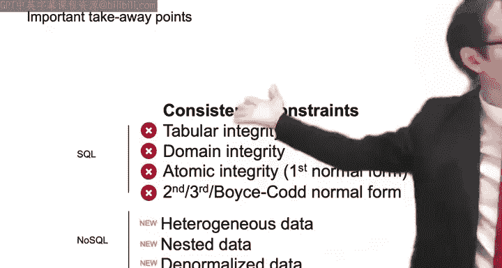

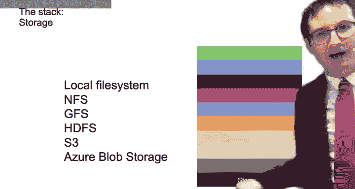

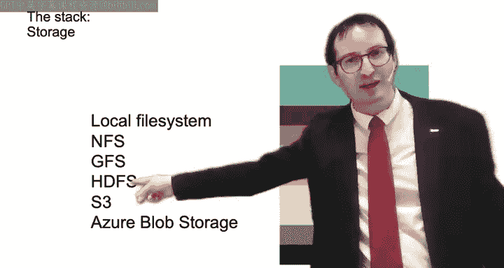

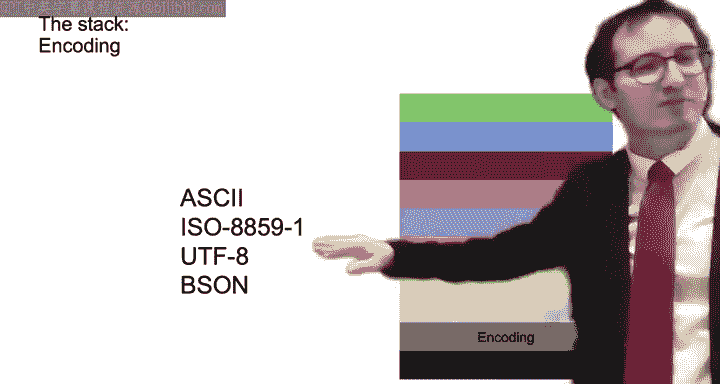

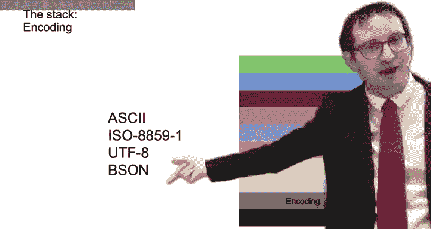

Then you have syntax CSV is for tables， XML JON for trees。

 RDF is for graphs doctor is also for graphs XBR is for cubes。

 so we' look a little bit at syntax data models we look at tables we already looked at tables but well also look at trees at graphs at cubes so a lot of different shapes of data then we'll go into validation。

 we look into XM schema JOM schema， Jso， relational schemas that's what we already know it's the current and types of that you have in there XBRN taxonomies for data cubes。

 so this is going to be validation。

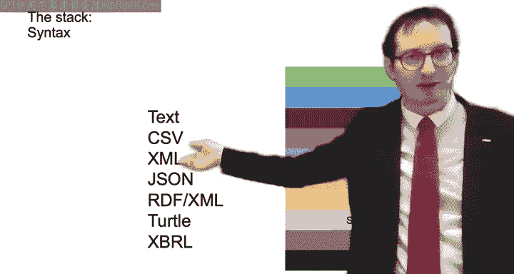

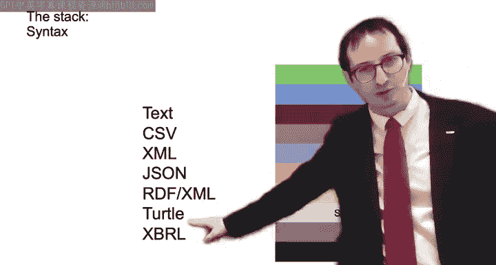

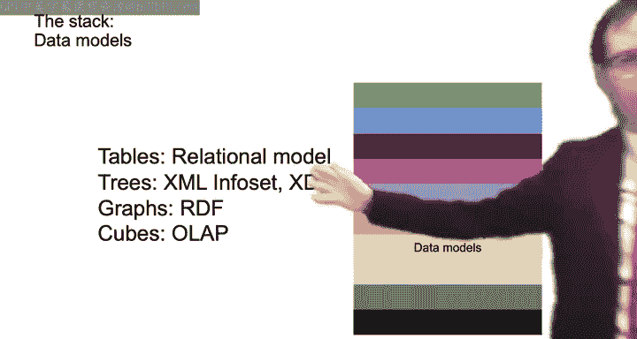

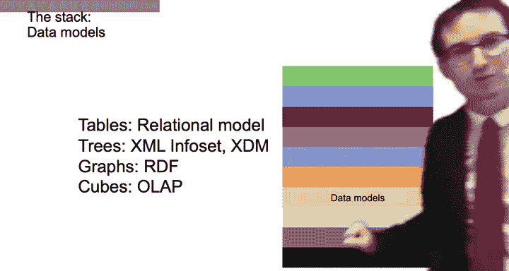

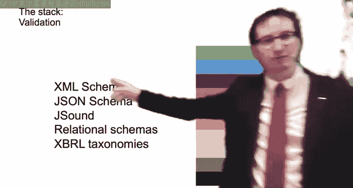

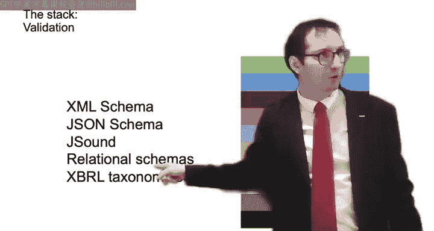

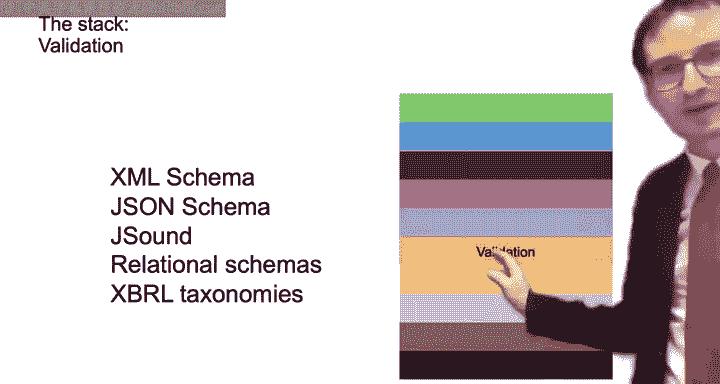

Then we look at processing。

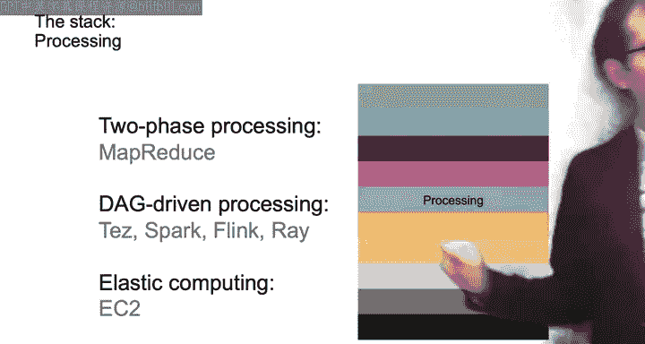

It's probably the coolest part of the lecture because this is when the data center is set into motion with map pre who heard of map preuse。

Who heard of Apache's Sp？OkayThis is what we are going to look at now we are going to play with the data in the data center okay。

Then the indexing， it's pretty much the same as in a relational databases。

 but we'd still rehearse them a little bit with B trees， B press trees， hhing DCs， and so on。

Then there's data store， a data store is basically like a mini database system。

 it's not quite a fullflged database system with ACD guarantees and with a highlevel language and so on it's kind of a mini version of that that might have an API rather than a queryirie language that might not be fully ACID and we'll also discuss these things but at least it's already a system that is integrated and that works out of the box。

😊，Then you have the querying layer that makes it a true database system SQL we are brushing it up Jsononic we look at it xquery is the same for XL Nikel MDX is for cubes Packle is for graphs so we look at also querying aspects and finally user interfaces it's like when you use different ways of accessing the system like a spreadsheets。

 Microsoft access Tau click UbiI tools， I should have put chargeGT in there as well because。

This is the direction that this is taking right you have an LLM and the LLM is interacting then with an underlyinging layer right we are not quite there yet as you know。

 but in the moment that we actually do manage to connect LLMs to systems like this that provide reliable data。

 then that will be a really good step forward。😊，All right。Okay， and today， we focus on storage。

 And then that's going to be the rest of the semester or the the rest of the stack， right。

 So we'll have 13 weeks left to cover all of this。 Okay， but we take it step by step。

 Now it's a regular lecture， regular material。 So I'm going to go through it slowly。😊。

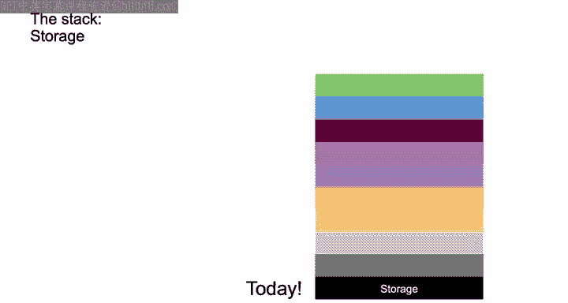

So that's the first problem we try to solve how do we store the data。

 all of these stars and galaxies that are taking hundreds of data well we need to put it somewhere right needs to go somewhere。

 there is this saying that quantum information people like to say that information is physical right you need to store information it has to be on some physical layer with in the end atoms and molecules all light。

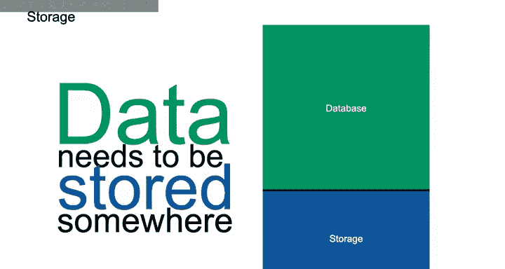

Okay， so it needs to be stopped somewhere。Now， we will see during this course that there are two main paradigms to store the data。

One paradigm is the one you have in PostgsQL。You need to import the data into the database。

 you have SQL command for that right it's called EL， itll come back to that extract transform load。

 you load the data into the database。

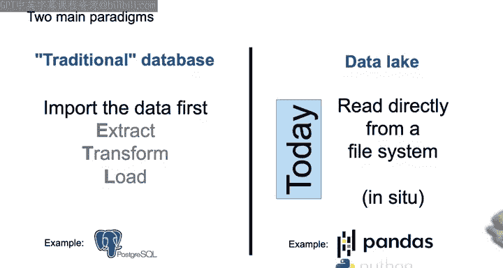

And the database system takes care of the rest， so if you load it into PerSQL。

 you don't have to worry about how Per GQl is going to put it on the disk because that's taken care of it's invisible to you that is the traditional approach to storing the data right you import it and then let the system take care of it。

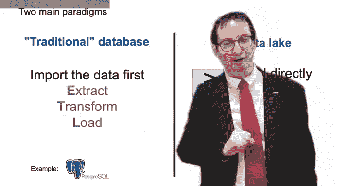

Another way to look at data that is a bit more modern is the concept of a data lake who already heard of a data lake。

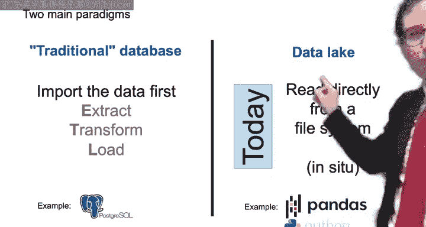

， many of you so the idea of a data lake is that instead instead of importing the data into a system and letting the system worry about how to to store it when in a data lake you directly store a data in a file system these are files so you store XmL files。

 Jason files CSV files all you want you directly store it on the data lake and you see them as files and directories so this is called the data lake approach。

😊，It's very convenient if you only want to read the data。

 if you want to modify the data you quickly notice that this starts breaking and it's not very convenient right but for readin setups or La we love data lakes for that reason right so examples if you look at using panndas with Python you are in fact using the data leak approach right。

It's also called inC2 it means that you put the data and you query it where it is without the needs to import it Okay we have a question yes。

Yeah。Ormost。So my question is， why is the data leak so difficult to modify。

 like you said it's difficult to move my right。So the reason it' difficult to modify is related to the question you asked earlier about consistency。

 it has to do with the fact that if you put the data on a data lake and let's say you put CSV files。

 XML files， JSON files then all kind of files。Then you have direct access to these files。

 So it's very easy to get it wrong when you actually， you could make them inconsistent。

 you could make mistakes that it's a lot on your shoulders。

 The other aspect is that you might have a very large file。

And you might want to modify one piece of data in that file， right。

 let's say you have a gigabyte file and you want to modify something in that file。

 We see that the large scale systems that we are going to look at， the data legs， they are really。

 really， really bad at modifying data like this in a random access fashion。

 They are really bad at that。 They are really good at writing down the data， you stream a big file。

 you stream the data over and write it down。 they are really good at that。

 but modifying data somewhere。😊，They are not good at it。

 and that I will explain next week when we study HGFS why that is the case that it's very difficult to modify the data in place。

😊，And the third reason why it's difficult to modify the data is that you might have multiple people trying to access the data at the same time right and then you really need to be on that side of things with a traditional system if you want to handle multiple users and transactions and ACD and so on right does it give you an intuition。

😊，B yes， thank you。 Yeah， thank you very much。Okay。

 so that's something you really need to keep in mind the whole semester。

 the distinction between the systems in which you have to import the data and they figure out how to store it。

 but then it will give you a lot of very nice features。

And data lakes that you just directly drop your filess on it and then directly query them where they are。

 it's a bit tougher to use， but also quite popular and we see the pros and cons on both sides。

By the way， also to complete my answer to your question。

 there is a system that allows you to make updates to a data lake that's called the Delta Lake who already heard of the Delta Lake of Databricks。

So this is something that they did， it's a very complex machinery to do that just to say that it's challenging。

Okay， today I'm going to focus on data Lake， how do we just drop the data in there and have a system where we drop the data？

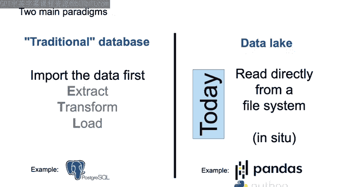

Well back in the 70s， we had h drives， right？😊，Like this。 Oh， that's the break already。

 So let's take oh wait before you go we have ETH juniorors so you're free to go on the break if you want。

 if you're interested in hearing about ETH juniorors。

 then then this is for you we' also have the next week I think is the analytics club So its just to give you an overview on you of what's going on at EthH yes。

😊，说这个。And I see you otherwise at Quaok past three。

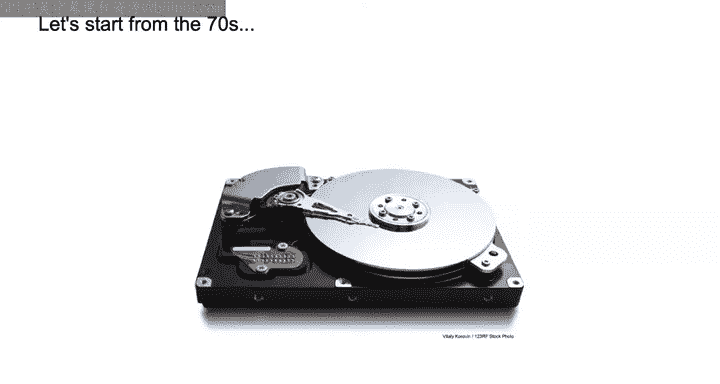