# 苏黎世联邦理工《大数据｜Big Data - ETH Zurich - Fall 2024》中英字幕（deepseek - P7：-07-3. Cloud storage (2_4) -.zh_en - GPT中英字幕课程资源 - BV1sHPKeoEJU

Welcome back， everybody。So let's continue to where we were。开始。So， we were talking about。

How to store the data。To start the data on a single drive， which is what we had in the 70s。

We basically have on these drives file storage， so we have filess and directories。

 it's all organizing the hierarchy， that's what defines the file system。

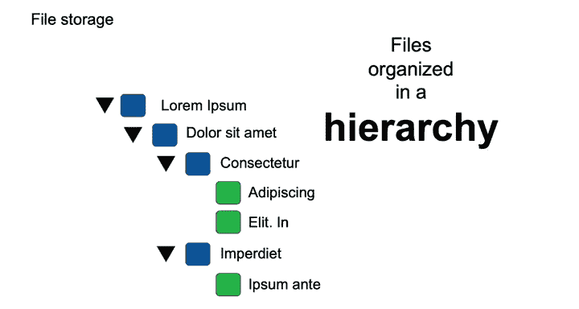

And another feature of this storage on the hard drives is that the content is stored in blocks。

 who already heard of that， that on your hard drive here on the laptop it stored in blocks。

Lo lot of you right and these blocks are roughly4 kilobys in in size each， right？

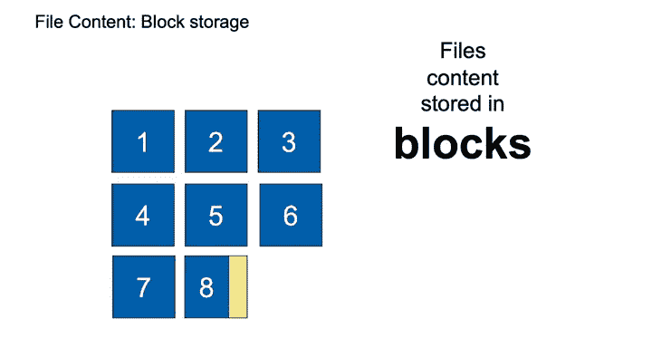

嗯。So you can have local storage at the level of your local machine。

 and only you actually access these storage。Or you can have NAS， which is network attached storage。

 who does have one at home， a hard drive accessible virtual network， some of you right。

 so this see a hard drive， but you can access it from multiple places it's on a network。😊。

And then you have wide area networks where like ETH is a wide area network Now as you can imagine if you try to plug a hard drive to the ETH network and have everybody at ETH access it that's not going to work right it's really not a way that you can store and query that data right because that doesn't support too much concurrent access。

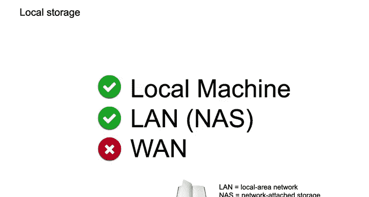

There is another limitation that has to do with the number of files。

 so 1 thousand00 files is okay a million files is okay a billion files is going to break your laptop so that doesn't work could does the backup of our machine。

So you might know the number of fights， the order of magnitude， who doesn't have a backup。

Do it now two nights， two nights， you do a backup really otherwise you realize it when it's too late。

 very important to do a backup the world backup days on March 31st that you should really do a backup now。

All right。Then I told you about the analogy with batteries。

 the way that we are going to actually solving this problem of going to billionial files is just like the batteries we are going to just assemble a lot of the small and cheap components so we are going to throw away the hierarchy in our first design so it's called object storage。

 we throw away the hierarchy we forget what directories just a flat list of files flat list of objects second we make the data model trivial the data model on which we are going to base our first cloud storage is you have objects that are identified by ID areas。

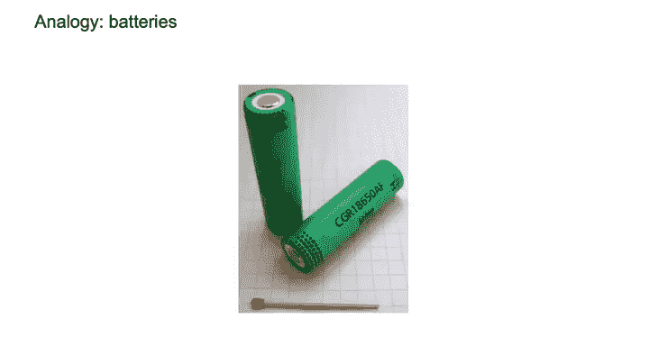

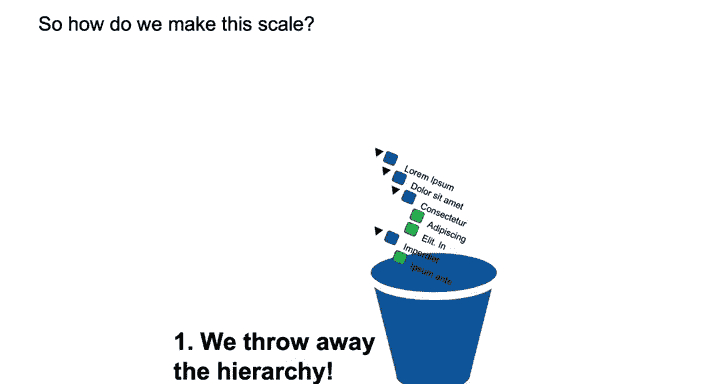

You can have trillions of them， trillions of ideas and every ideas is associated with an object。

 right That's also known that as a key value model who heard of that。So the key is the idea。

 the value is the object， right？You notice that I'm saying object and not file it's the same thing。

 but file is often said in the context of a hierarchy and when you have a flat list of pairs then typically you call it an object rather than a file。

 but it's just a matter of term immunoinlogy。

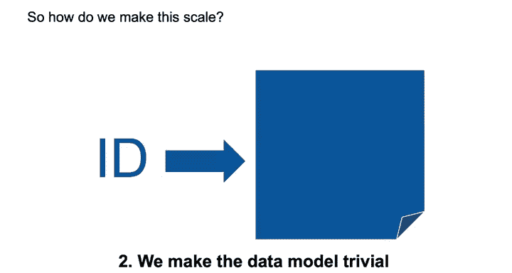

Okay， and then we have this global key value model when I say global I really mean global as is the whole earth because when you consider services Cs we're going to look at Amazon S3 the Asia B storage it is really a worldwide service so this is a worldwide model where you have these key values that are in there you can get your objects from the IDs so in terms of scale。

😊。

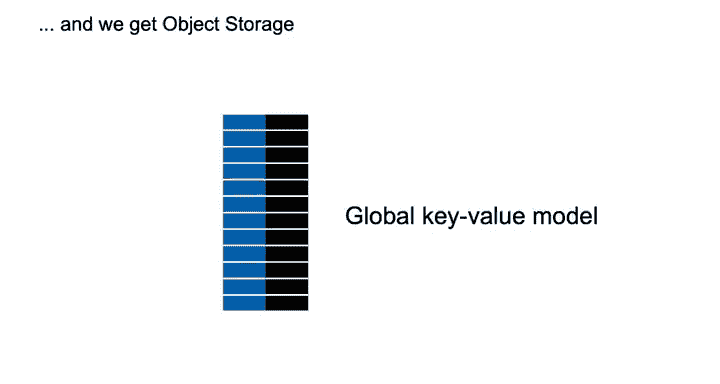

When a system is very slow， imagine you're on normal laptop。

 you're working on a semester of projects， it's too slow。What can you do？Well， several things。

 The first thing you might consider doing is buying a more expensive computer more exactly。

 have the professor buy a more expensive computer， right， And then you're going to have more CPU。

 more memory and so on。 And hopefully that's going to work a a bit past， right。

 very tempting to do this。😊。

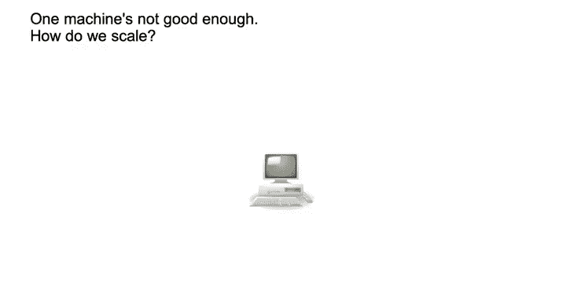

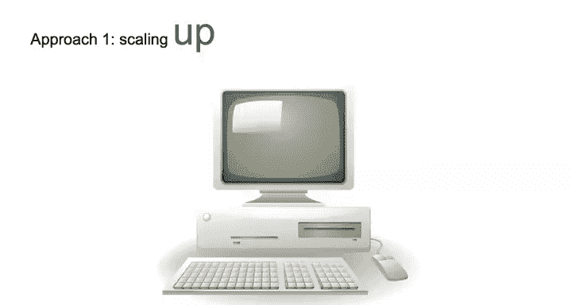

The second approach。Is to ask for more computers， you keep the one you have。

 but you buy more of them， second one4。12 many computers right， thousands of them。

 so this is called sating out the first approach is scaling up。

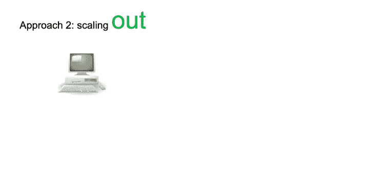

Skating out。The opposite of scaling up is scaling down right up means bigger machine down means smaller machine。

 Sating out means more machines， and the opposite of scaling out is scaling。

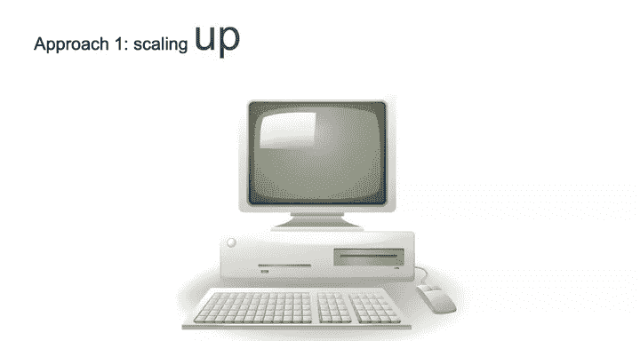

In you scale in means you reduce the number of machines People do it all the time on Amazon AW and so on。

 you can click more machines less machines， you can literally delete machines in in the in the cloud。

 So if you did it machines you scale in if you add machine， you scale out。

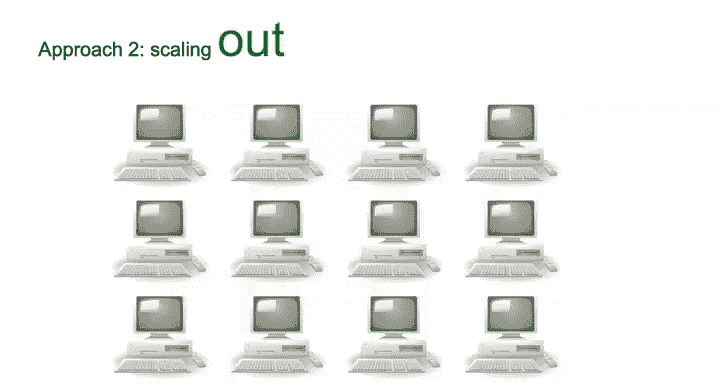

Okay。Now， if you compare the two in terms of costs。

 you will quickly notice that skating out is linear， but skating up is not to see this。

 just imagine that you want a petabyte of memory and 100 terabyte of disk。

If you want to scale up to a computer that has a disk of 100 terabyte and a beabyte of RAM。

It's going to cost you trillions of dollars， why， because you're going to have to set up a lab with the best the best RDD sorry。

 the best R&D research and development people in the world and spend maybe 30 years designing that machine that doesn't exist and maybe you will not even manage to do that because of physical limits。

So scale up， you can forget about it。 you will not have in the near future a computer with 100 terabyte of disk。

And a better bite of rum。Scaled out no problem just by millions of machines and that it we have millions of machines。

 we have data centers filled with millions of machines。

 so this is why scaling out is the solution building more of the small machines is much more realistic and less costly than trying to to build bigger machines for whom does that make sense。

Right good。So this is why we love to scale out， but there is something we like even better than scaling out is to be smarts and writing better code and in fact I would like to insist on that because now we are going to scale out and look at data centers with thousands of machines。

But do not make the mistake of rushing into it the first thing you should do is write better code。

 profile your code， write better code， be more efficient， use less memory and so on and so on。

It's an art and a science to do this typically you learn that when you do a PhD。

 especially a PhD in the systems area， this is the first thing you should do because then you don't need another machine。

And you don't need a be machine， right？

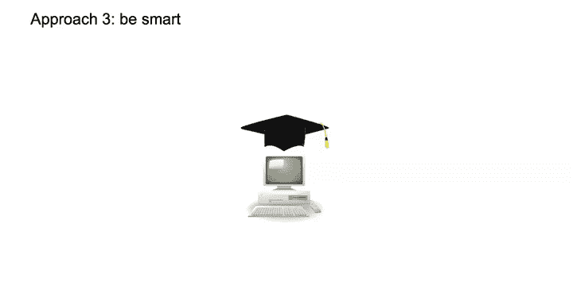

So this is the approach and there is this quote that I really like is that you shouldn't be allowed to use a second computer when you already know how to use the first one。

This recommendation goes in particular to those who are funding a startup and want to query data a lot of people think okay let's rush into the cloud and spend a lot of money and then we spend even more money if it's not fast enough but in fact many people I know who start this sort of things they realize that it all fits on a single machine in many cases it fits on a single machine right so you should really try that first to try to use code and store it in a way that is more efficient and then if you have good reasons then you can consider scaling out to the clouds okay so after that word of wording in this lecture we are going to scale out a lot right with thousands of machines there's even a slide where I will have millions of machines right。

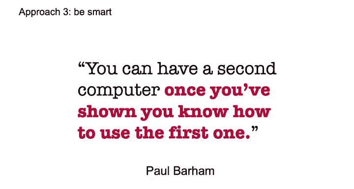

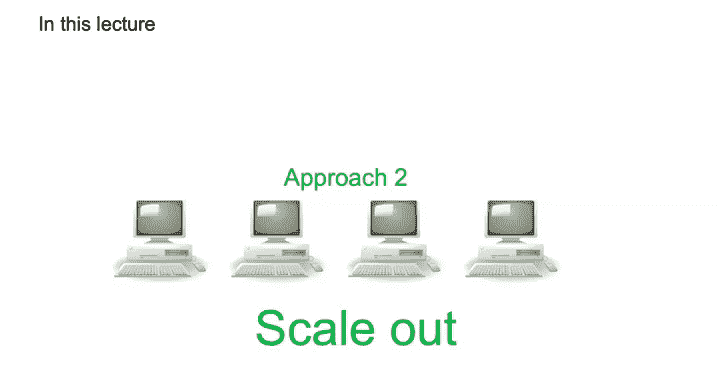

So scaling out。In order to scale out we cannot do it right here with at home you need to actually go to places called data centers there are a few in Zurich we even had a field trip plus June with big data for engineers where we visited a data center interaction in the north of Zurich。

 many people think it's in the mountains right in the military bankers and the Alps but in fact there's a lot of data centers right here in Zurich there's a fiber optics highway around the city and many data centers so what we have in there are typically in the cluster in the data center I'm giving you the order of magnitudes we have a0200 thousand00 machines it's order of magnitudes。

So the first thing you need to know is。100，000 seems to be some sort of hard limits。

We don't know there's private companies that don't disclose the size of all their data centers。

 we don't know for sure， but I'm not aware of anybody who has more than 100。

000 machines in the same data center， they might have it across data centers。

 but not in the same one。The reason is actually physical it has to do with the electricity consumption and the cooling of the temperature physically if you have that many machines it becomes almost impossible to handle so much electricity and so much cooling right so this is a physical limit a data center basically consumes the electricity of an entire airport I think a data center in Zurich it's comparable to the airport of Zurich in terms in terms of consumption so you have a limit that you reach at some point and this is why typically it's thousands tens of thousands but 100000 is really really seems to be the hard limits。

Of course you cool down and have a lot of electricity but you can use it for heating so there are data centers that are used in such a way that we get the heat and we basically use it to heat the homes of the people living nearby right so there are ways that we can use that in an efficient fashion。

Then in a server， so a single machine on your laptop you might have eight or 16 or maybe 24 cores in a data center you can go all the way to 128。

 maybe even more I rounded it up let's say 200 calls on the same server right。

So this is the order of magnitude and you would have to multiply that with the number of machines。

 of course， machine and serverr is the same thing， by the way I might use node machine and serverr a bit interchangeably。

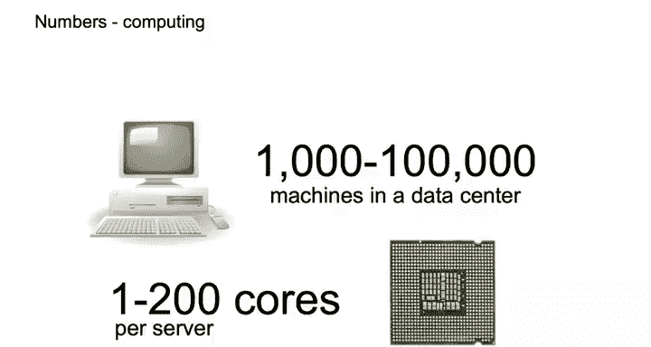

Then in terms of storage you already know I think the upper limit today for a single hard drive is 26 terabytes but it keeps increasing I think there's going to be soon 30 terabytes there was a prototype of 64 terabytes so it's not commercialized I think this is the typical storage that you're going to have on a single drive SSD is the flash drive they have less than that this would be a mechanical drive right HGD。

😊。

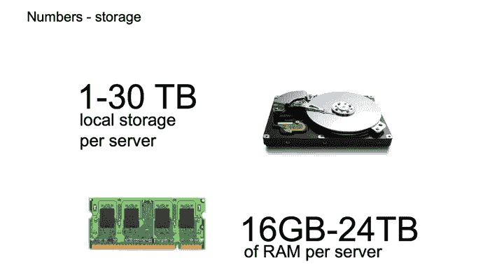

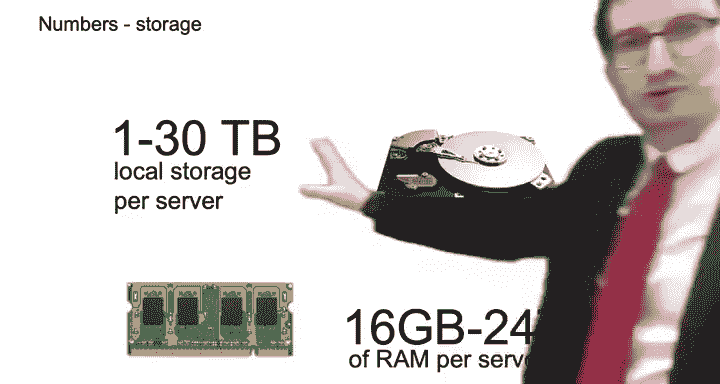

Then in terms of RAM， you can start typically8， oh you can you actually start at8 gigabyte。

 maybe 4 gigabytes， but all the way to 24 terabytes of RAM， I checked。

 I connected to AWS and looked at their latest specifications。

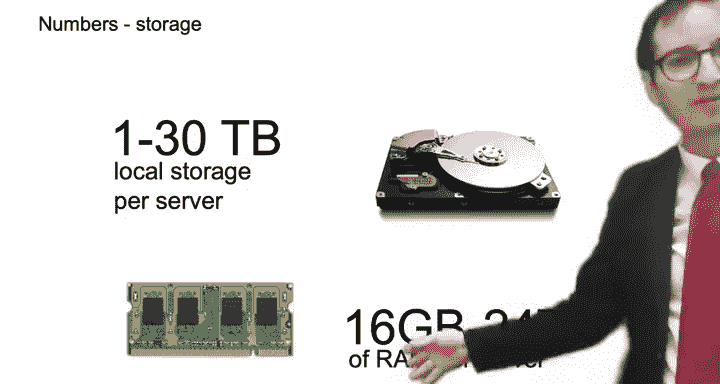

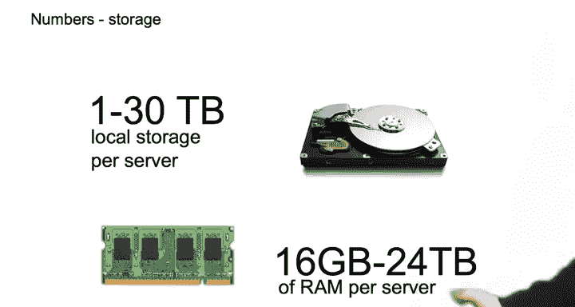

And now people would have looked in awe 10 or 20 years ago seeing that the order of magnitude of the memory is the same as the order of magnitude in the disk which would have been unthinkable back then。

 but this is really happening right the order of magnitude of the Ram we can have is very similar to what we can achieve with drives In fact。

 there's a reason for that it's the how popular the inmemory databases are getting right instead of stor the data on the hard drive。

 you can also just retain it in the memory in the working memory and if you switch it off you need to load it up again。

 but basically they are benefits。

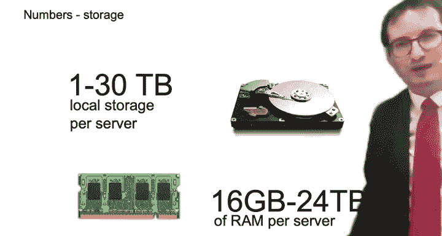

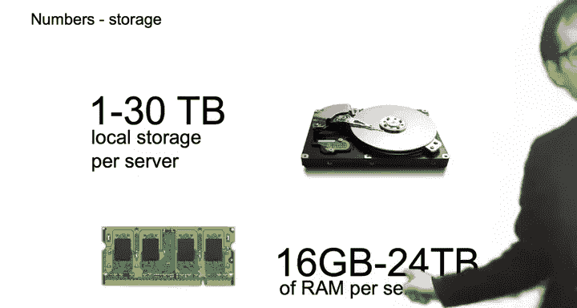

To holding the data into memory， right， And then we were able to make it happen。 All right。

 so these are the orders of magnitudes。 then in terms of network。

 you can go all the way to 200 gigB per second。 Again。

 I look at AWs Some of the machines can achieve 75100 or close to 200 gigBs per second。

 So that's the network bandwidth。 That's what goes over the over these cables right here right So this is the number of bits per seconds that go over it We full here its bytes here its bits。

 So when you look at at the cables， you're interested in the zeros and ones。

 when you look at drives or memory， you're interested in the bytes 8 Bs。😊。

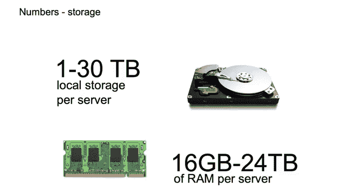

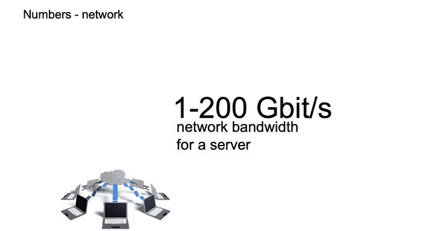

Okay。😊，No。If you go to a data center， you're not going to be finding a big room with desks and computers on the desks。

Instead， what you do is that you pile you have types of computers basically you pile them up。

 that's called the rack right it's called the rack and it's highly standard in the sense that you have a unit of heights that's called the rack unit are you and here thats 42 rack units it's because you want to standardize the way you pile up the computers otherwise it's a huge mess and then the providers are incompatible with each other so it means that in a standard way you can put server you can put disk storage units。

 you can put network switches， router and so on and this is one example of what's called the node it's a server and the heights here can be between one and for rack units and again it's all standardized in such a way that it's very easy to pile them up like this。

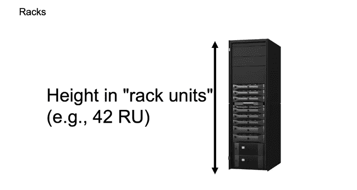

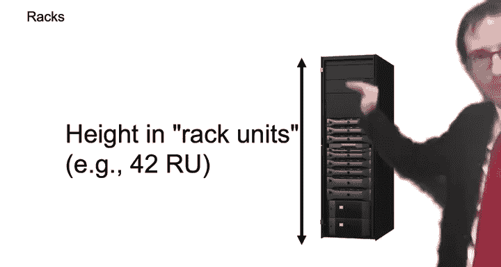

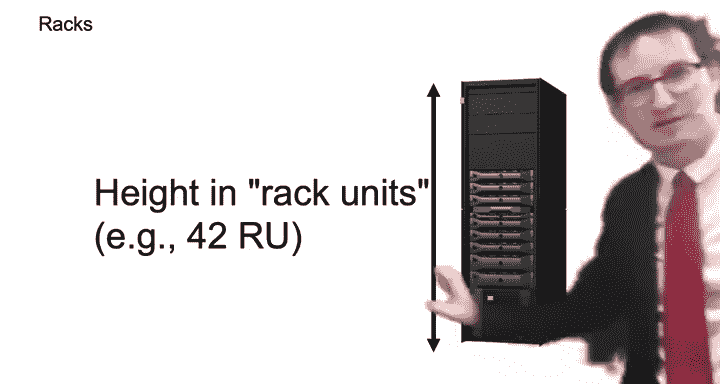

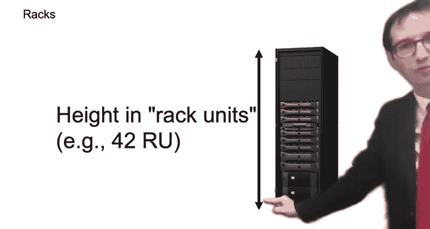

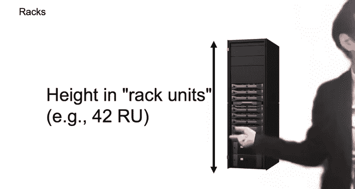

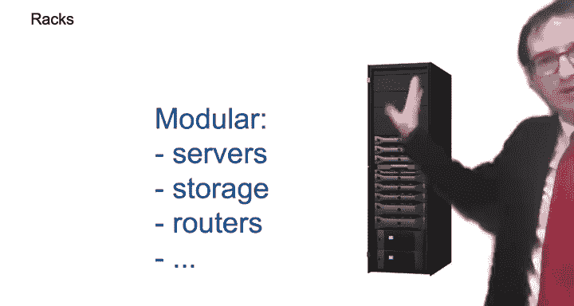

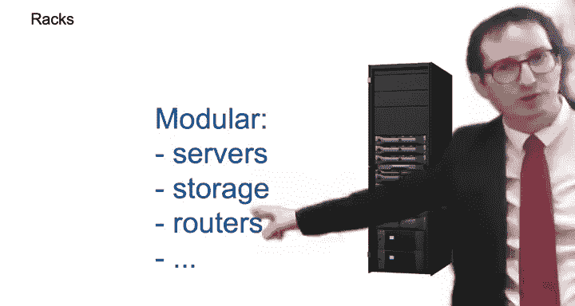

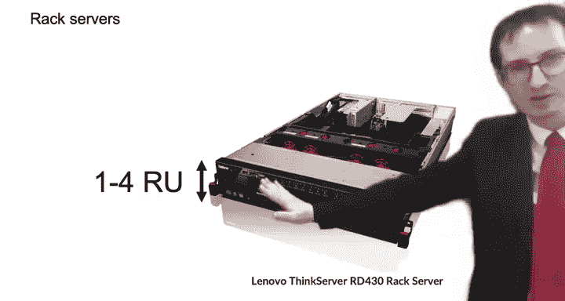

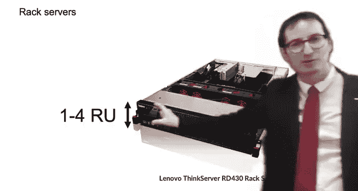

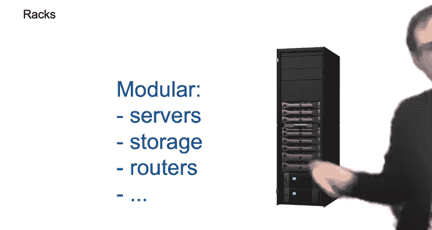

So when you go to a data center， you have rooms that are filled with racks like that so node inner racks。

 inner rooms and maybe multiple rooms okay and the racks are connected together via network switches and the nodes as well。

😊，It's very important of performance I'll come back to this a bit later to the fact that it looks like this。

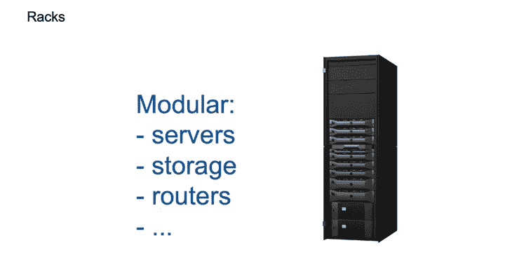

Okay， you can look at them if you go to diggiite or whatever store。

 you can actually look up these if you want to look at the specifications right it's called a rack serverr。

Okay。😊，嗯。😊，Okay， so I might call this a node， a serverr， a machine， you know。

 it's all meant with with the same terminology， okay。

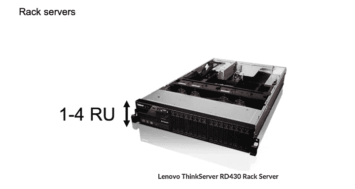

All right， so now that we have seen the hardware now you know what there is in a data center who has already been in a data center。

Oh， quite a couple of you already， Okay very nice， it's something to at least see once in your life to actually see a data center。

Okay。So Amazon S3 now。When your computer scientists。

 so probably you're not shop in big data for engineers， people like Amazon。

 they' are selling books like what is Amazon doing on the database is lecture。 but in fact。

 what happens is that yes， Amazon used to sell books。

 they still do but what happens a couple of years later is that they notice that people were buying more books in certain periods of the year。

 For example， Christmasma on search periods。 The problem is that when that happens you have the problem that you need more machines because you have more orders So they bought more machines。

 but then you have a new problem is that the rest of the years you're not using the machine at all because you don't have enough orders。

And so they had this brilliant idea of saying okay， we're not using these machines。

 let's rentse them to other companies and that's how Amazon Web services was born。

 They had the brilliant idea of studying these resources to other companies and now they are not the only ones there's Azure。

 Microsoft， Azure and there is Google Cloud So these are the three big ones but there's also other providers who do these right And so this is why Amazon Web services and what they provide is access to the resources。

 the machines， but also with the abstractions So one of the abstraction is S3 the storage storage abstraction simple storage service if I'm correct。

 that's why it's called S3 and we are going to look at it now there's many other services that you have in there。

😊。

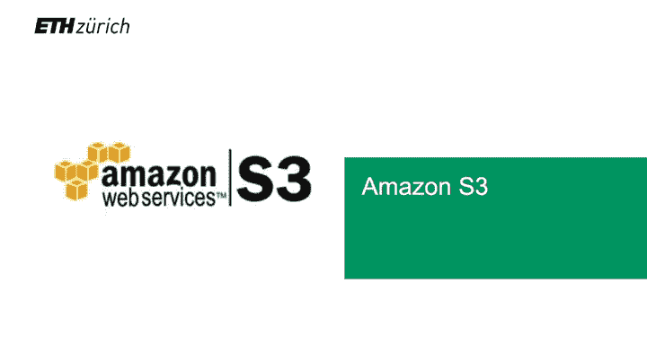

So the S3 model。Is very simple。 I'm going to do something today that I'm going to do almost in every week of the lecture。

I'm going to follow data independence。 I'm going to show you the logical level。

 which usually is rather simple， and then we are going to look at the physical implementation of how it's done right most of the weeks not every week here I cannot do it for S3 because we don't know it's proprietary and they never publicly said how they are doing it but the good news is that Asiaure is public and here you can read the paper。

😊，That explains how they actually did it。 But anyway， the logical model。In S3， we have buckets。

 you can have storage buckets。

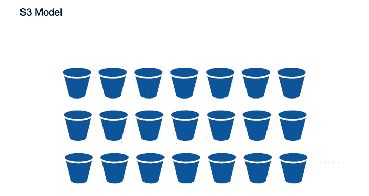

The buckets have a bucket I D。

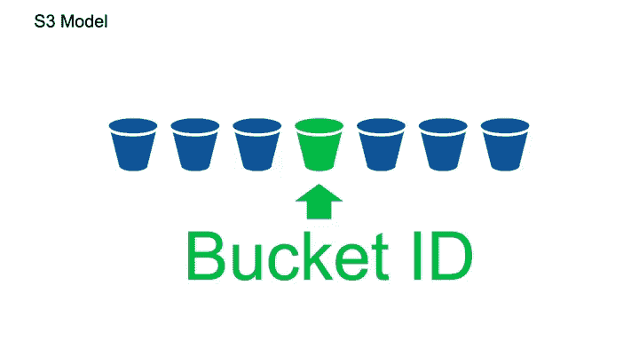

And inside the bucket， you can put objects， these are yourites by the object。

 so they're called object， and an object is accessed inside a bucket with an object ID。

And this is a worldwide service， so anybody in the world can have a unique bucket ID and you're guaranteed that nobody else in the world has the same bucket ID plus the object ID。

 if you have the two of them bucket ID plus object ID， then you can request that object。

 you can read and you can write both directions or you can read it also。

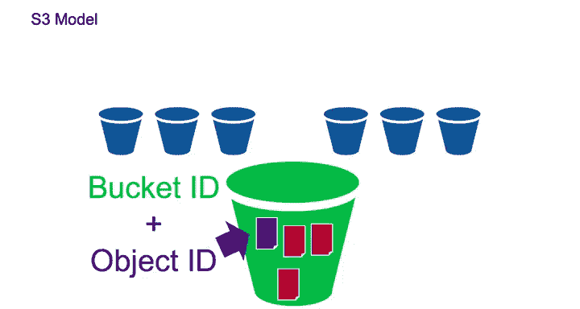

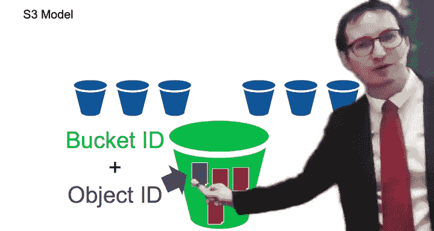

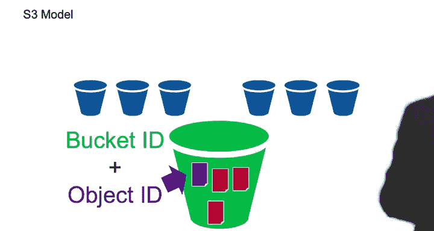

Okay， so it's quite simple， actually， right？😊。

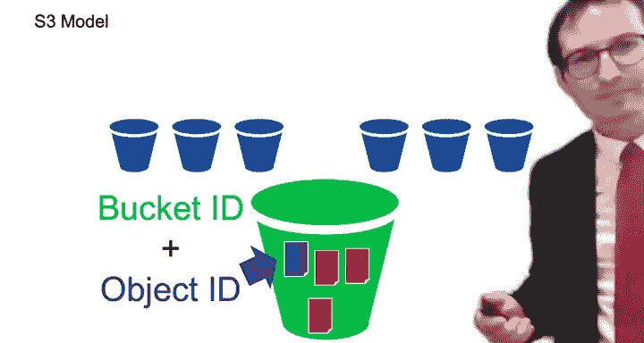

Now there is a maximum size to the objects that they can have， and it's five terabytes or S3。

Now you could guess why it still fits on a single machine。

 so maybe that makes you guess that perhaps they do store objects on a single machine right they might not spread them over machines and come back to this idea of spreading50 objects of all machines of course least next week。

 so the maximum size is five terabytes， the maximum size of an object。An object。

 just view as that as a zeros and once， it's just a file zeros and once up to five terabytes。😊。

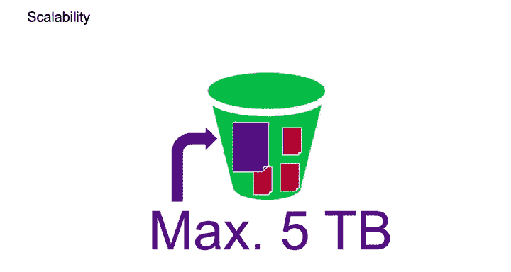

Then you have a limit of 100 buckets per accounts that's just so people do not abuse it because again bucket ID are unique in the world and they will only give you more than that per request so you need to actually ask them politely and maybe they will give you more buckets right so 100 per accounts。

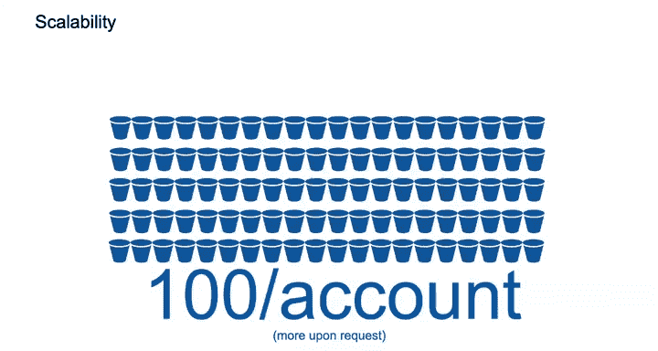

And then they offer you a few guarantees。 So， for example。

 they will tell you we have a durability of 99。999999999%。

And what that means is that if you give them 100 billion objects。

One of them is going to disappear into oblivion during the year。

 You lose one of them one of 100 billion during the year。But you have a guarantee that。

 you know this is atmost that， you will not lose more than that。So this is a durability guarantee。😊。

Of course， you don't want to be that person that actually loses their object。

 but you can steal their solutions， you can do backups， you can duplicate and so on。

 but it is already pretty a lot of nines right in there。Speaking about that。

 a lot of guarantees are actually expressed with a lot of nights。

What are these lot of nines for these lot of nines are basically for the lawyers because the people who actually paying for these services they want guarantees because you're a company you have a business to run so you want a few guarantees so in something that's called a service level agreements you're going to basically have all of these nines rank in there and then you can sue Amazon if they didn't respect their side of the contract right so this is basically what these service level agreements are going to be so let's look a bit closer so another kind of 999 number。

Is the availability。 So this is the loss of the objects。 This is now the run。

 the the fact that the computers are working。 Imagine now you want your object。

 you want to request your picture or whatever you saw in there。

And then it says no I'm not available Well， if you have a guarantee of 99。99%。

 it means that that can only happen one hour over a single year of an entire year。

 one hour of accumulated un availability time then so that's a lot of nine years everywhere just to give you an impression of what they mean so 99% of availability it four days a year that might be down and here you see 99。

999995 of them is four seconds every year it's a pretty strong availability right so you see this is what you get for your money when when you when you use these services and you put that in the contract。

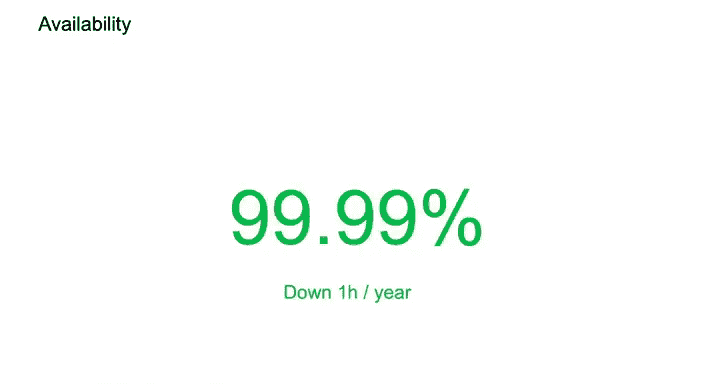

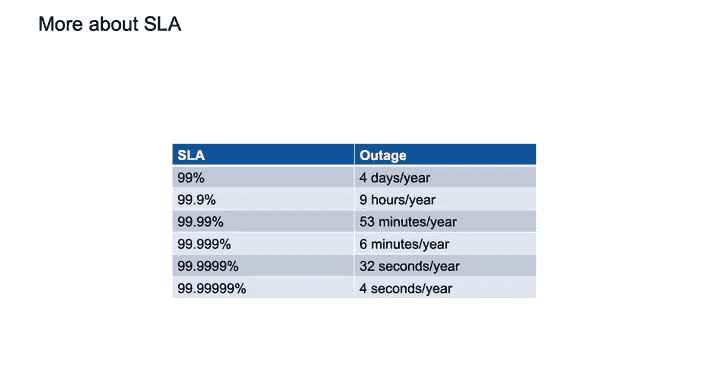

Another kind of SLA is how fast do you receive your res， right。

 how fast are you going to receive your responses？Well。

 you might think that's a response sign that you could put in the contract， okay。

 the average response time is going to be， let's say， 10 millise seconds or less than 1 10 millcon。嗯。

But instead of the averages， we don't like averages。

 it's very very tough to guarantee legally averages。 So instead we again do it with a lot of nights。

 we basically say in 99。9% of the cases， for example。

 the response time is going to be less than 10 milliseconds。😊，And maybe once in10。

 you're going to have a bit longer than that， right。 So this is how it' specified。

 This is just random。 I wrote 99%。 thats did not tied to S3 in any way。

 The only goal I have is to show you the structure of the contract， right，99。9 or9% of the time。

 You're guaranteed the response time below a certain limits， right。

 So these are called service level agreements。 and typically it documented。On the websites。For S3。

 I think I'm not sure if they guarantee it， but what people experience is roughly 300 milliseconds to access an object and and write it right So it's a few hundred milliseconds。

 which is already quite impressive for a worldwide service。😊。

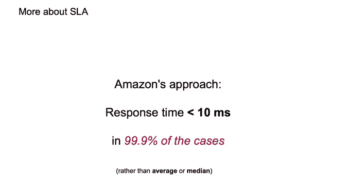

Okay。😊。

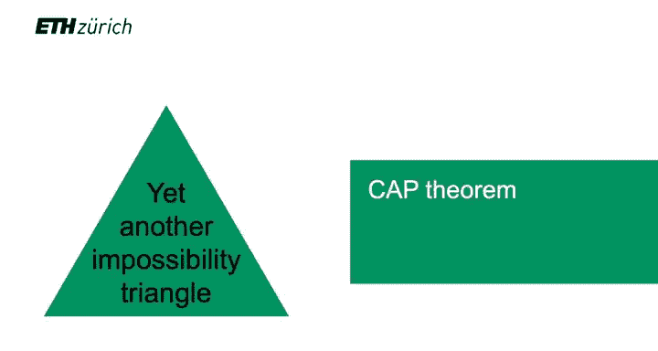

Any questions so far？Yes。😊，Oh by the way I could say it now we need to be careful with these microphones because they are I mean it's soft right。

 but if you throw it very， very rapidly then you can help people so I'm just saying for the whole semester when you throw it always throw it in small hops you know just a few persons away from you and gently that's just as an early one。

 it wasn't for you I'm just because I was reminded to say at least onces to the class right okay so go ahead I'm just wondering if it's actually thing that companies track these things and try to them。

So I didnt don off them it's for the legality right Yes I'm asking if it's actually a thing that companies track this that I as a company track the response time and then at the end of the year I'm like okay this response time isn't what we agreed on and then so so I can give you an intuition I'm not a lawyer and this is not a law program so so you know take it with a pinch of salt but what the way I think of it。

Is that？When you do business with people or you're the customer of a company。First。

 you usually pick serious companies and people that you typically establish a trust relationship with。

 So normally if you have a healthy relationship with in contracts with with companies or people。

 then you you don't even need the contracts right they are here。

 but you don't really need them So the goal of these contracts。

It's not really that you would hire 100 people who measure everything and then if it's slightly different you su Amazon。

 that's not the goal， the goal is that if there is a problem。

 imagine that your company you're using could be Amazon could be Asia or anybody else。

And then at some point something goes wrong and there's actual damage to your business。

 Maybe your website was not available for a long period that resulted in a loss of revenue and so on and so on。

 This is when you start going into these things that you start that you start talking into these things。

 but the goal is not to actually measure So typically you rely you rely on them。

 but you would actually go into suing and so on only if there's really something going wrong right This is this is kind of the way to think about it。

 Does it make sense。All right。So let me continue。There's no other questions for now。

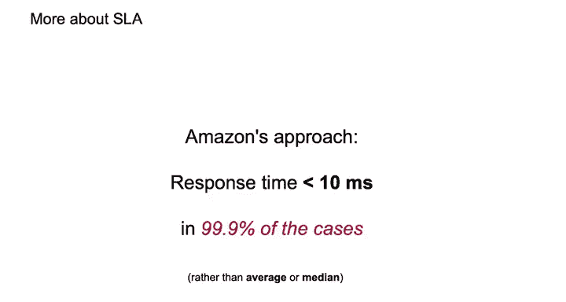

Okay， so。I told you。A you that。In the case of big data。

 we cannot offer ACI ACID is too complicated and expensive to offer people starts now to try offer ACID of clusters it's on way。

But we think of it in a different way。 and that's called the CA PM。 So instead of A3。

 we think of CA the。

C is an impossibility triangle。 It tells you there are three things that you cannot have。

At the same time。These three things are part tolerance， availability and consistency。

It's not the same consistency as in ACID， we you come back to it。Pracition tolerance means。

You have a thousand machines， maybe of different places in the world and the network gets partitions。

 there's an earthquake or there's something that happens and now you have two sub networkss that no longer talk to each other。

Pition tolerance means you can still continue to deliver and serve your customers from these two sub networks right it doesn't break the whole thing。

 this is called partition tolerance if it's not part to it means that it crashes and it's done。

Availability means that if people make requests they get an answer this is。

 for example the what I told you about this thing here that it's supposed to be you know available to you right you can access it and if you issue a request you get a response so that availability and the third one is consistency but it's not the consistency that you asked about earlier about you know the predicates that hold。

 it's consistency in the sense that depending who you ask because there are 1 thousand machines right so you could be sending your request to any of these machines。

Consistency means。Any machine that you ask will give you the same answer。

 It doesn't depend to which machine you connect。 This is called atomic consistency Okay。

 this is this kind of consistency right here。So what that impossibility triangles really setting you is。

If there is a network partition。Earthquake fire cable that is that is cut in the Atlantic Ocean or whatever。

Either you're going to remain available， but at the cost of being nonconistent。

 it means that you have to accept that maybe the two sub networks are not going to give the same answers。

Or。You really stick to consistency， you do not allow for inconsistency。

 but the cost is that you have to drop availability。It means that if people。

 you have a part and people try to access your service。They will basically say sorry。

 we have a temporary problem please come back later right so this is the idea we are not available at the moment until the part tolerance the part is over right and then the whole network communicates again。

Right。It's not the same thing as not being part tolerant。

 being part intolerant basically means it crashes and it's unreccoverable。

 but being unavailable is something else it's just temporary right you tell people to wait until the part goes away for whom does that make sense。

😊。

Yeah， all right， and the ID then a repeat your atomic consistency means all not see the same data availability means you have access。

 you get a response when you ask。😊。

And the idea to think about it is that imagine you have this network of node and there is at some point an updating there whenever you update a value in the network it needs to propagate toward allloads right has to propagate but if there is a network partition and then you cut the link in here it cannot continue to propagate the whole way right and so in that case。

😊，Either you say okay， we don't give any answer to anybody we're unavailable because we want to always be consistent。

 so we have to wait until we reconnect them again and finish the propagation that would be then consistent and partition tole。

Or we say， no， that's fine。 We continue to sell our customers。

 but this side is going to give the newer data and this side is going to give the older data。

 so it's not consistent， but at least it's available， continues to work Okay。

 it is also called eventual consistency， that kind of protocol okay。But whom does that make sense？

Okay。So three kinds of systems， those that completely crash if there's a network partition。

 those that remain available and those that remain consistent， yes。

How this node let the other part that hasn't got the update that it should not serve customers if we decided that we should say it's not oh that's tab coded in your program basically all of the nodes would be informed they notice that there is a partition and theres source code running on every node and the source code would basically say okay it's stopping because there is a network partition right that's how it happens。

All right。Another question， yes。can。Like during a if there is a separation in the partition。

 is it possible like that you could support some operations and not others like communutative operations？

Maybe like you you want to add something to your bank account and someone else is trying to add something to your bank account。

 but there's a partition thing where that should be fine。

 but if like someone somewhere else is trying to multiply your bank account by something then then like it would have to tell you oh like。

Way or something until the network is fully connected again。 I suppose you could do that。

 You could design systems that would be consistent in some cases and available in some others。

This is really a framework， it's a thought framework to basically think about these things。

Some systems say we're completely available or we completely consist that。

 I could totally imagine engineers that kind of say it depends of what you want to do。

 I could totally imagine that。😊，は。A word of warming you start seeing in some。

 even in academic papers， claims that systems are CAP。

 meaning that they actually are all three of them do not believe them think critically ETHD is the marketing people who try to say that。

The trick that they use is basically to say， okay， we need to choose between A and A and C only if a part happens。

AtPitions， they never happen。 So we are all three。 That's basically the story。 but in real life。

 the parts actually do happen so。Maybe right now， there's none。 But the day that a part happens。

 we will know if it's A or C， right， So do not believe people who tell you。

That there are all three of them。

Okay。Now there's an extension to CAP that's called the PA ELC。

It actually means partition in case of partition you're available or consistent L D E is L if there's no partition it means that everything is functioning normally then you're either low latency or consistent right so you add an extra dimension there so this is the one I discussed you're either available or consistent but if everything is running smoothly most of the time then there' are two things either you're consistent but you need to accept some latency it might sometimes take a bit of time maybe 100 milliseconds or one second for your request。

😊。

Or you say I don't care about being consistent， I don't care if you don't immediately see everywhere the changes。

 but I want low latency， I can give you an example of low latency LinkedIn when you write a comment。

 you refresh the page you don't see it anymore that because they are not consistent they basically the idea they stop the comments somewhere it hasn't propagated everywhere but they are not going to stop the entire LinkedIn until it has propagated so in order to be low latency。

 they keep showing the comments， it just might not be up to date。

You mean not see the latest one。 So it means that they chose E El， right？ It's low la。

 This is typically what you experience in real life。 Okay already noticed that it does that。

 you post a comment and then it doesn't show immediately。 Yeah that's because of these design choice。

 The alternative would have been that you always see the latest comment。

 but the price to pay is that you might have to wait a bit more when you refresh the pages。

 Okay so this is basically the compromises of your of your system。

 So you can look at any system and basically cl classify it very costly in this way。

 sometimes it's not it's a bit ambiguous or you're not sure because again， any system is different。

 but it's really， let's say a broad thought framework a broad mindset to view these things。😊。

Right？So this is， this is it。嗯。Now let's move on to something else that is fundamental to databases and big data。

 its RE API， who heard of RE。A lot who had never heard of rest。Some of you。

 it means representational state transfer if I correctly remember where in fact rest is HTTP if you do HTTP is the Hytext transfer protocol the web。

And rest basically means that it's machine connecting to machines over HGTP instead of a web page you send data。

It was a PhD thesis originally。And the idea is that。😊。

Whenever you have a system， the database system。😡，You can access this on the terminal for example。

 you can access PostgresQl by typing SQl on the terminal or you can do it in Java in Python。

 you have a driver and you connect to the system via a host programming language or you can do it in fancy Notebooks that's what you will have during the semester this is where you will type your queries or you can use rest rest means that you send over your queries over HtTP and you receive the responses over HTTP that's called the rest API the nice thing about rest is that if you have a rest API it's very easy to implement other programming language on top because you just need to connect them to the rest API right so if you invent a new system do consider supporting a rest API。

No。It works like the web， so this is Tim Bellneri， he's the inventor of the web。

 was with 35 years ago in Geneva。

And the way it works is that when you want to issue a rest request over HP。

You need to identify the resource that you want to access that's done with the UI universal resource identifier it looks like this。

 so you might be familiar right this is a scheme HttP。

 but there's also mail tool or other schemes this is an authority that's the domain that you can buy for a couple of ranks every year this is the path s slash。

This is a query， this is typically when you use the forms with JavaScript you can supply parameters after the question mark and this is a fragment if you go to Wikipedia and access a specific section then this is done with a sharp sign right who is familiar with that normally this is really something you're familiar with right okay。

So this is a URI。We shouldn't be calling it URI we should be calling it IRI that's the official term that it's supposed to be I don't know anybody who says IRI actually so people still continue to say URI and I also continue to say URI because that's that's what everybody does it allows us to communicate basically URL N URLL are not supposed to exist anymore that's no vocabulary that is obsolete there is no distinction anymore everything is a URI。

Okay。All right， and so with S3， we have a rest API and the ID is that every bucket and every object is associated with a URI so you can do requests against buckets and objects using these URIs like this right notes that you also have a scheme called S3 there's also S3A S3N so there's other schemes just for S3 but you can also do it with the HTB scheme。

😊。

嗯。All right。Was there a question， I think I remember seeing a race hand and then I forgot， yeah。

 I wanted to come back to you， yes。

For theB， you are。Freakest would not be able to be used by browsers right it's some different we use rest in our application。

Yes absolutely， so the idea I'm going to repeat it's about using this in a browser。

 so typically when you see something started with HTP。😊。

You probably want to put it in the address bar of a browser and see what happens。

It works if that URI is actually pointing to a web page but there's also UI that don't point to a web page and in fact if you try。

 I actually don't know what's going to happen， it might be that they need something that shows you a web page but they don't have to so you also have plenty of APIs where if you try or you have a UI it will not do anything in a browser right so it is very important it is only going to work in a browser if it's meant to be a web page at that location if the resource is not a web page or doesn't have a web page representation then you won't see anything now you're absolutely correct that S3 is noted by browser。

It will not know what you mean with S3， rather you would use S3 on the command line when you use command line tools that try to access these objects。

 they will support S3， you have the AWS tools， you have many tools that will understand S3 okay。

Awesome， there's also HGFS schemes， we'll see them next week。All right， this is what half of rest。

 these are the resources and your eyes the other half is made of those called methods get post delete puts there's more of them。

 but these are the main or so a request in rest is always made of the method plus a UI。

And if you look at the HTTP protocol， you have a request with a method and you are a URI possibly with some parameters and some body data and you have a response that comes with a status code。

 you know the four or4 not found that's a status code， 500 to error。

 200 success that's a status code comes in the response and in the response you have again a header and a body the body might be a web page might be a picture might be Jason might be XM might be anything this is rest。

 this is HtTP。So this is how what it could look like in practice。

 if you actually real look at real data， you can do it in your browser on web pages。

 but there's also software that allows you to peek at what's going on， right？Okay。

 so the body is the HTML here and you have the header that is all these parameters with the type of the data。

 the length and so on。Okay。Now what about this ver。

 if you do it well get is not supposed to cause any side effect。

 if you get something you just download a representation of it in XM and Jason in CSV but it's not supposed to make any updates。

 maybe it could log in some log that you did a request but that's what is atmost all allowed as a side effect。

P is a side effect。The intent is that if you do a get after a put gets you back what you put with the put that makes sense right so if you say put that picture at that location。

 then you come back five minutes later and say get that location and you get back the picture so get and put are supposed to work together。

Delete。😊，Make sure that if you try to get it， it's a 404。

 so if you did it something that was available and you say get， then you get a 404。Okay， not sounds。

 so these ones are easy to un， get put didit。

And this is kind of the I'm not going to say the garbage bin。

 but if you don't know what to use then you should use post So this is really a catch all。

 if is for everything else， you just handle it as a post So it's the most generic method that can have side effect it's especially useful for creating new resources that you don't know yet the UI off then you post it you post the request and then you would get the new UI as part of the response that's the typical use of of a post request but could really be anything。

 So get put deleteit post that's basically with giving you a rest API and whenever you do a product you can design it there is one for S3 you can put a bucket to create delete a bucket get the listing of a bucket put an object somewhere with its。

Object I D inside the UI。 deletete an object。 get an object。

And so on so that is all working okay over HtP thanks to the rest API this is of course for programmers right when you start doing that sort of things a lot of people are not going to use rest。

 they will use a UI a user interface right but if you program it then rest is a good way to access it。

Still have， I see it can add a few things。What I would like to add is S3 is not a fine system。

 it's flat， you have objects that have bucket ID and object ID to identify them。

 but that's it there is absolutely no hierarchy。Yet。There can be slashes in the object I。

 What do they mean absolutely nothing It's just a character like any other。 However。

 for your convenience， if you access the Ui of S3， it is going to display that as a hierarchy。

 but it's only the Ui that's doing it for your convenience because many people use the slashes having in mind sub sort of path but always remember that physically the slashes do not mean anything。

 It is really just a character in the object I okay。So this means it's not aified system。

 these are really object ideas。😊。

What you can do that is very popular to do with S3 is to host websites。

Static website it means that it's always the same HTML it's always the same teachers。

 there's nothing dynamic so nothing like phP or Java or whatever if it's a static website。

This is a very cheap way of having a static website costs almost nothing to do it right that's a3 thats the same for Microsoft Azure for Google Cloud they all have the the same thing and it gives you a pretty good la here again it's 300 milliseconds so that that's it's pretty good performance or website。

This site on JsonNique is actually Ho on S3 as static pages。

But you can also start data sets in fact this is the main reason why I'm showing you S3s that the objects are in fact going to contain data right so typically you will have directories but again take directories because the slashes don't really mean anything but in the UI you see them as directories and then you have chunks I'll come back to the meaning of chunk that this is a huge data sets and it's divided in chunks objects and all the chunks together give you all the data right so this is how you store data sets on top on top of S3 I'm going to stop here。

😊。

Just before you go， I hope it's not going to， it is going to ring， of course。

 at the moment that I want to do it。 but I just want to check if you actually。

AndJust do everything。And then I see you tomorrow for the continuation， so just tell me that。

 then I let you go。That tells me slow down， accelerate。

 you know I can basically adapt my rhythm to you。All right， so that looks ratherhood。

 you can continue to answer if you want。 Thank you very much。 I'd see you tomorrow at 915。😊。

