# 苏黎世联邦理工《大数据｜Big Data - ETH Zurich - Fall 2024》中英字幕（deepseek - P8：-08-3. Cloud storage (3_4) -.zh_en - GPT中英字幕课程资源 - BV1sHPKeoEJU

Welcome， everybody in the lecture hall who had the courage to wake up early and come here at 9 a。

 hello everybody on Zoom， hello everybody watching us from the future。

So I'll continue on cloud storage， mostly actually getting into KVU stars。

 I ask you a few questions too， but I have one thing to tell you before， who has never seen Iraq。😊，O。

This here is a rack， it's even written on it Ra E5， so if you want to go have top a lecture。

 take a look at it， it's technically a audio video rack。

 but basically it looks exactly like this what you have here。😊，I wanted to work。

Let's tell you that's。 Alright， so let me。No。Ask you a question， so we have mathematicians in here。

 we have other people who might have taken a discrete mathematics lecture in their computer science Bchelor。

😊。

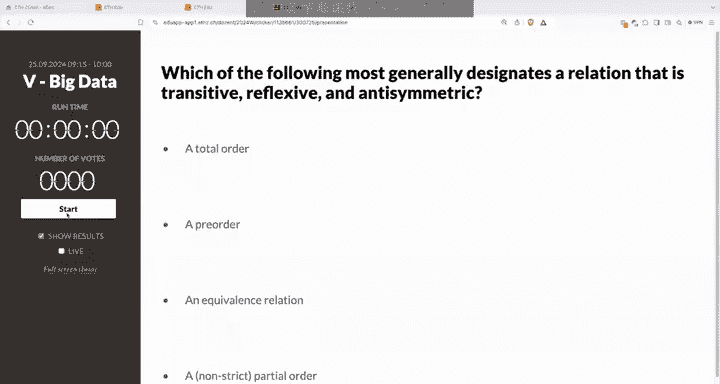

So this is my question。 which of the following most generally designate。A relation that is。

Reflxive transit。And anti site matrix。Is either a total order， a pre order。

 an equivalentvalence radiation， or a nonstrict actual order？

Translive means that if A is in relation to B and B is in relation to C。

 then a is in relation to C and transitivity， reflexive means that a is always in relation to itself to A and antissymmetricmetric means that if A is in relation to B and B is in relation to A。

 then A and B must be equal， that's antisymmetricmetric。So if it's all three of that。

 is it a total order， a pre order， an equivalence relation， or a non strict partial order？

Let's look at you on this。Oh well， that looks like ate。😊，We order that scale， everybody。Okay。

Total order， equiance relation or non strict partial order。 Okay， let me tell you， in fact。

 it's one of these cases。

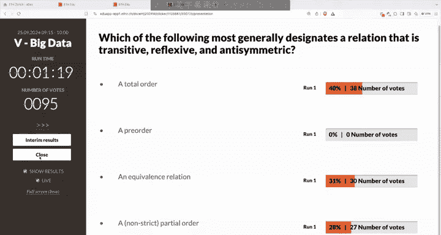

That the answer with the list votes actually is the correct one， it is a partial short order。

So let me just briefly explain a picture author who knows what to tag is a directed to safety graph。

That is a partial order。 That's what it is。 So basically you can look at the graph you will see it's transitive。

 it's reflexive and antismetric。 Well， technically， when you have a dag。

 you take what's called the transitive reduction for the da itself， you remove the transitive edges。

 but basically it's represented as a dag。😊，A preder is the same thing， but only transit reflexive。

 You don't have the empty symmetry。Equivalence relation。

 it's when it's symmetric rather than antisymmetric。

 It basically means that you put everything into bags and whatever is in the same bag is in the same equivalence class。

 a total order is the same thing as a partial order。

 where it's special partial order where everything is in relation to to something else。

 That's basically the case where the dag is a straight line。 That is a total order。

 It's a special case case of D。😊，But again， remember， Doug directly thecycl graph。

 this is what the fashion order is about。 You will understand later today why I asked you。I question。

So let's go back to the slides。😊，It's takinging its time。

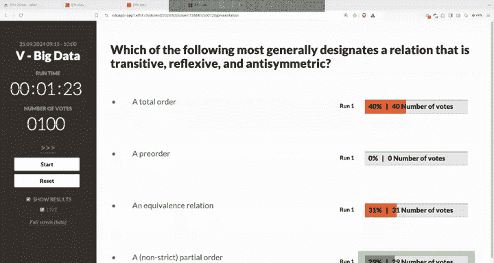

Okay。No。All right。So where we were always done with S3 right So S3 is about this cloud storage where you can store objects up to five terabytes。

 It's a flat key U pay model what I wanted to tell you is that there's different prices you can pay for it and that all has to do with availability you can pay more for high availability。

 meaning that you have more guarantees about the availability or you can pay less why would you pay less well for backups because for backups。

 you don't care if it takes a few hours， if you don't have access to it for a few hours and then get it it's okay because you're so happy that you actually got back your data that you don't mind writing for a few hours。

 So this is called Amazon Gier Gacier if you speak French and and then you pay less in the exchange of less availability So you see you have all of these compromises that you can that you can that you can make。

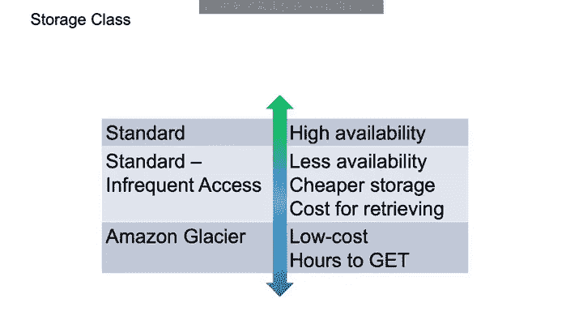

All right。😊，Now， what is going to often happen in this lecture is that I'm teaching you a concept。

 a kind of technology， but actually there's multiple implementations of it。 This is the case here。

 S3 is one of the possible providers that you can get Asiaure is another one。

 they also have something called A Blob storage， Google Cloud also has it they kind of look alike in the way they work。

 but there's a few minor differences and now quickly the best ways to just compare them So how does Aure Blob storage compare to S3。

 well instead of bucket and object in Asiazure， you need your account。

 your email address if you want or your account plus the name of the container that would be like a bucket except that the naming system is unique to your account。

 not in the whole world。 that's why you need your accounts to be more precise and then a blob which is the same as an object In fact。

 the O in Blob means object right binary large object。😊。

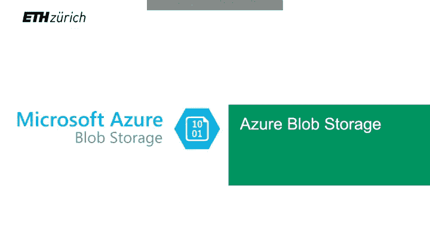

Then in S3 as part of the API， you have the ability to upload an object into several parts。

 not in one go because that for fighterterabytes it might be complicated so you can upload several parts of it and when you have uploaded all the paths then you say S3 I'm done now paste them all together in that order and then you get the object right but that's only an API thing。

In Asia they go further because there's actually something called a block where you can divide the objects into blocks。

 but that will study as part of HDGFS Asia is actually in between object storage and distributed site system。

 but this is why I'm not telling you about B this week， I do that next week。😊。

Then the limit of five terabytes is also different on the Asia side。

 in fact on the Asia side they have three kinds of storage， three different flavors。

 the one called block blobs is basically four data if you want to store a lot of data data sets that's the one you're going to take。

😊，Uend blobs is for logging。 This is when you just opened new lines like a log at the end of a log so this is up and optimized and here it' you can fit a bit less。

 but then you just start a new bb when your log is full and page is for memory in the machines right so this is something that is a bit unrelated to what we are doing in the In course but they also have page blobs。

😊，Okay， but you see the ID is quite similar。 You have an API and you can upload and download objects from the storage。

 given an ID， which can be a bucket or an object or an account and container en b Id right when I say accounts containerb。

 the three of them are IDs that identify an account that identify a container that identify a b Well whom is that dear。

Okay， then I have good news in S3。 we don't have the slightest idea how they did it because it's not published。

😊，Asia actually did publish a paper in which they explain how Asia blob storage works。

 That's an optional reading that I added to the lecture。 If you're interested。

 It's very likely that S3 has a few similarities with it。

 but at least they tell you a bit more about the internals。 For example， what they say。

 is that they have these storage stamps， which is a couple of racks， typically 10 to 20 racks。

 which gives you 30te of storage。 that's going to be in one data center。

 and then they have plenty of them around the world。

 They try to always keep it between 80% of storage capacity because you know what happened。

 you start on your laptop when the disk starts to get full。 You get error messages， warnings。

 So they always keep it below 80% if it goes above 20% of capacity。

 they just off it to somewhere maybe they are going to buy more storage stamps and spread the data to other places。

 and on every rack， you have 1818 storage optimized。

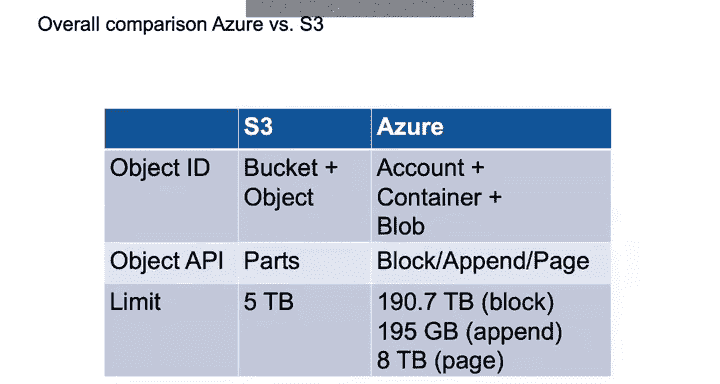

Nots， basically， it's going to be a lot of hard drives in there。 So this is where they tell us。

's very likely that S3 has also something in the in that sense。

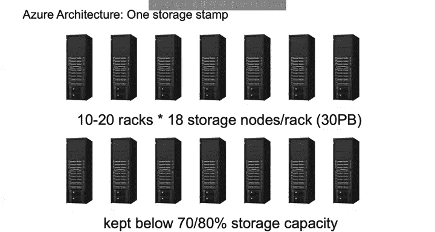

And they also replicate the data。 That's something I'll come back to next week。

 You don't want to lose。 How do you reach， you know， this availability， know this durability。

 sorry durability of losing only one object in 100 billion per year。 You do it by replicating。

And the way is that they do it is that they store the same data multiple times in the same storage steps that's called intrat reification that's done immediately。

 you upload an object。 they immediately store it multiple times in the same storage step like here。

 and they also replicated to another stem somewhere else， but this is asynchronous。

 that means that they don't make you wait。 You've just uploaded an object。

 They confirm that it's uploaded and replicated here and later in the background after you gone。

 They will further replicate it to another step。 That's the difference between synchronous and asynchronous。

😊。

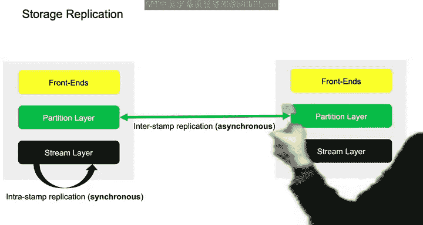

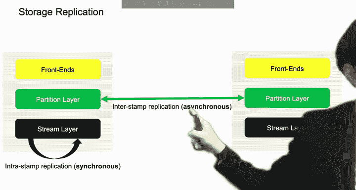

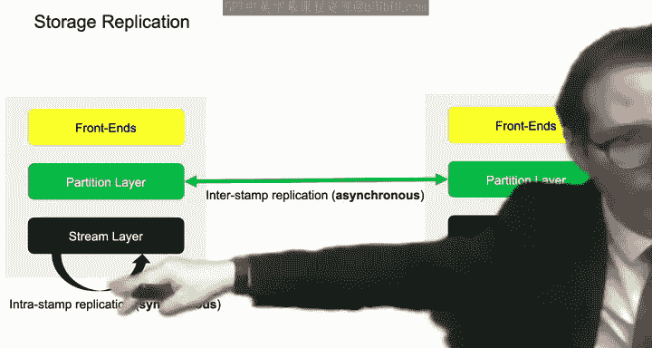

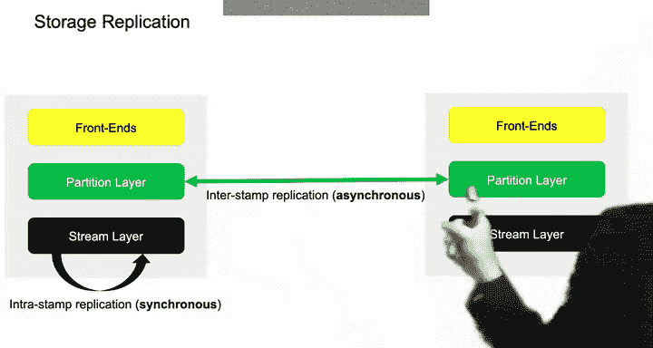

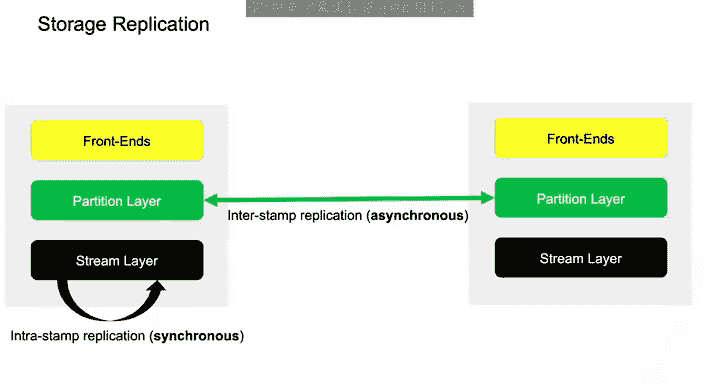

Okay。Then it's distributed， as I said， all over the world。 There are two main reasons for that。

 First， you optimize latency， because no no matter where you are in the world。

 there will be a storage stamp， not too far away from you。 So you can only eat from there。

 And the second thing is resilience to natural catastrophes。 You can have earthquakes。

 You can have tsunamis， you can have many bad things that can happen fire in the data center。

 I think it happened in Eastern France a couple of years ago。 there was a fire in a data center。

And they did not replicate the data to other storage stamps or other data centers and businesses actually lost their data in the process。

 so that was a reminder that you really， really need to copy over and replicate the data of multiple locations。

Okay， so this is Gb storage， I'm not saying more about that because that's again。

 very similar to the idea of S3。Which brings us to something slightly different。 Q value storage。

 which is also a kind of cloud storage， but I'm going to contrast it to object storage。

So it's the same idea。That we store objects that we call values。And a lot of them。

 very large number of such values associated with keys。

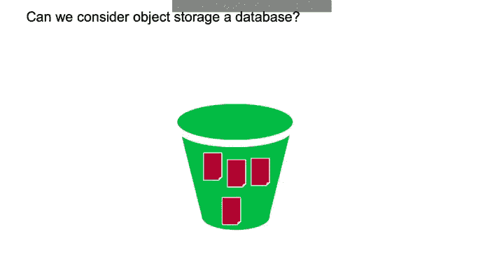

So the problem is that if you just use S3 as it is in order to store data or maybe have a database system on top of it。

It's just too slow because for a database system a couple of10 milliseconds is too much。

 this is way too much what you expect from a relational from database management system relational or not it's just a few milliseconds2 milliseconds。

3 milliseconds when you just do a lookup this is your expectation right so cloud storage is a logo or for efficient realtime data query right it's very good for analysis right when you want to query petabytes of data and that's what we will do with mappreuce and spark but it's not good for a database where you need immediate a quick access to the values for this we have to find another solution right again typical database few milliseconds to access one value。

😊。

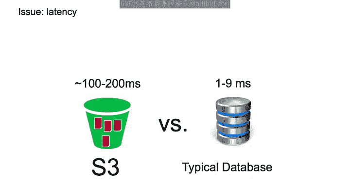

Which is where we have keyV stores in keyV stores。😊。

We basically have the similar model of key values， right， we associate the objects with ideas。

But the objects are going to be smaller instead of being 5  TBys。

 it's up to 400 kilo right so you really store small quantities of data and not not bigger things。

 right By the way， the sort of things people are storing these5 terabytes on S3 iss going to be pictures。

 it's going to be movies like the pictures you upload to to cloud services。

 maybe that you have on your smartphones。 This is typically stored in S3 like storage。

 This is that kind of storage。You might also have videos and even chunks of videos。 In fact。

 Netflix and Disney+ and you know， all these services。

 they are stored in S3 Aure Bb storage and that kind of storage。

 What it does is that your laptop or your TV or your smartphone。

 just keeps downloading objects from cloud storage， which is a few seconds of your series。

 And this is how it switches if if there's not enough bandwidth。

 it's going to download objects in lower resolutions。

 you have multiple objects in different resolutions。

 and then you switch dynamically between highre or low rest， depending on your bandwidth。

 right So the streaming systems when you watch series， This is how it's implemented。 So S3 b storage。

 typically all of them， they don't even stick to one provider。

 but it's very common if you look on your firewall with Apple， for example。

 if you if you go to iCcloud and so sometimes I don't know if it's still case。

 but you could see that it connects to Amazon Is or A Is。😊。

Because it just spreads it to multiple providers okay but in KVU stars we don't store theories or videos or pictures and so on we just store data smaller amounts。

 400 kilobytes for example， Okay so that's how it's going to different and of course the implementation is also going to be different because the objects are much smaller and we can make it so much faster within just a few milliseconds。

😊。

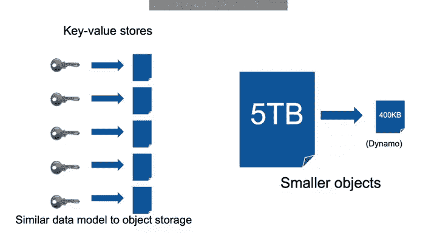

The API shouldn't surprise you。 You basically have Getput deleteit right so you can get a key。

 you can get the value associated with a key。 You can put a new value associated with a key。

 you can also， I didn't put it here。 you can also deleteit the value associated with a key right you could implement it on rest in a very natural way。

 right， get put deleteit。 I that also rest methods。

 but this can also be methods as part of the Python API or Java API you know in any any kind of API So getput。

Well， in fact， it's slightly more complex because in reality you have what more thing in there。

 you have what's called the context when you return a value。

 you also provide a context and when you put a new value back you have to provide a context as well。

 but that would explain why and that has to do with。😊。

The question I asked on the Ds and the partialher orders？

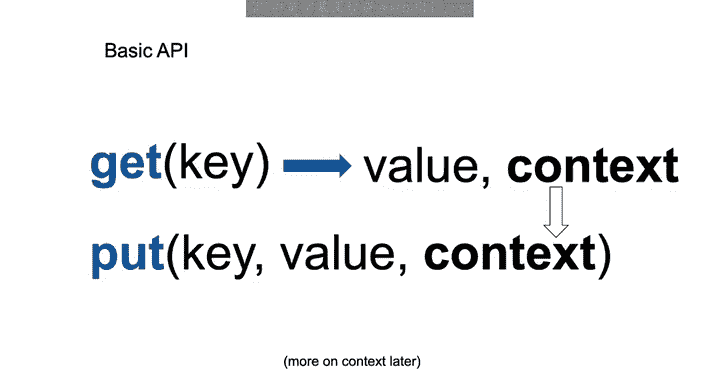

So now we have to make a few compromises on the system and that has to do with the CA TheM that I told you about there's a partition。

 a network partition， either you remain available or you remain consistent。

 cannot be the two of them。And this is exactly what people have been doing for KVU stores and also for social media and so on。

😊，In order to accelerate the whole thing， we give up consistency。

 It's fine if the data is not exactly the same everywhere， it's eventually going to be consistent。

 if you give it enough time some point the data is propagating everywhere but you don't stop the system until it's consistent you allow for returning in consistent values So this gives better performance。

 it's much faster and it's more scalable when you do it this way so this is one of the tricks in big data systems that we give up the consistency because we want to remain available okay。

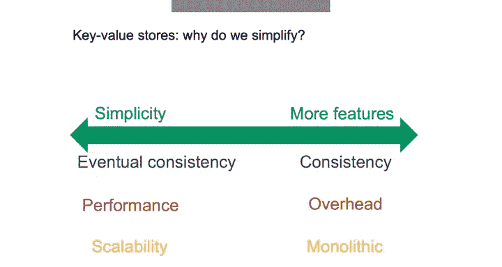

Now in keyV stars， the model is the same as in object storage。

 in fact it has a name it's called an associative array in terms of abstract in the abstract type system it's a map right you know abstract types that map list and so on these are abstract data types well here it's a map and associative array would be an implementation of that right you can implement it as a tree map as a hash map right there are there are many ways that you can implement these but the tree map or the hash mapap that only works if everything is on the same machine on your laptop then you can use Java libraries that take care of that。

But the problem is that we have here so much data that we cannot implement that just as a hashmap or a treem on one machine that doesn't work。

 We have to find another trick。

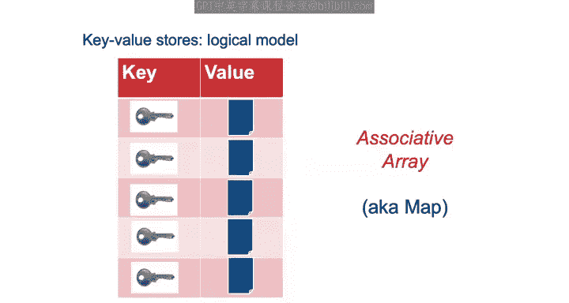

Because we have a few requirements， first， we need to be able to spread it all over in the machines in a cluster。

 up to 1 thousand0 machines if you want， in the same cluster。

We also want some guarantees that if we add machines。Can we add a machine？Computer。Yes。

 this is one more machine it has to continue working that has to seamlessly add the machine the to the available machine and if you remove a machine。

 then the system also should continue to work right so it has to be dynamically adapting to the number of machines machines come and grow。

😊，And， and the system continues to work。 right， So that's the first requirement。 Then we have。

Another requirements， I think this this。Is starting to strike。 So let me be closer to the machine。

 So another design is that the， it should be symmetric。

 So all the machines basically run the same software and have exactly the same the same role and behavior。

It has to be decentralized in the sense that there is no coordination node that everybody communicates with。

 It's just fully decentralized。And it's heterogeneous because the machines might not all be the same。

 you can have machines with more memory with more CPUs and other machines with less memory and less CPU。

😊，Well in fact， now we know a system that has all of that that's the blockchain right when when you for the cryptocurrencies so this is basically the same kind of requirements but in the blockchain that's the difference with this in the blockchain you have the additional requirements that you also resilient if they are bad actors like you don't trust all of the computer anybody can join and you have to also be resilient against that so the difference with the blockchain is for this you control all of the machines and you know that you can trust them this is already in your data center theres a firewall so you don't have these issues。

Okay， so this is basically a PR2 PR network as opposed to the centralized architecture that we'll see in the coming weeks in the data。

 right， it's the only Pi2 PR architecture well have in the lecture actually。

So what happens in order to know which machine solves we？Is that we take the keys。And we hash them。

 who knows whether the hash is a hash function？It's a way of producing a string of bits。

 a sequence of bits from anything right that's called the hash and hashs have the somelits basically from cryptography。

 if it's designed well， they don't collide so often。

 so you rarely have two values that would be hash to the same one。😊，Plus， the。

 the other aspect is that they have to inver。 So it's very hard to find the video given hassh。

 Do we have a question on， on Zoom。So the question is。

 is there a threshold for how many machines are allowed to leave the system or join at the same time for it to still count as incremental stability。

 Obviously， if all of them leave， it won't keep working。

 but also 90% of machines leaving the system wouldn't be ideal， So is there a general line。Yes。

 I would agree with that， so these are not details that I go into so because I'm not a specialist of the implementation details。

 but you're absolutely right that for example， imagine that suddenly 99% of the machines leave at the same time than you are in a bad situation。

It could be Putin's perspective with parameters of the system。

 NW and R that I'm going to give you a bit later， but this is indeed the case that you expect that not too many machines are going to certainly leave at the same time because as you can imagine you can lose data if you lose the machines that's solved yes。

Or that given value stores， or at least a diamond there's a limit of 10 kilo appliance for the object。

 Its this like an implementation limit or conceptual。So I'm going to give。

I'm going to give you a general answer that is going to not only apply for for a dynabo。

 but also in general， I think that it really doesn't want to work anymore this one so generally these limits that you put。

Are basically a design goal。 you want to optimize your system for a use case。

 So if you see it as a design goal， it basically means that as long as you respect this limit that it's below 400 kiloBtes。

 your system is going to work properly。 is basically it's。

There are similar limits for document source and so on that I come back to Mongodbe and so。Basically。

 then in a system， you can have two different implementations of that limit。

A soft or a hub implementation。The hard implementation is going to not even accept anything beyond that and you say no sorry i'm not doing it for your own safety right i'm not accepting these values There are other systems that have a soft limit in the sense that they said is defined I accept it but this is at your own risk and be careful because I'm not going to give you a warninging so then it puts about new as a user to be careful and in practice you see these two kinds of systems you really see these two kinds of systems。

呃。Yes， exactly。 you you just you just shift button to the user and say I'm not going to check that。

 It's at your own risk。 and that will be the case， for example， in the case of Mongo Db。

 it's going to throw an error and not let you store documents that are too big。

 but if you take edge base， it's not going to complain you can use it with larger values。

 it's just going to be slower and potentially into issues right now dynamo Db， I don't know。

 I would have to look it up。 if it's a softer hard limit。 but whatever it is。

 there's other systems than dynamo Db that implement that And probably some of them have a hard limit and some of them have a soft limit So it's really you have to understand it as a general design principle。

 does it make sense。All right， so now I'm going to go back where I was。 Yeah。

 so we hush the the values into strings of 128 bits。😊，Which is 16 B and not 7。

 as somebody made me aware in the notebook。 I will fix that。 So 128 Bs per per hash。

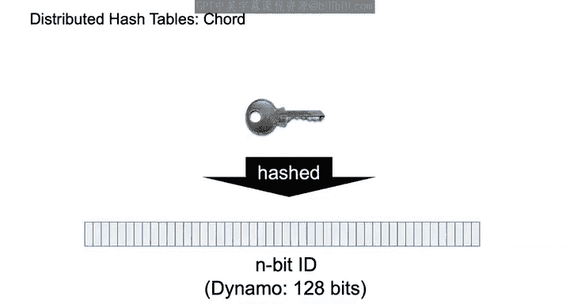

And the idea is that visually the hashs。

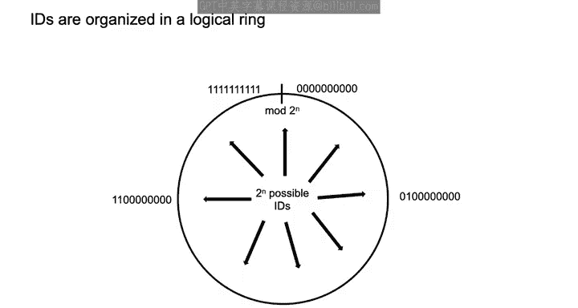

Basically can be seen as numbers that are no longer than two to the power of of7 if you want。

 and so basically you can see it as a ring if you take the modlo right as soon as you have 128 ones。

 then you go back to all zeros so you basically see that as a ring。

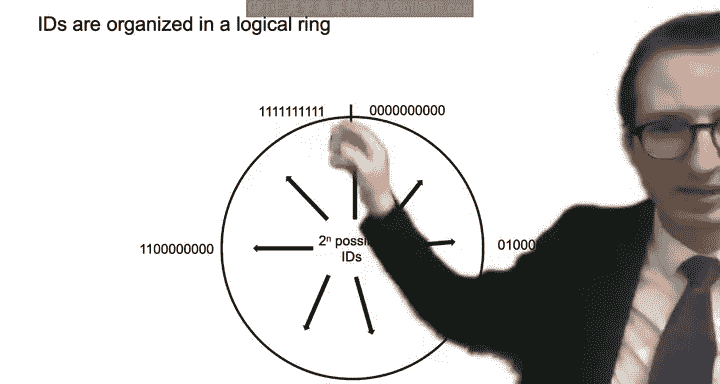

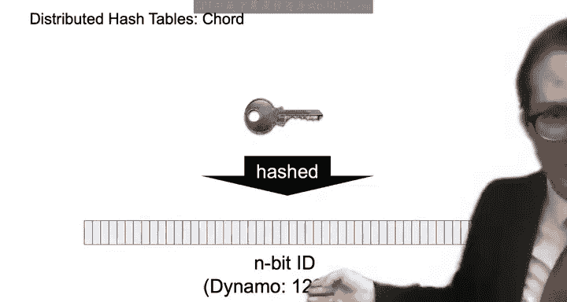

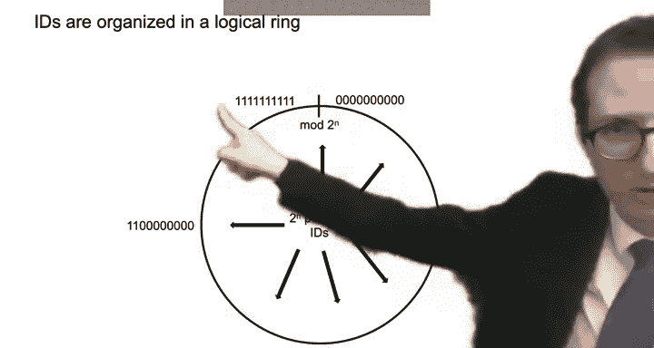

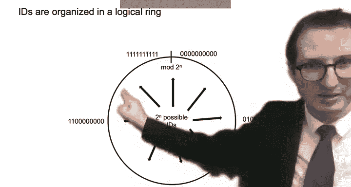

Then what's going to happen is that for each machine that you have in your system。

 you play a lottery。 You just pick a random place on the ring where the machines are going to let right so every machine generates a random sequence of bits and that puts them on the ring。

 This is a logical view。 It's not physical right physically it's a Pitopia network and the machine just talk to each other。

 At on logical level， you can visualize every machine as having a position on that ring。 random。

 if you have a lot of machines is going to be more you have an expectation。

 it's the central limit theorem that it's going to be more or less evenly distributed， of course。

 if you have less machines then it can be more irregular， but I' come back to that。

 Now that you have that that data means who stars what。

 Basically this machine here is going to store all the key values such that the hash of the key is here on the ring。

 This machine stalls this。 This machine stalls this and this machine stalls this Their question。😊。

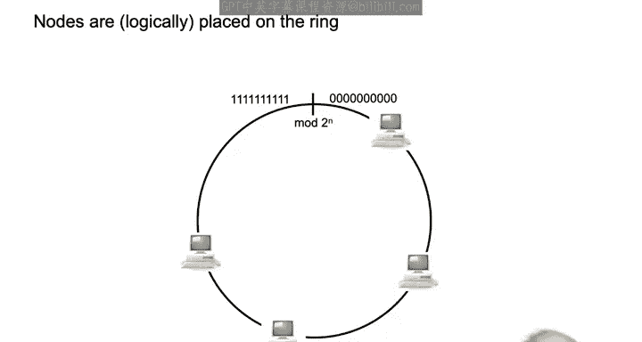

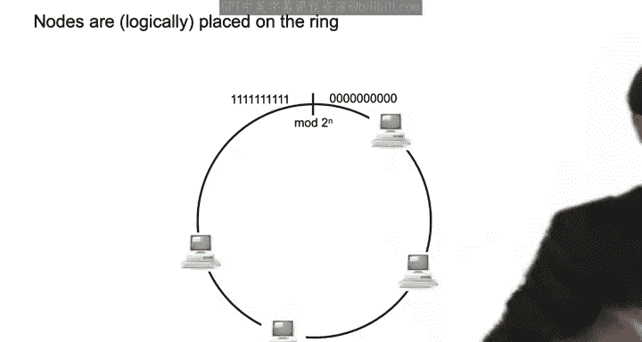

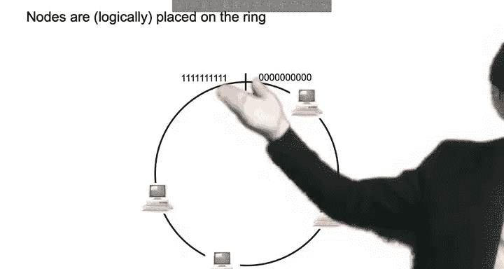

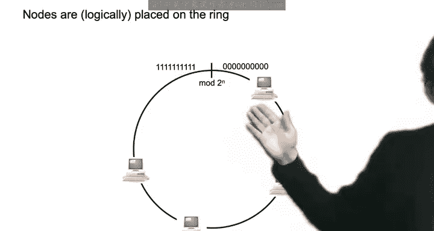

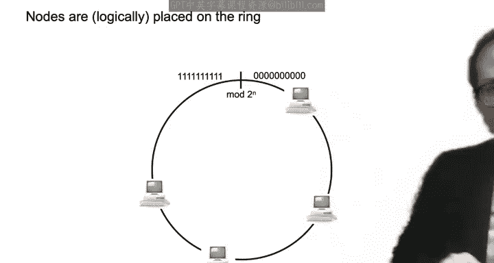

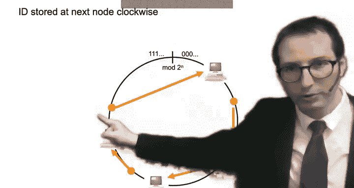

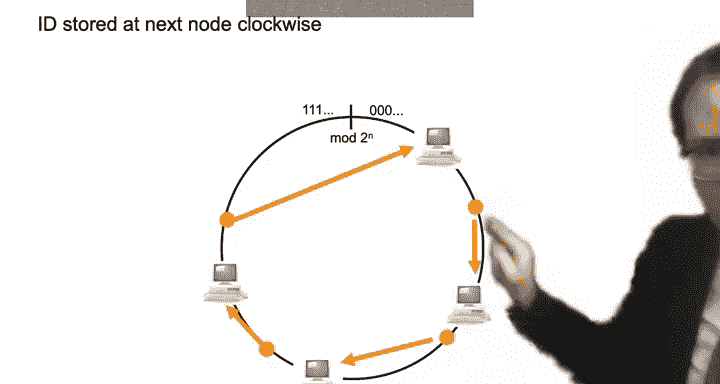

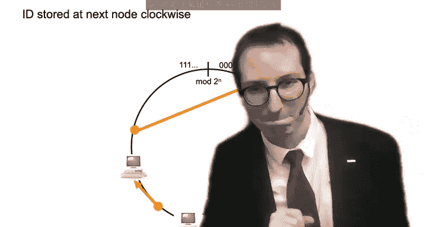

Thus the logical randomness introduce latency and the physical propagation of data。呃。

That is a good question。If you compare it with not being random， but being regularly put on the ring。

I don't。 it's only my inition。 I don't have the feeling that it would make a difference in latency。

 if you， if you exactly distribute them or take it randomly。

 I think the reason for randomness is mostly that machines can come and go。

 And so if they can come and good and it's easier to just put them randomly on the ring。

So my intuition to answer your question is that I don't think it would have an impact on the on the latency of the system。

 And that's because all the machines talk to all the machines the P2 PR network。

 Does that make sense。Just maintuition。Yes， okay。 awesome。 Okay。

 so now you know who stars what based on this， Yes， we have a question over here。😊，や same time。Yes。

 that's a good question。 The question is， can we have symmetry and heterogeneity at the same time。

 Yes， because heterogeneity is about the hardware are available on the machines， Mem and CPU。

 Symry is about the fact that they run the same code。

 So you can have the same code running on machines that have different memory and CPU。

 That's why it's slightly different。 but it's utter。😊，Okay。嗯。There's another question， Yes。

 we can try also with this microphone。Yeah。I don't think so。There's volume in here I can control。嗯。

So just to clarify the College of premisemacists。 But so does this ring represent both like the modular nature of like the hatching of the keys but also the topology and the network of these machines。

 like that they only communicate in this spring of the next。So this is purely logical。

 this is purely logical and that decides who solves what， this is what it does。

 the topology of the network is a Pi to PR network。

 every machine talks to every other machine even though of course it would be influenced by what they store but the idea is really that this is a logical thing the ring y。

😊，相机。Oh， it means that the fact that it's logical means that when you see this ring right here and the edges between the nodes。

 that's not network cables。😊，It's only mathematical visualization that allows you to say that a machine。

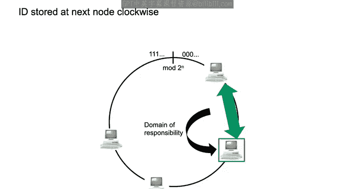

Like this one is going to be storing the key values that have a hash that basically is between this value and this value。

 this is what this means visually right， but the network cables are all over the place。

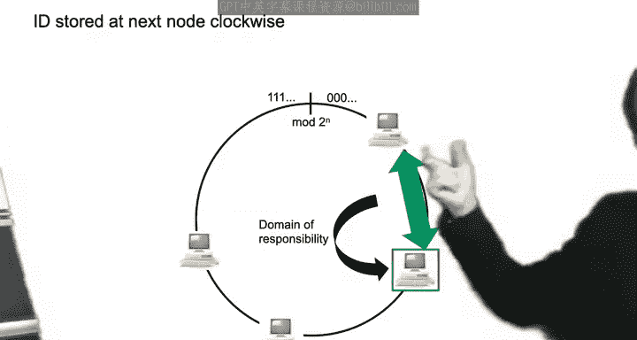

Like1 my thought。

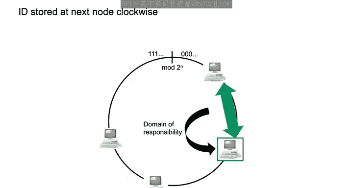

It's doesn fantastic fact to communicate to them I think like past three o'clock。

 it' actually trying to reach。

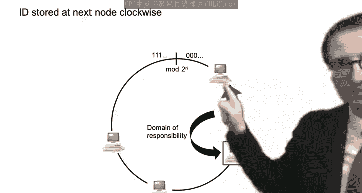

For example， like it can just directly like for consistency or something it can directly goes yes。

 this one can communicate with everybody， but it might more often communicate with this one。

 but it's going to communicate with everybody。

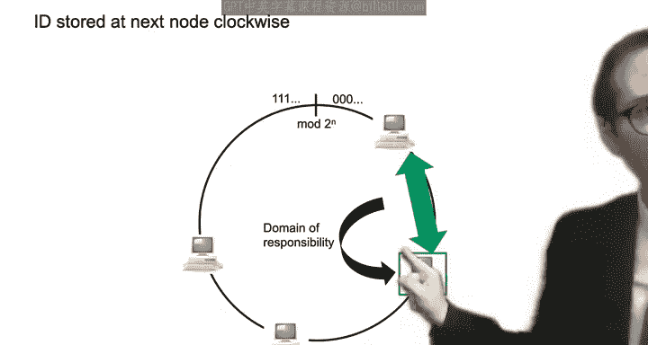

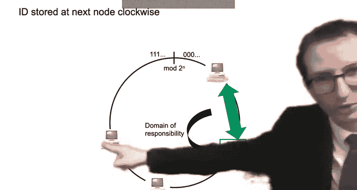

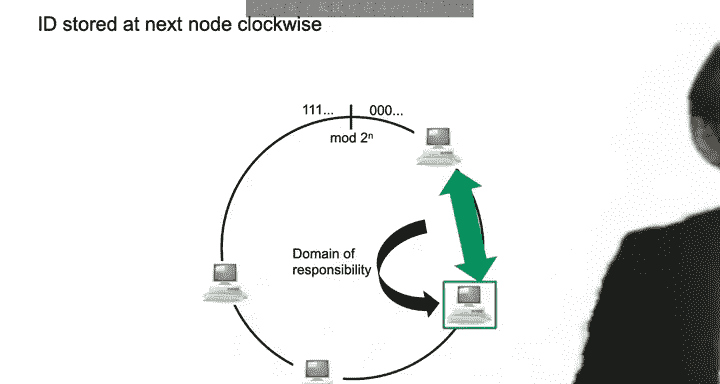

Even  nine o'clock。 Yeah， we have another question， two other questions when over over there。

 I think the microphone， I'm not sure。 Can you hear the questions on zoom of the of the students or should we repeat them。

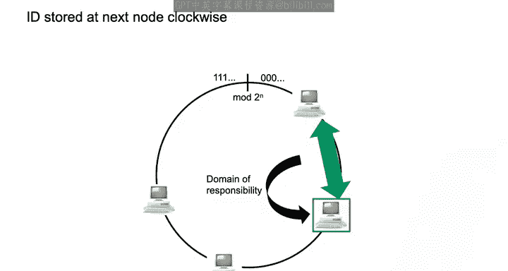

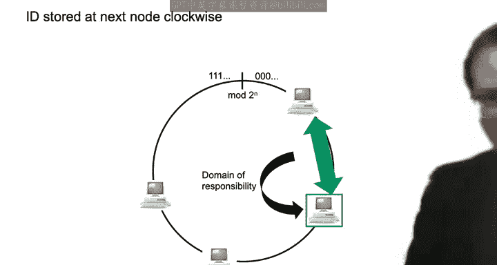

You cannot hear them。 Okay， so I have that in mind。对。嗯。えば。

So that's almost a cryptography question so a hash basically to simplify is basically something detertaministic that looks random if I simplify it's detertaministic because typically it's going to be a bit of multiplication and addition in a modulo typically when you implement them。

😊，But the thing is that it has to look a bit random to be unpredictable and very hard to to hack right So cryptographically now what it means that。

Since it has an implementation and you compute the hash in a certain way in a dataministic wave from the key。

 it's almost guaranteed that it's not going to be perfectly uniform。

 it's almost guaranteed because there's a bit of imperfection in reality。

It's just that if it's a very large space and it's a very， very good hash function。

 we call that an ideal hash function， then it gets very close to being uniform right but there's always the math and then there's the implementation that is never quite quite perfect for example you want hash is not to collide in reality they can collide。

😊，Does it answer your question？Okay， and there was another raised hands， where was？

I don't see it anymore。Oh， yes， so well there。Why is it exactly that So we're just talking about it being。

Asing to this computer a certain range of ID is。 Why would it then be more likely than that。给我的学习了。

If there's not necessarily any responsibilities。That's going to come soon。

 I explained it's on the size that photo yeah， but that's a good question that was basically about why would they have to communicate with or node if they are just storing what's in their domain right。

 but that would become very clear。Right so basically if I continue to explain here， if you add node。

 for example， you add a node that's basically this answer your question to what happens is that now this new node takes responsibility of this while this remains under that responsibility so in that case there will be a transfer all of the key values here will be transferred from here to here because this one now is responsible for these values right so this actually answers your question。

😊。

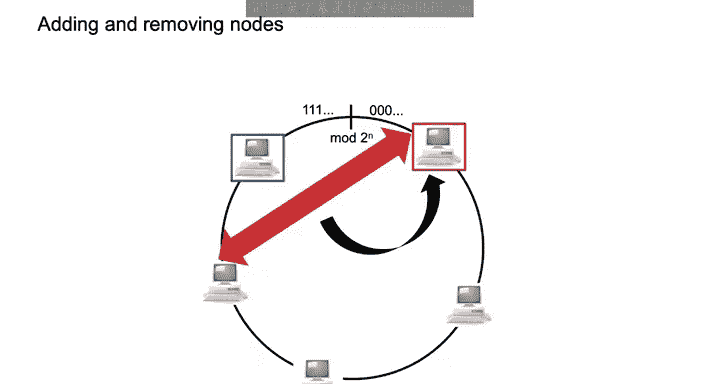

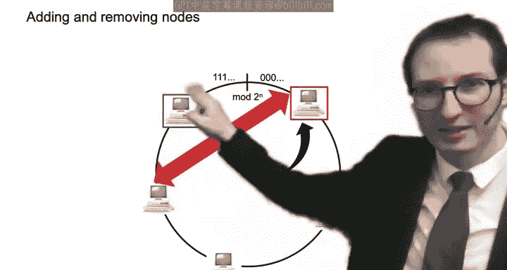

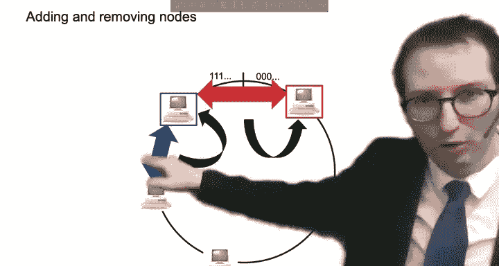

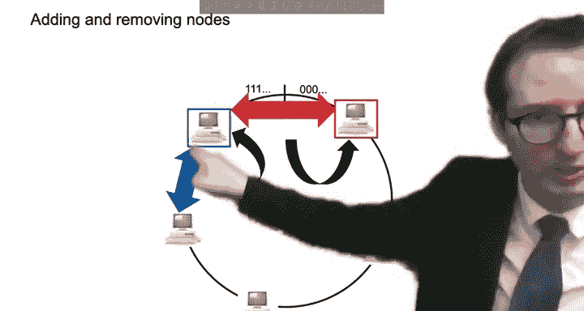

Now so you need to transfer between nodes so this is why these two it communicates that because of that but if you remove these nodes that are not effective if you remove something。

 for example， this goes away， then you have to transfer back right so let's assume it's not a crash it's elegantly leaves and politely one that it's about to live then this node is going to transfer this give used to that one before it leaves right。

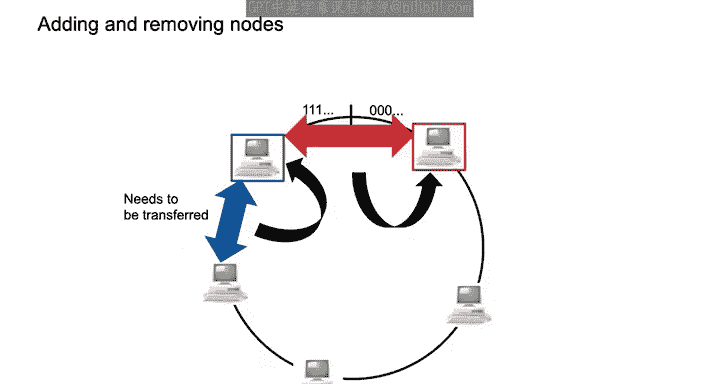

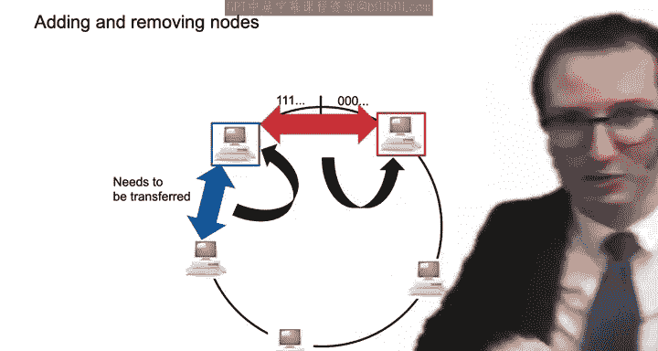

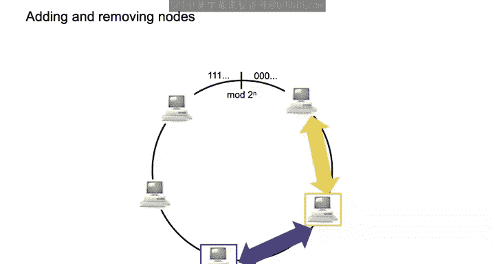

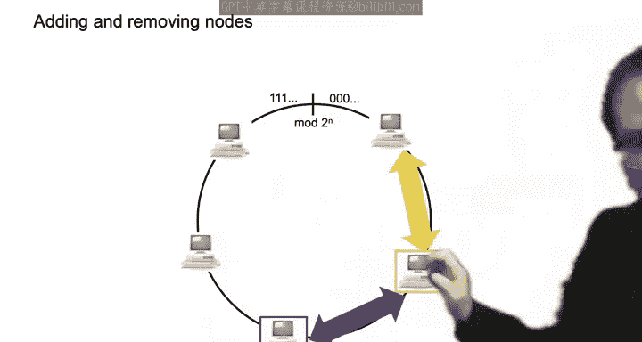

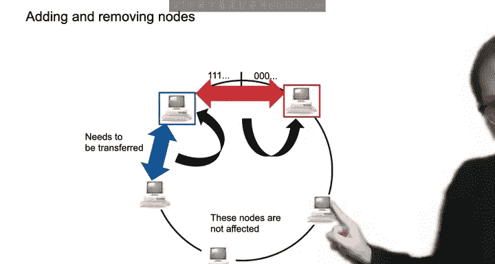

So this is what's going to happen。Like this， this is transferredt here。

But as you can imagine that doesn't work if it's a crash because if it's a crash then you don't get an in notice and you lose the data so how can we solve that well you might have guess it's a bit with redundancy what happens is that now instead of storing only the key values that are right before you in the clock you actually store two regions before you right so these computer stores these key values plus these key values and that gives you redundancy because now these machine stores these ones plus these ones so it means that the key values here will be stored at two places they will be stored here and they will be stored here or who is that here。

😊。

So we introduce a bit of redundancy， that is also an answer to the question you ask because it means that these two machines we kind of communicate with each other or interact in a way because have they store the same data。

That's also the reason why machines we tend to talk more often to their neighbors。

But they can also speak to any other machine。 Yes， or here question。是啥。

I don't know which computer I need to talk。So where's the question。

Stor where I can look up which can know。DaThere like any how much just。

We one of those which possible for the data that I。不是。やばい Iそか。はい好。

So the question I'm repeating for everybody to hear also on the recording。

 the question is about how do we enter the system， you want to query data。

 where do you connect to who is in charge。And what phone number you need to call basically so indeed。

 there is somewhere some sort of structure that that allows you to know who is responsible for what。

Actually it looks like this， it's called a preference list。

 so this is a structure for every key or here rangech that gives you the list of nodes that are responsible for it that's called a preference list。

😊，The way it start has to do with the distributed systems algorithm so the same sort you know Paxos or the blockchain or you know all of these kind of technologies that are outside of the scope of the course。

 but basically there is a way to start data in a way that is organizing a PitoP network that everybody shares the same data right that's exactly how the blockchain works you have many machines and they all have the same data and there's a protocol that allows them to synchronize these data it's called Go protocols。

😊，One example， does he answer answer your question？

P because the other part is who do you talk to and the answer is any node。

 you connect to any node and that node is going to redirect you to the right one。😊。

Right I have a slide on that that's coming right so we can connect anywhere and then that machine will figure out who to connect you with right So just to finish that there's two duplication of two you can also have a duplication of any number3 in that case34 so you can you can pick your replication number and then what you would expect is that the number of nodes in this table in this preference list is your target number2 three more that's what we call n right so you have these you have these list here This is the structure that you have distributed systems algorithm that allow you to make sure that all the nodes have a shared view on that structure right it's not stored on a central driver anything it's really a protocol that allows everybody to。

😊。

Agree on that common structure。诶。And so basically you have these parameters that you have a number R。

 that is when you read data， how many nodes do you need to get these data from to basically rely on it。

 then you have W that says when you write data。😊。

But how many node confirmations do you wait until you consider that your data has been written。

 that's a number of w and n is the number of nodes that store that are in the preferences to store the data and you have a requirement that r plus w must be more than n right that gives you。

Some guarantees。 I'm， I'm not getting too much into it， it's。Explain on a high level on the。

And then it will paper， right， But basically， you have this number N of nodes in the preference list。

And R and W， which are the requirements for reading from R nodes and writing to W notess。

So now this is the answer to your question actually。

 on that slide if you connect to the system typically first you're gonna have a load balancer。

 So when I say you connect randomly， it's assigned to you。

 it's like when you connect to a websites of the bank or Amazon or whatever you have a load balancer that kind of directs people randomly to all the server that can handle the request So you have a load balancing system that assigns the visitorsor or the users to random nodes and then the people who want to query ki you pay connect to one of the nodes that they got from the load balancer and that node is going to figure out who is in charge by looking at this list that everybody has in the network So they take the first node in the list thats the coordinator node and then you would also look at n minus1 more nodes when you actually look for the data right and you stop when you have R of them that responded So whom is that here。

So you connect to a random node and then that node is going to figure out who is in charge。😊。

Now， there are a few limitations to what I've just showed you。

So one of the limitations is that you can only look up， you cannot do any ranges， for example。

 you cannot search， you can only look up if you know the key。Then it doesn't handle data integrity。

 It doesn't handle security issues that I told you that's a difference with the blockchain that you。

 you have to really trust all of the node， but it highly highly scalable can work on many machines with really a high number of key values。

 It's robust against failure。 It's self organizing and so on。 We have a question， I think， on the。

Why can't the load balancer just connect to the coordinator？That is， yes， indeed。

 This is there are multiple designs possible。 So this one just randomly assigns the notes。

 It really depends on your， on your system， because depending on the， you know。

When you look at the theory， it feels like everything is uniformly distributed right。

 But now you you go to a real company that has a real website that has real people doing real searches on their website。

 What's going to happen is that people have patterns。

 There's going to be words or searches that people do more often than others。

 and that means that you will have what's called hotspots in the in the ring。

 There will be places that are more solicitity than other places because they are more popular。😊。

And so if you always connect to the coordinator， you're going to over the path of the data center of the cluster and not the rest by putting random nodes。

 you're distributing the work a little bit more when you enter it right so' that's the reason Does it answer your question。

😊，There's another question here。I probably this a quite business explanation earlier。

 but I think earlier， we said that this network is sort of or this database is decentralized。

 but here we have like a central。Like sort of deciding like ultimately where some of things out so I get out if that's really。

So first never apologize for asking a question because in the university we are here to learn and it's very likely when you ask a question that many people have the same question。

 so it's always totally fine to to ask questions and that's a good one because indeed it feels here that this is centralized because we have a coordinator。

 but the reason it's not centralized is that there's a coordinator that is different depending on the key you're looking at。

😊，Right so it's really this job is distributed it's like in the TA team， for example。

 we have a TA of the week who' is in charge of the current exercise sheets。

 but that doesn't make them the head TA because every week it's a different T with who' is in charge right so that's kind of the D IDD it's not the same coordinator or every key。

😊，Like like a like every Yes exactly and there's protocols for that So there's this is one of them that's called quote in distributed systems there are lectures by Rogerjavatano if' so interested he teaches that very well Also he talks about blockchain and these things that explains that really well too we have another question here。

😊，自己开始。Da may sort kind of they by a bunch of different joke。

I the coordinator determine the strictlyly shows ver piece of data is like in a day。

 it don't always need。Yes， it is deterministic because of the hashhes and because of the placement。

 once you have determined the position on the ring， it becomes deterministic。

So is that deterministic choice standardized as part of the architecture or？

It is standardized as part of the protocol so the idea is that once you have chosen the position on the ring so that part is random。

 but once you have chosen the position in the ring， it becomes itministic。However。

It will depend a little bit on the failures of the nodes and so on because it's fully predictable if no crashes happen。

 but when the computer starts crashing and not behaving optimally。

 then it becomes a bit less dataistic but it still works because it's resilient by the way。

 I have an animation to show that to you how it actually works。

 I'm not sure I will be able today but I will have an animation that shows you exactly what happens when you insert and update the keys and the communication through the through the ring right so you will see it in action。

 and probably that's also going to help to make you understand still have a few more minutes。

 maybe I can say a bit more。 Yes what I want to say is that we still have a problem that for example。

 you might be out of luck if you don't have a lot of nodes and then it's not even distribute it and addresses the question you had and maybe you have so much heterogeneity that even if it's heavily distributed。

 it's not fair because even the large computer still have the same amount of the storage that。

Are responsible for the answer to this is the actual tokens。

You basically create maybe 10 times as many tokens as machines or 100 times I don't know maybe 10。

 and then you assign the tokens to the machines like this I put colors in there so you have six machines here but you have more tokens and machines and every machine is responsible for tokens so the tokens replace the machines on the ring now we put the tokens on the ring and we assign the tokens to the machines and this machine for example。

 is responsible for that wrench and that wrench and plus more if it's duplicates So now when machines leave。

 you just reassign the tokens to other machines right so you basically just decouple the positions on the ring from the machine right so these are called tokens。

😊。

Okay， does that make sense， so this is how we artificially increase the number of positions on there two questions yes。

没。The nextの。我北京。但是都不是。Yes， they have to signal that they' are going to leave and they have to make sure to send data to other machines。

 but not necessarily because even if theres a crash since we replicate now even in case of a crash even if they don't communicate it still works it's still resilience against that but yes if they nicely live then they really communicate with the system right and it's really with everybody they communicate yeah this called protocol yes。

As its architecture now， for example， when a few told me skeptic by lot traffic。

Does it develop for dynamic missignment。嗯嗯。That is a good point so basically the question is what happens if there are hotspots basically if if some of the data is accessed more often then you can just reduce the distance between tokens you know you have ways of modifying it I don't know if they did it in that system but you can also dynamically adapt if you want in the design。

😊，他え。我食 part个最问题。That depends on your usage in some systems for some companies。

 maybe it's evenly distributed for some others， it's always the same places and for other companies it depends if it's Christmas or if it's the summer right that really depends。

The talk on himself， but we endeavor changed the responsibility of the machine。

It's really dynamic you can change the link between machines and tokens and you can change where the tokens are located that's one possible design right so thank you very much everybody if you have more questions we can talk offline I'm going to continue and finish this lecture next week have a good day enjoy the exercise session on SQL bye bye。

😊。

