# 苏黎世联邦理工《大数据｜Big Data - ETH Zurich - Fall 2024》中英字幕（deepseek - P9：-09-3. Cloud storage (4_4) -.zh_en - GPT中英字幕课程资源 - BV1sHPKeoEJU

Welcome everybody in the lecture hall， welcome everybody on Zoom。

 welcome everybody watching us from the future。😊，Today I'm teaching on Wifi because the cable seems to be on strike today we see if we can fix it so it might be if at some point the people on Zoom start seeing pixels I call pixelix or bad quality and that be that would be just because of it so if it ever happens then you can help in the lecture hole by trying to disconnect from the Wifi but as long as it works then it's working。

And the USB Flingral cover is sponsored by F， so it's thanks to them that I'm able to actually broadcast these cells on Zoom。

So I'm going to start with a question。😊，To check that you've been。Blowing what I told you。

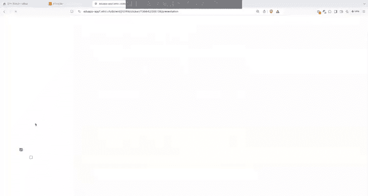

Last week， so what is the best practice？Do you first try to scale out， then try if it doesn't work。

 try to make the code better and then scale up or do you first try to make the code better。

 then you scale out， then you scale up， or do you first try to scale up， then scale out。

 then make the code better or the author doesn't play any role when should just try everything。Well。

 91 do。You don't sell comingomy in。Wonderful， okay， so the majority is， in fact， correct。 indeed。

 that's what I told you The first thing you should do is try to make the code better。

 How do you do it， You just do it on your laptop So what you typically do is you take one1th of the data or 100th of the dataset like a small size。

 then you improve the code on your laptop and when it works in it faster then you can either maybe make it all on your laptop because suddenly it fits or you can then upgrade the code that run on the cluster and then you're going to get something faster。

😊，Then of course if it doesn't fit on your laptop， you scale out。

 scaling out means you go to multiple machines， cheap machines。

 but a lot of them scale out scale in would be reducing the number of machines。

Skating up means you have more memory， more CPU， so more expensive machines。

 but this is really the last thing that you should actually try。 In fact。

 these days skating out and skating in is handled automatically by many cloud providers， for example。

 Amazon Asia， they can all automatically adapt the number of machines that are running dynamically depending on the number of people who are on your website。

 Yes， we have a question over here， we maybe use the over here。

I don't quite see why we would scale out first before scaling up so let's say I have a shitty laptop from 2015 and it doesn't work so I think the smart thing is to upgrade the laptop because if I scale out i'll have all the you know all the inefficiencies of parallelism and all that stuff and there are papers which say you know you don't need Hadoop you can just do your unique stuff。

Yes so you're absolutely correct so this is a guiding principle right it's a general guiding principle but of course in practice at TTH we teach you to think critically and of course there are cases in which it makes sense to scale up for example you can upgrade to a neural laptop that's scalingkating up in that case it makes total sense right then you know what you are doing if you already have a stout configuration you know imagine that you're just missing a tiny little bit then you can you can you can either upgrade to a new laptop or go to a data center。

😊，Then you have to think about the cost the cost of purchasing a new laptop if you're just you know you just need a tiny bit more that might be more expensive than just renting some machines for an hour on Amazon that kind of thing so you really need to adapt to every situation if it makes sense but the message that I want to give you here is to always try to start with the code。

 try to see if you can start the data more efficiently if you can write more efficient code because in many。

 many cases you're going to manage to make it run on a single machine so this is the firstcalding principle and this is true for many people who stuff with a project and the second principle is that when you are in the cloud at the asymptootic limit scaling out makes more sense economically the reason is that when you scale out it's linear so unless you have supply issues on the market of hardware basically it's linear one more machine is the cost of one machine。

100 new machines is the cost is 100 times discussed。

 but scalingating with the same factor on a computer like 10 times as much working memory or 10 times as many CPUs。

 that's not going to be just 10 times the cost， that's going to be much more than that because if you have 32 gigabytes of RAM。

 then getting a computer with 320 gigabtes of RAM its going to be much more expensive than just 10 times the price。

So this is basically the idea， but of course you have to adapt it to every situation right there are situations in which you might consider that it's worth it to purchase a new World laptop because you have an old run right does it make sense？

😊，Alright， but it's very good to think critically， right， you should。

There's always always question on Zoom there's， but buying a new machine and new laptop isn't considered scaling out and not out。

I think there's if you continue to use the Farmware laptop in addition to your new one。

 then that's skating out。But then you have to consider the complexity of making the two of them work together because it's going to be much easier to just trigger two of three machines on Amazon with a few clicks than configuring HDFS on these two laptops with heterogeneous configurations。

So again， it depends on every situation。Right， but technically， yes。

 if you add one more laptop is scaling out， if you replace the laptop with another one。

 then that's scaling out。Did that answered your question？Yeah， all right。So。呵。I think that's the one。

No， that's not the one should be the one。

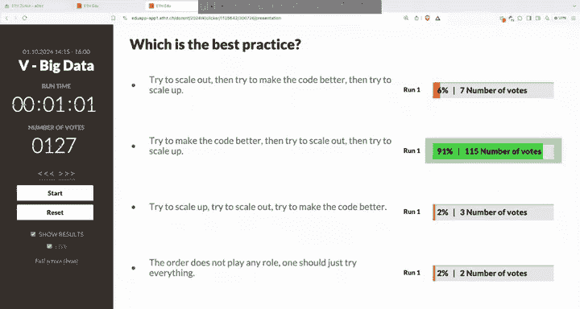

But in general， it's very good to question everything， right。

First because this is how you learn and I might also not always be right。

 maybe that sometimes I'm wrong and there's this is also how new discoveries are made right it's people who basically try to try something else and as it turns out it actually works better。

All right， so this is where we left last week I was telling you about how we use the actual tokens in order it's basically about simulating that we have more machines。

 imagine that you have 10 times as many tokens on the machine you increase the number of points on that ring right and so the more points you have the higher the likelihood that they are going to be more or less well distributed over it and you can also consider that these tokens correspond to a similar workload in terms of in terms of keys in such a way that the computers that have more memory and mock CPU they can be assigned more tokens。

😊，And the computer that have less memory and less CPU， they will have less tokens， right， So it。

 it gives you a bit of elasticity and flexibility。Obviously I mean here on the slides I don't have enough space to draw so many points。

 but obviously you will try to not put the tokens for the same machine next to each other right so here you have three green tokens in practice you would try to spread them out in such a way that you don't start twice the same given use on the same machine right if if you try to divify the colors on the ring then you are going to spread over more different machines okay for whom is that clear the tokens。

All right， very good。 So now it means that if a machine disappears。

 then these tokens become free and they are reassigned to other machines like this。

 And then the the the data is transferred if it's a smooth。😊。

Elegance rush in the sense that the machine knows in advance it's going to leave and it politely wars the others。

 Then it can transfer the key values。 Otherwise， it's no big deal because now。

 you know that the key values are stored multiple times。😊，Not just on the next token， but on the two。

 three for next tokens， so it means that these data is not lost for the two tokens that are off here。

 it's not lost， you just ask for the machine， for example。

 who is here if they would have the data and then you download it when you take over。

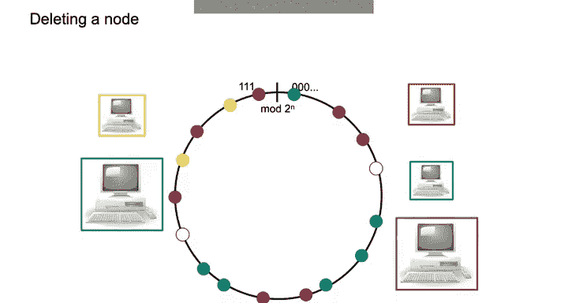

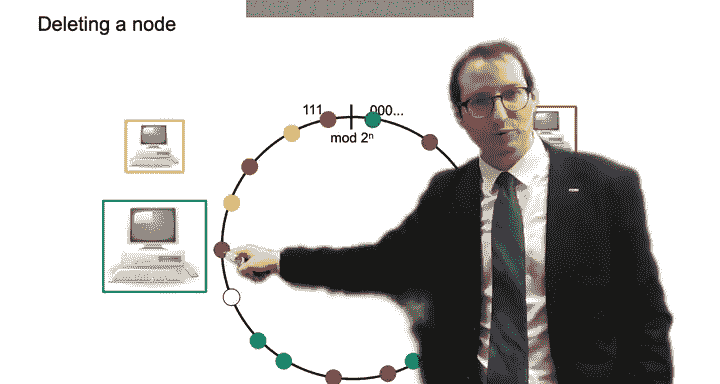

All right， and if you add new machines， then you just redistribute the tokens。

 the responsibilities to the new machine。 So you see we still fulfill what we had before。Now。

You remember that I told you about the EAP CRM？Which is about choosing， that' the question。Yep。

 go ahead。Thank you。 I guess so earlier we we discussed how like the way the with the keys are hashed like I guess like I had the impression that like different devices or groups of devices were responsible for sort of。

Contiguous ranges of the the key hashes， but here like the tokens are sort of more dispersed or distributed like around the circle。

 yes more than a nice site。Oh in practice， yeah， okay， so like like in general。

 like it doesn't like matter how the tokens are。Like distributed like with regards to like each machine like they can have them from all over the the ring I guess so technically the first thing you do is you create the tokens and distribute them randomly over the ring。

And then you assign the tokens to the machines and when you assign the tokens to the machines。

 maybe you can be careful to not assign two neighbor tokens to the same machine。

 right in order to avoid that the data is concentrated。

But that you do when you assign to the machines。Does it make sense， Thank you。 All right。嗯。

So the CPP theorem， I told you that in the beautiful world of big data。

 when there is a network partition。Either you crash or you choose consistency or you choose availability a very interesting use case in when is when you choose availability at the cost of consistency。

 this is exactly what we are doing right here。And what happens when you do that is that when you have an old system like that is always available consistent No network partitions。

 it would just crash if when happens， then you basically have a linear timeline right because everybody agrees that all points in time what the data is so if you modify the data then you new version of the data will be later on the timeline right you can even create a versioning system that keeps track of the all the versions so you have a linear timeline。

 but the thing is when you have a network partition and you choose to remain consistent you're going to have half of the network that is going to be on some version of the data and other half of the network that is going to be on another version of the data because then they will start modifying the data each on their side and they will no longer agree right。

And then something very weird happened because that actually throws you into spacetime right who would have guessed that and in fact。

 in order to solve that problem， we just no longer have a linear timeline。

 but we have a a directed a cyclic graph who knows Gi。😊。

It's just like the gi branches that forms the deck right when you have all these commits。

 so we do the same thing here， but it actually is a feature of space time because that corresponds to the case that you start having spacex separation like with Earth and maths and so on。

 but let me show you what it means。😊，So it means that we cannot use a clock like it's 1pm， it's 2 pm。

 like we cannot have a linear clock。But we are going to be using what's called the vector clock the vector clock was actually invented here at TthH if I'm correct by Fma matter who is a professor in the department of computer science and that actually made its way into plenty of products including Amazon dynas so here is how they work you basically have a clock that correspond to the node that handle the first request so let's say it's node a so you add the time for node A you set it to one that's the first version then maybe you update it again on the same node so you're going to say okay node a that's version2 right so you increment for node a and when you have a network partition you might have on one side of the network then some other node is going to take care of it node B one half of the network and then it's going to increment for a new version of the data it's clock to one knowing that a was a2 b is that one right so you just increment the clock of B it's called a vector clock because。

😊。

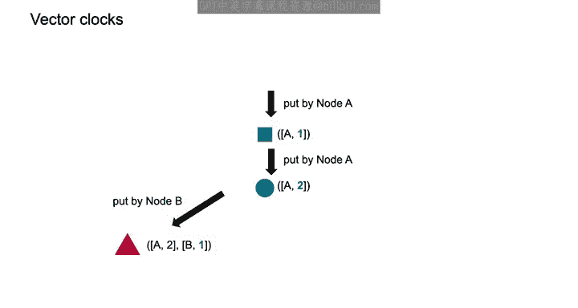

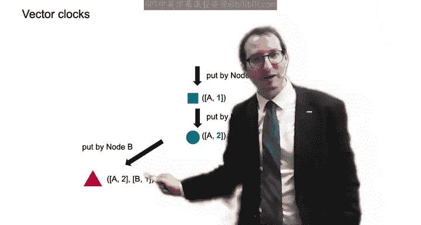

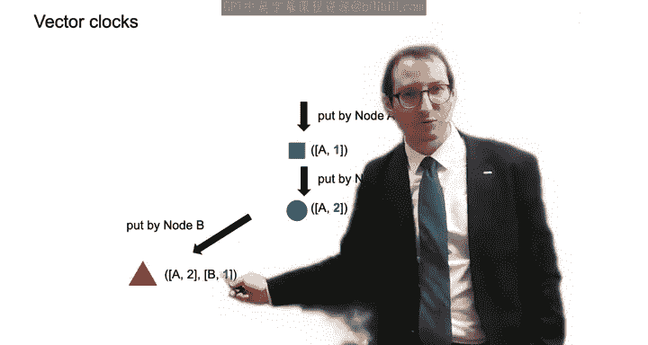

Instead of having a single number， you have as many numbers as there are machines in the network right all the machines that don't appear here are zero right you don't put the zeros but the machines that did see the data once。

 they have a clock that they increment every time So this is one half of the network that this has this clock and the other half of the network that's another node on the other half of the network would be a also but I just put B andC for more interesting case So C would create a new version that would be a yellow square and for the other half it's a red triangle and that with the vector clock to C1 right so it's a different vector clock。

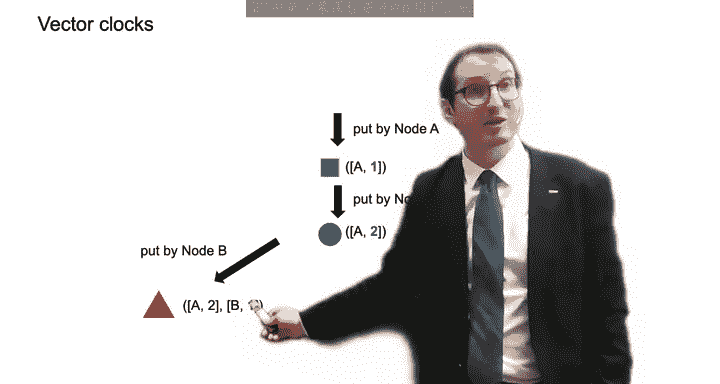

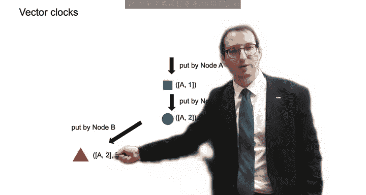

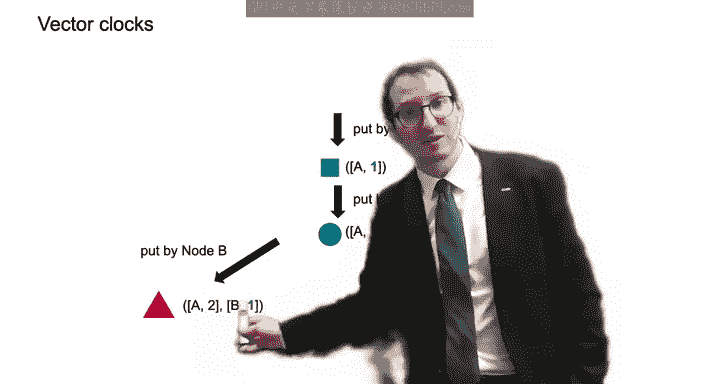

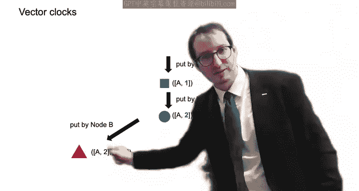

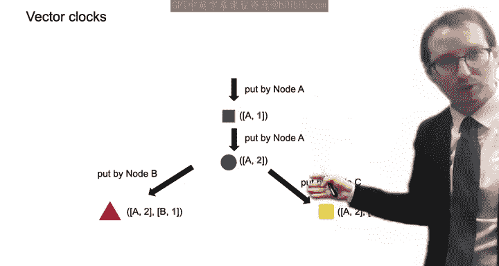

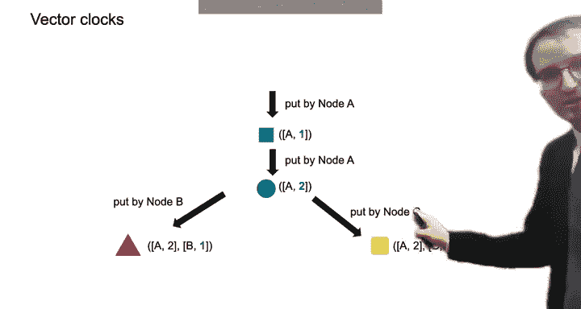

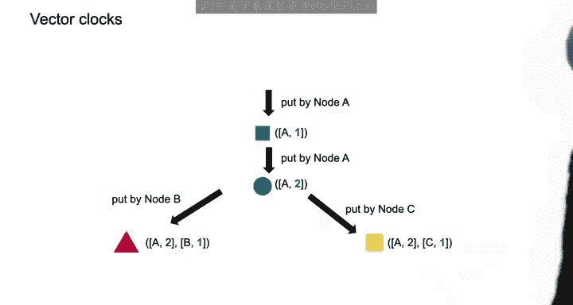

And then you are no longer consistent why because one part of the network see this。

 the other part of the network is that this is why you drop the C in CA right you are E right。

 Partition toent and available， but now you're no longer consistent and what happens in this case is that at some point the network partition is solved and the whole network connects again。

 but then you have the problem of this disagreement on the data， then you need to。

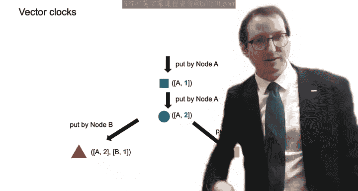

unified so the user is going to provide a new value that that is going to take over on the two sides of the network。

 you basically reconciate or you solve the conflicts and what happens is that imagine it's node a that does that。

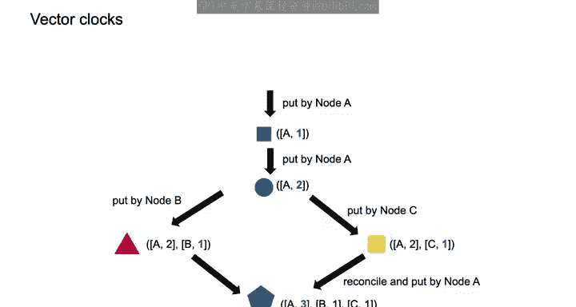

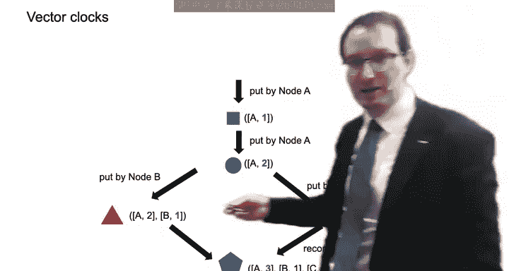

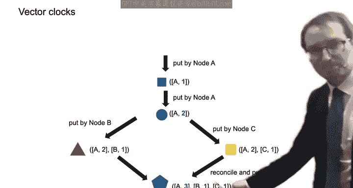

You merge these two clocks， A2， B1， C1， right， and you increment whichever node takes care of it， 3。

1，1。

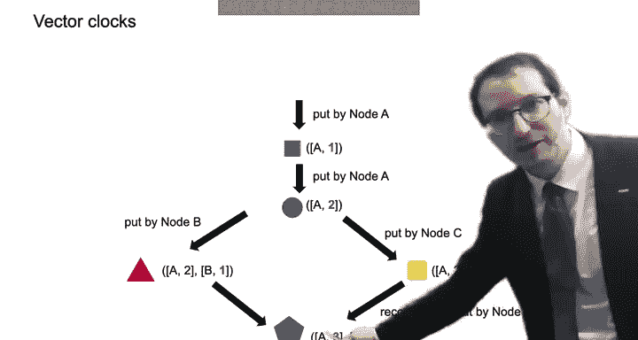

What's actually happening here is that we have a partial order this is the question I asked last week on Wednesday。

 a partial order corresponding to a DG it means that if you take two clocks。

 two vectors like this either you can compare them and say this is greater than this this is greater than this this is greater than this this is greater than this or you cannot compare them。

 you take this to you cannot say that when is greater than the order this is how you detect a conflict when you solve the conflict you create a new clock a new vector that is both bigger than this one and bigger than this one and now you have basically a maximum value so this is called a maximumimal element at that point you have two maximal elements but when you actually have a value that's bigger than everything else then you have a maximum right this actually is larger than anything else so if the system is functioning normally there is no network partition then you will have like。

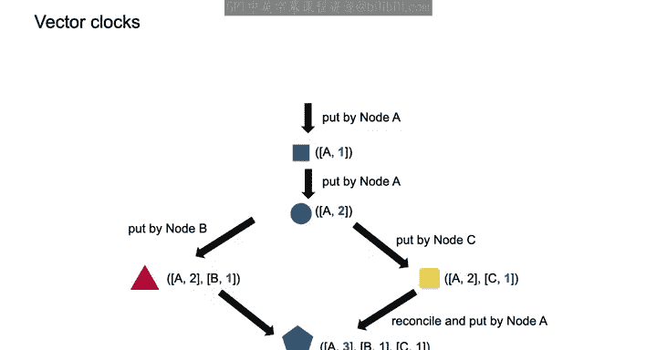

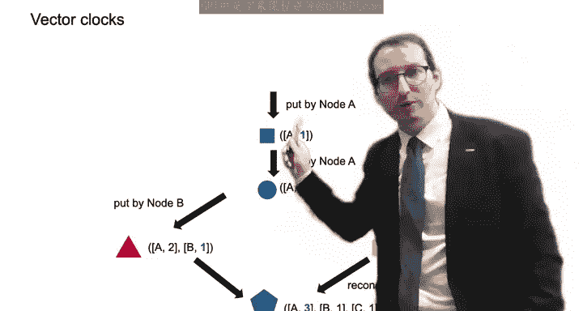

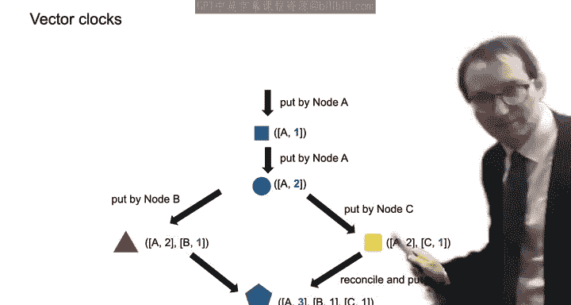

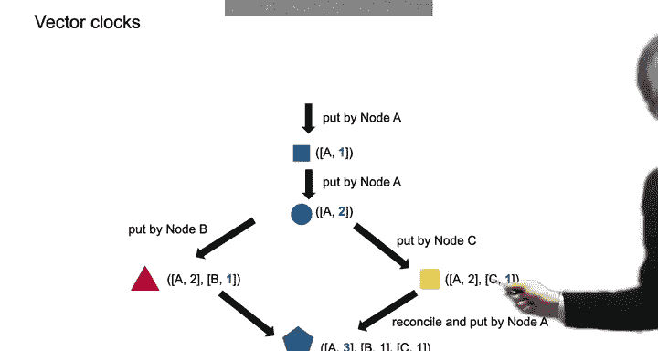

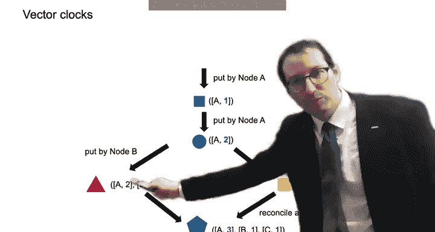

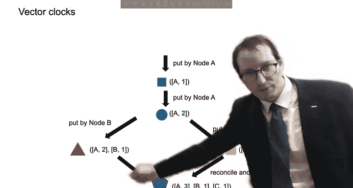

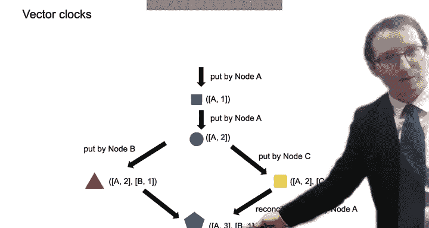

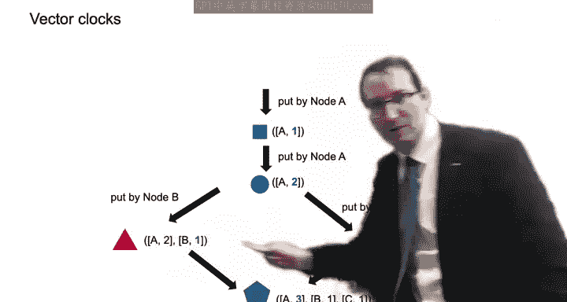

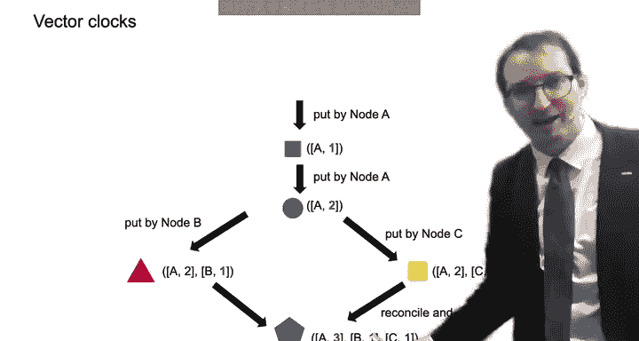

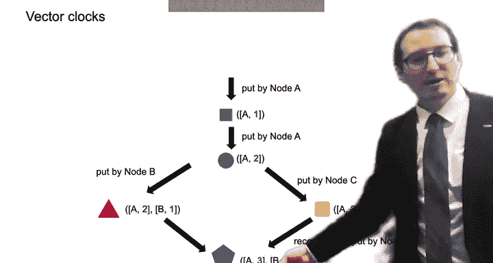

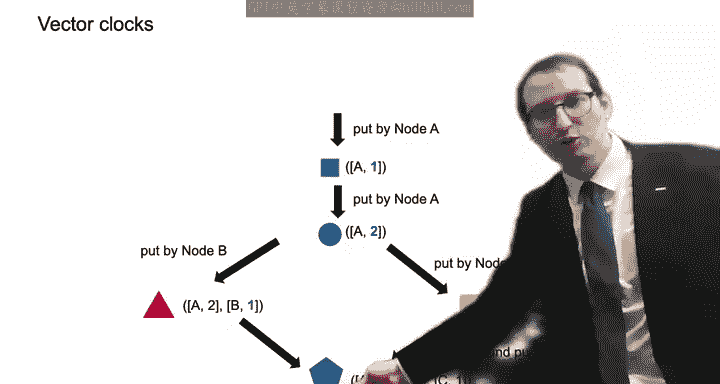

This a maximum likes some sort of unique value that is greater than everything else。

 but if you have a network partition temporarily you're going to have competing competing vector clocks that are both maximal elements。

 but there's no unique maximum for whom does that make sense？😊。

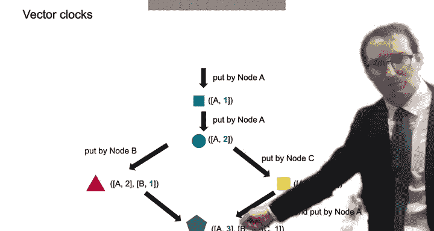

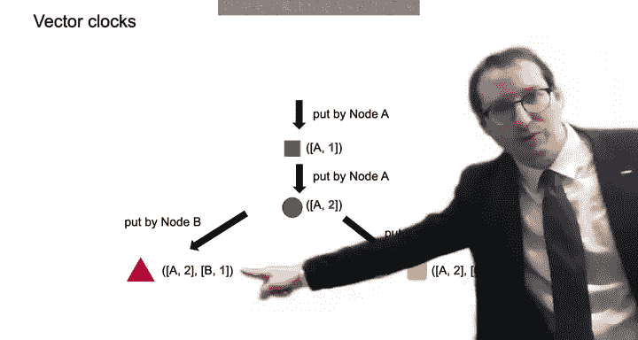

So network partition and now it's solved。呃。This vector clock is actually the question。

So how do we do the conflicts solving them here？Is the user so I will show you an animation right now it's the user that decides you basically present these two values to the user and you say now please solve that for me and the user of the system is going to answer with a blue Pentagon saying this is what I want to have as the new value and then the dynamo is going to create that new vector clock that makes sure that this is this takes over right it's like Gis right when you have a conflict with a Git repository it's up to you to solve the conflicts and then commit it to the repo。

等等。208对的。It has to be done manually， but it's also not mandatory。 You know， you。

 you can also live like this。 It's fine。 You have conquer version。

 But the next time you try to update a value， then you have to handle the conflicts。喂。

That's the8 all right。呃。Okay。Now this vector clock， you remember that I told you it's getput delete。

 the API， just like in rest。But I you get and put actually have additional parameters。

Gett has what's called a context and put takes a context。

The context is actually a vector clock now you know how what it is and I'm going to show you an animation because there's nothing better than actually seeing it in action so I'm going to take as an example across it's very few notes here for my slides。

 I wasn't going to draw 1000 of them imagine we have a applicationplication factor of three so we have three machines that are responsible for it I'm not using tokens but it's the same I with tokens right for simplicity I'm just using one token per machine in that case Allright so here you go you have the system and I'm token on three machines So we have an incoming request that says please put。

😊。

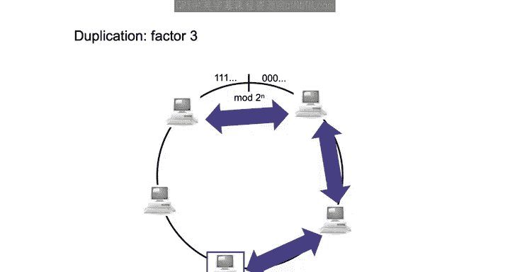

Associ with key1， I do everything with key1 is some key associated with the value。 A。

 A is some value like my rectangles and triangles that I had earlier， Right。

 So let's put a associated with key1。What happens is that the system you connect has a load balancer and then it redirect you automatically thanks to be stable at some point to a machine that is responsible for key1 turns out to be n1 for that range of keys based on the hash of key1 and then N1 handles it。

 create a new context。 Ve clock is incremented by one and then it storing the value a with the vector clock n11 key1 is also here。

 but again， everything is key1 in my example。 So that's why I don't put it here And then it propagates right because two more nodes have also the responsibility of storing it because of the duplication that I told you about So we replicate the same thing over the three nodes it's possible because there's no network partition right you can communicate with everybody here。

Then if you get the key， you gather all the versions。

 you notice that they're all the same so there's no problem in here and you return this unique value together with this vector clock right and that's it So you return that and that's the context that you get from the get function tells you not only the value but also the context。

😊，Then the user or some user may be the same one or the one who did the get request。

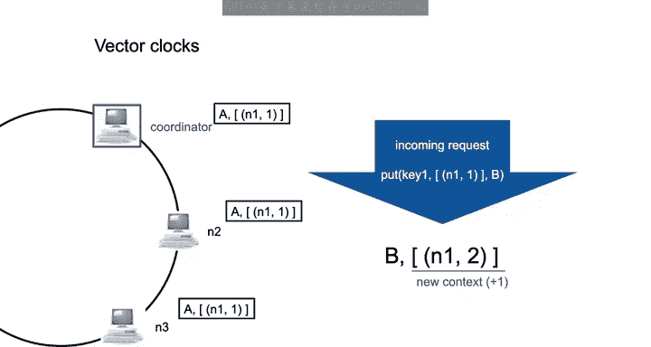

Now wants to modify the value and put B instead so it wants to put value B and it has to resupply the context that it got from here right so it res okay that was the context I had please now put value B in place Now N1 is still handing it because it's available so it's going to increase the clock by1 so now it's n12 so you store B with n12 and then you replicate it right you don't have to delete the old version immediately right since it's old versions version then you know the version and you can keep the older versions as well doesn't it doesn't help you can still clean up and prune a bit later right。

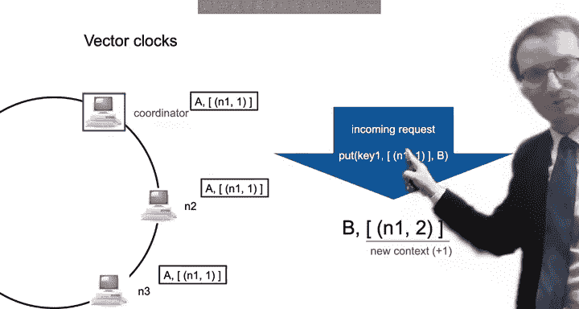

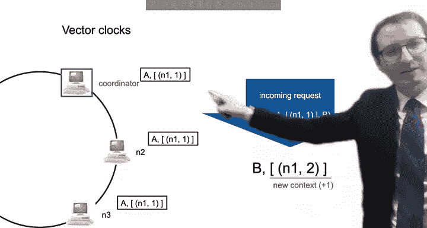

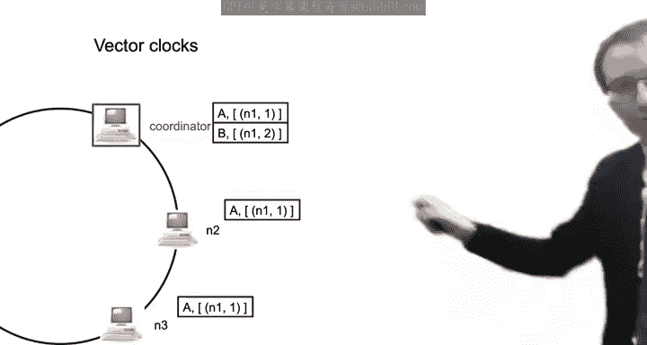

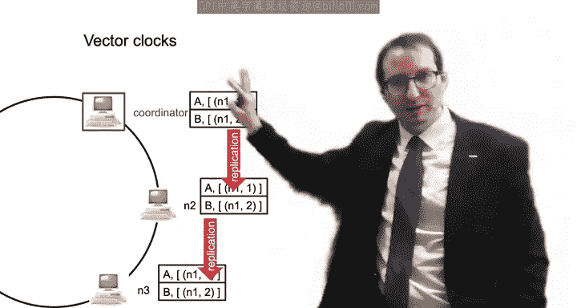

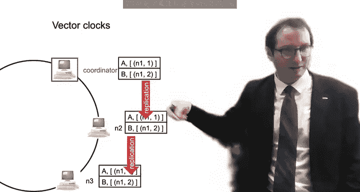

Then you try to get key1， you gather everything。😊，So you do have two values， conflicting values。

However， if you look at the vector clocks， you can see that one is larger than the other。

 they do compare right and you see that n12 is larger than n11 according to my partial relation。

 so I'm returning just this one which is the maximum that I have among my vector clocks。

 so I return B with the context N12。😊，Then somebody else wants to add a new key sorry to add a new value with that key So see now again n1 so you create a new context plus one。

 except that now like in a howood movie there's a catastrophe and the network actually partitions the cable between n1 and N2 is broken so you see what's happening here this value is blocked here but doesn't propagates to the rest of the network because there there is there is this network partition but it's not a problem because we have a partition tolerancele system and it's a partition tolerance system that is a so it will continue to be available and it will continue to work so you can continue to use it Imagine that somebody connects from the lower path and once the value for key1 that's okay it's going to work you just pick the second node in the preferences that's N2 and it returns the value B with N1N2 that's okay it's not the latest one but that's what it means to not be。

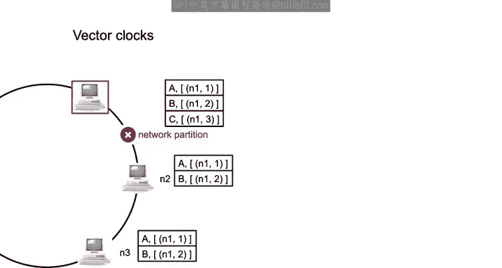

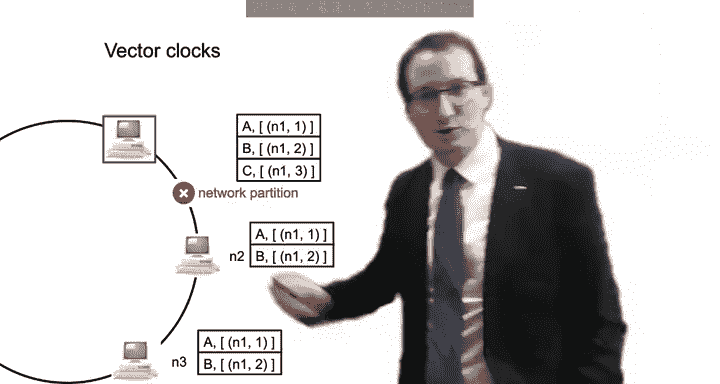

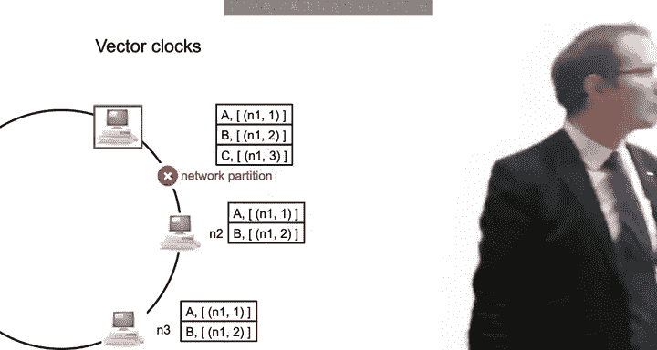

De you just don't return be the values that would actually be the latest one because n1 is is disconnected。

 So you return B N12。 So imagine that now whoever got be as the latest value。

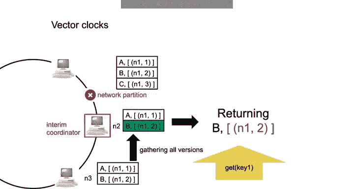

Once to put D instead， so you create a new vector clock in that lower part of the network。

 it's N2 that takes care of it so。N1 remains associated with two but n2 this node here is increasing its clock by one so I have n to1 and you're storing D like this and at some point you will propagate but now it turns out that the cable works again so now its all connected all over again so what can you do you propagate things again right so imagine that I try now to get key1 even I didn't even have time to propagate so let me get key1 so now I gather everything I try to gather all the versions that I can find in there and I'm going to have these four different versions。

😊。

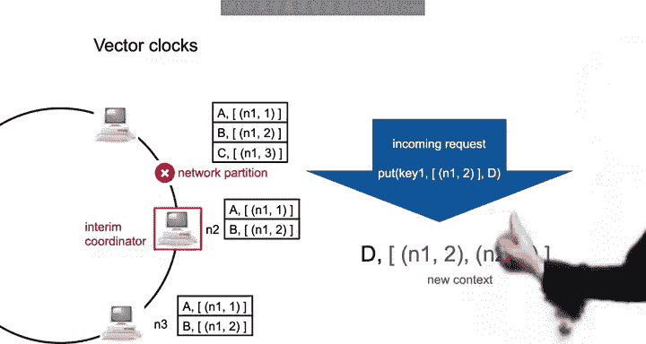

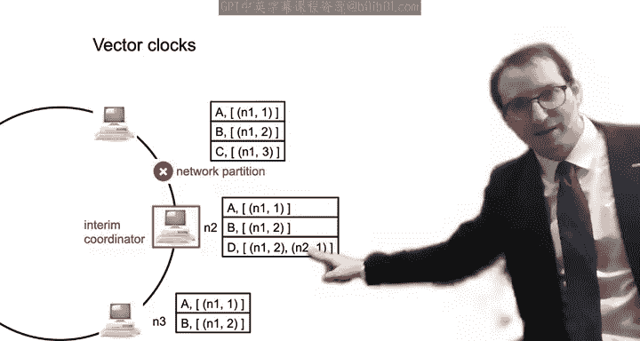

I want the maximal elements， right， so I'm going to return which ones， two of these values。

 which ones。😊，C and D， exactly because A and B are not maximal elements。

 C is larger than A And B And D is also larger than A And B。 So A And D are not return。

 but C And D you see the maximal elements。 These are the nodes that don't have any outgoing edge in my directly the exactly graph deck。

 And so this is what I'm going to return。 They are not comparable。 no one win。

 So I'm returning the two of them right So that's it。 I'm returning two values。

 C And D with the vector clock and13 and to one and now and this answer all your question that you asked earlier。

 its the user's job to say what instead of C And you want to put right So the user can decide on a new value So maybe they do。

 So now the user in thinking okay what am I going to put as a new value in the backgrounds。

 the nodes are going to synchronize again So you have again。

 all all the data can now be spread over the machines again。😊。

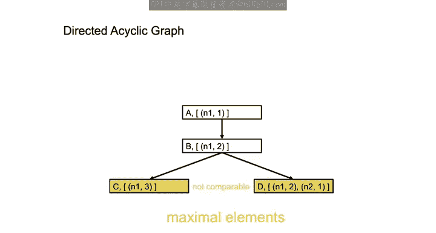

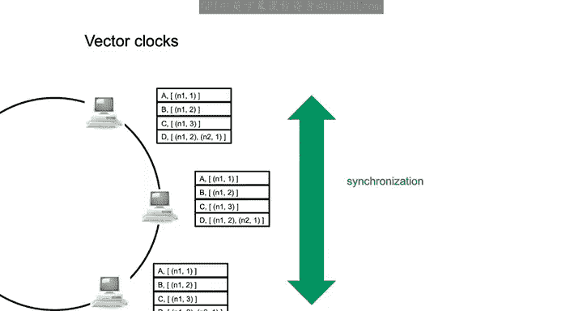

Maybe we can also do some cleanup while the user is thinking so here A and B can actually be good we can get rid of them because they are not maximal elements。

 let me only keep C and D right that I can do periodically now there's an incoming requests Finally the user made up their minds。

 So now we have E as the new value together with the old context So notice that the context that the user was given here was taken as merging the two right N13 n12 and21 so the merge of the two is n13 N21's just the merging taking the max for all nodes。

 So now we take that's the context now we take that context and since it's n1 that's handling the request because it's back online so we increase the n1 counter becomes4 and now we have this new version E that I add everywhere but now it's great because we again have a maximum。

😊。

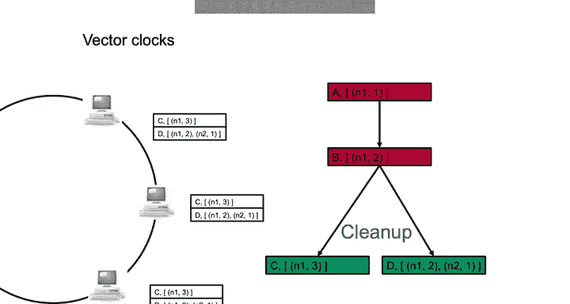

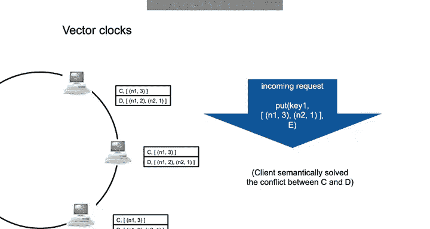

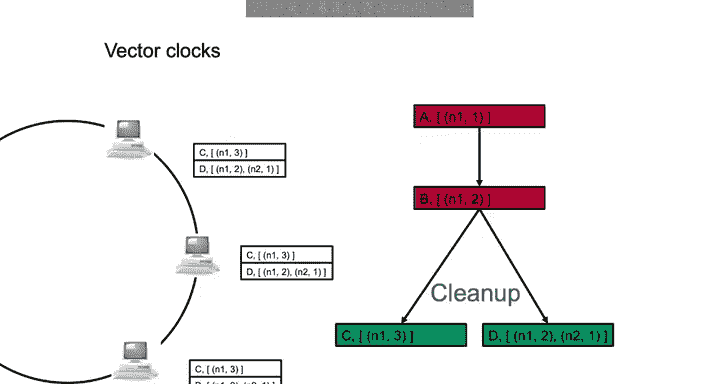

Right。W is with me on this。RightNow we increment it and we again have a vector clock that is larger than anything else right so this is it now we have an absolute maximum and it means that the conflict is solved。

😊。

Okay。😊，So this is how you handled it and there is again a very beautiful link between classical physics like Newtonian physics with absolute time that would correspond to a system that is always consistent you just have an absolute eapse of time a linear view and an absolute complete order right it's a full order that that complete order。

 I can't remember the adjective now okay the one that basically is a straight line you have a da that is in a straight line。

 but if you have conflicts and you want to not be consistent in case of network partitions then time becomes a da like this right and these kind of graphs you see everywhere in spatial relativity or even general relativity when you have a structure of space time with that kind of dependency graphs but I think as complete scientists you've seen these graphs already plenty of times right so who has seen a graph like that。

😊，Almost all of you， it's a classical theoretical computer science， All right。

 so this is it vector clocks correspond to partial orders correspond to bug。😊。

I had a few last worlds very quickly about Amazon， Asia and so on。

 So the idea is that they even though they the cloud providers are very similar in the things they offer on the high level。

 so Google clouds。😊，Microsoft Ager and and Amazon， AWS。On Amazon。

 there is a tendency to have plenty of small services。😊，You have a service like S3 fostering objects。

 you have a service for relational database， you have a service to rent machines。

 you have a service for your domain， you have a service for the DNS zones and so on and so on。

 you have maybe hundreds or more services on Amazon and you can just help yourself through through the console to use all of these services right Asiaure has a bit of a different approach and has a few products that do more things right so it's less distributed across plenty of services that do only one thing that you have。

 for example， database management systems that Christmass Db that handle different things So the QVU paradigm that we saw but together with graph table trees So it's ongoing research to try to unify the data shapes and so you do have work that goes in in that direction。

Okay and this is where the path on cloud storage is ending right so we saw S3 which is object storage for objects sized up to  five terabytes worldwide a service that you just pay for and that is host by Amazon and you have on the other hand E you stars like a dynamod DB that'll handle smaller objects up to 400 kiloytes right but but they are faster they have a much lower latency as a result and you know that this is done with the co protocol and that I've described here。

Do we have any questions？On zoom。No questions算 so。Aiz will wait a bit for questions because when you ask a question。

 then as a student I you like at the moment I want to ask a question。

 the professor already continue to something else。😊，No question， right？Okay， so。If that's the case。

 then I'm going to move on to the next batch。

Going to stop the recording。

