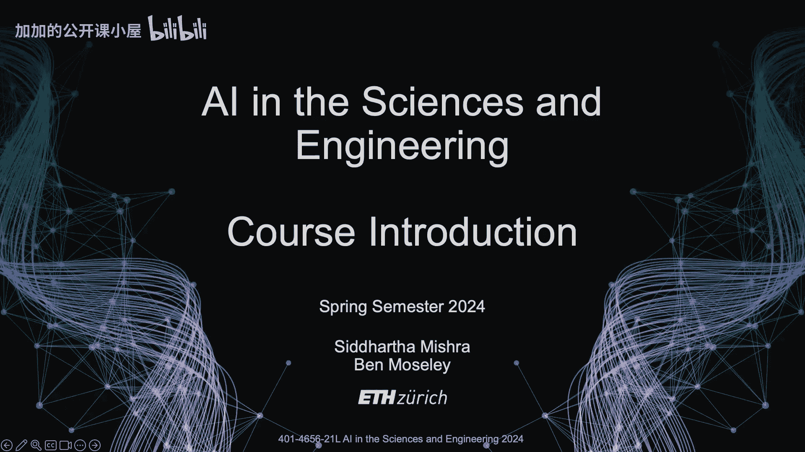
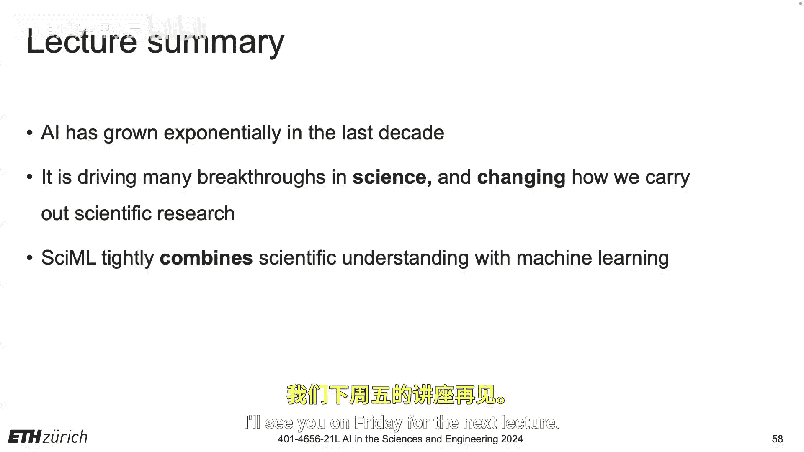

# 苏黎世联邦理工【中英⚡科学与工程中的人工智能｜2024 AI in the Sciences and Engineering】 p01 P1 Course Introduction -BV1smxgzHEPC_p1-

Okay good morning everyone welcomee to the first lecture of AI in the science and engineering my name is Sid Mira and I am co teachinging the course with Ben Ben mostly Ben is going to teach you today but I will drop in on next Friday for the first lecture that I'm going to teach we are going to share and Ben is going to also show you the lesson plan so now without further ado I hand it over to Ben thank you very much Si。

So welcome everyone， this is the first lecture of this lecture series。

 which is AI in the Sciences and Engineing。So as they said。

 my name is Ben Mosley and we're going to be teaching this course together throughout the spring semester here at EthH in 2024。

So what I'm going to do is dive straight in and give you a very high level motivation for the course。

And then after I've given you that motivation， I'll talk a lot more about the course， contents。

 the assessment and the practicalities of the course。So let's just drive straight in。

So AI is having a massive impact in science today， it's driving lots and lots of breakthroughs。

And I would say especially in the last year or so， these breakthroughs have started to gain widespread attention in the public。

And what I've got here is a few examples of AI really having an impact in science。嗯。

And so the first example is using AI to forecast the weather and to do climate simulation。

So companies like NVdia with their forecast net model。

 and also Google with a model called Graphcast and many other companies， too。

Are able to now train AI models that are able to accurately simulate the climate and weather patterns。

To an accuracy that is competitive with and in some cases。

 starting to exceed traditional numerical simulation。

And this is really exciting because not only can they perform very well。

 but they're also orders of magnitude faster than these traditional numerical models。

So this is an example of forecastnet predicting global weather patterns。

So on the top right here is a news article that explained how forecast Matt was able to forecast Hurricane Lee。

 so this is an extreme weather event up to a week in advance。

And these models are actually very different to the traditional numerical simulation because they're very heavily dated driven。

And so that the way they simulate is that they learn from lots of previous observations of the climate。

 real data and measurements that we have to be able to simulate forward in time。

And so this is kind of a transformative change in the way that we think about climate simulation and it's really yet transforming this whole field。

Heres another example， this is using AI to help us carry out nuclear fusion。

So what is nuclear fusion， well it's an alternative way to produce energy。

And it does it by combining atoms together， so fusing atoms and collecting the energy that they release。

嗯。So to create fusion， you basically have to recreate your conditions inside a star here on Earth。

And to do that involves creating a plasma and this is a state of matter which is very high energy and very high temperature。

And these partners are really difficult to control and they're really unstable。And so this research。

 this is collaboration with PeMd and EPFL here in Switzerland。They used a neural network。

And in particular， they trained it using reinforcement learning to control a real life nuclear reactor。

And what you can see from this animation on the top there is that this trained neural network is not only able to control the shape or change the shape of the plasma。

 but also keep it stable over longer periods of time。

And so this was a really this AI here has really given us a step forwards in producing energy with nuclear fusion。

Then the final example I've got is Alpha fold and this is an AI model from Google DeepMd that is able to accurately predict the 3D structure of proteins given amino acid their building blocks。

 which are their amino acids。And this is a task that used to take a lot of painstaking effort in the lab。

 months to years in the lab， and now we can predict the structure of these proteins in seconds just on a computer。

And this has allowed many downstream applications， for example， in drug discovery。

 and has become its own research building its own right and so AI is really transforming this area of science Institute。

So why is AI impacting science today in such a big way？Well。

 the reason is because AI itself has exploded in the last decade or so。

And there are some really powerful AI technologies in the world today。嗯。

Most of you I'm sure are familiar by now， but with Cha GBT。

 this is the model that's taken the world by storm over the last year or so。

And more generally large language models are able to have full conversations with you and do things like summarizing documents and even creating fully autonomous like digital agents。

Another impressive breakthrough has been in image generation in AI， so we can now take a text prompt。

 for example， a photograph of an astronaut riding a horse。

And we can generate a very highly realistic image from that prompt。I mean， just last week。

 Open AI announced SRA， which is a text to video tool and that generates incredibly realistic video from text。

On the top right here we've got a Gtto， so there is also a trend in AI right now to not just use AI to carry out very narrow tasks。

 but also to be more general to become generalist agents。

And so GaA is a model that is able to do not just image classificationacation。

 but it can also capture images， it can also play Atari games and it can also have a conversation with you or using the same model under the hood。

And we use AI today to help us code so Git our code P is really good at completing code and suggesting a whole blocks of code for you。

AI is the fundamental technology between autonomous cars and we also use AI to translate now very effectively and AI can translate seamlessly between hundreds of different languages。

So if you look at these graphs， you can also see in the numbers。

 the number of research publications in AI has been growing very quickly。

 the amount of funding has been growing more or less exponentially。

And another kind of interesting trend recently is the number of laws that have been passed in AI is also going up and we're starting to really think about the ethics behind behind AI seat。

So why has AI itself exploded？Well， I would argue that what has been driving a lot of the progress in AI over the last decade or more。

 90% of that progress has been driven by deep learning。

And deep learning is the training of deep neural networks。So before go any further。

 I just want to explain what deep learning is just to make sure that we're on the same page。So yeah。

 deep learning is concerned with training deep neural networks。And at the risk of。Being too simple。

 but also I think this is a very useful way of talking about deep neural networks。

 particularly for this course。嗯。I'm going to describe a deep neural network as simply in mathematical function。

So here Annas。Where the function takes in some vector input X and it gives some vector output way。

And what's really important is that function has some free parameters， we call them featuress。

 and these parameters are tunenable。And so we tune these so that the output of the neuralA network matches some desired output from some training data set。

嗯。And then training basically involves having lots of examples of inputs and outputs of a network。

 you also need a loss function to compare the outputs as a network with the output of the model。

And some optimization algorithm that is able to tune the weights based on that loss。

So that's very simply what a neural network is or a deep neural network。Then the next question is。

 well， what exactly is that function in all network of x？

Well that function then depends on the specific neural network architecture that you're using。

And there are many， many different choices， but pretty much every neural network architecture can be described in this kind of simple。

 simple way。The final question is what makes it deep， well。

 usually we say a deep neural network is any neural network function that has more than two layers or two layers or more。

So why now why has deep learning really exploded recently。

 well there are broadly three big reasons why it's so popular。

The first is that there is exponentially increasing amounts by some measures of data in the world and you can see that on the chart on the list。

Huge amounts of data that allow us to train deeper and deeper models and more and more sophisticated models。

The second reason is the amount of computational power has also been growing exponentially more or less。

 perhaps not in CPUU power and orbit bit， but with the advent of GPUs。

 which turned out to be really amazing for training deep neural networks。

 we really are seeing scaling in terms of compute。And then finally。

 we have a lot of more mature deep learning frameworks that now allow us to train in all network in you know。

 one， two， three lines of code。So these are platforms like Pywach， Cares， Penifflowlow and Jas。

As well as that， there's also been a lot of innovation in the training algorithms of neural networks and also their architectures and that there's a lot of interesting work there。

Okay， so I showed you some examples of AI really impacting science today and what I tried to do here is to think about some of the grand challenges in science that AI could really help us solve and there are many you know there are some really big problems in science that would really benefit the world and humanity if we could solve them。

And so what I've got are four different kind of grand challenges that and I'm going to explain how I think AI can help those。

So the first big challenge I would say is on the top left and that's the challenges the amount of data that today's experiments or some of today's experiments are producing。

So this is a part of the data that is recorded every month at CEN。

And you can see Sun is recording thousands of paraabytes of data every month。

And this is just impossible for a human to go through by hand and pick out you know the needle in the haste。

 like the different particle， the interactions that we're looking for in that data。

So AI here could really help to automate our discovery process and our processing of that data。

So on the flip side， there were also experiments that we carry out which have very little data and the data that we have is very。

 very noisy。So an example of this is exoplanet discovery。

And the most popular way to discover exoplanets today is to use the transit method。

And this is very simply where you see the planet directly transit across the face of the star。

 and that causes a very small dip in the flux that we receive from that star。

The issue is that that flux change is pro based small can be less than a percent change。

And it produces measurements which are very， very noisy。I mean， to the human eye。

 it would be very difficult to detect a transit based on that data。

And so that AI can really help here to help us pick out signals from noise。

So this is another big area where AI can help。Okay。

 let's go to the top right and this is the task of simulation。

And the difficulty that we have with many， many simulation algorithms across many different domains is that they are often very computational expensive。

So this is a simulation of the flow past and aircraft wing。

 obviously a really important simulation to make sure that our aircrafts are safe and also efficient。

But these types of multi scale high fidelity simulations。

Can take millions of coralarrows and also millions of dollars to run。

So any way that we can speed up these simulations using AI machine learning could have a really massive impact in our simulations。

Okay， finally， on the bottom right， a lot of the scientific experiments that we're carrying out today or the scientific systems that we're studying are becoming more and more complex as we learn more and more about them。

A good example is the COVID virus and how that virus evolves through time。

And this is actually a super complex problem you're modeling the transmission across the entire world essentially。

And we have a lot of data here and what AI might be able to help us do is discover patterns in that data that we may find it difficult to do by ourselves。

So yeah， rather than me telling you why deep learning is important for science。

 I thought I might as well just ask AI itself and so I asked ChaGPT。

 what are the benefits of using deep learning in science and chatGPT actually gives a really brilliant response that basically summarizes what I just told you。

So AI can help improve the accuracy of our scientific algorithms。

 it can also help us automate and automate the discovery from our scientific data。

It can enhance our understanding by many detecting patterns that we wouldn't be able to see before。

And yeah， increases the efficiency， it can help speed up some of our computationally expensive workflows。

Okay， so I've got a couple， well， I've got two more slides of applications of AI and science to convince you even further that this is a really impactful technology。

And what I'm showing is many different applications across many different domains and I'm not going to go through them in detail。

 but I'll give you a quick summary， so AI is helping us take images or scans of our eyes and segment those images and be able to detect issues or diseases in our eyes。

AI is able to take images of gravitationally lens galaxies and undo that lensing and reconstruct the image of the galaxy without a lensing。

Very accurately， actually。AI was also able to go through data from particle providers and detect events in that data。

AI can also take recordings of our neural activity and decode the speech that we were saying just from that normal activity。

Hoping us to understand our brain and yet how our brain works。Here's four more examples。

 so this is some work that we did where we use AI to appear into permanently shadowed regions on the moon and so these are craters and other topographic depressions that are permanently coveredved in darkness。

And the images are very， very， very dark and very， very noisy and so we trained AI to remove the noise in these images and for the first time it allowed us to see Cats and boulders and other objects inside of these regions。

AI can help us design antibodies， so this is an example of an AI actually discovering a new antibody for Eco life。

 so this is a bacteria。And it does it by using a message passing neural network which is trained on lots of examples to predict various molecular properties that can cause resistance and then when it's tested on new molecular designs that can come up。

 it was able to come up with this new antibody。AI can can solve Olympia level geometry questions and this is alpha geometry and this is really interesting because it combines a large language model with a symbolic inferenceprint engine to carry out that task。

And then AI can also help us code our scientific workflows。

 and this is an example of Cha EBT actually doing a really good job of writing code to solve the 2D diffusion equation。

Okay， so I've really picked up deep learning and AI and the potential for its impact in science。

 and now I want to bring it down to reality a little bit and tell you some of the changes of deep learning as well。

 and it's really important to recognize these changes。

 especially if we're going to apply AI to scientific workflows。

So there are some big challenges that are very well known by now of deep learning in particular。

And I'm going to go through four of them。So the first kind of big challenge is just the sheer size of the models that we're training today。

So if you think about Chat EptT， kind of the early versions of Cha EptT took 175。

 so hundreds of billions of parameters just to train train that model。

 it also took a huge amount of data， essentially scraping the internet to be able to find a training data for that model。

There's a graph here which shows the trend the number of parameters versus pi of some of the major machine learning models that have been released and you can see the trend is going very very much upwards and we're getting towards trillion parameter models and so even just storing these models in memory on the computer and doing inference on them it can be a challenge。

嗯。AI also suffers or deep learning， deep networks also suffer from bias。

And a property of deep neural networks is that if you have bias in your training data。

 that is also going to show up in the output of the model。

 and unfortunately a lot of the data that we have trained in deep neural networks on has contained biases in。

 for example， when we're carrying out facial recognition and the performance varies across different groups of people。

And so this is a really important consideration to make sure that the AI that we train is fair and ethical。

Kind of related to that is the lack of interpreterability of deep neural networks。

And this is fundamentally because neural networks use a distribute with representation when they're processing their inputs。

 and this can make it really hard to interpret what they're doing or to get them to justify their actions。

So for example， if you were training a neural network to drive a car。

 you would really wanted to explain why it took a left or right hand turn based on its inputs and its context。

Then the final challenge is actually design the neural network itself。

It actually is not often obvious what the right neural network architecture。

 that neural network function that I showed you should be for a given task。

And I would argue that a lot of the progress in AI or a lot of the research in AI over the last decade has been experimenting with lots of different architectures。

So if you think about， for example， image recognition， a classic task in computer vision。

We've gone from fully connected networks to convolutional networks to Resnets for transformers we're still kind of playing around with the best architecture to use。

So I have two more challenges， which I think are especially penilent to using AI in science。

And the first of those two challenges is the challenge of generalization。

And so this is the property of deep neural networks that。

They often perform very well when they're given an input that's within their training distribution or close to their training data。

But as soon as you give them an input that's outside of their training distribution。

 their performance often decreases very rapidly。So this is a test that I did myself。

 I took a pre trained renet that was trained on INe so this is just thousands of different natural images。

And if I get it to classify an image of a dog， so this is an image that's within its training distribution。

It not only nails that it's a dog， but it also tells us to succeed breathe very a。

But then as soon as I give it an image it's outside of a screen distribution。

 so some sort of space dog， doesn't it really starts to struggle and can't label it directly。

So related to this and perhaps of kind of a wider kind of issue is the challenge of reasoning with deep neural networks。

And they can often struggle to exhibit kind of common sense reasoning in their outputs。

So this is an example doing image generation with Dili3。

 so know a state of the art image generation model。

And I asked it to produce the street with absolutely no lamppost。

Rather than reducing what I asked for， it gave me a streak with lots of lamp posts in of the exact opposite and so what you can see here is that the model is struggling with the s negation in the logic behind the statement。

So this is an outstanding challenge and definitely a very hot topic of research at the moment is putting more common sense reasoning into neural networks。

So I showed you the challenges。're talkingal through the lens of traditional AI tasks。

 but what is really important to understand is when we apply AI to science。

 these limitations also crop up in our scientific workflows that we're using AI for。

So this is some more work that we did where I show you where we found one of these limitations。

And so what we did here was we trained the neural network to carry out simulation and specifically to carry out simulation of earthquakes through the Earth。

So you don't need to know the exact workflow， but at a very high level， we had a neural network here。

An neural network here that took in as input the structure of the Earth。

 and in particular the velocity of the Earth， which varies depending on the geology of the Earth。

And then it produced an output， which is basically the seismic response along the surface of the Earth。

 so basically the strength of the earthquake wherever you are on the surface。And what we found is。

Well， so we trained this neural network with lots of velocity models that were very simple。

 so they just had horizontal layering and a single fold。

And what we found is when we tested that neural network on a velocity model that was close to its training data。

 so you know， a similar horizontally layered velocity model with a single pole。

It was able to predict the seismic of very， very actively。

But as soon as I gave it an input that was outside of its strain and distribution。

 so that a velocity model that had curves in it or extra bolts， for example。

tThen the prediction of the network starts to really suffer and it performs much worse。

 so this is the issue of generalization showing up in a scientific workflow。

So this kind of makes a lot of scientists uneasy when we try and say， okay。

 we're going to use AI to replace our existing scientific workplace because we know that deep learning has these flaws。

 you know it has this lack of intererability， it sometimes struggles to generalize and we also need lots of training data to train these algorithms。

And this doesn't really sit well with people to scientists that understand the traditional way of doing science。

 which heavily revolves around this interplay between theory and experiment。

The traditional way of doing science is to come up with a very explainable theory。

 come up with some hypothesis to test that theory， to do an experiment and either validate or tell us that we need to improve that theory and and it's this iterative improvement cycle that we typically cope。

And a really important point about that theory is， you know。

 a good theory should be explainable and make novelble predictions and that's exactly what deep neural networks struggle to do。

So in the last， I would say five years or so there's been a real。

Change in scientific research using AI and what has happened is。

We've now started to see this field called scientificient machine learning emerge and what is scientific machine learning。

 the core thesis of this field is to not just replace our scientific workflows with machine learning。

 but to actually tightly combine our existing scientific understanding。

 which we have centuries of scientific understanding to build upon。

And so we're going to tightly combine that with our machine learning works and we call those models scientific machine learning models。

And we hope that they're more powerful， more robust and more interpretable than just replacing our existing workflow with AI。

So there are a whole plethora of scientific machine learning techniques that have been proposed and being currently researched。

 this is a very very hot field right now。And you might have heard of some of these techniques already。

 so for example， things like physics informed neural networks， differential physics。

 neural operators， neural differential equations， a lot of these techniques we will be covering in this course in a lot of detail so you'll see a lot more of these to come。

And yeah， this is a very rapidly growing field， so there have now been scientific machine learning workshops。

 you know workshops on combining machine learning with scientific understanding across all of the major machine learning conferences over the last two to three years。

嗯。I also did a keyword search to look at the number of publications that contain these scientific seen learning keywords。

 so for example things like physics inform neural networks。

 CML operated learning differentiali physics， all of these keywords have received exponentially growing numbers of publications over the last year and now we're really starting to see a really emergence of this field。

Okay， so I just gave you the kind of very high level motivation of the course and I've hopefully tried to convince you that AI really is having an impact in science today and it is potentially a very transformative tool that we can use in science。

So what is the overall goal of this course and so we have kind of four big learning objectives for you so by the end of the course。

We would hope that you'll be more aware of the advanced applications of AI in the sciences and engineering。

Also to be more familiar with the specific design， implementation and theory behind those algorithms。

We also want you to be realistic about when you can use AI and when you perhaps shouldn't use AI to enhance your scientific workflow。

And we also want you to not just understand AI techniques。

 but also how to tightly combine and scientific understand them with a scientific understanding with them。

So to appreciate kind of these key scientific machine learning learning concepts and bes。Okay。

 so this is the course timeline so there's a lot going on in this slide and I'm going to talk you through it。

So we have two lectures a week and we have the one on Wednesday。

 which is today's lecture and we also have a lecture on Friday and they're both in the same room so here in ML H 44。

Alongside the lectures， we also have tutorials， so these are going to be run by our TAs and they will contain practical exercises。

 usually coding exercises that will complement all the content that we covering in the lectures。

I'm not going to talk through you。Exactly the details of each lecture right now。

 I'm going to tell you about the course overview review later on in the lecture。

But to give you a very high level description， Siid and I are going to talk you through well we're first going to do a brief recap of deep learning。

 one of the pre because it's of the course is to understand the basics of machine learning and so things like optimizationim and supervised learning so this will be quite a fast recap but hopefully get everyone on the same page。

And then we'll talk about different types of core scientific machine learning techniques and so we'll first talk about physics and neural networks。

 then we'll talk about the field of operator learning。

Then we'll go into a couple of specific architectures or state of the architectures that are being used in science。

 so things like larger language models， graph neural networks， of fusion models。

Then we'll talk about differentialiable physics and then at the end we have two guest lectures where the lecturer will be talking about machine learning in chemistry and biology。

 so that should be really exciting。嗯嗯。The other thing I should say is this schedule might change depending on how quickly we go through a material and we're also actively adding new material so a lot of the material in this course has been researched in the last year or two。

 so we are actively changing this course as well。And they're are some practical information as well for the course。

 so all the materials will be available on our course Google page。

 so this includes the lecture recordings and also the tutorial exercises。

We're also running Zoom meetings so that you can join online as well as being in person。

And then what you'll probably be mostly interested in is how we're assessing the course。

 so the big thing to note is that we don't have any exams for the course。

And all of our assessment is done through three individual homework assignments。

So these are individual assignments that you'll be asked to do and they'll be due every four weeks and so we'll release the first assignment on the 8th of March and then it will be due to be submitted four weeks later so on the 5th of April。

So these assignments will be related to the content that we cover in the lectures in the tutorials and all the specifics of what we're going to ask you to do and what you'll be asked to deliver free each of those assignments will be given when we release the assignments so you'll have a very detailed description and you can also talk to our Ts who will be helping us mark those assignments。

So our teaching assistants for this course are bogthan and Victor and they'll be very happy to help you you can also message us on Google there's the ways that you can connect with us。

诶。Okay。So yeah， I've been talking for a while， so we'll just take a quick break and then we'll get back to it in five minutes or so so yeah。

Okay， so how does the rest of this lecture look and so why I just gave you was the course motivation and the overview of the course。

So now what we're going to spend the rest of the lecture talking about are some of the key scientific tasks。

But we want to study in science in a very general way。

And then I'm also going to try and explain to you how AI can help or machine learning can help solve those scientific tasks。

So I'm going to talk at a fairly abstract level across many different disciplines。

 but it turns out there are a lot of different scientific tasks that are general or like the common across different disciplines。

 and so these tasks are simulation problems， inverse control data or simulation problems。

 equation discovery and anomaly detections I'm going to talk about those tasks in general。

And then at the end of the lecture， I'm going to give more of an overview into the scientific machine learning it and tell you more about how to more tightly integrate scientific understanding into interm learning。

And try and motivate some of the key scientific kind of tools and techniques that we'll be studying in much more detail in the upcoming measures。

So what are our learning objectives for the lecture so we have three of them。By the end of day。

 you should hopefully understand why AI is so useful in the sciencess and the impact that it's having。

You should also understand the typical types of scientific tasks that we try to solve using machine learning。

And you also understand why it's the field of scientific machine learning exists。

 why it's a good idea to combine scientific understanding with machine learning。Okay。

 so let's talk about some key scientific tasks that are very common across many different scientific domains。

And so before I talk about scientific tasks， I should really talk about differential equations or in fact partial differential equations。

And these are really the building blocks behind science。

 and they really determine or describe the world around us in a very elegant way。

From the smallest scales， for example， describing how atoms evolve over time。

Using the Schroing equation。So the're very larger scales thinking about how black holes and their dynamics。

 and these are Einstein's field equations。They also help us understand the Earth。

 so what I showed you an example of climate simulation in the first slide of the lecture。

 so you know the fundamental equations behind these dynamics of an AS folks equations。

We also know that differential equations can help us understand biology and in particular。

 the reaction to fusion equation helps us understand how patterns form when animal skin are growing。

So PDs are fundamental and we place quite a large focus on solving problems related to PDs in this course for this reason。

And so we'll be talking a lot more about how to use AI in the context of differential equations in this course。

Okay， so now let's get on to these key scientific tasks。

And as I said when I talked about the lecture overview。

 I'm going to give you examples of specific scientific tasks， as I'm talking through。

 but I really encourage you to think at the higher kind of abstract level。

 maybe in your field of science， if there are any analogous tasks that you're interested in or you think are hard to solve in your specific field。

So the first task is simulation and what I'm going to try and do here is describe it at a very high level and to do that I'm going to say we have some physical system。

And we have some input conditions in that physical system， which I'm just going to describe by A。

ButWe also have a physical model of that system， and this more often than than not is some set of differential equations。

 for example。And then given those input conditions in that physical model。

 what the task of simulation is to predict the resulting properties given those input conditions。

 so B in this equation。诶。So this is obviously a very high level description of simulation and depending on the actual task。

 the underlying physical model can be much more complicated in terms of the maths that we use。

So here's an example of simulation， it's an example of modeling an earthquake through the structure of the air earth。

And you know simulation in a broad sense is crucial for many different scientific tasks and it's really important for understanding different scientific phenomena and predicting how they behave。

And simulation is usually used as a starting point for many other scientific tasks， so for example。

We might want to see how the seismic response here varies at the surface of the Earth。

 depending on where the earthquake is， and we might want to do some kind of modeling or hazard prediction based on that simulation。

So the underlying here that I'm running the simulation using is the acoustic wave of equation。

 so this is a very very well known familiar equation。

So just to lay out more explicitly for you using that framework that I just described。

 so we kind of predict B here and B in this case the simulation is the wayfield。

 so it's the solution of that differential equation。

 which is essentially the pressure of the seismic wave。view as a function of space and time。

And the inputs of the simulation is the velocity model， so this is our model of the Earth。

 the structure of the Earth。And also the location of the earthquake and given those input conditions we want to predict the seismic weight field and then F here is our differential equation our wave equation。

 but also as well as knowing the equation， we often need some method to solve the equation and for example。

 a very common method is to use a finite E solver when we're solving the wave equation。Okay。So yeah。

 how do we solve simulation problems well traditionally we use numerical methods。Most PDs。

 especially with realistic input conditions， are not analytically solvable and we have to resort to numerical techniques。

And this is know a massive field by its right and it has been studied for decades or more。

So we have many， many different approaches for numerically solving differential equations and popular methods。

 which I'm sure many of you have studied already things like finite different solvers。

 finite element solvers， spectral methods， the main de composition methods that the list goes on and theres a lot of techniques out there to choose from。

So what are the challenges of stimulation that we have today？

Well I already told you at the start of the lecture that typically the big challenge of simulation is the computational costs that it takes to run these numerical methods。

 these finite element， finite different solves。So this is a video from NASA。

 it's a simulation from NASA simulating the exhaust from a rocket。

And this is a super complicated simulation， it's a multi physicssic multiphase simulation and just to run you know this couple of seconds of simulation took 500 million grid cells in their simulation and ran for several weeks on thousands of core。

 so this cost millions of dollars to run a single simulation。

And that's very restrictive what we would really love to do is to run this simulation maybe thousands of clients varying the design of the rocket to help us optimize that system and producing an efficient rocket。

 but it's just not practically possible we're just limited by the compute。

So if we could speed this up with machine learning。

 it could be potentially transformative in the way that we can you design these systems。

There are a couple of other big challenges as well， methods like finite element methods。

 we spend a lot of time just designing an appropriate mesh for that simulation that can take a huge amount of human effort just to do it like I'm talking weeks。

 weeks of design。On top of that， a lot of our established simulation codes， so for example。

 OpenF is very popular fluid dynamics code。This code base has millions of lines of code and can be very difficult to build upon or understand if you're just coming into the field。

Yeah。Okay， so we're now going to move on to the next class of problems and this class of problems are inverse problems。

And so what is inverse problem at a very high level？So we have this same equation。

 but now what we're trying to focus on is instead of predicting the outputs of the system。

Is we actually want to predict or infer the input positionss of the system。

Given given some observations of the system， so given some observations B and an understanding of the physical model。

 what were the input conditions that produce those observations？

Okay so let's think about framing that seismic simulation task as an invertter problem。

 so the invert problem would be given you know observations of the wavefield so suppose we have geoFphones that measure the pressure response on the surface of the earth。

 for example。Can we figure out where the earthquake was and maybe even what the structure of the earth was as well the underlying velocity world？

And yeah these are basic these are of across many different fields of sites。

 so these are a couple of example in problems， so this this is seismic imaging we also have an MRI imaging is another example of an inverse problem。

Also image denoing， removing noise from images can be thought of as an inverse problem or estimating in test infection rates。

 design problems the list goes on。So how do we solve inverse problems so fundamentally we can frame an inverse problem as a search problem it's you know。

 given given a value of B， let's try and find or search for the value of a that gives that value of B。

And it's often very useful to frame this as an optimization problem specifically and in an optimization problem。

 what we do is we define some objective function or a loss function。That we want to try and minimize。

So， you know， a common one might just be the L norm between the prediction given some guess value of what the input conditions areR。

And the true observed values speed。So then if this loss function is differentiable， for example。

 we can evaluate the gradient of this loss with respect to A。

Which also by the way requires that your solve F is also differentiable。

 so your finite difference finite element solver is differentiable。Then we can use methods。

 gradient descent methods to optimize and solve for A。If we don't have access to the gradients。

 there are also many other gradient free methods we could use。

 so things like evolutionary algorithms， basing optimization。

 bru force search in some cases can work。So let me just lay out using gradient decent to solve inverse problems explicitly for you。

 so as I said before this we have this objective function on the top here。

And or loss function and what we do is we start with a model on the top left here。

 we do forward modeling to predict what the values of VR to get some synthetic data。

We evaluate that loss function and that decides how good that model is。

Then we update that model using gradient descent and then using this iterative for loop or yeah iterative loop。

We end up with a final guess of what the model is。So。Just for later。

 this is really exactly the same algorithm that we use to train deep neural networks and this is actually kind of interesting and we'll go into the links of inverse problems and training deep neural networks in more detail in the course later。

A lot of the tricks that we use to train deep neural networks can be used to help us solve in problems as well and vice versa。

So yeah， specifically for that seismic inverse problem I described。

Here our observational data would be the wayflow that I showed you before and we would start with some guess of what the velocity model would be and usually we would just start with a very smooth approximation of the outreach velocity say。

We run this cycle of training and we end up hopefully with a model that's close to the true earth model。

So this is actually a real gradient descent algorithm running on on this way build data。

And we're doing this for loop， we're updating the gradients and this is how that guesses the bing model changes as we update the gradient。

So in geophysics this is actually known as core waveform inversion。

 this is the inverse problems name。And what you can see there's quite a few interesting things that they arere going on here and first of all it does actually get quite a good guess of the true velocity model and also the estimated wayfield based on that guest velocity model。

But what's interesting is that it doesn't update the model outside of where the wastefield has traveled。

And so this makes sense like there's no information outside of where the Wfield hasn't travel get and so you can't understand what the velocity is before it's traveled there。

Another interesting thing is it gets most of the boky on the right。

 but it really sucks and map up in the left hand side there and it gets some really weird anomalies in the estimated velocity velocity。

And so this is a challenge of in problems is that。In many cases， in many real world cases。

 the observational datas that we have。Doesn't uniquely allow us to uniquely determine what the solution of the EMverse problem is。

And also even if you have enough information， the loss function still might be very complicated and have lots of local mini in in it that you might still not converge even if you have enough information。

 which is probably what is happening here， we have a lot of information but the loss function is probably very complex。

So there are actually a lot of challenges with vendor problems and in practice they are extremely difficult to solve。

And yeah， the biggest reason is this ill post is what I mentioned。

 so there's often not enough information in the observational data to uniquely determine what that solution is。

嗯。Another issue which contributes to the opponess is observations can be sparse。

 they can also be a very noisy and again that makes them harder to solve。The final thing is。

When we're running， for example， that gradient assembly loop doing optimization。

We have to evaluate that forward solve often thousands of times to carry out into the extent。

 so I already told you that simulation， you know evaluate doing numerical simulation can be very expensive。

 so which we have to run out thousands of times interest problems are even more expensive than simulation in many cases。

So yeah， this is definitely a very difficult difficult thing to solve。

 so this is another example of an problem in the left here。Is doing computer tomography。

 so basically doing x rays。And so what is the end problem in this situation？

So what we have is an X ray source， where the solid is little。

 we have some media that that source is going through。

And that media has some absorption of the X phrase and that absorption depends as a function of space。

 so different parts of your body absorb x phrases in different amounts and you can interpret that as an image that allows you to see into the body。

And then we just record those x rays along the are at many locations。

And you can see that if we just have a single single depending on the number of lines that we reports。

 the number of x including media。That really determines the illponess of the inBs problem if we have lots of lines。

 then we could get a really good image。But if we have very few theses then then it becomes very difficult to reconstruct that image and you can see。

The actual data that we received， these are the incentives here actually that in fact doesnt look anything lightly was before before the sign them。

We have to beaten instructions on that sign on the1 definition and this is an example of one particular investmented back prediction algorithm than that it's doing that and it's clearly not getting the exact answer that it's a very noisy estimate of the true solution。

Okay。So related to invest problems are controlled and data ass simulation problems and it can help to think of these as different classes of invest problems。

So what is a control problem or a control problem is you know given a system of differential equations？

Can we add some action， of course into those differential equations that controls the system or the state of the system？

So a classic example a classic control problem is the inverted pendulum I'm trying to you can imagine a pendulum on a cart and the task is to move the cart such that the pendulum ends up inverted like this and this is a very unstable equilibrium。

The underlying equations and motion are here， I'm not going to describe them in detail。

 but what we're trying to do is vary the force here so that the final state dependent and ends up the angle is tenseed towards zero。

So we can frame this as an enormous problem where A here is the force that we're binding for the car。

 F is the fi equations and the way we solve them and then B is the condition that there's a function of time tends to zero。

Another type of problem is a data assimation problem and this is a task for example。

 where we have noisy measurements of the pendulum itself and we want to perhaps infer the startinging position of the pendulum or maybe the path of the position through time。

So again， we could then say A here is the thing that we want to understand。

 which is the starting position of the pendulum。Be perhaps easy measurements of X and a Pi。

And then F this again， the model that we have and perhaps a noise model weighted on top of if they noisy measurements。

And the final kind of type of em problem is design problems and so this is the problem that I was talking about when we were designing space rockets。

 for example。What we want to do is we have some physical system or we want to optimize the design of that system you know to maximize certain metrics of that system。

So another example would be designing the shape of an afoil so that we maximize the lift of the aerofoil and the parameters that we have to play with are maybe the shape of the aerofoil and the angle of attack of the wing。

So this is again， can be thought of as an inverse type problem。Okay。

 so we're just going to move on to the last class of scientific tasks and this is actually understanding F itself。

So this is what I would describe as equation discovery or model discovery。You know。

 we might have some observations of the initial conditions of the system and maybe some observations of its output like how it behaves。

 we might not fully understand what the underlying differential equation is or whatever the model is。

And this is actually the case for many different domains of science。

 so for example experimental fluid dynamics is trying to understand better the kind of underlying equations of fluids。

嗯。So yeah， how do we do it well traditionally it's relieding upon you know remarkable human intuition。

 I had to put a picture of Einstein here because we're ETH。But yeah。

 and to be able to come up with a good theory is what I was describing before having this interplay between designing a theory。

 carrying out experiments， validating that theory， and it's this iterative cycle done by humans mostly。

So from a computational standpoint is or in the context of this kind of。

Framework that I've been describing， you can kind of think of it as some sort of inverse problem where we're given again some observational data and we want to understand some underlying description of the system。

But here we're actually trying to predict the model it and this and the hallmarks of a good model is that yeah。

 it should be explainable， it should be generalizable and it should make novel predictions that we can validate using using experiment。

So maybe a more specific or a specific example of model discovery would be anomaly detection。

And so this isn't discovering the entire model， but it's doing one small part of that discovery process。

 which is detecting anomalies in your data， which can lead to you updating or discovering a new type of physics。

 for example。So yeah， an example of an detection would be the detecting exoplanets as I was discussing so this is the transit method。

 which I already explained。But this is challenging for a number of reasons。

 I already explained that the noise in this data makes it very hard for a human to detect atoms and anomalies in the data。

It can also be really hard to detect anomalies， particularly if they come from physics that we don't currently understand so they're out of distribution or froms unexplained physics。

And very often anomalies are kind of like looking for a needle in a hastpe。

 they're very infrequent so if you think of for example。

 particle collisions and like specific particles that we're looking for in particle coliders。Okay。

So what I've got in the next like section is just a couple of examples of how deep learning can help each of these tasks so I've got an example of deep learning improving simulation。

 I've got an example of deep learning improving in problems and then an example of deep learning helping us to discover underlying equations of a system。

So at a high level of help deep learninging help so as we saw before TraBT summarizeise it's very nicely for us。

 it can help us improve the accuracy of these techniques， it can improve the efficiency。

 the automation and discovery and。Of our scientific workflows。Okay。

 so here's an example using machine learning for science and it's the example that I already showed you using deep neural networks to carry out climate simulations or weather simulations。

And so this is forecastnet， which I showed you this animation on the right here。

So what is what exactly is for Casonnet or forecast Casnet is this deep neural network called a fourier neural operator。

So it is just the neural network architecture， it's based on convols， convolutional networks。

But what's interesting is it it does the convolution in the Fourier domain。

 so you we know that a convolution in the frequency domain is just a multiplication essentially。

And what's unique about the Fourier operatorator rather than just a standard convolutional network is that when it does that Fourier transform。

 it actually clips some of the frequencies， so it throws away some of the high frequencies in the input data essentially。

And then it times as it by the weight matrix， which is doing the convolution and then does the inverse transform back？

So this is interesting and there's a lot of there's a lot to be said about。

The motivation behind foreign law operators and operator learning in general。

 which we are going to talk about a lot more in the course。

But for now you can just think of this as kind of an intelligent neural network architecture。

 which is just preferring load frequencies in the inputs。

So it has like some prior that saying we should model like low frequency trends better。

And it turns out that this model is really good at carrying out weather simulation and the most important thing is that is four to five or magnitude faster than solving negative stokes equations or like a full blowning climate model using traditional numerical techniques。

Okay， so now let's talk about how can we use deep learning to solve in problems？

So I showed you this know classical gradientding the se algorithm for solving it problems that is often used。

So how can we put machine learning into this algorithm to try and improve the performance of it？

So there are many different ways to use machine learning to solve inverse problems and this is just one particular way again in the course we're going to cover many different ways to do this。

But one particular way is to use an neural network to actually improve the estimates of the gradient or the step that you want to take each iteration of the gradient descent loop。

So we know that when we estimate the gradient here in the loss function， that gradienting。

 especially if the inverse problem is ill posed， will be very noisy and it won't take us in a step that is exactly the right direction to solve the inverse problem。

The lost landscape is going to be very complex and the gradientd direction is maybe not the best step to take。

So the idea is to train a neural network， but take that gradient and update it so that it takes a better step。

And how do we learn that neural network， how do we learn to take a better step。

 well we write this algorithm down and we actually differentiate through the entire algorithm using the auto differentiation to train the weights of the network and the loss function that we use to train the network is to match。

The upper final algorithm final model here many example in problems。

I'll be talking a lot more about this when we talk about differentiable physics in the kind of second half of the course。

But it turns out if you do this， if you train a neural network to improve the gradient steps。

 we can start getting a much better performance of the diverse algorithm。

It starts to remove some of the noise present from the illness of the problem。O。

So the final thing task to talk about is equation discovery。

 so how is machine learning help us discover the underlying equations of the system？So again。

 this is now becoming its a whole field and this is just one example there are many different techniques to do this。

And what this method is doing is very simple， so you can imagine。

We have some observations here of some physical system。

And we don't understand what the underlying differential equation is yet。

 we just know that we have observations of some variable U。

 the solution of the equations and how it evolves through time， so these are our noisy measurements。

So how do we discover the underlying differential equation that this U of P obeys？

So it's very simple， we just first， we fit the neural network。To this data。

 so we have a neural network function here， neural network of X and T that directly tries to fit this data。

 so it's just a curve fit to that data。The next step is to compute various gradients of that neural network。

 that train neural network， so you know that neural network function is just the mathematical function and we have analytical gradients that we can get from that function so you know the derivative of the output of the network with a respect to its inputs so U by the T and u by the x。

So what we do is we just compute a whole library of these gradients at many different random XT locations like querying in the whole function。

And then to discover the underlying equation given those gradients。

 we just carry out as faster linear your regressionggression over those gradients so we make the assumption that for example。

 the time that you see is to the video upon managing all these different gradients。

Typically how we could frame a differential equation。

 if you think about writing a different equation now。

 it's just a linear combination of these gradients。

So that's the assumption that we make about the system and then we're going to try and learn each of the coefficient surveys building to actually kind of discovered the underlying the equation。

Now， I wouldn't say that this is。For blown discovery of a physical model is just linear Russian essentially。

But it is a starting way to kind of understand or to start discover discovering the equations。嗯。

So yeah， this is a paper that came out in Nature communicationmunications a couple of years ago。

And it does it very well， so if they able to discover this underlying equation here。

 so this is the the Dos equation that's fluid problem。Okay。

 so what I just did was I told you a high level the kind of general scientific tasks that we're interested in solving in sitess。

 and that gave you a very small flavor of how machine learning can help us solve those tasks。

So now I'm going to spend the final part of the lecture just talking about this field of scientific machine learning。

 which I already said was a way to combine our existing scientific understanding with machine learning a much in a very tight way to produce more powerful and more robust and more interpretable models。

So I'm going to give you more of an overview of this field。So yeah， I described this already。

 so we know that deep learning when it's just naively applied to scientific workflows has all these issues so it has the lack of intererability。

 poor generalization needs a lot training data and so this is what SM is doing is we're trying to combine our scientific understanding into these algorithms。

So how do we actually do that， like what are the different ways that people have researched and proposed to actually blend understanding with neural networks in particular？

So I like to class them into kind of really broad categories。

And we'll be explaining these different categories throughout the course and examples of different techniques within these categories。

But at a very high level， there are kind of three ways that you can blend scientific understanding into a neural network。

The first way is through the loss function， so this is the loss function that you use to train the neural network。

And rather than just training the network to reproduce lots and lots of scientific data。

 you can actually put physical constraints into that loss function， so for example。

 you can tell the neural network that you must conserve mass or you must conserve energy or you must obey。

 for example， the underlying differential equations。

And this is a really powerful way of improving the performance of these models and also allowing them to rely on less data。

And so there's a lot to be said about this and a specific example of physics inform neural networks and these have become very popular in the last five years or so。

So we have three or four lectures just on physics and form networks。

The next kind of broad category of doing Sel is to change the architecture of the neural network itself so that it encodes kind of scientific experience inside the architecture。

this is kind of a hard constraint， whereas training the changing in the loss function is more of a soft constraint。

So for example， we could have specific layers in the neural network which encode symmetries that we know about at a very deep level。

They could also encode energy conservation rotational invari。

 there's a lot of really interesting tricks to improve the performance ofcyclic models that we train。

Then the final kind of approach， which is probably the broadest approach is what I call hybrid methods and so rather than replacing our traditional scientific algorithm or workflow within neural network。

 even if it's got some clever kind of constraints in it，In this hybrid method。

 we actually try to tightly combine a neural network inside of a traditional algorithm。

So for example， that inverse problem that I was describing where we had a gradient suddenly when we put a neural network into a small part of that algorithm。

So these can be very powerful and also very interpretable methods and again we have two or three lecturees describing techniques in this area。

 so for example， things like neural differential equations， differentialiable physics。

 things like this can be cast as hybrid methods。O。So actually。

 I said So is this rapidly growing field and there are a whole psho of techniques out there。

 of which some of them we're going to cover in detail。

And this is actually a plot that I made in my thesis， this is already out of date。

 so I did this in 2022， but I think it's still useful to see this plot and think of it in this way。

And so what I did is I just broke down in a table along the top here are these three different scientific tasks that we're trying to carry out these general tasks。

 a simulation inversion and equation discovery。And what I did on the row here is I defined which Steinmark technique that research paper was using to solve that task。

 so you have the categories here， the architectural techniques。

 the loss function techniques and the hybrid approaches as I was just describing。

And what you can see is that there is research that covers that entire plain blade of possibility。

So you know you can use architectural approaches to carry out equation discovery。

 you can use hybrid approaches to carry out simulation。

 there's a lot of really interesting areas and sub areas in this field of signal that are focusing in these different parts of the table。

There are also some gaps although like I said， I caveat this this is already out of date and so there's a lot of research that I am not putting up on this。

Okay。Another way to think about s L  techniques0， which is often very useful is to think of the spectrum。

So what is this spectrum so on the left of this spectrum we have what I would describe as naive methods for carrying out scientific workplaces。

 so this is essentially just taking our scientific data and training in blackb neural network to reproduce that data。

And then on the right we would just have traditional our traditional scientific workflow so these don't use any machine learning。

 no deep networks of at tools which just are， you know， things like finite difference modeling。

 traditional windverse algorithms， etc ce。And so what you can do is you can place these Sinl techniques inside along this spectrum somewhere。

And their position on the spectrum just depends on， for example。

 how much scientific understanding they blend into the model and there are different amounts in a very wishwahy way I'm not describing this in the precise way。

Different amounts that you can put sign against understanding into the model。

 so you might think towards the left here you would have models like where we just changed the loss function we' not really changing the architecture。

That's kind of a soft constraint it might be more towards the left。

 but then these hybrid approaches where we're building on top of an existing traditional numerical model might have a lot of hard constraints in the  physics of the model and so it might be more towards the right hand side。

So this is just a very useful way of thinking about sideinal techniques。

There are other kind of reward properties that emerge from the left hand side and the right hand side so on the left hand side of these models。

 you could think of them as being fully learned。Fooly driven by that data and not having any kind of physical strengths in the model。

And on the right， you wouldn't need any learning at all。

 you don't need any data and the physics is just hard coded into the model。

So yeah there are subcatego within each of these three different sel approaches and we'll be coveringborating all of these circled areas throughout throughout the course。

 so I'm not going to talk about them now。Okay， so let's just go back to the course overview we're nearly done。

And now that I've told you about Sima in a bit more detail。

 we just talk about the overview of course in a little bit more detail so I've already done the course introduction and like I've said we're going to recap very quickly an introduction to deep learning to make sure we're all on the same page。

Then we'll talk about physics and networks for a couple of lectures and these。

 like I said are methods that change the loss function of the network to incorporate physics constraints。

Then we'll talk about operator learning and this is typically to learn solutions to differential equations or to solve problems related to differential equations to learn operators rather than functions。

And you could think of these， for example， that Forier neural operator that I talked about。

 you could think of these as clever architectures for defining neural networks that contain some kind of constraints of our system。

Then we'll move on to a block of lectures where we'll be talking about some state of the art models。

 so things like transformers， craft networks， diffussion models and how they're having a big impact in science and again these are very cleverly designed architectures that incorporate things like rotation weighvaris。

 for example， if you're modeling like molecules。And so you can think of maybe the sophisticated architectures。

Specific for science。And then we'll have the final set of lectures。

 which we'll be talking about these hybrid workflows and we'll be talking about a very important concept in science you know。

 just the idea of differentiability and differentiable physics。

And we'll talk about in more differential equations and lecture on symbolic progression and equation discovery as well。

And then we have the guest lecture at the end talking about applications in chemistry and biology。

Okay， so I covered a lot， but if I wish to summarize and what I want you to take away from my lecture is AI really is driving big breakthroughs and sites today and it's really become really received a lot of attention in the public over the last year especially。

And it is been driven by these big changes and fundamental breakthroughs in AI over the last decade。

And I would say I would go so far as to say AI is actually fundamentally changing the way that we carry out sciences。

 its really us changing our mindset and how we do scientific discovery。

And the latest and state of the art in this area is scientific machine learning。

 it's not only using the machine learning model， but also incorporating scientific constraints to improve the performance of that one。

So yeah thanks a lot for coming I'll see you on Friday for the next lecture and yeah andll see you then thank you。

