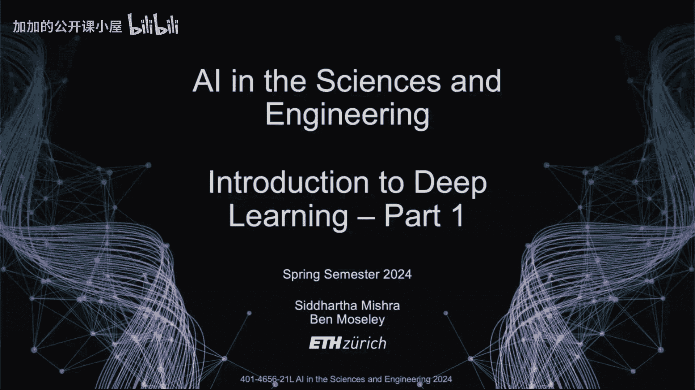
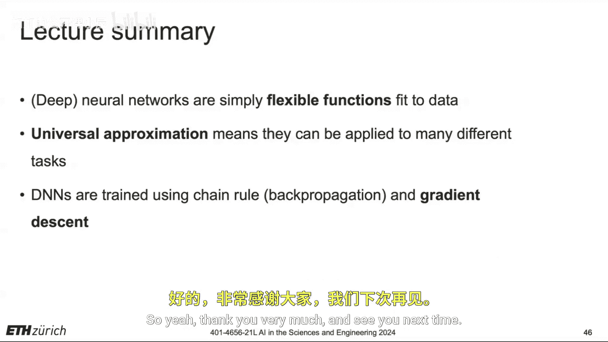

# 苏黎世联邦理工【中英⚡科学与工程中的人工智能｜2024 AI in the Sciences and Engineering】 p02 P2 Introduction to Deep Learning Part 1 -BV1smxgzHEPC_p2-

Okay， everyone， we're going to get started。So welcome to this lecture。

 This is the second lecture in our course， AI and the sciences and engineering in this lecture。

 I'm gonna be covering an introduction to deep learning。😊。

And so this is the first part of two lectures on this subject。

So before I do that， let's just recap what I covered in the last lecture。 And the last lecture。

 I gave you a very high level motivation of a course and introduction to the course。

And what I hopefully tried to show you was that AI is really having a massive impact in science and as and is driving a lot of breakthroughs today。

So I talked about examples from， you know， using AI to carry out really fast and accurate climate simulations and weather predictions。

I also showed you an example of using AI to help control fusion in nuclear reactors。And。

 and AI can also help us predict much， much fast， much more fast the act the。

 the 3D structure of proteins。I also talked about the kind of key scientific tasks that we often want to solve when were doing scientific research。

 And I also try to motivate the ways that AI could help us solve those。 So， for example。

 helping us solve simulation tasks， maybe making them more efficient or faster to run。

Helping us solve inverse problems， understanding underlying parameters from observations of a system。

Perhaps AI can help us more accurately determine those parameters。

And then I also talked about equation discovery。 And， and instead of relying on human intuition。

 can we， can we have an AI learn kind of to， to discover unknown physics， for example。Okay。

 and then I also try to introduce this field， which is called scientific machine learning。

 And this is kind of the state of the art of using AI in scientific research today。And this， and。

 and this field exists because we realize there are many disadvantages of using machine learning or。

 or maybe flaws of machine learning。 For example， lack of intererability。

 the amount of training data that we require。And so what we try and do in this field is really tightly blend our existing scientific understanding with M L to make models that are more powerful。

 more robust， more interpretable。Okay， so yeah， here's the course timeline that I' showed last lecture。

 So we're on the second lecture， like I said。The first lecture of two on an introduction to deep learningning。

So what we're gonna cover in this lecture， it's a， it's a fairly high level recovery of deep learning。

 And so first， I'm gonna explain what deep learning is。And I'm gonna explain multiloo perceptrons。

 one of the most basic neural network architectures there is。

I'm also going talk about the universal approximation of deep neural networks。

Then I'll talk about the popular tasks that we used deep learning for。

 So things like supervised learning， unsupvised learning。

 these are kind of classic machine learning tasks that we， that we want to solve。And then last。

 I'll talk about how we train deep neural networks and， in particular。

 gradient descent and back propagation。Okay。So， yeah， by the end of the lecture， hopefully。

 you'll be able to mathematically define what a deep neural network is。

You'll be able to understand the typical types of tasks that we use neural networks for and explain how theyre trained as well。

And then by the end of these two lectures， you， I should have covered enough material that you'd be able to explain a bit lower level how chat G B T。

 you know， this super popular model or more generally how large language models that are trained and also the architecture that they use。

 And you should be able to understand how these work。Okay。So just to start off a really high level。

 And this is a slide that I showed again in the， in the course introduction。

 AI research has really exploded in the last decade or more。

And I showed examples of AI impacting the world today。 And I， I just talked about chat G BT。

 We have now large language models that can have conversations with us and。

 and do really remarkable things。We also have AIs that can generate really realistic images and videos now。

 We have AIs that can do multi tasksask， can solve multiple tasks at the same time。 So， for example。

 Gatto is able to classify images and have a conversation with you and play games。😊。

And AI underpins a lot of the technologies that we use today。 So， for example。

 speech translation or text language translation。It also helps us Co code Github Co， codevit。

 for example。And the， the technology that is really driving AI research and has driven AI research。

 or I would say90，99% or maybe 90，90% is deep learning。嗯。And so why， why is deep learning so popular。

Well， again， this is the， the slide that I showed in the introduction。

 There are broadly three main reasons。 The first is there is a lot more data in the world today that these。

 we can train these algorithms on。EHardware improvement has improved， so we can train much， bigger。

 much bigger models。And also， there's a lot more software out there today that makes it really easy to train neural networks。

 So we have Pytorch Tensorflow and also a lot more architectures and a lot more innovation in in， in。

 in the theory behind these models as well。Okay， so before I explain deep learning specifically。

I want to just put it in the context of the broader field of AI。So AI machine learning。

 deep learning， these are terms that are used fairly vaguely today or are kind of hard to define sometimes。

Or people have different definitions of them。But what I'm gonna say is。

 or what's important to realize is that machine learning and deep learning is one specific part of。

 of AI。And for the purpose of this course， I would define AI as， you know， and then。

T training an intelligent agent to be able to mimic， mimic human， human behavior。And。

 and learning about the world， kind of learning about the rules of the world is just one aspect of。

 of what I would expect an AI system to be able to do。You can imagine， like。

 once you've learn some rules， you don't just want to know those rules。

 You want to be able to do something about it。 So， for example， if you。

 if you've learn a lot of mathematical logic statements about the world。

 you might want to infer things from those statements。Or if you've learn about transport systems。

 you might wantan to be able to then plan， a route from A to B。So。

 so learning is just one part of a autonomous system。

So machine learning is concerned about learning the rules of the world。

 And then deep learning itself is just a specific part of machine learning。

 which is using specifically deep neural networks to learn， learn patterns or learn these rules。So。

 yeah， we're gonna focus a lot on deep learning， but it's really important to appreciate this。

 this wider field。And， and if were interested in getting into AI more generally。

 there's a lot of really great material out there。The one that I would recommend is this book。

 a modern approach from Russell and Norvik。 This is a kind of classic textbook。

 which gives you a wider introduction to AI。Okay， so if there's one thing that I want you to take away from。

 from this lecture is， is this， this idea。 and it's the idea that neural networks are very simply just flexible functions that are fit to data。

So that， that's quite a simplistic view of， of neural networks。 And， of course。

 there's a whole variety in many different architectures and a lot of complexity when training networks。

 But this is really useful， especially when we're gonna apply neural networks to scientific problems。

 This is a very useful way of thinking of them。😊，So what do I mean by that。 So。

 so it's very simply the neural network takes some input， and this input is usually a vector X。

It passes it through some mathematical function。The neural network architecture itself defines that function。

And that architecture has some free parameters theta that we're gonna， we're gonna tune。And then the。

 the network produces an an output Y， which again， is another vector。

And what the training process of the network is to try and match those outputs of the network to some training data by tuning the values of theta。

So an example， a very simple example， would just be， you know， given this data here。 So this is。

Noisy measurements of， of， of some data sample from just a polynomial， for example。

Given those Y values。ECan we produce a function that fits， fits that curve basically。

 So it's simple curve fitting。嗯。And so， yeah， that， that's exactly it。

 neural networks are simply f flexible functions that are fit to data。Okay， so I。

 I hope that most of you know about function fitting already and have done。

 have done function fitting before。 and kind of。If we just assume that this data here is just from a polynomial。

 then， you know， the， the classic way of doing it is just to do polynomial regressiong or or。

 or actually just linear regressionggression。 This is something that hopefully everyone has seen for。

So how would we do it if we， if we were gonna， just gonna do linear regression。

 How would we do function fitting。So first， we would just assume a model of the data。

 So we would say， okay， I， I'm gonna assume that these data points follow a polynomial curve。

So why hat is our approximation of the， of the true function。And the only thing is。

 we don't know what the coefficients of the polynomial are。 So these theta 1， The 2， The 3， The 4。

So one way to frame this is to， to say， I'm gonna use least squares to， to estimate what theta are。

So I'm gonna choose a theta star。 My best guess of what theta is by minimizing the least squared difference between what my model predicts and and my。

 my noisy train training measurements。Okay。So this is just least squares regression。

And we can just rewrite this using the Ne algebra。 So， so we can say that all of the outputs。

 all the predictions of my model， these Y hats for each training data point。Just equals this matrix。

 which is our values of x and their powers。Times by our vector of， or our column vector of， of theus。

And then we can rewrite our least squares objective as minimizing theta in this。

 in this matrix equation。And you can show for this polynomial or linear regression case。

There's an an analytical solution。 So you can compute this analytically。 And。

 and it just involves computing in inverse of this， of this fire matrix。Okay， great。 So。

 so hopefully that's something you should be very familiar with。

So how is neural network regression different， Well to be honest， it's very， very similar。

It's exactly the same idea where we have， you know， again， some function。

 some neural network function， which we're gonna try and fit to this data。AndTyically。

 a very popular。You know， method， again， is to use late squares。 And。

 and we're gonna use exactly the same objective。Where we're gonna say the outputs of the neural network。

Or the difference between the outputs of the neural network and my training data should。

 should be minimized。 And we'll choose a the of value that minimizes that。So really。

 the only difference here is that in general， I haven't told you what that neural network function is。

 And if we don't know what that function is in general， we don't have an analytical solution。

And so we have to resort to some other way of learning those parameters of the network。And so。

 you know，99% of the time， we， we use gradient descent to train， train deep neural networks。

And so that involves taking the derivative of this。

 this loss function with respect to the weights of the network。

And then doing a gradient descent step with some， some learning rate。So yeah， that， that's。

 that's it。 That's a very simple description of how we train neuralA networks。 And。

 and this is the case that nearly every neural network that we train。So the next question really is。

 okay， so what exactly is that function that we're defining neural network of X。As I said。

 this is just depends on the specific neural network architecture that you choose。

And the one that I'm gonna cover in detail is this multi layer perceptron。

 So this is probably one of the most basic architectures that has been around for the longest foreign neural network。

呃。MLPs come can be defined with many with a varying number of layers。 But for a2， two layer MP。

 the actual equation for it is， is given below here。And so we take our input X。

 We times it by some weight matrix。 We add a bio vector， pass it through an activation function。

 This is a sigma value， and then do the same process again。

 depending on how many layers we have of the of the network。And yeah， that's， that's the。

 the simple mathematical definition of of an MLP。So you have to ask the question， like， why。

 why do we choose that particular function， Like， there are so many different functions we could choose with。

 with three parameters And like， why， why does everyone use this， this particular function。

 It seems a bit arbitrary。Well， I mean， the reason why we use neural networks in these functions is。

 is because neural networks are inspired by biology。 I mean。

 this is the reason why this field started is because we wanted to。

Train algorithms that were more like how the brain brain works。

And so there's a a caveat there that neural networks definitely a very simple approximation of the brain。

 And what the brain does is much， much more complicated than this。 But it's， it's a good analogy。

 at least。And so， so if I took just a single neuron。

 a single output neuron of the MP here for the last layer， and I just draw the。

How it processes its inputs and and gives you its output。

You can see that it takes the activations from the previous neurons。

Times times and times does it by these scalar weights， sums it together。

 adds the bias and passes it through inact。And this is indeed kind of a simple view of how a biological neuron will work。

 So， you know， this is a diagram of a neuron。 It has， has some inputs here that are being activated。

 It processes those inputs and and produces a spike depending on their values and then passes it to the。

 to， to neurons further， further downstream。So this is kind of similar to what a neuron is doing in a。

 in a neural network。And so then if I， if I， this is just for a single neuron in the last layer。

 If I， if I write an expression for both the neuronss in the last layer。

 I can actually just turn that into a matrix equation。Where I put my weights inside this matrix here。

Times them by all the activations from the， from the lot， from the previous layer and biospec。

And then you can see how we can arrive at this equation that I explained before that defines the neural network function itself。

And so to add more layers， we just compose each these layers together。

 And we can just say that the neural net function is just a composition of these layer functions。

 these G G AndF functions。Then the final thing I haven't really talked about is that the actual activation function itself。

 And so。There are many different choices that you can make of the activation function。

The probably the most popular one that is used is the re activation function， which is just 0。

 when the summation here is less than 0。 And otherwise， the value of the summation。

 if it's greater than 0。We're gonna be covering a few different activation functions in the course。

 One that we use a fair amount for scientific work is is tan H or more generally continuous or smooth。

 smoothly varying activation functions。So， for example， in。

 in physics and functional neural networks， these， these are very useful。 And。

 we'll explain why in the， in that lecture。So， yeah， I've given you all the， all the。

 the tools necessary to be able to train this， train the neural network define it and train it。

And so this is just an example of， of the M LP。Given by this function here， fitting。

 fitting to this training data that I， I've， I've been showing you。And you can see， as it trains。

 it starts to， it starts off at a very kind of smooth function that doesn't very much and slowly fits to the data。

And so this is an animation of the， of the function， the function estimated by the network as of。

 as a function of training step。And I just think it's really interesting to see how these。

 these things evolve in trains。 Sometimes it's kind of hard to understand exactly why it trains in a certain way。

One really interesting thing you can do is plot the weights of each， you know。

 the weights for each neuron and how they evolve over， over a training step or over time。😊。

So this little animation on the right， the width of the line just， is just proportional to the。

 to the， the absolute value of the weight。So what's kind of interesting， as you can see。

 even though this is a very simple function。The， the， the output is。

 is a summation over the over a distribution like is distributed over these over the hidden neurons。

 So it's not like a single neuro is， is， is just producing the output。And so this。

 this actually is the reason why neural networks are actually sometimes very hard to interpret because。

 because of this kind of distributed representation that they learn。Okay， so。

 it does kind of beg the question。 Like， if I'm doing like simple curve fitting。

 a polynomial curve fitting。Why wouldn't I just use linear regression。

 So can anyone give me an answer why， why it's the good idea to use a neural network for function fitting。

Y， yeah， come on。Yeah， yeah， definitely。So， the clue is in the in the title。

 So it's this property of neural networks called universal approximation。So what does that mean。

 So neural networks are just simply flexible functions that fit to data。

 But what's special about them and what's different to say， like polynomial or linear regression。

Is that with enough parameters And， I， I'm saying this in a very imprecise way。

 But this can be much more formalized， you know， using mathematical theory。With enough parameters。

 neural networks can approximate any arbitrary complex function。

And this is the universal approximation property of， of networks。So this is really， really。

 really great。 And what makes deep learning so powerful and what makes deep learning applicable to all these different tasks that has been applied to。

 you know， today。😊，So I， I can learn not just simple function fitting。

 but I can learn really complicated functions。 For example。

 the function that takes an image to like a classification of what image is。

 This can still be thought of as an image。How can， how is an image this can still be thought of as as as a function。

 So how， how can an image be thought of as a， as a vector？ Well， it's quite easy。

 You could just imagine each pixel， each value of the pixel in the image is just an element of the。

 of the vector。And the classification is just， we just interpret the the output of the network as a。

 as a class。嗯。And so， yeah， this is a really， really great property of， of neural networks。

 And this is what makes them so powerful is that we can train them to do many。

 many different types of tasks， which probably a linear model wouldn't be able to do。

And so what makes it non nonlinear。Rather than just a linear function。 Well， it's。

 it's the activation functions。You can see if we， if we just went back to this definition of a neural network here。

What happens if I just took out the activation function。 So I。

 I didn't pass it through any activation function。 What would happen， Anyone tell me。Yep。Yeah， yeah。

 So a matrix times by matrix is another matrix。 You just collapse it into one linear function。

And so if you do like a classification without activation functions， for example。

 you'll just fit like a， a linear classification to， to this data。

So it really is these activation functions that allow you to draw these kind of non nonlinear relationships between。

 between your data。Okay， so we talked about MP。 So I'm gonna try and explain to you a different type of architecture now。

 which is the convolutional neural network。 And I explain why it's useful to use different architectures than just a standard MP。

So we're going take this example again of of classifying an image。And we're just gonna think about。

 if we used an MP， just the number of parameters that we would need to。

 just to do a simple classification task。So as I said before。

 we could think of the input image here as just a vector where we flatten out the image and each pixel value is。

 is an element of that vector。But that already is a really massive vector。

 Like if we have the images 1，28 by 1，28。 It's a very small image。呃。

Then you remember that each layer in the， in the MP is fully connected。 So each。

 each neuron is fully connected to all of the previous neurons。Then you can work out the。

 the size of the first weight matrices is gonna have to be assuming there's 100 neurons in the first layer。

 It would be 100 times by 128 times 128。So this is already 1 1。

6 million parameters just in the first layer of the network。 And。

 So that's a huge amount of layers to do a fairly simple classification task。

So it doesn't really feel like an MP is the right architecture to use and is very likely to overfit to this data。

 given the amount of parameters it has。So how is a convolutional neural network different。Well。

Is used for the same task。 So we're still gonna classify the image。

 But the way that the neurons see the input is different。And so。Again。

 we have a hidden layer of the first hidden layer of neurons here。 and we。

 we lay them out so that they have the same shape as the image。

And the important difference is that each neuron neuron in that hidden layer。

Only sees a few neighboring values in the， in the input image。So， for example。

 it sees like a 3 by3 or a  two by，2 by two patch of the image。

And so then this neuron here is not connected to the entire image。

 and so therefore has many less weights that we're。

 we're multiplying the image with to get that activation of that neuron。

The other really important difference of convolutional networks is that each neuron here shares the same weight values。

 So they all apply the kind of same filter to the， to their patch that they see in the image。So this。

 this dramatically reduces the number of， of weights inside each layer of the convolal network。

In fact， for example， if the， if each neuron just， just saw a three by three patch of the image。

 then you would just have three times 3 weight three times 3。

 which is 9 weights in the in the network。 that that's dramatically different to you know， one point。

 however many million weights in the， in the MLP。So mathematically， we can just write this as a。

 as a cross correlation。And this is the expression。

 and it looks similar to how a fully connected network would look。 It's just， that we'。

 we're doing a summation over this， over this filter。嗯。

And CNNs are really good choice for other reasons， too， they have a lot of interesting properties。

 And the one that is most known is their， their translational equivaris。And so this is the idea that。

 you know。The， the， the， the， the head of the dog， the， the head of the dog， for example。

 would give you the same activation no matter， no matter where the， the head is placed。

 So there's translational equivaris to the， to the input image。That sounds strange。

Is it the radiators or is it they're blind for。ho say。Okay， I'll try and carry on anyway。So。

 in practice。We usually extend C N N to have multiple input channels and multiple output channels。

 So， for example， the， the image of the dog usually has like a red， green and blue channel to it。

And so we can do the same with the， with the each layer， the convolutional network as well。

 It can have multiple channels。And then what we say is each neuron in each channel is not only connected to the。

 to a single channel in its input， but also all the other channels， too。 So you just build out the。

 the weight matrix and sum over the channel channel dimension as well。 And so。

So that's the extra summation that we're adding here in in our， in our layer function。

So this gives us a few more weights， but makes the， the network more expressive。

 and it can learn features across different input channels。You can also extend C NNs to their 1 D。

3D or even N D equivalents as well。 You can see how that， how that would be would follow analogously。

And yeah， there's a lot of innovation on， on other tricks for CNN， Like， for example。

 adding diations， not having neural networks connected to every single neighbor。

 but maybe every other neighbour and strides similarly。

So one really interesting thing that was realized quite early when were training CNNNs。

Is that actually， the depth， the depth really matters。So a good question is。How big does the。

 does the neural network need to be， How many promises do we need to have to be able to train the network。

And for to be able to perform well and be able to classify images well。 Well。

 it actually turns out that a really important thing to do is to train a deeper neural network and not just a wider neural network。

 So not just to have more and more channels or more and more hidden neurons。

 but to have more and more composed functions。And what you can do is like query each kind of layer of the。

 of the convolutional network to see what it responds to in its， in its， in its patch。

And what we can see is that the first layers of the convolutional network respond to kind of very simple features。

 For example， edges and curves in the input image。But then as you get deeper and deeper down into the。

 into the network， you can see it starts to be sensitive to more and more complex features。So。

 you know， going from maybe things that look like ears and noses to entire faces。

And so CNNNs neural networks are really powerful at learning these， like， complicated features。um。

So you can even， you can do this more numerically and， and。

 and plot the performance of the test accuracy of different neural network designs。So， for example。

 like a fully connected network with just， with just3。

3 layers or a convolutional network with three layers or 11 layers。

 And you really see that it's the depth that matters in the in the accuracy of the network and not just the number of parameters that the network has。

So what does this mean W， what we're really doing in a very general sense is encoding into the network function like a prior or an inductive bias。

 We call it。 And this inductive bias is that。You know， the。

 the true function that we're trying to model is， is a composition of simpler functions。

 And this is kind of a powerful idea。 And what is the type of inductive bias that we're encoding into our neural network architecture。

Okay， so I've， I've given you， a brief overview or recap of。

 of what neural networks are and and how we train them。

So now I'm gonna go through some of the popular deep learning tasks that we often train neural networks on。

So in particular， I'm going talk about supervise supervised learning。

 and I'm gonna cover regression and， and and classification。

Then I'm gonna talk about unsupervised learning and feature learning。

 auto regression and generative models。But I think I want to go back to this point that I said at the start。

 in all of these cases， even though we have maybe a different objective in a different。

 different way that we use our training data。 In all cases。

 the neural network is still a function that is fit to some， some data， some data objective。

So supervised learning。 So this is where we have some。

 typically we have some inputs and we have some labels or outputs of the function that we want to。

 that we want to model。 So in regression， it's a， it's a continuous function that that we want to model。

And as I said before， the setting here is。We have a set of inputs and outputs。 example。

 inputs and outputs from， from some true function or maybe some noisy observations of that true function。

And then we're gonna use a mean squared error as our loss function or， or。

 or our objective function to minimize， to estimate the weights of the network。Okay。

So what's very useful is to frame this as a， from a probabilistic perspective as well。And this。

 this can really help us interpret how， how the network is learning and also deal with this kind of the。

 in the situation where we have some noisy data data rather than exact measurements of the function。

 for example。So how would you frame frame this from a probabilistic perspective。 So you。

 you would say， well， instead of trying to fit a function， what we actually have some y value some。

 some conditional distribution。 So you， you know， why。

 these y values are sampled from this distribution， given the values of x。

And we actually want to approximate the conditional distribution itself。

 And we're gonna say there's some values of data here that we w to find that best approximates this distribution。

So how， how would we， how would we train the network from a probabilistic perspective。

 So often we make， we have to make some assumptions And。

 and like a common one in this setting is to just assume that this conditional distribution is just a normal distribution。

Where the mean of that normal distribution is the output of the neural network， given the value of x。

And then maybe this standard of deviation is just a single number。

 Or we could try to learn that as well， sometimes。Then we have to make a couple more assumptions。

 We say that the training data or each training data point here is independently and identically sampled from the same distribution。

 So from this same normal distribution。And that allows us to write the probability of our entire dataset set。

 So the probability that we observe X 1， Y 1， X 2， X， Y 2， etceta。Given our values of theaterta。

 and we can write it out in this with this product。

And then we just use a very simple technique in statistics。

 which is maximum likelihood likelihood estimation。 And that's just to say that。

We're gonna guess that our best values of theta here are the values which maximize the probability of the data。

 given the value of theta。So how do we maximize this expression here， what we。

 given that this is a normal distribution， we can just put in a normal distribution here。

 And then you can see quite， quite quickly that the maximization of theta here is the minimization of。

 of this expression here， which is the same as the loss function we used before。So it's， it's。

 it's a really nice way to to interpret loss functions from a probabilistic perspective。

 And depending what distribution you choose changes the。

 the loss function that we'll use to train the network。Okay， so let's move on to classification。

 So how is classification different to regression。Well， from a probabilistic perspective。

 we're still trying to estimate a conditional distribution， which is， you know， given the value of x。

 what's the value of y。 But from a classification perspective。

 this distribution is now a discrete probability distribution rather than a continuous distribution。

So we assume that Y is a sample from， from some finite class of possible values of Y。So， for example。

 in this in this very simple image classification task， we can say why is either a dog or it's a cat。

 So there's only two possible classes that it could be。So how do we。

 how do we define an appropriate loss function in this case， if we want to train this network。

So one way to do it is just to say each class is gonna be encoded as a one，1 hot vector。

 What does that mean， it just means that。If， if the output is a dog， then we're just gonna say。

 why is this vector 0，1， And if it's a cat， then it's the the1，0 vector instead。And then we， again。

 we have to assume some form of this conditional distribution。

 So we'll say now it's just the output of the network itself is just gonna represent the probability of that class。

Given by this， this expression here。 And you can see how that would the， the probability is just。

 just。because this is a one hot vector。 It just pulls out the probability for example， if this norn。

 sorry。If， if this neuron here tells us the probability of the dog。

 then this product here is just gonna pull out that probability because it's a one hot vector。

And we have to make sure that， to make sure our probabilities are all correct is that the。

 the summation over the outputs of the， of the network should equal  one so that we have a well defined distribution。

Okay， and then we do exactly the same workflow。 So we use maximum likelihood likelihood estimation again。

We assume that each of our training data points is identically and independently distributed。

 And then we can write out our probability of our data in， in this way again。

And then it's the same idea。 So we， we maximize the probability of the data given。

 given the value of theta。 and we end up eventually with the minimization of this。

 of this expression。 And this is known as cross cross entropy in。 And yeah， there's the standard。

 standard loss function for training classifiers。Okay， so。One other thing I said before。

 we had to make sure the outputs sum to one。 And so the typical way that we do this is we use a softmax output layer in of the network to ensure that and。

So we just say the final activation here is， is normalized by the summation over the outputs。

 And that makes sure that it sums to one。Okay， so let's move on to unsupervised learning tasks。

 And so again， remember， I said no one networks the functions fit to data。

 And it's the same thing here。 It's just the data that we're fitting the the network to is slightly different。

 So we don't have like explicit labels and explicit inputs。 We just have some data set。

 And we're we're gonna try and learn some function that learn something like in the middle of that dataset set somehow。

So， so， for example， feature feature learning is is， is one unsupped technique。

And it's the idea that we can take an image and what we can say。 Well， actually。

 that image can be compressed into a lower dimensional space that contains， you know。

 each element of that space is like a salient feature of that image。

So maybe we could describe images of dogs by， by like the colour of their fur and the size of their head。

 for example。 And theyre like two salient features that we could learn。

 learn to describe images with。So in in this setting， we have a neural network。

 which will compress the image down into just like a vector， which is much smaller than the。

 the input vector。And then decompress it back outwards again。 And。

 and we have a loss function which just matches the output of the network to the input of the network。

 So to reconstruct the image。And just by doing this。

 we can force the network to learn like a salient representation， which， which is very useful for。

 for further downstream tasks。 So for example， if we want to do some sort of clustering of the images or。

 or some， some extra tasks on on top。So， a good example of this， a variation auto encoder。 So this。

 this frames it in a fully probabilistic framework。

And it's really good at discovering these kind of latent， latent variables。 So， for example。

 if we train a V AE on， on N this， which is just lots of images of digits。

And we just used two salient。 You know， we use a vector here with just two elements in the。

 in the middle latent vector。And we， we， we then sample those values across their ranges and see what the output of the V A E gives us。

We can see that， the， you know， they learn to smoothly interpolate between different numbers in the。

 in the dataset set。Okay， so kind of related to that feature learning。

 like reconstruction of the data is auto regression。

 This can be thought of as an unsupervised learning task。

So instead of just reconstructing the whole data， the， the goal here is to。

 to predict forwards what will happen in the data。 So it's a prediction task。

 So there are many different examples of auto regression。 One is， for example。

 predicting stock prices。 If you're given the previous price from the last like 10 days。

 can you predict tomorrow's price。Or another example of these large language models。

 like Chay B T were。They're given a sentence or like part of a sentence。

 And the goal is to complete the next word in the sentence。So the task is given many examples。

 sequences train a model to predict the future values from， from the past values。嗯。

So this is how one neural network architecture might work。 This is， recur。

 a recurrent neural network。So you can imagine X， we have our， our previous values， x 0， x 1， x 2。

 x 3。We passed them into the network， and they're processed。You know， by some， some network module。

 and I'm not gonna be specific about what that is。But it could be， for example。

 convolutional networks or M LPs or something like that。And then we run。

 we run these networks recurive recurrently through time and then produce outputs after that。

 and to predict the next， the next values。Okay， then the final kind of class of unsupvised learning algorithms that I'm gonna talk about are geneerrative models。

 And so again， this is。This is another type of task， given some training data。 So。

 so given many examples of， of， of X's here。 So some， some training dataset set。

What I now wantan to do is learn a distribution or， or more， more specifically。

 I wanna be able to sample from the distribution that those， those examples came from。

So an example would be if we have lots of images， I want to be able to sample a new image from that distribution that's never perhaps been sin before。

And so， yeah， image generation is， is one example。 And one way you might do this is you might have a something called a generative network。

 which， for example， might take like a random， random vector as a seed as the input。

And given that random vector， it will process it into into an image。

 there are many types of generative networks out there and and ways to train generative models。

And one of the most famous ones called generative adversarial networks。And these。

 these derative networks look like this kind of architecture。 But the way that they're trained。

 they also have a discriminator， which， which helps to train the generative network by。

Telling you or guessing whether that image has been generated or whether it's a true， true image。Hm。

😔，So， yeah， I， I've given just a very brief and quick overview of the different types of tasks that we。

 that we train neural networks to solve。 And。 And there are many many tasks like this in scientific research that we want to solve。

 And so it's， it's very useful to understand all these different techniques。Okay。

 in in the last couple of minutes， I'm， I'm gonna talk a little bit more about training deep neural networks。

 And， in particular， how we use gradient center to train train the networks in more detail。嗯。So。

 yeah， I already said this before。Again， most tasks that we're using neural networks for。

 we trying to fit a function to data。 And we just， we use some sort of loss function。

 Sometimes it's the squared。 sometimes it's something else。And in general。

 there's no analytical solution that will let us minimize that loss function。And so we have to use。

 we often use gradient descent。 And this is the kind of algorithm of choice for。

 for most training tasks。So the question is， how do we actually computationally compute this。

 the derivative of the loss function with with respect to theta。 And that's。

 that's kind of an interesting question that's worth exploring。So。What we do is we utilize the chain。

 basically to， to be able to evaluate this gradient。And so， you know。

 given this least squared loss function。We can already apply the chain rule once to， to。

 to show very easily that the L by D The is just， you know。

 two times the network output minus the true value times by the derivative of the network with。

 with respect to the。Okay， so， so we've applied the chain rule once to， to， to get the， to。

 to evaluate the， the gradient。So now we have to bring in the actual neural network function itself。

 So let's just assume that it's a fully connected network here that's composed of these these layer functions in a very simple weight。

 weight matrices times by the input plus the bias。So the next question is。

 how do we calculate what is the derivative of the network with respect to， say。

 one of the theta values to the W， W1。So how， how would you go about how， how can we derive that。

 Does anyone know。How would， how would someone go about finding the derivative of this function with respect W1。

Yep， go on。Chain rule， y， well， what makes it a little bit harder。Than just a simple chain wall。

 I mean， that is the answer that。Yeah。Yeah， so this is a multivariate problem because this function。

 the output of this function is in general vector。 and the input is also a vector。

 And we've got matricacy multi multiplications。So what we have to do。Is the， yeah。

 multivariate angle。And to do that， we can evaluate this D M by D W 1。

But this object here is not a scalar scalar gradient。 It's actually a matrix。

 a Jacobian to be more precise， which is a matrix which contains the derivative of of the each component of the output with respect to each component of the of the weight matrix。

 So this is depending on how big W1 is and the output of the network。

 this can actually be a really massive matrix with a lot of values in it。 For example。

 if this weight matrix has a million values in this is gonna have like a million rows， I guess。😊，嗯。

所以。Oh sorry， a million columns looking at the definition。So， yeah。

 we have to apply the multivariate chamber。So I can actually write this down analytically。

 And I don't， I don't have the time to explain this in the lecture。

 but you can go away and and write this stamp and prove it for yourself。If I use the moiv chain rule。

 then this is the expression for the， for the gradient with respect to W1。

And it just involves derivatives of my activation function and the weight matrices and the values of。

 of， of X and， and the intermediate activations of the， of each layer。

So then we can just finally compute the L by D W 1。 So that L is a summation over all the examples。

 So we have this summation in the final gradient。And it's this expression here。

And so the way that modern frameworks for doing deep learning。

 like Pytorch and Tensorflow work is they use this algorithm called back propagation to evaluate these gradients of the loss function with respect to the。

 the trainable parameters of the network。And that propagation does exactly evaluates exactly this expression。

And for efficiency reasons， and I'm， we're gonna get much more into detail in this in the。

 in the second half of the course。 when we talk about differentiable physics and auto differentiation in much more detail。

For efficiency reasons， it evaluates this expression from left to right。

This means that we can do vector， vector Jacobbian products instead of big matrix matrix multiplies。

 which are very impossible to compute。So， yeah， we evaluate this from， from left or right。

 And so how these algorithms work， or， what the differentiation works is that we do a forward pass first。

 where we， where we evaluate the output of the network and store all the intermediate activations。

 And then we do a backward tos pass where we compute the， the gradient from， from those。

 from those values。😊，um。Yeah， and I've just shown you the gradient with respect W1。

 you can derive similar expressions for all the other， all the other parameters of the network。So。

 yeah， in practice， we're gonna use auto differentiation to do all this stuff for us。

 And we don't have to worry about this when were practically coding neural networks。

 All we have to do is define the forward function of the model and auto differentiation Py toch Tensorflow will be able to evaluate that gradient and help you train that model automatically using auto di。

😊，Okay， so that's the end of this lectureca we're， it's a short lecture today。So just to sum。

 the main thing I want you to take away is that no one networks are simply flexible functions that are fit to data。

The magic of neural networks is that they have universal approximation。 They can be trained on many。

 many different tasks。And we train them using the gradient rule the chain rule and gradient descent。

 So yeah， thank you very much。 And see you， see you next time。

