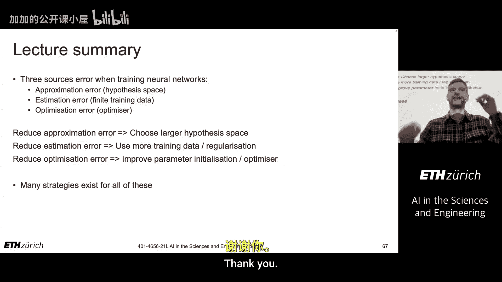

# 苏黎世联邦理工【中英⚡科学与工程中的人工智能｜2024 AI in the Sciences and Engineering】 p03 P3 Introduction to Deep Learning Part 2 -BV1smxgzHEPC_p3-

Yeah so hello everyone and welcome to this lecture。

 this is the second lecture on Introduction to Deep learning。Of the two latches on this topic。

AndSo。Let's just start by recapping what we covered last lecture for the first introduction to deep learning。

And my take home message for you that I try to impress on you is this idea that neural networks。

 although they can be incredibly complex， can just be simply thought of as fittingitting functions to data。

And this is just a really useful way of thinking about training neural networks。嗯。

So what I mean by that we have some input vector X， we pass it through some neural network function。

 which depends on some three parameters and we get out some output vector Y。

And we just train it by matching the output of the network to some many。

 many training examples that we have。And then this neural network function just depends on the neural network architecture that you choose and obviously that function can be incredibly complex depending on the architecture。

So for example， for a MLP， the neural network function is fairly simple。

 it's just the input vector at times by this weight matrix added with the biospecter passed through some activation and repeated depending on how many layers you want the MLP to have。

And then the other idea that I try to impress on you is that this idea of universal approximation and this is what makes neural networks so powerful and why they're applied to so many different tasks is this property that you know with enough parameters。

 they can approximate any arbitrary function。And this really allows them to do you really impressive tasks。

 like take an image， for example， and classify that image that's a really complicated function to be able to do that。

Okay。So I also talked about the different types of tasks that we used deep learning for。

 so I covered supervised learning so things like regression classification。

 I also talked about unsupervised learning so things like feature learning where you have an image for example and you want to compress it down into some salient low dimensional representation。

It talks about generative modeling， which is trying to generate a sample， so for example。

 generate an image。Based on lots of examples and images from that distribution。

And then I also talk about auto regressionggressions so this is the task of predicting future values from past past values。

But I think what's really important to still remember is in all cases， you know。

 this is we're always training a network to fit some data with some loss function。

 it's just the way that we arrange that data and label that data is different depending on the task。

O。And I also talked a little bit more in detail about how we actually train neural networks and so usually we define some loss function that matches the output of the network to some training data。

A very typical one for the regression is this least squares error。

And then 99% of the time we use gradienting descent to train the network。

 so this is evaluating the gradienting the loss and then taking a step in the gradienting direction to update the waste。

And then I went into a little bit more detail about how we actually do that computationally。

 how we actually evaluate these gradients and to do it， we use the chain rule。😊。

So we apply the chain to the gradient here。And that means evaluating the gradient of the network with respect to its parameters。

And for example， if we took a fully connected network， that's just a composition of vector functions。

 you know， functions that output vectors and input vectors。And so to evaluate the chain here。

 we just have to use the multivariate version， so this is multiplication of Jacobians。

But in practice， we don't have to worry about this when we're actually doing this in pipeor tensor flow。

 auto differentiation handles this and the back propagation algorithm is an efficient algorithm for evaluating these gradients。

And we're going to talk a lot more about AutoDF in the second half of the lecture series when we talk about differentialiable physics。

呃， yeah。Okay， yes， so by the end of this lecture I'm going to try and explain to you how chat GPT works at a lower level。

 so instead of just understanding how we interact with it I'll try and tell you exactly what the neural network architecture is and the loss function that we used to train it。

I mean， you should just be able to understand this very easily after this lecture。

so this is the timeline we're in the second lecture of introductionuction to deep learning。

U then on Friday this week， Si is going to come and give you an introduction to PDs and say why they're so important to science and scientific research。

And then we'll start kind of a series， the lecture series in earnnest and we'll be talking about our first Simon Alni。

 which are physics form neural networks， so that should be really exciting。Okay。

 so what is this lecture about and so the goal of this lecture is to talk more about the difficulties of training neural networks and deep neural networks。

And， you know， it can be very difficult to train people neural networks。

 especially if the task that you're trying to train them on is very complex or the loss function or the data is very complex。

And there's a lot to think about so first I'm going to introduce you the concept of overfitting and underfitting and also how this is related to the bias and the variance of neural networks I'll explain what that means。

Then I'll talk about ways to alleviate the underfitting and overfitting so this is using regularization again I'll define what I mean by regularization。

And then we'll talk about different types of optimizes that we can use to train neural networks and how the optimize。

 the choice of the optimizetr， is a really important choice that affects the performance of the network。

And we'll then I'll talk about chat GT at advantage。So yeah。

 our learning objectives by the end of the lecture。

 hopefully you'll understand the three main sources of error when we're training neural networks。

You'll be able to explain overfitting underfitting and how to alleviate it and know more about the optimization process and the different optizers that we can use。

Okay， so。So far I've just been talking about how we train neural networks。

 but what I'm going to get onto is how we test their performance and this is a really important difference。

 I think。So when we train a neural network we have again we have a loss function where we're matching the output of the network to some training data points。

 so for example， that for regression we're trying to train this network based on these blue data points here。

 the training data。To try and fit this polynomial totenza。

And so our training points here from a probabilistic sense are sampled from some joint distribution probability of x and Y。

And we just sample n values of those to create our training data。

But then once weve train the network and we want to come to test its performance。

 we don't usually use the same data set to test it。

 what we really should do is use a test data to validate the network's performance。

And this is different in the we don't use the same data points to test test the network。

 we sample new unseen examples that the network hasn't been trained on。

And so so we create a test data set here and typically those samples are sampled from the same distribution。

 the same underlying distribution。So again， you can see the orange data points here still follow the curve。

And we'll test it using some other loss function， it could be the same thing。

 so it could be at least squares， but you're also free to choose any other metric you want so we can also have like a L1 loss。

 for example， an absolute difference instead。We can also evaluate the train error as well using a different metric so that once we've trained De we can again。

 we can choose a different metric to evaluate a training error。

So something really interesting happens when you look at the difference between the training error and the test error。

 depending on the type of network that you train on this data。

And so what I've got here is three different neural networks that I've trained on this data using this training data。

On the left is a model that has one layer in zero hidden units。

 and I'm using an MLP here and so that model is just a linear model it doesn't have an activation。

 so it's just a matrix and a bias that's added to the data。

So you can see the model fits like a straight line to this curve。

 obviously not a very good model where it's not very accurate。

And both the training loss and test loss are quite high。

Then I train a model that has two layers 16 hidden units and you can see this seems to do a really nice fit。

 that seems to fit the data very well kind of estimates the mean of the data。

 which I showed you before if you use a mean squared error loss you effectively estimate the mean of this normal distribution。

And both the train error and test error are similar。

 but what's interesting is if you increase the size of the network。

 the training error and the test error start to diverge and when you look at the function the network learns you can see it's a much higher frequency function and it's really very accurately fit into the training data。

But not fitting to the test data very well。And we say that this function here is overfitting to our training data。

 so we have this gap between our training error and our test director。So。

From our kind of traditional point of view， we would say that this is an over parameterized model this model basically has too many parameters and it's too flexible and can fit very tightly to the training data and therefore。

Reduces the task performance。So we can think about kind of the error that the network is making in a bit more detail and so let's think about the loss function that we're actually using to train the network。

Like I said， we use this least squared error here and we have some training data set with endpoints here。

So more generally， we say that we train neural networks with an empirical loss and we can write this more generally as you the summation over we're training into。

Of some loss function， so it doesn't have to be a mean squared loss。

 it could be any any kind of metric here。We X and Y here。

 our training data points are sample from our join distribution that we're trying to model with。

Now this isn't really the actual loss function that we truly want to minimize。

 this isn't the best thing that we can minimize to fit this data。

A much better loss function to minimize is what we call the expected loss。

And so this is instead of just evaluating this loss metric over a finite number of training points。

We actually want to integrate function， the loss metric over all possible XY pairs over the whole probability joint distribution。

And you can see that if we did this， then this model will not overfit。

 it will match the test data just as well as it matches the training data because in that integration we're sampling every point。

 every possible data training data。So this is impossible in practice。

 why do you think we can't actually do why can't we minimize the expected bo in practice？Yeah。

What do you mean by computational cost？Yeah， yeah， that's， yeah， that's a good one。Anyone else？

Any other reason？Yeah。Yeah， so this so this is the main reason actually is most of the time。

We only have access to a finite number of samples of this distribution。

 we don't actually we can't even sample that distribution let alone compete it。So if you think of。

 for example， like natural images， we don't have every possible natural image in the world。

 we just have a finite set that we're only from。😊，So this leads to what we call as estimation error。

So this is the difference between training a neural network on this empirical loss。

Where we're only fitting to sort finite samples in this distribution。

First is the neuralA network which would actually minimize that expected loss and that produces some error in this expected loss。

 kind of landscape。嗯。There is also another source of error。

 can anyone tell me what the other source of error is？Okay。

 so this called approximation error and so there's another reason why even if you minimize the expected loss here with all the possible training points。

You might not still find the function that minimizes this metric。

Because the neural network is just not expressive enough to match that function。You know。

 if this is a really complicated function and the neural network just models the space of polynomials。

 for example， it's just bit polynomials。Then you're not going to find the true minimizer of this expected loss。

So you have approximation error， which is the limited expressluivity of the neural network。

So these are the two big era sources that we need to think about that will lead to underfitting and overfitting。

So a really nice way to think about this is to think about the placing the neural networks so that we train it inside a function space。

And so this is just a pictoral representation of the space of all possible functions。The take。

Some real input vector and output some other real input output vector。

And so you can pull these different functions in this space and it's useful to think of it so we can pull for example。

 this is the true function， this star here is the true function that we're trying to model。m。

 and maybe it lies on some manifold maybe it's like a polynomial or some sort of manifold of functions。

And then what I'm drawing here in this blue boundary is the space of possible functions that the neural network can represent。

So you know if you vary the weights。This is the space of functions that that network could represents。

 so it could be the space of polynoials， it could be the space of linear models or more complex nonlinear models。

So the approximation error says that the network is never going to be able to model a function that's outside of that area。

And so you know， this is the approximation area here is the difference between the true function and the boundary point where that neural network sits。

But then that's just the approximation error， the estimation error is the fact that we're not minimizing the expected loss and we have some error that in the fineness of the training data that we're using。

So these are the two kind of error sources。So then we can plot these three different models that I trained in this using this function space to help you understand what it looks like。

And so。What I'm doing here is plotting the space of networks possible。

 so remember I just trained a set of linear models here so this is quite a small area in the function space。

And that area is far away from the function， so we can see that we're going to have quite a high error in this case。

In the overfi pace， we have a model way that's over parametermatizeder can model many types of functions and so then。

We may encapsulate the true function， but the network that minimizes the empirical loss with the finite training data is maybe very far away。

So the ideal model is a model where we just restrict the function space enough that we encapsulate the function we want a model。

 but it's not too big that we are susceptible to overfitting or you know。Yeah。

 the minimizer being too far away。Okay， so hopefully you understand the kind of error sources that lead to overfitting and underfitting。

And what I'm going to try and do now is explain this from a more probabilistic viewpoint and we can kind of。

Decompose this expected loss and show you how overfitting an underfitting kind of emerges from this decomposition。

So what I'm going to do is I'm first just going to define this function H。

 a function of x and D and D is our training data。Which is just the train neural network。

 so it's the network after training， it's just a function。That depends on X and the training data。

So you can think of。I've just replaced theta with D here that that makes sense because Theta just depends on D。

 you know， we use some complicated algorithm to get theta， but the input。

 the thing that determines what theta is it's D。And what we'd like to understand now is the expected loss。

 so again this loss metric， the expected value of it。

 not just over all the training data not just over all the possible inputs and outputs。

 but also over all the possible data sets。So what is the average expected loss over all possible data sets that we could feed to train the network？

So to go any further， we have to make some assumptions。

 so we just assume that for now that the metric we're using is the least squares loss assumption。

And then you can show by， and I'm not going to do it in this slide。

 have a look at this link down here， it gives a full derivation。

 but just by using the properties of expectations。You can show that we can decompose this term into these three separate terms and we call them the bias。

 the variance and the irreducible noise。So I'm going to explain each of these three terms in a bit more detail。

This is just copied from the previous slide。So I'm first going to talk about the variance。

 so what does that mean， what does that term mean？And so the variance is just the expected value of H。

 so this is a particular network trained or a particular training data set。

The expected difference between that network and H bar so what is H bar so H bar here is。Okay。

 H right here is the expected value of the the expected value of the output of the neuralA network averaged over all possible training data sets。

😊，So you can think of this as just the average model。

 like what it was the average model if we trained thousands of networks with different sampled training data sets。

What's the average prediction？So the variance is just saying how sensitive is the output of my network to my training data essentially。

You know， this does this difference vary a lot to my average model or is it similar？Okay。

 then let's talk about the bias， so this is H bar we know that's the average model it。

And so the bias is the expected value over all possible inputs to the network。Of the average model。

Difference between the average model and Y bar， which is the average observation。

So if you look at this， this is just the mean value of y given some input x。

But this is just our mean of， for example， in that polynomial with the noisy samples is the mean of that normal distribution。

And this is essentially the best possible。Why bar is the best possible predictor of the wave Hyatic variable itself。

 you can't beat this。If you're using at least squared loss。

And so then the final term is this irreducible noise。

 it's the difference between the true value of the random variable and its mean value and we can't beat this。

So what do we want to do， what we really want to do is make this expected loss averaged overall training data sets to be as close to zero as possible。

You know， we want all of our models to train very， very well， that's sort that the goal。

Well we typically find。When we evaluate this from like particular neural networks and particular tasks。

 is there's most usually a， a bias variance trade off。And so this is the statistical way of saying。

 wait there's a trade off between overfitting and underfitting。嗯。So what we find is。

The bias in the variance depend on the model complexity。

 so model complexity is the number of parameters that we're using to train train the network。

And if we have a very small number of parameters， for example， just linear models， for example。

What we usually find is that the variance is very low， so those models。

 the output of those models don't depend much on our training data。But their bias is very high。

 so the average model error is very high， they don't fit the data very well。

And as we increase model complexity， we get this trade off where the variant starts to increase。

 so it becomes very sensitive to the training data。And the bias starts to drop。

 so our average model does give a very good fit to the visa。

So our goal is to try and find some sweet spot in the middle where we have， you know。low bias。

 thats basically this is where we have good test performance and good training performance。

So yeah if so。If I go back to these three models again。

The model on the left has higher bias and low variance。Again。

 you could think of sampling lots of different training data sets from from this curve and the linear model is always going to fit in the same place more or less。

 so it's going to have low variance， but higher bias。This model has low bias and high variances。

 like this is very sensitive to the training data because it can fit the training data very well。

And then in the middle， we have this sweet spot in the biasasparance code。

And in a kind of hand wy way， I mean this is not the definition of these values。

 but when you're training all networks practically you can it's useful to think of as the training losses。

 the bias and the difference between the test and training losses， the variance。

 but that's not a mathematically precise definition。O。

So hopefully you understand what overfitting other thefitting is and kind of how it occurs and the aero source is behind it。

So now I'm going to spend most of the rest of the lecture talking about how we can alleviate overfitting and underfitting。

And different yeah， different ways to do that。So there are basically。

Some general strategies that you need to do if you're in a high bias or underfitting regime or if you're in a high parents and overfitting regime。

So if you're underfitting， the quickest way to improve both the test loss and the training loss is to increase the model complexity。

 so add more parameters to a network and make it be able to model a more complex nonlinear function。

And so this， if you think about function spaces is like growing the function space outwards。

 alternatively， you can choose a new architecture design or try and shift that function space to closer to the true function that you're trying to model。

If you're overfitting if it's the other case， then one way to reduce overfitting is to increase the amount of training data you have。

 this effectively reduces the dependence of the network's output on the training data。

Or you do some sort of regularization and that's what I'm going to talk about more in the next couple of slides is regularizing neural networks。

So let's think about， let me explain what regular is。

so we're going to think about this regime where we have a neural network architecture that's very flexible and tends to overfit our data。

And so what we do when we recognize the deep neural network is instead of changing the expressivity of the network。

 so the size of the function space， what we try and do in regular is to try and prefer certain regions of that function space over other regions。

So what regular does is it says。嗯。I want to prefer that the network converges on a function that is close to the tree function。

 and we have to somehow guide the network。to closer to the tree function。

So you can think of regularization as a soft constraint。

 so instead of you know a hard constraint which changes the boundaries of this space。

 it just changes which parts of the space we prefer to convert Joegar about others。Okay。

 so the definition of regularization is to restrict the space of possible functions so changing the function space could also be thought of as regularization as well。

or preferring certain regions of the function space or also in a problembilist expense sense it's has been parting up prior on on our neural network or our learning algorithm to prefer certain solutions already before we've trained the network。

So I've got a little task queue， so I want you to have a quick conversation with your neighbor。

And just think about the different ways that you know that we could regular a normal network。

 so there are actually many， many ways to regular and just have a brainstorm and then I'll ask you some of the ways you thought that you've thought of。

you've got two two or three minutes。Okay， so lots of good discussion。

So can anyone raise their hand and just give me some of the regular methods that you talked about？

okay， can you be more specific towards， regression yeah okay。

 so I'm going to talk about that and next that's good yep， anyone else。

There was a lot of conversation。Y drop， so this is randomly dropping some of the activations of the network I'm going to explain that yep this last oneep。

Any more？So changing the loss function， changing the architecture。Okay。

 so I've got a whole list and hopefully you're going to learn that there's lots of different ways to do it and it's not just about these two ones that you proposed。

So嗯。Here's just some way that regular neural networks。

 so the hard constraint versions is where we're changing this function space。So you know。

 we'll change the boundaries of the function space by reducing the model complexity or changing the neural network architecture to shift that function space as well。

Another way to regular is to increase the amount of training data。

 like reduce the dependency of the network on the training data。

 and that is just naturally going to bring， you know。

 we already learned that that's going to bring our minimizer closer to the tree function。

We can do weight regularization， so this is adding terms in the loss function， for example。

Or more generally we can add additional loss termss。

 we can do dropout as you mentioned another type of regularization is early stopping going I'm going to explain what that means later。

So I'm going to go through each of these in the list and talk about them in a bit more detail。

So let's talk about weight regularization it's a very simple idea and it's to say。Well。

 we know that over parameterized networks tend to overfit the data。

So that's just adding a soft term in the loss function that just tries to minimize the L2 norm of the waste。

So what is it saying it's saying I prefer weights that are close to zero rather than large values and you can think of that as。

Asscerting some friar that the network learns to prune unnecessary connections。

 so you know it makes itself a leaner model as it trains and this can help overfitting。

So also known as Ri regression and we can use other norms like an L1 norm or even an L's0 one。

 depending on the type of regression。I like to compare this。

 you know have a probabilistic perspective on this thing as well。

 it's quite interesting to interpret it。And when we're doing regression。

 I talked about this in the last lecture， what we're really trying to do is estimate this conditional distribution。

 you know the probability of Y given the value of x。And we assume that it was a normal distribution。

And I showed in the last lecture that if we use maximum likelihood estimation on this distribution。

 we can derive the least squared error loss function so we can derive this loss function。

So we can actually also derive this loss function if we change kind of the assumptions in that derivation。

So I'm just going to go through it again and so we say that the data likelihood here is the probability of all of our data points。

 all the x1， x2 y1 y2， given our theta values， if we assume independent identityly distributed training examples。

 we can write it as just this product of each conditional value。

So now what's different to before is we actually assume a prior on the parameters of the network so we say。

Without knowing anything about the training data， we assume that the value of the parameter or the distribution of parameters is a normal distribution。

So the parameters are distributed over some normal distribution with a mean of zero and some standard deviation。

So then we can say just using base rule。The probability of the parameters given the data set is just Bayes rule which depends on this prior here and the probability of the data given the parameters。

So the data likelihood and so this term here is the posterior the parameters， posterior distribution。

And so instead of doing maximum likelihood estimation where we maximized the probability of the data。

 we maximize this term。What we do instead is we use maximum a posterior estimation。

 so map estimation to maximize the probability of theta given the data so kind of the other way around。

This allows us to incorporate this prior into our estimation。

So you can just you can write this posterior distribution down here or at least the top term here and the book we can't in general or estimate and probability the data can be very complicated。

 but it's just a normalizing term so we don actually need to compute it in this just for doing map estimation。

So so to maximize the postera is just maximizing this this object and and you can see that that's also equivalent to to。

So minimizing this loss function， which we stay at at the start。So it's kind of a nice。

 nice just popbabilistic interpretation of doing weight regularization。Okay。

So we don't just have to use you know this specific additional term in the loss function。

 we're free to choose kind of any additional terms that we want in the loss function。

 so in general the loss function can have some regularizer that try to push the networks's out solution to some a preferred solution。

So there are many examples and they depend on the tasks that you want to train the network to do。

So for example， if I'm doing something like image generation。

 I'm using a generative network to produce images。One， one possible。

One possible regular term is the structural similarity index measure。

 so this is kind of an empirical kind of houristic。

That compares two images together and it just and it's known as like a perceptual image quality measure。

 so it tries to place a high weight on images that look natural。

I won't go into why these memes and stunt deviations do that， but this is a very common metric。

If you're training neuralO apps to model like a certain frequency band of some data， so for example。

 in scientific research， we sometimes want to do that。

We might want to have some preference over the types of frequencies that the network outputs so。

This additional loss term could take， for example， the output of the network。

 it could maybe Fourier transform it to get its frequency components and then， you know。

 put a loss on value higher frequency components， for example。

You can even have some way more sophisticated loss functions， for example。

 feature space losses and so we don't just have to have a loss in the space of the vector space of the output of the network。

 we can transform that output to other by a nonlinear transformation into some other vector space and do kind of a Euclidean distance in that space。

So for example， we can have a feature space loss if if we want。For example， if these are two images。

And we want them to match in their salient representations of those images rather than the pixel space of that image。

We can have like a CNN， this could be， for example。

 in those unsupervised models that have some latent vector。

 we could pass the output of the network through that feature model to get those latent representation and then match the training data point to the output of the model in that latent representation。

And that's a really nice trick that can improve performance as well。In summary。

 there are many different loss terms that we can use。Okay， and then。What you mentioned was dropout。

 so this is another really popular technique for regularizing neural networks。

And so we're not changing the loss function here， but what we're doing is we're changing the neural network every training step that we do when that we're training the network。

So as we're training， what we do is we just randomly set some of the activations of the network to zero。

For example， in the first training step。We might just throw away the activation from this neuron from this neuron and from this neuron。

 we just switched them off。And we'll propagate through the network and update it just based on the connections that highlighted。

Then when we go to next the next training step we'll randomly drop other activations so maybe it will be this one。

 this one and this one， so as we're going through we're just dropping random activations。

So why does this regularize the network， why does it improve the performance of the network？Well。

 in a kind of loose sense， what it's doing is it's saying， you know。

 the output of the network here shouldn't depend too strongly on like any specific the output of any specific norm。

or equivalently， individual neurons here shouldn't depend too strongly on a single previous neuron that it is connected to。

And this can really help the network to learn like a generalized representation that doesn't depend too strongly on like a specific input。

嗯。What we're actually doing really is effectively training on on top ensemble of models。

Where each model has like a random random set of connections in the network。

And you can go much further into kind of mathematically interpreting dropout and you can show that this is actually estimating the uncertainty on the network's outputs。

So if you sample after you train the network， if you sample from many different members of dis ensemble。

 you can get an uncertainty estimation， so what is the variance between the predictions of the network？

So if you're interested in D I' have a look more about on this reference， this very。

 very good technique。Okay， the next regular method that is also used a lot in practices is early stopping。

So what I'm showing here is this over parameterameterized network that eventually overfits to the data and gives us a poor generalization。

What I'm showing is how it evolves， the network prediction evolves over training step and it's very interesting to plot you know the convergence or the test error and the training error as a function a training step here。

And what you see is they start off a very similar value。

 this is because the network's prediction to start off with is very smooth。

 it's almost a linear function。And then as it trains there's some point at which they diverge really strongly。

 but somewhere in the middle， we actually are in this regime where we have a low test error。

 a low training error， and we have like a nice nice nice performing model。

And so this is called early stopping that， you know。

 if we just stop the training algorithm here rather than continuing for more its。

 we would get this nice smooth model that fits the data the well。

So it's really interesting to study why that is the case。

 like why does the network halfway through training have like a nice smooth approximation？

And at least for fully connected networks， there's this property which is known as spectral bias。

 and this is exactly this property where they tend to learn low frequencies in the data much。

 much faster than high frequencies in the data。And this can just be a nice already a nice built in regularisizer the network and it's maybe the reason why you know over parameteramatized deep neural networks still generalize nicely and interpolate between your training data points because they tend to fit like a nice low frequency approximation to start with。

We're going to talk about spectral bias when we talk about physics and neural networks and actually that that reduces the performance of physics and neural networks and so that's going to be an interesting discussion in that lecture。

Okay， and then the final way of regularizing deep neural networks。

Which is often the best way if you can do it is just to increase the amount of training date you have。

 like make it really hard for the network to overfit the data by having as many possible samples of that distribution that we're trying to model as possible。

So how do we do that， the question is， as you mentioned。

 how do we do that if we only have access to a few samples from that joint distribution？

We don't have the data to improve and so there are a lot of tricks to augment or change our training data to try and get around this。

So let's imagine this situation where going we want to train a neural network here to do some digit classification。

 so we have you an image of a digit and we want to produce a classification what number is that to achieve。

But let's just assume that we only have nine images。

 so this is a really dangerous situation we're going to if I trained a CNN on this on this data set here。

 I guarantee you that it would overfit very quickly。

And it wouldn't perform well if I gave it a new digit that it hasn't seen before。

So there are a couple of strategies that we can take to try and improve the performance the first strategy is to augment the training data set。

 and so this is to change the inputs by some transformation。

And keep the same label and train the network to learn across those transformations。So for example。

 we might do some like random rotations， we might add noise to the images。

 any way to try and change that input image to the network learns over a more varied range of imp。

This can kind of a nice upside of this is it means the network can be more resilient to like noise and other kind of perturbations and the inputs in real world data。

 it can be very useful。If another way to do it， which is also very popular is to do a pretraining step so and what we sometimes call this selfsupervised learning and so what this means is before we train the network to do the classification task。

 we're going to pretrain it to do some other tasks beforehand。

 which hopefully trains the network to learn some like feature representation that is useful for the main task that we actually want to solve。

So for example， we might， this is the classification network， this decoder， for example。

 sorry encodeder。We might attach a decoder to that network and then use a loss function a nonsupvised loss function that tries to reconstruct the input image。

 for example。And in doing so， this network here will learn like a latent representation or like a salient representation that is useful then once to train it afterwards on the classification task。

So it could just be a reconstruction loss， it could also be。

 we could do other types of loss functions so we can randomly like take out some of the data in the input and try and get the network to predict the answer。

And so all of these methods， these are self supervised methods to pretrain the network to help it generalize on just these few images。

So this is kind of known as like one shot or few short learning after after pre trending the network。

Okay， so I've talked a lot about regularization， so we'll take a break and then we'll on move on。

Thank you。Okay， so we talked about overfitting underfitting。

 then we tried to talk about ways to alleviate both of those by using regularization。

And I talked about many different regularization techniques， hopefully you've learned a few more。

So now I'm going to talk about the final part of this lecture。

 which is optimizing deep neural networks and the fact that the optimize that we choose has a massive impact in the performance of the network。

And we should have time to talk about chat GT at the end。So we talked about these two sources error。

 the approximation error， so whether the neural network is expressive enough to model the true function。

And also the estimation error， which is the sensitivity of the train network to training data and the fact that we're not minimizing this true expected loss。

But there is one other kind of elephant in the room or one other big source of error that。

And mean that the function that we train is not the true function。And this is optimization error。

Up until now， I've just been assuming that， you when we train the neural network。

 we end up with the parameters that actually do minimize this empirical loss that is the true minimizer of this loss option。

But in practice， you know， finding the global mineral of this function is incredibly hard and I would argue we don't do it for pretty much every neural network we train。

And so when we're talking about error， the error of the function that the network models。

 we also had to consider the effective optimization error and this is a big part of these error sources。

So it's kind of， you know， I motivated neural networks at the start of last lecture by saying they had this universal approximation period。

 know in theory， they can approximate any function。

But that function doesn't say anything about how easy it is to find that function。

 you know whether we can actually optimize this boss function to get that function。

So let's go back to our function space and now I'm plotting all three error sources。

 these are the three error sources that we have to consider when we're training neural networks。

So again we have our true function here， we have our space of possible functions and the network can represent here。

Approxiation error is the closest network function in that space that is closest to the true function。

Estimation errors this actually error from the training data。

And then optimization area here is the fact that we're not minimizing the empirical loss or we're not finding the global mini of that empirical loss we're finding some other other location in the loss function。

 so we have an extra errorator。O。So how do we alleviate each of these three so I already talked about the top sorry I talked about the top two approximation area we just increase the size of the blue area。

 increase the hypothesis space。Estimation error， use regularization or if we have training data。

 add more training data。Optimization area we have to improve the optimizeizer。

 make the optimizer more able to find the global minimum of the loss function。

So when you're training neural networks and you see that your past performance is poor。

Then my advice is to go through each of these individually and think， am I， you know。

 do I have a flexible enough function？Do I have enough training data am I overfitting and can I improve the optimization process these are the kind of big three questions that you want to be asking yourself。

So let's actually look at the lost landscape， so this is a really interesting paper and it's very simple what they did is they tried to visualize the lost landscape。

And this is actually quite difficult to do like this loss function here。

Is a function of theta and theta is often you know millions of values if we're training any deep neural network。

 so to just the visualize the loss function in this very high dimensional space is actually quite hard to do。

And so what they did is a trick to be able to see it in 2D and to plot so this is an actual lost landscape of a neural network。

And to create this plot， what they did is they sampled randomly two vectors in this space in the space of the weights of the network。

 so in this high dimensional parameter space， so you just randomly sampled two vectors。

And then you plot instead of the full loss landscape。

 you just plot the loss value varied across those two vectors， so this function here。

So you're obviously not visualizing the whole lot landscape here。

 but we can see it across like one plane this is essentially we're just looking at across the of a plane a plane in the space。

And yeah， this is really interesting to look at so this is a real lost surface from a resume trained on Sfa so these are natural images and I think it was a classification task。

So no， this is a neural network in the world。And what you see is that this lost landscape is incredibly complex。

 so we you know we have like a global minima here so that by the way。

 this is centered around where the optimizer landed after the network train so you can see that it landed in this mini here。

Actually， it might not be the global minimum， it might just be a local minimum we I'm not sure。

 but it's surrounded by these valleys and troughs and you can see how it'd be very difficult to try and try and find you know a better minimizer if you're inside one of these valleys。

 for example。O。So this is the issue， the loss function is very high dimensional and contains many local minima in practice。

So I'm going to talk about difficulties or challenges of optimizing neural networks and there are actually many many reasons why the loss function can be very hard to optimize。

And the first one is kind of counterintuitive is there are actually a lot of times when the loss function is completely flat。

 so instead of looking like this， the loss function is just flat everywhere and that's a real big problem when we train neural networks because we're evaluating the gradient of the loss function to update weights and if the loss function is flat then we're not going to move anywhere then the algorithm is isn't going to optimize the network。

So why is this the case， why do we get this is so called vanishishing gradient so the gradient just hass to zero everywhere why does this happen in neural networks when we're training them？

So this is the problem that。The loss function， the gradient of the loss function is zero。

So I'm going to give you a clue here I'm going to say that we're using an MLP so a pretty connected network and we're going to use this1H activation function here。

So can anyone think of a reason why the loss function might go to the gradient of the loss function might go to zero if we use these tannch activations？

Yeah， most very history is smart and so we I guys smart lot。With the river tip of what is for one。

Yeah， yeah， I think you got it， yeah。So so诶。When x is very well when the magnitude of x is very large。

 so if it's very negative or very positive。T0H has this property， which we call saturation。

 basically， where the activation saturates。And it just gives a value of one。

 no matter what the value of x is。So if we give it an input back to here。

 that's not approximately within minus one to one。Then the output of the activation isn't going to depend on the input anymore。

And yeah， if you just look at the function， you can see the gradient over here is it's zero。

And when we evaluate gradient the loss function with respect to the parameters。

 we're applying the chain rule， remember。And at some point in that chain where we're going to need to evaluate the derivative of the loss function。

 this is like an intermediate output of the network。And it's going to be zero。

 so it's just going to you know zero out the entire gradient gradient of the loss function。

So this is a really important point that is often very much overlooked its one of the bugs that always happens when you train neural networks is we forget to normalize our inputs and our outputs so we want to make sure that。

The network sees inputs that are approximately between minus1 and1 and also sees outputs that are between minus1 and1 and this is just really good practice and even if you're not using Kash activation functions it's definitely recommended to do that。

Okay， so let's just imagine now that we've properly normalizedizedd our inputs and outputs so we're not saturating our activation functions。

 we can still get this problem of vanishing that the output of the network or the loss function can still be for that。

So what we need to think about is how the values of the outputs for each layer vary as we go through the network as we get deeper and deeper through the network。

So let's just think about the output of a single neuron and we're going to make it very simple and not think about we're going to not have an activation function and it's just going to be an MLP。

And so that single neuro in that case is just。Taking its input vector to aim it by its weights and it's just a straight linear model。

 basically。So then we make a couple of more assumptions and we just say these inputs to the neuron are just random random variables。

Let's say that the weight values themselves are also random variables and therefore y is also like a computed random variable。

 there's a function of E two。So then the variance of white here is just the variance of this object。

And if you make a couple more assumptions， like for example。

 each of the input elements are independent and identically distributed in the same with the weights。

You can show again， just by basic properties of the variance of random variables。

 the variance of y is the variance of x times by the variance of the weight。

Times by the number of inputs so the number of X elements that we're summing together。Okay。

So what I'm going to show here is how the choice of the variance of the weights。

 so how you initialize the weights really affects how the variances of Y evolves through the network。

 so how the output values vary。So what is employed in here？嗯。😊。

Is the outputs of each layer of just a fully connected network。

 so this is a network that has five layers。And this distribution here is just showing you the range of values that each layer outputs basically。

So we're going to assume that the inputs of the network starts with like you know。

 this range of values between approximately minus one and one。And then the network。

 as we pass the vector through the network， those range of values decreases or increases。

So what we're applying here are three different networks。

 the first network has the weight value drawn from a normal distribution with a mean of zero and a standard deviation of 0。

05。This one has a lot weight drawn from a larger value of standard deviationgation and then this one from an even larger value of standard deviationgation。

And what's important is that this MRP each layer has 100 hidden units。

 so we're taking the input which we're assuming is also 100 values。

Redduucing an output which has0 values。So we know from this expression that you know the variance of y equals a number of inputs so 100 in this case。

 times y the variance of the weights times y the variance of x。

So it's really important to choose the variance of the weights so that we approximately keep these you know the range of values approximately the same between minus1 and1。

And just from this mathematical equation， we can see that， you know。

 if our weights are initialized with a variance that's less than one over a number of inputs。

We start getting this exponential decrease of the outputs of the network。So， you know。

 no matter what the input is here， eventually if we have enough layers。

 the output of the network is always going to tend towards zero。

 which is a really bad situation like we want the output to be。Between minus one and1。Conversely。

 if we chose that the variance of the weights is greater than this one over n。

Then we see the opposite effect but the outputs exponentially grow and they explode so this is known as vanishing and this is known as exploing exploding。

So this is the sweet spot is where we choose， we initialize our weights so that their variance is you know one over the number of impacts of the norm。

And you can see how this would。You know， this bottom the bottom case in the top case。

would result in the loss function being zero or the gradient of the loss function being zero。

Because if all output values are zero， then the loss functions can be zero。

And if all output values tend to infinity， then if you're using 10h activation functions。

 you're going to start saturating that 10Nh and you'll get an F that I just talked about before。

So yeah， initializing the network in this way is known as Laan initialization。

 and I think it's the default in Pytorrch when you use a linear layer。Ill could be wrong。

 but I think it's true。嗯。So you can do the same thing so I talked about thinking about how the outputs of the network evolve over each layer of the network。

 you can also think about the back propagation when we're back propagating the gradient backwards through the network in backf。

And we can carry out the same type of analysis， so remember we just used the chain rule so we see。

You know， the L by Dx is the L by， D y by Dx， where you know， this is an intermediate layer。

With this layer function is。And you can do the same thing where you assume that these gradients are random and random variables and do the same variance analysis on what we expect the gradient with respect to the inputs compared to the gradient with respect to the outputs of the layer。

 so you step after one step in the gradient descent algorithm。

And this actually gives the kind of opposite result that the variance of the weight should be one over the number of outputs that they know and rather than one over the number of inputs that they know。

It's kind of interesting to think that their stability is different depending on if we're going forwards through the network or backwards through the network。

And so we have to choose some sort of compromise and a good common compromise is is this harmonic mean when we're initializing the weight。

 so it's yeah the harmonic mean of those two initialization strategies。

So this is called Zga initialization。Okay， so continuing that trend to make what we really want to make sure。

 like I said before， is that you know， the outputs of each layer tend or tend to stay within the range minus one to one。

 it's really important to make sure that the loss functions is well behaved。嗯。

Another way to do that instead of choosing our weights to make sure that that is insured。

 another way to do it is to dynamically make sure that the outputs of each network are in the range minus one to one。

And this is batch normalization， so what we do。Typically when we're evaluating a neural network。

 we don't just give it a single input， we give it a batch of inputs。

 especially when we're doing stochastic gradient and descent， I'll talk about that in a minute。

And so what we say is in this batch norm layer， we just take statistics of that batch。

And then we normalize the outputs of the layer based on those statistics。

 so we take the mean mean of the output value across the batch in the standard deviation of the output value across the batch。

 which are just these two computations here。And then we normalize the output of that layer based on that mean and that standard deviation here。

So you can see that this object here would be normalized between minus one and one approximately。嗯。😊。

We also have。When we do batchchelor Or， we have a couple of learnable parameters that we introduce。

 so this ganer and beta here。And their learnable parameters。

 they initialized again between zero minus one and1。

But they can vary and it just gives the layer the opportunity to undo the normalization if it desires to if the learning algorithm thinks that that's a good idea。

嗯。So。This actually changed the architecture of the network itself。

 it's not just an initialization strategy and so this is that Nor is also often thought about as a regularization strategy。

 which is actually really interesting to kind of understand that in more detail。

The only other thing is once we train the network and we come to test it we should best practice is to fix these values。

 we don't want to keep varying them depending on the inputs that we give the network and so we usually keep running estimates of these means and standard deviations for the test climate influence of the network。

Yeah， what's epsilon those case epsilon here is just to make sure it's numerically stable so it's very。

 it's like oh yes precision one to the minus 12 or something。Okay。

 so another way to make sure that especially the gradients。

 when we're talking about the gradient stability and that the gradients don't vanish as we back propagating through the network。

Is to use residual connections in the network and this is kind of the idea of res。

So what is a residual correction or residual connection？

It's also known as skip connections it's a very simple idea it's to say。

We have some input to the layer here at X。And instead of saying that the output of the layer is just。

 you know the output of this layer function， whatever it is with some three premises of the network。

We're going to say that the output of the layer is the value of this layer function plus the original value of x。

 so you know this is the full layer function here is the original value of x。

 the input plus the flexible function that we're learning。

So in this way you can see that this layer is learning a correction of x rather than learning a full change of the vector。

 it's learning to add some correction term to that input vector。Now。

 if you do this and you think about that propagating through dysfunction， so for example。

 what is the derivative of elbow respect to eggs？Again。

 use the chain rule and we can just show that it's the derivative of elbows with respect the Y times by this object here。

And if the layer function is zero， so if the network doesn't earn anything。

This term is zero and we just still end up with the gradient before we apply the before we apply the function so the backdrop will still have a gradient going through that layer even if the layer is the output of this function is zero。

So it's really kind of neat idea and it's very effective in practice。

One cool kind of property or resnets is you can train a renet with like hundredds of layers that gradient is going to flow nicely through it and at some point the resnet is going to learn that it has enough layers and it will just set the later layers for zeros。

Or at least that's the idea I don't know if in practice， that actually is how it works， but。

You can think of it as kind of learning the ideal get through the network。

ResN also in practice really， really good for tasks where you know the input to the network is similar to the output that you're trying to get the network to learn so for example。

 if I'm doing something like image denoisising the input to the network is like a noisy image and the output is the noisefr image。

Depending on the characteristics of the noise， that might look quite similar and so the reson。

Whether residual connections is going to learn just the noise components。

There's also a really deep connection with resonnets with ODE solves and this layer function here starts to look a bit like a single step in an oiler step。

 for example， in ODE solvevers。I'm going to talk about this a lot more when we talk about hybrid workflows and normal differential equations in the last half of the lecture course。

So yeah， so this is what， you know， this is the original re that paper。

 they were able to train really， really deep models with stable gradient flow backwards all the way through to the inputs。

And they did show in the paper that you know。If we use residual connections here， we can start。

 we can improve the task performance。With a deep neural network and that can be harder if we don't have residual connections so here without the residual connections the deep neural network is performing not as well and that may be because it's harder you know you it's harder to back propagate through the gradients and keep them stable as you're training the network。

Another really common type of residual network that we use， especially for scientific research。

 so that this is called the Una， this was proposed for medical imaging。

And it's just a convolutional network where each convolution it downscales the image。

To some very low dimensional space needed and then upscales it again to give you your final image。

But at each scale or like intermediate scale that we're computing。

 we added a skip connection in the unit， so we have this kind of unit shape here。

So this network is really interesting， it kind of learns across different scales and learns residual differences between the inputs and it turns out that that's really good at doing segmentation of many different types of images actually。

Okay， so I talked a lot about vanished ingredients and making sure that the loss function is the appropriate loss function to optimize and you know initializing the network using batchchelor using resonancenets to make sure that that's the case。

So now I'm going to talk about the actual optimizer that we use to train the neural network。

 you know， to update the weights。And I said， 99% of the time。

 we use gradientian descent to train the neural network。

So let's just recap what gradient descent is again， we have our loss function here。

We initialize our weights randomly， but making sure that their variance is appropriate for the size of the layers。

We compute the gradient in the loss function and then we just update the weights by taking a small step in that gradient direction and gamma here is our learning rate typically we set that to a small number so we take a small step in that direction。

So you can visualize， let's just imagine we have two， two。

 three parameters that we're learning here so we can actually plot the lost landscape。

And we might start somewhere here， for example， and we just follow the gradient descent direction。

So you can see immediately like a standard out of box gradienting descent is always going to get stuck in any local minima that it's going to find once it's got to this local mini here。

 it's not going to be able to go upwards because it always follows the gradient downwards。

So in practice， there are a lot of kind of tricks or improvements to the standard gradient descent algorithm that we use to be able to discover you know the actual you know better minimizes of this loss function。

So one way to do it is just to use a larger learning rate。

So even though we're following the great direction， if we get here， for example。

The gradient is going to point us towards this local mini。

 but that local minimum might be very small and narrow。And if we take a larger step size。

 we might just jump over that local minima and land into a different area of the loss function。

 it will then eventually take us to maybe a better mini of the loss。So this works to some extent。

 you know， we can escape local minima。But the problem is that we can also escape other global minimal or better performing parts of the loss function too。

 so you know if learning rate is big enough， we might also escape out of this area as well。

So it can be very unstable。And so one trick kind of to counteract this is to use an exponentially decaying or a slowly reducing learning rate。

 so it has some kind of exploration phase where it's bumping around the loss function。

 exploring the whole space， and then it slowly narrows in and kind of innes to the solution。

There are other tricks that you can do with the size of the step so you can have so called adaptive learning ratess。

Or intelligent learning rates。What we do here is we adapt the step size that we take。

 depending on the state of the optimizer or maybe the context the optimizer has the loss that landscaped around it。

So for example， you can adapt the learning rate based on， for example。

 how large the gradient is the local curvature， how fast learning is happening。

 how quickly the loss function is decreasing， for example， the values of the weights。

 there are many different approaches。嗯。So another really。

 really popular method which is used in the majority of cases when training neural networks is to use stochastic gradient descent or also known as mini batch gradient descent。

And so what we do here is you we use the same loss function。

 but instead of evaluating this loss function over our entire training data set。

 so all of our training examples，We only evaluate the loss function using a random batch of training examples。

 so a much smaller much smaller number of examples。

You might think based on our previous discussion with making the train data say even smaller we're going to like really overfit。

 this isn't actually the case， it actually helps the optimizer in many cases by making this gradient estimation noisy of the true gradient of the loss function。

Because we're not we're not getting the gradient the true value over all the training examples。

 we won't take a。Necessarily a step in the true gradientding direction。

 we might just take some random deviation from it。And so this noisy gradient estimate helps us again bump around the loss function and an escape local minima。

And in process， it's actually very good at getting us towards better solutions。嗯。So yeah。

 I really recommend this as your kind of default choice when you're training deep neural networks。

It produces noisy gradient estimates so that we can escape local minima。嗯。It's。

The other one just sole reason by itself is this is much more efficient generally than using full batch training。

So you know， if I'm training a neural network to classify images and I have imagenet。

 like I don't want to evaluate the gradient with respect to all of my training data。

 that could be millions of examples and just be way too computational expensive。

So we can get away with like batch sizes of hundreds rather than millions when we're draining images。

 for example。And yes， it's widely be used in practice。

So the optimizer that is basically that I would say the default choice of most people these days for training deep neural networks is the aom optimizer。

And so atom is just a variant of gradient decent， and it can also be used stochastic gradient decent using mini batches as well。

And so how is Adam different from standard gradient descent it' very simple。

This is how the algorithm works。Again， you're looping， you' estimating the gradient and looping。

But to estimate the direction that you're stepping in。

 you first compute the gradient of the loss function。

Then what you do is you estimate these things called the moments and so what these two quantities are is essentially keeping a running average of the gradient as a function or training step。

Here and an average a running average of the magnitude of the gradient of a gradient squared here。

For each parameter。And beta here is just known as a forgetting factor at saying how much does this running average。

 how much should it depend on previous values versus the current value with the gradient。

 so is kind of like a smooth average as we。Going as we're exploring through our lost landscape and optimizing。

Then we apply a bias correction， I'll say what that means in a minute and then we update the weights by taking a step in this kind of average reading direction or running average direction。

 but also that step is normalized by the running average of the magnitude。Okay。

 so why is this useful， why do we use this？嗯。So there's basically two ideas that make it different from gradient descent the first is that we're keeping some momentum when we're moving in the parameter space。

 like the gradient set that we take in depends on the previous values of the gradient because we're taking this running average。

So it gives us some momentum that if we're going downhill。

 we might keep that momentum in that direction and be able to go uphill a little bit to escape a local minimumma。

 for example。The second idea is to adapt the step size。

 so this is an adaptive algorithm based on the magnitude of gradient and so。

What this is doing essentially is normalizing the gradient and it's saying that this step direction is generally approximately a step of one in terms of the parameter value。

And so here， then the learning rate is more intuitive because it basically tells you on average。

 what is the kind of the magnitude of the update that I'm applying to the parameter of each training step。

And then the bias correctionction that I showed in the previous slide is just to remove the effect of the initial value of the moving average。

 so this is just a yeah， this is just a nuance of the outcome。So yeah。

 here's a plot of Adam versus gradient in discent you can also。

Select you can mix and match so you can just you can use gradient descent just with momentum or gradient descent just with adaptive step sizing。

 for example。So this is a standard gradient descent versus gradient decent with momentum and then atom。

 so that is step sizeizing plus the momentum term。And yeah。

 you can see we keep some momentum and we are able to jump over this bump and land in the global mini of this function。

Okay。So yeah， this is definitely the best starting point I would recommend。To use that， to use Adam。

Okay， so there's one final optimizer that or type of optimization algorithm that I want to talk about and these are higher order optimization algorithms。

And so the optimizes thatve I've been talking about so far just for using the gradient of the function。

but it can be much more powerful to use higher order derivatives of a loss function to help you explore that loss function。

So we we know， you know， if we take this loss function here。

 which is just a scalar function of this weight single parameter here。

We can use a table of approximations and approximate this function locally around some point。

Hopefully you all know about the Taylor series。And what we normally do is just estimate the gradient so the first order term in this approximation。

And we use like gradientian to take a step。But what we could do instead is make a second order term approximation of this function by using the second order derivative of the loss function。

To fit instead of just a straight line to this function。

 we now start fitting a quadratic to it instead。And then when we take a step。

 we don't just step in the gradient direction and we actually step directly to the minimum of that second order of approximation of that quadratic function。

So this is Newton's method。And this step now depends not just on the gradient。

 but also the second order derivative the curvature of the loss function。So I mean， in practice。

 our neural networks have lots of parameters and so the inputs to our is a vector rather than a scalar and so in general for a multivariate function。

 we can do the same thing， but we have to use hesian matrix and it becomes to take this step involves inverting this hessian of the loss function。

problem with that is that the Hessian itself is an absolutely huge huge matrix。

 it's P by piece where P is the number of parameters。

So if I haven't all know it which has a million parameters， the hessian， computing the hesian。

 if we've computed it fully would be a million by a million and that's a huge array in a lot of computation。

So this is usually prohibitively expensive and most modern methods that use you know high order optimization use some approximation to that hessian by keeping like running estimates of the Hessian。

 for example， I'm not going to go into in detail， but there's for example LBFGS is a very very common method to do this。

嗯。And it does turn out when we're training neural networks， for example。

 physics inform neural networks， the high level optimizers can help in these networks。Okay。

 so we've got five minutes less and I'm just going to talk about chat UP so I promise you that by the end of this lecture I should be able to explain to you how chat UP is working。

And even though it's an incredibly impressive model that is able to do remarkable things and have full blown conversations with us and even mimic humans in some way。

The way that it's trained is actually incredibly simple。咁。And again。

 child GT is just an neural network， it's just a function that we fit the data。

 this function is incredibly complex and incredibly non nonlinear。

But the data that we're fitting this function to is just some corpus of text and this is a huge corpus of text like this is like data scrape from the whole internet and many books and etc。

And we can think of that text as just a sequence of tokens， so you know， as a vector。

mWhere if we just took Wikipedia， for example， we just wrote it into one long sentence。Each word。

 for example， might be a single element of that vector and we would have n words in total。

 so you know this is the whole data set here。And so what is the input to the network。

 what is the output， the input of the network is just a sub sequenceence。

 so this is like for example， a single sentence， this would be the question or the prompt that you feed judge ChayP。

And then the output of the network， what is the network actually trying to predict。

 it's trying to do a classification so it's saying or an auto regression， it's saying， you know。

 given this input sequence， what is the next what is the likely next token in that sequence。

 what is the next value？So it's estimating this conditional distribution， you know。

 what is the next value given the previous values？And we use and we estimate that probability distribution just is just the output of the network。

 so you know the network a bunch has many different output neurons and each neuron is given a probability to say。

 you know if it's this neuron， then it's going to be this word as output。

So this is standard classification， we just train this network with a standard cross entry pre loss just like I showed you in the first lecture。

And this is the loss function that we use。And what's remarkable is that even though TgBT is just trying to predict the network。

Like really amazing properties just emerge that from that complicated model and that huge amount of data that we train on so we can start feeding in sentences like questions and it can answer those questions intelligibly and to me that is really remarkable that it is able to do that。

And this is so called zero shot learning where you train it on a specific prediction task and all of a sudden it can do lots of other tasks afterwards。

 like add numbers together if you ask it to add numbers， for example。嗯。

So if we want to generate multiple tokens and we just recursively run this network forward。

 so you know we give it a prompt， we predict the next word。

 we append that word to our prompt and then we recursively run it forwards to get the full output of the model。

Okay so what is the model what's the architecture， so the architecture is this really popular method called a transformer used a lot in state of the art research today。

So I'm going to spend the last two slides just telling you what an overview of the transformer architecture。

 I think SiD will talk about transformers a bit more later in the course。

So this is the architecture that they show in one of the early chat EPT papers。

And it's a neural network which has this structure。

 it has this block of layers that's applied 12 times， so it's a very deep neural network。

And each block has different layers within it。And you already know what most of these layers are。

 so you know it has a fee forward network here， just like a fully connected network。

As a skip connection here， we talked about resonance。

It has a layer norm which is just a variant of batch normalization where instead of normalizing over the training inputs or the batch of inputs。

 we're normalizing over the features of the layers， it's just a different type of normalization。

And the one kind of thing that I haven't talked about so far is this attention layer。

 and so that's the key kind of innovation of a transformer is this attention attention block。

So what what is an attention later， so I'm just going to describe it a very high level for you。

AndAttention is a sequence to sequence operation， so the input to the layer is a sequence of vectors。

 the output of the layer is another sequence of vectors。

So when we're applying this layer to text prediction， which is what chat UT is doing。嗯。

The input is like a string of text no it's obviously not the words。

 it's some embedding of those words into a vector。And you know。

 that is what this initial module is doing is turning words into vectors using， for example。

 like word devec or some other embedding。So then what the attention layer does is each for each token。

 so for each X embedding here。Or each word essentially。It generates a query vector。

 which is just depends on this embedding and a key vector and a value vector。

 so these all depend on this value of x。Usually we use like an MP， for example。

 to learn these relationships。And then it's got this kind of information communication between the different vectors in the sequence。

 so what we do is we take this query vector from this token and we multiply it by the key vector from each of the other tokens。

And that's kind of， and that produces a score， this is like a product here that produces a score that says like how close is this key to my query vector？

And we pass through a softftmax to make sure that it's between this score is between zero and 1。

And what we interpret this quo to B is basically the attention it's seeing。

How much should we attend to each of the other tokens in the sequence when we're processing this token here？

And when you actually look at the attention values and you can interpret the network by looking at these attention values。

 you can see that， for example， it here， if you look at the learned attention。

 it will have a very high attention on， for example， dog。

 so it knows the relation that it is referring to dog and this kind of helps it process the in。

So we essentially how attention is working， the mathematical function is here。

 like I said we have these query key and value vectors here that are just functions of the input and then we do this cross communication with a softmax so that this is the attention layer。

There is a lot more to be said about attention and I've just given you the one slide overview here。

 so if you're interested in implementing it， there's a implementing ChaGBT yourself。

 but there's a minimal version here， which is really， really good to learn about it。

And have a look at the paper if you want to know more about attention in John。Okay。

 so we're at the end of the lecture。What I described to you were that P neural networks can be really hard to train and their performance can suffer a lot and the reason is we have these three big sources of error when we're training neural networks。

We have the approximation error， you know the space of possible functions that the network can represent have estimation error。

 this is from the finiteness of the training data。And an optimization error。

 the fact that the optimizer doesn't always give you the global Min of the loss function。

So we talked about lots of different strategies for correcting these errors and producing a more robust and perform model。

嗯。And yeah， hopefully these two lectures have given you like a recap or a wellwin introduction into deep learning and yeah。

 I'll see you next time after SiD's giving you their lectures。Okay。Thank you。

