# 苏黎世联邦理工【中英⚡科学与工程中的人工智能｜2024 AI in the Sciences and Engineering】 p04 P4 Importance of PDEs in Science -BV1smxgzHEPC_p4-

Can you guys hear me？Okay， perfect。 So let's get started。 Welcome to。

Leure number four of veryI in the Science and engineering course。

Ben has been teaching you till now and I teach today and then he comes back and then I come back in two weeks time and that's how and after that I teach for quite a while。

ok， so what do you learn做法。So essentially in the last couple of lectures or the lecture before that。

 what Ben has done as I've seen the slides myself on the recording is that has given you a very succinct introduction to deep learning so let me use some highlighting color so。

You can see this when I highlight okay， perfect， so what is deep learning。

 He has introduced deep neural networks and somehow the basis of deep learning today。

A several theories the first is of course data， so you have large data large data this is very。

 very important you'll see that in the sort of the context of the course this might not be as large as you'd like。

 but you'll get to that。And then you have neural networks and you have good gradient decent algorithms。

And what is often a key towards making machine learning work is the ability to generalize。Okay。

 and you'll see repeatedly this word come in during at least my lectures。

So now after having this crash course on machine learning。

 what we're going to do for several lectures is to apply it in some scientific context and this scientific context would be in the beginning physics based and towards the end of the lecture lectures towards the end of the course chemistry and biology。

 but in the realm of physics， what we are going to focus on is those physical models that are covered by PDs partial differential equations。

So let me start with that and today my objective is to give you a very brief introduction to PDEs and also to say what are the challenges。

 why you need to do something which is different from what we need to do。

 how does machine learning come in and what's the scope what's the goal here so let me get started with that。

So what appeals right many of you might have seen them before。

 particularly those who students of physics， engineering。

 chemistry and so on because but essentially to sort of introduce the concept to introduce the paradigm let me tell you or give you a quote from Herbert Simon Herbert Simon was a Nobel laureate。

 he won the Nobel Prize in economics in 1978 and he did many interesting things about behavior complex systems he also wrote a paper called what is complexity and from this paper I have taken out this quote okay and let me quote him。

So given a blueprint to find the corresponding recipe， so this is his sort of context。

 much of the activity in science is an application of this paradigm。

Given the description of some natural phenomena So this is the keyword here So given the description of some natural phenomena。

 the phenomena could be how the weather evolves or something as simple as when I'm speaking。

 how does the sound waves that I'm producing reach you right how do these waves or how does the sound that I'm making propagate this could be as simple as that then what Herbert Simon says and this is the recipe for science is that you find the differential equations so now of course it doesn't to work so find the differential equations that of the process that is going to produce a phenomena or what is he saying he's saying that if you have any physical phenomena of interest could be the weather it could be the propagation of sound waves it could be what happens when I heat up one part of the room when someone starts a fire andintentionally in all these problems there is a process there are some phenomena and what we need to do in order to describe this phenomena scientifically is to write down the differential equations that govern them right so this is sort of the key key point。

In other words， my paraphrasing of it， which is written here。

 is that if you have a scientific problem。Give me a second。

If you have a scientific problem essentially you find a differential equation but in general you find a partial differential equation that is going to describe right so this is somehow the paradigm that we are going to operate and you might have seen it in your courses you might have seen it in your projects that this is sort of ubiquitous so you take any kind of phenomena and the first thing that we do in order to write down a mathematical model is that we write down a differential equation。

So what are these partial differential equations that we are going to study。

 we are going to see intimately in several in the next several lectures。

So essentially this is let me let me draw a cartoon a sketch。

 so what you do is let's say that you are having a open set a domain T here。

And this is the let's say this is room here， the room that we are sitting in and standing in。

 so this is going to be your domain D， so this is the there is a thing here D is your dimension of your space。

For us， it's three dimensional， but it could be one dimension。

 it could be two dimensions and some problems it could be thousands of dimensions。

You'll also see that during the sort of progression of this course， so you have open set the room。

 as I can see here and then you have to take some quantity of interest so let me quickly write down。

We have a quantity of interest。And this is what we doote as you， Okay。

 so this quantity of interest could be anything。 Let's take a very simple one。

 Let's say it's the temperature。So of course the temperature is at any point in space and at any time any point in time right so the temperature for instance in this room is going to change it's higher during the day it's relatively low during the night and so on and so forth and also it changes in this room it doesn't really change but if you look at the city of Zurich for sure it changes as we as we move along as we it's different at the lake than it's on the top of you for instance right so you have a dynamic phenomena you have a quantity of interest and you have physical laws and this is important to state here so you have some physical laws。

So and these physical laws。For instance for the spread of temperature it is called Fourier law。

 it could be Newton's law of gravity， it could be whatever and these physical laws are codified in terms of a mathematical object which looks like this so it's a complicated nonlinear relationship as you can see this is the nonlinearity here it's a complicated nonlinear relationship which takes the quantity。

And relates it for instance， to the gradient， so what is the gradient just for notation gradient of U is UX1。

 the vector， UX1， UX2， UXt。And similarly you have the time derivative。

 you have the second derivative which is just a matrix。

 the Hastian matrix which puts all these things together。

 so essentially what the physical law says is that you have a relationship。

 a very complicated nonlinear relationship I emphasize between the quantity of interest and its derivatives because these derivatives for instance tell you how things change right how things change in time is given by the temporal derivative how things change in space is given by the spatial derivatives。

 the spatial second derivatives and so on and you put them in a bin and this complicated nonlinear relation gives you a PD so I'm sure that all of you have seen these kind of PDs before if in some form or the other and this is sort of a very generic form of it of course in practice we deal with much sub concrete examples of this and this is what I'm going to give you in the next two or three minutes so these are different examples of PD。

And just to illustrate the sort of different scales at which we can operate so you can start right from the scale of atoms or even elemental particles that constitute atoms。

 so this here is sort of a molecule as you can see and the PD that comes in here let me write it down is shroing this equation。

I think the situation。Again， this is the fundamental equation of chemistry an anatomic physics or molecular physics。

 and the equation is something like let me write it down La plusian of psi plus some potential V okay so this is psi is what is called a wave function or sorry。

How many of you in this class have seen this roing this equation before？

So more than half you haven't seen the Schroinginess equation， okay？

Am bit surprised if you go to Wikipedia， you can easily read very quickly what its。

 so this is what is called a wave function。😊，It tells us what is the probability。

 let's say that we have a single electron which is moving around the nucleus。

 it tells you the probability of finding that electron at a certain position and a certain momentum。

 for instance， this is a typical example， this lapplian this is the complex imaginary complex number。

 the unit imaginary number， I and lapplian is the trace of the Hessian okay。

So this is the trace of the hessian just in case creating second derivative few。

And this is some sort of a potential。 So this tells you the kinetic energy， this term here。

 and this tells you the potential energy。 So all of us in some sense， are。

Walking representations of the Schroingous equation because at the end of the day we are made up of atoms and electrons and so on and so forth and if you put all of them together we'll have a very very very high dimensional Schroingous equation so the fundamental equation of chemistry and atomic physics is the Schroingous equation。

which is a partial differential equation right and in order to do these kind of things like nanotechnology to design some nanomaterial for instance。

 you need to solve the shortroness equation in some form or the other， otherwise you can't design it。

Here another example this is of course was in the news in the last three four years which is detection of gravitational waves as you can see these are two black holes which are coming towards each other and in the coalition they generate a lot of gravitational waves and these are the waves that were detected by the。

By the gravitational observatory back in the US right so this is and what are the equations that govern these kind of phenomena who can tell me so if you have the coalition of black holes and generation of gravitational waves。

 yes。Of what kind of。Einstein so okay so these are the Einstein field equation this I don't even dare to write down because I won't be able to finish。

 but let me just write the name here so okay what happened here。😊，So thanks。

 so these are the Einstein equations。And Einstein， of course， is the most famous。Alumnus of ETH so。

And it's just fitting that his equations， these are a very complicated set of perian differential equations。

So you can write them in different forms， different geises。

 but these are partial differential equations and so you started at the scale of an electron which is a highly subatomic particle and this is really at the scale like a universal scale right so you have like 30 40。

 50 orders of magnitude difference in the scales that we are looking for but all these phenomena needless to say are modeled by partial differential equations and this is of course an example of the average temperature so global climate very much in the news and the global as you'll see later on in the course we have some details about it a global climate is also modeled by systems of PDs。

And if you look at it， so global climate is a very complex interplay between different physical processes。

 so you have fluid motion right so this is an atmosphere and the ocean。

 you have fluid motion and the equations that govern fluid flow are what are called the obviousvi tos equations。

 so you have obviousvi tos。Again we will see that in quite some detail in later lectures so that is the fundamental sort of block here fluid flow equations of course it is supplemented or augmented by things like radiation so again another thing that we are going to see radiative transfer equations these are also PDEs。

Be it if transfer。And there are the other PDs that come in in the global climate system。

 so there are a bunch of PDs couple PDs which sort of govern the evolution of the A our climate and needless to say so this is again at a large scale at the scale of the earth。

 but even at the scale of human being or biological organism， for instance， this is。

This is a fly wing， so the fly is the fruit fly that we the common fruit fly off which is used in biology labs and the equations that govern it are what are called reaction diffusion equations again some things that we are going to。

We are going to see reaction action diffusion equations。

And the reason why I put this particular picture here of how ifiv evolves really when it's。You know。

 when it's in an embryonic stage， it's because I myself wrote down this equation， so that's why。

ItsMy equations then I'm not comparable to Einstein's equations。

 but I wrote them so it's something I'm proud of anyway so this as you can see again。

 different kinds of phenomena you started with materials went all the way to the universal scales then you went down to the earth and then at the level of an organism biology chemistry physics climate science all these things。

 all these different scientific domains but the common language in which we express them are given by these mathematical objects right so this is the sort of the beauty of the thing that even very。

 very different phenomena and I personally have studied almost all of them but from this vantage point because it allows you to express very。

 very different things， very， very different physical systems and express them in one particular mathematical language which is the language of social differential equations that's why they are very。

 very important and they constitute the bulk of at least this course where we are going to use machine learning machine learning to。

Sort of solve its special differential equations。Okay， and as I said， you'll see many。

 many examples during concrete examples during this course。

 how many of you can know the Navia tos equations how many of you have seen the Navi tos equations just to have a ballparked。

Okay， other others will fight out right so that's good。

Okay so now once you have these equations whether it's a strroingous equation atroox equation Einstein's equations。

 even Einstein himself he was only able to solve his own equations in a very very special cases barely able to solve it he wrote down the equations in 1915 and even today you don't have a formula to solve these equations right you know that very well that even simple algebraic equations cannot be solved let alone these kind of differential equations the point is that we cannot use pen and paper to solve these equations because there is no way we can we can find formulas right except in very very special cases none of these equations that I wrote down you can find formulas except in special cases so what do we do in that case so in absence of formulas how do we solve these equations so what we do is essentially can be summed up by one word which is approximation so。

We don't solve these equations exactly because we can't。We simply unable to。

 but we can approximate them so instead of saying that the temperature in this room is exactly that can be more or less exactly solved if you know the boundary conditions and so on。

 but nevertheless we do an approximation and this is what is done by what are called traditional numerical methods means so here are the let me highlight this so traditional numerical methods so you have a PDE and people have been writing down does anyone know who wrote down the first partial differential equation so who wrote down the first differential equation let's do a pop quiz here。

Who do you think wrote down the first differential equation？Someone else， yes。Different equation。

 it could be an ordinary differential equation also not a partial differential equation， yes。Newton。

 actually， Newton did， so。Newton saw the first he wrote down because he wrote down his laws of motion through that's why he more or less had to invent calculus right because he could he could discover or he could write down the equations。

 but the first partial differential equation as you said was actually written down by Euler who is probably the most famous Swiss scientist and he wrote down what is called Euler' equations and Ouler's equations let me just write down so these were Eulers equations。

So this govern the flow of what is called an ideal fluid what Navian stocks realized is that no fluid is ideal so you have to make some approximations and that's how they came up with the Navia Sts equations and this equation was written down more or less in a form that we still use it today in 1757。

So that is a year in which Ouler wrote down is Oless equations and let me tell you even today there are thousands or tens of thousands of people who study the Oulless equation because we still don't understand everything about them so it sort of remarkable but from 1757 to let's say I don't know it 1928 I think was the year。

 till then from almost almost 200 years1 in 75 years。

 how people solved equations was by writing formulas you see they tried to find out some special situation。

 how you can solve it， for instance， Euler himself and many others they did this。

And they also used what are called asymptotic expansions。

 they would expand things in tailor expansions and then they will try to match coefficients and so on。

 but in 1928， around 19 late 1920s there was a revolution because there was a first person。

 his name is Richardson， he was a physicist in Cambridge。

So what Richardson came up with is an idea to use computers at that time analog computers to solve by using what are called numerical methods。

 so these are ways in which you take a partial differential equation and you discretize it I'm just telling you the words or discretize it。

And this started the field of modern numerical approximation of differential equations。

 both ordinary and partial differential equations， and the reason why Richardson even started this process is because he wanted to predict the weather。

And it is and today the weather is predicted by solving this equation so in a way his program succeeded beyond you know。

 the weather is very very accurately predicted so that so what what he realized and what many other people contributed for Noibon in particular is another name that stands out another alumnus of ET。

Who contributed significantly and this is during the Manhattan project so from 1940 to 1945。

During the Second World War he realized that you can't build a nuclear bomb without simulating it without finding out how it behaves and for that he and his group derived a lot of interesting numerical methods so of course to do this course you don't need to know what numerical methods are but you need to know that this is going to be the primary form in which we are going to derive data you know our data is mostly going to come from numerical methods and there are a wide variety of them as you can see this is almost1 hundred year old subjects so there is a lot of lot of activity。

 a lot of research a lot of ideas， a lot of code and so on and maybe i'll try to give you a very very brief glimpse of what it is most popular methods what are called finite difference methods finite volume methods finite element methods colocation spectral methods let's call spectral methods。

And so on and so forth， and just again， as a popquiz here just to get an idea of what I'm dealing with in this class。

 how many of you have seen a finite difference method， for instance？

So yeah many people but not everyone okay well doesn't matter so I presume that and finite elements how many have seen is the same even less 500 elements okay。

Fair enough so then we have we have to do something but these are sort of the current paradigm for numerical methods and for those who haven't seen this let me just recapitulate the simplest numerical method that you can imagine so I take a PDE so this is a heat equation so here is the heat equation。

I take it in one space dimension， so now I realize I don't know how big this is。

So I realized that at least to me I don't my see my grid， so I'll just expand it a little bit here。

Yeah， so what is the idea so this is the heat equation you say U is the temperature。

So you have the temperature。For instance in this room but of course the room is not one dimension so I kept things simple and the domain that you're looking at is here zero to1 right in space so the space is from zero to1 and in time is from zero to capital D okay so this is your domain and this equation is not enough you need to give what are called initial conditions so what is the temperature now and then we can predict the temperature in the future so these are the initial conditions that are given here and we also need some boundary conditions so just for simplicity so boundary conditions for instance what would be the temperature on all the walls here right so for simplicity I just put zero so along these here and here it will all be zero okay just imagine that you have ice blocks and then you heat up something。

Okay so this is the heat equation as you can see and this particular equation we can actually solve it by hand means there are solution formulas which are based on green's function to solve these equations but we can also easily simulate it approximate it on a computer and the way we do it is very simple so first we have the domain which is a spacetime domain this box as you can see so let me write it down。

So it's 01， so the。Okay， D T， this is the domain， let's say01 times 0 T。

And this domain as you can see instead of having its a sort of a continuous object its instead of a continuum object instead of that I've discretized it so I've broken it down into these tiny points and at each of these points so the way I have done it is that I have I have a delta x so this is what is called a mesh size。

And similarly， I have in time， I have a Delta T， as you can see， So Delta t is the time step。

And then I have broken down everything， this entire domain just into a collection of points。

 so this domain here becomes a collection of points Xj TN Xj as you can see is J times delta x and Tn is n times deellta T So instead of having a continuous domain I just have a lattice or a mesh or cloud cloud of points in this particular ca it's going to be a mesh So that's the first thing because we cannot put continuous quantities on the computer so we have to put some discrete quantities digital quantities so we did this right this is this an elementary step。

But that's not enough because we also have the differential equation right so this was just taking so what were going to do is we're going to approximate the solution U at XjtN at these points by some discrete object which we are going to call us P andng okay as you can see maybe in the picture also it is here a VNng。

And it's not enough because we also have this derivative so you have UT the time derivative you have XX U xX the second derivative in space。

 so what we are going to do is we are going to approximate these derivatives by finite differences so here is a finite difference this is a finite。

And this is the simplest possible finite difference， so if you take a derivative。

 this is what we learned in calculus， we take a derivative and we replace it with a forward difference。

And we take the second derivative and we replace it with the central difference okay so it's as simple as that。

 So in principle any different operator which is derivatives locally right So what you can do is that you can do tail expansions and you can approximate it in terms of these kind of finite differences。

Of course we are on a regular or uniform grid so it is very simple you can do that and then when you just take this two together you know that this so we say that this finite difference equals to this finite difference so when you do that you end up with the numerical method so the numerical method tells you so this is a lambda some parameter that I have defined here which is the ratio of the time step to the square of the me size but in general what does it tell me so if you look at this picture what it tells me is that I can march in time so given the solution here I can predict the solution at the next time step because all that I need are the values here the values here and the values here similarly if I want to go here I need the values here the values here and the values here which is applied to me by the boundary right so it's the time marching process I start initially code the first time step I have all the values the first time step code the next time step go to the next time step and so on and this is very easy to code up on modern computers。

And as a consequence you can also see and show that this is indeed a solution or an approximation to the solution of the heat equation so this is a finite different scheme and finite different schemes are very easy when you have like Cartesian domains and so on when you have complicated domains like for instance this is aircraft so this is just the no section of an aircraft and you want to simulate flow around it so here for instance then you need more complicated measures you cannot use Cartesian grids anymore and you need more complicated methods like finite volume methods and finite element methods and so on but these are these are details and this is not the objective of this course right。

Do you have a finite difference or a finite element， finite volume spectral methods？

And this will give you an approximation of the exact solution and this works very。

 very well means as I said， this is something which is 100 years old。

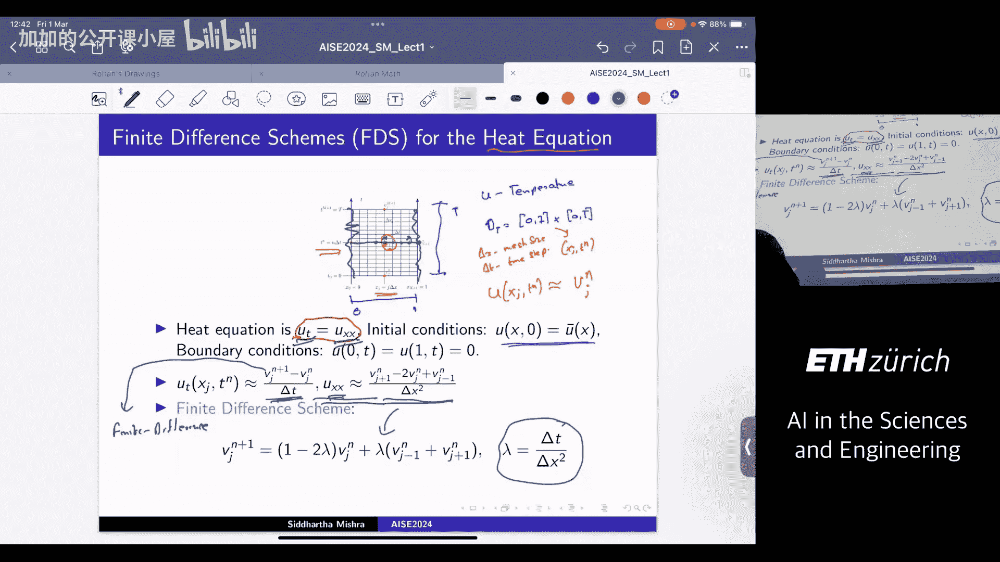

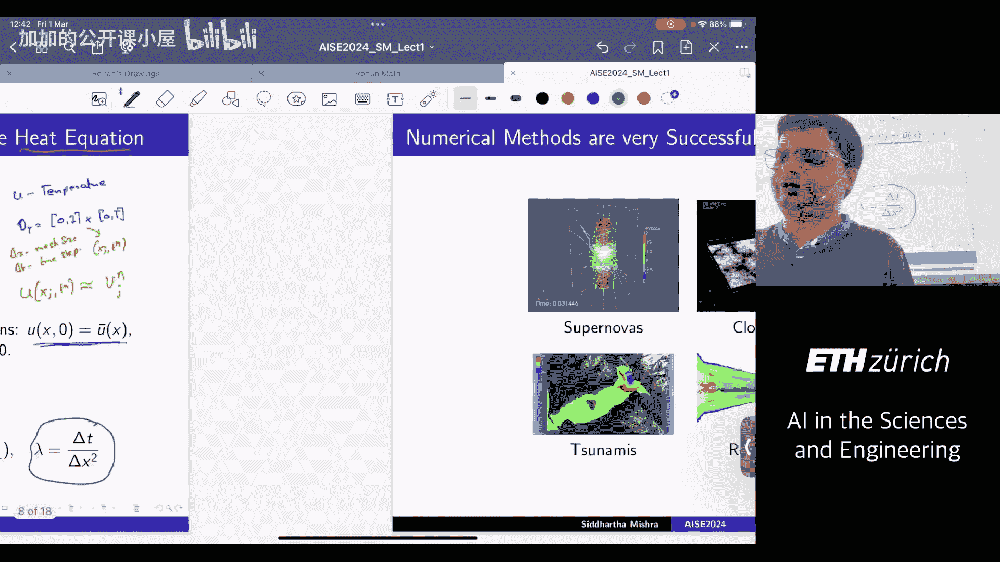

And even in my lab we have all kinds of examples of exotic phenomena that are solved using numerical methods as you can see here let me give you a quick quick tour so this is the core collapse of a supernova supernova is a massive star it's dying and houses the dynamics and you can see that this very complex physics in 3D which has been simulated with this with this kind of numerical methods this one was with the finite。

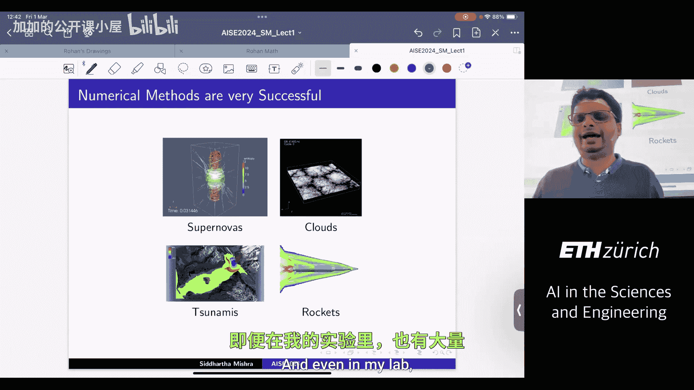

Fite volume method I think yeah finite volume method。

 this one is more with a finite difference method， this is clouds so you start with dynamics of clouds startcuulus clouds again done with the finite difference method here。

And this is the propagation。 So this is the landslide and the landslide hits the。

Lake or in this case a particular bay excites the tsunami again can be modeled by some shallow water equations and then you solve them with some finite volume method and this is a flow past an aircraft or rocket and this is done with a finite element。

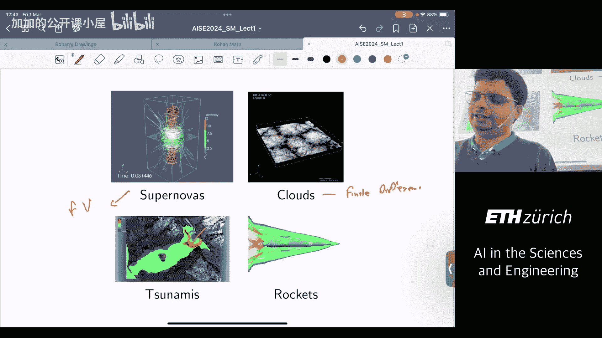

So all this is done in my lab， for instance。You know that there are all kinds of successful examples of these methods。

 so they work， they're very good and they work。But what we say or what we argue today and what we are going to sort of try and address during the course of these lectures is even though these methods work very well。

 they are time tested for 00 years now， there are some issues with them and this is why I wanted to briefly describe what these issues are。

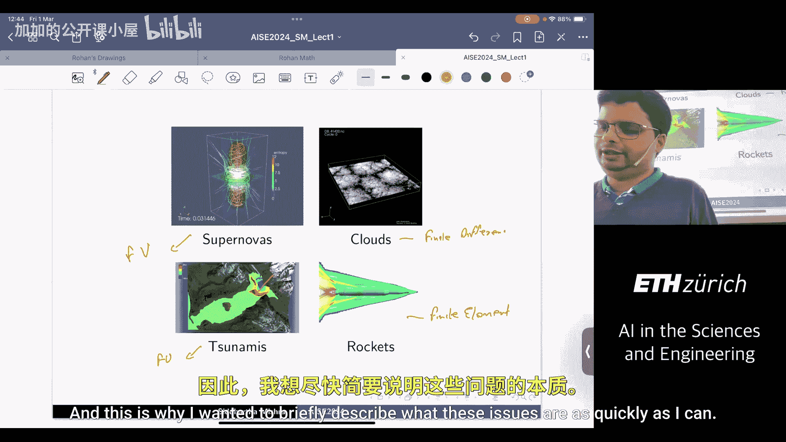

As quickly as I can So what's the caveat right Why do we care anymore The caveat is that you'll see in a second that these methods。

 So if you look at the method with the heat equation， so the one that I just showed you。

So if you remember that I had a mesh size and a time step right so it turns out that for different stability reasons or your time step has to scale in a certain manner。

 it is to scale as a square of the mesh size because after all this is the quantity that came in right t the T over Dlta x squared。

And the error， the amount of error that we make because we are discretizing that also scales in terms of the square of the me size you can you can show that for this particular example for the final difference method。

So this is going to be the error。But what is a compute。

 What is a computational cost to get certain amount of error So that depends on the number of mesh points So in 1 d it is very simple。

 it is1 over delta x right but in 2D you just have one over delta x in each direction So it is one over delta x squared in 3D it's one over delta x cubed and so on。

 So the points this scale in terms of this a negative sign for some reason I forgot to put a negative sign So the scale exponential in the dimension in some sense right the time step the number of time steps is essentially one over one over Llta t sorry so it is delta x squared So now the compute is the computational cost of this is the total number of proportional because per mesh point per time step you do a certain amount of arithmetic operations So it is proportional to this to the product of these guys So this is the scaling it's a very simple scaling So if you look at the。

Ptitional complexity， this is I just take this equation here， this equation here。

 and I substitute and I get a relationship which is like this。Okay。

 and this scaling means this scale factor could be 10， it could be 10， it could be whatever。

 but it's a finite scale factor。 and now if you start putting in let's say in three dimensions it is three5 over two right5 over two。

 and if you want a error of one。1% that is one over 100 right and so this is 100 with a power5 over two square root of 100000。

 but that's not enough because we also have a scale factor which is like 100 so you can see that the computational cost it' is going to be large okay so even if we have good methods。

The the point is that the compute is always going to grow exponentially with dimension so in particular this is what this formula shows us right in particular in 3D you will have difficulties with the numerical methods I'll give you an example but is this point clear that just from very very basic elementary scaling we know that in order to get a certain amount of error the computers to scale exponentially somehow and because of that the computational volume is going to be very very large okay and this leads to issues right in particular。

There are some other issues also， so the the most important issue is computational cost。

That's why I want to write it here， but there are the issues for instance。

 to generate a grid it's not easy。 you have multiscale multi physicssics problems。

 high dimensionmensional problems， all these cases because remember that the compute scales exponential dimension So if you want to solve 100 dimensional problem or a 10 dimensional problem already this is the compute scales and a factor of six which is power of six which is just insanely large right 10 to the power6 is a very very high number so it's a lot of compute and because of that there are many。

 many problems which are interesting for instance， boltsman equation or Schroingous equation Schroing' equation the number of dimensions depends on the number of particles that you elementary particles that you're looking at so even for very very simple atoms you are out you know like carbon for instance。

 you have many electrons and many states and this becomes easily 100 dimensional thousand dimensional problem so you cannot solve them or if you solve。

the with the numerical method this is going to be very very expensive so that is one one computational challenge another computational challenge is what are called many query problems so what are these many query problems these are multiple calls to a PD solver。

冇得步公。To a PV solve Sometimes they can be parallellyzed。

 but often they are sequential and then it becomes each call is very expensive then if you have to do it 100 times it just close very very expensive let me give you an example so this is an airfoil it's a section of the wing so when you design the wing of an aircraft the first step is to first design each cross section right so the cross section is an airfoil it is a typical tearrop shape for aerodynamic sort of reasons right so to reduce the drag to increase the lift and so on and the way this design is done whether it's by Boeing or ever so any aircraft design company is very simple so what you do is that you take a starting point so this is the black here is a starting point of of the wing of the airfoil and then you solve the equations these are either depending on the regime is either the oil or the obvious tos equations the same equations which have been around。

for more than 200 years and then you see if the then you do a gradient descent and see how to reduce the lift or till not to reduce the lift or to keep the lift constant and keep on reducing the drag so you compute a gradient and then you move step by step in order to reduce the lift in the drag but the point is this might take you easily10 or0 iterations。

But for each iteration you have to do this kind of a forward solve you have to solve the PDE numerically which is done here by using in this particular case a finite volume method。

 but here it's not like you're solving the PD once you're solving it 1 thousand times and you cannot do it parallel right because you need a previous value in order to go the next value and then to the next value and so on so that's why this is a computationally very expensive problem for instance poet they spend I know this from the chief technology officer that they spend approximately $2 billion a year。

2 billion。On their compute budget which is a lot of it goes towards of course they have not spend enough otherwise their windows will not crash out and and so on they probably need to spend 5 billion but you can imagine that this this is expensive and you'll see why in a second this is expensive because you have to do multiple multiple calls you have to do multiple multiple trials because this is what design is all about right but the point is multiple calls here so this another example this is what is called an Englishverse problem let me look at the time I have to be quick。

So this is to detect the geology of the earth underneath so how is this done suppose you want to find out what are the geophysical properties of the soil in Zuric for instance or the rock formation in Duric so what people do is that they have a set of sensors。

which are located here， they have a truck on land it's typically a truck on water it's a ship and this has a wave generator so it is generating waves which it is sending into the soft surface so the wave equation which is UTT minus C squared of xla plus in a U。

 this is what is being solved， this is a wave equation。

And then what happens is that these waves get reflected right so these waves get reflected。

 they're captured by sensors and they're captured in time right they're observed in time So what you get is sort of a measurement field which looks like this very noisy you know this kind of time snapshots these are for different sensors you get you get a measurement field like that and what you have to solve is an inverse problem because here you know the solution in some sense but you don't know the coefficient this guy here because this tells us the geological properties of the soil so this is this C square of x and then you have to invert then it is going to look something like this okay so here it's an inverse problem again it is solved an iterative manners so you start with a gas then you solve the forward problem see if things match and then move in the direction of the gradient so again it takes10 to1000 iterations in order to get anything acceptable and。

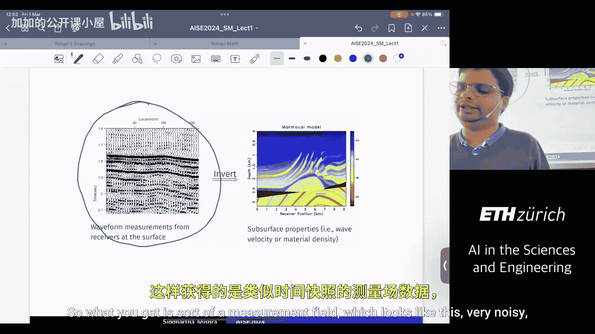

10 to000 iterations or 10000 iterations are pulse to the PDE solver。

 which make this very difficult will we will look at this problem later in the course in some detail。

Okay so this was another example uncertainty quantification。

 so if you have a turbulent fluid flow it doesn't make any sense to to essentially do pointwise measurements or because you can see that this flow becomes very very turbulent so what you need to do is to compute statistics mean variances and so on which are much more stable but statistics we know is over 100 samples thousand0 samples。

10000 samples and this makes it very very expensive right and how expensive I'll just give you an idea。

So this is why I said what is the computational cost for doing these things right so I know the cost here because I have to pay it in some form or other so here is an example so this is a fluid flow so this is an obvious to equation。

This is an academic test case， but you get an idea and this is the initial condition and this is the final solution。

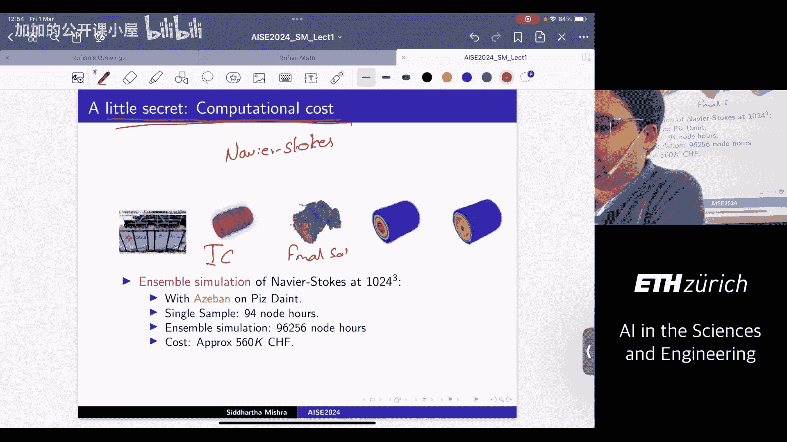

And as you can see this is a very very rich solution like means you can see that there are all these verticisees and worlds and things move around and so on。

 so this is a very complex solution that's why you need to compute things like the mean which is here the variance which is here and this requires so this a very high resolution simulation man this requires approximately 124 samples。

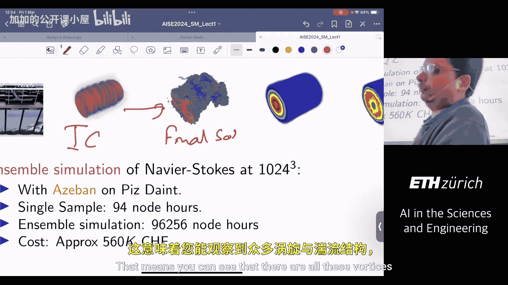

Not enough but this is what we could afford and we go to the biggest supercomputer in Switzerland which is Ptainined we have a highly optimized code which is developed in my lab and for a single sample even in for this problem it requires about 100 node hours right but we need I think it was even 512 samples no maybe 1024 samples so this requires 100。

000 node hours。But of course this is not cheap right because this machine has to someone has to buy the machine。

 they have to power it， there are people who are actually in the audience who are employed by by CSCS the supercomputing center here so all these things are necessary these are cost of course we get some grants but if you had to pay like a private person and just for this simulation we would have to pay half a million restrain strengths okay now you can imagine why the budget of Boeing is 2 billion when for a single simulation I have to pay half a million restrain strengths so this this is the thing that it's even if these methods are there and they work well the computational cost is just prohibitively expensive but that's not the only thing this is the last point I want to make and it's a very important point because you know the dynamics of the atmosphere but they follow the a toox equation this is not hard to argue if you go to a fluid dynamics one on one course you can easily learn。

But there's a lot of lot of interesting phenomena whether physics is much more let's say flaky。

 missing or uncertain， for instance， even in an earth system model like the one that we have the fluid dynamics the equations are known the thermodynamics the equations are known radiation the equations are known but you also have the role of vegetation for instance。

 you know forest they contribute to how how for instance our climate is going to change if you take out all the forest for instance then of course the temperature is going to be very different when we had forest but now what is the evolution equation for a tree correct this is essentially what it boils down to signal land right how land absorbs the quality of soil how it absorbs how it reflects this also tells you something about the earth system again we don't have any sort of first principles physics to tell us how this is done so for instance in a climate model。

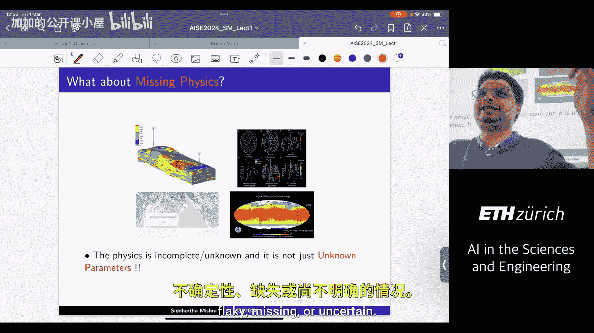

Quite a bit of it is based on sound physics， quite a bit of it is based on missing physics right so this is not just about missing parameters but really missing physics another example that I really like to show is because again I'm involved jointly with some startup here from ETH and they try to model the traffic in Juric so you can see that this is the lake this is the big bridge at Bellue and ETH is somewhere up here so you have the traffic in Juric so you can make some assumptions and you can write down some equations to govern because traffic is also thought of as a flow things flow so you can write down some navious talks like equations but there is you know there is no sort of in principleple aitionio derivation of this equations so again I would say that the physics is going to be missing but what we have is lots of data right so you have lots of data but the physics is going to be missing similarly if you want to this is an example of flow in our。

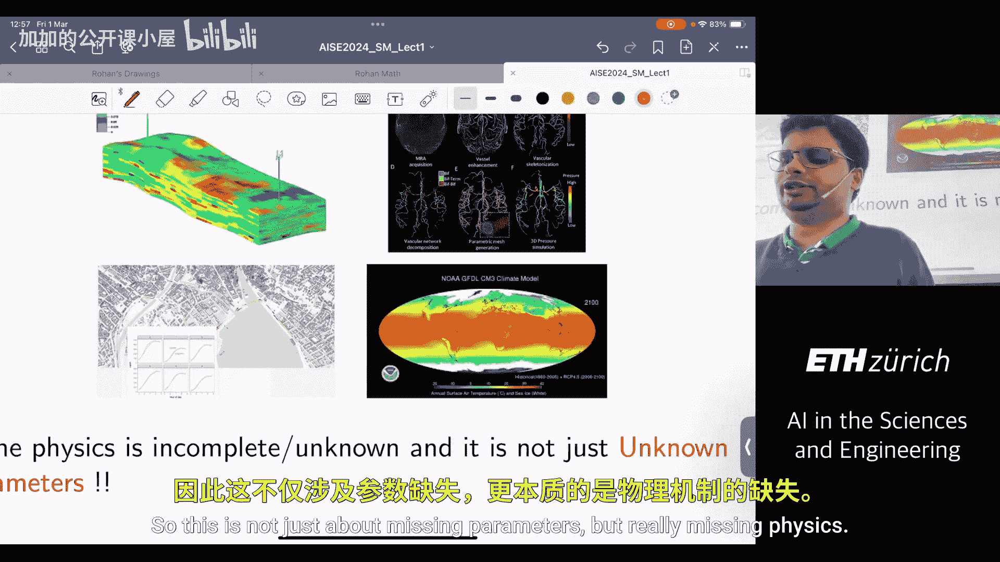

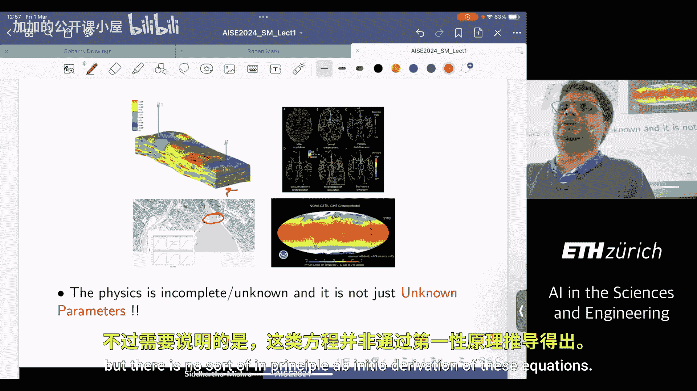

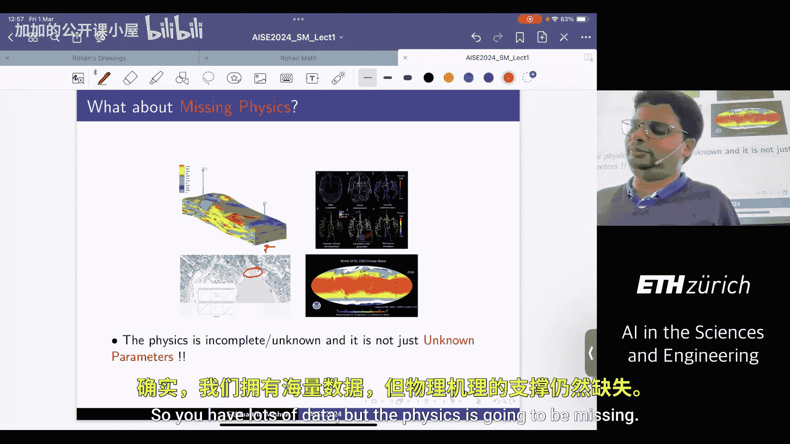

Again the same same kind of phenomena comes in that a lot of physics is actually missing we don't really know how the biological circuits how they are contributing to affect this fluid flow the point is that even though even if the physics is no it can be expensive to simulate and there are many。

 many problems where the physics is even unknown okay so these are the problems physical systems that we have to deal with。

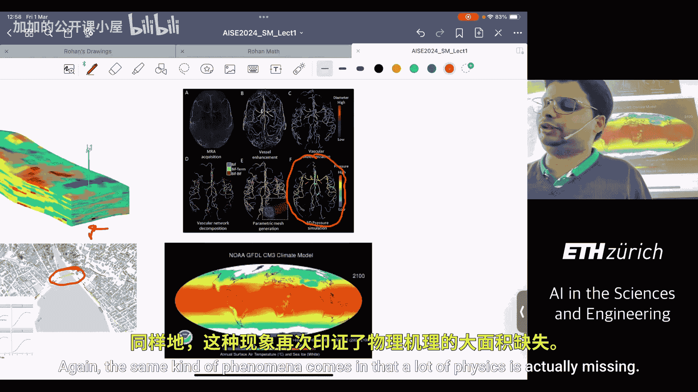

And what we are going to do is， as I said， that they are either expensive。

 like in many query problems or high dimensional problems or with systems within complete physics。

 yet they have lots of data。So what we're going to do in the rest of the course is to address these kind of problems can we reduce the cost when the methods are feasible can we make it feasible when things are infeasible and can we for instance augment our physics or fill in the missing physics with data so this is what is going to be the content of several lectures now。

Quite a few weeks where we are going to find alternative strategies and these alternative strategies will combine physics and data。

In order to be able to use deep learning Okay， and that will be the content。

 so I think in the next lecture just to give you a preview。

 so Ben is going to be back and he's going to teach you something called physics informed。

New networks， something called bins。You networks are pins。

And the idea would be that we would use neural networks to completely replace the existing numerical solver。

 which is essentially so if you remember the heat equation so instead of using this we'll just solve this problem using neural networks but that is what Ben is going to talk about Okay so if there are no further questions I will stop here and I look forward to seeing you guys in two weeks Okay bye bye。

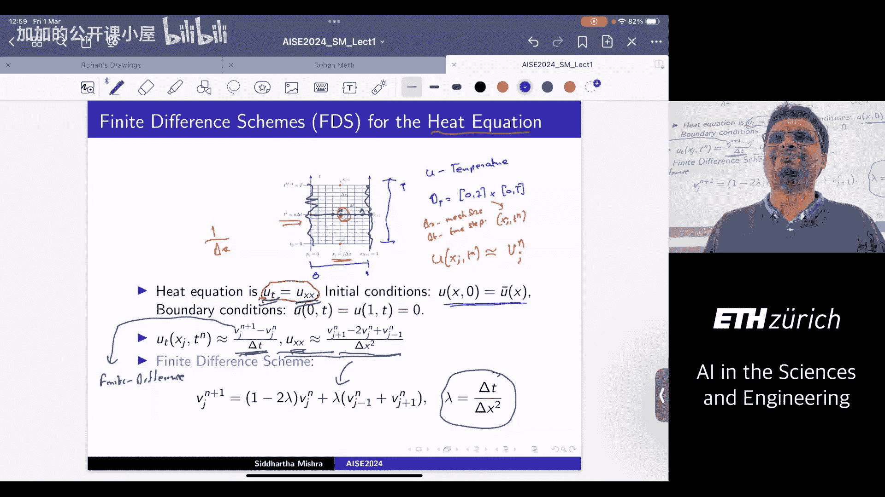