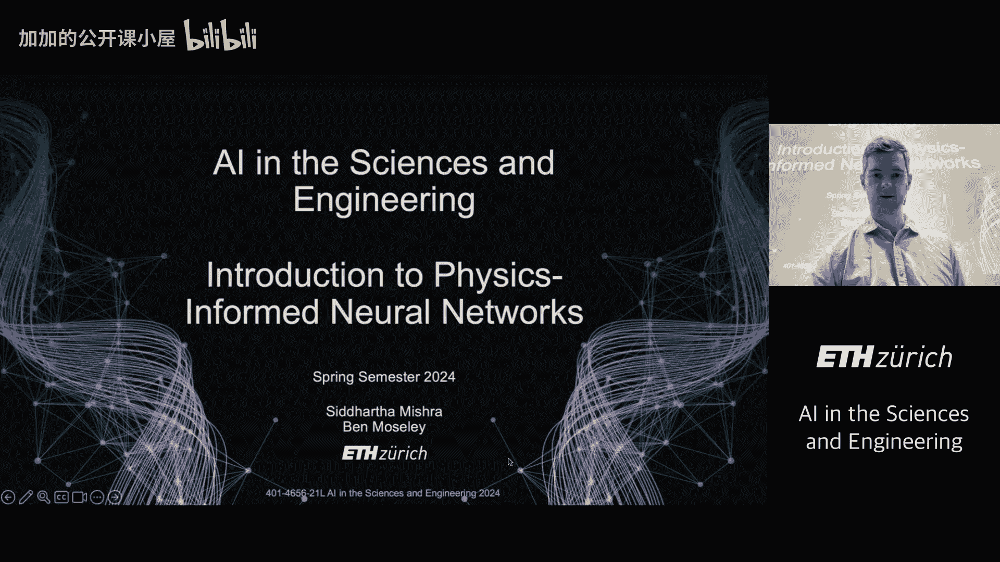
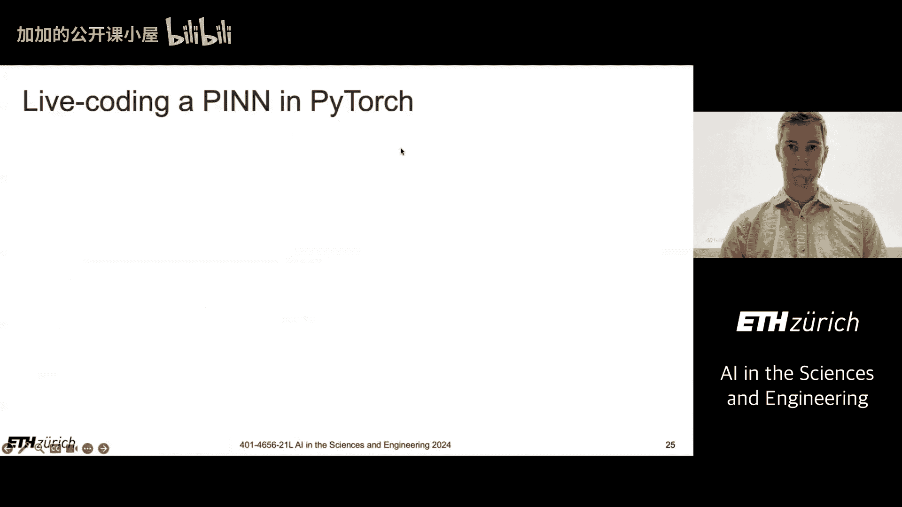
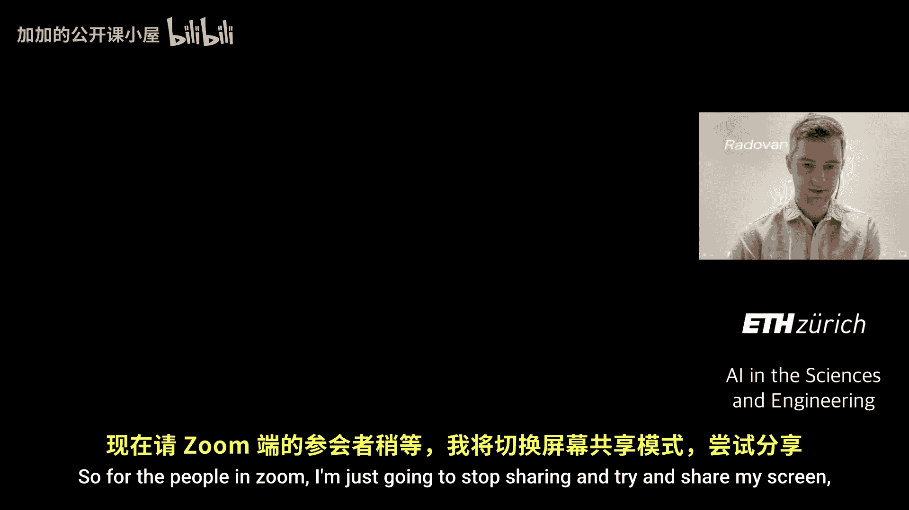
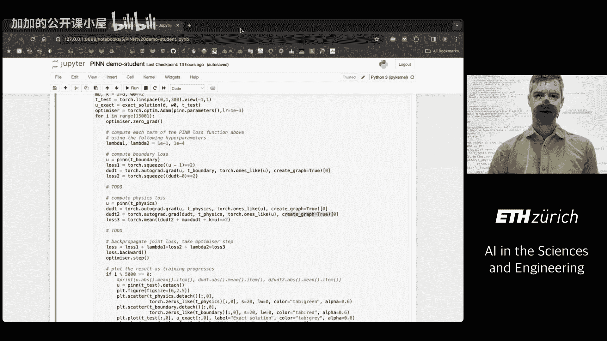
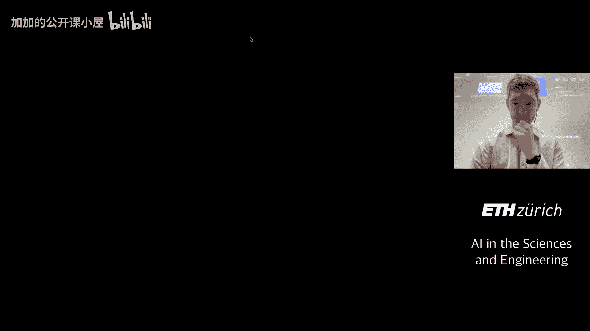
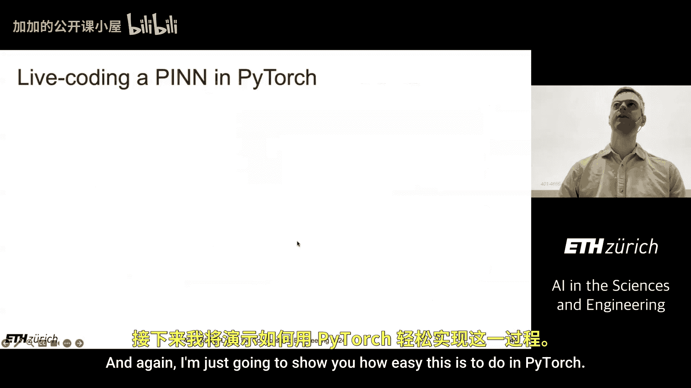
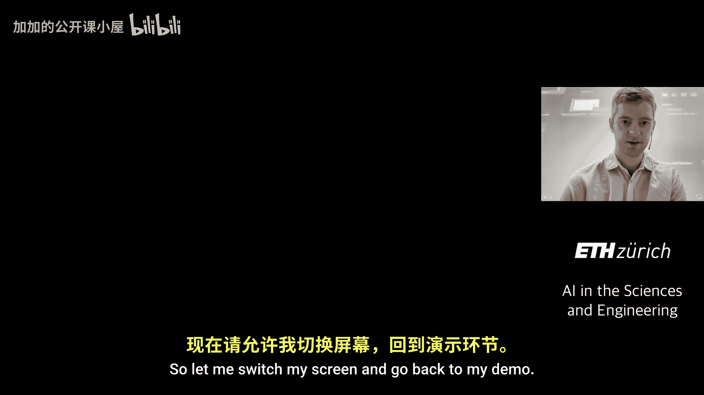
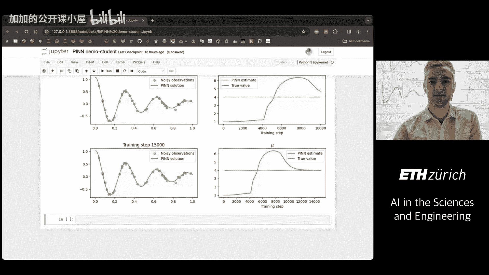
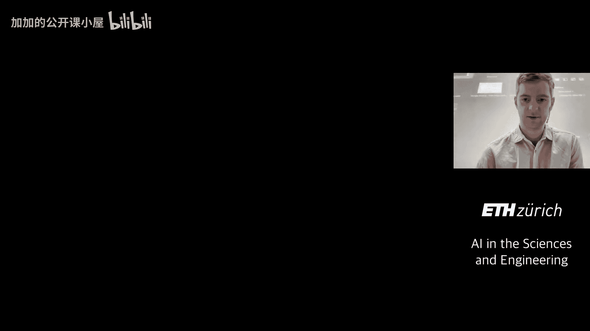
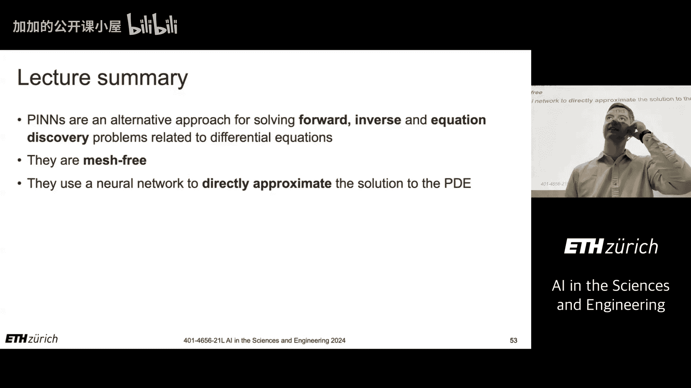

# 苏黎世联邦理工【中英⚡科学与工程中的人工智能｜2024 AI in the Sciences and Engineering】 p05 P5 Physics-Informed Neural Networks – Introduction -BV1smxgzHEPC_p5-

So while going to this lecture， this is the first lecture on physics informed neuralA networks。

 so I'm going to be introducing physics informed neural networks in this lecture。嗯。

Before I get started on physics informal networks， I just want to recap what Sid talked to you about last week。

And he talked about the importance of partial differential equations and PDs really are the fundamental building blocks that we use to describe and understand you know。

 many different scientific phenomena。From， you know， this very smallest of scales using， for example。

 the Schchrodinger equation to model the dynamics of atoms to the very larger scales and using。

 for example， Einstein's equations to model black holes。嗯。

PDs are also really important to understand phenomena that happened here on Earth to， for example。

The Navy Sts equations are really essential for understanding how the climate evolves and the fluid dynamics of the climate。

And then what's amazing is that some biological systems can also be described by PEs， so for example。

 the reaction diffusion equation can be used。To model how the patterns on animal skin evolve over time as they grow。

So this is why we place a lot of emphasis on PDEs in this course。

And physics informed neural networks are a way to solve differential equations or a way to solve problems related to differential equations and I'm going to show you exactly how pinNs physics informed neural networks can do this。

So yeah， this is the first of quite a few lectures on physics and neural networks。

 we're now really into the main body of the course where we're getting into these kind of new scientific machine learning techniques that we've been talking about so far。

So yeah how does this lecture look so first of all I'm going to give you a very high level description of what physics and Formal networks are a really simple description。

Then hopefully if it works， I'm going to try and do some live coding to show you just how easy it is to train a physics informal network in Pytorch just in a few lines of code。

And then I'm going to really justify why we use pins and all the different applications that you can use them for and so it turns out you can use them not only just to solve differential equations。

 so carrying out forward simulation tasks。But you can also use them to carry out inverse problems。

This is you discovering underlying premises in a system given some observations of that system。

And you can even use pinIs to start discovering the PD itself， so did the terms of the PDE。

So pinINs a really flexible framework and really interesting field of research to study。

So by the end of the lecture， you should be able to explain precisely what physics informed neural one is and how to train one。

Um， and all the different kind of applications that we use pinIs for and all the different tasks that you can use the pinN for。

Okay， so what is a physics informed neural network？So before I describe exactly what a pin is。

 I want you to have a think about how you might use a neural network to solve a differential equation。

So SiD last lecture talked about all these traditional numerical methods we have so things like finite difference methods。

 finite element methods。And he talked about the pros and ponds of those methods。

 but pins are fundamentally different they use a neural network to solve the differential equation。

So I just want you to start off the morning， just talk with your partner about。

Ways that you could use a neural network to either solve a differential equation or help you solve the differential equation。

So I'll give you a couple of minutes and then I'll see what you've come up with。

just have a quick discussion。It's a very broad questions。Okay， so it's just a very quick discussion。

 so can anyone give me a hand of a way that you thought of using a neural network to solve a differential equation to carry out simulation？

Yeah， well we give it as inputs the initial conditions。

 maybe in some numerical app of the eyelash or something at the initial point and that has an output that he supposed to produce or it is supposed to produce the result and produce some lot methods to offender result there function。

Yeah， so to repeat you would have a neural network that would take in the input of the network would be these initial conditions。

 so by the way， this is the an example of solving the wave equation with you know the acoustic wave equation here and some initial conditions and this output here is the output of a finite different solve。

So you might have a neural network that takes these's inputs and then tries to produce this simulation as output。

And you train it maybe based on lots of examples from finite difference model， for example。

 in a supervised manner， yeah， yep， definitely。Any other ideas？Yeah yeah。

 this is a really good idea and so this is very similar to what pins so the idea is to instead of generating lots of data to train the network。

 which is very expensive general if you have to remember I was saying in the introduction to deep learning。

 we need thousands， millions of examples to train deep neural networks and that could take hours or days to compute on the traditional simulation。

So if we could use a wave equation directly to train the network and minimize the its penalize the difference。

Using the way the equation that would be bed。So that's a great start thinking about physics informed neural networks。

 so let's now start to think what a pin is。So I'm going to take an even easier differential equation。

 this is an ordinary differential equation。And it' it's the equation for a dampharonic oscillator and so this is a canonical problem in physics and it just models you know a mass on the spring。

 what is the displacement of this mass as a function of time。

And we know that the displacement E here is a function of time。

Just obeyze this differential equation where M here is the mass of the oscillator。

Mu is the coefficient of friction， so it's some dampening term。And then K is the spring constant。

And so we get this depending on the kind of regime in the oscillator。

 you can have overed and underdamped and critically damped regimes。

this is the underdamped regime where the oscillator slowly decays over time。

 so we have this sinopoiddial function with an exponential decay。And so we know， you know。

 in general， to be able to solve a differential equation we have to give it a unique set of initial conditions and boundary recognition to give us a particular solution。

So the appropriate ones here to say the mass is going to start with a displacement of one and a velocity of zero that allows us to uniquely and in this case analytically solve BD。

Okay， so how are we going to try and solve this equation using a neural network？

What I mean by solving is we want to be able to compute this function。

 let's just assume that we don't know what it is analytically because for the vast majority of PDs。

 we don't know what the analytical solution is。So pins are very。

 very simple that the underlying idea of a pin is very simply to approximate the solution directly with a neural network。

So we say my solution， U haveTE。Is approximated by this function。

 remember neural networks are just functions that fit the data。

So it's a neural network function that takes in the coordinate T or the time value T and has some free parameters detail。

so just to be very explicit， we typically for pinINs， we start with an MLP。

 this is usually the model that we start with。And so the MP has a single in this case。

 a single scalar input is the time value and then it gives you a single scale of output and that's the prediction of the displacement。

So one question already is how is this solution that we get from this technique different to the solution from。

 for example， finite difference modeltley can anyone tell me？

Just by the way that we're framing the problem here。Okay， so I'll tell you。

 what we're doing here that's fundamentally different to find our difference modeling is we're making a functional approximation to the solution。

So the output of the pin is a function that we can query at any point in time and it will give us its approximation of the solution that's not the case when we run finite difference modeling what we get from finite difference modeling is a disretized version of the solution we get the solution the value of the solution where on the mesh of points that we use。

So one key property ofpins is this idea of them being mesh free。

 they're a mesh free approach they' we don't need a mesh to compute the solution。O。

So then the question is what loss function do we use to train the pin and this is where we put in this information of the differential equation。

 as you were suggesting。Into the loss function。So we have two loss functions。

 one is called or two components to the loss function， one is called the boundary loss。

And one is called the physics loss， where sometimes it's called the PDU residual。

 I'm just going to refer to it as the physics loss going forwards。And it's very simple。

What we're saying is。With the boundary loss， that the neural network should match whatever our initial conditions are。

So let's take the first this boundary loss has two terms， let's take the first term。

It says that the output of the neural network at t equals zero should just equal one。

And so that's exactly saying， you know， this initial condition displacement starts starts like long。

The second term in the boundary loss is to say that the derivative of the network with respect to T。

Should equal zero？And again， that's just saying that the velocity should equal0。

 that's our initial condition。Then the final one which is the most important is this physics loss and what this does is it computes the residual of the underlying differential equation。

So we take on neural network and we just evaluate all of the gradients required。

 so you know the derivatives with respect to time。That're required to compute this left hand side of the differential equation。

And if this solution exactly matches， you， is a true solution of the differential equation。

What is the value that we expect this to be？If neural network is a true solution。Yes， zero yeah。

 you know that's that's what the differential equation says so we try and make sure that this residual is as close as zero as possible and if it is and the neural network is giving us a true solution。

嗯。Now we have to evaluate this residual at many different points in the domain。

 so we sample over many different time values。To make sure that across the entire solution domain。

 this residual of the differential equation is abed。所诶。

You can think of the boundary loss as asserting the boundary conditions and making sure that the solution is unique。

And then the physics loss is making sure that the underlying equation is obeyed at all points in the end the domain。

And here's what happens if I train。Fully connected neural network work。

Using exactly this loss function here。And what you're seeing is the gray curve is the exact solution and the blue curve is the neural networks fit or the neural exp prediction of the displacement。

Ass a function of the training step。Now I'm also plotting a couple of points here so what i'm plotting the boundary point so this is just t equals zero here this is the boundary point that we're matching to in the loss function。

And we just have one point in this case for the single 1D equation。

And then the green points here are these what we call physics loss training locations。

 or we also call them the colocation pos。So these are the time points here that we sample the physics lossover to make sure that the differential equation is obeyed at all points in the domain。

So this is a super key slide to really understand every element in this slide。

 everything that we're going to talk about in the remaining lecturees on pinINs is going to come back to these core ideas of how we train pinNs and how they're defined。

So has anyone got any questions before we move on y we'。Yes。

 and if we were to sample from outside of absolutely yep。

 so really good observation if I take this train neural network what I've trained here。

And I give it a time coordinate thats outside of the domain。

 it's very likely that that's not going to obey the underlying solution because it's outside of the training distribution of the network。

 so the generalization of neural networks is still an issue here so we're going to talk about that in the next lecture as well。

Yeah， different training steps by commitment different training steps。Right。

 so we're training this network just how we train a normal normal network with gradient descent。

So we take， you know， we take the gradient of the loss function with respect to the weights and we take a step so what I'm showing here is the prediction of the network as a function or training step。

N stuff we could use the all the training locations like all the Ts yes yeah so we。Yeah， yeah。

Unlike what we normally do with neural networks where we use mini batches and we do like small batches of training points。

What is more often the case in pins is just to use full batch training so you give it all the points at every training step so all of these green points and all the orange points in this training example are being used every step。

Yep。And any other questions？Yes， yeah works。5Yeah。Yeah。

 so you don't have to and it's good to compare when you're training pins and it often depends on the type of problem that you're solving as well。

To me， it makes more sense because it makes the problem more well posed。

In that you're making sure that the PD loss is consistent everywhere。

And there needs to be like a deeper level， there needs to be communication。

Like we need to be able to without this boundary point here。

We could learn any solution to this differential patient and it could start anywhere in the for example。

So somehow we need to communicate this boundary point across the entire and forwards and solve it causes it。

 so having all these points can help do that rather than just random only sampling。Yeah yeah。

We'll talk about that more as well。你可以。I think it comes from what I'm talking about when we need to communicate or propagate the boundary conditions forwards in time。

We don't don't know what the solution is here until we've learned what the solution is before it to constrain the value。

 like to solve the equation forwards in time。So so and but I mean in general it's very difficult to understand the training dynamics of physics and Form networks this is actually quite difficult。

 so this is my kind of。My empirical observations， but to analyze it mathematically is a really interesting topic as well to think about the training dynamics。

Yeah， we'll talk about that as well coming up。😊，Okay。Yep。我是一个。Stay domain space。Yeah。

 so we're going to talk。Next lecture about extensions of pins and so physics and neural networks is an entire research building and there's a lot of clever ways to make them generalize better to speed them up to improve their limitations。

 so I'll talk about this。O。I'm just going to chat the chat as well because it looks like we have a question。

嗯。Oh no， it's just a suggestion， okay。嗯。Okay。So as I mentioned， these TI。

 these green points in the domain are known as colocation points。

 and we sampled them through the domain。And。One other thing that I haven't talked about so far is these Lada values and you can see that they are just weights that we apply to each term in the loss function。

And what we do is that we just consider them as hyperpar that allow us to scale or balance the contribution of each of the terms in the loss option。

And so in practice， this is really important to make sure that the pin converges quickly。If you set。

 for example， the boundary weights to be very， very low。

 then you might just learn a different solution that's not the true particular solution of the differential equation。

Okay。So I showed you a pin for the daantmonic oscillator。

 but what makes pinN so powerful and why that's so such a popular or heavily researched field today is that this is they are actually a general framework for solving partial differential equations so I can take this idea of just using a neural network to represent the solution of a differential equation and train it on any differential equation I like。

So we can。Set up pins in a more abstract way and say given some PDA and I'm not being specific about what PDA is and some boundary initial conditions。

嗯。So we can just say that the PD in general is just some differentiable operator。

 differential operator that's applied to the solution。That gives us maybe some function as output。

Where we have some domain in some D dimensional space。So for example， a 3D problem with X， Y， and T。

 for example。And we have some boundary operators， we might have K of them， for example。

 we might have a initial condition on the velocity and on the value of the solution itself。

Equs again， some boundary function here evaluated on the boundaries of the domain。

This can define precisely our P or boundary value problem that we want to solve。嗯。I'm also。

 you can also incorporate time here into X， so I haven't explicitly said the time is here。

 but it could be incorporated into this vector。嗯。So PINs train neural network to approximate the solution to the PDE by directly approximating the solution。

 so this is a functional approximation of the solution。And we use these two。

Lost terms that I just described so we have the boundary loss。Where， you know。

 we have a separate loss term for each boundary condition， each K boundary condition。

And we have a physics loss that minimizes the residual of that underlying differential equation。Okay。

 so to make it more concrete for you and to show you an application of a pin to a different partial differential patient。

I'm just going to consider the Bur's equation， so this model's fluid flow。

And this is the visccusburgberggus equation， so we have some viscosity parameter new here。

And you here now represents the speed of the flow。嗯。

And we're thinking about the flow just through a 1D section as a function of time。

 so the solution here is the flow wherever you are in that section and then a function of time。

So we set up these initial conditions， we you say that the starting flow is some sign function。

In X and then we have some boundary conditions saying at the edges of the domain the flow should be zero so what we're actually modeling here is the fluid flow through a pipe。

 for example， where the fluid starts with a sinop audio distribution of its velocity。Okay。

 so then we say， yeah， the solution is approximated by no network。

And then we do exactly as we did before， we have our boundary loss here。

Where we have now three terms in our boundary loss。

 which are certain each of these three boundary conditions。So， you know。

neural network across all points in x， but time equals zero。

We want to match to the negative sign function。So we need to sample all the like sample many possible valid values of x。

When we're evaluating this term。Then this firm says at x equals minus one for all values of t。

 we should make sure that it's zero and for x equals plus one， the same thing。

And then the physics loss， we're just evaluating the residual of the full differential equation。

 sampling over all possible values of x and T in other domain。ok。

So let me show you a picture of what that looks like。This is the same loss function again。

But what I'm plotting here is the black points and the green points。

 the black points represent where we sampled the boundary loss from。

So when we did the 1D harmonicoslator， we only needed one boundary point because it was 1D。

 but in higher dimensions， you need to sample the subspace of the domain。

So we're sampling across the edges of the domain here for these boundary loss here。

And then the green points here are where we're sampling the physics loss。

You can also see that we're not doing a uniform sampling anymore。

 we can also do a random sampling in the domain and actually。

Random or quasi random sampling can actually improve or help the convergence of pins and we'll talk about that coming up。

And yeah， this is actually what here is the solution of the pin and so what you can see is again。

 this is the fluid flow through a pipe and we started with a sinaloiddial fluid flow。

And what's interesting about the Burger's equation and what makes it nice to study is that as time goes forward。

 the fluid starts to form a shock and you start getting a flow that goes one way any other way and you get a shock in the middle。

And so this is quite an interesting problem to study， especially when we're using numerical methods。

 because we can start to get really big discretization areas where we have these discontinuities in the solution。

And what's nice to see is if you plot the kind of exact solution against what the neural network predicts after it's been trained。

It does somehow model this shock fairly well in its solution and gets quite a good match to the tree solution。

So this is a plot that was taken directly from RiceCC's physics informed neural networks paper。

 which is kind of the seminal paper on physics informed neural networks。系。

So to be more specific about kind of the setup that they used and it's important to understand kind of these fine details。

They used 10，000 pro locationation points in the physics loss here。

And they used not uniform sampling， but this thing called Latin hyper cubebe sampling。

 which is pseudo random sampling。And then they had100 boundary points sampled。

 yeah along the boundary again。The network they used was a pretty connected network， nine layers。

 20 hidden units， so that turns out to be 3003 parameters that we need to fit this flexible function to the solution。

And then we use a10h activation function and a second order optimizes， not just gradient descent。

 but， quasi quasie Newton optimizer。所。嗯。One interesting thing is the activation function。

 so can anyone tell me why。Why they chose to use a tanNH activation function here instead of say。

 for example， reo activation。Yeah， help。呃。Yes。Yeah exactly so the answer was that really can give always gives positive outputs that's true what we typically do when we do neural networks for regression is we don't use an activation for the final layer。

 which gives us the opportunity to have negative values。

But the real reason why we would do the tonH is that it's a continuously differentiable and smooth function。

So why is that important， why do we need a continuously differentiable function？

Or activation function。Yes，Yeah， exactly， we need to be able to evaluate the second order derivative here of the neural network with respect to its inputs。

So if I used a re activation， what would that value be？Remember。

 a re activation is a piece wise linear function。有。So。Yes。Yeah。

 so the gradients of the piecewise linear function。

 the second will derivative to the zero of a neural network that uses a re of activation function。

So that's a really important thing to understand it's often overlooked when we train neural networks they're actually making piecewise linear approximations if we use reallyD。

So but if we use a1Hch activation， then we have an in general or continuously differentiable function that we can fit。

Okay。So you don't have to just use pan H， you can use other kind of smooth approximations of the re functions。

 or these Swisish functions， for example， or others that you can use。So I've been hinting that pins。

Is an entire research field by this point。嗯。And if you look at the number of publications that have the keyword physics and form neural networks in them。

 you can just see that the amount of papers published on pins each year has just been growing very。

 very quickly。嗯。There's it's a whole research field。

 there are so many extensions of pins and we'll cover some of them in the lectures coming up。

But if you really want to get into physics and formula when that in more detail。

 you can have a look at this review paper， which is a fairly good comprehensive review of all the research landscape on pins to date。

It's actually quite interesting to note that the kind of basic concepts behind pins so this idea of using an neural network to approximate the solution and then train it using this residual differential equation。

 these basic ideas can be found in papers going back all the way to the 1990s， for example。

 Lagarris and others。But the paper that is most well known for pinIs is Rice's paper and this is the kind of seminal paper which reimplemented and extended pins using modern deep learning frameworks and showing that we can train deep fully connected networks and other networks to solve these differential equations。

Okay。So hopefully I've described to you a high level what a pin is so now I'm going to talk in much more detail about the training process of training the pins there's quite a lot of factors that I haven't talked about or have left out so far。

And I'm going to hopefully in this section talk to you about or do a live coding of opinion in Pythtorch to show you how easy it is to train in Pytorch。

So let's think about the training loop of a physics and formal network in more detail。

Let's go back to this harmonic oscito example， which is a simple example to think about。Again。

 we have our boundary loss and we have our physics loss。

And so this is how the training loop would look if I just write it down as a list。

So we would first start by just sampling our boundary points and our physics training points or our colocation points。

 so note the orange point and the green point here。Then we would compute our network output。

And then the important thing is we need to evaluate the derivative of the network with the respect to its inputs。

 so these Dn by D T and Dn by the T squares。To be able to compute this physics loss and also the boundary lost it。

Then that allows us to actually compute the value of the loss function。

But then we need to do another step where we need to take the gradient of the loss function with respect to the neural network parameters in order to update the parameters to learn the solution。

So the key question here is how do we compute the gradients that we require so you know DN by Dt and D L by D theta。

Can anyoneone tell me how we would compute this？Or even if they're available， yep， yeahep。Yeah。Yeah。

 so in general。The neural network here is just a mathematical function。

 remember it's just a bunch of linear operations plus some activation functions。

So we can write down analytically the derivative of the network with respect to its input。

 that's something we can actually analytically derive if you had a pen and paper， you could do it。

And as I described in the introduction to deep learning lectures。

 we don't actually do that in practice， we can just use the auto differentiation and that propagation as an efficient way to compute those gradients。

所。The important thing is we can use AutoDF not just to get the gradients of the loss function with respect to the weights。

 but also we can use autoDF to get the gradients of the networks's outputs with the respect to its inputs。

Same algorithm， same auto differentiation can be used。

So let me just show you how we would use Auto diF to get both of those gradients。

And let's just think let's just make assume that the network is a MLP。

 so a fully connected network that has this form。And。

We used the change rule when we were differentiating the loss function with respect to the weights to be able to evaluate that gradient。

 so we can use very analogously， there's the chain rule to now compute the gradients of the network with respect to its input。

 so a different gradient， but very simple。So we just note that the neural network function is just composed of these vector functions。

And we just use the Cha to find out what the derivative of the network with respect to its inputs are。

And you can to this analytically， like I said， I don't have the time to do it today。

 but this is an exercise so you can go away and do。

And so we can just show that the derivative of the network respect of time is just iss this expression here。

Okay。So then how do we get once we've got this， once we've evaluated this derivative。

 how do we get now the derivative of the loss function with respect to the waste。

 that's the next derivative that we need。So we can just to do this， we can use auto different。

 we can simply just think of computing these derivatives of the network with respect of these inputs as extending our computational graph when we're using auto differentiation。

So AutodeF works by creating a graph of all operations and tracking that graph and then're back propagating through that graph to to give you your gradients。

所以。This gradient here that derivative the network with respect to time is just some extra computation。

 you can just think of it as an extra computation， which just extends this forward past this forward graph of the network。

So you know， this derivative just depends on the activations G and H。

 and it passes them through some functions， which are derivatives of the activation functions and times of by weights。

So we can just plot that as an extra part of our computational graph。

 which then allows us to compute the final output of the graph， which is the loss function。

So once we've extended our computational graph and we can just call autod on the entire graph。

 this whole combined graph to backproagate from the loss function to back propagate through it to get the gradients of the weight。

So this is the kind of key realization is that we can recursively apply Alative to first get our gradients of the network with the respectynus。

 create the new graph， and then get the gradients of that graph with respect to the network's parameters。

To update the parameters themselves。So this is how it would look in some pseudo code of in P talk。

Like I said， just you can in practice， just use autograd to get these gradients。

And so you would have T here is our time coordinate， The is our parameters of our network。

We get the prediction of the network given the value of T。And then we compute our first gradient。

 which is our derivative of the output of the network with respect to time and we can just do to also gra together this。

We also need the second order derivative with respect to time to evaluate the physics loss。

And the key thing we do in Pywat is we do this thing called create graph equals true and that extends the computational graph so that we can then differentiate through again。

When we call autograd the final time to get the gradient of the loss function with the respect to the weights。

I hopefully this makes sense， does anyone have any questions on how we get these two gradients？Okay。

So now we have everything we need to actually train a pin in Py to auction to actually code up a pin and so I'm going to attempt to do some live coding for you。

So for the people in Zoom， I'm just going to。

Stop sharing and try and share my screen。

My chromme screen。Okay， so hopefully you can see that okay。嗯。

So what I have here is a Jupyter notebook。And I've got a lot of the code here is already filled in。

 and I'm just going to be adding a couple of lines。

 the key lines for training the Ph and form network。So we're going to be using Pytorrch so I'm just。

Everyone can see this again。And we're going to be using Pyth。

 so I'm just going to import the relevant libraries。Okay。

 so again we're going to be training a pin to solve this that tamonic oscillator I've already told you about the differential equation。

There are different regimes we're going to be focusing on the underdpped state here where we have this kind of decay of the solution。

Analytically， you can actually show that the solution has this form。

 so it's a cosine function as a function of time。damped by this exponential factor and it's if you're interested in kind of dering this。

 I would have a check out of this blog post it's very， very useful for understanding。Okay。

 so the first thing we're going to do is just simulate the system using the pin so we're going to try and solve this this differential equation。

So I've got a couple of kind of pre computed or predefined functions here this is just a function that。

Compututes the exact solution。Given some parameters， so here omega0 is the is the。

Is the base frequency of the solution， which just depends on the spring constant and the mass。

And again， Delta here is it determines how much dampening we have and it depends again on the coefficient of fiction in the mass。

So given these two values， we can figure out what the exact solution is。

And then this is just a class in Pytorch， which just defines standard fully connected network。

And I'm not going to describe this， I think we already covered this in the tutorials with you。

 so hopefully this is familiar to you。Okay， so we're going to train the pin to with exactly the loss function I've been describing in the lectures yet。

And we're going to be using torch Autograd to get these grings。And so this is the。

This block here is the main block that we're going to be using to train the network。

And you can see already that it's not many lines of code， like in Pytorch。

 we can do this with 1 10 lines of code also。And it should be very similar to。

Or it should look very similar to when you've been training normal neural networks。

We start by just creating a neural network。A fully connected network。

 which here just has 32 hidden units and three three layers。

Then we set up our optimizer and then we have a standard training nuclear where we're taking we're getting a loss function and we're propagate back propagating through the loss function so this is standard pietorrch code。

嗯。So what I'm going to do is what I need to do is define the boundary loss and the physics loss in this code。

First thing to do is to define this is this boundary loss and so the first thing we need is to define the point that we're evaluating the boundary loss at and so this for this problem is just a single point。

So we're going to save that T。Tear the boundaries。I's a torch hot tensor。And it's the value zero。

 so we're going to be passing t equals zero into the network。

So the other thing we need to do is that because we need gradients of the networks output with respect to Bi input coordinate。

 we need to tell Pythtorch to start tracking the computational graph that is created when we use when we use this tensor。

So this just says track the graph so that we can later get gradients with the respect to this tensor。

So we do this requires Gr。谢谢。Mostly just going to change the shape of the tensor so that it's just appropriate for f it into the network。

We also have to define our physics training points。

 so these are the colocation points that we use to evaluate the physics loss。

So it's going to look very similar， but now we need more than one point。

 we need to sample the points across the domain。So I'm just going to do a simple uniform sampling of the points from zero to one。

 which is domain main that we're going to be solving the。

It's the domain that we're going to be solving the differential page Obox。So where are we？Yeah。

 and we'll take 30 30 points and again we're going to need to require gradient。

And we're going to make a nice view with the data。Okay。

 so so now we've got our points that we're going to feed into the network now we need to compute these loss values in our training loop。

So the first thing we need to do is the boundary lossened。

The first boundary recognition that we want is that the solution should be1 at t equals zero。

So we're going to say first we need to compute the solution using the pin。

 so we say we just call the pin with our boundary point。And then we want the loss。

 the first loss to be the difference between the network prediction and one。

And we're going to square this。So very simple first loss option the other thing I'm going to do is squeeze it。

Whi just turns it into a scalar value， which is appropriate for the piey torch。Okay。

 so then the next term， we now need to bring in autograd to get the derivative of the network with the spec input to get the to make sure that the velocity of E os laterter is zero at the start。

So how do we do this， so we say we use autograd so we say do you by DT？Equals torch the autograd。

Don'tcra。This is our core kind of gradient computation using watergrad。

And we want the derivative of the output， we expect at the entry point。

So autogra makes it very easy to get these gradients is just how we define it in Pytorch。So。

An important thing to note， so this is the documentation for a Torchdot or to grad。grad。

And what it actually does behind the scenes is。Compute the vector Jacobbian products。In general。

 U here is a vector function of T。And what this autograph tool does is actually give you a vector times by the Jacobian of that vector function。

Now if that's confusing to， don't worry I'm going to be explaining what autograd is in much more detail in the second half of the course。

 when we talk about differentiable physics but for now all I need to do is just specify what that vector is that I'm computing the vectorpro product with and that can just be a vector of ones for now。

So we'll just do torch dot ones like the solution。The final thing we need to do is this create graph lag。

 which I explained before， makes us build a computation graph so that we can then differentiate through it again when we evaluate the gradient of the loss function。

And I know that this returns a two and we need the first element of the two。

So this should just be a vector， the same shape as you。

 it just has the gradient of view we respect to he。

And then we can just go ahead and compute our second term in the boundary loss。

 which is just you know the difference between U by Dt and zero。

 so we're saying the velocity is going to be zero at time equals zero。

We're going to square it and we're also going to do the squeezing as well。もう一つですね。O。

So initially there， now all we have to do is compute the physics loss and we're going to use exactly the same autograd pools to get these the extra gradients that we need。

So the first thing to do is now to compute the pin not at the boundary points。

 but now at the physics points， so across the domain。So I teach physics。

And then I'm going to copy this line。And paste it twice。

 and I'm going to pass the physics points instead of the boundary points。Like this。

And what's neat about Auto diF is that we can again。

 recurs recursively apply auto diF to our composition graph。

So for the game the second or derivative width vector time， we can just pass in you know。

 this object here， which is tracked by the computational graph。So no， our velocity vector。

So now we've got all the derivatives that we need to complete physics the physics loss。

 and so we can just do that by doing loss three is the mean across all the co location points。

Of and now we just type in the underlying PD residual so this is。

Let's just go back to what it looks like。The mass， which we're just assuming in this case is one to make it simple times by the second derivative plus plus the coefficient of friction times by the first derivative plus K。

If value aid on the network。So we could just do this。呃第把你机。Plus few times by。

D by the T square plus mu times D by the T plus k times square u。

And then we want to square this to make sure that we're giving the squared error。

So I'm just going to double check this to make sure that I've not made any mistakes so I think this should be fine。

 this should be fine。呃。That looks fine。😔，That explaining。Okay， so I think it's okay。

 so let's give it a run and if it's not Ill trying to budget it。

So the rest of the code here is just plotting as training progresses。

 it's just plotting the pin solution， so we're  querying the pin a set of test test locations。

 a much finer sampling density than the physics loss。Yeah， and it looks like it's working。Yeah。

 this is the animation that I show you in the lecture， so as the pin converges。

 we start to converge on a solution。And these green points here are those physics points that I use for training and the red point is that boundary point。

So anyone have any questions on the code before I go back to the lecture？Yeah。

 some of the loss in the end， quite equal lost one plus three exactly yeah。喂关键个。我 spirit that。Yeah。

Yeah。The找位。Yeah， yeah。Yeah， so you can choose the important thing is you just have a relative balance between the terms。

 it doesn't matter what the magnitude of the terms are or it does。

 but when we use addom it does this automatic scaling so we don't have to worry about that absolute magnitude。

 but it's an important question to think about。I chose these， by the way， by just by just。

Doing the experiments myself and changing these values by hand。

 but there are better ways to do this and I'll talk about that next lecture。Yeah。哎是。Watch backwards。

 yeah， you could。This is just a pipewa theme that if I use when I call Torchdot backwards。

It doesn't give me a vector of the gradient， what it does is it。

Does the backdrop through the computational graph and accumulates that gradient inside of the leaves of the tree？

This is just the way that Pywa is friends， yeah。Yeah。

 so we do need to do cr graphic true for here because we we need to differentiate through this this this derivative when we're getting the gradient the loss function with respect to the weights so we the final。

Watchdo grad call this is not stop backwards。So we need to build that graph to be able to differentiate through it when we update the weights。

Does that make sense？Okay。Yeah。Anyone else？O。So now I'm going to try and switch my screen again。

小学。嗯。

Okay。Right， so。What's important is to think about the computational costs and evaluating these derivatives。

 like I've said that they're available and we can compute them analytically or you know。

 equivalently using auto differentiation。But the cost of getting these derivatives can be quite higher。

So if you just think about the computational graph。

That we build when we add these extra computations to compute these gradients。

With a respect to the imp。You can see that these computations roughly double the size of the computational graph if I go back to this expression here。

You know， this expression here is has roughly without going into it in detail。

 you can see it has roughly the same computational cost as the forward pass of the network just to evaluate this function here。

It's doing similar things right it's time vectors by weight matrices and par through derivatives activationation functions kind of the same computational capacity。

So we can actually more precisely， you can derive that the time that it takes to given some vector function here。

 the time it takes to compute the Jacobian vector product。Is is。Approximately this omega。

 so a constant value times by the time it takes to compute the forward pass of the network only。

Where mega is some value between2 and 2。5 and to really understand that derivation。

 you can have a look at this reference here。So it sounds good like we can compute it in a roughly the same amount of time as the forward pass。

But。We want high order derivatives when we're training pinINs normally。

 we want second or derivatives or even high order derivatives when we're evaluating this physics loss。

And so this grows cost of evaluating this higher order derivative grows exponentially with a value of n。

 so it will get this omega to the power of N kind of computational scaling。

So when you're training pins， what you'll normally find is most of the time spent training it is not in the forward parts of the network。

 but actually when we're computing the gradients and this is of this is kind of a key kind of limit or kind of limitation of the computational cost pins。

There's a couple of other important considerations。

 which I think we've pretty much talked about already now。Yeah。

 the Lambda values really significantly affect convergence and often they're a key choice to define them properly。

We also have to make sure that we have enough colocation points in the domain to make sure that we constrained the PDU residual precisely across the whole domain。

And enough it's quite hard to define precisely。You know when we do finite difference methods。

 finite element methods， we have very clear congence criteria on what the sample sample spacing should be。

 for example。AndYou might think， for example， here we have a basically a sine wave and so wed want to make sure that the sample points are below the Nwis sampling rate that would be kind of a sensible start to make sure that this converges。

等于。And similarly， we need enough boundary points to make sure that the learn solution is unique。

We can sample these colocation points randomly or uniformly if we like。

And as someone pointed out at the very start， pins。

 even though they have this kind of clever physics loss inside of them。

 they's still a neuraler network at the end of the day and they still suffer from all of these error sources that I talked about in the introductionuction to Keep Learn lecture。

 so they still have approximation error， if this neuraler network is not flexible or expressive enough to represent a true solution。

 it's not going to converge to that solution。They have estimation error if we don't choose enough co location points we' converge on a solution that' not minimizes the true expected loss。

An optimization error， like even though。We might have an network that can give us a solution。

This might be a very complicated objective function for the optimizer and it still might not converge。

So yeah， next actually， we'll talk about how we can get over some of these limitations when we're training pins。

And if you compare this to kind of finite element finite method。

 finite difference methods where we have like analytical bounds on the convergence。

 this is a kind of very different cell。The final way to look at pinIs before I talk about move on and talk about the applications is where we use pinIs。

Is to reframe pins from a machine learning perspective and I think it's really interesting。

 you know given this course is AI and science and engineering and the very intersection of these two fields。

 it can be very useful to look at these techniques from a more a pureer machine learning perspective。

So from a mathematical perspective， you know， we've set these neural networks up to solve。

Partsial differential patients are a functional approximation to the solution。

But what can we say about pinNs from a machine learning perspective。

 purely from the perspective of training a neural network。

 what's interesting about this loss function？Can anyone make some observations about the loss？

I'll make it a bit easier for you。Imagine if we just interpreted this boundary loss is like a supervised loss。

You know we have the neural network here and we're matching it so some label training data here。

 like one and zero we're saying that it should eat all these values。

So what's different about the physics loss？Yeah。不是改得了。Yeah。It's more like Urs， who said。

 it's more like a regularization plan。Which is exactly right， so the physics loss here。

 it doesn't need any labels。You knowIf we're thinking about this from a supervised learning versus unsupervised learning framework。

The boundary loss has these labels or what we want the solution to be the physics loss。

 or we give it are these time points， these inputs to the network。

And it evaluates this loss function based on just those inputs of the network。

So from an AMOC perspective， we can think of the physics loss as an unsupervised regularisizer。

Which is asserting prior knowledge， it's giving us this induct kind of it's not an inductive bias。

 but like a regularization term。That pushes the types of solutions that the network learns towards solutions that obey the differential equation。

So this is a really nice way to think of it from a machine and in perspective。

 it's a regularization term。So let me just make that like super clear is different this is a different way that you can train pins where instead of having this like specific boundary loss you can just say。

 okay， what if I just have a bunch of solution bunch of observations of the solution。

 you know these orange points here。Then if I just train like a standard neural network with a supervised loss those on those observation nu points。

You can see that the network fits the data very well within its training training range。

 but as soon as I query the network outside of that training data points。

 the solution just flattens out and it' really poor approximation。

So now we think of the physics loss is basically adding erect regularization and we extend the colocation points further out outside of the training points。

And we can start to learn a more general general solution with the caveat that if we test it with a time point this even further outside of those codication points。

 it's not going to perform very well。So hopefully that makes sense from a machine learning perspective。

And then if I step back to an even higher level and we think about these three board categories that I talked about in the first lecture of ways to incorporate scientific principles into into machine learning。

We're very much on the left hand side here， we're talking about changing the loss function of the neural network we're just using in a pin of a standard neural network architecture。

And we're adding some scientific understanding of the loss function to improve the performance of this network。

Okay。So we're going to take a break and then I'm going to come back and talk about the applications of pinIs and how we can extend them to solve inverse and equation discovery problems。

 so yeah that's take five minutes。I explained to you at the start what a physics informal network is and I showed you how to train it。

 I did some live coding。So now I'm going to talk about the applications of pins so all the different types of scientific tasks that we can use physics and formal neural networks to solve。

I've been focusing so far on simulation tasks， solving the differential equation。

But what I'm going to try to show you is that we can also use pins to solve inverse problems and also equation discovery problems。

So let's just go back to the kind of key scientific tasks that we often want to solve and this is a slide I showed in the course introduction。

This is just an example using the wave equation， so the example of seismic simulation。

 but you can take any PDE and there would be similar tasks associated with it。

So forward simulation is a task of， you know given some input conditions to the system。

 so for example the。A velocity model of the Earth and the location of an earthquake in the Earth。

Can I predict the outputs of that physical system so in this case。

 what is the amplitude of the seismic waves that propagate through that media？

So we can say B here at the opposites of the system just depends on some model of the system。

 typically this is a PD and some inputs to the system A。

So an invest problem is to try and do the reverse is to say given some observations of the outputs of the system。

 so in this case the wayfield， the seismic amplitude。

Can we invert for the underlying structure of the earth or where the location of the earthquake is？

Then the final task is equation discovery， this is the task of not only discovering input parameters。

 but actually understanding the underlying differential equation or model behind all of this dynamics。

So in this case， maybe your observational data would be the wayfield， the source location。

 and also the Earth model itself and and given all of that data and observations。

Can we invert for the underlying differential equation。

 which in this case is the acoustic wave equation？And so what I'm going to try and convince you in the last part of this lecture is to say that pinIs can solve all of these three categories of tasks and not just simulation tasks。

So I've got just one more example of P's doing simulation before I move on to those other tasks。

So this is some work that we did where we solved the wave equation。

 so that equation that I just showed you using pins。And so the task here is given a velocity model。

 this is just describing the velocity of the earth and in this case I'm just assuming the Earth is just a very simple horizontally layered structure。

And given a source location in the middle of back， can I predict how the seismic waves propagate through that earth model？

And so this is actually what it looks like if I run a ground through simulation using finite difference modeling。

And it's really interesting to look at how these way fieldss evolve over time we get a lot of complicated physics that happens。

So we get a general kind of outwards explosion of the source。

But then as we hit these interfaces in the velocity model。

 we start to get these reflections at each interface。

We also start to see compression and expansion of the wavefield or the wavelet。

 depending on the velocity that it's going through， so it squashes up when the velocity is slow。

And we got lots of other interesting effects as well that can occur in way physics so in general this is a really interesting kind of problem to model。

And to see if pinNs can model this sort of function and this function is much more complicated than the kind of single sining soo function that we were looking at before。

So how do we do this well， the setup is exactly the sameness I've been describing。

Here we have a fully connected neural network which where the output is just a scalar。

 it's just essentially the pressure of the seismic wave。Which is what I'm showing in this qua hit。

And then the input to the network we're going to solve this in two dimensions in space and then we have the time it's time vary problem so we have time there's an extra input to the network。

Now to make sure that the network learns the boundary conditions for this。For this example。

 what we did is we just matched the network to a very small number of finite different steps just for the very first 0。

02 seconds of the simulation。So basically just this red box here， we took as。

 supervised examples of the solution。To match the network to。

And then we sampled the physics loss using colorlocation points throughout this whole。

Spacetime domain， so all the way up to time， equals 0。2。嗯。And so here's the results。

Well important here is the pin solution here， so immediately you can see that the physics are functional network。

Is able to model the solution， which is really interesting to see。Not only that。

 it doesn't just get the jam outwards motion of the wayfield， it also models these reflections。

 which is， you know， it's just learning to model these reflections based on minimizing that EE residual。

It hasn't seen these reflections in the training data in the boundary conditions that it was given。

 so so that's really cool to see。And then what I'm also applying here is the output of a naive neural network。

 so what is this network or how is this naive network trained so it's very simply trained by only using the boundary loss and not the physics loss。

So this naive network just uses this first term in the loss function here。

And it's interesting to compare these two solutions and so the naive network clearly models the boundary data very well where it has training points where it doesn't have training points。

 it kind of captures the idea of this wayfield moving outwards but doesn't understand about these reflections in the wayfield。

So you can really see why the physics and formal loss is essential for getting the correct dynamics here。

Okay， so here are some of the kind of more numerical details of this network。In this case。

 someone was asking about whether we use full batch or in this case I used mini batch sampling。

 so I did randomly sample 500 points in the domain every training step。And in the boundary as well。

It's quite a large network so it has 10 layers and 10000 hidden units。

 so this is a fairly big network to be able to model this this sort of function with this complexity。

It's using a soft+ activation， which is a continuous version have I read。And add what to myself？

Now the big limitation here， and this is often the biggest criticism it pins is the time it takes just to run or to train this network。

And this took one hour to train on a GPU to get this solution now if I compare that with finite difference element finite difference modeling。

 how long do you think the finite difference so took？Just have a guess。Yeah， it took like 30。

 30 seconds to a minute， so this is just is completely not competitive with finite difference modeling in the raw version in the raw format of a pin。

So I'm going to be explaining。How we get over that problem in the next lecture。

 and how we speed up pins to make them more competitive。

I'm also going to try and justify why pins are still useful for inverse problems and equation discovery in the next slides。

Okay， so。That' when move on using a pin for an inverse problem。Again。

 let me just explicitly say what the inverse problem is and I'm going to be talking about this same example using modeling seismic waves through the Earth。

I have the wave equation and I have some now I have some observations of the wavefield here。

And what I want to invert for is this underlying velocity of the media or maybe even where the source location is as well。

So how will we do this traditionally， traditionally we would frame one way to solve an investment problem is to frame it as an optimization problem。

And we just say that we have our observations be and we have some forward model with the system given some guess of what the underlying inputs are。

 so this is a guess of the velocity model。And we just minimize the difference between our predicted outputs and the true observed outputs。

And。You know， if F is differentiable here， if this is a finite difference solvever。

 which is differentiable， we can just use gradient descent on this subjective function。

So how are pinNs different， how can pinIN solve this investment problem in a different way？

Okay so I'm going to explain how we do it and what we do is very simple we just change the loss function that we use to train the pin so it's a very simple change that allows us to solve these in problems。

So again， here's the loss function for solving forward simulation we've really looked at this before。

Where here， this is the general form of the loss function。

 but here the differential operator might be the wave of the equation， for example。Okay。

 so if we're going to solve the inverse problem， what we do is we say。In general。

 we have access to these extra observations of the solution and so what we're going to do is we're going to add an extra loss term here where we say where we have an observation of the solution。

 we're going to match the neural network output to that observation so it's an extra supervised loss that we can add to the loss function。

So that's the first change that we do。The second change we do is we say， okay， in general。

 we probably don't know what the boundary conditions are of the problem。

 like let's just assume that we don't have access to that， we just have observations the solution。

So we get rid of the boundarys。And then we keep the physics off the same。

 so we sample lots of points in the domain just like we did before and we evaluate the PD residual。

Now the one other key change we do is we say。Okay， well so this differentialiable operator it has some underlying parameters that we want to try inert for these are for example in the wave equation it's this velocity model here。

 this C is a function of x。So to be able to solve this invest problem and estimate what these are。

 we the very simple trick is just to say， okay， these are just going to be extra free parameters that we're going to train inside of our global training algorithm when we're train the pin like you know。

 jointly when we're learning the so we're going to learn these underlying parameters fire for example。

Jointly when we're learning the values of theta。So you can imagine as the pin trains。

 it's not only like simultaneously learning to solve the model forwards。

 it's also learning the underlying parameters at the same time。

 it's doing some kind of joint optimization of the problem。

So this is kind of cool this is very different to how I framed I framed the inverse problem before where here we're just。

Solowly focusing on optimizing the underlying parameters and we're not learning the solution。

 we're just differentiating through a solve。So yeah。

 it's a very interesting way to think about solving in problems and。嗯。

This can be computationally competitive with a traditional algorithm using gradient descent。

Because we don't have to evaluate this expensive forward solver anymore。

 we're just training training a network to fit the data so we don't have an expensive forward solve in the inverse algorithm。

So here's an example using ga pins for the wave equation。

 but this time we want to understand what the velocity model is。

So let's just assume that we have so this example it's a vibrating plate and what we do is we just vibrate the plate and we measure the displacement of the plate as a function of time。

And this is used in non destructive testing， for example。

 to investigate whether there's cracks in the plate or any sort of perivrbations in the plate。

So you can see as this wave is like propagating through the plate。

 it create there's some anomaly here which is causing reflections and so。

We want to investigate this a bit further。So given these observations， so this is real data。

 by the way， this paper is actually taking real data of this vibration plate。

So given these observations， these measurements of the displacement here across the domain。

We're going to train the network to match those and then we're going to also add this this physics loss in here。

 which has the velocity model here and we're going to assume that we don't understand what the velocity model is of this plate。

And instead， what we're going to do is we're going to say， okay。

Instead of knowing what the velocity is， we're actually going to approximate it with another neural network which has extra three parameters five。

So we can do that we can just say velocityity is a function of x is's just approximated by some additional neural network with some three parameters。

And when we train the neuralA network， we're going to jointly optimized theater and fire at the same time。

Does that make sense to everyone？Yeah。O。So this is the result。

 so what's happening is when the pin trains it slowly starts to fit the solution and this is the output of the solution network here。

And at the same time， it's training that velocity model network to learn the velocity and we can query that velocity network at any point of space。

 just like we can query the solution network。And this is what it predicts as the underlying velocity and you can see it's learned to find this crack in the plate and it shows up as a perturbation in the velocity model。

So I'm going to show you how to I'm going to go back to my live coding and I'm going to show you how to do this with a daonic oscillator and we're going to learn what the coefficient of friction is of the oscillator。

And again， I'm just going to show you how easy this is to do in Viytorch。

嗯。So let me switch my screen and go back to my demo。

嗯。So this is our second task， we''re going to use the pin to invert for the underlying parameters。

So again， we have this loss function where we don't have the boundary loss anymore。

 we still have the physics loss and now we have this extra loss where we have where we matching the network's output to some observed values。

So I need to first just create some noisy observational data that we can use in this data loss。

So this is just the code for doing it and what I'm doing is sampling a bunch of random points in the domain and I'm using the animmomicable solution to get the values but I'm also adding a bit of gaussian noise to those observations so I'm assuming that they're noisy。

So now this is the same training loop that we had before and I just now need to adapt this training loop so that I can I treat the coefficient of fri。

The carpett。Yeah， the coefficient aff friction mu here is a learnable parameter。

So I need to joinly optimize over new and the weights of the neural network。So I'm going to。

 we have to start with an initial guess of what Mu is。

 that's how we kind of start the gradient percent algorithm。

So I'm just going to start with an initial guess that Mu is just one。Per friction of one。

Now am my loss function？I'm going to need the gradients of the loss function with a respect on mu to be able to update it。

 so again I need to make sure that this is a tensor that requires gradients。

So that I can order differently。The other thing I'm going to do just to help P4 is just to apply this as a parameter。

 this is just a wrapper that just allows the optimizer to work well。It doesn't do anything。

Other than that。And then I need to add new to my my Pythtorrch optimizer so that it knows but optimize it in its gradient assembly。

So I'm going to create the optimizer by just copying the optimizer above。

And I'll just paste it in here。But originally we were just optimizing the pins parameter。

 so now we need to add the mu value as an extra parameter to the optimizer。

So we just do that by just converting this into a list and then adding it or appending new to that list。

So this is telling the optimizer when you're doing you know。

 gradient descent optimize mu as well as the pins parameters。

I've already copied and pasted the physics loss into this block。

 and so the last thing I need to do is define the data loss。So this should be very simple。

 so I'm just going to compute the pins。Solution。At the observed time coordinates。

 so this is this TOs tensor here。Where we yep， and then we're going to。

Just say that our second term in the loss function is a mean squared error。Of you minus observed。

 so these are the noisy observations of the solution。And we're going to square it。

So I think this all looks good， so now we can just retrain the bit。

And so what I'm plotting here is the noisy observations and the pin solution as a function of training step。

 and I'm also plotting the value of mu as the network trains。So remember。

 we're jointly optimizing the solution and the underlying parameter at the same time。

And depending on how many observation points we have， so basically how well posed this in problem is。

 is there enough information？In our observation and data points to be able to solve the equation and also estimate mute。

嗯。Depending on how many points there are， it depends on how well this converges。

 but in this case it converges well， so we get a nice fit of the solution and you can see that we started with a guess of mu equals one here and the optimizer initially overshot and thought it was much higher and then converged nicely onto the solution。

O。Any questions on this before I move back to the slides？

Okay， so here's one other example of using pins for inverse problems before I move on to the final application of pins。

And this is to carry out cardiac activation mapping。

So this is a completely different use case of pins。

And here the goal is to be able to characterize the heart better and in particular when your heart beats。

 the activation of the heart like travels as like a wave across the heart。

And you can actually map the time at which the activations across the heart occur。

And the underlying equation here is the ecanal equation and it tells us the relationship between the velocity across the surface of the heart and the time it takes for that point on the surface to activate when the heartbeat occurs。

So in general， it's a really useful medical diagnosis to be able to understand this velocity model。

 the velocity of the heart to look for any issues with your heart。

And so the goal is basically given observations of the activation times across the heart。

 can I understand what the underlying velocity of the surface of the heart is？

So we can just make this for now just a simple 2D version of the problem where we just have you know a velocity model that looks like this。

 this is just a simple toy model for now。And we can actually plot the activation time that it takes if across the heart here。

 so this is the activation time given this velocityy model。嗯。

And so what we're going to do is just use a physics inform neural network to fit both the velocity and activation times at the same time。

And we're just going to use a physics velocity here where the neural network approximates the deasation time and also approximates the velocity here with these theater and fire weights。

And we just match the neural network this appmating activationation time with the observed time points that we have so these time points in。

And so what you see， this is the exact solution and this is the result of the pin。

 so the pin is able to accurately approximate these activation times and also get a fairly good inversion of what the underlying velocity structure is。

So this comparison here is if we just use chain that naive neural network with just the observational times and not the iconal equation residual。

And you can see it does a much worse kind of interpolation of the velocity without that understanding of the physics equation in the loss function。

You can also compare it to just using a gasussian process to interpolate these failure points and also a linear regression and it's clear that the pin with this extra irregization and its loss function is the better model here。

嗯。Okay， so in the last five or10 minutes， I'm going to move on and say how we can actually use pins to start discovering the underlying differential equation itself rather than just these parameters of the equation。

So here's the setup we used for solving inverse problems with pinNs。

 we said we jointly optimize the weights of the network to simulate the problem。

 but also the underlying parameters of the differential equation fire。So the question now is， well。

 how do we actually learn D， this differentialiable operator rather than just some parameters of the operator？

So what we're going to do is we're going to say。Okay。

 we're going to assume that D is composed of many different differentiable operators。

And we're going to build a library with that's operator so we're going to say our PDE could contain any combination of these of these operators。

 so for example， the partial derivative of the solution with respect to X with respect to T。

 the second order derivatives in their combinations。

And then we make the assumption that the differential operator can just be represented as this lambda matrix here。

 so this is a matrix of coefficients multiplied by this this。Library vector of different operators。

So for example， if we were going to represent the downtowntime on a bus laterator in this way。

 we would have this library of operators and this coefficient matrix。

 which in this case is just a call it's just a row vector。

So you can see here where we don't need the operator we'll just set a coefficient in that matrix to be zero so we only need the first three coefficients in this library。

And then the goal of learning the equation then turns into a problem of learning these coefficients of this lambda matrix。

So this is how we would frame the loss function and train the pin to do equation and discovery and。

And yeah， we would have， instead of the differential operator。

 we would now have we would replace it with this Lada matrix times by our library of possible operators。

So嗯。呃。This in general is a harder problem than just solving inverse problems Inverse problems are already hard to solve when you have one second they're already hard to solve when you have a lot when you don't have enough observation data so this is an even harder problem to do a regression over all of these operators linear combination Yeah so we are assuming it's linear a combination if we use this matrix times operators vector but you don't have to assume that so if you knew that there was nonlinear near times where you could include nonlinear terms inside this library so you could have u times by Dx or dx times by DT for example。

嗯。So depending on the kind of space of possible differential or differential equations that you want to be able to model。

 you choose that library for。Yeah。Yeah。Yeah， that's typically the way it's done。

 but there are other ways to approach it as well。But so what I'm getting at is that this space of possible differential equations it grows like exponentially。

 it's a huge space of possible， if you imagine all the combinations of all these operators。

 that's absolutely massive combinatorial space to search。

So this is actually a really hard problem in general。

And what we typically have to do is to assert some regularization or prior on the coefficients of the differential equation。

So for example， we assume something like sparsesity we say we want to find a differential equation that has the minimum number of operators possible。

By， for example， adding an extra regular term in the loss function that says。You know。

 their landed body should be sparse， they should tend towards zero。

And this helps make the problem converge and be more of a well posed problem。Other than that。

 we just fit in the same way we do with an N problem。

 we have observations of the solution and we just fit the network to those observations and this is once we fit those observations then we're regressing the gradients to get what the underlying equation is。

Any other questions？Okay。So this is a paper that did exactly the process that I just described came out in Nature communicationations a couple of years ago。

And yeah， they're doing exactly this so they have a data loss where they're matching the network solutions to some observational data。

Then they have the physics loss， which is minimizing the PD residual， but using this。

Library of operators and trying to learn the coefficients of those operators。

And then it adds somers sparsity regularization to try and minimize the number of coefficients that we use。

And it's trained by doing like a alternating training where they first learn the weights of the networks so they first fit to the solution data and then they do a step where they learn the coefficients and this seems to be better than just doing a joint optimization。

嗯。So yeah， this is an example from the paper this is an example of pins。

Discovering Burger's equation in the kind of sense of doing a linear regression on the coefficients。

So their input data here were just noiseisy measurements of solutions of the Bur's equation for different initial conditions。

 as you can see here。And just given those observations and they're assumed the library of operators。

They were able to discover coefficients that gave a very close approximation to the true P at the bottom。

Okay， so we've covered quite a lot， I've explained to you what pins are and how to train them and I've also showed you that we can use them across forward inverse and equation discovery problems。

Really important thing is that they're mesh free， so they give you a functional approximation to the solution rather than just a discretized version。

And so there's a direct approximation to the solution。

So next lecture I'll talk about the limitations of pinINs and all the many possible extensions that people use that pinIs are extended by so yep I see you see next lecture thank you。

好，谢谢。😊。