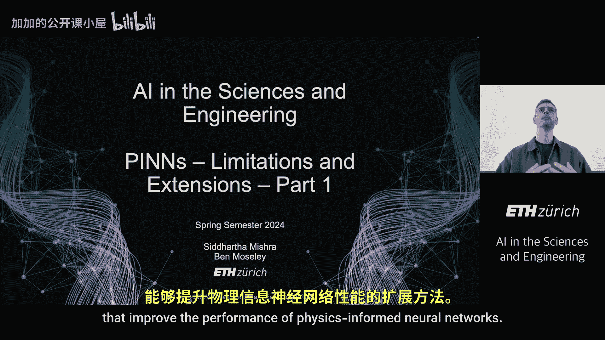
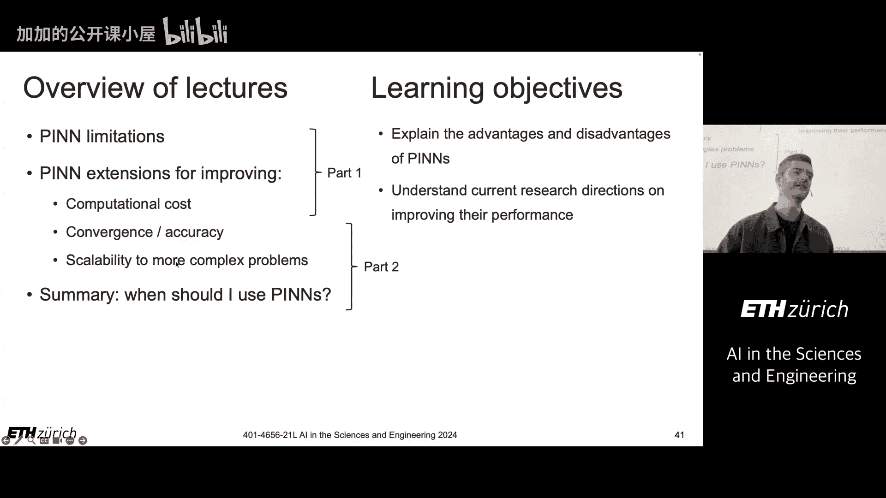

# 苏黎世联邦理工【中英⚡科学与工程中的人工智能｜2024 AI in the Sciences and Engineering】 p06 P6 Physics-Informed Neural Networks – Limitations and Extensions Part 1 -BV1smxgzHEPC_p6-

Okay， so let's get started with today's lecture this is the second lecture on physics and form neural networks last lecture I introduce pins to you。

😊，And this lecture and also half of the lecture on Wednesday next week。

Is all about discussing the limitations of pinINs and also the extensions and like I showed you there are so many hundreds of extensions at pinNs and it's not an entire research field by itself。

And so we're going to delve into some of these that improve the performance of physics and neural networks。

So before we get into the extensions， let's recap what a physics form neural network is。

So this is the key slide from last lecture and it has all the concepts behind pins in this slide。

So I'm just going to spend some time just recapping what a physics important no other case。

Physics and Form networks are ways to solve differential equations or problems related to differential equations。

And so the example in the slide here is the damp tunnel across later。

 which we looked at last lecture。And the key idea of a pin is very simple。

 it's just to use a neural network to directly approximate the solution to the differential equation。

So pinINs work from many different differential equations。

 not just the humong oscillator thing here and this is what we always do， we say the neural network。

 which is just a flexible function。That takes as input the coordinates of the solution。

 so in this case just the time coordinate because it's a oneD problem。

And then the output directly approximates what the solution value is so this U here。

 which in this case is the displacement of the oscillator。

And typically the network we'll start with is MLP a simple fully connected network， for example。

And it's really important to note that this is a mesh free approach。

 and that means that once we've trained this network。

 we get a function as as the approximation to the solution。

 which we can query at any point in the domain。So， this is。Different to how for example。

 finite difference methods work， where once we've run the simulation。

 we get the solution on a finite point on a mesh， so discretize on a mesh。Okay。

 and then the loss function that we use to train the network has these two main components。

 the first is called the boundary loss。And that makes sure that the network matches whatever the initial conditions and the boundary conditions we have of the problem。

So in this case， we're going to make sure that the oscillator starts a displacement of one and has a velocity of zero。

And so we just to get the velocity， for example， we just take the gradienting the network with a respect of time。

And then the important component is a physics loss and this is minimizing the residual of the differential equation itself。

So we know from the differential equation， this left hand side should equal zero。

And so we evaluate all these gradients that we require to evaluate that left hand side。

Using the neural network and we try and push that residual to zero。

So kind of intuitively boundary loss make sure that the solution that the network alones is a unique solution。

And the physics loss make sure that the underlying differential equation is made at every point in the domain。

 so we evaluate this at many colocation points， these green points in the domain here。

So as I said last lecture， this is a really key slide to understand so has anyone got any more questions on the basics before we move on？

Hopefully it should be clear clear now。Okay。So yeah I told you that pins are a general purpose technique for solving many different differential equations and so this is an example of using pins in two dimensions to solve the 1D burgers equation plus is time evolution。

 so  one+ 1D。And I'm not going to go into this in detail。

 but the only difference here is now we're sampling boundary points across the whole boundary。

 so instead of just needing one boundary point we need many。

And we sample colocation points in the entire domain and we explain that this is kind of an interesting problem to study because it forms a shock in the solution。

Whi traditional numerical methods often struggle with and so the pins seems to perform fairly well in this case。

And then last lecture， I talked about all the different types of problems that we can solve using pins and we can not only solve forward simulation tasks。

 but we can also solve inverse problems where we're given some observations of the solution。

And we want to understand what the some underlying parameters of the differential equation are。

 so these five parameters here。So for example， in the damp timeline of oscillator。

 it could be understanding what the coefficient of friction is or the spring constant。

And the way that we can solve these inverse problems is that we have this extra data loss term where we match the network's output to the observed data points that we have。

And then when we're train the pinI， we do a joint optimization where we both learn the parameters of the pin Theta。

And the underlying parameters of the differential equation phi jointly in the same optimization algorithm。

嗯。And then you can take this concept further and even try and start to learn the underlying differential equation by learning the individual coefficients for each term in the differential equation。

And so this is how we can use pins for equation discovery。So in this case。

 we have fire here now is a vector or a library of differential operators。For example。

 all the gradients that you might think would appear in the differential equation， so B B by Dt。

 B by D x， etc。And then Lambda here is a matrix which contains all the coefficients of that PDE。

And we we typically， so we do the same thing as an inversion。

 we match the network to some observed values of the solution。

And we jointly optimize the coefficients of the PD here to try and learn the underlying differential equation。

Now this problem is often very illd because there are many different combinations of PDs that the data could fit potentially。

 so we often add like a regularization like a sparsity construct to say we want the equation that has the minimum number of terms to be the one that we choose。

Okay。So we're on the second lecture of pins， limitations and extensions。like I said。

 I'm also going to do half of the next lecture is also going to be on extension zips。

I'm going to give half of that lecture and then Si's going to through come halfway and give the rest of the lecture。

He'll talk more about the theoretical aspects of Ps。

Then we're done with PIs and we'll move on to another big topic in SL or scientific machine learning。

 which is operator learning。Okay， so I've just explained that。嗯。

So I'm going to first in this lecture just talk about the limitations of pinNs。

 we've already touched on a few of them last lecture。

And once I've given you what those limitations are。

 then I'm going to spend the rest of the lecture telling you about how we extend pins to overcome those limitations。

And the one that I'm going to cover in this lecture is mostly focused on the computational costs and how can we make pins faster to train and this is a really important thing to be able to do。

By the end of the next lecture， I'll give you a summary on the kind of realistic cases where you should use pins and where you shouldn't use pins and should have a good idea of when they're the best techniques to choose。

So yeah you should be able to understand the advantages and disadvantage of pins by the end of these lectures and also in these lectures there's a lot of current research on physics and Form neural networks so you should be able to have a fairly good idea of the current state of the art in P research by the end of this。

Okay， so let's just recap the advantages before we talk about disadvantages and I talked a lot about the advantages last lecture。

So here's a list of some of the biggest ones as I've been trying to say pins pins are different than kind of traditional finite difference methods。

 for example， because they're mesh free and this means that we don't have to generate a mesh when we're doing the simulation and I told you in the course introduction just the active。

Defining a mesh in your computer program can take humans like days or weeks。

 depending on the complexity of the simulation。So being able to not do that step is a big advantage if the pin works。

Another big advantage of pins is that they can jointly solve these forward and inverse problems at the same time。

So I was telling you how we solve an inverse problem with a pin。

 we jointly optimized the theta values and the underlying parameters at the same time。

 this is kind of different to how we traditionally solve an inverse problem where we'll have a forward simulator and we'll differentiate we'll get gradientdiance to that forward simulator。

So in this case， we don't have to differentiate through the forward simulator。

 which can take a lot of time to do。嗯。So often theyre their best where we have these situations where we have some observations of the data。

 but we want to understand what the solution is， and maybe we want to understand what some underlying parameters are as well。

One thing I didn't mention is pins also have tractable analytical solution gradients。

Which this is sometimes overlooked， but actually quite useful。

So this just means that we can evaluate D by D T and D by the X， you know。

 the gradients of the solution with respect to its inputs， and this can be very useful for doing。

 for example， sensitivity in ASIS studies on how the simulation might change depending on some inputs。

嗯。And they're mostly unsupervised if we think of pins from a machine learning perspective。

 we have this PDE term， which is an unsupervised regularisr。

 and so we can actually get away with training pins with very little data and this is very different to these like big data regimes or ideas or training models。

Okay， so we'll talk about the limitations， so there's there's three big limitations that I'm going to cover。

The first one is computational cost and I gave you a hint of this last lecture。

I showed you an example with pins solving the wave equation。

 again we have like an earthquake or explosion in the Earth so in some which we model with a velocity model。

And the wave fluid propagates outwards and causes reflections and etca。嗯。

And this wasn't a very big network， it was only or like 10 layers。

 a thousand00 hidden units like that's not massive compared to today today's billion parameter models。

But even just training this network to solve this simple kind of 2D problem。

 it took an hour to train on a GP。And the finite difference simulation would take probably about a minute or less than run。

So this just isn't competitive with an numerical technique in this form。嗯。

The real killer is that once we change the initial condition。

 so if we try to simulate a source that's to the left or to the right。

Or maybe we change the frequency or something like that the pin has to be retrained for every new initial and batterytric condition so you know every simulation you run you're going to have to retrain a neural network。

Okay so that's a big limitation so let's talk about another limitation and this is the sometimes poor convergence of pins and it's not guaranteed that the pin is going to converge to the mini of your loss function and this goes back to our introduction to deep learning course lecture where we talked about all these error sources so you know the finiteness of the training data the approximation error of the network and the optimizer like the optimizer might not be able to navigate the complicated loss landscape of the。

That we're using to train the pin。Start。One of the biggest factors when specifically when training pins is。

This issue is how to choose these landda values。So I mentioned that the lambda values are very important because they control the balance between the boundary loss and the physics loss。

So for example， if we choose Lambda to be too small in this particular loss function。

It means that we don't care so much about the boundary conditions and we're only going to minimize the PDE residual。

But that's dangerous because that means the network could learn any particular solution of the PDE。

 and it might not be the one that we want given the boundary conditions that we have。In the opposite。

If landmbda is too large， then we're not going to satisfy the underlying differential equation and the boundary conditions might just be imposed everywhere in the domain。

So I've got an example of this。This is again using a physics inform network to solve the wave equation。

Now we have a point source that's propagating through this。A velocity model here。

 which is just a couple of Gaussians， basically Gaussian perservations。

And you can see the wavefield is like just propagating through these different perturbations and kind of squashing and changing its shape based on those perturbations。

And this is the pin so the top row here is the round truth finite difference modeling output。

The middle row is after I've trained the pin after the final training step。

 this is what the pin looks like。And at first glance。

 it looks like it does a pretty good job at estimating the solution。

But what's interesting is if I look at the loss curve as a function of training step。

So what I'm plotting here is the test error， so this is the difference between the pin solution and the ground truth solution averaged over all the points in the domain。

And it's very interesting to see that whilst it does converge it a fairly low absolute error。

Halfway through training， the loss is still incredibly high。And if you look a bit further。

 it's very spiky as well so what I would interpret this as is the pin solution thrashing around it it's really trying to figure out what the solution is。

And so it's interesting to plot the pins prediction of the solution training step 20。

000 so this is like here for it slight converging。And what you can see is it's learnt the anchor condition well。

 but then the rest of the domain， it's basically set a solution to zero。

So anyone got any ideas why this is zero here， why it hasn't even started putting amplitudes in。

So this how we initialize the ways？Maybe， yeah。Yeah， that could be a reason。

 it could be an initialization。Go。yeah that's a good point。

 so why is it a local minima in the loss function？Yeah， yeah， yeah you're on the right lines。

 there's another reason that's related to that。Yeah， so the way zero options。Exactly。Yeah， yeah。

 so you've got it so so if you go back to the wver equation。

A trivial solution of the wave of the equation is that you equal zero everywhere。

 but this satisfies the PDE constraint， it will give you exactly zero。InIn that physics loss term。

So my intuition， my guess here， and I think it's correct is。

If you think about the PD term in this whole part of the domain， you know。

 from this time point further。The PD loss is basically zero。

 so it's very happy that it's minimized that term。嗯。

The only problem is that there's some disconnect with the boundary condition you know just after just after the boundary condition。

 the PD is if you will be fairly high。But overall， the loss function is fairly well satisfied so that is definitely a local minima if you think of it that way。

So this， you can see how this lost landscape is quite difficult and you know。

Non convex for optimized。Okay， the final limitation。

 and it's related to the poor convergence is our ability to be able to scale pins to more complex problems。

So everything， all the kind of applications that I've been showing you so far。

 I would argue have been related to what I would call very simplified or toy problems。So for example。

 you know， waves propagating through just simple horizontally layered media。

Or maybe the fluid flow past a cylinder， this is kind of a canonical problem that we study in fluid dynamics。

But if we talk about having you know a significant impact in the world and having kind of real world impacts。

What we really want to do is solve these like large scale problems that people that we care about so you know。

understanding or predicting how the whole climate system evolves or， for example。

 how earthquakes propagate through the whole state of California。

Like if we could be able to solve these problems faster and more accurately。

 this would have a massive impact。But there's a massive difference between the left hand side and the right hand side。

And if you think about our traditional methods that we would use to solve these kind of larger scale problems。

It's often really challenging to scale them right this is why we're thinking about using machine learning to help。

Especially when we have multi scale multi physics systems， if we have larger or five frequencies。

And if we have noisian real or sparse data as well。

 these things can really make our traditional methods struggle。

And I think it's a very valid question to ask all these Sl techniques， you know。

 even though they have some kind of interesting ways to put scientific understanding into our ML algorithm。

How do they cope in these settings like do they scale in the same way or do they have different kind of limitations and that was that' kind of an interesting research question to me。

So yeah， how do pins cope in this effort？So unfortunately， pins struggled。

 especially in this case where we want to scale pins to higher frequencies。

So what I'm showing here is using a pin to solve one of the simplest ODs I could think of the U by the x equals co omega x right so the solution is just s。

And what's interesting to plot is how the pins performance as I increase the frequency of the solution。

 so as I increase omega here。So on the top left here is the easiest problem where the frequency is very low so frequency of one hit。

And I can train this very rapidly and very accurately using a pin and the pin only needs two layers and 16 hidden units。

And so in total， that's around 300 parameters to fit the sine wave of using a fully connected network。

If you look at the loss curve for this， this is the test loss as a function training step。

 it's this red line at the bottom here， so again it converges within a few thousand gradient sense steps and stays at quite a low level。

But the real issue comes when I increase omega and so if I go to omega equals 15。

 so a much higher frequency problem。the same pin with two layers and 16 hidden units here on the top right。

Really struggles to fit the solution and in fact it only fits maybe six or seven of the cycles。

So why don't you think that it can fit any more cycles in this case？Y。Yeah。Yeah。

 exactly so we only have 321 parameters in this network and so there's just not enough to fit all of these cycles of the solution。

Yeahep。Yes。Well yeah absolutely so the point the question was doesn't this show that the network doesn't learn at all but simply memorizes so I agree I said last lecture pins suffer from the same issues you know estimation error issues as standard neural networks so they still have generalization error。

 approximation error optimization error。嗯。And we're not telling the pin that we expect that solution to be sinaloid this is just a flexible function that's trying to fit to the signine curve。

There are ways to put kind of understanding of what you think the solution will be into the Ps architecture。

And I'll talk about that for next lecture。Which can help。

So the only solution in this case if we're stuck with using an MLP is to increase the size of the MLP。

So this is the plot if you increase it to four layers and 64 he units and you can see it learns more cycles。

 but not all of them。And I have to push it all the way to five layers and 128 units and this is taking60 over 60。

000 parameters just to fit a sign curve。And even so。

 if you look at the training the test loss as a function of training step。Even though it decreases。

 it's nowhere near as perform as the low frequency pin。

So I've got a little animation of this just to show you in an animation and so this is a pin training on this stamp harmonic oscillator problem。

It's the same as what I've been showing before， but all I've done here is just increase the oscillators frequency。

So we're modeling up to more cycles here。And what's happening is the pin is really struggling to fit the solution。

嗯。Okay， so there are three big limitations， I would say apppins the computational cost。

 especially for forward only problems for inverse problems， they're more competitive， like I said。

 because we don't have to run the forward simulator thousands of times。

they can be hard to optimize because of these competing terms in the loss function。

And they're changing to scale larger domains， like when we have high frequencies or multi scale frequencies。

So that sounds fairly dire。But the good news is that there are many。

 many pin extensions and there are many better alternatives than just training a fully connected network on the solution。

So as I said before， this is a whole research field now in its own right and this Rley paper has got over 8。

000 citations now of and if you go into those， there's hundreds or even thousands of applications and extensions of pins that people have shown。

So we're going to talk about a few some selected examples in the lecture， we can't cover everything。

So I'm going to move on to talk about extensions for improving the computational cost and that's going to be the rest of this lecture next lecture I'll talk about those other two limitations the convergence and the scalability to more complex problems。

Okay。So computational costs， how can we improve this？

So one big idea is this idea of conditioning the pin on additional inputs。

So it's a very simple idea it's to say。Instead of having to retrain up in for every new initial condition or boundary condition。

Why don't we just add those initial conditions or other PDE parameters that we want to solve across it's just additional networks to the additional inputs to the network。

So let's think about this seismic simulation task again。

 and this is our standard pin where we just the only inputs of the network are the coordinates and the time value。

And the output is the seismic pressure， essentially。

So this is how a conditioned pin might work if we want to train the pin to learn across one of the initial conditions。

So say that we want to learn a model that。Is able to predict the output no matter where the source location is。

So what we would do is we would add the source location here， the X and Y coordinate of the source。

As an input to the pin。And then once this neural network has been trained。

 we don't have to retrain it on a new source location we can query out any source location it will give us a prediction of the solution。

Okay。So yeah，为我睇你。Yeah。Yeah， so。I will answer that once I've talked about how we train it， but yeah。

It's a good question。So this is the loss function we use for the standard pin。You know。

 PD residual and boundary conditions and in this example I just trained the pin。

With a few time steps of the finite different solution is the boundary loss。

 that was just how I defined it。So it's just trained this on this red。

 essentially this red time step here and it's learning to propagate outwards based on the PD loss。

So how do we train the condition pin so it's very simple， the same loss function。

All we do is we not only sample over the pro locationation points and the boundary points。

 we also sample over the sources as well when we're training the pinned。

So let's think about the boundary loss， we have to generate lots of finite different simulations with different examples of the source location。

To match now because we want to generalize across the source location。

So this is boundary loss is now matching the network's output across many different boundary or initial conditions from the finite difference or。

And then in the physics loss， when we remember this is still unsupervised。

To evaluate it all we needed all we needed before was random points of X and T now we also just randomly sample an S value and we make sure that the physics losses are paid across all the S value inputs to the network。

Does that make sense to everyone？So it's just simply adding an extra input to the network and training over it。

嗯。So this is some work that we did， we tried to condition this physics informed network on the source location。

And we took this velocity model， which is a more complex velocity model than I've been joining。

And the white points here show you the source locations that we used as training points。

 so we've carried out a finite different simulation at each white point here to get our boundary data and then we randomly sampled across this area to evaluate our physics loss as well。

And then。The test tester runs here that I'm showing just samples from these red points。

 so kind of in the same distribution， but not exactly the same training points。

And you can see that the P does learn to generalize across the source location。

 is allowing us to evaluate the amplitude of you know， wherever the source is located in this region。

AndThere's some interesting things here， so the pin solution is not。

Very accurate compared to the ground truth actually。

 so what it does do is a good job of getting the direct arrival so this like the main amplitude response at the wave。

But it starts to really struggle with getting the reflections and I think this is in part because they're much lower amplitude than the direct rival。

嗯。But what it does mean now is that this pin doesn't need to be retrained for each of these sort locations。

 so we can do some interesting analysis with this now so for example， we can say。Remember。

 I said you have tract tractable solution gradients。 we can say how does the simulation vary。

With the values of S so what。If I change the source location， how does the amplitude change。

 is it very sensitive or not and this is a very interesting question for for example seismic hazards analysisis when you want to know what the amplitude of response is at the surface。

 whether it's going to be a big shock， if an earthquake occurs or not and how sensitive is that to the location of the earthquake exactly？

So this type of surrogate model where we've got a fast kind of approximation of the solution can be very useful in industry。

Okay。Here's another example of a conditioned physics inform network。嗯。

So this is an example of using a deep net with a physics informed constraint。

Sid is going to talk a lot about Dpon nets and Dpon nets are more commonly known as an operator learning technique and he'll talk about that from that perspective。

But from this perspective， as a condition pin， you can just think of it as a condition pin。

 this physics informed form deep up。And so what is the network architecture。

 it's just a essentially a fully connected network that again gives me a prediction of the solution of our differential equation here。

And it takes in our X and our coordinates in our main。

 but it also has us a kind of special conditioning input。

That allows us to condition the output based on some function here。

That's the architecture and this is an example of using a deepponNe to solve the reaction diffusion equations。

So this is the reaction diffusion equation and in this equation you here would represent。

 for example， the concentration of some chemical reaction as a function of space and time。

And what we're interested in doing is predicting the solution for different values of this function here。

 this F term。So the way the deepO works is it just discrecratizes this function over endpoint。

 so it takes n samples of that function into as a vector。That's the conditioning input to the deep。

And then the other inputs of these X and T values within the domain。

And this paper trained this deep using exactly the conditioned pin loss function。

 so you know a boundary loss and a PDE loss。And this is the result they get that these are different examples of that conditioning function here and this is the the prediction or the exact solution and the predicted solution based on that conditioning function。

嗯。So I put this example in because this is an interesting way to think about deeppots and you can compare that to how SiD will describe them in the operator learning lectures。

Okay， so the next way to speed pins up is to discretize their outputlets。

 so this is what a technique which is quite different， which I call I described as discretized pins。

嗯。And so what is the discretized pin？So the idea here now is to say。

Instead of having a fully connected network that is giving us a functional approximation to the solution that we can query at any point in the domain。

We're going to go back to just trying to predict the solution on a match of points。

So we're going to have some neuraler network。And the output of the network is going to be a discretized solution。

 so a matrix of values， like for example， if we want to solve the burger's equation here。

 it would be 128 by 256 points。And the network that's going to produce its solution。

 but now let's just say that it just has a fixed input， just maybe a random number or just a zero。

And from that value， it dedes that value into the solution， so for example。

 we could use a transpose convolutional architecture to do that。

So the process of learning the weights is then to just to match the output to the true solution somehow。

So yeah， to be very clear that the neural networks's outputs。

 the elements of that matrix and now the solution are those grade points。

 and it's not a functional approximation， is the difference。

So how do we train this network in a similar way to how we would train a pin？

So we can use a very similar loss function to train this network in an unsupervised way。

 just like pinIs or unsupervised。So what we do is we say we have this output submission here and we still want to minimize the residual of the PDE of that output solution。

And we know that， for example， the Burgers equation here。

 we have to evaluate the gradients of the network with respect to T with respect to X。

So here we have a discretized solution， so the way that we can evaluate those gradients of the solution is just to take finite difference derivatives。

So we replace our exact derivatives that we can get from a fully connected functional approximation。

To finite derivatives that we get from just taking differences on the grid。

And it turns out that we can use this loss function and train this to match the solution just like we can use this loss function to train the pin。

So to be。Retally explicit when we're evaluating the derivative of the solution with a respect of time。

 we just use like a finite difference on two elements， for example。

Does anyone have any questions on that， that's kind of a different way of thinking about this？Yeah。

What exactly would the input that you're providing and just date and say fixed value？Yeah。

 so in the simplest case， it's a fixed value and it can be anything。It doesn't matter what it is。

 but it should stay fixed， it should never change。If you think about the function that this network。

 this network is representing， it's like a function。

 it's a vector or it's a function that takes us here， it takes a scale of value as input。

 it gives you a matrix's output。And that function has some free premises。

But you just think of that as a black box function with some free parameters that we're tuning to make the output match。

The solution of PD。Does that make sense？But if I were to suppose change the input。

 let's say how would that change my whole yeah， would change it in a really strange way that doesn't make any physical sense。

So we're only using the architecture just as a way as a flexible function。

 which is hijacking the fact that it's a flexible function that we can train。To produce a solution。

 we're going to change that in a minute， so it's going to make more sense but this is the this is the direct dialogue with it as if we were going to train the pin。

Yeah， gone。Yeah， this could be thought of as a decoder， for example。Yeah。

 but the difference is that this doesn't have any physical， the way that I framed it。

 it doesn't have any physical meaning at the moment。Yeah。

But you understand how we replace the exact derivatives with just the finite difference derivatives Okay。

 yep so you got it so we're going to change we're going to change it now。just before that。

 it's actually the one thing I didn't talk about was how we make sure that the solution obeys the boundary conditions。

 so that actually this is really important。I only showed you the physics loss here。

 what does the boundary loss look like？Well， we can't really have a loss function that asserts the boundary definition here because。

But I guess you probably could actually， but a better way to do it is just to make them hard constraints because we can do that here。

So we just add padding around the outside and we just pad with the values that we know the boundary values。

So for example。We know the initial condition here that the the fluidflow should start with a sign of audioial profiler。

So we're just going to pad the elements here with a slightly of audio function here。

And likewise here， we're going to add these values to be zero to make sure the flow outside of the main is zero。

And you can see that when we start taking these finite difference derivatives。

 we're going to be evaluating the derivative against those pad values and that's is what's going to constrain or make the solution converge to the particular solution。

So this is kind of different to normal pins because we're having hard boundary constraints we don't have that issue with the different Lada values in the loss option anymore。

Yes， but we don't solve an numerical method。With like linear solves because the function that we're fitting is not like a linear function。

 it's like a complicated one。Yeah， yeah， just for the bunch of terms， yeah。

So just the padding was just so we don have those clients when we yeah do the also that yeah yeah so this you can see how we're getting closer to finite difference methods in I guess the key differences is the function that we're fitting is like a no nonlinear function so we have to。

When we train this， we're using。We still use AutoDff。

We still use Auto dip here to update the weights， so we're still using the gradient descent to actually conversege the average。

Doesn't even it has a metric fee。Yeah， yeah， so this now depends on the mesh and this is the limitation of this method。

Yeah。Okay。So as someone suggested over there。What is great is now we can also condition discretized pins just like we condition normal pins。

And we change that input instead of being some random fixed value。

 we change that input to be the parameters that we want to condition the discretized painover。

So for example， in the Burgers equation， you might want to be able to simulate over many different viscoity values and maybe many different initial profiles of the float。

And it's the same concept of condition pins where to train this， we use the same loss function。

We just inside the loss function， we sample over all these different inputs when we're train the network。

So for sample， the physics loss over different viscosity values and different kind of initial conditions in the padding of the output。

So now it starts to make more sense， I guess that this is like a fast surrogate model。

So whats what's the other way that you could train this， by the way。

 just forget about this physics loss function？What we have here is a CNN that takes in some initial conditions and gives us a discretized version of the solution or the other way of training it。

Be first call。Yeah， yeah， you could so if you're given examples of this you could try and learn this instead。

 y and that you can directly learn them up， that's a really good idea。

What I was thinking of is the simplest way to train it is just it with a purely dated driven loss function right you can just generate loads of finite different simulations and just train the network based on those。

so what's what's cool about this method is that this doesn't need those simulation training examples。

 so we don't have to spend。The expensive computation to get training data。没来。

So this is one of the main papers that proposes this kind of technique and it's yeah a very influential paper。

 you definitely should read it。And the example one of the examples they showed in the paper was doing a condition discretized pin。

To solve the Darcy play。So this is given some porous medium。

 so this could be just a rock with fractures in， for example。

Can I predict what the pressure is across that media of some fluid going through the media？

And what the flux is through the structure of the rock。And yeah。

 what's really cool is that they trained this so they used a more complicated architecture。

 it was had convolutions and fully connected networks and other kind of things going on。

But they trained it with this physics loss， so fully unsupervised no simulation data required。

Only requires input permobil fields is the input， that's the only thing you need train to train this to converge。

And they're using sobel filters， which is just finite differences essentially to get the gradients of this physics loss。

So here's some examples of the simulation， I think this is the prediction and the simulation ground truth simulation。

Looks like it does a really good job at modeling this today。

And they produced a couple of plots in the paper， which are quite interesting to look at。

What we're comparing here is the test accuracy， so the accuracy averaged over many example inputs。

As a function of the number of training data that we have。

So this is basically for the unsupervised discretized condition pin。

 this is the number of input permeability fieldss that we train it on。

And you can see if we train it on more more inputs than the error decreases nicely， which is good。

 they also compare it to the data driven version， which is the blue line here。

So the data driven version is when they've generated。

Many thousands of example simulations using Gr truth modeling。

And what's kind of cool is that the unsupvised method is nearly as perform。

 especially when you have more training data as perform。than the supervised method。

 so you don't need simulation data to destroy these models， it's kind of cool to show that。

What's even more impressive is if you test the network given some input that's outside of its training distribution。

 so the generalization error of the network say if I give it a permeability field that has way more channels or way more connections in the channels。

they found that this unsupervised model， the discretized pin。

Has better generalization performance than the model that's trained with only data sort of fully data driven model。

So that's kind of interesting， maybe maybe the physics loss is imposing more of a physics understanding into the network somehow。

So advantages and limitations of discretized pins， advantages we can now start to use fancy architectures like CNNs to learn the inputs and outputs。

And we can extend them to regular geometries， we can even do time dependent versions of these with RNNs。

The limitation is that they require approximate gradients and we only we fixed to the mesh that we use。

 we can't change the at。Okay， I've got more one more slide to show you before we finish。

And this training pins with finite differences。The main。

Reason why pins are slow to train is because we have to compute these gradients。

 the gradients of the output with respect to the coordinates。

 and I showed you last lecture that takes a lot of time to do。

So the idea here is to not use orthoDF to get those gradients。

 but instead you finite different methods to approximate those gradients。

And you can get kind of two to four speedups just by doing this。

 but the downside of this is then you're using approximate gradients and this choice of AE this like width of the group filter is a very important choice。

Okay， so I've covered just the first extensions of pinNs which improve the computational cost next lecture I'm going to talk about improving the convergence and then also the scalability to higher frequencies。

So yeah， thanks for coming and see you next time。

