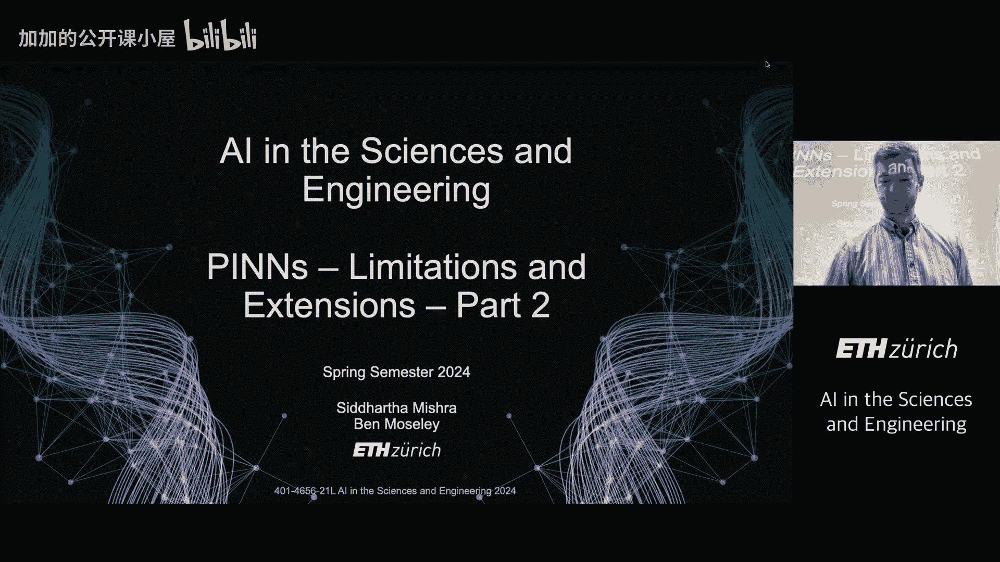
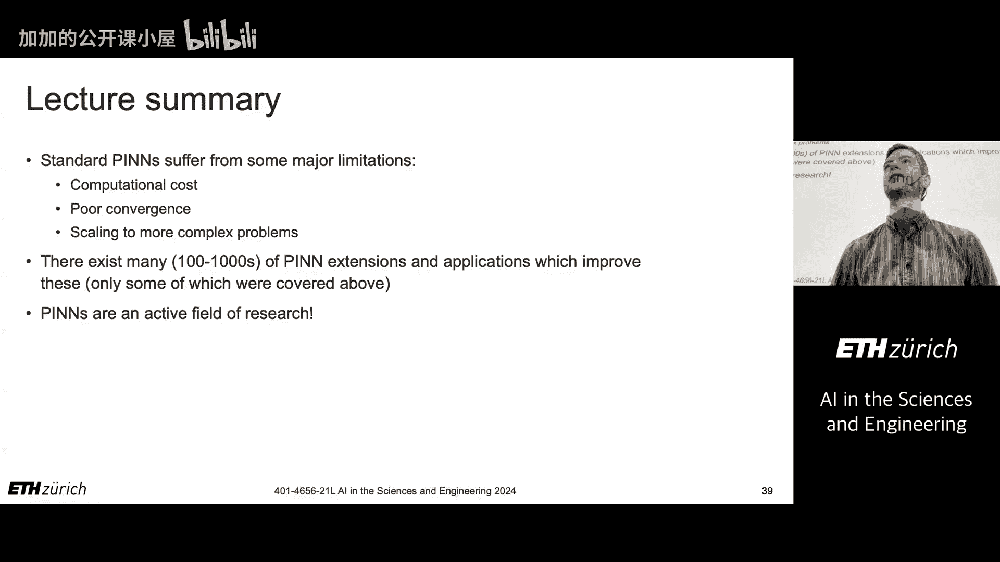

# 苏黎世联邦理工【中英⚡科学与工程中的人工智能｜2024 AI in the Sciences and Engineering】 p07 P7 Physics-Informed Neural Networks – Limitations and Extensions Part 2 -BV1smxgzHEPC_p7-

So this lecture is the second lecture on the limitations and extensions of pins。

So we talked a lot about some of the limitations and extension this last lecture。

And so this is going to continue that discussion。

So let's just recap a couple of things on last lecture。

And this is the key slide showing you kind of the main advantages and main limitations of at least standard physics form neural networks。

嗯。And。We're focusing on these two lectures on these limitations and so I just I described these last lecture。

 the big kind of three limitations that we typically see is that pins often be competition expensive to train。

Especially when you only want to solve the kind of forward simulation task we've with pins。

They can also be very hard to optimize it's not obvious or trivial whether the gradient descent or whatever whatever optimization algorithm you're using will converge to the kind of。

Global minima of the loss function。And often that's not the case。

And couple to that can be very difficult to scale in some more complex kind of maybe multi physics or multi scale problems。

And so we talked a lot last lecture about the first one。

 how do we improve the computational costs that pins。

 can we speed up how they train or perhaps whether they can learn across problems so they don't have to be retrained for each solution。

And the whole point of these two lectures is to tell you that yes， these limitations exist。

 that there are pins by now is a massive research build and there are so many extensions that try and address these limitations。

So what were the ways we discussed to kind of speed up physics inform neural networks one of the main ways that I described to you was a very simple idea and it's just to condition the pin on additional inputs of the simulation that you're trying to carry out。

So them I call these condition pins。And for example。

 we looked at simulating seismic waves through the Earth。

And if you just train a stand pin on this simulation here。

 you would have to retrain it for every source location that you use。

 so each new initial condition of the simulation。So what condition pin doesn't set is it adds those the source locations。

 the x and y location of the source。To the as an input of the network。

 and then we train over many possible earthquake source locations when we're training the pin and so this trains a surrogate model。

Which once trained can generalize across the source location。

 at least in the training distribution that you trained it， trained it over。

We also talked about these things called I call discretized pins。

The fundamental difference with discretized pins is we instead of using the neural network to directly approximate the solution to the differential equation。

And what I mean by that is。The neural network represents or directly approximates the function itself。

Now， instead。We say that the network outputs an estimation of the solution。

 but only on a grid of points， so we go back to estimating a discretized solution。

Now that seems like a limitation， but it has advantages and the main one is that you can then start to use kind of different neural network architectures。

 things like convolutional networks that，Maybe help represent or learn kind of spatial correlations between the inputs and the outputs of the network。

So how do we train these networks well we can't get derivatives of the output with respect to coordinates anymore because the coordinates are not input to the network。

 they're implicit in the kind of output mesh of the network itself。

So instead we use finite differences， taking differences between each mesh points to get our derivativeants with respect to X and T or whatever the coordinates are。

And I also explain to you that we can condition these just like we can condition pins on。

 for example， initial conditions of the PDE。So when we're solving the burgerger's equation here。

 for example， we can add the initial flow velocity。

 which in this case is a sine wave at time equals t and maybe even the viscosity parameter of the underlying differential equation as well。

And in the same way， this network will train and learn a surrogate model。

 which will be very fast once it's trained。And here's an example。

 a paper that implemented these scritized pins and they showed they trained them to solve Darty flow。

 so the flow through a porous media。And what I find kind of。Remarkable or really。

 really great about these methods is that they're fully unsupervised so you don't need any training data to train your surrogate model。

All you need to know is what the underlying differential equation it is， it needs to satisfy it and。

And lots of examples of inputs， like initial conditions of the system。

And it all learns to simulate just through this learning process and minimizing our PDE residual。嗯。

So that's the kind of big advantage of these methods。

Okay so I already explained this we're talking about the limitations of pinNs and last lecture I covered the computational cost。

 so this lecture is all about thinking about the other two limitations so how can we improve the convergence of pins to improve the optimizer or navigate the lost landscape better？

And then how do we really scale pins to problems that we care about， you know。

 solving like big multi scale multi physics simulations？

And these two are very challenging and still definitely open areas of research。嗯。

So originally I said last lecture Sid would take over halfway in this lecture。

 we decided he'll just come and give his first lecture on Friday on the theory behind pinINs and so thatll be the last lecture on pinINs and then Sid is going to carry on teaching for a large block of lectures and he'll be talking about operator learning and there'll be a lot of lectures on that topic。

So I'll come back after this lecture。Here when we start talking about differentiable physics and hybrid workflows and I'll take the lectures till the end of the course。

As well as our guest lectures。Okay， so let's talk about this second limitation。

 the poor convergence of physics and form neural networks。

So this is a slide that I showed last lecture when I was giving you the high level description of these limitations。

And let me just tell you what is happening here again。

 so what I did in this experiment was train a pin to solve again the wave equation so that this is simulating。

A seismic wave starting at a very point source essentially and exploding outwards。

And the pin after the training is able to model the solution， which is good。

But what's interesting is if you look at the convergence curve or the L1 test loss。

As a function of the training step of the network and what I showed you is that the pin exhibits this thrashing behavior。

Where only after maybe halfway three training does the pin actually start to converge to the solution and if I plot the pin solution at training step 20000 so you know somewhere around here。

You can see that the pin has only learnt the initial condition it't and it's put zeros essentially everywhere else in the solution。

So can anyone remember why this might be the case， why did we decide this was happening？呃Yeah，再 good。

It depends yes。Yeah， exactly so。The underlying wave equation here。

 a trivial solution is that U equals zero everywhere。And so this whole。Part of this of the domain。

 you know， from T equals 0。01 to all the way for the end of the domain。

Is satisfying that PD residual term in the loss function？嗯。Just after the initial condition。

 the residual loss is probably quite high， but on balance across the whole domain。

 it's tried to minimize it to probably a local minimum in the loss。

So what we have here is a natural competition between trying to satisfy the boundary condition and then trying to satisfy the PDE loss。

And it is often the case that there's a trivial solution that is much easier to satisfy in the PDE loss。

 that doesn't satisfy the boundary recognition and there's this kind of communication that needs to happen between the two loss terms。

And so this is just。Reiterating that point， again， we have our boundary loss in our loss function and we have our physics loss here。

And a key way that we can kind of control the balance between those terms。

Is by is through these lambda values So these are kind of for a stand pin these are just scalar。

Positive numbers that we uniquely choose by hand， so it comes down to human experimentation like scanning across these parameters to see which pain converges best。

嗯。And yeah， if Lambda is too small， it doesn't learn a unique solution and if Lambda is too large。

 then it only satisfies the boundary conditions。So what I've got is many actually different approaches or ideas you can think about to try and overcome these。

The competition between the Lada terms or maybe help the network learn to minimize both those terms at the same time。

So the first kind of idea is is。Is called hard boundary conditions or hard initial boundary conditions。

So what does this do， this says， well， at the moment， if you look in the loss function。

The initial conditions are satisfied in a soft way。That means that。

The final network that we train might not perfectly satisfy the boundary conditions。

 this the boundary loss might still be greater than zero for example， and typically that is the case。

So but is there a way that we can reframe the optimization problems or the way that we could find them pin so that the boundary conditions are always exactly satisfied so we don't even have to worry about matching the boundary conditions in the network？

So it turns out there is a way to do this so there are many ways to do this。

and kind of one of the key ideas is to use the neuraler network as part of a solution and。

So do people know what I mean by an an？Some some some yes and some again。

 so what I mean here is that。Instead of。Saying that the neural network directly approximates the solution。

 so neural network approximates U of X and T。What we now say is that the solution or the neural network is part of the mathematical answer。

 so this is just some mathematical function， which is our like guess of what the solution should be。

And so the neuralA network is now part of the mathematical Landsats and that entire LandatAT approximates the solution rather than the neuralA network directly。

And what we do is we design by hand usually that mathematical an so that it already satisfies the initial boundary conditions without us having to train the network。

So let's just take this example of the Burges equation。

And we had importantly these two initial conditions or boundary conditions。

 so we said that time equals zero。The starting speed of the fluid should be a sinaloidial curve。

And then on the edges of the domain， the flow should be zero。

 so this is modeling the flow through a pipe。So if we just assume that our solution is approximated by this mathematical function。

呃。And the neural network is the only kind of learnable or flexible function part of that function。

what we're doing is we're timeizing the network by t minus1， x plus 1， x minus1。

 and then we're subtracting minus sine pi x。So now just by choosing this anset。

 you can see very easily that it already satisfies these initial boundaryric conditions。

So you can see that if， for example， I plug in we want this first condition。

 U x equals time equals zero should be this sine function， so here when t equals zero。

What happens to this whole time here？It' yeah。It's zero， right， yeah， it's obvious。

So then u x equals t equals0 is exactly sine pi x。So we don't have to use a lot of boundary time here。

 same with these two constraints so you know if I set x equals to minus one here。

That zero is up this term， but also sa x equals minus1 is also zero and so that also satisfies this。

So the key point is that if we and the difficult thing is to choose the answers， but if we can do it。

 then this turns the whole problem from a constrained optimization problem where we have this boundary constraint to an unconstrained optimization problem。

Where all we're doing is minimizing physics loss and we get rid of this competition between these two terms。

Does that make sense， does anyone got any questions on that？

So where might you not be able to use this kind of handwritten answers？

Anyone see any limitations with that？Yeah。😊，Yeah。So Kong is part of the new。In a inequality。Yeah。

Yeah， yeah， so if your initial conditions have some inequality or something like that。Yeah， maybe。

 yeahep。So another reason is that。Here the boundary conditions are very simple Think about solving a much more complex PDE。

 for example。I want to model the flow past like an aircraft wing or something。

And I have boundary conditions over the wind。Then I have to somehow write that as a mathematical constraint inside of my assets like how am I going to。

Determine the distance to the wings so that I can zero out the neural network's value at exactly the wing's location。

So there are ways around it， but it can be more challenging when the initial conditions are more complex。

Yes，And would that thousand9 of question between head。来なね。系哦你什么す啊。Yeah， so actually。

 if I hear what you're saying correctly， but there are approaches where you can like learn distances to the boundary using another neural network and then use that trained pretrain network to help you write these answers。

So this is another approach。Yes。Okay， so there's a couple of things tonight note。

A nice kind of machine learning interpretation of this is is just to think of this final kind of。

Evaluation of his anats it' just the final layer of the neural network。You know。

 we're just taking some output of some hidden state and then we're time it by some value and doing a subtraction sign like it's a weird kind of activation or kind of lay it lay but nonetheless it's just an extra computation on top。

And if you think of it that way， then it's really obvious that you can still get gradients of this with respect to the inputs which we need to evaluate the physics loss because we can just use autod to differentiate through the whole landat。

And what's also really neat now is we don't need any training data at all。

 we don't need any examples of the boundary conditions because they're heart constraints and so they're pinning our trains in a fully unsupervised way。

And it turns out this can definitely help for a lot of problems so this is a paper that was solving the fluid flow。

 I think so I think this is the yeah incompressible one slopes equations。

Through a pipe but the pipe has astrict is constrained in the middle。

 so it narrows in the middle and you get a speed up of the flow。So this。

It turns out when they were testing different pins， so this is the grounds true solution。

When they were testing different standard pins， they couldn't find any value of Lambda so when they were using both terms in the loss function to converge onto the solution。

 probably because there's quite a big competition between the band really loss and the physics loss。

But when they use the hard constraints here， then they were actually able to converge the pin so this definitely helped for this particular example。

Okay， so let's think about another approach to try and help that alleviate the competition between these two terms。

And。One idea， again quite a popular idea is to now think about using adaptive landers。

 so instead of me going and by hand manually trying to scan for the right value of the of Lander to use。

Why don't we try to adapt them based on the algorithm or based on the pin as it's training？

So what this paper suggested is is the。We don't just have a single lambda value for each boundary return。

We actually have a single lamb of value for every co location point and every training point that we train the pin with。

So here。When we're summing across all of our boundary points and when we're summing across all of our colocation points。

 we times each term each sum element in the loss function by a separate lambda value。

So that's the first idea to have more lambda values to weigh each point by itself。

The second idea is to learn these Lada values as we're training the pin jointly whilst we're learning the theta values。

 the parameters of the pin。So how do they learn these for they do this kind of two level kind of optimization？

Where you first update the weights of the pin just like normal when you just by differentiating through the loss function。

But then you then take a step where you update the Lambda values and you do this by doing instead of gradient ascent on the loss function。

 you do gradient as on the loss function。So why does that make sense。

 why would you update the Lada values using gradient ascent？我。

Just think about DL by D Laer here for the physics lost term。

It's very trivial to show that this gradient of the loss with respect to Lada is just the residual value itself。

You can just see that way because it's landedized by the residual。So then why does this still。

 why does this make sense， why should we。Change the lambda value by the residual can anyone think of why that's a good idea？

Yeah。😊，People find out what losses the highest yeah exactly you've got it so what this is doing is is saying okay。

 where my losses for remaining pie？You know， I should increase the value of land or I should care more about trying to minimize the residual at that location so you can think of our residual as a function across the domain and we're picking out the points where the residual is high and we're trying to pull them down to zero。

And putting more preference on that。So from a machine learning angle。

 you could kind of think of Lander as like an attention mask。

 it's like where should I attend to in my optimization landscape to try and minimize the residual。

And so yeah， this paper。Implemented these so called self adaptive pins。

For the Helmholtz equation and other problems too。And it converges as， well。

 this is the pin solution on this fairly high frequency problem。

And what's interesting is you can plot the final Lada values after the pins trained。

It's kind of curious or interesting to try and interpret these lambda values what seems to happen here is。

The pin is focusing on the high amplitude regions of the solution。

 so it's really trying to match these peaks of the waves。Okay。

Now another idea going along this kind of theme of asking， well。

 where is the PD residual high in the domain as we're training and can we target that region？

Or we can do instead of weighting that region in the loss function。

 we could actually just add more colocation points where the PD residual is high。

 this is another strategy to try and focus attention on the regions where there's error。

So you can just imagine。Normally when we're evaluating the physics loss。

 we're summing over all colocation points to get a scalar value for the physics of digital。

But you can just plot this here， which is just the difference before the summation。

And that is just a value that you can plot across the whole domain。

And so you can just imagine seway're training a pin to fit some solution and it turns out x equals 0。

5 like in the middle of the domain， the residual is really higher。What we can then do is say， okay。

 we're going to sample more coloc points close in the middle。

And hope that that improves the conversiongence because we're really focusing on the PD residual。

So this is the idea is to adaptively sample these co location points as we're training by treating this PDE residual as like a probability distribution that we can sample from。

嗯。So to do it， we just as we're training， we just evaluate the residual and we define a distribution that is exactly that residual divided by some normal and constant to make it a probability distribution。

So this kind of， you could think of this as like the pin analog of adaptive mesh refinement。

 like if we have a fixed budget colocation points， we're like optimizing as we go through where we want to put those colocation points to solve the solution。

And indeed this paper， they tested this adaptive refinement methods。

 these are the kind of bottom three techniques in the table here across different PDs。

 so the wave equation focus equation diffusion and。嗯。

And it does seem that these methods perform much better than kind of just doing grid sampling。

 for example。The other approaches you could think of or the other approaches that they used in this table are also interesting to think about so instead of just using grid sampling which。

In general seems to be the worst thing to choose， they also tested random or quasi random sampling。

So these are all the kind of strategies that they tested and this is what the codification points look like。

I'm not sure but I think Sid will go into more details about why we should use quasi random sampling in his lecture。

嗯。Any questions on this method before I form you on？Yeah。

 so can I just with the kind of like a vector of loud this？P。嗯。对对。

Heres differentiate the muscle should affect these las。

You were talking about the previous techniques so the adaptive landers yeah so these are two separate techniques but the first is to adapt the view learn landers。

 second is to adaptive be shift accvaation points。I'm not sure you could do both at the same time if you're thinking that。

Because the landers depend on where they are in space。

 but I don't know that could be an interesting idea。Okay。

 so we're going to move on to limitation three， which is scaling to more complex problems。嗯。

So this is a really important question really。Most of the kind of applications of pins that I've showed you so far are solving what I would describe as tool or simplified problems。

Where you know， we're solving the fluid flow past a cylinder or we're doing wave simulation in a very restricted domain。

But what we care about really or what we're shooting towards。Is designing new simulation algorithms。

 new inverse algorithms that can cope with。Real world problems like can we simulate earthquakes across the whole state of California or can we do a full global climate simulation？

And this is just a very valid question is， you， how to pins or more generally。

 how do these scientific machine learning techniques still we' studying scale to these types of problems？

And our traditional algorithms often often really struggle in these settings。

 so you know as we add more multi scale multi multi physics components。as we add higher frequencies。

 when we start to think about real and sparse and noisy data。And I showed you this example。

 this experiment last lecture to describe this limitation。

And I'll just recap it so what we're doing here is we're training a pin on。A very， very simple ODE。

 which is the U by the axis coomeor X， and the solution is just a sign case。

And what we noted is that。The pin converges very quickly for a low frequency solution。

But as soon as I increase the frequency of the solution， the pin。

 the standard pin really starts to struggle and I had to increase the number of layers and three parameters in the pin just to be able to model the cycles of the solution。

 going from 320 parameters to over 60，000 parameters in the pin。And not only that。

 the accuracy of the final solution is much poorer in terms of relative loss than the pin in the low frequency case。

So this is a big issue if we want to scale into these kind of more complex， more complex problems。

So why is this the case， like why is the pin struggling to solve high frequency problems？

So one of the reasons and it is a big reason is this kind of so called spectral bias of neural networks。

 so it hands up who's heard of spectral bias。Okay， maybe one or two， yeah。

So this is a general property of neural networks， even if we're just training a neural network and not a pin so just with a supervised loss to match some data。

N networks tend to prioritize learning lower frequency functions first。

 or they take much longer to learn higher frequency components in their training data。

So this is an example that was this is a paper that was investigating spectral bias and what they're doing here is they're just training a neural network to fit a multi scale function so this is not a pin anymore this is just supervised loss trying to fit this function。

And as you see how the neuraler network trains， it starts to fit these low frequency components of the function first and then eventually fits the high frequencies。

And you can kind of see the frequency content of the solution as a function of a training integration here。

So。This is actually one of the reasons why early stopping。

 remember I was talking in the deep learning introduction about early stopping being a good regularization method。

 it helps to stop your network overfit your data。You know。

 maybe this low frequency trend is actually it's a good trend if this data is noisy。

This is a reason why early stopping can work。So this is just a mean squared error。Yeah。

 so no regular， this is just difference between blue line and green line。Yeah。So that that's it。

So what's really interesting is there's a whole theory behind this that I don't have time to go into。

 but you can use tools like neural tangent kernel theory to actually analyze under certain assumptions of the network's architecture。

You can actually prove convergence rates of different frequency components you can show that higher frequencies converge much。

 much slower than lower frequencies。So this is great for maybe for when we're talking about like overfitting or underfitting in machine learning in general。

 but when we're training these neural networks to solve PDs， this is not a good situation。

 we actually want to be able to converge fast on these high frequency components and on the low frequency components。

Especially if we want to solve these multi scale simulations。

So here's just another example I showed you with when I was describing pins。

 this downtown one of gosciator problem and and the pin。

For the problem that I chose is converged very nicely。

 but what I didn't show you is if I increase the frequency of the oscillator or equivalently if I just model the oscillator out to longer time values。

The standard pin actually really starts to struggle and it takes a long time to fit the solution and this is related to that schedule bias。

There's also some other factors that are making this harder to converge as well。

 or just the fact that it's a bigger optimization problem， you know。

 I need more colocation points to learn higher frequencies so that you know I'm sampling enough points to sample the frequency well。

I need a log or network， I need more parameters as I just showed you in that previous slide and we have spiritual bias for this。

All of these factors can and turn the optimization problem into a significantly harder optimization problem。

Okay， so we'll just take a short break and then I'll talk about ways that we can overcome this and yeah。

 let's just take a short break。So。What I'm going to do now is talk through again。

 extensions of pins to try and overcome this spectral bias or help them scale to higher frequency solutions。

So the first idea is to use something called Fourriier features。嗯。

So what are four your features and why are they a good idea？What Ferro features are。

 you can think of them as a custom layer inside of our fully connected network。

So everything I've been showing so far we've just been using， for the most part。

 just standard fully connected MLPs as our network architecture。

 we haven't really thought about changing the architecture of the pin to help it converge。

So what Fourier features do is they say， okay， before my fully connected network。

What I'm going to do is I'm going to take my input coordinates and I'm going to transform them before I put them into the network。

And the specific transformation I'm going to use is I'm going to use trigometric transformations so I'm going to take my X。

 so x here can contain you know X， Y T， however number of dimensions you have as input。

And I'm just going to take the cosine of x and the sine of x。

Now x is a vector and I times it by this matrix here。

 which essentially represents the frequency of those sine and postsine transforms。

So this matrix has shaped K by D when D is the number of inputs and K is the number of Fourier features that we're going to use。

So we're essentially just taking lots of signine and cosine transforms with lots of different frequencies。

 and we're going to form that into just one big hidden state before we put that into the neural network。

Typically， we sample these frequencies， this matrix here。

Just from a normal distribution so and we fixed view and the standard deviation to sample from whatever frequency range of interest that we want to target。

嗯。So what does this do intuitively well it's kind of hard to understand， to be to be honest。

 what it is doing is。Putting or transform the inputs into some hs to some frequency to some functions that。

Have a whole range of frequencies before we do kind of a fully connected network on top。

So if the Pre connected network doesn't learn very much。

 then we're already kind of our kind of inductive prior here is that the output function would already have lots of frequencies in it。

I guess that's kind of the best description that I can give you。嗯。And what you can do though。

 and these papers looked into these fire features in much more theoretical details， you can actually。

 again under certain assumptions of the network， show much more favorable conversions rates of higher frequencies when using。

 for example， this neural tangent kernel theory to investigate conversiongence rates。嗯。

So they showed it in this paper here。If I take a multi scale problem。

 so this is solving the 1D Poson equation， but the solution they they engineered the solution so that it has two frequencies in the solution。

 one low frequency sine wave and a high frequency sine wave riding on top of it。

And a pin without just a standard fully connected network。

Really struggles to fit both of these frequencies， in fact， it doesn't converge at all。

And it seems this， for this case， these spray features help and help us converge both on the high end the low frequency components。

But it turns out that there's no free lunch here that you can't just model。

an possible frequency and that the frequency range that the pin likes to converge on when it has these foier features very strongly depends on these new and standard deviation of the foier features of the input to the network。

So。The problem then becomes trying to figure out which frequencies to include in your fourier features to best match the solution that you want to try and solve。

Does this make sense or any questions？I' question in general for all these thin adaptations。

 you actually need to know how the solution works like in order to my solve this right。Yeah。

 and so and you're right， you actually point out the main limitation of these extensions and also the ones that are coming up。

 by the way。And I don't know of a good way to get around this。

 I would also I would argue that traditional numerical methods also have this problem。

Like if you're doing FM， we have to design you know we design the mesh so that it fits the solution that we think is going to occur。

And the traditional method to solve that is to use like adaptive meshes and I guess those adaptive lambs or adaptive corddiation points is like the pin analog of that so I think what you would have to do in practice is combine many of these extensions together and that is what kind of a lot of these latest papers do is that they're using lots of extensions at the same time。

对。Any more questions？Okay。So here's another approach to try and overcome the kind of spectral bias or challenge of scaling pins to large problems。

And that's to combine pins with the main decomposition。So what's the overall idea here。

 well the idea is to say， okay， that global optimization problem trying to fit one neural network across all of the colocation points is a really hard and complex problem。

What if we take a divide conquer approach where we try and turn that big global optimization problem into lots of smaller。

 perhaps coupled optimization problems？And just the hypothesis here is that if we take a divide and conquer approach。

 then。That those coupled optimization problems are easier to solve than a single global optimization problem。

So what is the exact divide and conquer approach that we would use？This idea is to。

Divs the modeling domain so the whole solution domain into many different subdins。

And then instead of having a one single network that represents an institution everywhere。

We place a separate neural network in each subdomain of the solution。So for example。

 here we would have a neural network that learns the solution in this red region。

 another one in the yellow and another one in the green region。Okay， so。

One of the first papers that proposed this idea was extended pins。So they did exactly this。

 they said okay， here's my solution to me and I'm going to have three neural networks here。

And each is going to tell me the solution， you know。

 each is going to take the coordinator's input and give me the solution as output。

 but it's only going to model it in that subdmean and not the whole solution。

So then the question of how do you train each of these networks and what loss function do you use to train each of them？

And。So here is the loss function for an individual subdomaamine。

 so M here is the number of the subdine。And actually the loss function looks very similar to the standard pin。

 we have the boundary loss， we have the physics loss。

but the important thing that we have to also include is interface conditions。

 so we have to say the solution along the interface should match across these different submins。

And that's a really important extra term that ensures communication between the solutions and make sure that the solution globally as a whole。

Aayyase the kind of global boundary conditions and connects properly。So I mean。

 this is a general property if any domain decomposition method for solving differential equations is they inherently have to have some communication between the subdmins。

To be able to solve the global problem and this is where it turns up in these extended things。嗯。

The big kind of issue with this is that。This interface condition。

 making sure that the solution matches across the interfaces is not a hard constraint。

It's just softly constrained in this loss function and is often not minimized fully。

And you can really tell this when you look at the difference between the true solution here and the predicted solution after we've trained all of these subdine networks。

And what we have is discrete jumps in the solution and so that this doesn't work if we expect the solution。

Or is maybe not a good representation if we expect the solution to be continuous everywhere。

 for example。On the flip side， for some problems where you do actually expect a discontinuity in the solution。

 or maybe you have kind of multi physicsss or different regime in inclusion。

Sometimes this idea of having a separate neural network does help you model these discontinuities in the solution。

So there are some cases where this works。Yeah， I just described this limitation。

So I'm going to describe now a different approach， which is the same idea。

 so we're using domain decomposition and having a separate neural network in each subdme when we train the pin。

But the difference here is that we're not going to have or we don't want to have these discrete jumps and the solution of the interfaces。

And so this is some work that we did， so we proposed finite basis physics inform neural networks and so how are they different to these extended pins？

So。As I said， FD pins， they do the same thing， so they divide your so now this is a 1D problem to make it easier to understand。

They divide your solution domain into lots of subdminins。

 but the key difference is that we now say that these subdminins are overlapping rather than non overlapping。

So you can see each sub domain here has some overlap region here。And what we say is。

We have a neural network in each subdomain and we say that the final solution now is just simply a summation。

 a mathematical summation of each of the neural networks。

Times by some window function that constrains the neural network to that subdomain onlyly。

So these window functions look like this and when we times the network output by this window function。

 we're basically saying the network's output outside of its subdine is going to be zero because that's forced by the window function。

So this is a very different way to kind of frame the problem and what we're doing now is we're。

Explicitly。呃。Putting in the domain decomposition in an an of the solution。

 so we're mathematically kind of writing in the domain decomposition by way of summing and applying these window functions。

So if we train this FP pin， and I'm going to say how we train it in a minute。

we train it on this sinal sod function and you look at the outputs of each of the subdomain networks times by their Wi functions。

You can see what the solution that each sub domainomaine network is learning and in the overlap region。

 they're being summed together in the summation is the full solution。嗯。

So the difference between this and the XB pin approach is that by mathematical construction。

 just by saying that the solution is this an with a summation at times by these webde functions。

This solution is continuous everywhere， there's no discrete jumps in the solution because this is just this whole thing is a smooth mathematical function。

 as long as we choose smooth and continuously differentiali window functions。嗯。And therefore。

 we can just train this。Using the same loss function as pins。

 we don't need to have these extra interface conditions in the loss function anymore。

 we can just use the standard pin loss function to train all these subdimins。And in that way。

 you can just think of this ands here as just a custom no network architecture， that's all it is。

You could think of each subomaine as like a small neural network and they're all sun together to get the final global solution and that's just that whole thing is just some custom architecture that we're using。

Any questions on how we framed the problem and framed the domain decomposition as an answer of the solution？

Yeah。嗯 there我。来週。安心。Yeah， so you're getting back to that point asked earlier about。

If we how do we choose the domain decomposition， yeah and so again。

 this is the limitation of this method and domain domain decomposition in general is you typically want to choose the decomposition so that it fits the solution。

嗯。So the standard FP approach doesn't do this， you have to know something about the solution A priorityory。

But you can choose the domain decopositionion to fit it if you do so we're not limited to having like fixed fixed size subdmins here you can see each of these are actually different sizes。

And what's cool and interesting and we're actually researching at the moment is whether we can learn these window functions。

So whether we can actually learn this sub domain main legal position。

 we basically parameterize this window function。WeSo for example。

 we say that the mean of the window and maybe the width of the window are learnable parameters and we learn them inside the pin moss。

嗯。So。Here's an example that if you've been training on this damp harmonic oscillator problem。

And the FP pin works much， much better than the pin in this case。

One of the tricks that I didn't tell you about is。Before we pass our ordinance into the subdine networks。

 we actually normalize them between minus one and one within the subdine region itself。

And so what that does is if you think about modeling a very high frequency function。嗯。

If we just have a subine to learn one cycle one cycle with that function。

When we normalize in the subdoma， we're basically stretching out that function into a low frequency function from the network's point of view。

So this is a way to get around the spectral bias by normalizing the inputs to stretch out the frequency components。

I mean this is another reason why they're training fast and using that normalization is really important。

How I would do it and I find another。 I think that I want to。Look at it as some basic but yeah。

 I want to minimize all those Yeah。Yeah， this is why we called it finite finite basis pinance because the inspiration was from finite element methods where。

We say our solution is very similar to this is where we say our solution is the summation over lots of local basis functions。

And that's exactly how you interpret that you say my neural network is now learning that basis function。

Rather than the basis function being like typically a polynomum or a ten function or whatever you want to choose。

So I really like that interpretation because then you're starting to really bring like have a unified understanding of like FBM and how FBM relates to pinNs。

 for example， pins like a standard pin is like FBM with one element in a really big basis function so what you think of it。

And that's also interesting to think about the computational speed， because FMs。

Can be solved much quicker than pins because they use very simple basis functions if we have a polynomial then we don't have to use gradient descent to get the weight the parameters of that polynomial that we're fitting in that beam we just use a linear solve。

Whereas here because we have a non nonlinearly basis function we're relying on gradient descent like optimization algorithms to get those to fit those basis functions so you can start to see the playoffs here maybe this thing here is more expressive and the FVM is less expressive perhaps like and depends what your solution is the auto model。

呃。The other cool thing apart from the fact that it converges much better than the pin is that it takes much less flops to train so this is the you know raw flops that it took to train the F pin so can anyone tell me based on this diet why not only does the FP is more accurate but it takes many less flops。

Based on the numbers that I'm showing in this slide。Yeah。😊，So the mean are much smaller than。

The stuff remains much smaller。So the question I'm not asking about whether it's easy to train。

 I'm asking why it' is less expensive to train， so is there why do we need less flops here？

So I haven't actually made this clear， so these lines here have the same number of training steps。

So we use like I don't know however many 15，000 steps for each thing here。But after 15，000 steps。

 we've only spent like 4。2 flockps to train the E pin versus four flockps to train the pin。

So why did it take less blocks？what's the follow？Floating point operation。

 so this is a measure of how much number crunching did we do to train the pin so how many operations？

Yes so the architecture is not so the pin is here is two hidden hit layers and 64 hiddens the F pin has。

15 sub domainmaines， so 15 sub domainine networks， but each sub domain is much smaller。

 so it's one hidden layering 32 hidden units。So I think you've basically got the answer to。

With EI pinNs， we can get away with using much smaller subdomain network sizes in each subdomain。

Because they have to learn a much simpler function。嗯。

And that basically means that there's a lot less computational swaps required to for train all those subies。

It's actually computationally training the FPP is equivalent to training a single global network with the same number of ways as each subdomaine network has。

So that's another kind of cool cool property of deputs。嗯。

So we can extend to multiple dimensions very simply by doing a domain decomposition over high dimension spaces。

So this is what it would like in 2D very analogously。

 we don't change the An or the way that we sum the solution tool。

So here's an example of doing FPPs in 3D or 2D plus time。

And what the simulation we're trying to do here is a multi scale wave equation simulation。

 so we're starting with three different sources now and each source has a different frequency range so。

嗯。This simulation would be very challenging to converge a pin that。

Whereas the F pin here does converge fairly stably as it trains。And。

The code that we have now is fairly scalable， so it's actually running 30 by 30 by 30 subtomins so 27。

000 neural networks at the same time we're training。But only takes two hours。

 this is still slow compared to FM， but definitely faster than training a global pin。

and about a million parameters and very small subdomain network sizes in each subdin so one hidden layer。

 eight hidden units， you think about the basis functions we use for FM and we're kind of approaching those now。

Y。One last slide on FBPs， another cool thing is that just by using the domain decomposition。

 you can actually start doing parallel computation so you can train them in a very highly parallel way。

So one idea of implementing this。For example， multiple GPUs as you would push each sub domainin to a separate GPU and feed all of its individual points separately to each GPU。

And you would compute all of the outputs of the subines in parallel。

 then you would need this one communication step where they share their outputs in the overlapping regions。

And then we show in our paper that you can then back propagate and train the networks in parallel without having to any more computation。

So long story short that they're very paralyzable as well and so this is another key kind of consideration is I want to scale to a bigger problem。

 can I put it on multiple GPUs or multi threadreaded callss， for example？Okay， so。

I've covered all those big limitations。The computational costs。

 the poor convergence and the scaling to more complex problems。

What I haven uncover is all of the other pin extensions and like I showed you before。

 there are now hundreds of pin extensions out there and it's a really big research field。

And this slide is just trying to cover some of the big ideas that I've missed or I haven't had time to cover。

And so there are many more extensions， so there are extensions， for example。

 in the differential equations or the classes of differential equations that you can solve with pins。

I've just been talking about fairly simple partial differential equations or ODEs。

 but you can solve much more exotic equations like fractional equations or stochastic PDs。

 for example。We've only been using the strong form of the underlying differential patients in our loss function。

 but you can also use other forms like the variation form and this starts to again make pinIs look more like finite element methods。

You can use mixed formulations。Many many other approaches。

Another thing to do is to incorporate uncertainty estimation when you're training the pins。

 so can can you actually learn。For example， when we doing inverse problems with pins。

Can we learn the like distribution of possible parameters given the observations that we have when we try to solve an inverse problem rather than just guess a single point value of what that parameter is？

So there are basin pins， there as go pins。Etettera there are there's a lot of innovation on the architectures so for examplere using adaptive activation functions using these fourier features using sign activation functions using wver layers using LTs I don't have time to go into the pros and con of these but there's a lot。

And then there's also been a lot of work on the optimization side and instead of just using a standard。

 maybe atom optimizer that we use for most of other machine learning tasks。

 are there more bespoke optimizes that are more suitable for pins？嗯。

And some of these look into NtK theory to kind of understand。

 to design the optimizer and you can do causal training strategies and there there' many many other approachess。

Also by now there's there's a huge ecosystem in terms of the software libraries of pins now so Nvidia have this platform called modulus。

 which it allows you to。Wite and train a pin very quickly。

Also incorporates many other sMel algorithms as well。As's D text DE。

 there's no differential equations as Python ass there's many other libraries as well。So in the last。

 I have two more examples that I'm going to show you。In this lecture。

 the first is doing Bayesian pins so trying to incorporate uncertainty estimation into the pin。

And then the final one is to look at wavelet layers as a different type of architecture to use。

But if you're interested in this， I recommend this review paper or yeah just。Reading around this。

 lots of great material and opinionss other。Okay， so let's talk about Bayesian Ps and this is a technique proposed by this paper。

嗯。So what we want to do is we want to frame this problem of solving the differential equations as a probabilistic task rather than just learning a single solution。

So what do I mean by that， the tasks are they imagin in this paper？Is to say。

Thus have instead of exact measurements of the solution and the boundary values and maybe the forcing function in the PDE so this is the terms different here。

 but it's the same setup， so this end here describes the differential equation， the operator。

And we just apply the differential equation operator to the solution and get some forcing function as the differential equation。

And then B here determines the boundary operator and we get some boundary value here。

 so it's just a different way to phrase the problem。So given noisy values of F and B。

 so this is values of our boundary and values of this forcing function in the differential equation。

And maybe be some noisy values of the solution itself。

Can we fit a neural network to model the solution， but not just a neural network。

 can we fit a Bayesian neural network to the solution and so how is a Bayesian neural network different？

The difference is that instead of having single values for the weights。

 we assume that the weights are actually drawn from some prior distribution。

 typically we assume that they're drawn from a Gaussian distribution。

And the goal of the learning problem now is to say， can I given all of these noisy data points。

 can I infer what the posterior distribution of the weight is？

So can I actually yeah learn or estimate the probability of theta given the data？

And we don't just want to get a single value of theta。

 we actually want to get this whole distribution or if we can't get the distribution。

 we want a sample from this distribution。So we want many possible samples of theater given the data。

So that's kind of the probabilistic setup of it。And。

You have to make some assumptions on the posterior or actually on the likelihood here。

 which is the probability of the data given theta and on the prior。

 which is the probability of the weights。So that you can sample from this thing。

And the assumptions that they make is that the data likelihood。

 this is the probability of observing the data， is's just we just assume that these data points are drawn from some Gaussian distribution。

Where are neural network models that mean of that distribution？

And then we assume the prize on the weights of justusian Gaussian priors as I was describing here。

So I appreciate that that's quite heavy in terms of the theory in the model and I'm not going to go into in detail。

 but I'm trying to just give you a high level perspective on the goal of this model。嗯。

So then the question is once you've got once you've got this model and this model。

 do you how do you get， how do you estimate the posterior and one way to do it and they show in the paper that you can actually use。

Standard ways of sampling from the posterior， so， for example。

 Hamiltonian Monte Carlo will more generally Markov chain Monte Carlo methods to sample from this distribution。

And。So what they did in the paper is they showed this example of solving using a baesian pins to solve the 1D Pson equation。

So this is the underlying differential equation， and we're just going to assume that the training data that we have now are some noisy values of the boundary values。

 so these this is the these are the boundary conditions here that。On the edges of the domain。

 the solution should equal these edge values。These are the noisy B values here and then we also have some noisy values of F here so these。

These are noisy values of this forcing function。And you can see that we have however a many 10 or so points。

 and these are essentially our co location points when we trim the pin。

So when you fit the spaing pin， the advantage of doing it now is that you get this whole posterior distribution and you can sample many possible solutions from that posterior distribution。

And so what you're seeing here is the best guess or the mean guess of what the solution is from that posterior distribution。

And also what the me guess of the forcing function is。

So I think this is quite a nice way of encapsulating or modeling the uncertainty in our training data。

Because we're not giving the pin the full value of F。

 we're only giving it the finite number of samples of F。

It's quite cool that this method can kind of estimate the uncertainty on F。

 given that finiteness of that training data of it and then also give you the uncertainty on the solution at the same time。

So in this paper， they extend this to doing inverse problems with pins as well and it turns out you can also get a distribution of possible underlying parameters by training this baesian pin instead of just a single estimate of what the underlying parameter is。

I highly recommend you have a read in this paper to understand it in more detail if you're interested。

嗯。The difference between the first column and the second column here is the second column just has more noise on these observations and you can see that as we add more noise。

The Bayesium pin does give more uncertain estimates of what the solution is， which is good to see。

Okay， one more example and then probably we'll finish a little early。

iss is on these custom neural network architectureship pins and so what I'm going to describe is some of the results from actually one of the master's students in our lab and so Davidvi star here was a previous student of the deep learning and scientific computing lectures so this is an example of one of the master's students that we supervised。

And what he was really interested in was modeling the elastic wave equation with pins。So嗯。

All the examples of the wave equation I've been shown before are the acoustic wave equation。

 elastic wave equation is modeling both longitudinial and transverse wave。

 so it's a more complex version of the wave equation。And the solution in this case。

You model the displacement in the x and the y direction。

 so the solution is actually a vector field rather than a single scale of value。

So what we've got set up here is an elastic wave propagating through a constant or homogeneous medium。

 and you can just see it propagates outwards in that circular pattern。嗯。

And so the observation that we tried to do here was to say， okay， well。

 we know something about the solution here like this。

 well we were trying to think how can we characterize the solution。

 how can we write into the network architecture that the solution should be wavy in the kind of in the loose sense。

And the idea was to say， well， maybe we can represent the solution as a summation over many wavelelets。

So what is a wavelelet， this is an example it's like a localized pulse and there are many different waveleletth functions。

 but this is known as the RA wavelet， thiss one that I'm plotting here。

And you can kind of see that you could think of the solution as the summation of these wavelets where where these waveletths are like slowly propagating outwards and their amplitudes are slowly changing over time。

 for example， and maybe as they go through different velocity regions the width of the wavelet like stretches out or stretches in。

So in somehow it makes sense to model this as like a summation of these。

 so you could also think of this as a physics informed kind of basis that we're learning the solution。

 so we're kind of instead of just learning the full solution we might just want to learn the amplitude of these waves and the amplitude of these waveletths and the width of these wavelets for example。

嗯。So what he did was proposed this architecture， which he called an encoded decoder pin。Where。

What we did is we had at the start， we took the coordinates and we passed them through some fully connected network here。

It's instead the saying the output that fully connected network was a solution we said actually that fully connected network。

 that encoder art。Is predicting the parameters of these wavelelets so we set up the problem with say 100 waveleletths or 200 waveleletths or more。

And this the job of this network was just to predict for each of those wavelets。

 what is the location and the width and the frequency of those wavelets？

So then we evaluate those wavelelets given those parameters。

 we need the input coordinates to evaluate the values of those wavelets for those to coordinates。

And we sum them together to get our anat。Now he tried training pins just with this encoder and summation kind of part and found that the convergence wasn't as good and this was perhaps too strong of a constraint just to say that the solution is just the pure summation of these wavelengths。

And the best model that he found was actually to add an extra fully connected network afterwards to learn to some these waylets in maybe a non nonlinear way or maybe just do a non nonlinear combination。

嗯。So what we're doing is we're trying to add some physics constraints into the network but still keep it flexible to learn like the solution around it。

And。Here's an example simulation of on the right here is just a standard fully connected network in training on the elastic wave equation。

And then on the left is his proposed model， this encodeder decoder wavelet architecture。

And we're running this architecture with 128 waveleletths and some small encoder decoder fully connected networks either side of it。

And he got some， this is just one result from his thesis， but he got some over many different tests。

 it turned out that this architecture was fairly convincingly better than the pin for different elastic wave equation simulations。

And you can see in this example， so if you look at the difference plot here。

 this is the difference between the the finite difference modeling and the pin solution。

And the error here stays very low for the decoder pin。

 but for the pin it grows much quicker so we get to something like 10% error here whereas it's maybe 3% here。

So just another example of changing the network architecture to fit the type of solution that we want to model。

嗯。So we're finished discussing the limitations and extensions of pins， just to summarize。

 standard pins for sure have some big limitations， their computational costs， their convergence。

 their poor scaling。But the good side is that there is a lot of extensions and a lot of possible ways to overcome those limitations depending on the problem that you have and this is very much still an active field of research and it's very exciting to see this field develop so yeah I hope you enjoyed learning about pins and well you'll have one more lecture about the for aspects on Friday so yeah thank you。

