# 苏黎世联邦理工【中英⚡科学与工程中的人工智能｜2024 AI in the Sciences and Engineering】 p08 P8 Physics-Informed Neural Networks – Theory Part 1 -BV1smxgzHEPC_p8-

Okay， so welcome everyone to today's lecture。 My apologies for not being there in person because of her。

Health situation in my family， but let's do it onsome。Okay， so let's dive straight in。

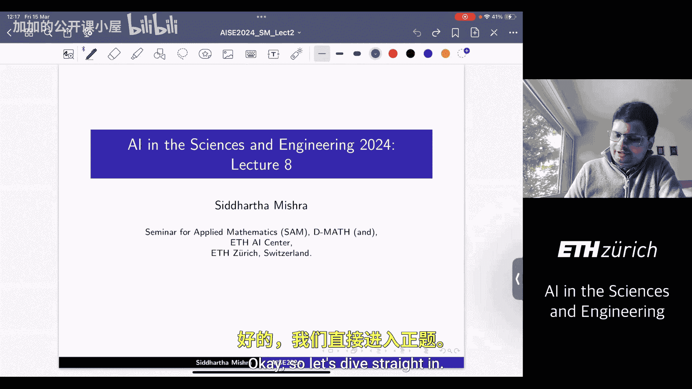

So so what have we learned so far just a quick recollection we have had an introduction to deep learning and then for the last several lectures Ben has been teaching you about physics and formula neural networks or pins for solving PDs and what he has done is that he has taught you algorithms he has also taught you what are the various successes of these algorithms as well as a few limitations right so this has been the。

Content so far and in today's lecture and also in the lecture next week。

 sort of the main focus would be somehow to find out some insights。

 particularly some theoretical insights into why pins work and why particularly why they don't work So in as you saw there were several limitations of these methods why do these limitations come off and what can we do to solve it so that would be the main main content of today's lecture and a bit of the lecture next week。

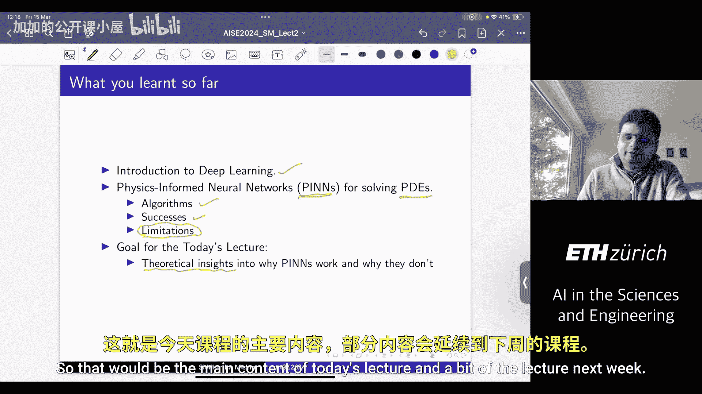

So let's get started just to sort of recapitulate what pins are and to introduce a bit of the notation。

 because since we're going to do a little bit of theory。

 I have to be more precise with my notation and also more sparse in some sense than what pin was。

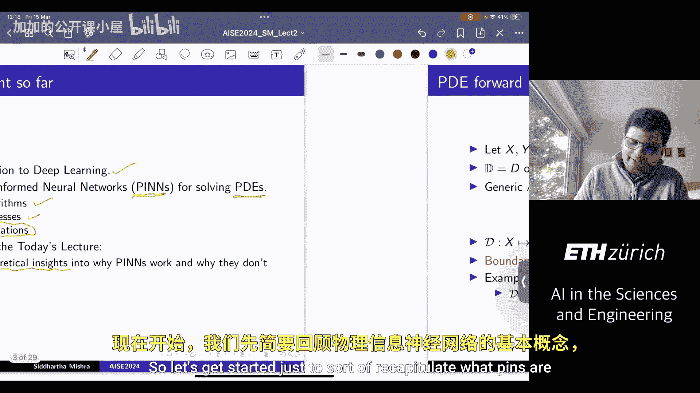

So first of all， so let's focus today on the forward problem for the PD so as you all know pins can also be used in the context of inverse problems。

 but I think for the perspective of this lecture let's focus on forward problems and then the target is to approximate the solutions of this abstract PD。

So this is an abstract PD as abstract as it gets because we are writing everything in terms of a differential operator。

 D and in terms of input F and in terms of the PD solution U。Right。

 so where are these objects defined。 So in particular， because our input， So let's let me， as I said。

 our input as well as our solution。 So U is the PDd solution。These objects are both functions， right。

 So they have to live in some function spaces。 So we say that the input lives in a。Function space y。

This could just be some LP space， so LP simply means P integrable functions。

 so L1 would be integraltegrable functions， L2 would be square integralteable functions and so on。

 and similarly U， the solution this lives in the space X， which is another function space。

Okay and these function spaces， they are defined on a domain。

 so this domain could be an open set in space or it could be open set in spacetime。

 depending on whether the PD that we are having is a steady state PD or whether it's a time dependent PD So this is sort of the basic setup and so we have an input to the PD and we have an output to the PD So this is F is the input to use is the output and what links them together is the differential operator right this is a PDE has to have an underlying differential operator and this differential operator is the one which takes the input which sits in the space X and goes all the way to the output which sits in the space Y right so this is sort of the basic setup and this is let's say that this space is X and y define such that this differential operator is well defined。

So now you can ask me what are the boundary conditions where the initial conditions because for time dependent PDs we need an initial condition and for all PDs we need boundary conditions so what I've done is just to keep notation simple and straightforward these conditions are actually implicit so in the sense that they are already included in the input f okay so when you have the input F you have the initial conditions in the boundary conditions that are included and is from a concrete example we always look at the heat equation so this is a equation in multisever space dimensions so in this case the differential operator D here is given in terms of the time derivative F the partialian derivative with respect to time and the lapplaceian with respect to space and remember the the lapplian lapplian of D you is nothing but the summation J from1 to D of U xj xj。

So you take all the second derivatives， the second derivative matrix。

 it's called the hessian and you just take the trace and then you'll get the lapusian So this is a complete example so you take a function U you apply the differential operator。

 the heat equation， the heat operator which is given here and then you get the input so the task of solving the PD is given this input F and the differential operator D。

 we have to find the solution U So this is very very straightforward setup that you can imagine。

And then how do we work with pins， How are pins going to solve it。

 So if you remember the first ingredient of pins， of course， without。

Saying much are deep neural networks again I need some notation because this is sort of my notation。

 so as you can imagine we have a mapping which takes some input in this case why if you remember。

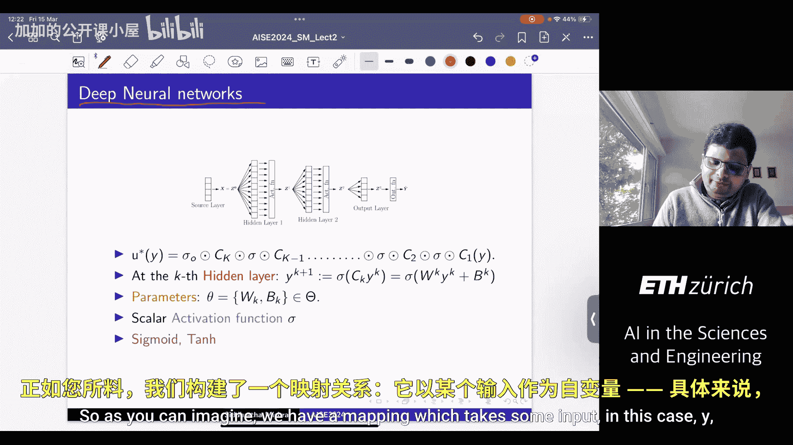

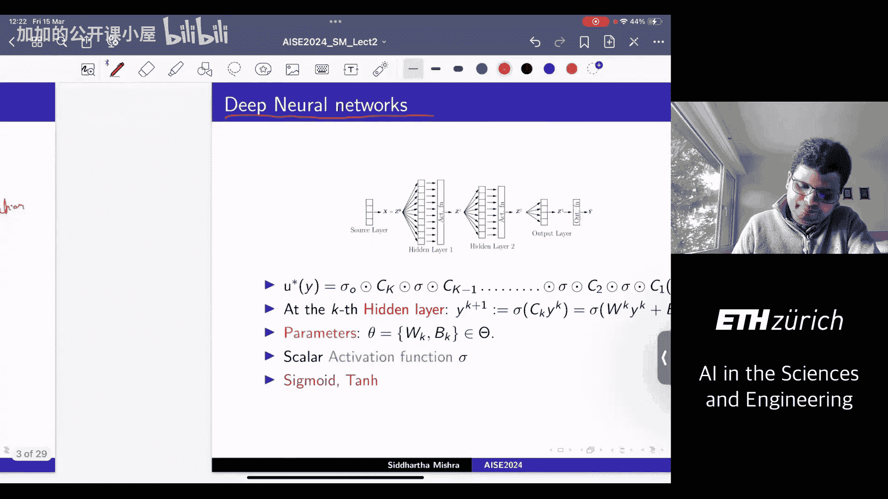

So D is the domain now so this sort of calligraph D is the domain and this could depending on the context be just a subset of space or of space time and this y now I didn't write it but this y belongs to this calligraphic D。

Okay， so these are the coordinates， space and time coordinates。

 and then the deep neural network U star is defined in terms of all these layers that you know very well。

 Each layer has two elements to it， the first one is this aine piece given in terms of a weight matrix W and bias vector B Bk and wk for the K layer。

 And then you also have an activation function， a scale activation function。

 And because we are going to differentiate sometimes many times our activation function is typically a sigmoid or a hyperbolic tangent or something smooth not relu which has potential discontinuities in its derivatives and the parameters。

 So this is just the neural network that defines ultimately goes into the pinal and the parameters。

 the free parameters that we are going to tune are the weight matrix is Wk and the bias vectors Bk So this is sort of the basic setup standard。

P vanilla deep neural networks。 you have seen several examples of them also in the tutorials。 Now。

 what we do with pins is that we take these deep neural networks。 We know what the inputs are。

 We also know what the differential operator is。 And we are going to approximate the solution here U with deep neural networks right So this is the basic objective。

 the basic algorithm。 So as I said means each of these neural networks are defined in terms of this parameter vector theta。

 And this parameter vector theta is now given by， so it's here。

 and this defines the deep neural network U Theta。 And this is what is going to approximate my solution of the P。

 I don't know why there is a star here。 Let's say that it also belongs to X or we could say that this was a subset of x。

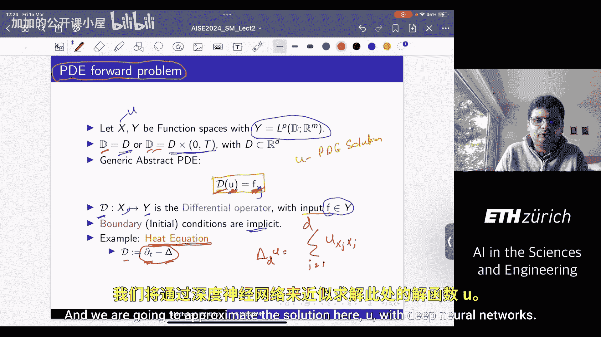

Okay， good。 so now aim objective here is that we know that there is a solution to the PD。

 which we don't know what it is。 We are going to find the theta such that this guy approximates this U and it approximates it in a suitable sense and what is the sense in which it approximates is what we are going to talk about today but the way in which it does this approximation is。

 it doesn't have any labels right it does not have access to necessarily have access to values of U all that it does to do is to work with the inputs which are given by this F here and by the differential operator because we know what the differential operator is So recalling what you do is that you compute the PDd residual。

 so PD residual remember that the PD is simply D of U equals F。

Right so now you just apply instead of you， you apply this differential operator to U Theta and take the difference here。

 course this is not going to be zero because if you' are lucky and it's zero then the problem is solved without any error but in general it will lead to what is called a residual this is the residual with respect to theta and we can compute this residual as I said by automatic differentiation in general。

 but also I think pen told you that sometimes you can also use finite differences but let's say from our perspective we'll just use automatic differentiation。

So now at every point in principle， were going compute the residual of the PD for a given neural network。

But of course it doesn't help to be able to compute it at every point because at the end of the day we have to take some sort of an integral。

 some sort of global quantity right because pointwise quantities they are not really useful so what we are going to do is that we are going to take the LP norm here of the residual so we integrate it across the domain we take an average in some sense and usually the p is equal to one or two so these are the two common spaces although sometimes you might need something else okay but for the time being let's say that these are one or two。

So now the objective is you find a theta such that this residual is going to be minimized。

 but of course this is an integral and you can't just compute integral by hands。So integrals by hand。

 So what you have to do is to replace this integral here by a quadroature。 Okay。

 now this is sort of standard in numerical analysis。

 you replace the integral by a quaroature and to do so you just choose some so you have a domain here。

 D。 this is your domain。 you throw some quaroature points in it。 This could be random points。 Okay。

 usually the simplest to take random points， but that's not necessarily the best。

 So it there has to be a quadroature rule。 there are some quaroature weights here。

 and you replace this integral out here with this quantity here。 So this is a quadroature。

 This is an approximation of the integral。 and then you take a theta star。

 you just minimize this right， So this is the loss function。 Now。

 This is often called a physics informed loss。Because there is no superficion here except for the initial boundary conditions which we have said implicit。

 So you have some physics informed loss。 and now you just this is of course。

 as as always in machine learning， This is a high dimensional nonconvex problem very high dimensionional nonconvex problem and we are going to use some stochastic gradient decent right so this is a pin algorithm that you take a class of neural networks you compute the residual in terms a pointwise by using automatic differentiation and then use a quadroature to approximate some global quantities mini minuss and your done So this is the algorithm and I think Ben has explained this algorithm shown many examples of this and you could say that in some sense it works。

 this is a question does it work So for instance， some sense it does work。

 So here is a multit heat equation。 remember this is U T minus lap plusian of t you equal to zero So this is a multi。

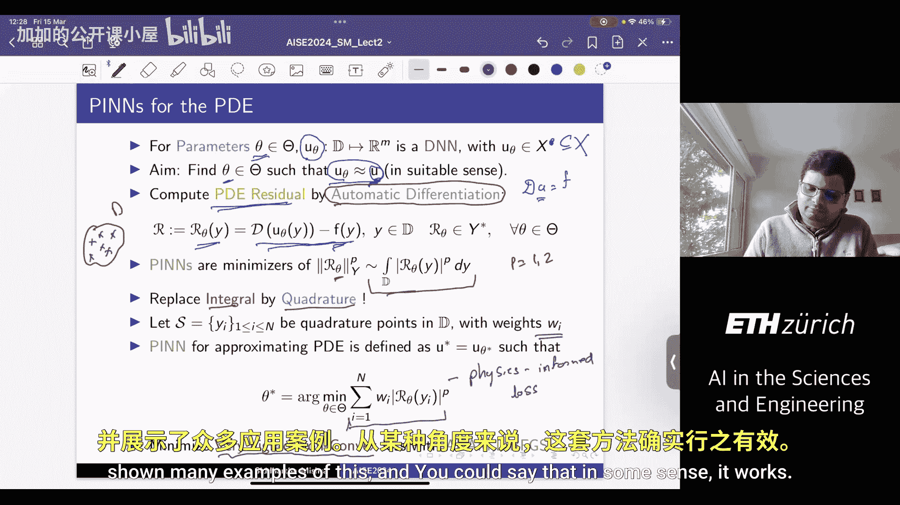

he equation now D here changes all the way from one to 100。 so this is a very high dimensional PD。

 you'll see later why we care about that and then we fixed the pin here。

 the neural network with it's just four layers so you have four layers20 neurons in each layer。

 not at all a big neural network and then we need quite a few qua points because we have so many dimensions and then we try to do this approximation procedure right so this can be done and all the points here so these interior points and boundary points。

 these are sort of random points because in very high dimensions nothing else works right you just start to take random points and when you do that then you see that for the same network somehow and for the same amount of training time you'll see that there is a increase in error it's of course very very small for very small dimensions。

And as you go up in dimensions the error does increase。

 but it's not increasing exponentially or anything， if you see now from going from 20 to 50。

 it is roughly doubling which is what you would expect and then from 50 to 100 it's also less than doubling so you would say that this is a linear increase。

Wwhich is the minimum so in some sense it does not have what is called a curse of dimensionality curse of dimensionality would be。

 for instance， if you would have an exponential increase right here this is not not at all the case So at least for this simple example where the complexity comes from a fact that you have lots of dimensions because in general you know you can't solve the heat equation in0 dimensions using the finite difference methods that I taught you in one of the lectures so it somehow works right but then you' have also seen other examples。

 where it doesn't work so how do we know when it works， when it doesn't work， why does it work。

 why doesn't it work and so on So this will be the focus of the next couple of lectures。

So let us get started。 Of course， if you have any questions。

 you can always ask me in the chat button。 Okay， this is always possible from time to time or you can raise your hands if you're so inclined So either of says is there we can still make it interactive even if you're all on Zoom。

Nevertheless， let's let's go ahead and let's try to address this question， right。

 why so why do they work sometimes and why don't they work sometimes？

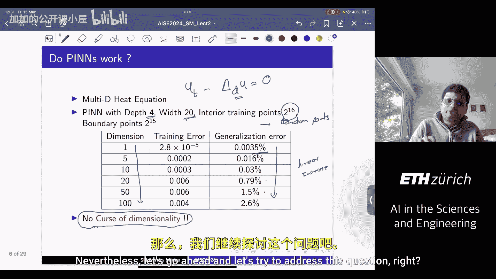

Okay， so then again， I go back to the abstract PD D because then the notation becomes very。

 very light and you sort of see the abstract structures。

 the mathematical reasons why things may or may not work， So this is the P D T equals F。

And remember that my pin solution is u theda right so this is the U theta。

 This is what the pin algorithmium gives me and the objective always in this problem。

 there is a very very specific objective， which is that you have to minimize the total error right so the error is between U。

 which is the exact solution。we don't know it， but it is there and U Theda is the approximation that we obtained with the algorithm that I just described to you right so this is。

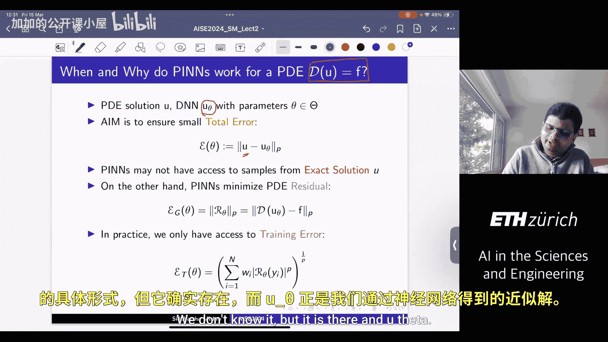

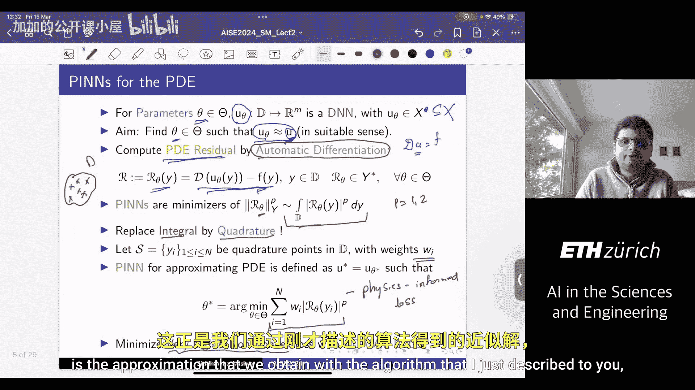

This is sort of the objective。So now the question is that so this is what we want to minimize we want to make this as small as possible right depending on the accuracy so in engineering for instance it's usually around 1% so a couple of digits three digits in some of the applications it could be more in some of the applications it could be less Now what contrast spins from what is standard supervised learning is that we don't or we may not have in general we don't have access two samples from the exact solution so we have no control we are never training the network directly on this error。

Because in let's say in regression or classification。

 traditional use of machine learning in images are text。

 what you do is that you have some labels and then you have the predictions of your network and then you try to make the distance between them as small as possible here we don't have access to that right that's why it's a fully unsupervised approach。

However， so what we do here is if you remember we are working with the PD residual which we are of course taking some normnet some LP norm yeah so this is the LP norm you see so that you take the p power and you take a1 over p so just think of p equal to 2 would be like the root mean squared error。

And P equal to1 would be the mean absolute error。 Many of you might have seen this， these objects。

Okay so now this is what we what we try to minimize what we have some access to are these residuals and I denote this by EG sometimes people call this as generalization error but think of it as a PDE residual because you don't have access to this this is not even your target you don't try to make it small what you try to make small is this mismatch here how much does a mismatch does it have at the level of the PD and in fact in practice you don't have access to this guy here what you have access to is the training error right so the training error is nothing but a P root of the loss function。

Because if you remember， this is my loss function。So the idea is that by minimizing or making the loss function as small as possible can I sorry can I somehow go back make this little small make the total residual small and eventually from here can I go back and make the total error small so let us try to sort of put this questions together and this is what I have done as somehow the key theoretical questions The first thing is and this is very important in some sense is that we are not searching for a vacuum you are not searching for a vacuum statement what do I mean by that so remember that my objective or my object in some sense my objective is to make the training error as small as possible and underlying why I want to make the training error small as possible is because it's after all a discretized version of the residual so I want to make the residual as small as possible so the question is can this even be done means otherwise what are we doing right？

In other words， do that exist parameters， do that exist in this class of neural networks such that let's say the training error can be made as small as possible and the PD residual made as small as possible。

 because if these errors are not going to be or these objects are not going to be as small as possible。

 there's no point in doing anything， let's say that this epsilon is like 100。

Then what is the order of terror will always be of the order of10 so it does not really help。

 So in other words， what kind of neural networks can we take such that these quantities at least a priority can be made as small as possible in principle in practice whether this happens or not is another question and we will see that So that's the first question that we have to ask I this even a feasible problem in some sense can be even addressed the feasibility。

Then， of course， as I said means in practice， we don't have access to this error。

 we only have access to this error here， the residual。

 so it's natural to ask if I make the residual as small as possible。

 does it automatically imply that might total error。

 the object that I want to make as small as possible， can that be made as small as possible。

Of course， trivially this is true if we have a bound， which looks like this。

It tells us that the total error， the object that we want to minimize。

I is bounded in terms of some constant times the a PD residual。

 so making the PD residual small will automatically imply making this automatically make this object small right so this will somehow justify why we are going to try and make this residual as small as possible。

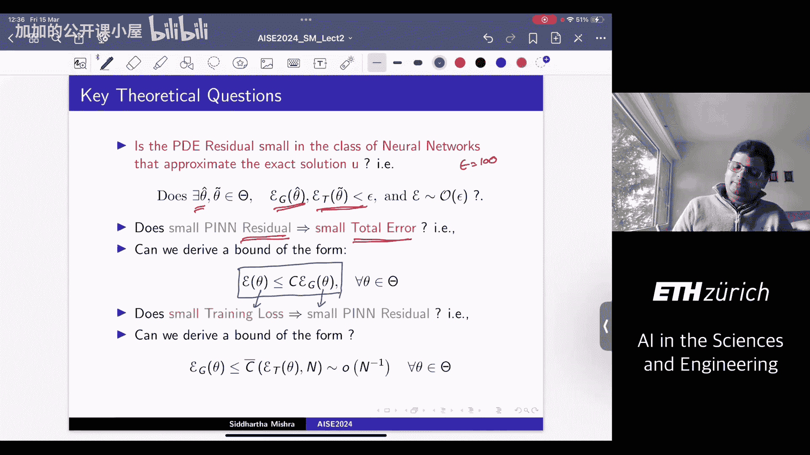

But we never have access to this quantity because remember that this quantity here is an sorry is an integral right so we don't have access to this quantity。

 we always have access to it through its discretization through this training error。

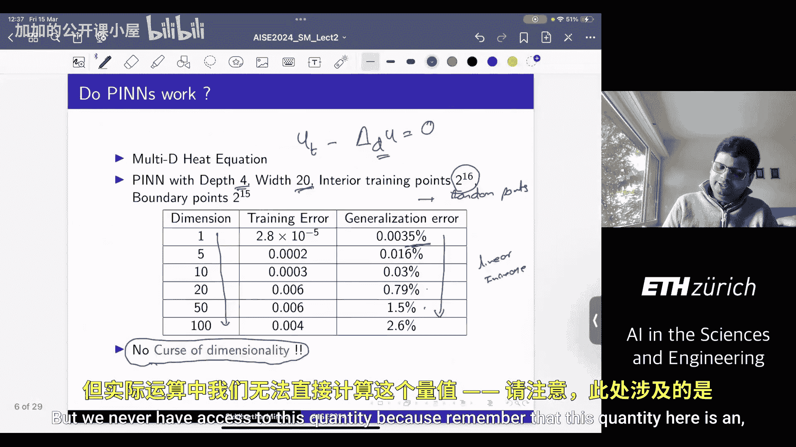

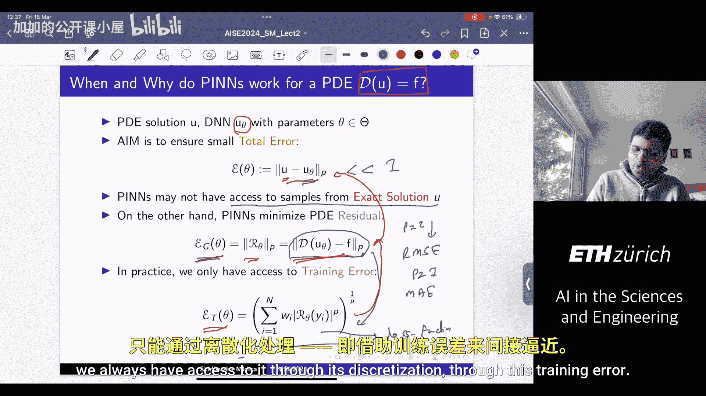

So then we have to go one step further and say that if you have a small training loss。

 because that's the only thing that we can read out during algorithm。

 if you have a small enough training loss， does it automatically imply that the residual is small？

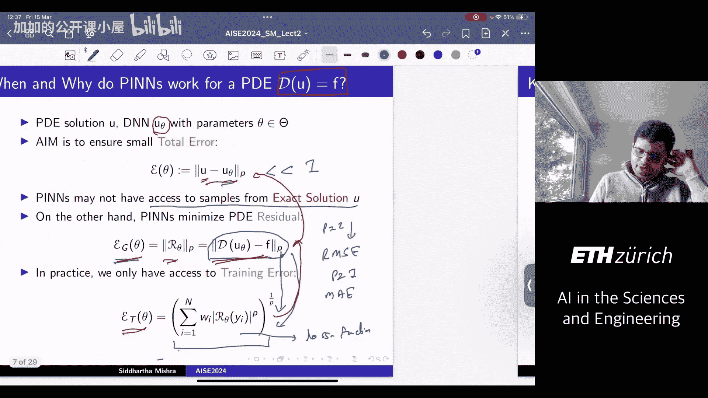

If it is so or in other words， if it is so， then or this will be true if you have a bound which looks like this。

So this tells us that as long as the number of n is the number of quadroature points。

 so n is the number of quadroature points。

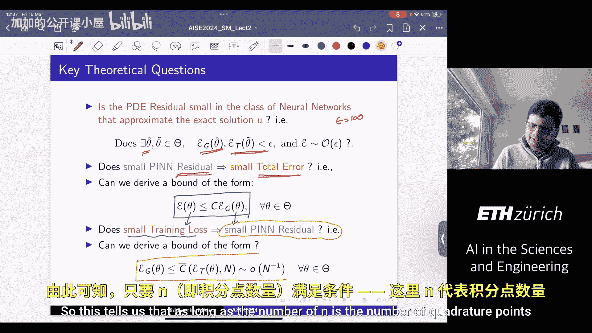

So what does this tell us this tells us that as long as you can make the training loss small and the number of quadroature points as large as you want。

 then the total means somehow this generalization error can be as small as possible this residual can be as small as possible and from here you can go back to the total error and make it as small as possible so this is sort of the let's say the hierarchy of questions that we have。

So let me recapitulate so what we want to do is first。

Can we make the training error as small as possible and then once we have small enough training error and large number of quadroature points。

 does it automatically imply that there's a small residual and does a small residual automatically imply that the total error So that that's the mechanism through which pins can work right Otherwise how else can we connect the training error to the total error。

 which is these are completely different quantities as sitting in different spaces。

 they have different meanings。 So the only way we can do this is through this route at least one way in which we can do this is through this up Now let me try to explain this a little bit more in details so that you don't get lost right So actually this is not not that let's say it looks a bit abstract。

 but it's it's not that unrealistic illogical to expect this if you know what I mean So let me start by the first question here The first question is are we even solving。

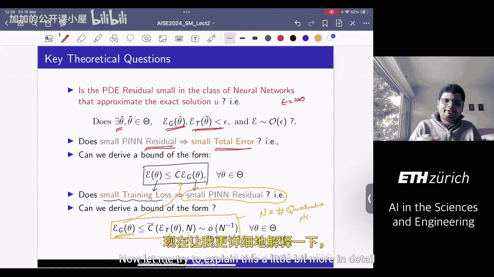

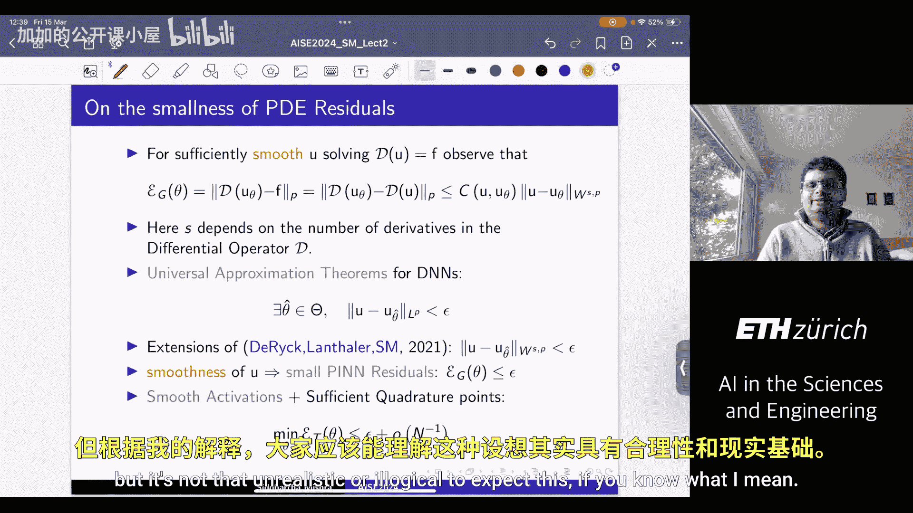

Feaible problem in some sense， in other words， can the total error and the training error be made as small as possible？

And the answer to that actually is yes， because this depends on the PD residual。

 this depends on the smallness of the training error。

 so how can you do that so the answer is here because remember that at the end of the day so let me use this。

 so we are solving a PD which is given by here。

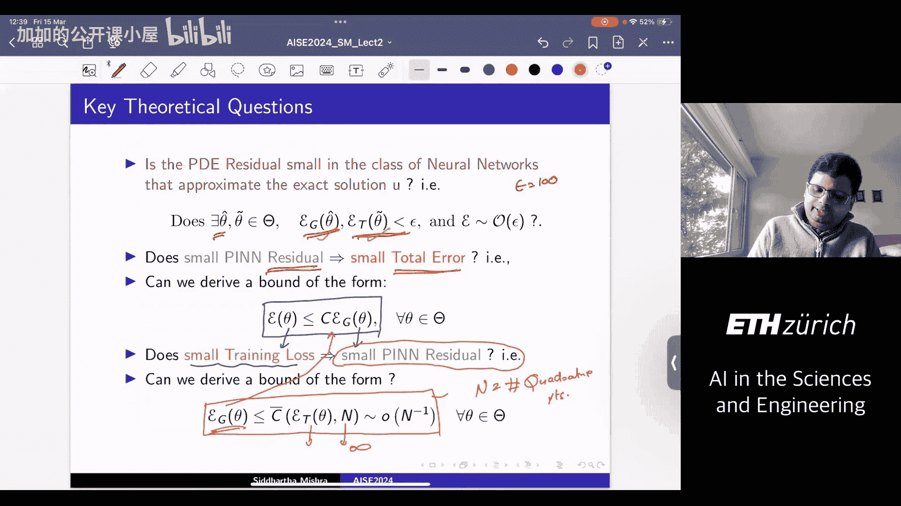

So now the PDE solution is， although it's not always the case， in many。

 many cases is actually a smooth function。So just imagine that you have the heat equation。

 so the heat equation is having one time derivative and two space derivatives。

So if the right hand side is even an integralteable function。

 the solution of the heat equation better have two space derivatives and one time derivatives。

 so it's smoother than the F here than the input here Now this is not always the case as you'll see in the next lecture but often this is the case that there exists the P solution is going to be smooth Very good So what does that imply。

 that implies that if you look at the pin residual So the pin residual is here this is defined like this So you apply the neural network。

 you apply the differential operator and the neural network take out the input Now what is the F here。

 F is nothing but D of U right so this is f is nothing but d of U So I have simply substituted this here So now we have the differential operator applied to u Theta and the differential operator applied to you and this gives us an estimate let me you know let me just for simplicity let me try。

To take this and expand it out for the heat equation， for instance。

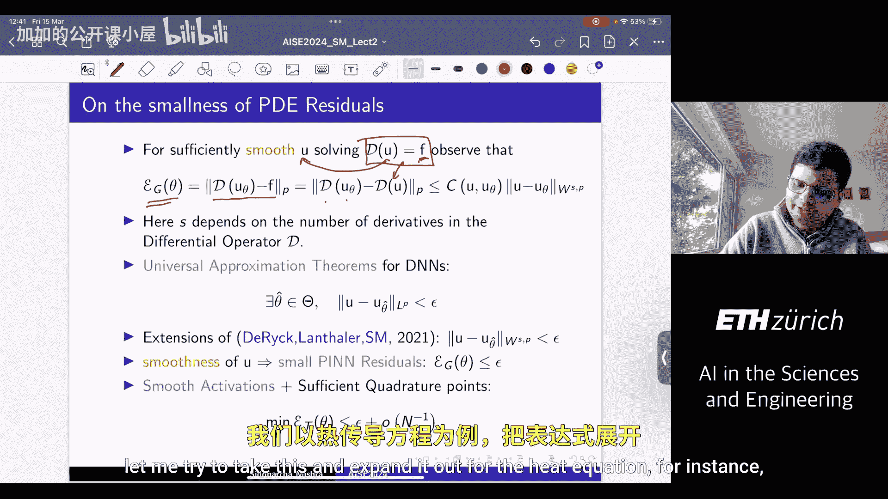

So that you're not completely lost。 So for the heat equation， if you remember。

 so let me take plaque here， so this is the object that I'm going to sort of。

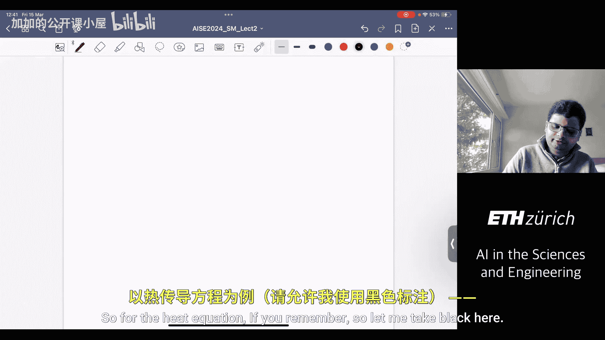

Expand， right， so I have D of U Theta。

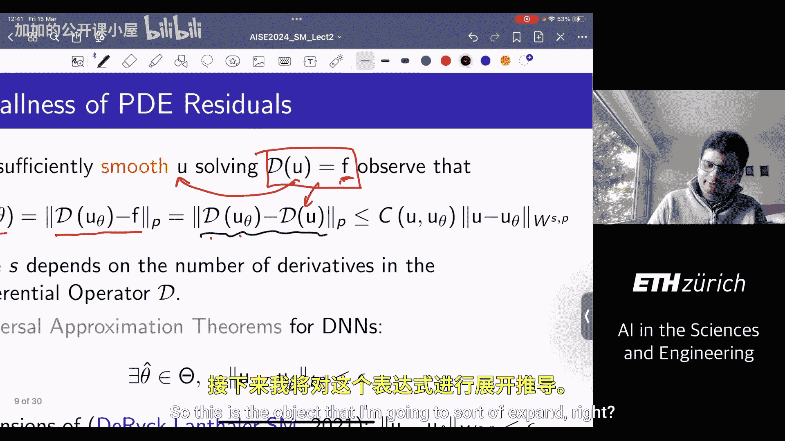

Mus D of u。RightSo d of U Theta is nothing but d D。

 the partial derivative of U Theta minus lapplian of u theta minus dt of u minus lapplian of u。

Let's put some norm here。So this is nothing but D of。

U theta minus u minus Laplian of u theta minus U differential operators are linear。

 So this is less than or equal to by using triangle inequality U theta minus u plus。

La Plaian of youth。Or in other words， this is nothing but you can say u theta minus0。

And I don't want to sort of expand notation too much but in what is called w1p and lapplaceian is a second derivative so this is u theta minus U in what is w2p one is in time and the other is in space okay just very formally I'm not not doing the math so W1p simply means that the function is close to something and its first derivative is close to something the first derivative the same thing here it means that these two functions are close to each other the first spatial derivatives are close to each other and the second spatial derivatives are close to each other So when I measure things in this space is WsP it means that I'm demanding that not only are two functions close to each other but also the derivatives。

 the second derivatives， the third derivatives， four derivatives and so on are also close to each other and this S here as you can see clearly depends on this differential operator if we are more。

then we are going to have more of this object there so this was essentially the content of what I wanted to say。

 So for a nonlinearar PD， of course， as you can imagine， this was a linear PD。

 So there everything sort of worked out but for an nonlinear PD it's a slightly more complicated and you get something some constants which depend on the function itself that's why it's nonlinear otherwise it would be a linear PD but essentially what it says is that the PD residual can be estimated in terms of the difference between the exact solution。

 the function and a neural network measured with the right number of derivatives So that that's all all is there to this mathematical delevation So all that we need to guarantee so to guarantee that the PD residual is going to be small。

 all that we need is to guarantee that there are neural networks which are going to approximate the PD solution which is a smooth function with sufficient number of。

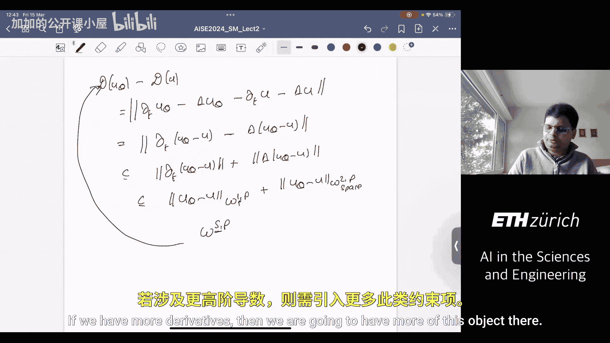

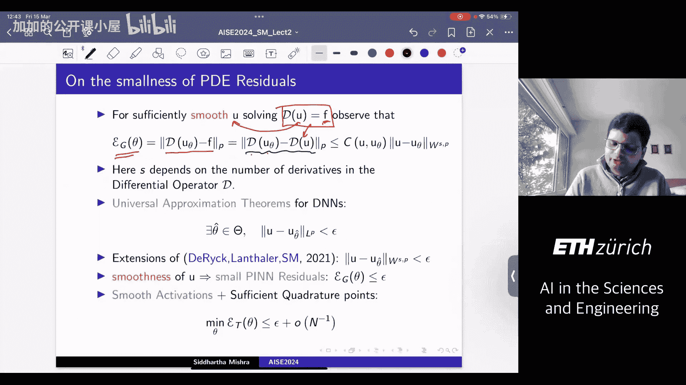

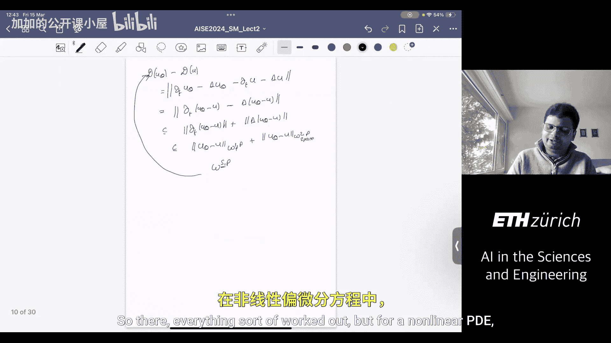

EativesRight that that's all that you do。 Now， this is where already。

 I think Ben has introduced what is called a universal approximation theorem。

So what is a universal approximation theorem， it's a very important statement for neural networks。

 it's one of the reasons why people believe neural networks work so well。

 which is that if you take any function this U is as long as it's a continuous function or even an integralte function。

Then there always exists a neural network， even a shallow neural network。

 which is going to approximate it in the right norm as to as much of a tolerance as accurately as possible。

So this is the advantage of neural networks that you think of any function see any function it just needs to be inteable。

 in fact it needs to be what is called measurable there always exists the neural network。

 which is very close to it right so this is sort of the basis of neural networks now we are invoking a similar kind of a question except that we want not just a function to be close to another function but also its derivative should be close to the derivative of the function。

 its second derivative should be close to the second derivative of the function and so on and there are similar theorems for instance one of my own theorems which say say this that this indeed can be done that you can always find neural networks which not only approximate a function in an integrable sense in an average sense but also approximate the derivatives the second derivatives。

 the third derivatives and so on so because the solutions of the PD are in some sense smooth this automatically imply and because neural networks are universal they can approximate any function it。

Partically means that there exists neural networks such that the pin residual is going to be small okay which is what we wanted to right we wanted this pin residual to be as small as possible so that we are not solving a vac problem and the same argument also works for the training error because what is the training error after all the training error just takes the if you remember。

I have it somewhere。 Yeah。 so the training error is simply that it takes this integral and it approximates it by a quarter。

 right， So this is traditional numerical analysis。 How do we take the integral of a function and just approximate it by some weighted combination of the function evaluated at points。

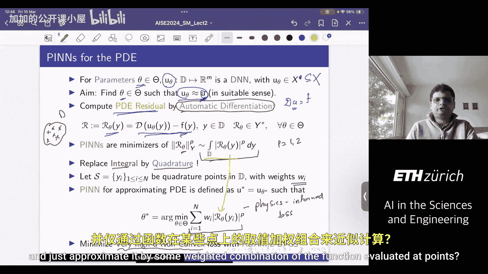

So as long as the function is smooth， the underlying function is smooth， there are many。

 many different ways in which you can do it， even if it is not smooth you can use Monte Carlo or central li theorem。

 so this tells us that if the pin residualceiv is small and if there is sufficient number of quaroature points。

 remember that we have smooth activations so this is typically hyperbolic a then this works quite well and this tells us that from this result you can come to this result。

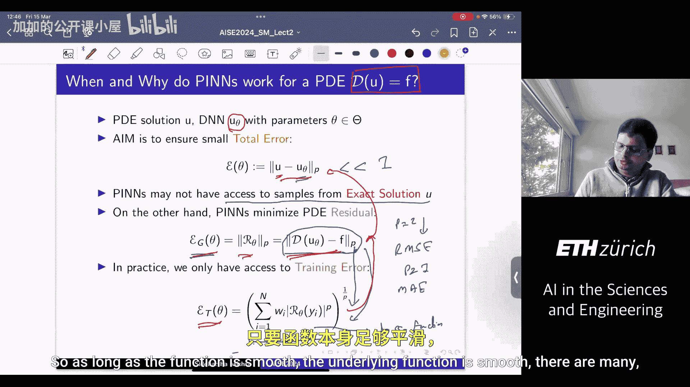

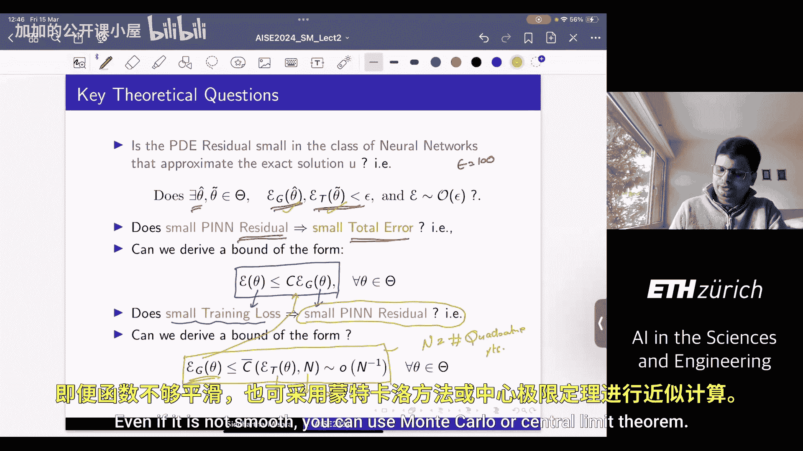

So in other words， that the loss function or the training error。

Provided that there a sufficient number of points can be made as small as possible。

 So you are not searching for some needle in a haystack。

 Probably at least there is a needle somewhere means you're not searching for nothing in a haystack。

 you know， So this tells us that these kind of arguments。

 What they tell us is that the problem that we are trying to solve is in some sense。

 well posed or is feasible that you can actually find neural networks such that this training error can be made as small as possible。

 And if you have sufficient number of quadature points。

 This automatically implies that that the total error is going to be as small as possible。 Okay。

 or the residual is going to be as small as possible。 So in some sense。

 this kind of simple arguments。Of course， for each PD D， this has to be carried out by itself。

 You have to compute this kind of a this kind of an estimate。 you have to。

 you have to argue why this result is true and so on。

 but the roadmap is right here and it's it's fairly straightforward。

 So that part is easy that at least in terms of the well postedness of the problem it is a well posted problem in the sense that there are neural networks which sort of minimize the there are neural networks which can make the。

Training error in principle as small as possible， whether you find these neural networks when you start at a certain point and you use stochastic grade in decent is a different question altogether and this is what we are going to address in the next lecture。

Okay， so so far so good， this tells us that it's a problem that we in principle can solve。But。

This is only good to know right because in practice we are not doing this in practice we are starting with something。

 we are trying to take make the training error as small as possible。

 And from there we want to conclude that the total error is going to be small。

 So this is we have to invert this pyramid as it were So how do you do that。

 So let me just explain it's not not very difficult at all。

 So this again goes to some papers that I wrote some years back where this argument was first made。

 but now of course many people have fine tune it and have improved it this where the first rigorous results on Y pins。

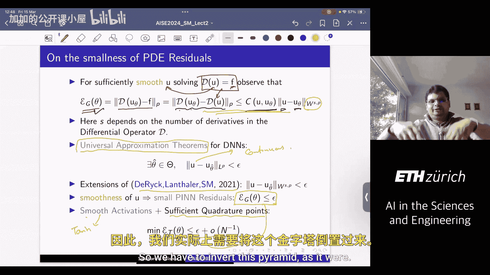

Pins would were okay， so the idea is very simple。 So remember that we have essentially So this is essentially the slide that explains everything。

 And I think after that， I will probably conclude because I don't have that much of time probably 10 minutes。

 Okay， but so the idea is that now we know in principle that the error can be made as small as possible。

 the training error can be made as small as possible。

 But given a small training error can we go go the other way and can we conclude that the total error is going to be small。

So this is done in two steps， the first step we are going to argue。

 so again it goes back to this picture here， so this is done now right so let's see the green and say that this part is done。

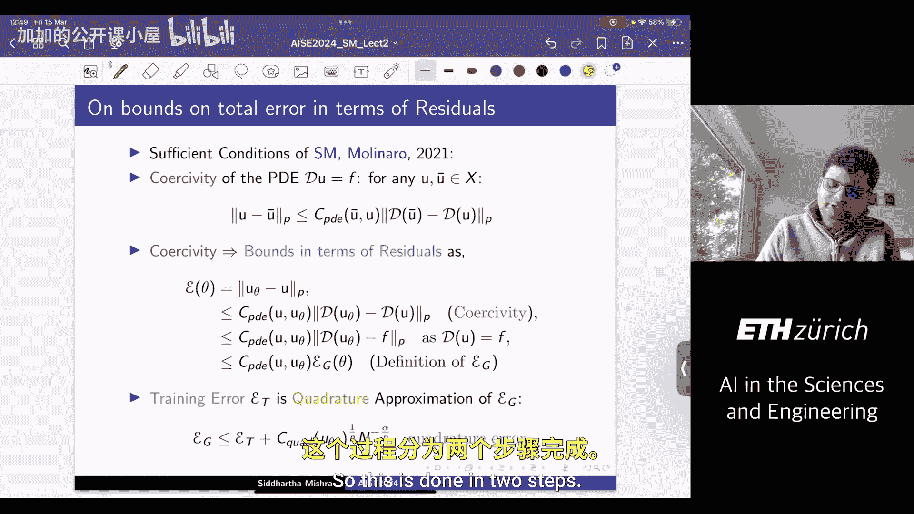

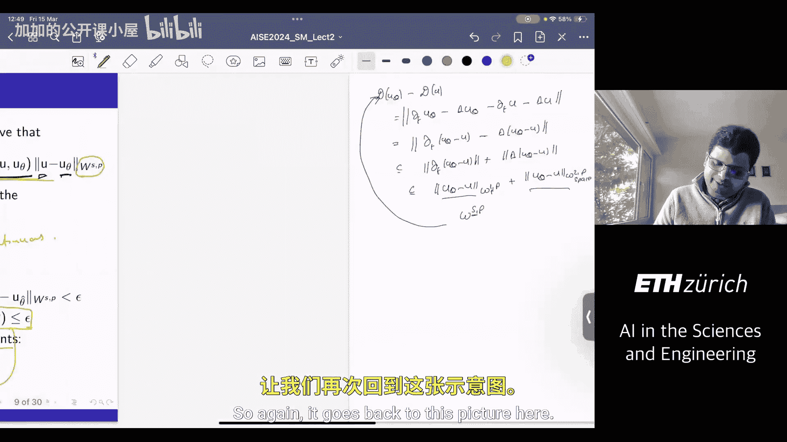

That there exists neural networks， such that these errors can be small。

 So now the question that I'm asking is this one。So does it mean if I have a small pin residual。

 can I make the rotal error small or in other words can I get a bound which looks like this okay。

 let us try to see whether this can be done and here is a strategy to do it。

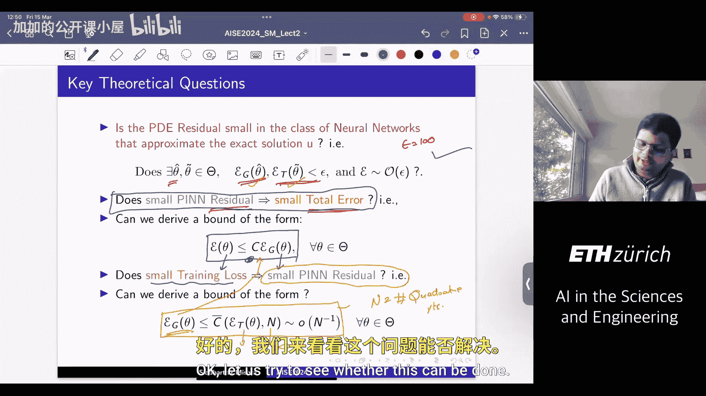

It is based on a property that we call as coercivity mass this is there is no universal notation but this is the term that we used what does coercivity mean its it's sort of a stability property of the PD so remember that this is a P。

So PD is nothing but associated with the PD as you'll see in a couple of lectures there' something called a solution operator。

 which is think of it as the inverse of the differential operator because given an F it will take give you the U okay so this this is how the PD works so now the idea of this coercivity so remember all the time F is the input。

Allright， so now let us consider another input which is close to this PDd， or in other words。

 let us consider。D u bar is equal to f bar。So remember that my original PD is T equal to F and now I have T bar equal to f bar。

So the idea is I perturb F so I have a f bar which is close to f what happens to U and U bar right this is a question of stability I changed the inputs to the PD a little bit。

 does it also get reflected in how the solution behaves and coercivity says yes that is indeed the case so this is precisely the question so this is nothing but F bar This is nothing but F。

So it says that if your inputs are close to each other， the output of the PD。

 so this is a stability of the inverse operator， somehow of the solution operator。

 the outputs of the PD are going to be close to each other。And in general， this。

 of course there are constants because the PDs can be nonlinear， so this is like。

 well let's say lipss continuity roughly speaking it it's a continuity statement。

 it's lips shits are a holder continuous statement。

So this is a stability statement we call it coercivity because this is a property that the PD can have。

So remember that the bottom line here of this entire estimate that I wrote down is given small changes in the inputs to the PD。

 the outputs to the PD， which is。With the PD solution。

would also have very small or relatively small changes because of course this depends on the constants。

Now how can we convert this？Into bound in terms of residuals so remember my objective and this is very。

 very straightforward and but it requires a little bit of concentration let's let's try to have that concentration So this is the definition of error。

Ped is nothing but neural network minus the exact solution in some node。

But remember that the PDd itself is du equals to f。Again and again。

 but what is the neural network doing， the neural network is solving T U theta is equal to f plus the rec work。

Right this is because you always get this residual so the neural network is solving it's a perturbation。

 it's a perturbation of f and the perturbation is precisely in terms of the residual now this can be small or big we don't know that yet but this is a perturbation so remember what does the stability say that the difference between the outputs is bounded in terms of the difference between the inputs so these are the inputs。

And du equal to f， so this is the this is what it is and du minus f is actually the because it's a norm。

 this is this generalization error， this generalization error eachy is nothing but the norm of the residueid。

你姓什么。So， that's it。So this tells us that if this quantity is going to be small right so this guy is going to be small if these are there's nonlinear terms。

 these constants are going to be bounded automatically the exact solution is going to be small and that solves our problem because what we say by minimizing the residual。

By making it as small as possible， we are saying that the object that is making the residualid as small as possible is as close as we bond to the exact solution of the PD。

Okay so this is one， let's say a sufficient condition， this is not necessary condition。

 but it's a sufficient condition which tells us that a mechanism by which minimizing the residual is akin to sort of making the or approximating the solution of the PDE is provided by this coercivity so this is a mechanism by which you can convert the properties of the PDE into a error estimate for the pin。

 for instance right so this is if this is true we have to verify it for each different PDE and this is far from easy but that that's how in the next lecture you'll see some concrete examples。

And then， but this is not job done right because in practice we don't have access to this residual。

 we only have an access at least the norm of the residual， we only have access to the quaroture。

 right this is a very signal。

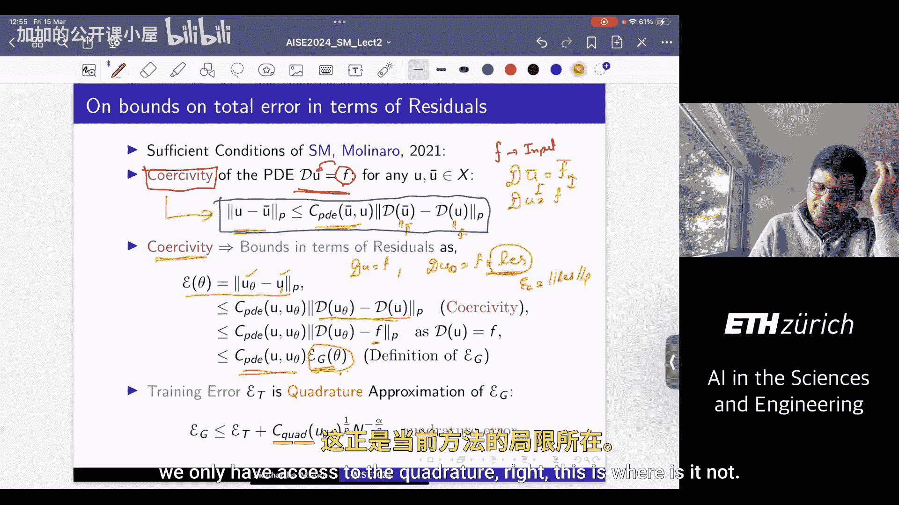

The quadroriture， which is here， so we don't have access to the residual。

 we only have access to the quaroture。

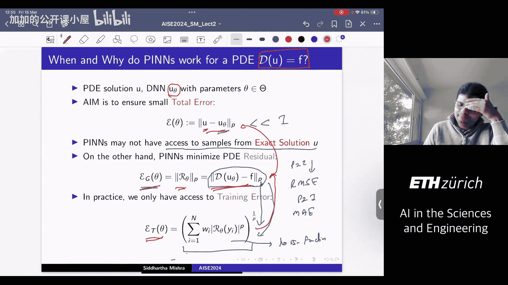

So but this is again there is a relationship between them because this is numerical analysis。

 you have a function and you have it you integrate the function exactly or you integrate it approximately so how close the error is and this is essentially what is called a water chair。

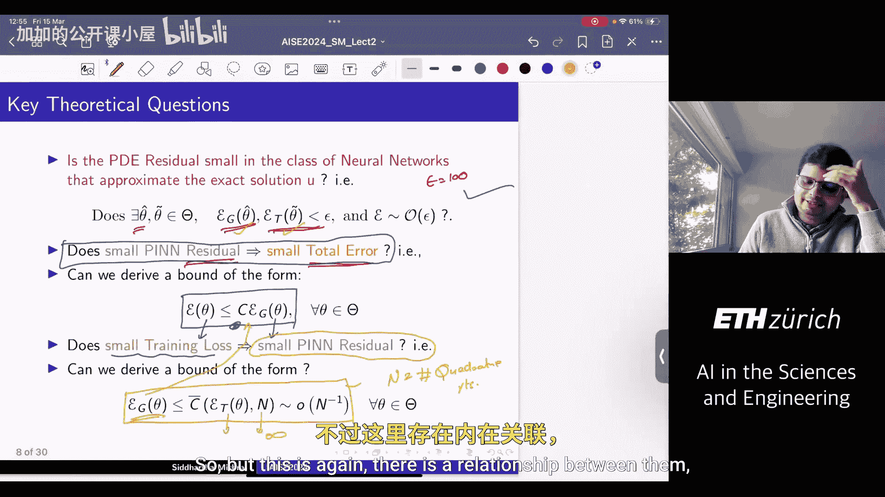

So this is done in traditional numerical analysis for instance。

 if you use let's say just random points， this number is going to be a half right because we know that if you have random points central limit theorem tells us that you can approximate the integral of a function by just what is called the empirical sum or the point by sum and the error is going to scale like the square root of the number of points so the PDd residual is given in terms of the training error plus some constants of course this constants they don't depend on the PDd itself。

 they only depend on the regularity of the smoothness of this function here of the neural network and the number of quaroature points so alpha is sort of the rate of convergence that I told you so if you think of Monte Carlo random sampling then this is going to be a half so this this is and p is equal to 2 alpha is going to be equal to 1。

Sort of the mechanism。 So first， if we can make the training error small。

 maybe I have even a slide here。

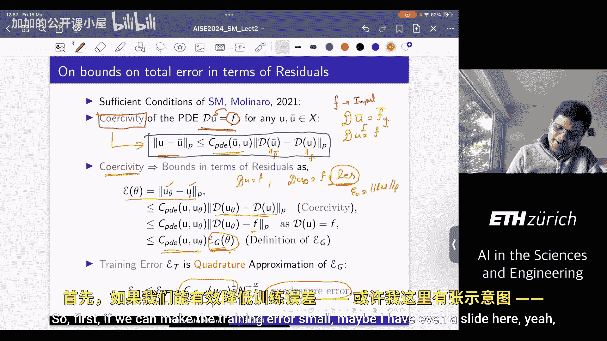

Yeah， so let's say that if if I can make this error small。

 the training error small and this is not going to be an easy task you know so in the next lecture you will see that this is this is a hard task if I can make my training error as small as I want and if this constant is going to be bounded if I take as many quadroature points as I want then the residual is going to be small So to make the residual small I need to train my neural network in such a manner that have a small training error and I have sufficient number of quadroature points okay that makes my residual so this you should think is just the norm of the residual right residual norm and then by using the coercivity this is the one that I have sketched out what you can do is that you can you can say that the total error is going to be small so again you have to compute these constants here in some sense well this completely depends on the properties of the PD as we will see in the next lecture。

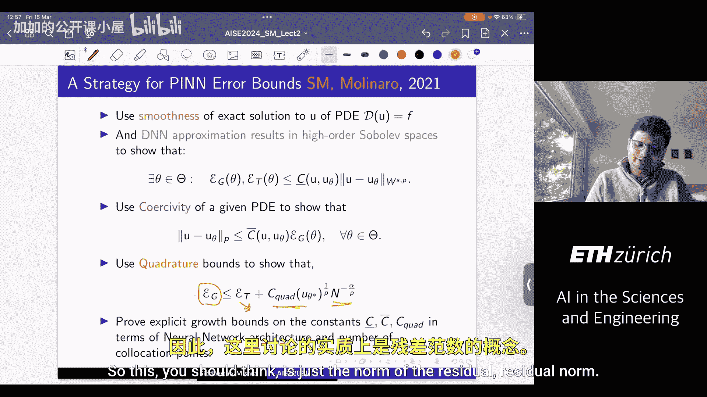

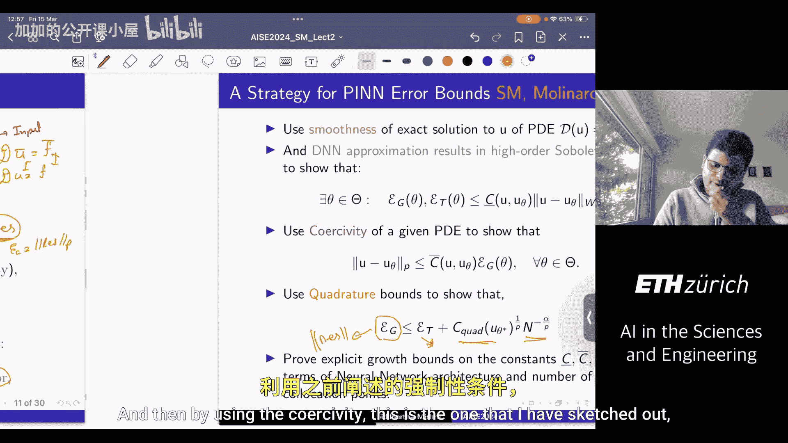

And the first line here gives you guarantees that at least the global minimum of this ET is going to be as small as you want。

 You know， this is a loss function。 you never reach global minima。

 this is because it's it's a nonconvex function but if you did then the global minimum can be made as small as possible so that there is there's a hope but there's a possibility that this quantity can be made as small as possible。

 this quantity can be made as small as possible， and if you have the right kind of PD。

 that can be converted into making the as small as possible。

 Okay so this is sort of the algorithm by which we can verify whether pins can work or not at least one of the this is as I said。

 it's all sufficient conditions it's not necessary conditions。

 So what we are going to do is in the next lecture。

 at least part of the next lecture is to look at some examples to see whether it is feasible or not but I keep on repeating and this is important so that you get a sense for where we start。

So the way it will work is you do your training when you train the neural networks。

 you can actually compute the training error explicitly because this is this the loss function is given to us and you take a square root of it or a pH root of it and you get the training error that tells us。

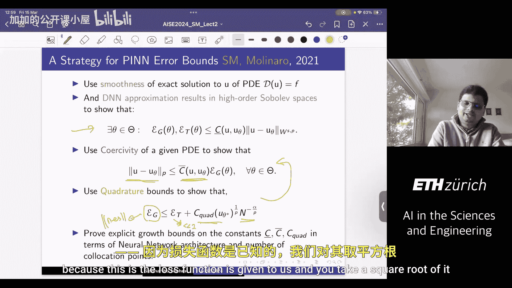

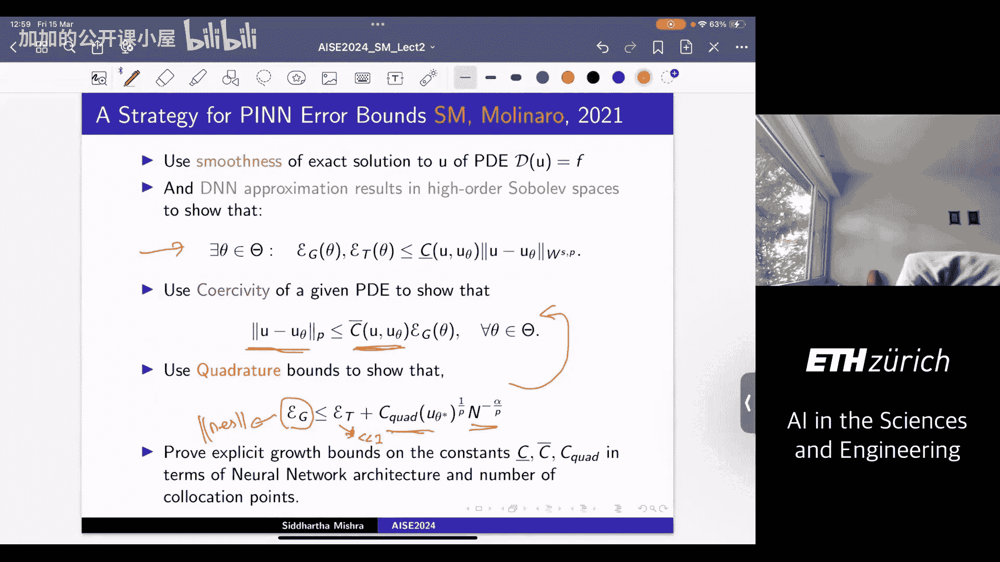

That tells us the quantum of this loss function here and then if you have sufficient number of quaroature points。

 this tells us that we need sufficient number of quaroature points that will make the residual small and then depending on the properties of the PDE the total error is going to be small so now you can also see that these arrangement can fail in many ways right for instance it can fail if you are unable to train the network well。

 the training errors are going to be large， it can fail if you don't have sufficient number of quaroature points。

 if it can fail if the PD itself does not have this coercivity property it can fail if these constants are going to be very bad and there are or these constants are going to be very bad so there are several kinds of failure modes here and we'll also see some examples of that。

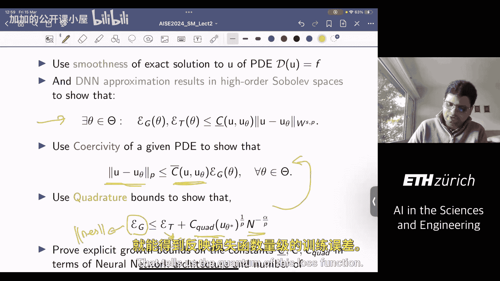

So I think I have come to the end of my time today and as I said in the next lecture。

 we sort of work it out what is When will the project be online。

 people are more interested in that than in the lecture soon， soon is the answer。Soon。

 because some of you requested that we don't have。A project deadline in the end of May because people have exams。

 so we had to sort of change the schedule so now therell be there will be no project deadlines at the end of May。

Right， someone is saying something。It's because it is neededed。Yeah， yeah。 it's okay。 means we。

 I think soon means either today or tomorrow。 I cannot guarantee that because the last time I looked it was more or less ready。

 but I think it's either today or tomorrow that。Who is saying now， what does she want now。

 Can you give us a preliminary schedule for all the projects， Okay， this will be provided。Okay。

 I will tell the assistant to release that， but tentatively I think we just move things a bit right so now it's the pins project will be re issued today will be something towards the end of April and there will be something towards the middle of June but the exact dates I think they will they will provide。

Okay， so in that case let's meet in person and also on zoom next week bye bye ask a question yes sure regarding the quad bound why do you must use quad bound would there be other kind of approximations that that we can use or is the quad approximation the best one。

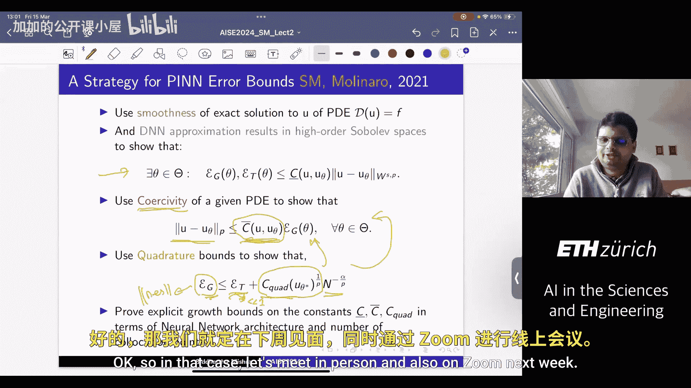

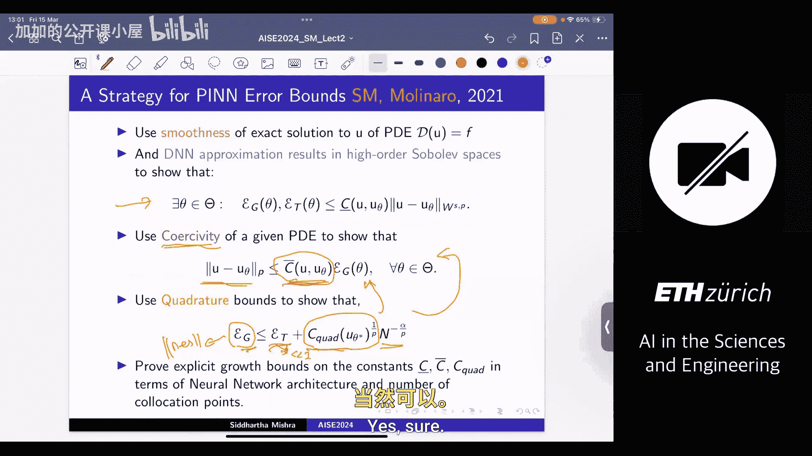

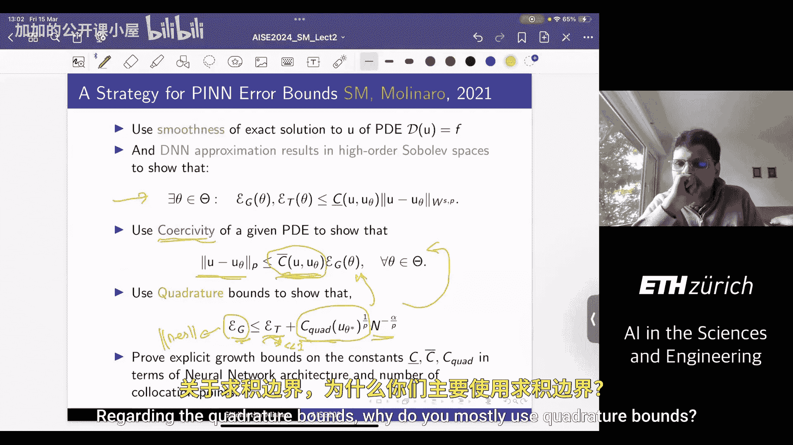

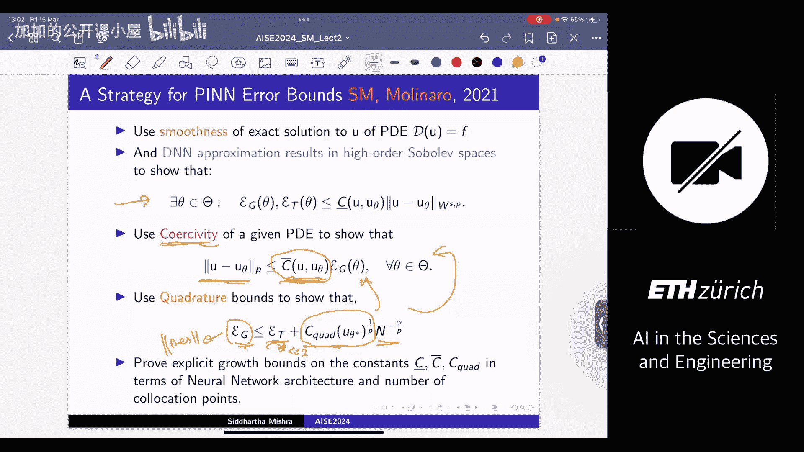

Any approximation is a quadroature right What is a quadroture Quadrature is when you replace an integral which is a continuous quantity by some sort of some form of a sum okay which is a discrete quantity So whether you use Monte Carlo。

 Monte Carlo you just if it's Monte Carlo maybe I can just so instead of of now of course my pen stopped working So if you have f of y d。

 you're going to approximate it by one over M F of Yi I from one to M so that would be Monte Carlo of course in probabilistic sense。

 but all of this aquadroature to me you know quadraature is any way in which you take a integral and you approximate it discretely。

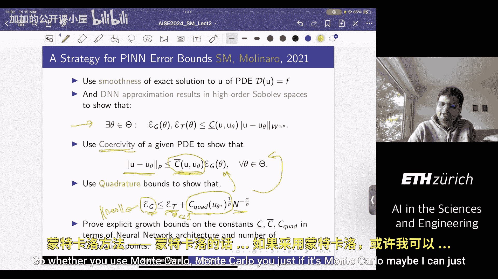

So everything， whether it's Monte Carlo， quasii Monte Carlo， Gaus Quaature， Newton Cos。

 all of them are included in the same ambit。

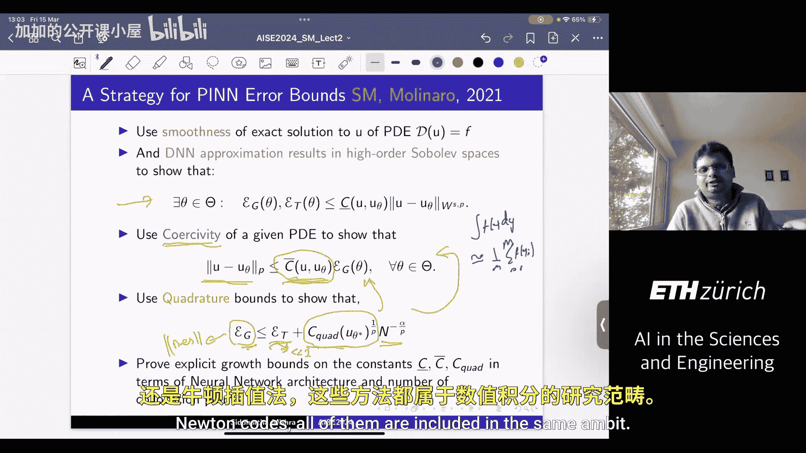

Is that okay， yeah， it's perfect，2 science。

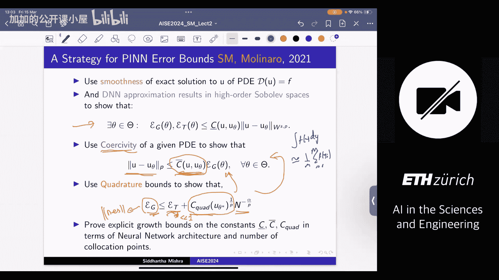

Any further questions？No， so the recordings will be provided and also the slides。

 if they have not already been put on， they will be put on pretty soon。

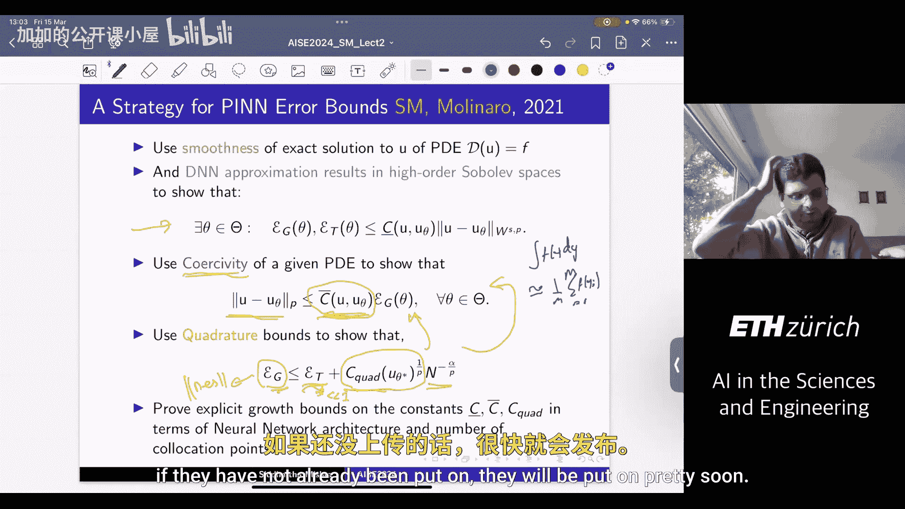

O，拜e拜e。