# 苏黎世联邦理工【中英⚡科学与工程中的人工智能｜2024 AI in the Sciences and Engineering】 p09 P9 Physics-Informed Neural Networks – Theory Part 2 -BV1smxgzHEPC_p9-

Welcome everyone to lecture number nine in my reckoning， I think if my count is correct。

 maybe it isn't but。Yeah， so where are we so far。

So as you can see behind me， so so far what we have done is we focused on physics in from neural networks of pins。

And we have looked at algorithms and in the last lecture。

 what I tried to give you was some theoretical insights。Right。

And the main idea is to see when pins work and when they don't work， especially when they don't work。

 as you will see today， are many， many conditions， many， many circumstances。

 situations where they don't work and I think we have a good understanding of that。

 And so that's the main goal today。 So today we are going to look at some further theoretical insights into why pins are going to fill。

Right so by the way， just for the people in the room， is it okay when I'm highlighting on my notad。

 is that okay or okay， otherwise， because if I use a pointer then people on Zoom they can't follow so I'm sort of constrained to do this。

Okay， so let's recollect what we stopped at in the last lecture， which is online。 So first of all。

 we have some abstract PD D。 So this could be， for instance， a heat equation。

We are going to see the heat equation again again today， so this is the heat equation， for instance。

 So this is the differential operator and all the sort of information the inputs to the problem I'm measuring in terms of where I'm giving them prescribing them through this input here F。

 this is the short term， the coefficients， initial conditions。

 boundary conditions and so on and the idea is that given F we have to find you right so this is the rough idea is that given f。

We have to find you and to do this we are going to use pins or sort of physics informed losses。

 physics informed neural networks and just quickly we have a neural network so youth The and instead of directly having labels to supervise the data on what we do is that we compute the PD residual because that's the only information that we have。

This is the residual of the PD and we compute it， we can compute it at any point in the domain because of automatic differentiation。

 finite differences， whatever you call it， and then we want to minimize the integral here。

 of course the integrals can't be directly computed so you have to rely on aqua。

That this is going to be our loss function， right， so this is L of T。Okay。Thanks。

W didn't that work yeah I of Theda and we optimize it with whatever some variant of this stochically and decent but so this is pins and what we did in the last lecture was that we sort of developed some sort of framework to analyze pins and to that end so this goes down to this paper I wrote some years ago。

And essentially the idea is the following that the point is all the time we have to work with three objects right so one is the training error this is related to the loss function right this is essentially the square root of the loss function of theta。

Then this is the PDd residual， this is precisely the PDd residual， this object here， as you can see。

 so this is often called a generalization error， so you should think of it as a PD residual。

And the last object here。Is the total error and the total error is given by this quantity here this measures the mismatch between what you compute the pins and what the actual ground truth is。

 what the solutions of the PDE are and the point was that as long as three conditions hold this program words and what are those three conditions the first one essentially is this let's use a different highlighting color is essentially the smoothness of the exact solution。

So as long as the exact solution is smooth in principle and this is very important because you'll see that in practice there are formidable difficulties in doing it。

 in principle we see that both these objects， the residual of the PD， this object here。

 as well as the training error or the loss function。

 these can be made as small as possible because the exact solution so these can be made as small as possible。

 you can estimate them， so essentially this can be made as small as possible。

Because you can make the neural networks in the space of neural networks。

 you have some closeness and approximation to the exact solution of the PDD So in principle。

 this is a well posed or a feasible problem。However。

 in practice we don't have access to the exact solution that's the whole point of pins。

 we have to infer them through the indirect information that is given by the PDdeE and to do that so we said that there are two structural conditions that one can use so first is what is called a coercivity this is as I said in the last lecture this is some sort of stability condition So this tells you if you remember so this was essentially U minus U bar in some node is less than or equal to c of U U bar you had in this case D minus D。

Okay， this didn't even fit。So。Never mind okay so it tells us that if you change the input to the PD in a small manner the outputs of the PD change So some sort of stability or this is often called a coercivity and this is essential in order once this is there I had this little argument last time which convinced you that if this is the case then the total error can be bounded in terms of the PD residual right and once you make a PD residual small the total error is going to be small and of course we don't have control on this we don't have a handle on this。

 we compute it with quaraature so one can use some sort of quarature random sampling quasi Monte Carlo or whatever in order to sort of estimate it in terms of the training error so at the end of the day we are given with an estimate which looks something like this。

What does this estimate tell us， this estimate tells us that if the training error is small and this is a big A。

 so this has to be small。And this guy has to be if you have sufficient number of quaroature points。

 then the PD residual itself is going to be small。 And once the PD residual is small。

 if the PD is coersve or has this stability properties。

 you can leverage them in order to make the total error small So this is I keep on repeating that there are many sort of links in this change right so one link is that you should have sufficient number of quaroature points and that depends on the dimension that depends on the smoothness of the function and so on and so forth then you should have sufficient below training error And later on after the break today。

 we are going to see whether this can be done or not and finally you should have some nice properties of the PD that allow you to make this small residual into a small error Okay so this is sort of the basic algorithm and what we are going to do in the first part of the lecture today is to work out some simple examples to see whether this is true or not and already you'll see that this gives us a lot of insight into what is going on okay so this is where we are。

And this is where we are going to start with today， are there any questions from within the room？no。

Feel free to ask or people on Zoom if you have any questions， chime in。

 you can just ask it through the chat function， the chat button。Okay， if not。

 let's do some concrete examples and I picked up some examples which are sort of illustrating the breadth and depth of PDs。

 the first example is what is called comocoop Ps they look complicated but they are actually not that complicated So the point about comogoop PDs is that they include the heat equation So this is of course what you have already seen the heat equation is essentially Ut is equal to lap plusian of U this is the simplest and let's see why this equation is related to this equation here。

 So all that you have to do is to take the transport term So this is what is called the driftft often if this is equal to0 then this term of course vanishes and if these guys are just identity this is what is called a volatility sometimes so these objects are identity then you'll just get the trace of the Hessian and you get back the heat equation So this is the simplest example of a time dependent PD that there is and it models very。

Yes things， diffusions， mix saying， browning motion and whatnot。

And then the reason why we wrote it in this elaborate form is because in option pricing so this comes from finance So what you do is you have a very famous PD that governs the prices of options European options and this is called a black ss equation many of you might have heard it it's a black srolls equation and the black ss equation is also in this form it is a particular example of this so all that you do in this particular case is that so the drift here。

 this is a fine so this is simply U of mu of Xj mu is often called the interest rate right so this depends on what the central banks or the banks are going to give you in terms of money So that is just a very simple term here and then these objects here these so-called correlations these are given in terms of what is called volatilities and you can see that there is some terms which are looking here So this is also a fairly simple term。

It looks wait for the ambulance to go。Yeah， so often in a basic PD or a basic engineering class you have seen the heat equation you're probably also seen the black shoals equation these are all in this very general form okay but essentially what you can think of them is some generalization of the heat equation with some additional terms thrown in which which are let's a mild manner in fact you can you can transform one into the other but the main point somehow in these problems often is a heat equation is very easy to solve you can use a finite different scheme and as I showed you a few lectures ago and you get a very accurate solution So what's the caveat the caveat is that these equations particularly the black shoals equation this can be a very high dimensional because D is the number of thiss a number of stalks essentially or bonds。

So if in your portfolio of 100 stocks， this is going to be 100 dimensional equation Okay。

 so now this equation is sort of a prototypical PDdeE and let us see what happens in this equation are these structural conditions fulfilled。

 right？So let's try to walk you through that， I'm not going to give any detailed proofs。

 but just give you some nice arguments。So again， this was done a few years ago and the idea is that first you have to argue and remember that here the dimension is the key issue right because you want to solve this problem in 100 dimensions。

If possible even in 1 thousand dimensions people can people can do it Okay。

 so what's the idea The idea is that if you take a pin。

 of course you have to take the Tage activation function。

 you can take some other activation function like sigmoid this will also work so main point is that what you can see is that the size of the neural network this is going to not depend of course you can get a low accuracy if the size of your neural network grows exponentially but in this particular case that's the whole point that you don't have an exponential growth So this alpha here is polynomial。

Its actually depending on for the heat equation， this is even linear or quadratic。ok。

So the details are not important here， but the take home message is that by using some deep math。

 what you can argue is that at least in principle there exist neural networks which are going to approximate it。

To sufficient accuracy， independent or polynomial in the in the dimension and not exponentially。

 That's why we claim that this overcome the curse of dimensional。Okay， so in principle。

Whether you do it in practice or not is going to be different now remember that our objective is not to show these in principle results but in practice results and what are these in practice results that somehow from the structural properties of the PDE you should be able to read out that if I make a small residual I get a small let's say I get a small solution or a small error and this is based on the stability of the PD and this requires a small argument that I'm going to。

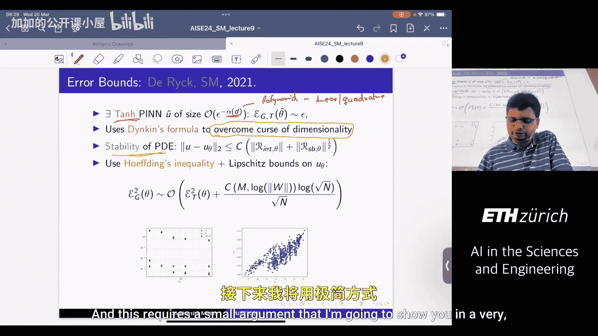

Show you in a very， very quickly， because it's so easy。So let me just do this。

 Let's take the one dimensional heat equation。 Okay， so you have U T is equal to U xx。

 This is a heat equation for the time being， I'm assuming that there are some initial conditions U x0 is U U part of x。

And you at okay， so this is and some zero boundary conditions。

 So you at0 equal to you at one equal to zero for all times， okay， for all。

So now remember that the whole point is stability， so let me try to illustrate that I'll take a different solution。

You， you bar was a bad idea， but let's change that to you， Ha them。U hat of T is equal to U hat Xx。

Plus some let's say residual R， right。 So this is， for instance。

 what comes out if you do a neural network and let's say for simplicity that it has the same initial conditions you had of x 0。

is it good to。U bar x and the same boundary conditions。So the only fluctuation。

 so you match the initial boundary conditions， the only fluctuation is that the pointwise residualidiv is no longer zero。

Now all that you do is that you take the difference W， which is U minus U hat。

 and then all that you do is if you subtract one from the other， you take this。

 then very easy to see that Wt is equal to W xx。minus二。Okay， something like that。

 I could have also flipped the science a little。 So let's see if I can erase it。是谢。

Just because I like a plus here。Okay， it doesn't really matter。 Right， So now we have this equation。

 And then from this， we have to infer that if the R is small， the difference W is going to be small。

 right， How do you do that？ That's very simple。 And， of course， W at。X0 is 0。

 That is because the initial conditions agree and w at 0 equals w at 1， which is equal to 0。

 This is because the boundary conditions agree。 So only fluctuation。

 the only perturbation between the two equations is given by this term R and the argument that we are trying to make is that if r is small then w is going to be small because this r is the P D residualible W is the error between the exact solution and approximate solution。

 let's say the pin in this particular case。 and then we just we can very easily argue this this is just a one line argument。

 So that's why I write it。 So all that I do is I multiply。

Let me take black So W W T plus is equal to w W xx plus R W this is， I just multiplied。

 Then I know that this is nothing but Pt w squared over2 is equal to w W xx。Plus， R W， nothing。

 nothing fancy。 And this is nothing but less than or equal to Ww X X。 Plus， I use the inequality。

 A B is less than a squared over 2。Plus b squared over2。

 And then you havearrows squared over 2 plus double squared over 2。Okay， so this is straightforward。

 and then I integrate。So because at the end of the day， the errors are integral。

 so if I integrate from zero to 1， this is also very straightforward。

Doubless squared of 2 Tx is less than or equal to integration does not change anything。WW X X。Plus。

0 to1。Ha are squared D X plus half。We don't do1 double squared of Tx。So now it's very simple。

 as you can see， this is a derivative in time and the integral is over space， right， so you can just。

Liip them。0 to1 double squared over 2。Dx is less than or equal to now here I'll do something interesting。

 very very simple trick all of you should be able to know this so I have the product of two functions here so I can use integration by parts。

This is in one dimension， so everyone knows what integration by path is。

So if you take it then you have minus0 to1 of w x， so you throw it derivative onto w。

 so it's w x squared dx and the boundary terms are going to vanish Can anyone say why the boundary terms are going to vanish where the boundary conditions themselves are0 if you remember boundary conditions themselves or sorry。

Boundary conditions themselves as zero， so the boundary terms are going to vanish。

So once you have this， then you are almost done because you have half R squared。D x plus half。

Doublas square。Okay， so now the half can be canceled。

 this quantity here is always going to be a negative quantity because so this entire thing is negative。

Right because this supposed positive quantity is the square， so this will imply that d over dt。

Of w square of tx is less than or equal to w square dx。Plus， r square of Tx。Okay。

 so this is very straightforward and then many of you have seen from basic ODs that we could use something like what is called a grown wall inequality。

Let me add， so this will imply。 I write it on the other page。So， outside's at the beach。

This is just some rough work， so what did we have， so we have D。

Of double squared of Tx is less than or equal to double squared Tx。Plus。A squared。DX。

 and then you have something called the Gro Wall inequality。

It's just telling that nothing grows faster than an exponential essentially。

And this will tell us that。Double squared at T。Of T x will be less than or equal to essentially02 T。

0 to1 r squared of X T D， X T。Because the initial conditions also agree so the initial conditions vanish and you are just left with this fourth symptom so as a consequence you can see that this if this quantity here。

 if the residual can be made small，Then automatically， the error can be mixed。Right。😊。

So this is all that is there you can see that we have used we have leveraged the stability of the PD the details of the proof are not important because it's essentially a few lines right but essentially we have leveraged the stability of the PD and we have concluded that if you have a small residual then you can have a small total error okay and this is precisely the point that is but through this argument here as you can see sorry。

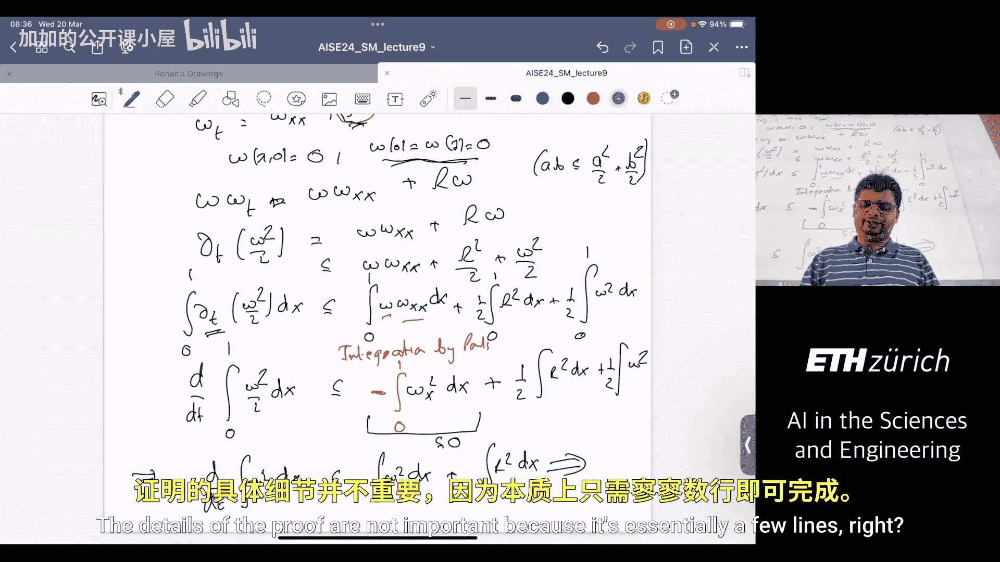

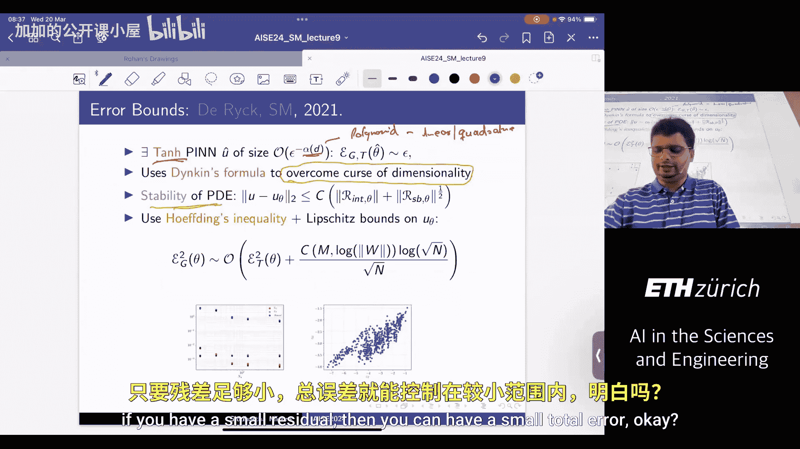

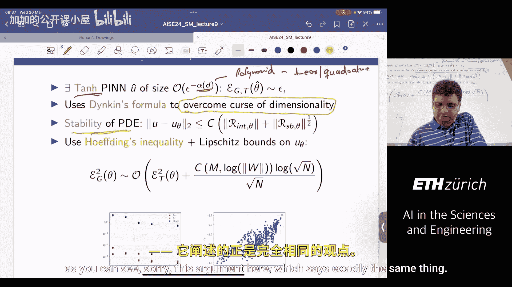

This argument here， which says exactly the same thing。

That of course now there are initial conditions， boundary conditions and so on and so forth。

 And because of the boundary conditions， you will have a square root here rather than a square。

 but essentially the argument is exactly the same。 So if the residuals are going to be small It is a constant which is independent of the solution this cell linear PDde you get that the total error is going to be controlled okay so this is this is a simple argument now you can argue why do I need to learn about this well because it's important right otherwise how else will you conclude that the error is going to be small So here you leverage the stability of the PDd later on in a few minutes。

 you'll see that there are some PDds which don't have this property and then things get if okay then last point。

 so this can be done So as you can see this part is over this can be done stability implies small error but what about the quadature bounds So because the very high dimension you can only use random sampling then nothing else works。

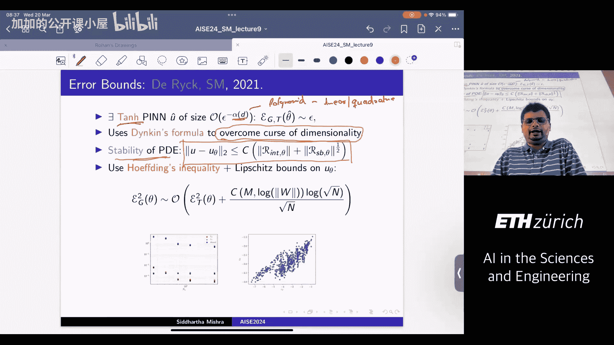

ok。So you can use random sampling。And then there are some random sampling essentially means that you use what is called a central limit theorem。

 so essentially you can show that the PD residual is given in terms of the training error。

 and the total number of quaature points， but it's square root of n okay so there is a loggasmic correction because things are correlated but there is a logatsmic correction and this is essentially independent or damage。

So now it's independent of dimension， it is always going to be squared root of or with a correction because it's a log on top but you know that any power grows faster than the logs。

 So of course these things decay as n decays so what are we showed so we have been able to show that for this particular class of PDs albeit beat very special class of PDs with wide applications you have that because the stability of the PD small residuals implies small errors and because of Monte Carlo if you take sufficient number of points independent of the dimension by the way。

 this estimate was also independent of the dimensions all these is independent of the dimension as long as you have small training errors which is a big if then the total error is going to be small and this is also borne out through actual estimates numerical experiments let me show you this example so this is in 1 d but it's already telling you what's going on So in 1 D we can explicitly compute some of these upper bounds so this is。

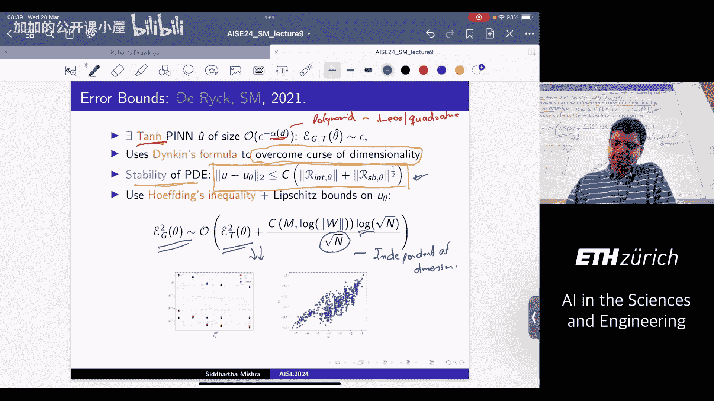

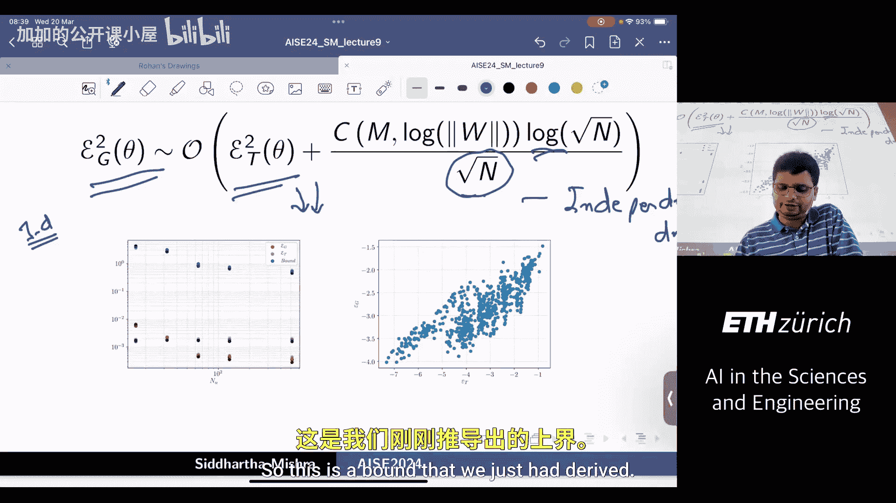

That we just had derived。 And you can see that as the number of quaature points。

Increases it's not a lot of cottage points， it's between 10 and000 points， so this quantity decays。

And as a consequence， you see that the total error in red， it also decays till it saturates。

 you know， at the end， it has to saturate。 So they are sort of following each other as expected。

 However， the total error is much smaller than the bound。

 The bound is a very let's say pessimistic upper a bound。

 You can see that this is how many orders of magnitude like three orders of magnitude difference between them。

 So they have the same qualitative information， but quantitatively you cannot use this bound to say how small error is going to be pesimistic。

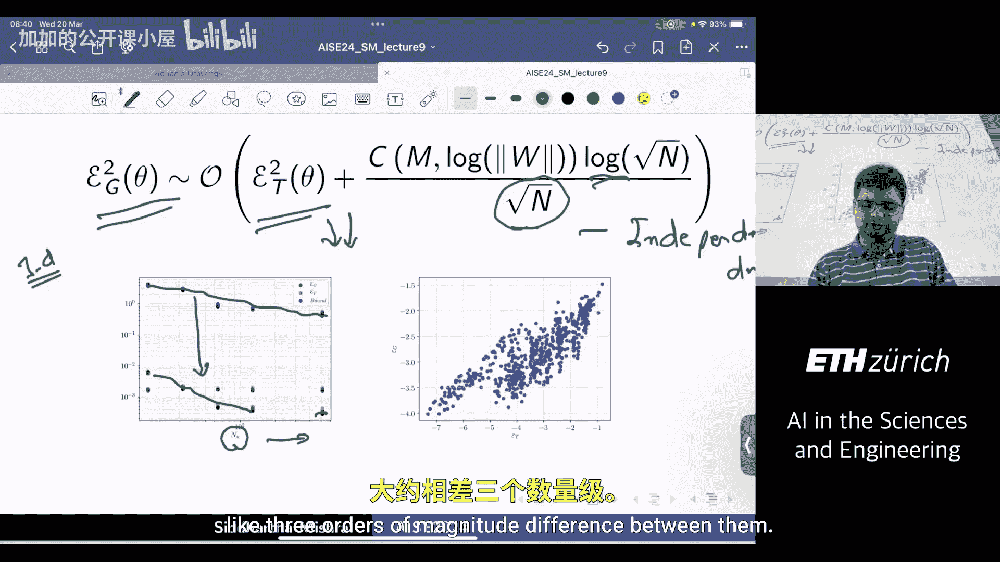

But it's nevertheless it tells you something， tells you that errors errors can be made small。

 and this is also very interesting because this is the training error。

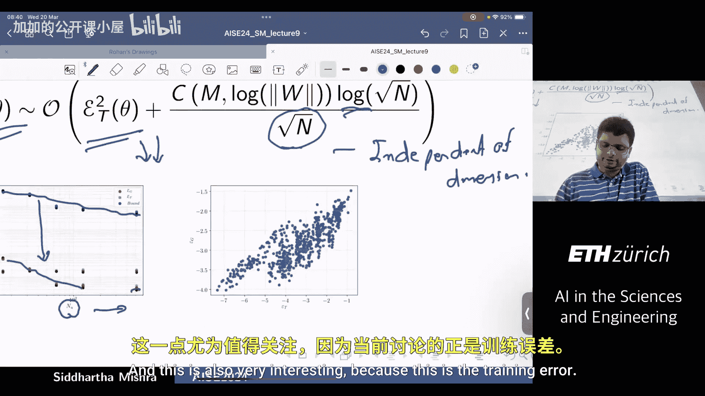

Okay， and this is the total error。And it says you that as this training error becomes smaller。

 the road this is a log log plot， okay， so here is a log， here is a log。

So as you can see that as the training error is small， the total error is going to be small。

 which is consistent with this inequality， sometimes the training error can be large and the total error can be small。

 but never the other error it cannot happen that the training error is small and the total error is large so this is some practical significance right it tells us that at the time of training a pin we can observe that the error is going to be small the training error because this will just compute from the loss function and then we know that the total error is going to be small so that gives us some confidence on that okay our training processes work now we can use this okay and what is also very interesting is that the estimate tells us that it goes like a square root of the training error and it's indeed true because as you can see there are six orders here in the training error and there are approximately three orders in the in the total error so as expected it also behaves like a square root so in that sense quantitative。

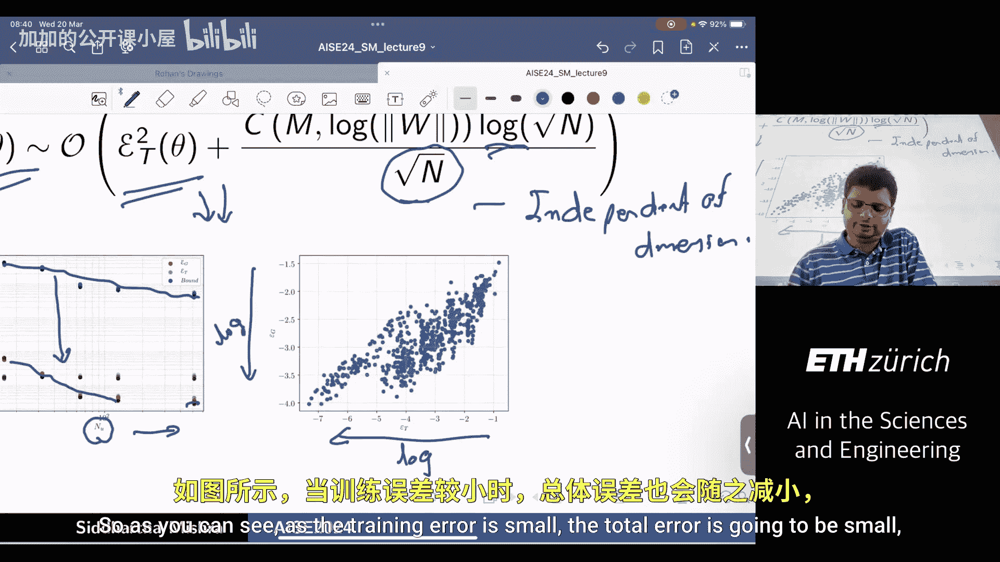

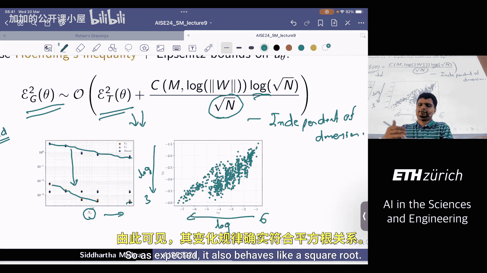

the theory is quite tight but because there is this no curse of dimensionality。

 this also allows us in practice okay these were my rough calculations this allows us in practice to do computations up to people have done now up to a million dimensions but at least we could do easily up to 100 dimensions without any problems and you can see that for the heat equation itself the error increased as as you' would expect to remember that there was a polynomial not exponential increase polynomial increase but it was really polynomial it was even linear so between 20 dimensions and 100 dimensions for the same compute time the error increased by a factor of I don't know4 right so this is less than even a linear increase so this is consistent this was for the heat equation。

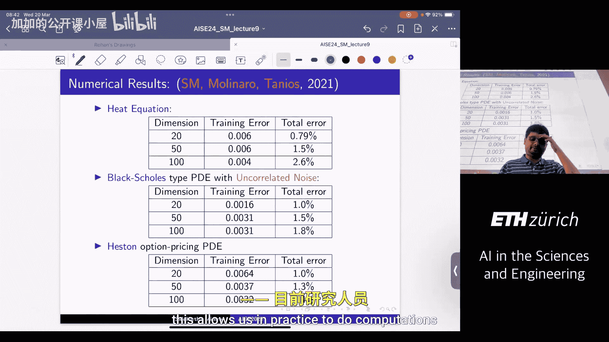

And for the black shahoals equation， the one from option pricing， it was similar。

 so for instance between 20 dimensions and 100 dimensions， and this is roughly I don't remember now。

 but let's say one hour of training。So we fix the compute and then we see how the error scaled and these are the numbers that you can see so here even between 20 and1 dimensions five times increase there are only increased by a factor of two so it's even subline in some sense。

And similarly， you could do Heton。 This is another of these equations also used in option pricing。

 Another different coefficients， different formulas， but essentially the same story。 again。

 you can go。

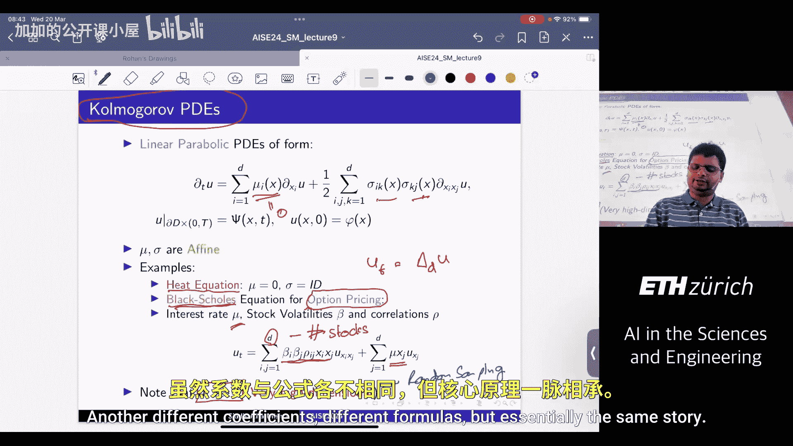

Without much of an increase in error， it does increase， but very， very mild。

So this tells us that this is phenomenal right we can solve 100 dimensional PDE within an hour of training to 1%。

 1。5% 2% error so that's somehow very very satisfactory there are caveats which youll see in a bit but at least for these particular problems things seem to work。

Let's do a little bit more of this， this is a very interesting PD another example that I wanted to give with not a lot of details this is radiative transfer so for instance when the energy comes from the sun it is essentially radiation it's also very important in climate and so on and so forth also in engineering because there are many many processes where radiation plays a big role。

So essentially there is a PD some of you have seen this probably but it's it's a very special kind of a PD let me walk you through So this the quantity of interest U is what is called the radiative intensity Okay。

 this somehow measures the total amount of radiation at each point and in time and there is a master equation which govern this。

It seems rather complicated， but it is not。 So this is， of course， a time derivative C。

 as you can imagine is the speed of light Okay， because radiation is light essentially right so it travels very fast。

 So essentially this is a very， very small term because one over is a very。

 very small quantity So essentially most applications that we are interested on Earth this term can be essentially neglected。

 the whole term can be neglected， even though in astrophysics， like when you are exploding supernova。

 the speed at which these things happen is comparable to the speed of light so you can't can't ignore it。

Now this quantity， now when radiation comes， you can compute the angle。

 so this is what is called the angle。Okay， and then these are this is essentially absorption。

Absorpttion。The details are not important here， so as you can see that this is a first order derivative here。

And there is a source term here， and there is a non local term。

 So this is what is called scattering because radiation is scattered。

 the different rays come and they get scattered。This is Katherine。

And this is measured in terms of this complicated formula。

 which tells us that you take all the angles together and you integrate the scattering coefficient And finally there are some source terms right so how many dimensions are there So this U is a function of time。

In general， but in many many cases you can ignore time， it's a function of space。

 space is usually three dimensional， it's a function of angle。

 so when you are looking at three dimensional space you have two angles so that's two dimensions and this no is a frequency。

Because radiation happens at different frequencies， So it's a function of frequencies。

 So this is one dimension， two dimensions， three dimensions， one dimension。

 So in the most general case， it's a seven dimensional and seven dimensions it's just imagine even if we take 10 grid points in each dimension110 power  seven is a very very high number and essentially its difficult to store that kind of well in the modern computers you can barely store them but if you110 points is not going to give you any kind of accuracy So you need1 hundred points and then you're out you cannot solve this problem by using traditional finite element methods and so on and there's an entire subject of radiative numerical raactive transfer that tries to do that so but pins。

 as I said， the good thing about them is that they have this dimension independent property。

 you never have to generate a grid， you can just use random points and in this particular case we don't use random points we use something called quasi random points。

 but that's not。

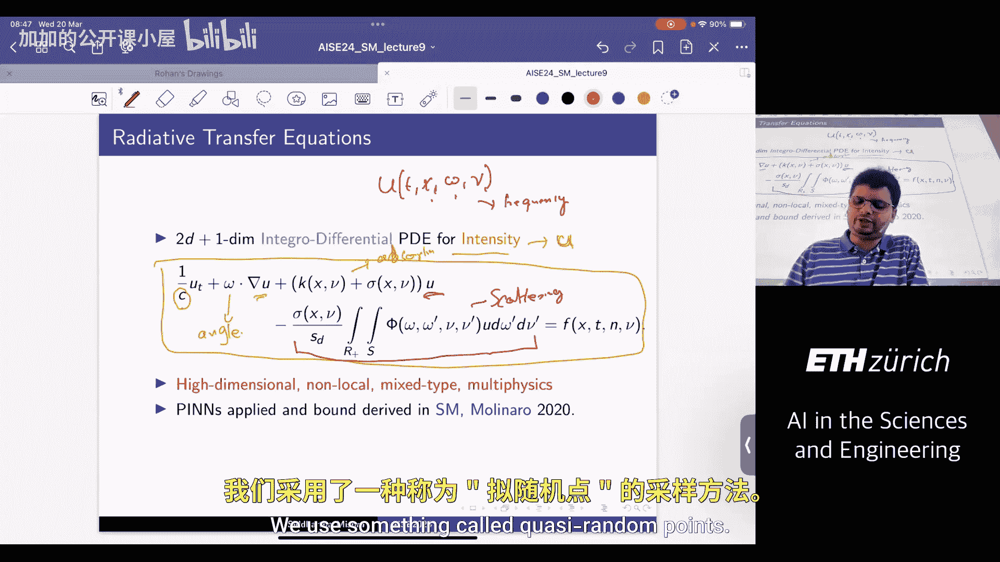

Not a big deal similar estimates can be derived exactly because it's a linear equation so it is exactly the same kind of features properties as the heat equation in some limit it is in fact a heat equation so one one can use that as an argument but let me show you the examples here right so we solve this problem in also in seven dimensions in the paper but essentially you look at either two dimensions or six dimensions。

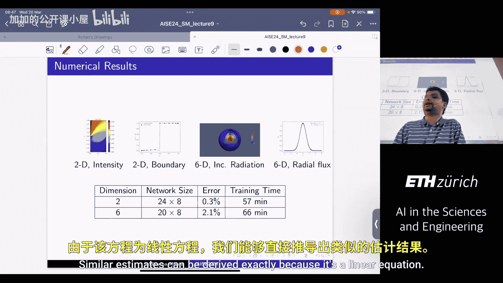

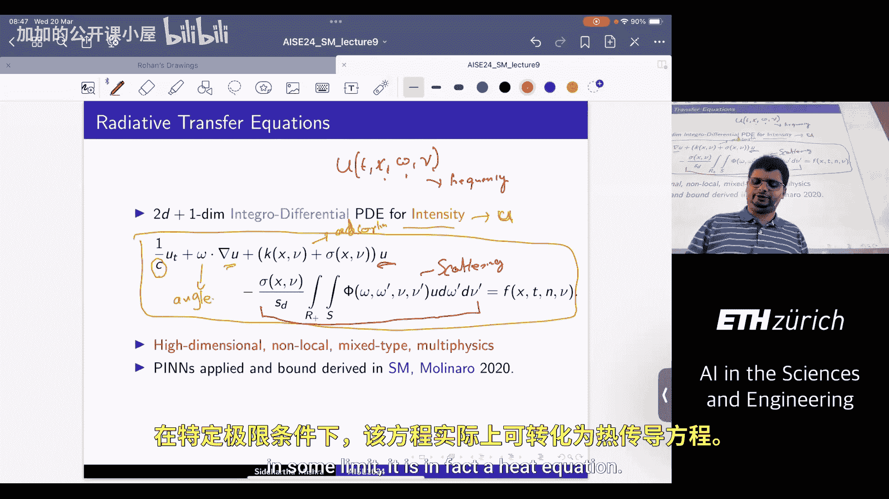

So two dimensions means one space dimension and one angle。

 six dimensions means three space two angles and one frequency so this is this is the harder problem and of course we fixed the network size so the complexity is the same but we change the training time is the same because we just fixed it and then we saw how the error develops and of course there is more error when you go from two dimensions to six dimensions but nevertheless even for a six dimension problem which is visualized here using some three dimensional quantity it's called the radiative flux you can see that the error is only 2% it took one hour in a finite element code that I had for many。

 many years this took maybe 15 days you know to get similar kind of errors。So it took only one hour。

 maybe in modern computers， this will take seven days。

 but it's there are two orders of magnitude here and you can get2 percent of so again this is there is in principle mathematical guarantee which is also reflected in the practice so high dimensional problems that's that's that's good for the that's good for this kind of。

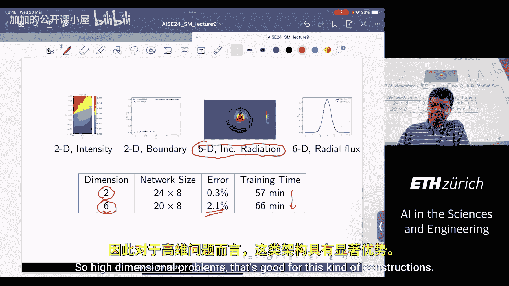

This kind of constructions。

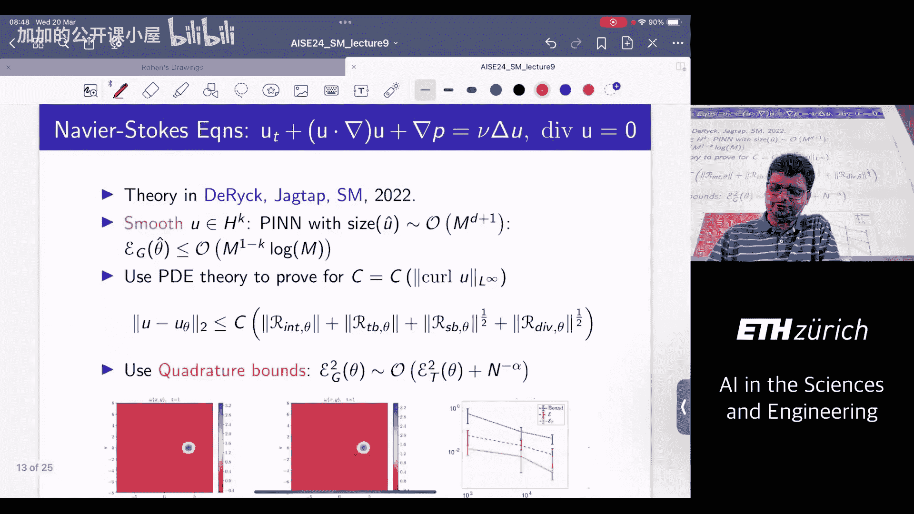

Good， so let me give you another example。 Now let's try to explore some of the negatives。

 not just the positives right So of course， this is the fundamental equations of fluid dynamics。

 Well come again and again to these equations。 This is the Navy na tos equations。

And for those who don't know what these terms are， so u is a velocity， so this is a velocity。

This is two or three dimensional。 It's a vector。Then P is the pressure。This is gay了。

So essentially you have in three dimensions， you have four quantities here。

 three components of velocity， one component of the pressure， nu is what is called viscosity。

It's a very small number because even for water， maybe it's not very small for the hair gel or something like that。

 but it's a。It's relatively large for a hair gel because it's very viscous but for water this is like 10 to the power minus-7 for air it is like 10 to power-15 so this is a very very small number okay so you can in many practical cases ignore this term so three equations three four variables and four equations because these are three equations here and the divergence because the flow is incompressible the divergence is going to be zero so there are four equations and four unknowns all of fluid dynamics relies on this fundamental equation and well revisit it again and again and again so in principle you can solve it with finite elements finite differences fine volumes but you can also solve it with pins and then the thing is can we go through this entire theoretical argument it turns out yes because if you remember that as long as the solution are smooth。

By the way， this is what is in general unknown and in fact。

 some of you might know that this is one of these million dollar problems that was posed at the turn of the millennium that if you can show mathematically that the solution is smooth。

 you get a million dollars but。People believe that the solutions are in some sense smooth nevertheless。

 if they are smooth and this is the smooth in the sense that the case derivative is going to be square inte then the pin has a certain size and the error can be made as small as possible because but just by' taking larger and larger neural networks you can get as small error so in principle but remember that in practice we have to argue that the total error this guy here is related to the residuals so these are the residuals for the different objects here and this can be done this has been done in this paper for instance but the point is that the constant here now remember that in our arguments we never bothered about the constants because they were linear problems mostly but in general you cannot do that the constants have to depend on the PD as well as on the neural network。

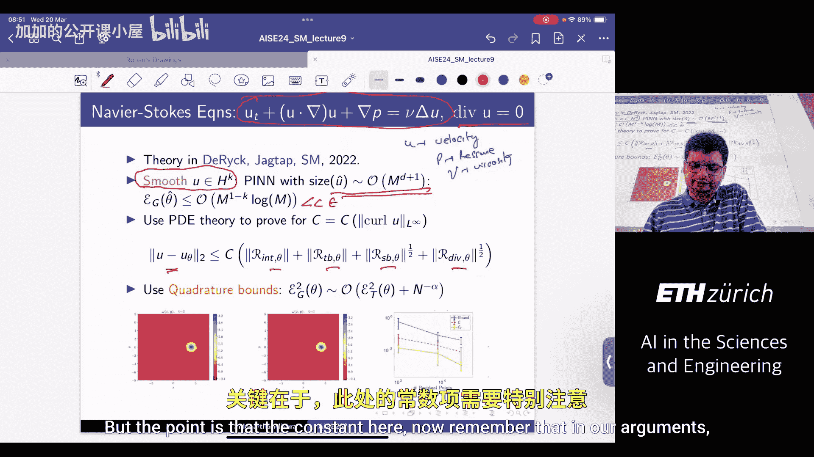

So here the constant depends on where is it？

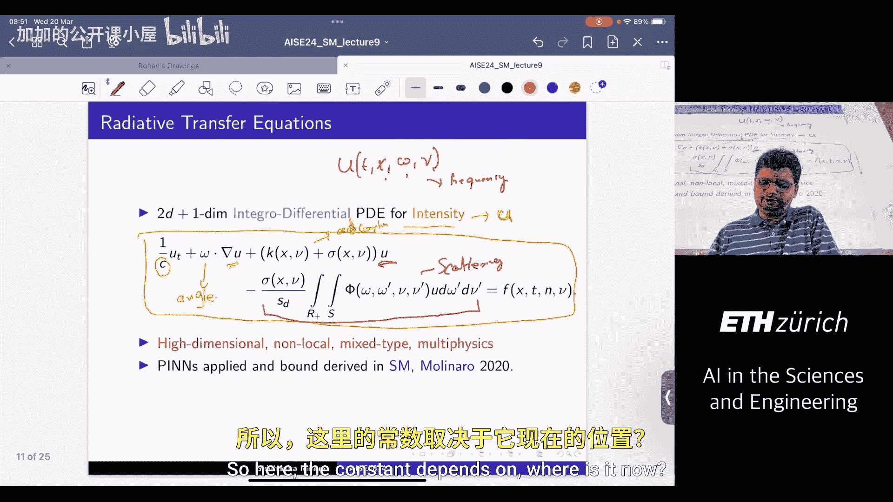

And this is an important caveat， so this quantity here is the curl of the velocity field。

 Some of you might recognize it as a aity。And the whole point about fluid flows in three dimensions is that the vticity can have very complex behavior so the vticity in principle can be large so if the vticity is larger and larger then this estimate becomes more and more useless because even though these quantities can be made small this is still large right and in fact you can use so this is an important cave so this for nonlinear Ps it depends a little bit on the property of the PDs and if you take this example where the vticity is like this is actually the vortex which is being ated at most this is like order of three so this is not not so difficult and this is a ground truth this is what the pin gives you this a fairly good approximations there is already less than 1% means this is 1% so there is less than 1% and the bound that we prove is very close to there so this is sort of comparable to each other but in this problem the vticities of the order of1 okay it's not not that large。

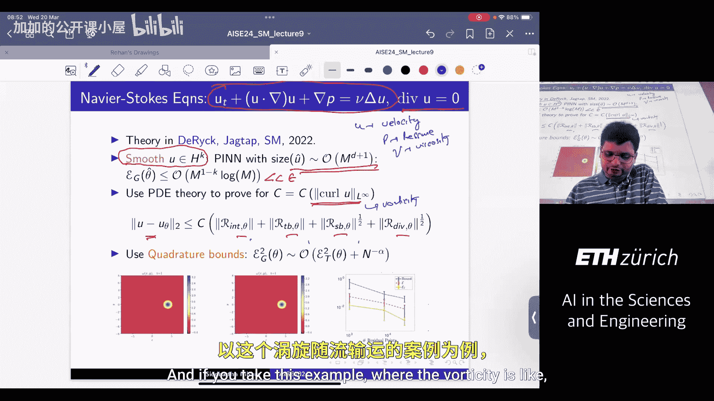

As long as the training error can be made small， the total error is going to be small okay so this is sort of the main main point here that if the verticity becomes large you might not be able to do a good approximation and this is also born out because now we try to increase the vticity quite a bit earlier the verticity was large in the sense that it was concentrated in this little vtex but now you have larger and larger vorticisees so as you can see this goes all the way from5 to minus5 so these these vertices here and these vertices here and they're also more sort of spread out in some sense and you can see that as as the time progresses。

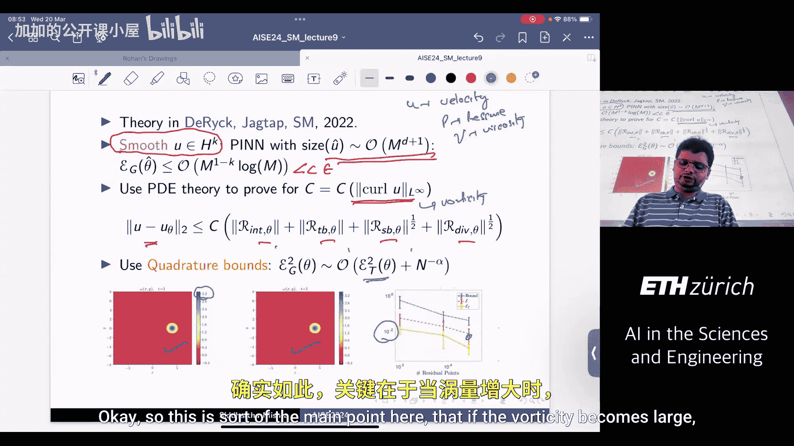

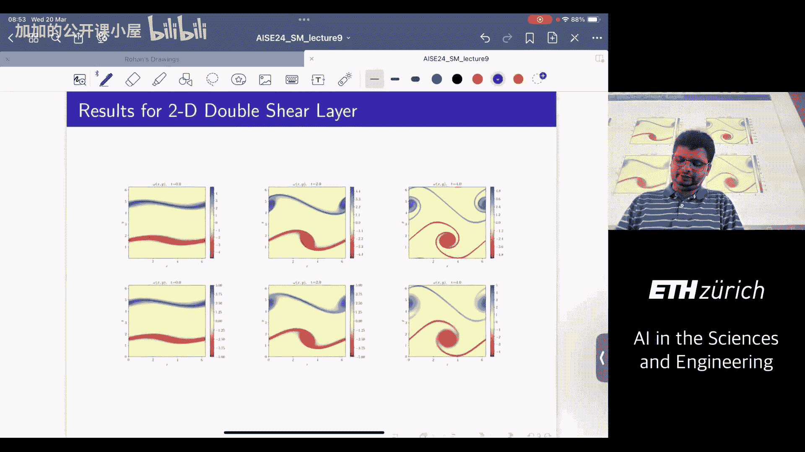

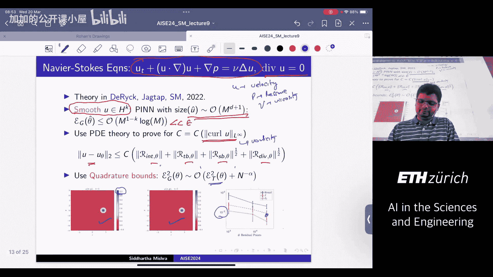

There is more and more vticity which is being generated and the quality of the approximation suffers right so if you focus on the picture here in the beginning this was less blurred than this guy but here for instance these verorticisees are very sharp and this is completely blurred。

Okay， so this tells us aha there is a caveat here that if you have a very complex solution with lots of vticity for this particular case。

 your approximation is not going to be good and in fact that is true if you take a more complex flow so this is fairly simple flows which already illustrate the idea but if you take a more complex flow like if you have a cylinder and your flow past the cylinder then there is a number called the reynols number which tells you how complex the flow is and in fact there is no pin which can do more than an nult number of 500。

The for water the renewals number is 10 to the power 7。

 so 100 million between 10 million and 100 million so you you're far off and is a there is a mathematical lot there is a good reason for that and the reason is that in this case the solutions to the PD themselves are fairly complicated so somehow this is something that one one should one should always remember instead of blindly applying these methods。

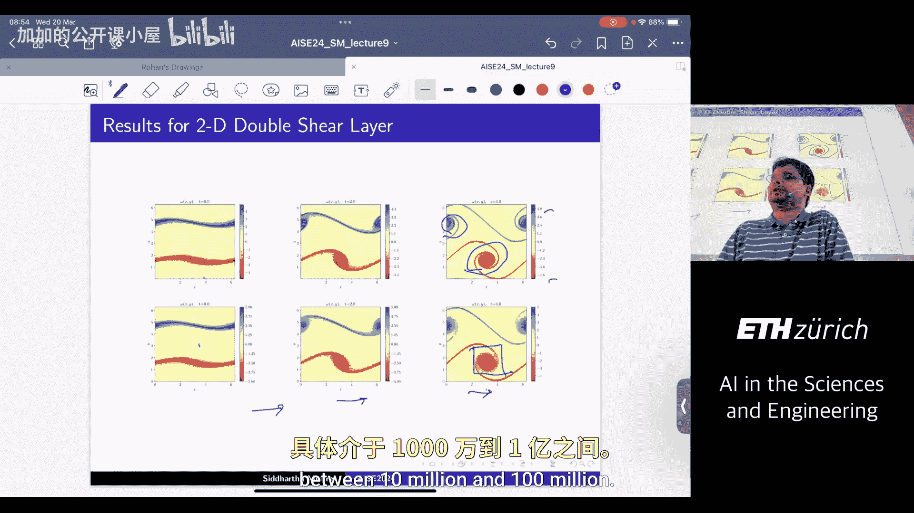

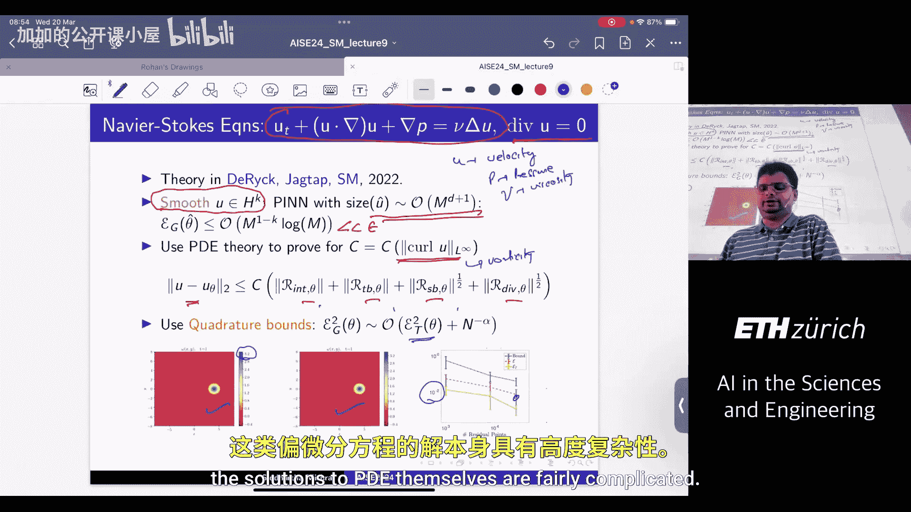

This is another example which tells you some of the caveats that are there and let me explain it quickly and then we go into the break。

So the this is the viscous Burs equation， so it has both transport。

 so this is nonlinear transport this term。And it is diffusion。So this term is diffusion。

It is like the heat equation right So if you did not have this quantity here。

 this would be just the heat equation Well the whole point of transport is that it forces things nonlinear transports so sometimes things move faster than some other things。

 So things get the compressed in some sense measures compression because diffusion does the opposite something is compressed it takes it out right so this system is the basic idea Now you can do the same arguments as before you can get an estimate on the total error which behaves on the training error which behaves on the number of quaature points and which depends on these constants and these constants just like in the na strokes case it depend on the gradient of the velocity。

And the point is that the gradient of the velocity we know some estimate on it。

 we know we can measure it in some sense we can estimate it and the gradient of the velocity。

 unlike the vticity， the gradient of the velocity， we know that it behaves like one over square root of this nu which measures the strength of the diffusion。

So if no is one， this is order of 1， but if no is 10 to the power 8， then or minus8。

 then this is 10 to the power4 say so it's a large number So in principle as no goes to0 you could have some blowup of the solution or of to approximation and I don't know if you can see it but you actually see it in practice so if you take nu to be a small number tend to per minus3。

 you can go all the way to 10 to0 or 10 to power minus8 for that matter。

 you can see when it is 10 to per minus3， the square root of that is still manageable number and that is a very good approximation to the exact solution but as soon as it is 10 to per minus8 or0 this really blows up as you can see here the quantity really blows up so the pins in this formulation that cannot cannot approximate this solution you see that there is a total failure here。

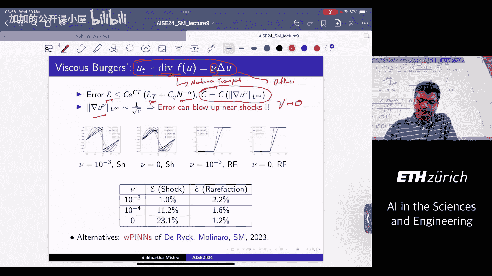

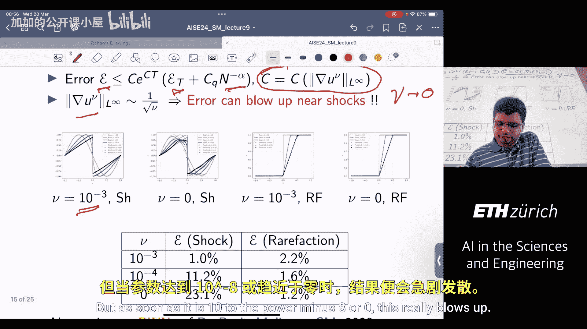

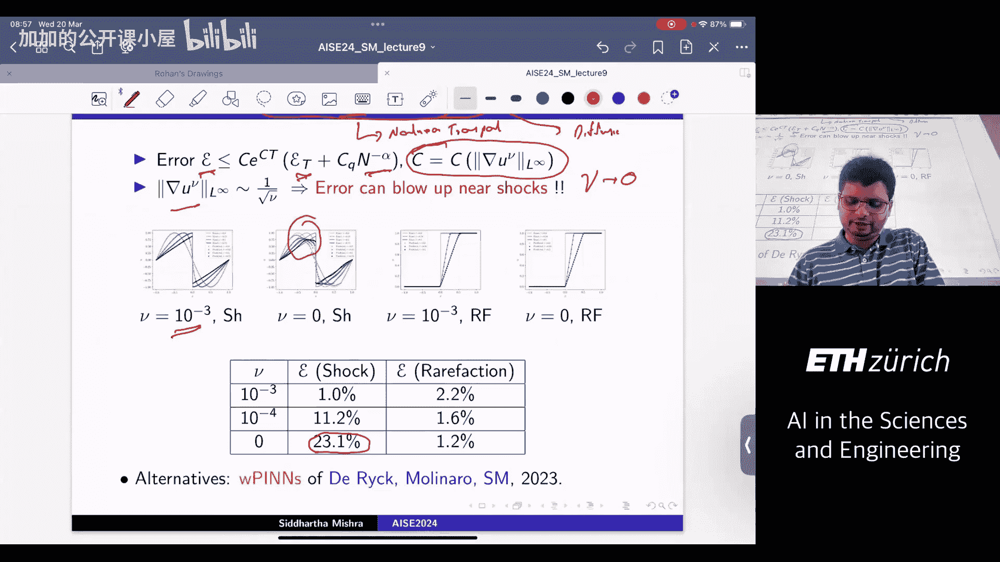

And just to further sort of justify our considerations。

 if there is another mode where the nonlinearity causes what is called a re fact means instead of a compression。

 in that case the derivative doesn't blow up and pins can do a very very good approximation is whether nu is tens per minus3 or0。

 you can see that the error actually decreases or is reasonably small so this is more or less constant error here on the other hand it blows up。

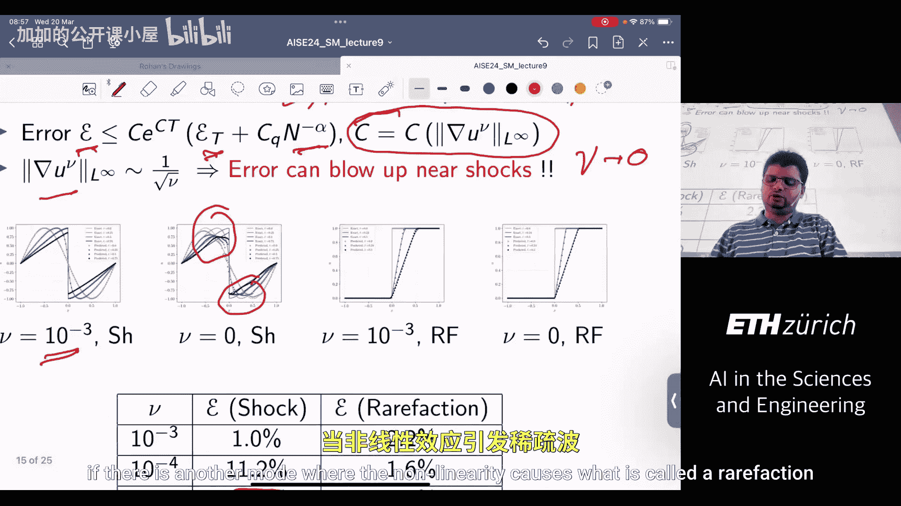

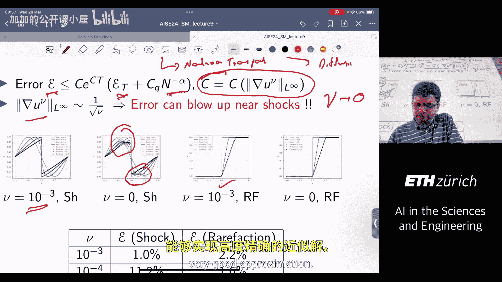

Right so this tells us that one has to be very， very careful when you use pins if the solutions become complicated。

 like for instance， a gradient grow or it becomes more vertical or helicical as one could use then the solutions themselves are soil behaved that it gets reflected in the errors of the pits okay so this is an important caveat of course there are some alternatives but this is not the time and place to do it okay so let me just give you a very quick summary and then after the break we will we will will sort of take it up So essentially the point is that for a generic PD let's take this here for pins we have more or less some good theory。

 some rigorous good insight and a rigorous error estimate which morally goes like this the difference between the ground truth and the best approximation that we can do depends on three things it depends on the number of quaature points this is always something that we can make more for instance even。

Dependdent of dimension， if this is random point。 So this is a good thing。 This is。

 this is a good term。 But there are two terms here that could be problematic。 First one is this one。

So depending on the PD。This term can be large right and as you saw。

 this can lead to some failure modes because if the solution is more vertical。

 if there are more complicated things happening， then you might have a failure and the final term that we have not yet done anything about is the traininger。

So this is still a question right so this term depends on the PDE this one here。

 but if you look at the training error， this is still a question mark at the moment I have even said that it's a black box right and after the break all that we know is from these general considerations that the global minimum。

And this is an important point。That there's a global minimum is as small as you want。

 depending on the size of the。Size of the neural network so there is a global minimum which is going to be small。

 but can we ever reach that because remember that the end of the day。

 even for the smallest networks that we saw so I don't remember let's take one of the concrete examples here right so the network size is that there are eight layers Yeah。

 eight layers20 neurons in each layer So the number of weights and biases is roughly 400 per。

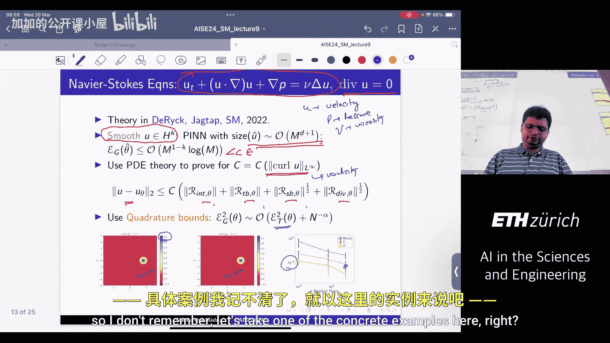

P layer in some sense we have eight layers so its that's a 400 roughly speaking because there are also some output layers and so on。

 So it's 4000 small network， fairly small network but you can see that it's still a 4000 dimensional right so in this 4000 dimensions you have to optimize a loss function and the question is there is a global minimum somewhere which is going to be small but we have to start somewhere which as Ben has already taught you and you saw in the tutorials we essentially start randomly right so we start the random we initialize things randomly can we ever reach the global minimum because everything relies on that because undercent we reach。

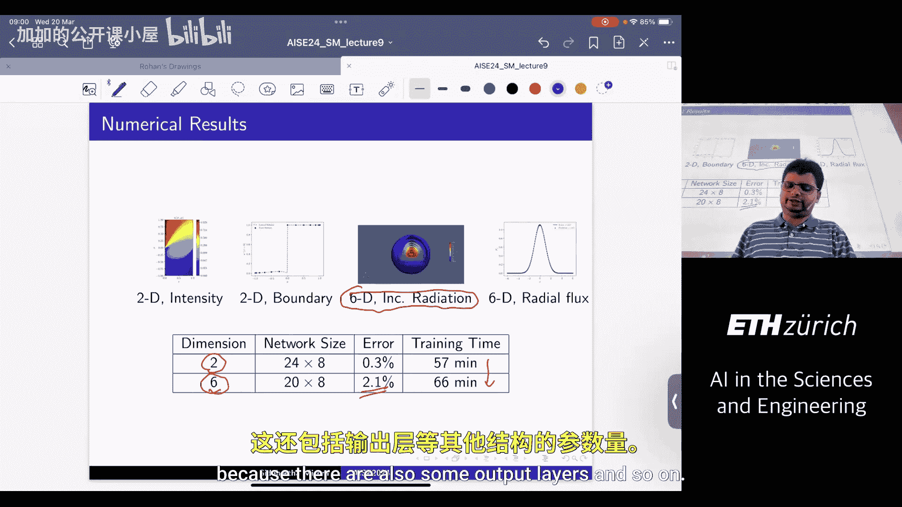

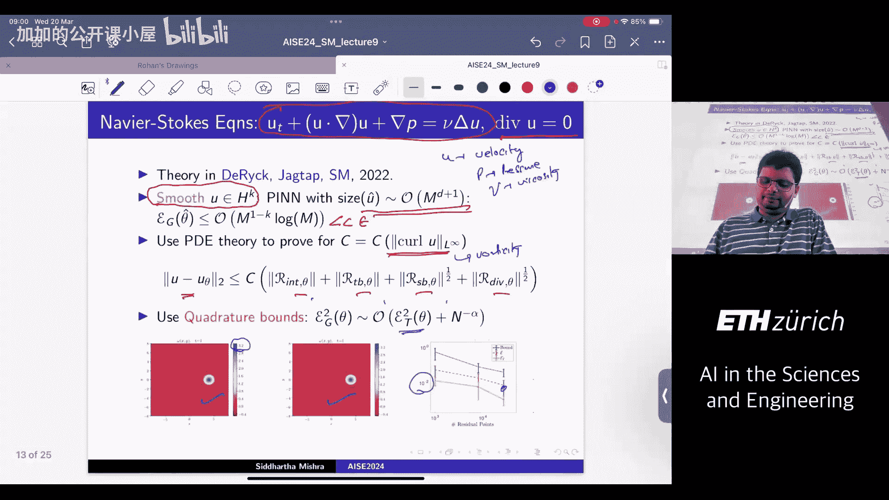

A small or even a good local minimum。 we don't have to reach a global minimum。

 if we reach a good local minimum。 then as long as the PD is nice。

 this error is going to be small and we are in business right And this is what we solve for many。

 many problems that we could reach a good local minimum， for instance， otherwise。

 how would we get 2% error And also you saw this for these problems here that the training error could be made fairly small。

 In fact， even0 dimensions， you would have training errors like 10 to the power minus-3 right So in those problems。

 we could you could see that。 But can this be done in general So this is still a challenge And after the break。

 let's take a break now， we yes。

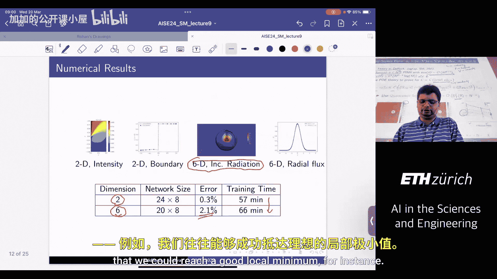

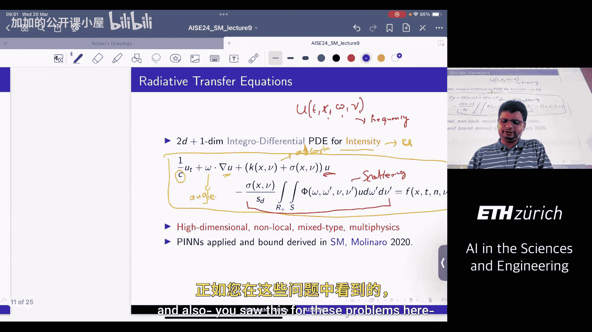

Yeah， they depends on the res number because you can also have laminina flows for very high res numbers but they do struggle。

 they can struggle but they are much better at laminina flow than a turbulent flow so is there is that possibility Okay so let's gather here at quarter past and then we resume the lecture so I should the recording。

Yeah是。Also to everyone on Zoom， we are restarting now so。As I said， before the breaks。

 the key point is。Essentially I was telling of one of your classmates during the break that for many。

 many different PDs， of course this term that I'm highlighting here would be problematic。

 but for many other PDs particularly for linear PDs。

 this term is very mild means it does not even depend on you so this let's say is imprint of nonlinearity this is only true for nonlinear PDs。

If it's a linear PD it's independent of you and you here so in that case as long as we can train well and if we have sufficient number of4 points。

 we should be okay so but as I said before the break so the training error is a black box and let us try to open let's see if this black box can be opened and you see that at least we can open it a little not not entirely Thaand otherwise somehow the machine learning problem would be solved which is far from the case so let us see let's try to unpack the black box a little。

Okay， and it's based on a theoretical framework that was proposed very recently by some of us here。

So this is a paper， maybe the paper can be uploaded if those who want to want to look at it。

 I'll just give you a very， very， let's say， easy version of it。

 perhaps even a dumb version of it just so that we don't get lost in the details， right？

So essentially what is the problem of pins or physics informed training boiling down too so the problem is that you have of course a loss function and I have taken a very remember that RPDE is T equal to F this is the case。

So a loss function is given by just L2 for simplicity because then it's easier to do some of the calculations so you have this is a loss function and you have to minimize this loss right so you have a neural network U which is dependent on X in this case x can be both space and time is dependent on parameters theta and you need to select these parameters theta right so to select these parameters Theta what we use is gradient descent stochastic gradient descent atom Pfgs。

 whatever but theyre all in some sense some variations some more efficient variations of gradient decent。

And gradient descent is a very， very simple algorithm which tells us that you stand at a point。

 you look where this is what we do if you have to go down。

 you look where there is a negative gradient and you just walk in the direction of the negative gradient and hopefully you will find the minimum in general it can if it's a convex function it will be the global minimum but these functions are far from convex。

 I think Ben showed you some of the lost landscapes of these functions and these are lots of hills and valleys but hopefully we can find a good local minimum and gradient descent has some other very nice properties that structural properties which make it useful in the context of machine learning。

And also this algorithm can be done in any dimension so whether it is 4000 dimensions like the pin that I showed you or the largest LLMs that are out there which are closing towards a trillion dimensions the principle is exactly the same so you have to compute the gradient with respect to the loss and you have to move in the direction of the negative gradient right so this is the algorithm so the iterate at K plus one depends on the iterated K and the gradient at the it K okay that's that's all with some learning rate and this learning rate is usually typically small right。

Okay， so now we need to understand and remember that there's a big difference between this problem and the traditional supervised learning。

 which is what you would use， for instance， to train an LLM within traditional supervised learning。

 the loss function here would be some integral of U minus some U Theta minus some ground group U bar some labels。

 right？But in this case we don't have that， we don't have any labels。

 so we have to infer everything from the PD， which is given here。

And you'll see that that leads to tremendous differences in the way we learn and let me try to explain a little as I said I will have to dumb it down because I don't have the time for all the details if you're interested you can talk to me later or you can read the paper。

So the first thing we do is that instead of working with the parameters。

 so these see are the weights and vice， we look at what happens to the function during training because after all at the end of the day we have a neural network and we want to see how this neural network behaves during training how it is updated what are the dynamics of the neural network So this you can say is NN dynamics。

During cleaning。Okay so let's do let's start at a point Theta  zero so of course theta  zero is where we start the descent and then let's say that at least we're close to the theta0 then we can do a tail expansion in fact。

 whether we are close so far we can always do a tail expansion so we do a tail expansion in theta so theta k is the value of theta0 plus the gradient of course the gradient with respect to theta remember the gradient with respect to theta is an important quantity because it also comes in the loss function then the distance from the iterate so this is the distance from the iterate and then the remainder term and the remainder term depends on a second derivative so it depends on the hesum so hk is nothing but the second derivative so this is the。

Gdient squared of with respect to theta of U so this is the hessian of the function so this is the quadratic term and of course you evaluate it using the mean value theorem so that this is an exact inequality right this is an exact identity。

So in principle， you can rewrite gradient descent just by reordering， so this is a long calculation。

 but essentially you can rewrite it in the following way。So this is around initialization。

 so maybe perhaps I highlight this a little bit。So what happens is that。Around initialization。

 so this is essentially doing some algebra。 You get three kinds of terms。

 So one is so in all these terms， what plays a big role， as you can imagine is this。

Ps so this is sort of the tangent directions so you take U the function itself and what is the gradient with respect to theta This tells you how the function what is the tangent direction at a certain point right so these are the tangent direction sometimes they constitute what is called the neural tangent kernel you see that in a second slide but essentially these are the tangent directions this is what is called the gram matrix where this is very intuitive why this happens because all that we have to do is we have to compute the differential operator applied so remember that I take this ta expansion and I just plug it in right because this will tell me what happens at the L the rate or the K rate and when I plug it in there is some term which is dependent on the theta zero doesn't change during training then there is some quatic term that we call as the remainder term here this we are not going to unpack but the linear term is where the action is so in this linear term。

you can see that some of these terms are going to come but essentially what it tells you is that the iterate depends on some quadratic terms。

 remainder terms it depends on theta k which is a current value and this is where this gram matrix comes in and it depends on theta zero because you're starting a theta0 you're doing a de expansion so this kind of what is called a simplified gradient descent I think I call it as a simplified gradient descent so this is an exact character issue youve just used the expansions and you have sort of unpacked or unroll the different terms okay the details are not important here they just come from the come from the structure。

 the algebraic structure of the problem what is important is to remember that this is sort of a gram matrix This has a structure of a matrix okay now as long as this error term is small and I will tell you exactly when this error term is small then gradient descent is what。

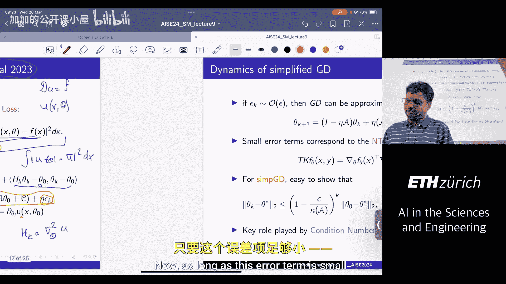

Approximateinated by what people can sometimes call as simplified gradient descent or some other people call it as lazy gradient descent。

There are different names to it。 It just tells you that at least locally， when you' are not far。

 then gradient descent can be done much more simply。 So in the sense that it depends on theta K。

In terms of this matrix you can say the amplification factor and in terms of what happens at theta0 okay so what happens at theta k you make a small increment and you stay close with theta0 and the smallness of these terms this epsilon so essentially the Selineization assumption right because I'm saying that this quantity is small now this quantity measures the second derivative。

 the hessum if the hessian is going to be small the function has to be approximately linear so think of it as a linearization assumption it doesn't mean that it is always satisfied during neural network training but at least near initialialization this is typically satisfied and that is what is called the nk or the neural tangent kernel regime。

So this is called the neural tang curve。Again the details are not important here。

 all that you can think of is that we are starting training。

 we are moving a little bit along some small directions。

 so essentially this phase is going to be linear。So under these assumptions you can actually compute exactly whether there will be convergence or not。

 so let's say that you are close to a local minimum how fast you converge so in that particular case this is a very simple matrix equation so you can just do some algebra and you get this expression here。

And this expression tells us that the speed of convergence okay there is convergence because these quantities are less than one in some sense。

 this condition number is always greater than one， so this quantity is less than one but depending on how close this is to one。

 you will have different trick of convergence， for instance， if it is a very。

 very small number then it's very close to one then you'll have very fast convergence if it is a relatively far away from one。

 then it will have very， very slow convergence So is this is the point right and the number of steps that youre required to get a error of delta is logariththmic in delta as you would expect so you have some sort of exponential convergence but there is this factor here k of this matrix a and this k from those who know some numerical analysis。

 this is what is called the condition number。Okay， so remember that this is a matrix。

 this is a matrix which takes this tangent directions， this can be explicitly computed in some cases。

 it computes the differential operator on these tangent directions takes an inner product of them and then essentially this gives you the conditioning of this problem。

So at least near linearization， if or near a local minimum。If you initialize near a local minimum。

 all that it tells us that you can do it fast or slow depending on how well this problem is conditioned。

 so your training can be expensive or cheap if this condition number， for instance。

 if this condition number is very close to one。Let's say that this is very close to1 the C is like one。

 so this quantity here is very， very close to zero。

 which means that it caused the number of steps is going to be very very small。

 let's say this is close to one so it's essentially exponential but if this condition number is100 then you are improp right because then this is going to be 0。

001 or the number of steps is at least going to be of0 of 10 so it it gets very very expensive the good thing about this formulation is under certain assumptions which one can argue and you'll see some examples of that in a bit。

You can quantify how quickly we can converge to local meaning okay。

 and the answer is that it completely depends on the condition number of this gram of this matrix。

 this of this quantity， which looks a bit。Bit obscure here at first sec。

 but actually this matrix is not completely obscure it has a very interesting let's say。

Manifestation or very interesting interpretation because it is related to the differential operator so this is a differential operator just think this could be the lapplian。

 this could be the heat equation， this could be the wave equation。

 whatever this is the sort of family of this differential operator and then in functional analysis in Bds and so on there is an object which is called the hermission square it is like applying this differential operator twice okay but except that this D star here is what is called the add joint of a differential operator。

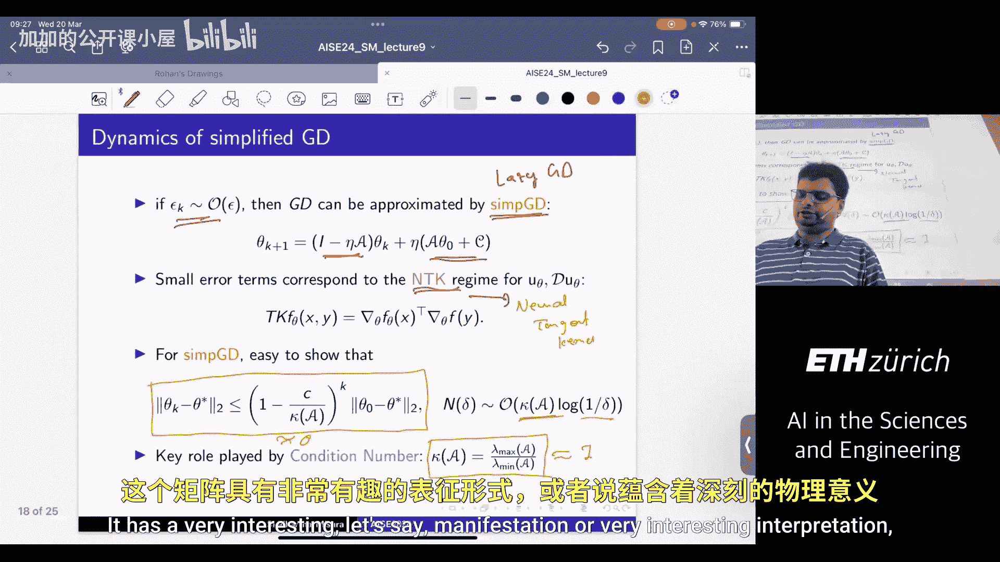

It's just a generalization of matrix So remember that if you have a matrix。

 you know what is a transpose of a matrix， Similarlyly， if you think of an operator。

 operator is nothing but an infinitefrared dimensional matrix。

 then the ajo is nothing but a suitable version of the transpose inside I don't have to define it。

 I'll give you some examples and then you'll see what this operator is going to be okay so then you introduce this operator which is given by this calligraph a and this is called the her squared and it turns out that this matrix here。

 this gram matrix which is written here， which tells you everything about the training at least near initialization。

 this is related to this her square okay in fact it's a very simple calculation that it is related to this her squared。

 there is some because this is this guy is a matrix so this is if you remember this is a gram matrix。

There matrix or Grmian as some people call it this is the hermission squared of course this is a operator this is a matrix so you know to pull it down from infinite dimensions to finite dimensions we use some kernel functions but that's essentially a detail so all that you have to think of is that my training depends on the condition number of a matrix which is morally equivalent to morally the same as the condition number of an operator and this operator is not the differential operator itself。

Because that is that is okay if it was a differential operator it is is a joint apply to the differential operator or what is called the her squared。

 so let me give you some examples so the simplest example is if you take the poson equation then D is the minus lapplian minus lap plus right but unfortunately the or not unfortunately but in this particular case minus lap plus is a selffur joint operator so it's a joint it itself so you apply essentially minus lapplian to the minus lapplian and you end up clearly with a fourthoughta operator this is called the bi lappl。

Okay， so this operator is called a biopplian。And it sort of it comes up in the elasticity equations。

 those who have seen structural dynamic structural mechanics might have known this。

 so this measures somehow， so the lapplian essentially the second derivative measures the curvevi。

 but now this measures higher geometrical quantities in some sense， so this is the biopplian。

And this makes it， this makes the condition number very， very bad because， okay， this is very easy。

 So if you take a square。Or if it takes0 to1 okay， so let me just give you a little bit of fia and you take the minus lapplian so the eigenvalues of this because that's what we are looking for。

 the eigenvalues of the minus lapplian are given by essentially k pi squared。Okay。

 so is this is roughly the eigenvalues， which means that the scaling between the minimum k can be from 01 to k capital k。

The scaling between the maximum eigenvalue and the minimum eigenvalue grows like case squared quadratic okay so the condition number is not very nice but at least it is going to be quadratic and we could have managed if that was the case but for the bila plusian the condition number the eigenvalues of the bila plusian and this is sort of the problem you can easily calculate it it's not hard this scales as a fourth power as you can imagine。

So now the condition number grows like a bi quadratic right so instead of a quadratic it's a bi quadratic so you can just imagine that if my problem has four modes。

 let's say now K to the power4 to the power4 is a very large quantity right it is 256 and if the condition number is already 256 one minus1 over 256 is a relatively large quantity in some sense and then the convergence is accordingly slow you need at least 256 steps but this is a very very root rough calculation but if you remember I think Ben showed you some examples where the problem has oscillatory structure it has like I don't know 10 modes then you are finished because 10 to the power4 is 10000 so you need 10000 steps of gradient descent but this is a very ballpar calculation but you need 10000 steps of gradient descent to be anywhere close right and this is not very satisfactory。

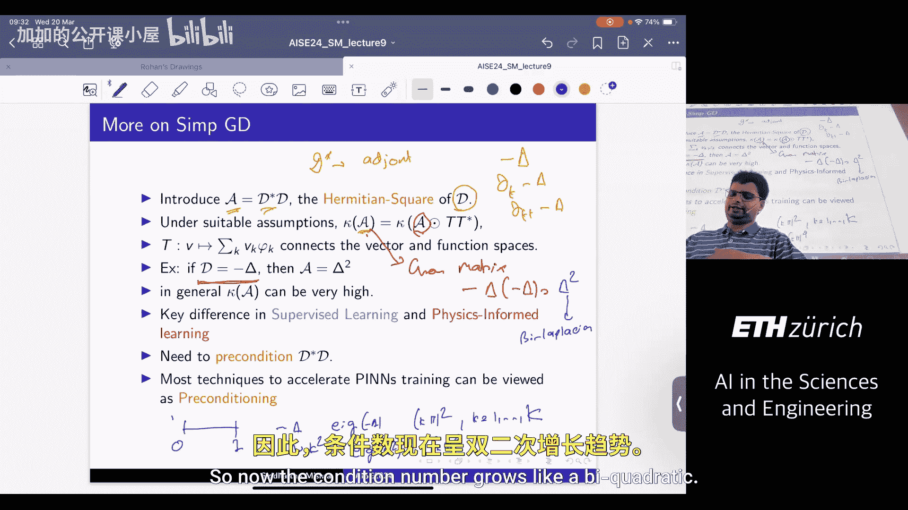

So this is a very negative thing and this tells you that， first of all。

 this can be very high and this is the very nature of the beast that the。

Iigh order derivatives are worse condition than low order derivatives and because we are forcing the differential operator your condition number is twice in some sense that of the differential operator and this is a key difference because if you had supervised learning this is if you train with respect to labels。

 then this D the differential operator in that case would simply be the identity。

The differential operator would be the identity and the a would be identity composed with identity。

 which would be simply identity。And there the condition number would simply depend on the condition number of the neuraltent kernel okay it's not always one。

 but it is it's a relatively nice number here on the other hand。

 in addition to what would have happened with supervised learning you get this additional factor here and this additional factor which depends on the differential operator which is endemic to all physics informed learning this will tell us that okay this problem is not wellconed in general particularly if the number of modes in the problem are large right because if there's only one more the condition number is is's just one there's only one eigenvalue but if there are 10 modes for instance。

 the contrast between the maximum eigenvalue and the minimum eigenvalue can grow very very rapidly。

And this makes it hard to learn problems which are oscillatory and I think Ben showed you some examples of that okay the first lesson that you learned from this is that training physics informed neural networks is least by itself and remember that if you train it if it's a linear problem like a wave equation heat equation and so on you're done but training itself is a problem because this is where this point really comes in so you cannot work with okay I'll teach you something about preconditioning but the point is that you cannot directly work with with training as it is so you cannot directly work with gradient li okay what you have to do and this is because of this ill conditioning okay this is a very。

 very important point so are there any questions also from people on zoom about what constitutes a difference between training and supervised learning and training in physics informed so math is not important。

important here is the concept that you are changing something。

 you're changing the nature of the problem and by changing the nature of the problem。

 you're introducing a factor， an amplification factor which depends on the number of derivatives that you have。

 so if you have a third order differential operator then you will have six order derivatives and your problem in scale you have a question yes。

Possible to use bottle pre of necessary。好。This is precisely what the next point is right。

 so will I will tell you with that in a second， but you have sort of guess。My my my conclusion。

 but on the conclusion itself that there is a difference is this point clear and this is where it will come repeatedly even when you do your exercises and you see that oh it's not training well maybe it's not your fault you see maybe it is maybe it is not this is this is where you have to you have to understand is my problem complicated enough because that depends on the but if you if it doesn't rain maybe there is something intrinsically wrong with the method itself and whatever I do it's not going to work。

So you have to make that judgment in a particular application you have to see whether the how many modes are there。

 what is the differential operator， what is the underlying physics。

 how well can I say Okay because once you trade if the PDs are relatively simple you generalized you do well Now how can we change this or are we stuck with this problem of course this is this big big problem so are we stuck with this problem not necessarily there are some there is no general solution because as you see people all these things are very recent right so this is probably the most neatest way of identifying the problem but other people have identified similar similar problems So let me explain at least one general it's a procedure general framework in which this can be corrected which is through the。

Concept of preconditioning and for that I need to add the page and write a little bit。

So what is the preconditioning that your classmate just just referred to right so if you remember gradient de gradient descent is theta k plus 1 my is equal to theta k minus Eta of gradient of the loss function L of theta k something like this and the problem here comes from the essentially the loss function right so the point is。

Can we do something， can we change the gradient descent in some some sense such that the condition number improves because everything now depends on this K of a K of a was this K of T study right so this is a condition number of the operator morally。

Although the math is a little bit more complicated than that morally it is just a de study。

 so what you can do of course， is you can use a traditional idea from numerical analysis。

 which goes by the name of preconditional。The preconditioning comes from numerical analysis。

 it essentially tells us that we should premply the matrix before inverting a matrix。

Ma the same kind of considerations come when you do numerical linear algebra So if you want to invert a matrix by whatever numerical method direct method or itive method if if the matrix is poorly condition if there's the aspect ratio between its centuries or its eigenvalue is very large and it's harder to go sort of invertted so what you do is that you multiply approximately with its inverse invert that thing and then remply so preconditioning is a very simple idea so essentially all that you have to do is that you have to rewrite gradient descent by doing let's say。

嗯。Eer of some J。off。Graient of。So you modify a gradient descent by adding this precondition。

 so this object here is called a preconditional。Be conditioner。And morally， this is， of course。

 the math is not that easy otherwise the problem will be solved morally J has to be essentially a inverse。

Okay， so it morally these things have to be have to be angles。

 So then the sort of the condition number。Of J because J is outside a is inside so the condition number of J roughly will be close to identity close to one so this is roughly the idea that you have to somehow know what a is you have to compute this gram matrix but you can compute this gra matrix it's a pretty heavy matrix to compute where is it it's a pretty heavy matrix to compute but if you have a operator centric perspective you somehow know the operator but this is a is a large matrix right because remember that let's say we have a million parameters。

Then this gradient here is vector with a million dimensions I'm assuming that the output is scalar so it's a vector with a million dimensions so then you can imagine that this is a very very large matrix sos it's not that easy to work with it and there are some techniques which are slowly coming in but I'm not not going to belabor the point here so essentially preconditioning is either by using the direct form of the matrix or by using some knowledge about the operator or you try to multiply a prefactor preconditioner to your gradient descent such that you have an approximate inverse in place okay so this is roughly what preconditioning is and this is what。

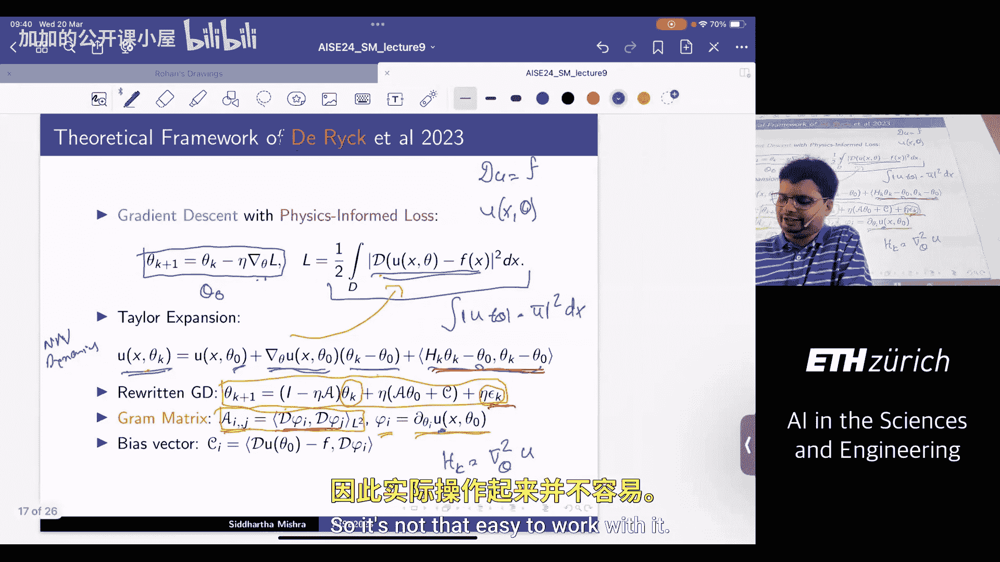

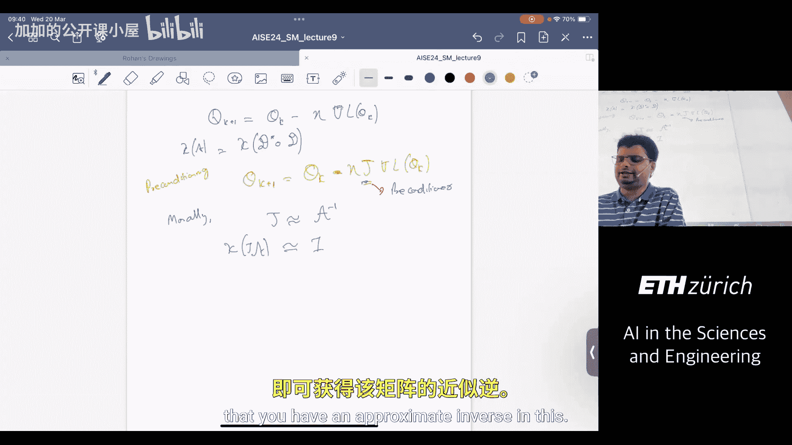

Essentially it boils down too so in fact I think Ben also mentioned this he had this domain composition method finite basis pins and so on so in the same paper where we proposed this theoretical framework we showed that almost all the techniques that are there to accelerate the training of pins because this is acceleration right if something takes 10000 steps and you can do it in 100 steps you accelerate the training this can be viewed in terms of preconditions so essentially some form of the other this idea comes in okay but let me give you a few examples and then we sort of close the chapter here。

So this is a very simple example where already the failure modes are very clear。

 so this is just a posta equation in 1 d， so you have boundary conditions， zero boundary conditions。

Yeah。Maybe it is between minus pi and pi。 but okay， that's that's a minus detail。

 So you have the second derivative。 You are given this matrix here。 and， of course。

 the solution is sine of kx， right， Because when you differentiate sine of k x twice。

 you get minus k square。Okay so sign of Kx very， very simple problem。

 we don't need a pin to solve it， we can just solve it by hand， But nevertheless。

 what happens if you take a pin So if you take a condition number in fact I take an even simpler model。

 I don't even take a pin， I don't even take a neural network。

 I take a very simple model so my youth leader。Is going to be what is called Fourier features。

P I raised Fourier features。So this is like a light neural network。So you have ak。s。Or A， let's say。

 sine L pi x。Plus， B L course。Elpis。So these are what are California features。

 I think Ben also introduced them at some point and all that you do is that these are your training parameters。

 maybe there is an additional layer。So you can think of a very simple。

Neural network I don't even want to use neural networks here because you can think of it as s you can think of it as a linear layer。

 a sine activation function and then an output layer so you can think of it in those terms so if you just take Fourier features and this is a very light neural network。

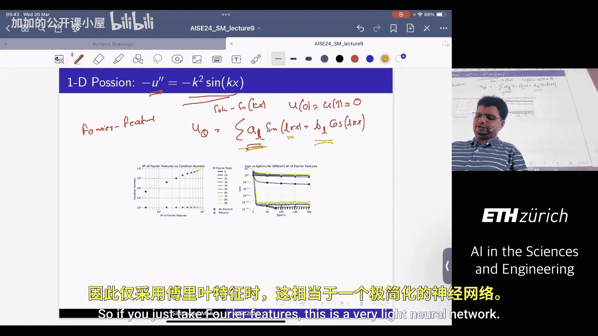

Then you can see that condition number， you can explicitly compute the condition number in this case for this problem。

 you see how it grows means as k grows as the number of Fourier features grows。

 this thing here or L here grows， this thing grows quadratically right so because it grows quadratically。

 you need lock of and it already becomes very， very quickly tend to the power。

8ight I can't even see 10 about eight so 100 million very very quickly with just a few modes right100 million and of course one over 100 million is a very very small number which means that this whole thing goes very very slowly you need lots and lots of steps and this is also very clear when you do the training because if you just take the naive version of it which is here so these are the number of Fourier features it doesn't really matter if the loss function is of the order of a thousand0。

So。So this simply doesn't train you see， of course if you have just five modes in the problem then it rains but if you take00 modes it simply doesn't frame so the same question happens with neural networks they perform even worse the diagrams graphs are in the paper okay so what does this tell us that even for a very。

 very simple problem I don't need to solve this using neural networks or anything right I can solve it per hand and I can certainly solve it fine differences this physics informed training simply doesn't work or high modes so has this spectral poor spectral behavior which is associated with the fact that you have this bi quadratic growth of the and you can see that right because this is1 to the power too and remember that it grows like bi quadratically and that's why you get1s about eight of course you're out so this completely matches the theory in this case preconditioning works very well because you know what you have to divide。

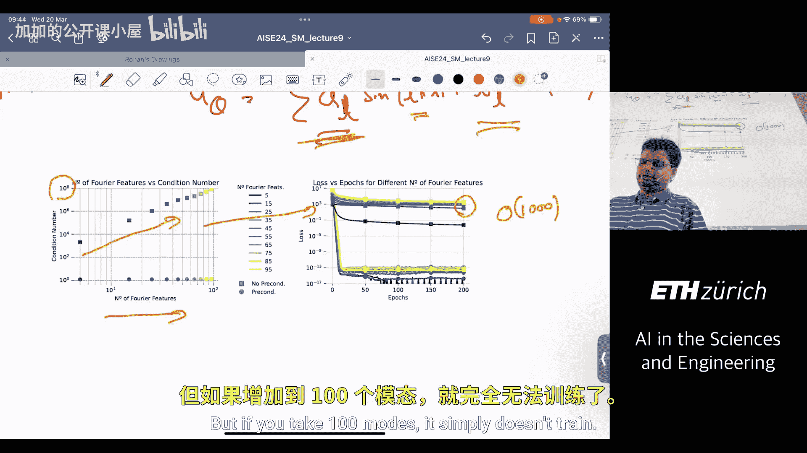

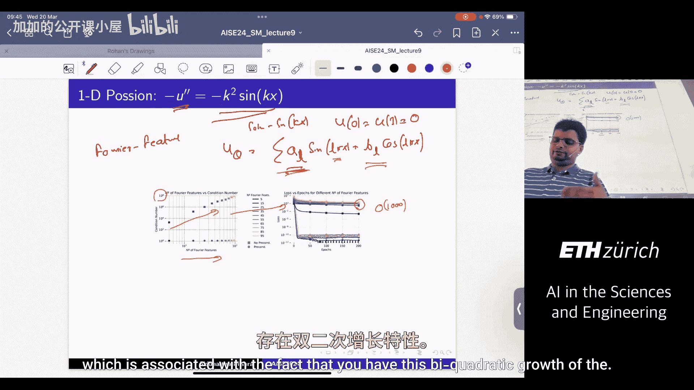

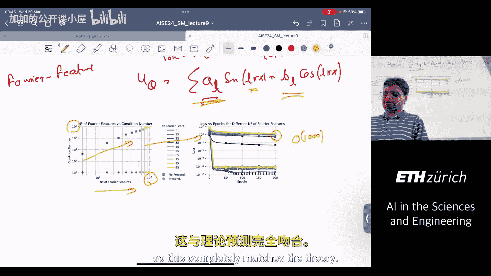

You just subdivide with L squared because you know how much it grows so L squared here and because there is a square so you get a L to the power fourth that cancels out and then of course the condition number is1 this is trivial more or less condition number is one and the training with how many steps is this 10 steps you get 10 to the power minus minus15 okay so this example was chosen in such a way that you don't need to the preconditioning here everything is exact preconditioning works exactly this is a very simple problem of course and a very simple neural network model not even the neural network model Fourier feature but the idea is very clear and you can't solve this with neural networks such a simple problem if you take K to be 100 you can't solve because the condition number is so so so so massive okay so is that clear so this is and I will show you an example with neural networks in a second so no chance。

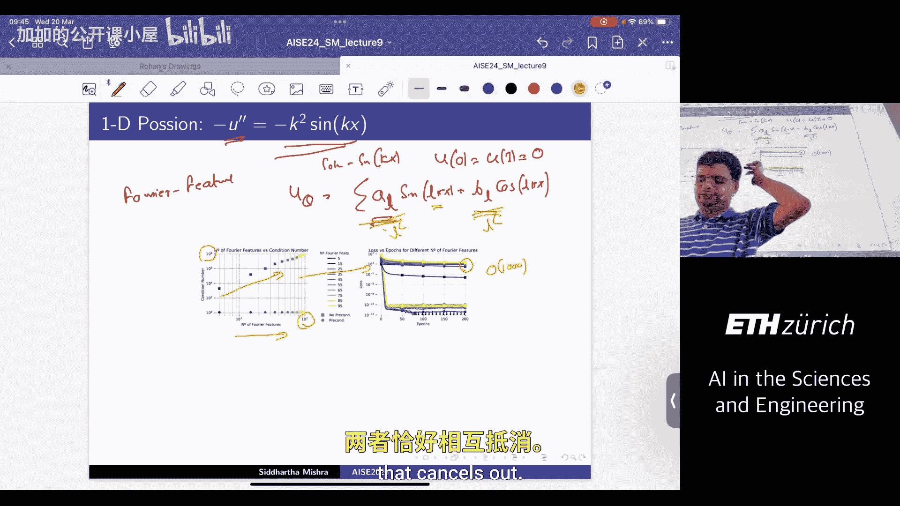

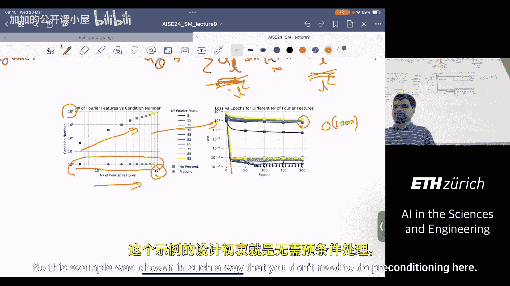

Because of the intrinsic nature of the physics info training so this is with neural networks I think let me look at the distribution of ourvalue neural networks these are genuine neural networks I think shallow neural networks one layer and damage hyperbolic。

Hypobollic tang function and essentially you have lots of zero eigenvalues this is well known。

 but the point is if you don't precondition。Then in this case， okay。

 it's not as bad if you take 5000pos， then you get a loss of about 10 the per minus 3。

Which is what it is， but if you precondition that is if you multiply the inverse of this matrix so essentially you take this in this particular case it's small enough that we can calculate this explicitly within a few epochs with 100 epochs for instance or less you get into per minus5 in5 epos so essentially even for neural networks this problem works because of this point about precondition so this are the very very simple problem。

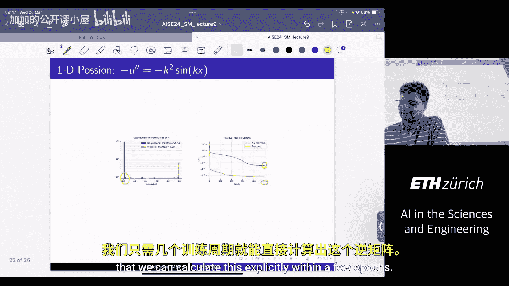

And this is another very simple problem where you can see that it doesn't put okay so this is UT plus beta few x action equation。

 a wave equation， but with only one aing wave we know what the exact solution is you of xt is nothing but you are the initial conditions x minus speed to T and now everything depends on the speed of action so as fast as you move and in fact you can explicitly compute so if you take Fourier features the same examples that I gave you。

Then you can explicitly compute that the behavior is like it is with respect to beta it rises with respect to beta。

 it is and you can see that for beta equal to 30 for instance， this is already 100。

000 you know so it will require 100，000 steps which will mean that it will never train and this is indeed the case it never trains and you see that so for instance here is an example。

So if you take， for instance， Fourier features， no preconditioning， the9 version of Fourier features。

 this is how the exact solution is so beta is equal to 30 pi so this is a I number but okay so what so this is how the solution behaves in space time so this is space between minus0 and2 pi and this is how it behaves in time so you have waves that are moving but here it simply doesn't work at all maybe in the beginning there is something but as soon as you go further you see complete noise and the same if you take a neural network if you take a Mp you don't see any behavior here because we know that the condition numbers are going to be very very bad right because when it's 30k the condition number is like a million so it will take a million steps and we can't afford a million steps we have taken thousand steps or something。

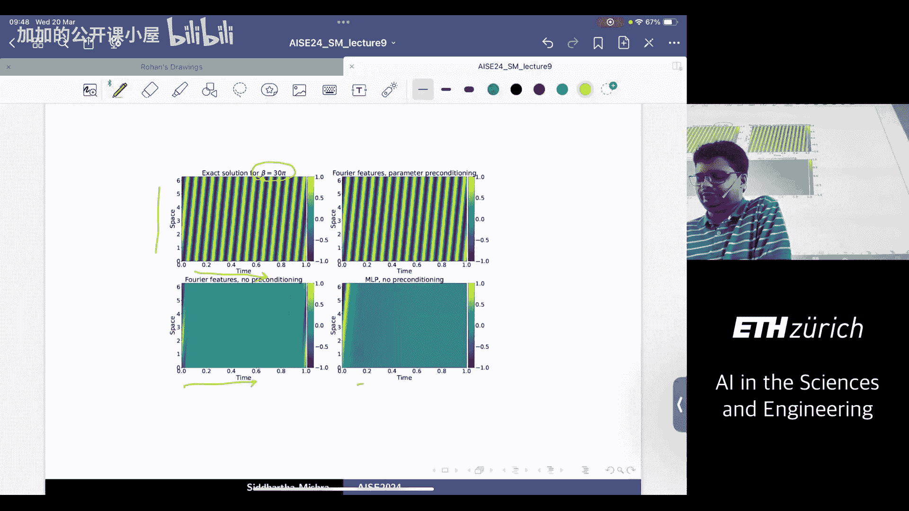

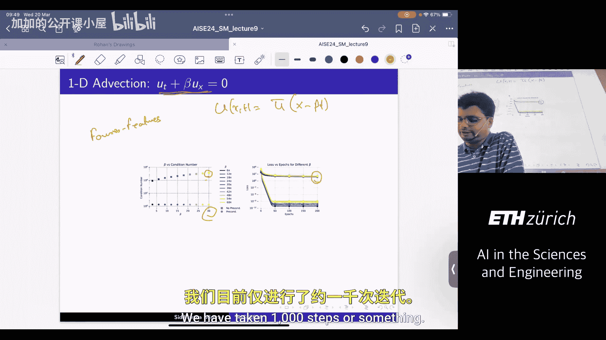

But then of course if you precondition and in this case you know exactly how to precondition this。

 you just divide with the right quantity， then it works like a charm so you can see either here that the loss within 50 boxs it's already at machine precision so this works quite well and whereas and you also see it here that even if the speed of infection is large you see that good Sta mode has been addressed so preconditioning really works for this simple problem and we leverage the fact that it's a simple problem we know everything about it we know exactly how the condition number behaves but the gra matrix is and we could analytically invert。

The same thing works also for neural networks means again the same story that if you take bit 30 or 10。

 the loss simply doesn't go down， it's of the order of1。

 whereas if you precondition it then you start seeing that this post down so within 200 epochs it's already at 10 the per minus6 which which is quite good。

And you see the same here。

So this was without any preconditioning right doesn't work except in the very beginning and with preconditioning it works very。

 very well， but again as I emphasize that this can only be done because we are able to have an explicit structure of the problem for ourvi strokes for complicated problems we don't have we don't have access to this exact preconditions and approximation people are still doing it means it by no means ready。

Okay， so I think that's more or less what I have to say。 Let me go back to the summary。

So essentially what I tried to do in the second half of the lecture very quickly was to try and open this black box。

 essentially through a simplified gradient decent。But I think it also told us the story what we needed to do and essentially training is ill condition。

This is the main。It's ill condition because it depends on the condition number of T30。Essentially。

And D itself as a just imagine that if you take the navi tox equation， it has some nonlinearity。

 it has some transport and so on， and when you take DstarD。

 first of all you get fourth order derivatives， you get spacetime derivatives you get all kinds of cross terms and we don't yet know how to precondition these kind of problems and for simple problems we can precondition them you can precondition the biplian for instance we know how to do it from classical numerical analysis from general linear problems I think we can do it for nonlinearar problems this is completely open so essentially it says that if you don't have complexity in your solution either through the PDdeE or through the data you can use pins but as soon as there is some complexity。

 lots of modes， lots of aity and so on either training will fail or it will fail to generalize so one should be very very careful with these methods。

Okay， so I think I finished a bit earlier， but just five minutes earlier。

 so if you have any questions I'd be happy to answer them also from people from the chat。

Otherwise from the next lecture we realize that these methods they have a lot of promise。

 but they also have enormous limitations as I just showed you even for a possible problem they don't work so what's the point in some sense so we have to change perspective and we are going to change perspective in the next lecture and since the PDE alone can't help us we have to rely on data okay and that's going to be its own challenge but this is what we're going to do in the next lecture。

Okay， if there are no questions， we meet on Friday。

