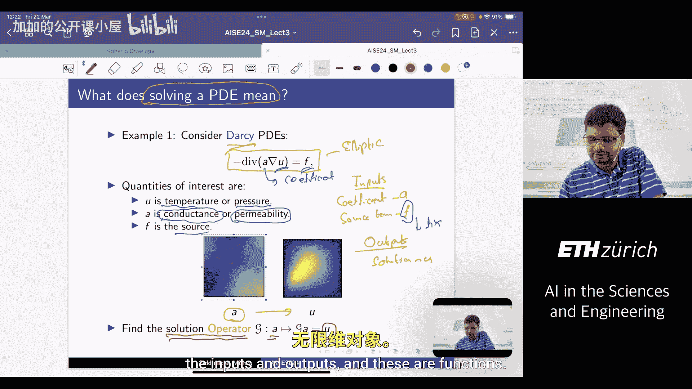
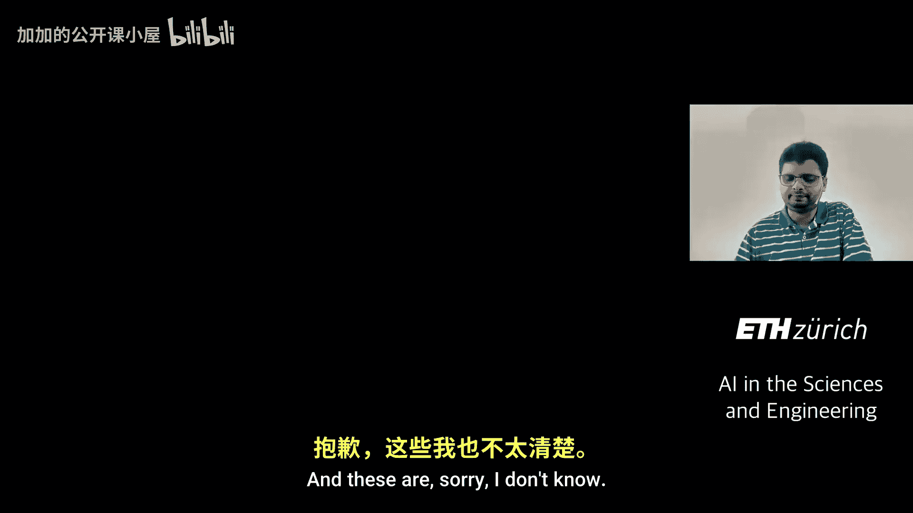
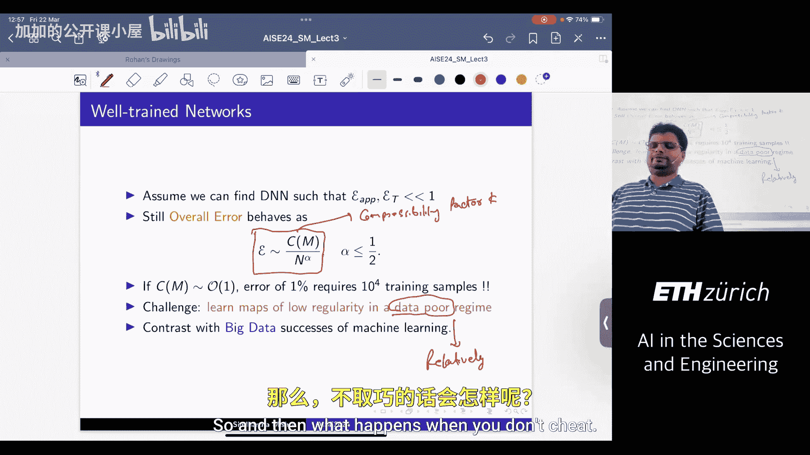

# 苏黎世联邦理工【中英⚡科学与工程中的人工智能｜2024 AI in the Sciences and Engineering】 p10 P10 Introduction to Operator Learning Part 1 -BV1smxgzHEPC_p10-

Okay， let's get started without further ado， so welcome to lecture number 10。Yeah， progressing fast。

And what have we learned so far， just a very quick recapulation of where we are。So in the last。

 I don't know， five， six lectures， the focus has been on pins physics and formula networks。

And we have seen that for many PD these are great， right。

 especially if you don't have a lot of training data。

This is something that I'm going to highlight quite a bit today。 but as we saw in the last lecture。

 theres several negatives in in particular。The key negative that we found out was training can be expensive。

I mean， it's difficult。And the reason for that is there's sort of intrinsic properties of physics informed losses where。

The her squared， the condition number of the her， the conditioning of the her squared of the differential operator really matters。

So from that perspective， and also if you remember that in terms of the PDs themselves。

What we saw is that they were very good for certain PDs which had let's say smooth solutions。

 not two difficult solutions， but once you have difficult solutions， one develop lots of frequencies。

 lots of scales， which is the case in reality then we are at an intro book right so in that sense we do need alternatives and especially the alternatives make a lot of sense when more data is available and how much of data is more data we are going to talk about that quite a lot during the next several lectures so now let's change perspective and what were going to do is for the next several lectures what we are going to do is to look at supervised learning。

Supervised learning is essentially leveraging the data that is available to us right so we start now and till the end of the month。

 at least the month of April that is we will deal with this perhaps even early in May Okay。

 so let's let's get started。So before even sort of going towards data driven solutions or PDs。

Let me try revisit or recapitulate the question of what does it mean to solve a P D， right？

 So what does it mean to solve a P D， What do we do when we solve a P D。

And this is going to be important for what we are going to discuss。

So let's try to understand that through a very simple example right so this is a very important PD。

It's a prototype of what are called elliptic ps。 So this is what is called elliptic。

And this is modeling various things， so it depends on what your quantities of interest are。

 so for instance the U here this guy here， this could be the temperature or it could be the pressure or it could be some other property but let's say that if the temperature。

 the pressure then depending on the application that we have the a here。

 So this is what is called a coefficient。For instance， if you are modeling heat conduction。

 then this a is precisely the conductance or the conductivity。

Is the same if a for or U is a voltage for instance， and this is electrical conductivity。

 but on the other hand if it's a pressure of a fluid that is trapped inside on the underground。

 then this would be the rock permeability， the sort of material properties of the medium itself。

So this is the point is that it tells you something about the material。

 it tells you something about the domain where the action is happening and finally if this is much simpler to understand this is just a source term right so just imagine that your which is made off of a material that is not uniform and then you start heating it then of course the source is the heating source。

 the material is given by the material properties and U is going to be the temperature and this is modeled by this ellipric PDD which is called the diffusion PDD sometimes it's even called the Dar C。

PD particularly in fluid elements So this is the situation of the PD So what we can think of is we can think of the PD itself as a system like any system。

 it takes an input or inputs and it processes them into outputs So what are the inputs。

So at least for this particular PD， this is clearly the coefficient。そ this is谁。And it is the so term。

F。😊，It could also be the boundary conditions， the domain and so on。

 but let's let's keep things simple let's say that for this particular PD your inputs are the coefficients and sources and in particular I could be interested in the situation for instance if I'm drilling under the ground that I fixed this so let us keep this fixed。

So if I fix the source。Then essentially the task of the PD。

 and I've forgotten to write what the outputs are going to be。The output is just the solution。

Soution which is given by you here so essentially you can think of the PD as a system that takes an input in this particular case the coefficient and source。

 but let's say just a coefficient and it turns out an output which in this particular case is the solution of the PD In other words it takes a coefficient a here as you can see it has some spatial fluctuations and then it turns out an output which is given by the solution of the PD as you can see the a does not look remotely like the input here。

 the coefficient does not look remotely like output because what the output tells you is how the fluid is distributed somehow the pressure of the fluid is going to be distributed right So in other words in this particular case you can sort of say that solving a PDE is tantamount to finding out what is called the solution operator。

The s operator is this object which exactly does the systemic transformation。

 it takes input and it produces an output so it takes the input a。

 the coefficient here and it produces an output which is a sedution to the PDE which is given by this okay so remember that this is the way you can think of differential equations so these are transformations that take inputs to outputs except that there is something special about this inputs and outputs unlike a standard function which takes a finite dimensional input and provides a finite dimensional output here the inputs and outputs and this is these are functions。

And these sorry。

I don't know。

Some reason。Yes。Some reason it。这有吧。Anyway， so the these inputs and outputs， both of them。

 the solution itself clearly is a function。So what do I mean by it so the input itself is an infinite dimensional quantity because it's a function it cannot be described in principle by finitely many parameters and so is out the function which is described in terms of finitely many parameters that's why the transformation that takes an input and churns out the output is an operator because operators a generalizations of functions which takes infinite dimensional inputs and churn out infinite dimensional outputs so this is a very important point here that solving a P essentially is finding or computing or calculating or approxiating the solution operator and this is intrinsically an object that transforms infinite dimensional quantities into infinite dimensional quantities and you'll see why this is an issue。

In a very short time。 So this is one example right， but is this general enough An answer is yes。

 indeed， if you take another PD， for instance， it's a time dependent one。

 I just took one for definiteness， but there's nothing special about it。

 So these are the compressible oil equations of fluid dynamics， for instance。

 aerodynamics the flow of air just outside this room is going to be governed by the compressible oil equations。

 And as you can see these are much more complex PDs than this simple scalealar PD right but if you're interested。

 these quantities have some meaning row here is the density of the fluid v is a velocity field。

 So in 2D or 3D it's two or three components E is the total energy B is the pressure and then you have an equation of state there is an equation of state which relates。

And usually for an ideal gas， the total energy is given by。

P over a gamma -1 plus half pro is something like this。 Okay。

 so this is a detail that this is a fairly complex P D。 Now here。

 let's say that we fixed there are no sources。 There is no for saying there's no coefficient。

 Let's say its the flow of air。 So there's nothing to impede the flow。

 And then we have just a square domain， periodic boundary conditions just for simplicity。

 All these can be additional inputs and all that we are left with is other initial condition。

Here's an example of an initial condition， a typical initial condition that for instance。

 happens when you look at the clouds。 it's a sher， So you have the density and I don't know whether you can see this。

 but this is a shear。 So the velocity goes in this direction and here it goes in this direction Okay。

 so there's a shear and because of that the flow becomes very， very complicated and at a later time。

 as you can see this is a very complex flow。 So this is a density。

 What I'm showing here is a density， This is a density。

But of course every variable changes and you can see that there are lots of complex verisees and fingers and so on and so forth。

 so fairly complex solution。 But again， the idea is this is a solution at a later time T let's say this is t equal to one some unit time in some idealized units that we have So what is the solution operator in this particular place what is the transformation that we're interested in the transformation now takes an initial condition and it produces a solution at a later time or at any given that this is a trajectory any given time could be encapsulated in these terms but let's say it's simply the solution at a later time So again it takes the a here is the initial condition and you here is the final the solution at a final time which is given in terms of the operator of the B So again it takes a function clearly a function it's defined at every single point similarly the output is also going to be a function right so in other words。

 you have an operator。Takeakes a to U dot T a dot here means that it's sort of given at any any given point in space so again it's the same story that solving the PD is the same as computing this transformation that takes infinitear dimension a function input and transforms it into a function okay so this is what it means and we can sort of make it abstract so that things are easier to understand in some sense I don't have to keep on writing specific PDs all the time。

By simply taking a abstract perspective。 So now， remember that at the end of the day。

 we have functions。Which get mapped onto two functions。And this is done by operators。

So any questions about that？So this is this is a key setup that we are in and we will we will deal with this setup okay so now just for simplicity we take a function because our inputs and outputs are functions so what we do is that we take a function space here we take a function space here and of course since we are going to take data we need some data distribution so this mu you can think of it as a data distribution。

But the data is function valued now each time you're going to plug a point a sample of the data youll get an object like this。

 so just think you have a library of images a library of functions and you choose some random so that is the thinking of a data distribution。

Okay and then there is some abstract PD so the abstract PD is clearly given here the same as what we did dealt with with pins。

 no change there and now the important thing is now I put both the coefficients as well as the sources in one bracket and simply say that there's a solution operator that maps x to y so this here is G。

So this is the abstract setup that we are going to do。

And the task here is also very clear because now for every PD we have associated with the PDA solution operator right。

 for instance， which takes a coefficients to the solution or it takes the initial conditions to the solution and so on and so forth and now what will be given is data right so this data that is going to come to us that's why I mentioned that there is a measure with respect to it So what do you do。

Let me choose this。 So you choose AI。From this distribution meal so remember that AIs are functions Miu is a distribution on functions。

 so you have to choose this and then the data that is given to you is AI。And G of AI。For simplicity。

 plus some noise， okay。So this is going to be your data。

So given this data so a could be a large number it could be a small number it depends on the data that you have so for instance if you think of weather and climate data this a this number a is typically something like 60。

000 members okay it will have 60，000 members in the standard weather datas but for some other applications this could only be five members so there is a huge disparity in the size of this data but it is not in the order of the sort of internet scale data that we have for text and images where there are billions and billions of data points in some sense so that this is going to be a challenge right so given this data the task is to learn the operator right so learn。

这。This is what is called operator learning。And as I said means there is no other solution to this because intrinsically your inputs and output are infinite infinite dimensional so you have to in order to solve the PD you have to learn the operator are there any questions on this because this is a very。

 very important point。No， everyone understands this also on Zoom are there any questions。

 you can always ask questions on the chat box and Zoom。O， yes， yes， of course。Thank。Yeah。Yeah。

You didn't get this part。Okay， I can explain it to you， no problems。

 so shall I explain it to this example first。So okay， let me take you a very simple example， right。

 so let's say that。Even even simpler so that hopefully this will be much clearer and to everyone else。

 let me give you an example and maybe I don't want to clutter my writing even more。

Let me write it on some paper。Okay， let's take a very simple example。

 let us say that my domain is 01 cross 0。Okay，It doesn't matter if it's 01 plus 0 t means。I mean。

Let me raise this。I now I have to improvise a little。

So let's say that it's R the real line cross field just for simplicity。My b。Is the action equation。

Several of you have seen this， I'm sure。Okay， and this satisfaction equation and this is given by Ut plus a U equal to0 and I took the whole line because I didn't want to bother with all conditions okay and now your a here is under your initial conditions。

are。Youre not of。Okay， so these are functions， right， unit of x is a function。

So now your solution operator S of T takes you not。2 S of you node。

And who can tell me what is the solution of this PDd So given you not。What is u of xt。

This is just that action， yes。X minus 8 perfect。 So this is the。Right。

 so this is the solution of the PD。So now as you can see that you start with any function right。

 so let's start with a function， let's say there is sign some form of sign After a while what happens is that you get this sorry。

You get this transported。Become something like this things move right。

 So this is so now what is the input here， This is a function sine of x is a function and output。

 for instance， sine of x minus8 is a function。 Now you tell me， can you describe this function by。

A finite dimension in general， you can approximate it very well with finite dimensional objects。

 but can you describe them entirely by finite dimensional objects No right because its it's a function so that's why it's an infinite dimensional quantity cannotnot describe it in terms of just one or a vector of finite dimensional quantities and the output is also going to be infinite dimension because again it's a function。

Okay， that's why it's mapping between functions and functions we don't need to think in terms of images。

 we can just think in terms of analytical expressions that it takes sign of X。

It goes to sine of x minus80。It can take I don't know exponential of minus x and it goes to exponential of x minus80 so it's a mapping which takes any function and it map to any other function or a relevant function okay you can take another mapping one minus x squared。

And then， it goes to。1 minus x minus8 squared， something like this。 you see。

 So it takes functions and it turns out functions。 Is that clear to you now。

 good so you can always ask questions because then other people who are afraid of are asking or don't want to ask they。

They also benefit from that good， so now let's go back to my to my slide here。

 so because we don't have to go fast， it's more important that you learn the concept。

 so it's good that you ask questions So this， as I said。

 is a core of operator learning that you really have to learn and this is。

You see that it's not a huge difference， but a priorityi it's a big difference from sort of what you have seen so far right because what you've seen so far。

 let's say that you want to classify an image an image is always given at least in terms of what we have in terms of stock images let's say the MIS so this is a standard image classification data set these are 32 by 32 images okay there all are 28 by 28 and 91 forgetting 28 by 28 images so the entire image is described in terms of 7 and 94 pixels and that's it。

But here as I told you also with this example， I don't have that kind of a description So for a traditional sort of a CNN let's say or any any machine learning task So what you have is a 28 by 28 image and the output is going to be some classes right so there are 10 classes and you churn out the class probabilities so with 784 dimensional input and you have a 10 dimensional output so it's a mapping between let's say vectors and vectors maybe of very high dimensions but vectors and vectors here in just conceptually this the difference because now I cannot describe it。

I can approximate it and we have to， but I cannot describe it in terms of just one or 10 or 00 numbers right because these are functions。

 this is a function this is a function， this is a function， so intrinsically。

Or implicitly I have to work with infinite dimensional inputs and infinite dimensional outputs and this is a stark departure from what you have seen before where the Ds the deep neural networks these are mappings from finite dimensional inputs to finite dimensional outputs so is there is an issue here there's a golf here and for the next several lectures we will see how we breach this curve right so is that clear so the difference in paradigm the difference in setup is quite star okay but how do we we have to deal with this somehow it means after all we do make use of these frameworks。

So what do we do， So first option that I give you is we cheat， okay。So actually， this is。

Don't get confused， but there is。At least many， many applications you can actually cheat your way。

 you don't have to you don't have to solve this problem。

 but eventually in the next lecture you will see that we have to get out of this cheating。

 we can't use this trick all the time and we have to essentially solve the problems。So the point is。

 and maybe I could have even given you an introduction right here， So what if？My input was。历史。

MyIn this particular example， the cheating is can be made rather explicit that my input distribution。

 so remember that my input functions you not withdrawn from a distribution me。

What if I said that instead of looking at all possible functions which is unnecessary in practice。

 my inputs were given like this， so they were let's say summation of ak sine K pi X。Okay。

 sum of KAK s K pi X。And ak was uniformly distributed in minus-11。Okay， and K went from1 to 10。Okay。

 so in other words， so this was my my data set or the task itself is not to look at arbitrary functions because that is going to I'll give you some concrete examples。

 it doesn't make any sense in general， but it is restricted to a certain class of functions that my class of functions is always given by。

Is always given by these class of functions， so in other words。

 my input is given by these set of parameters。So these are my parameters。

And what what I can do is I can work with these parameters so instead of an operator learning problem I have a finite dimensional problem because now my inputs just by definition are restricted to this class aK remember because these are the coefficients of a certain basis and the basis is fixed so now my my input is going to be finite dimensional right and my output is potentially also finite dimensional I can do that by simply taking aK。

X and D。Andm churning out my solution， which is going to be you of。Xエピエ。In other words。

 I can rewrite my solution in terms of space， time and some finite dimensional inputs。

 so this was 10 dimensions， this is one dimension， one dimension。

 12 dimensions and a map to just one number， so this is one dimension。In other words。

 by restricting the space of my dataset set， by restricting my tasks's generality。

 of course you will see that you pay a price but let's do this cheating for the time being。

 what I have done is that instead of having an infinite dimensions to infinite dimensions snap。

 I have managed to escape by just having something which goes from 12 dimension to one dimension。

And this is what is called parametric PDD。 so remember that this was my setup。

 this is a setup in which I work。But the simplified setting that I told you is that the data that I'm going to draw that's why I had this probability measure here。

 this measure has a finite dimensional support。Or it can be described all the data。

 essentially this is a mathematical way of saying a precise yes， yes。

 so if we print us up with a resolution， is they doing the same thing。

You will see that okay is there is there is a connection here。

 but at the moment I'm not fixing resolutions right I'm simply saying that my data itself is not coming from a very arbitrary class of functions but it's only coming from a class of functions that are given in terms of finite many parameters So the number of degrees of freedom for my input is finite and'm subsequently I can also make the number of degrees of freedom of my output finite that's why I said I'm cheating here right becausem sort of reducing because all signs in some sense a reduction you reduce what is unknown to what is known we know how to deal with finite dimensional inputs and outputs So somehow you have to project infinite dimensional inputs and outputs into this finite dimensional setting right and I'll give you a concrete example where this makes sense So here so this is what is called a parameterized PD because so for instance in this particular example now I'm running out of space here I guess but what you could have done is you could have。

ける。That this should be U。Plus， okay， I was， okay， let's say that instead of A。

 I would have had a C here， probably because and this you not。depended not just on x， but on some a。

Okay， this is the summation of vector a， so this is this ak sine K pi x。So in that case。

 your initial data is this a parametric PD because it depends the solution itself， depends on time。

 on space， and on the parameter a， this is the basic idea。And here is an example， which is much more。

 So I call the parameter Y。 sorry for the。Confusion in notation。

 so it's called a parameter y and this is finite dimension， it belongs to Dy。

 but dy can be large dimension of dy can be large。So here is a complete example for this to just illustrate this point So if you want to design a new aircraft the critical design element is what is called designing the wing right because aircraft is flown by the lift that is generated by having an aerodynamic wing that generates a lot of lift and that doesn't have a lot of drag so this is the basic so you cannot have a car which is going to fly but a plane flies because it has this aerodynamic shape among other things right so then so if you design the wing so what people do is in general to do anything in 3D is hard so people take cross sections of the wing because if you have seen when you're flown you have seen an aircraft and you see that you can essentially compose it of cross sections there's not a lot of variation within the shape of the cross section only the sort of the dimensions the length of the cross section so along each cross section you get what is called a airfoil okay so this object here is an airil。

Why， it's not working now。Okay。F。So this is like think of it as a 2D wing right but it's of course when you put it together you get a proper wing so now in general these things have to be manufactured these things have to be described and so what people do is that they they have a certain base reference therefore so black here is a reference okay so this is a reference。

And then they of course， you start with a reference airfoil。

 which is based on the engineers intuition， but you want to see whether you can increase the lift or reduce the drag or increase the lift to drag ratio and so on。

 So what they do is that they start with the reference airfoil so some Sf and then they generate some design space Okay so this is some。

Finly， many parameters， a from one to。Whatever D Y of y times。Oh。

 I have some concrete examples later but。Perhaps it's easier to say that it's S Y So in other words。

 you can see here in this design what is called the design envelope that the shaded regions this represent a whole set of shapes that are mapped by these parameters okay so these parameters they are sometimes called as his and parameters in aerodynamic but the details are not important there are something between 20 and 50 parameters so the entire airfoil the design is somehow restricted the number of degrees of freedom are restricted to these 50 parameters up to 50 usually people use 20 and then what you do is that you compute the whole flow field here。

So here， as you can see， the， the inputs are。Of course the space coordinates because this is steady state aerodynamics。

 you don't care what happens during takeoff and landing in terms of fuel efficiency。

 but you care about what happens during cruise conditions so it's x Y X and this is the y is the shape parameters。

So this is a concrete example of what I just illustrated the last time around， right。

 and then the output is simply the flow parameters， the velocities， the density and so on。

 So these are functions， for instance， row off。X，y。And let's say， the pressure。P of X y and so。

 And from these parameters， you can compute things like drag and left and so body forces。

 which are just observable。 Okay， so these， the solution itself is in the form of a field。

 and otherwise drag lift these are sort of observs。

 So what we do by this cheating is essentially take an infinite dimensional problem reduce it to finite dimensions simply by restricting the input space and the output space。

 So we will in some form or the other， we have to do it in general。

 but this is a sort of brutal way of doing right you simply say that you look at finitely mill parameters。

 but many， many people think of design engineering design as operating within this space that you finitely many parameters and you're trying to find optimal values within those parameters Okay how else can we design。

Now let's assume that this is our problem that we have cheated。

 we have projected our problem down from infinite dimensions to finite dimensions simply by reducing the measure by reducing the data that the diversity of the data that the dimension of the dataset that we have once we do that it just plain vanilla machinery these are the things that you're already familiar with because now remember that my inputs are this X and y also T if it's a time dependent B and then all that you do is I plug it together I call it as a Z So this is T X Y。

 these are all the inputs， this is time space parameter and my solution is given by some L。L of Z。

 this could be the field。It could be an observable a quantity of interest。

But it's a mapping between final dimensions and final dimensions。

 so you could just use your plain vanilla deep neural networks means the usual usual things。

 you have these layers， you have the weights and vices。

 I don't have to tell you this you have some activation function and now since we are not going to differentiate like we did with pins we can take any activation function it could be alo for instance。

 which is the。And widely used activation function right and then how do we how do we have data。

 the on that we have the sort of the argument or the hypothesis that we have for data usually is that this data is randomly generated right so this is this is hypothesis so what you can think of is that now these things think of them as parameters in space so for instance within this set of shapes you will randomly generate let's say thousand shapes youll compute the flow field with respect to1 thousand shapes thousand is just a number that I gave you that would be quite expensive because each of these computations will be between one and two minutes even the fastest quotes will not be will be of the order of a minute and when I was a PhD student or a master student like you guys this was of the order of two hours maybe so we have done like。

At least two orders of magnitude down， so things have improved。

 but it's still up the order of a minute。But if you generate 1 thousand。

 it's 1 thousand minutes which is which is sometime it's not serious time。

 so this is going to provide you with the data so L of Z I is your data you can think of this as your labels。

So Ze is are the points at which the sampling is taking place， there could be some noise。

 but I'm operating in a noisefr regime just for simplicity。

 and then you look at the output of the neural network。

 which is given here these are the predictions。And this is not this a regression problem essentially it's not a classification problem。

 so what you do in this particular case is that you just use whatever SGT atom。

 whatever to minimize this loss function so the algorithm itself is super simple you have finitely many parameters you take a random set of these parameters generate some data and then you learn the solution operator by using standard deep neural networks explain vanilla deep neural networks。

Any questions on this？No。From people on Zoo， no， okay， so this this is as and see as it gets。

The question is is going to work out what what are the caveats do we do we have some issues let's see what what happens right so the first question always at least for a mathematician is that is this ever going to work so in particular if you're given some tolerance here this is some tolerance。

The question is can we find a deep neural network， can we find a suitable architecture and so on such that for the underlying map。

 we even think of it as an operator now， but it's really a map because operators been reduced to a function。

 can you find deep neural networks as that these things are close to each other？

And if you remember the last lecture， I already talked about it。

 that we have this universal approximation property。

And what does the universal approximation property do。

 it provides you the guarantee that yes therell always be even a shallow neural network。

 even a one layer neural network such that this is true as long as this map is continuous and in fact even less than continuous it could be inteable its as long as it's measurable then indeed this can be done okay so from the in principle this is not a hard problem because it's finite dimensional so you can always solve it。

However， the point is that there is a price that one has to pay with respect to complexity。

 so the size of this neural network， so let me say M is a number of parameters。

Then there are some results which essentially say， that the rate at which this convergence happens in general。

 of course there are problems where it is， but this is the worst case guarantee。

 but in general it scales with two things， it scales with the regularity of your map。

 so this s is the number of derivatives。So if you have a smooth function。

 s is large right it could be 1000， whatever and P is some integuability。

 think of it as one and2 and D bar here is a dimension so D bar is a dimension。In words。

 it's easier to learn smooth maps than things which are complicated and it's easier to learn in low dimensions than in high dimensions this is sort of the sort of the thinking that that happens and the point is that in general this is not good because then you are hit with a cur dimensionality that even in sort of low dimensions you will end up with very very large network sizes so if you do the math then already you get into 100。

No， is is $100 billion or no。A trillion right and the 12 is a trillion and this is even chat G the underlying model is not like that So this does not explain anything right because even with very very low dimensions。

 you end up with very very large numbers so there is a curse of dimensionality which I had already spoken about in the last lecture but it turns out that that is not the case because at the end of the day we are not looking at some random mappings here right these mappings are these functions。

 this L here， this object is operators if you want to think of it like that。

 these are much more structure in them and the structure comes from the fact that these are solutions of PDs So solutions of PDs could be smooth。

 there are other forms of regularity dimensionality reduction and essentially there are lots and lots of results。

there's some detail here， there's not important， but then lots and lots of results which essentially tell you that this error。

 the earlier error which scale like exponential in dimension。

It scales much better than that for because of the solutions of P。So this is for all kinds of PDs。

 elliptic， hyperbolic， parabolic and so on， then lots of results， and this sigma here。

 which tells you the rate， this can be linear， quadratic， even logariththmic。

For some PDs okay so if something scales linear in dimension it's not a big deal or quadratically in dimension it's not such a big deal So this is there is some regularity or compressibility of the data。

 which tells us that at least in terms of the approxi error the error that we get from in principle error of approximating this。

We can we can do longer better right so this is this is not such an issue however the main point is that you all have other sources of error I think Ben mentioned them at the beginning of his lectures you have optimization error this is our familiar friend training error that we saw a lot in the last couple of lectures and there is some generalization error and this is the one that I'm going to target here because once you have random points remember that my data was supposed to be random。

Once you have random points， then there is a limit to this and the limit is given by also we saw in the last lecture there is essentially square root of end。

Okay， morally square root of n， even though there is a log at correction here。

 this always there because things are things are correlated， so essentially at the end of the day。

 we can say that my overall error this behaves in the following month。

And this is important these considerations are important because it depends on the network somehow。

 but let's say you see somehow sometimes called in theoretical machine learning as a compressibility factor。

Repossibility factor。Some people also call it aka。I just called it a C。

Okay but essentially in terms of sample complexity because this is for us an issue。

 this is always going like a square root， it's slightly worse than a square root even in the the guarantee is slightly worse than a square root but it is let's say a square root and this is again a problem for us because remember that even if this was order of one let's say it's a number one and I want an error of 1% so 1% is one over 100 right assuming that everything is a the order of one so if I need one over 100 so I have to find the number of samples the square root is 100 and that is 10000 so 10000 is a lot of lot of samples because just imagine as I said a single simulation takes me approximately two minutes。

 10000 samples will take me 20000 minutes and this is too much right。In 3D so in 3D。

 you can imagine nothing runs in one minute， 3D， a single output of the code takes you anything from one hour on on a small machine to hundreds or thousands of hours or millions of hours on a supercomputer。

 So one has to be careful and this is some sense the big challenge that I'm trying to sort of pose here that we are dealing with an object。

 So this is not like taking an image， taking an image is cheap， you know。

 compared to solving a PD or solving differential equations or just simulating physics。

 So forget about the low regularity here。 This is neither here nor there。

 but essentially we are in a relatively and this is a relative。Because。

Also if you're looking at number of sick people like in medical AI that's even less you know so so its one has to be relative relatively data poor regime and this can be to some extent at least it opposedd in contrast to the big data success of machine learning that has come up from large datasets right and towards the end of our course I'll convince you that actually here also we need large datasets but for Ding let's pretend that we can never get access to large datasets and we have to work with relatively small datasets perhaps the order of hundreds of hundreds of samples not tens of thousands of samples and how are we going to leverage that and how are we going to use that so there's no point in me starting a new topic we will do that in the next lecture okay so there's only three minutes left okay so have a nice weekend and last next week remember that Friday is Easter Friday Good Friday sos a holiday we have only one lecture and there we will talk more about operator learning and。

See whether this cheating works or even cheating doesn't work here because we don't have enough data right so and then what happens when you don't cheat okay next week then so long。

