# 苏黎世联邦理工【中英⚡科学与工程中的人工智能｜2024 AI in the Sciences and Engineering】 p11 P11 Introduction to Operator Learning Part 2 -BV1smxgzHEPC_p11-

ok， so。Let's start where we left in last lecture。

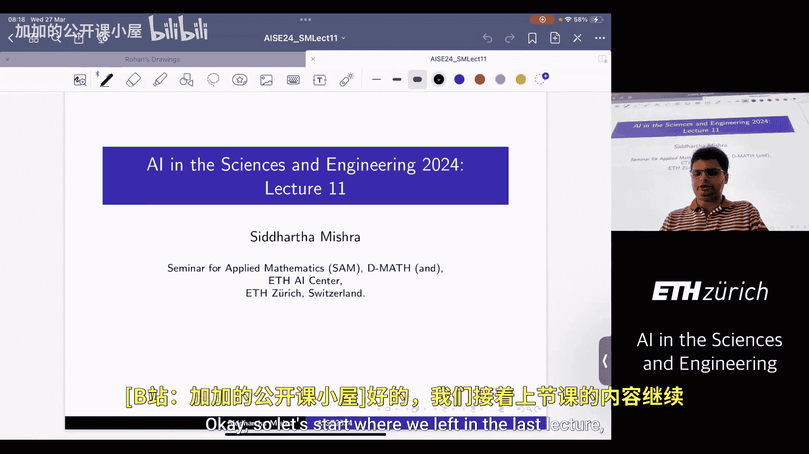

Which was a gentle introduction to operator learning。 Right， So this is where we focus last time。

 operator learning。And the idea was that if you have a PD。

 so you could also think about these stochastic differential equations， whatever you have it。

 but if you have a PD with some inputs and some outputs。

 you can express the PD or this so you can sort of manifest the PD in terms of what is called solution operator and this is going to be a mapping between two function spaces so it takes a function in code。

 let's say A andF。From the space X。 and it goes to a space5， which is the solution。

 So the key here is everything is functions。 So let's remember that we are dealing with functions and not with vectors。

Okay， but of course， as I said， in this generality it is very difficult to solve a problem。

 we have to do some approximations and the first approximation what we did is that we know that F here or A and F。

These are sampled from some probability distribution muu。Which is a probability measure on x。

 your input space。And then what we did is that we said that the dimension of this space is finite。

In other words， instead of dealing with the entire problem and its full generality。

 we looked at what are called parameter PDs so the dimension could be large。

 but it is at least finite So in that case the problem is a finite dimensional one because you have three inputs or three types of inputs you have to temporal coordinate T the patient coordinate x and the parametermetric coordinate y and the important thing here is that y this dy can be large right but it's finite so I keep on repeating that and we did some very very basic theory back of the envelope calculations and what we ended up with the fact was that if everything goes well the map is nice the solution to PD is smooth and so on still we are confronted with this challenge the total error this scales as one over square of n this is a best case right because of the Monte Carlo rate and this implies that we need lots of data lots of data in the sense that to get error of 1% which is 10 to the power minus-21 over 100。

You need 10000 samples。 So this was sort of our。Challenging some， we need lots of data。

 and you could say that this was primarily because of random sampling。

Wwhich is a good answer in general and it's sometimes unavoidable particularly if you have in very。

 very high dimensions but is it something that we could address。

 is it something that we could improve and answer is yes means there is unlike an image and text so if you think of images you can essentially people take images they take pictures they put those pictures into internet。

 they put it into different stock image libraries and these are more or less randomly taken they're not designed in any particular manner So it's reasonable to assume that those kind of images for instance。

 are taken randomly so it's its a genuine answer however， when we're doing like scientific computing。

 scientific problems nothing is done randomly we don't go and randomly solve a PD for the fun of it I do it but most people don't So then what do you do in that case so there is much more of a design space there's much more of let's say structure to the data that we have and we can exploit that there are different ways of exploiting it and。

Without belaverring the point I just give you one example just to illustrate that we could we could work with let's say more structure data and this goes to a trick as I said this was proposed by some people here in Mala sometime back and the idea is that instead of doing random sampling。

 what if you have more structure in the sampling right so remember that this D it's it's if you remember in the air problems that we saw this was like D was like 20 dimensional right between 20 and 50。

And in some other problems in many， many engineering problems this is not infinite dimensional by design because these are design parameters you can only design so much so you keep it within some finite dimensional space so it's 102050 these are the is not of the order of thousands so in that case what you can do is that you can use a different type of training data or you can generate different kinds of training data and this is sometimes a useful train so instead of doing random sampling so remember that our alternative was random sampling this is in blue what I do here is sampling using what are called low discrepancy sequences Now I don't have the time to give you all the details but the idea is very very simple and let me try to explain it through this picture here so this is just in the unit square in two dimensions01 square and let's look at how random points so random points underlie the Monte Carlo method right so these are random points they underlie the Monte Carlo method for instance and as you can see。

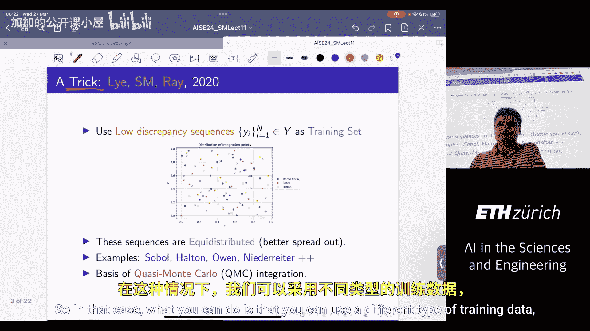

Dide the square into smaller squares。 I have 25 of them and the idea is that if you take random points。

 you cannot guarantee that these points land in the right squares means in every square there is a point。

 in fact， you can see that this square there is no point this square is barely a random point this square there is no random point this square this square and so on。

 so on the other hand， there are some squares， for instance this one there are almost six in the vicinity5 or six in the vicinity。

 that's a whole point of randomness right because there is no structure to it。

 you just take random and then in the next draw you could get something else and the next draw you could get something else and if you have lots and lots of draws of course you fill up the whole square。

 that's the whole point of randomness。 However， we cannot have that kind of let's say you cannot have so many random draws we can have at one or two so then you don't fill up the whole square So what if I design something of course which is going to fill up the whole square while at the same time being better distributed in some sense right。

Of course your answer would be then just take the center of each square that would solve the problem right all these all the squares will be up but then you can see that per dimension I will have one entry in each square it's essentially like the number of grid points that I will have and that of course blows up a dimension so just imagine that if I have 10 dimensions and in each dimension I have five points so I have five to the power 10 and that's too much right random of course if I throw a thousand0 points it doesn't matter they get sprinkled all over so there is a compromise between uniform grid points which is what you do in two or three space dimensions three is almost the limit of that and random points which is okay if you have a million dimensions and if you have infinite dimensions as you will see there is no choice but in finite but large dimensions let's say 1020 you could do something else and these are precisely what are called low discrepancy sequences there is。

Earlier I used to teach much more about it， but there is probably no time to do that。

 So the idea is that there's simply better spread out。 Okay， so I'll give one example of this。

 It's called soball sequence。 It's a very popular one and this are the orange dos and you are in stars rather and you can see that they are much much better spread for instance。

 this place where there is no random point there is a soball point here， for instance。

 where it was this one there is a soball point this one there is a soball point this one doesn't have a random point it has a soball point Of course sometimes they are not like this one has no soball point even though they have three different random points so it's。

It's also not perfect but it's relatively better than random points because these sequences are what are called equi distributed so there is a precise mathematical definition that I don't have the time to give but essentially these are equi distributed roughly speaking they are better spread out even though they don't incur the curve of dimensionality or they have a mild curve of dimensionality as you'll see in the next slide and there are dimod of them there are at least 20 or 30 different types they are very。

 very easy just like you use so these are these are behind what are called quasi mon。

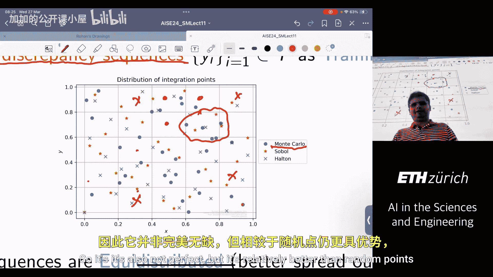

So just like random points are behind Monte Carlo， these points are behind what is called quasi Monte Carlo。

 So if you go to I don't know si pi or in a standard library and you search for these there are many。

 many different ones I just showed you two soball and hton sequences the one in orange and gone in green you don't have to learn so much about them just like you use a random number generator to get random points you can use a quasi random number generator to get these kind of points and this is a fairly easy easy piece of code and what is the advantage of them。

 the advantage of them is precisely given in the next slide。

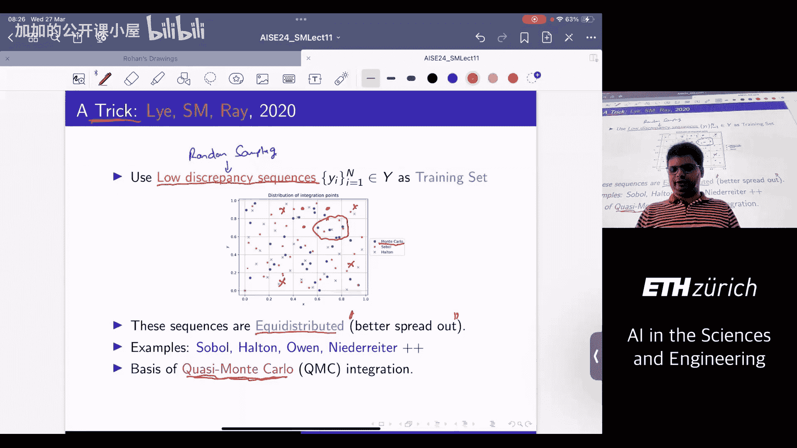

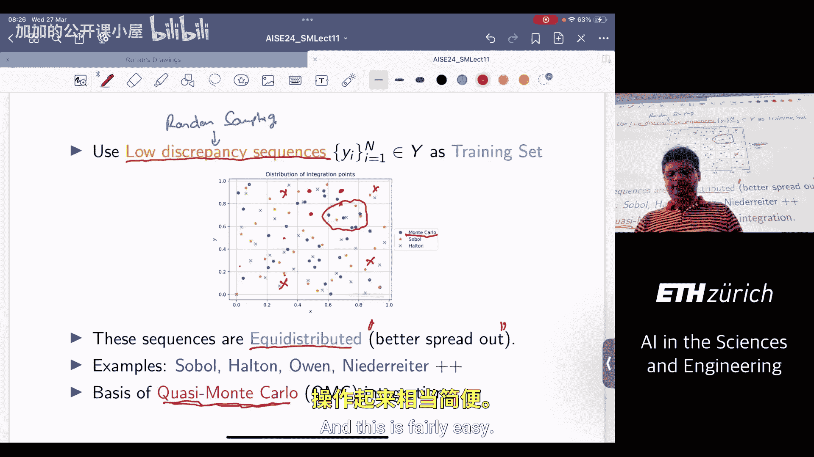

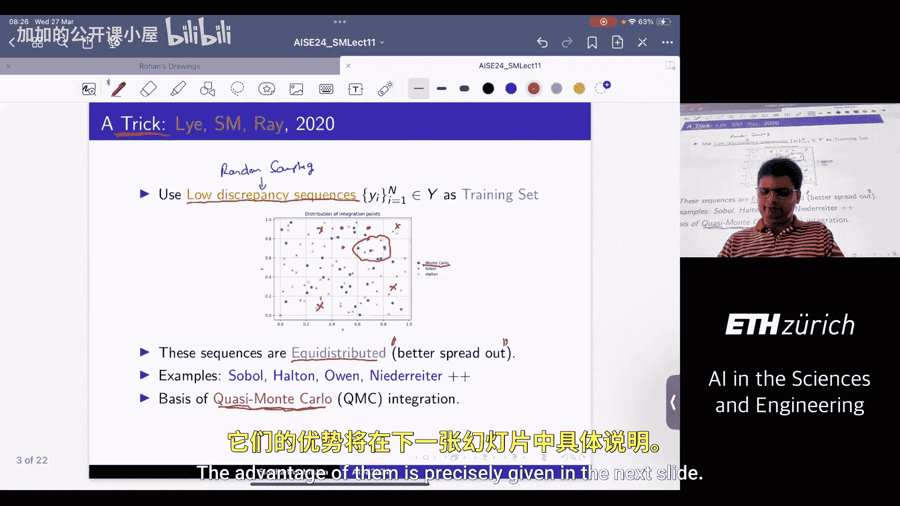

Okay， so as long as your map that you're approximating， so remember that this map here。

 this could be the field。This could be the field U of T X Y。 Now Z is the entire thing。 T X Y。

 or it could be an observable。 So this is what I call a L of Y right in this case， Z would be Y。

 So this could be a field or observable field would be the whole flow field around the F observable would be the left and the track。

 then as long as this function a certain structure。 So first of all。

 it has to have what is called a bounded hardy cr of variationation。 So this is not that difficult。

 it's just integral。 So your underlying map。 let me call it as L。 So D Dy of L。

 let's say this is Ty1 Ty 2， these are mixed  derivativereatives。 Okay， this T Y T。

This guy is going to define it over d， this is going to fine。

So it's not derivatives but it's just makes derivatives as long as it makes derivatives of finite。

 so this is morally the hardygraph of variation so the function has to have some structure the map that you're going to approximate has to have some structure it can't be discontinuous for instance then you can prove very easily that your total error remember that this is a familiar quantity for us the rot error has two parts training error optimization error this we cannot but now this is supervised learning right so it does not have all the problems that pins up because you don't have this square transmission of the differential operator or anything so this is standard supervised learning and then you have this hardygraph of variation that comes in so if it has large hardy curve of variation then of course the constant blows up but you need a smooth activation function relu for instance won't work because it doesn't have mixed derivatives but hyperbolic tangent or smoothen versions of relulu glue and so on they will work and then the key point here is that you get one over。

はい。Okay， there is a logatmic correction， as you can see that there is a logatmic correction。

 So if you remember， if you have random sampling and this is where the number。Random sampling。

Was the errors if the training error was small was  one over square root of n and here let's say it's with this low discrepancy sequence。

 LDS， low discrepancy sequence sampling。Then the error is going to behave like1 over n。Okay。

 so of course， this required for1 percent error。1% error dis required 1000 points， because one。

1% is1 over 100， this under other hand requires 100 points。

So it may not see much one over square root of n1 over n， but when you do the math。

 you really get a lot of benefit， you know also if each sample takes about 10 minutes or two minutes to generate like we did for the foil a factor of0 is quite a bit of saving right so and in 3D it's even much more much more serious so this is an example where this problem with large data that the fact that you need lots of data as long as you're in this parametric setting and if you have reasonable number of parameters then it's okay but of course eventually this has this is a good part right the one over n this term is good but that just like there's a denominator there's also a numerator and this numerator is this log ethnicmic term here。

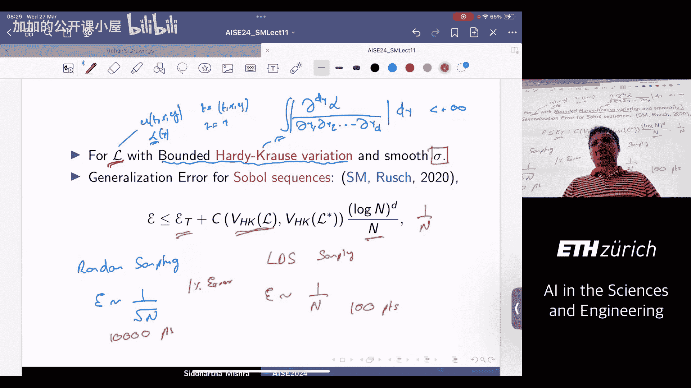

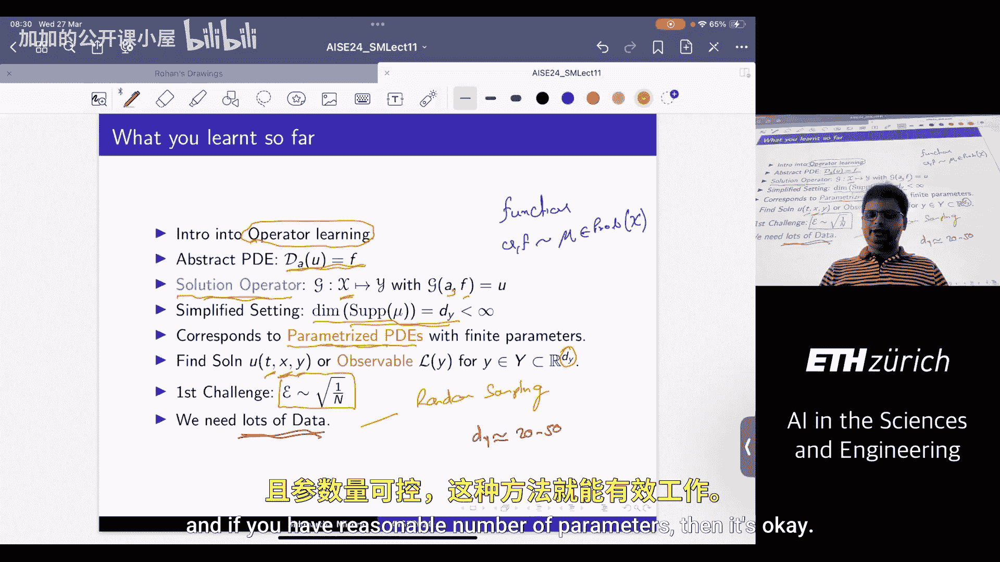

And this is a bad one because this depends on the underlying dimension， actually。

 they should have been T or4。Ill correct it in the slides right so of course if n is a thousand log n is just three mean there's nothing but three to the power something right once the dimension starts kicking in this becomes a serious thing so let's say that there is a cutoff for this and the cutoff is roughly 50 dimensions because beyond 50 dimensions you don't have a choice okay so at least for some of these problems this is going to be very very useful。

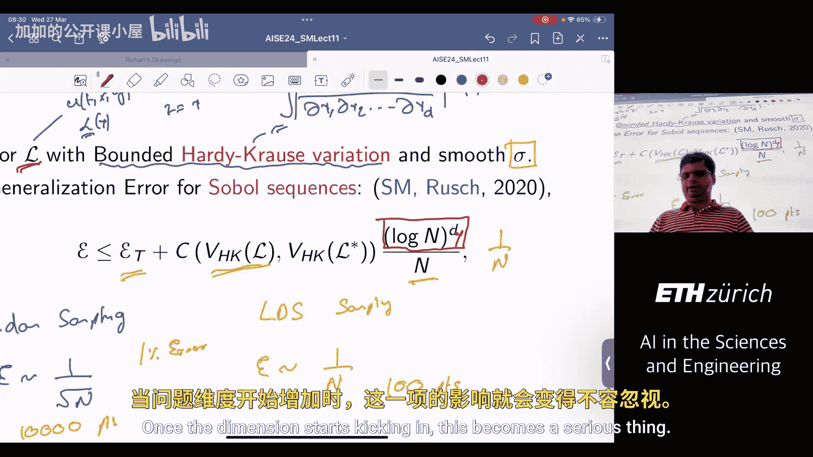

And I'll show you an example， but so far is this clear how this sort of by better spreading out the sampling points and we can do that because we are not taking images。

 we are not trawling data from the internet text data from the internet but we have the capacity or the power to generate data because we can we can always generate data through numerical simulations we can do it in a much more targeted manner so this is roughly the model of the story here and once you have that then of course can you can go and try to solve the problem。

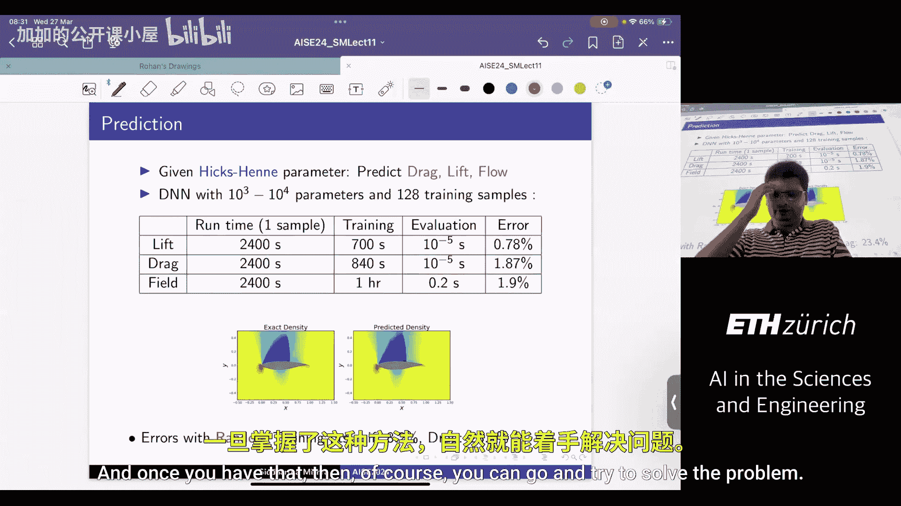

So if you remember what I started out with， so this was this problem with the flow cost and airfoil。

 so here is the airfoil， this is parameterized with I think 20 parameters， so dy is equal to 20。

And then what we are looking here is so this is what we are predicting is the whole flow field so we can also predict the left in the drag these are the important observables as you will see later on and then we have very。

 very small this was done some years ago so there you'll see towards the later half of the lectures that will end up with DNNs which are hundreds of millions of parameters right but for these kind of simple problems you don't need such big networks simply not enough data to train them right so here you just have something like 10000 parameters perhaps I don't remember the exact configuration now it was maybe 10 layers with or five layers with 100 parameters in each layer something like that nothing nothing big and you have very few training samples。

 128 this is reasonable you'tt you could afford to have 128 training samples and to generate these samples this was done with a very very high accuracy。

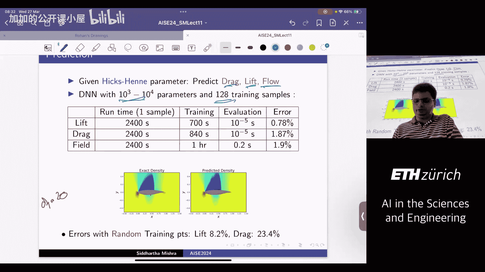

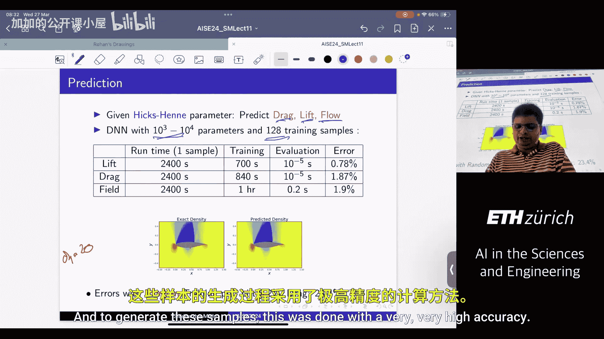

Because as you can see the shock here is very， very sharply resolved。 all these regions are very。

 very sharply resolved， So there is a grid that is very fine and then of course it took it takes time。

 It takes about 40 minutes on a on a laptop。 This could be speeded up if you do things in parallel。

 but let me give you the raw numbers here So it takes about 40 minutes if you don't want a very fine resolution you can get about in one to two minutes。

 Okay， this is sort of but this is a very fine resolution This is the ground truth。

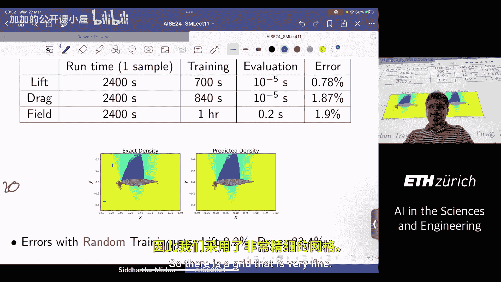

And then you can see that for the lift and the drag， we could get very， very good results，1 to2%。

 even for the whole flow field， we could get one to 2% results right the training you generate the hundred and 20 examples。

 this is some additional cost means we don't count that but once you start training at that time it' faster now because the machine so much faster。

 it took across approximately an hour okay whether you took the lift or the drag or the whole field。

 it took approximately an hour， and the point is that you' got very， very low errors。

 which is which is good， this also looks quite okay not not exact as you can see that this is this region is not completely well resolved。

 but of course this an approximation this is where the 1% error comes from but the most impressive number is what you see here。

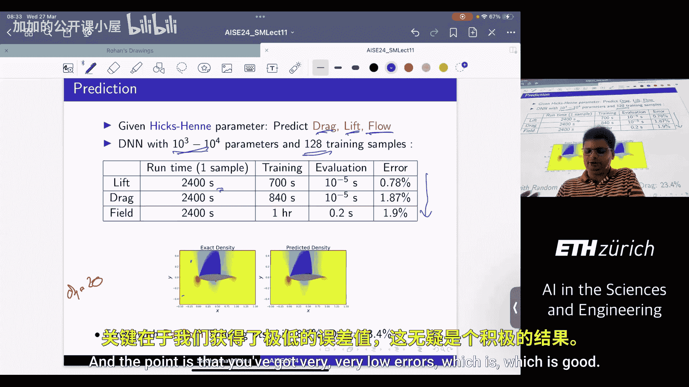

Right so remember that the underlying simulation took me 40 minutes if I wanted to predict the lift and the drag which are the real quantities of interest here it would take me 40 minutes because I have to compute the flow field then I have to compute some integrals these integrals will take me I don't know10 seconds to compute that's not the problem is's the flow field that takes a lot of time right so you compute the flow field and then you do the evaluation and this takes you 40 minutes but once you have the train neural network it takes you no time because this was like。

Not even 10 microseconds right 10 about minus five secondsds for the whole field it took a little bit longer。

 but it's still of the order of one over 10 one over 10 seconds it sort of the whole field means you have to fill in every single point drag and left you just have to give one number。

So this shows you that in principle， if you're able to train so these these kind of new networks or models。

 these are called what are called surroets， let me write it I don't think I even wrote it down anywhere。

 so these kind of models are called surroets。

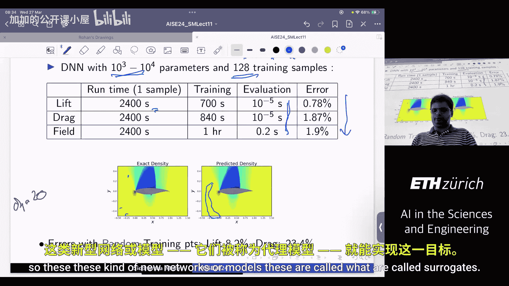

Because they are surrogates for the entire physics here， the dynamics here。

 right and the advantage of this is that you get very， very fast quick quick evaluations， of course。

But this was done the reason why it worked in some sense was this was done with LDS with soball points。

Soball sampling。

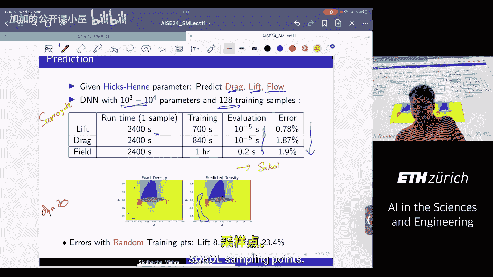

This is a point that I wanted to illustrate right if I did random training then of course the errors were larger because remember that the errors 30 k with 1 over square root of n in particular。

 the drag was useless right if you have 23% drag， you can't do anything left was okay。

 lift is somehow easier。 It's more linear in some sense drag is much more nonlinear。

 You'll see in a some some sort of the whole distribution of left and drag in a minute。

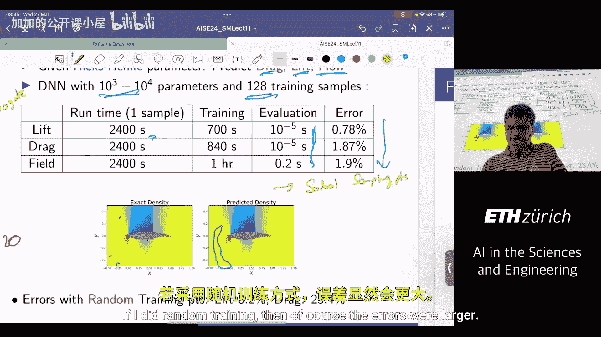

So this tells us that the method works provided that youre able to confront with this data challenge right so if you needed if you wanted 1% for the drag。

 then you probably had to take 10，000 samples or 100000 samples if you remember that this LD case very very slowly whereas there are here with the soball points it was decaying linearly at least and there are some problems for which you can do quadratic or even hypochodratic and so on this is beyond the scope of my lectures today yes absolutely。

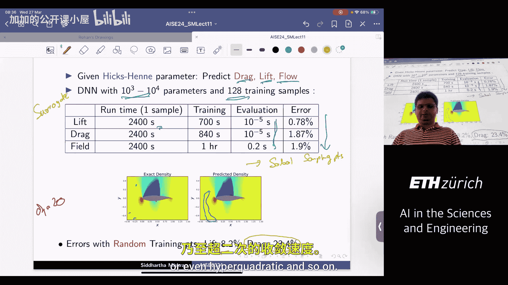

Yeah that isYeah so there is a huge difference because and the difference arises from the fact that there is theory behind it so you understand also why this difference arises this difference this difference is precisely due to this factor here okay good thanks for the question and now also the bottom line is it works provided that you have this data challenge you parameterized everything properly you have good training data and so on and so forth。

Now once you have this surrogate， what can you do with it right you just don't stop here that you make a prediction。

 you do something beyond some downstream tasks okay and the first downstream tasks that you can think of so let me even write down these are called downstream。

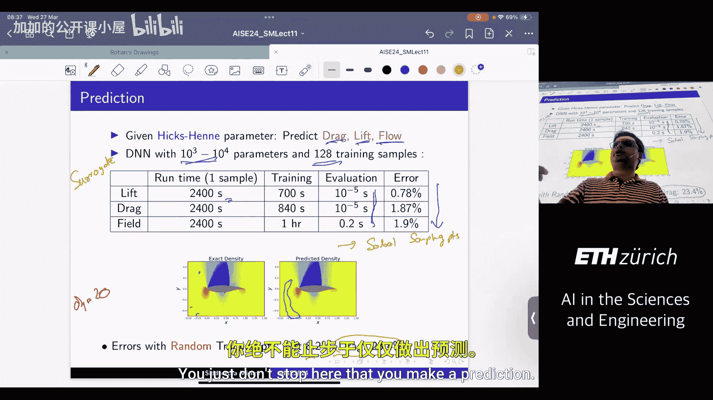

So prediction。Is just one part of the problem in engineering in particular。

 you don't just predict something know you want to do something that you want to design。

 you want to optimize， you want to control you know that there are some end result some end goals that you want to evaluate and this is done this are what are called downstream tasks and here is a very simple downstream tasks it's called uncertainty quantification Okay uncertainty quantification。

 roughly speaking there this is a topic by itself as a huge topic by itself with lots and lots of books that are written on it but the way I think of uncertainty quantification to explain it in one slide is that you want not just one particular value。

 but you want the whole distribution， okay you want errorbus So if if you think of it all of you might have done experiments going to the lab and so on and then you need errorbu because every experiment has certain uncertainty and there there are some errorbus So what are the error barss in this particular in this particular point right So for instance。

 in this example So this is just a flowpa error。

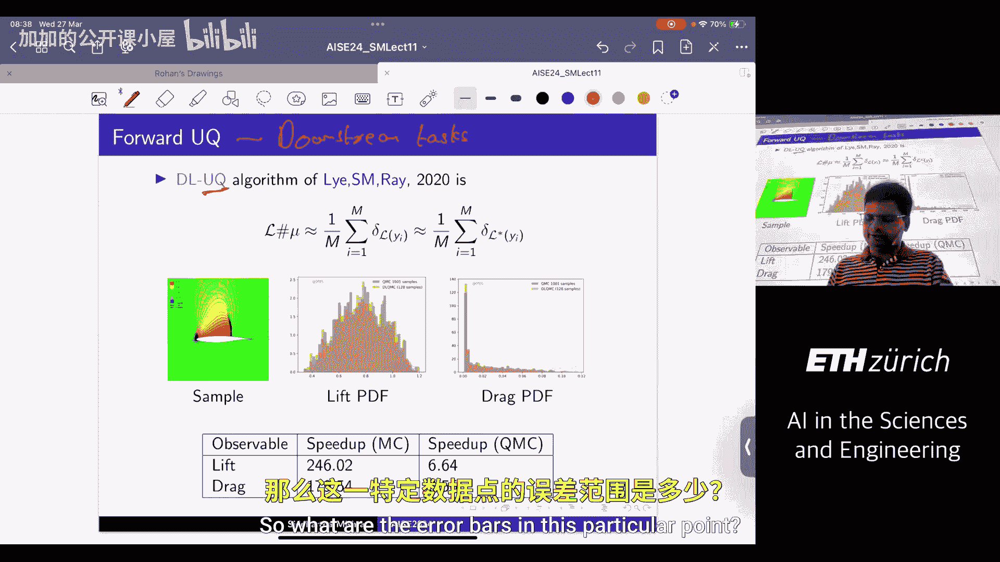

For a similar example to the one that I have now you know when you manufacture there could be some small impurities in the shape right because the shape is never perfect perfect it's never perfectly manufactured but at the moment we are not even considering that but the point is that here on comes in from the fact that you have some flow right so there is some incoming flow so you make some assumptions on the incoming flow and these assumptions are based on what is the incoming pressure what's the incoming mark number what is angle of attack angle of attack is where the flow hits there for it's typically 1 degrees but it's of course not exactly 1 degree which it could be 1。

1 degrees it could be 0。9 degrees similarly the incoming mark number I don't remember now it's probably 0。

8 but of course who says in 0 it could be 0。780。82 and so on so is there is a distribution so in other words inputs to the PD inputs。

Have some let's say that there is some uncertainty in the inputs in this particular case。

 these are parameters also could be in the shapes right so because it's y eyes they are they they belong to some space y and there is a measure on y let me call it as new because it's not a measure on the function space it's a measure there is a probability measure and y。

And you generate the samples so the uncertainty comes in from the fact that you cannot be precise with your inputs。

 your inputs have some uncertainty in them okay now once you have this uncertainty in your inputs。

 of course you have an operator So you have some uncertainty the output right so in other words this uncertainty in the input is what is called so what is UQ or forward UQ because there is also inverse base in UQ as some people call it So UQ is essentially roughly speaking very roughly speaking will be the statistics of the measure。

 So you have your operator L and this is what is a push forward okay。In other words。

 if you have some input uncertainty， how does the solution operator translate or propagate。

 it's also sometimes called uncertainty propagation。

 how is this uncertainty propagated by the solution operator right so here is a typical example so you have these uncertainties in the flow conditions and then as you can see well we have to quantify that uncertainty the histogram of the lift for instance this is in blue here。

 so the histogram tells you that the lift is distributed there is a distribution。

 so sometimes you can have very high lift 1。2 even sometimes you can have very low lift0。

8 but it's mostly like a truncated Gausian with the values around 0。8。

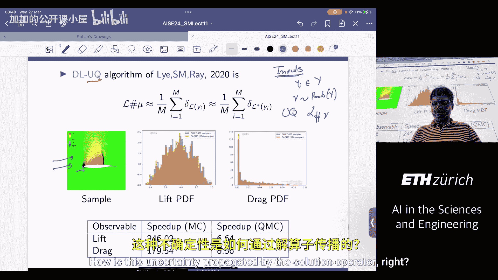

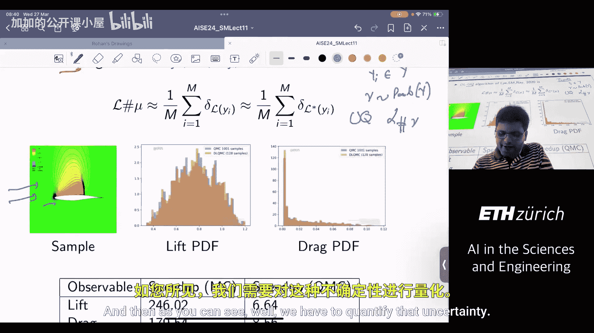

Okay so that that's good So that's where the left is but there is a distribution to the left and this distribution comes in because of the uncertainties in the flow Okay so in every physical system that you have。

 there are some intrinsic uncertainties and these uncertainties they can be modeled you can model the input uncertainties So here we model the input uncertainties with the prior which is a uniform distribution Well what else right but if you look at the drag。

 for instance， even though the uncertainty in the inputs， these were the flow parameters。

 as I told you angle of attack mark number and so on。

 in the lift you get some sort of a Gaussian behavior in the drag you get a very。

 very non- Gaussian behavior and this is because it's a nonlinear problem right So the inputs getting translated or transformed into something which is highly nonlinear So there is that element here and you can see that this is this is much more of a what some people call a beta distribution probably or it sort of a very。

 very distribution most of the drag。

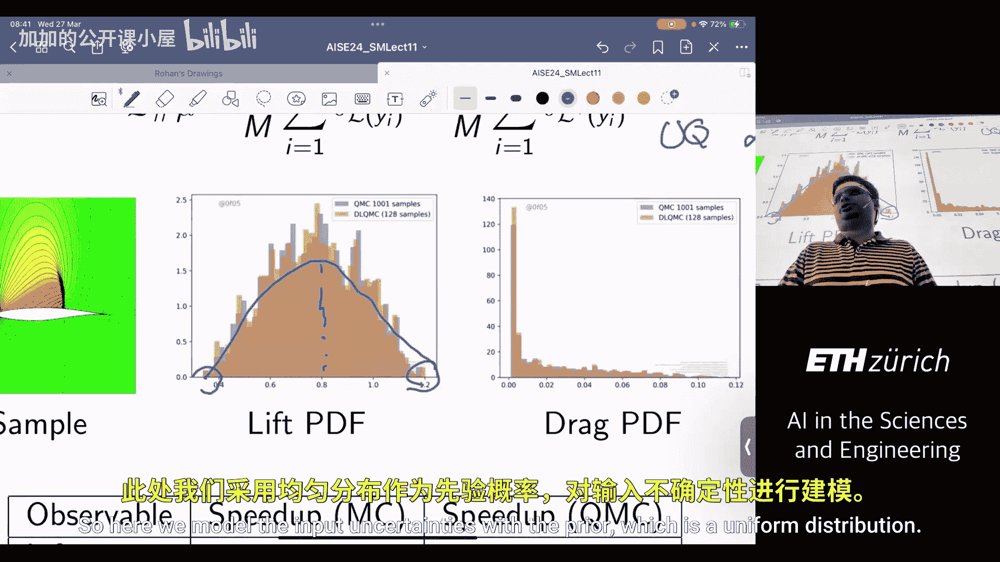

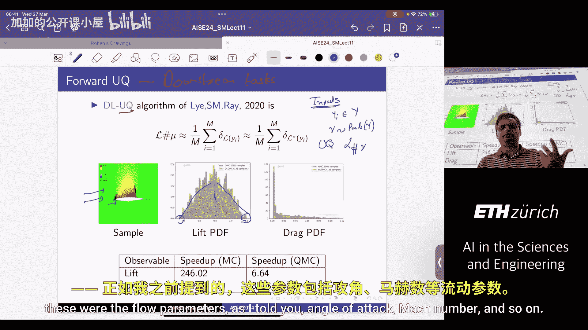

round 0。006， but there are some extremities when the drag can be 0。

1 then that object essentially cannot fly if the drag is 0。1 and the lift is 0。4。

 the lift of drag ratio is for no object will fly you need a lift drag ratio approximately 10 or something to fly but this can happen if there are some extreme flows flow conditions then you cannot do anything about that right so the idea is to propagate this uncertainty and how is it done in this is the same with the weather So when you go to meteor ss。

 you open your app and you look at the uncertainty of weather。

 how do they calculate it So they have some inputs to the weather right So these are the temperature at at this time the pressure。

 the precipitation all kinds of different parameters and they know that there is some uncertainty because when they do the data simulation。

 there is some uncertainty there run the weather forecast I don't know how many ensembles there on now。

 but some years ago it was 50 on some。

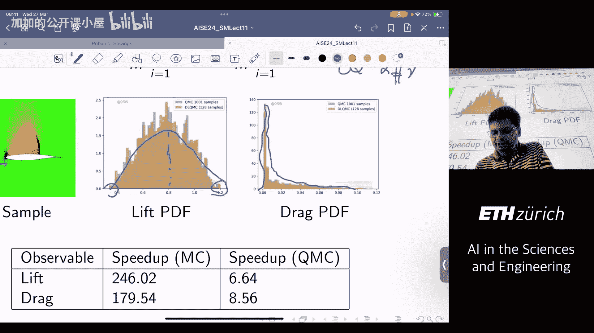

They would run 50 ensembles， where the forecast is very expensive to run。

 it occupies quite a bit of time at CSs at the big supercomputing center here。

 And then what happens is that you take 50 members of the ensemble or 00 members of the ensemble and then you compute the statistics and you get some uncertainty。

 Okay， it's a little smarter than that。 but morally speaking， that is what is going to happen here。

 But now hundred is nothing。 remember， this is a Monte carlo sampling at the end of the day and00 samples。

 The error is one over square root of 100 as a square root of 100 is can be set。

 So it's not you can have large errors。 So you need lots and lots of samples again。

 in order to be able to compute this uncertainty。Sorry。这每个字。

So now if you need thousand samples or 10000 samples， how do you do it， as I said。

 the weather forecast was run many many times right now running the weather forecast is expensive so you cannot do it 10 or 1000 times it the same here remember that for a high resolution simulation it took me 40 minutes but for low resolution simulation it will take me two minutes and if I do0 of these are 10000 of these again I'm not in business right because it takes forever So what we are going to do now and this a very simple algorithm is once you have sort this L star here so remember that Monte Carlo sampling you could also do it with quasi Monte random points quasi random points right like soball and culturegen and so on but。

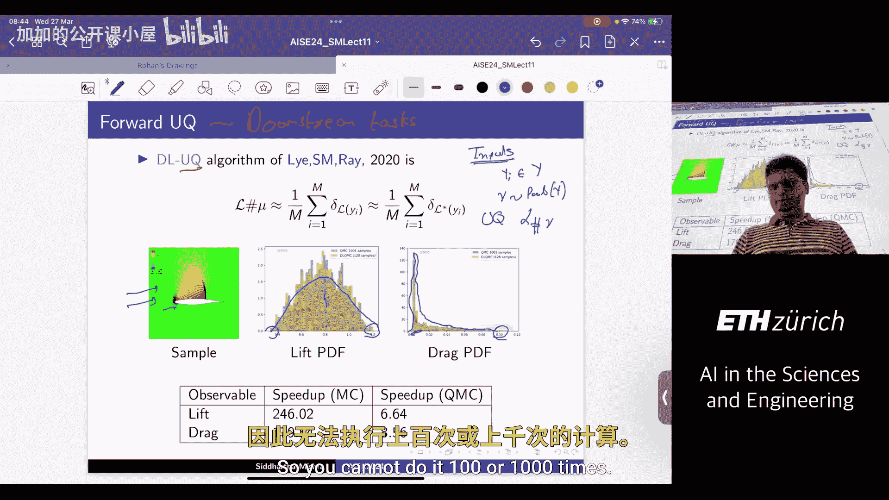

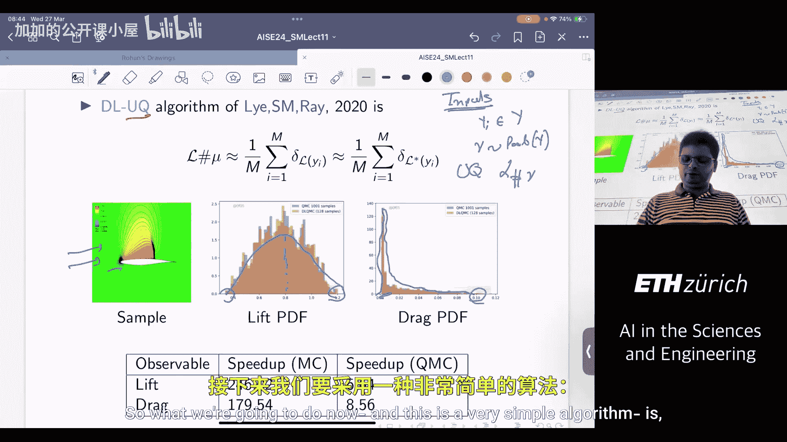

Essentially what you could do。Is that you just this is a Monte carlo so you take this is written in a mathematical mutation。

 but essentially what is going on is that you take M samples of the input， you propagate。

 you run your code M times and you average them so that is going to be the you average and your computer statistics right but instead of using this you train you take some samples you train your neural network okay because now with 0 samples。

 you can train your neural network quite well we have realized that and then remember that then I can take this M could be 10000 I don't I don't care because for instance。

 for the lift and the rack it was one10 microseconds right so even if I take1000 samples I still am in one second。

Because that the training is taking its times there's no choice about that it takes you some time to generate the samples。

 it takes you some time to train them， but once you do the inference it's very very fast so it's the same here means say if you would have done a direct forecast you would have taken 10000 samples which you take you X amount of time to train X amount of time to run now I say I run 100 it takes time for minutes let's say or let's say 10 minutes for each sample it can parallelize it that's not a problem because theses a sample independent but nevertheless it takes time but once it is there it takes one hour to train and then to infofer it takes me no time whatsoever so this is sort of the algorithm it's more or less online and then if you if you look at the speedup first of all there results also very good because of course your surrogate has been trained very accurately so there is little scope for errors and you can't really distinguish between the probability density functions the PDFs the histograms。

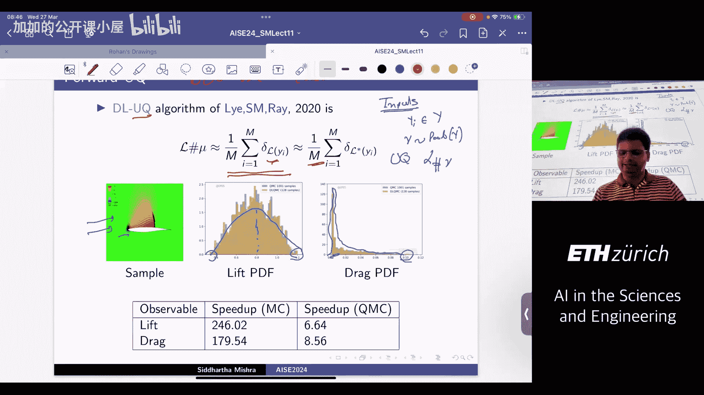

In this particular case that you get from the from your surrogates and from your。

From your ground truth in this particular case from with the Monte Carlo， the quasi Monte Carlo run。

 So in fact， if you just looked at the uncertainty using Monte Carlo not training with Monte Carlo。

 just the original uncertainty quantification using Monte Carlo you get two orders of magnitude。

 sometimes even three orders of magnitude， but in this particular problem you get two orders of magnitude speed up and this includes the sample generation time because otherwise I could have just used those samples to do my uncertainty quantification right so I in one case I generate all my samples。

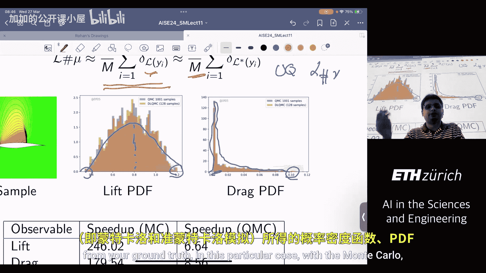

and then I do my uncertainty quantification in the second case， I generate a few samples。

 do my training and then do my inference and uncertainty quantification So what is the speedup that I get if I would have used Monte Carlo as my base algorithm for uncertainty quantification these are very very impressive numbers but of course we know that Monte Carlo is not optimal there real test is what if I would have used quasi Monte Carlo as as my algorithm here for my base algorithm even with that there is a speedup of one order of magnitude so there is a speedup it's more modest because you're using a state of that let's algorithm for uncertainty quantification。

 but even then a factor of 10 is nothing to laugh at and this is what this particular problem in 2 d in 3D these speedups are much much more So the point is as soon as you can do this sort of a training there is something cool that you can do with it there is something good downstream that you can do with it and I think one of your exercises if I don't remember has has this element。

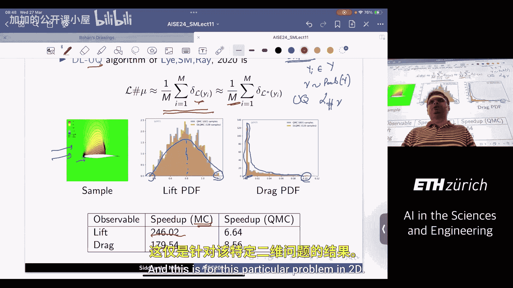

O， are there any questions。Now， everybody understood this was a very。

 very quick introduction to uncertainty quantification because yeah。

 we have more interesting things to do in some sense。Okay。

 so let me show you another downstream task， which is even more vital。

And this is what is roughly called SPD constraint optimization。Okay。

So what is PD constraint optimization so this is design essentially and let me instead of giving you a very general picture。

 the whole thing that me give you a concrete example because it's very easy to communicate。

 convey what's going on with this very simple example and this would be the problem that we start with with which is the shape optimization of efforts。

And the idea is always that you're going to do this optimization in order to increase or improve the aerodynamic properties right because this is an more optimal airfoil is someone which has better aerodynamic properties okay so what do you do in this particular case so remember the way we set the problem up was so we have some reference airfoil。

 this is how people do this in Boeing or airbu or any Dau or any company is this is the process it's just a toy version of okay so you start off with some reference shape which is given in black here。

 this is some standard shape that people have let's say through intuition you know because you don't start with the square and then try to optimize it to airfoil We know that a square or a circle a plate is not going to fly So you have to start with some something which is a aerodynamically reasonable right and then you start with this and this is my reference shape and then roughly speaking。

 I'm going to perturb this shape I have this design envelope。

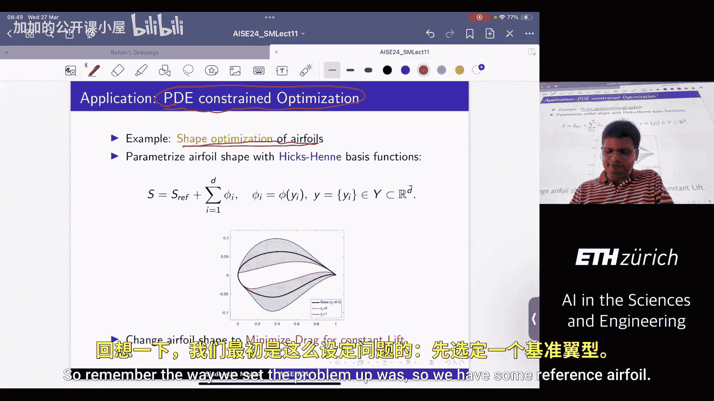

Ptubed this shape by using what are call some his and a basis functions。 Okay。

 these are some splines， you can think of them as some sort of splines。

 but these are usually as I said means my D is a D bar actually in this particular case is anywhere between 20 and 50。

also need to manufacture them。 It' it's important to manufacture this right I don't need to give you the details。

 but what I can tell you is that all the shapes will have to lie within this design envelope the law because that's what this spans right you can't have arbitrary shapes you don't you don't want to parameterize this airfoil into a circle you only want to sort of parameterize it into reasonable aerodynamic shapes and these have been designed with a lot of intuition because people have been designing aircraft。

 The first aircraft to the right for this design didn't have any of this they just went and they flew something but these are bicycle mechanic mechanics trying to sort of do fly an airplane。

 they didn't they don't didn't need to design it like that。

 but today modern design you have this intuition that has been built in for 100 years and then you go through this process right and then what you need to do is to find these parameters。

 this ys such that I have some airfoil shape for instance， the typical objective function is to。

Minim you fix left because you want the plane to fly， so you fixed left。

Around the reference Airfo is left， so the reference airfoil has been designed to fix left。

 but then you minimize track。In other words， you take the lift it's a constant。

 and if you divide by the drag this lift to drag ratio。

 it integrates right so this should be another another design objective so mathematically。

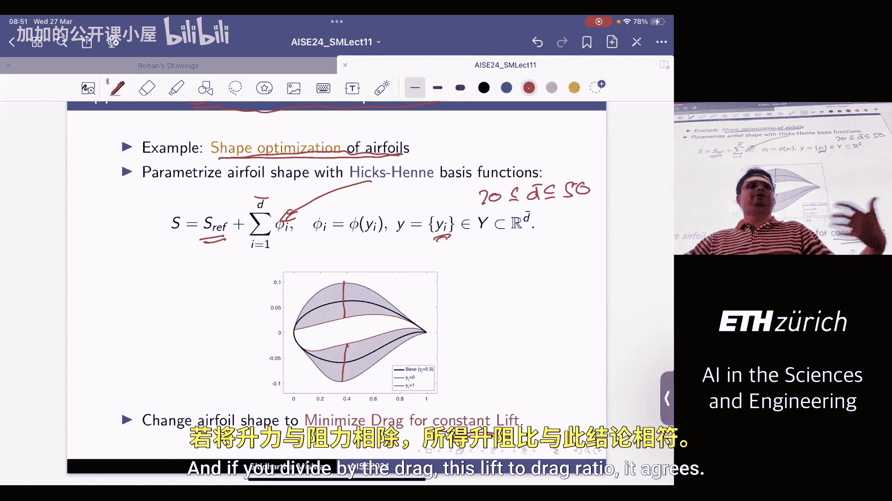

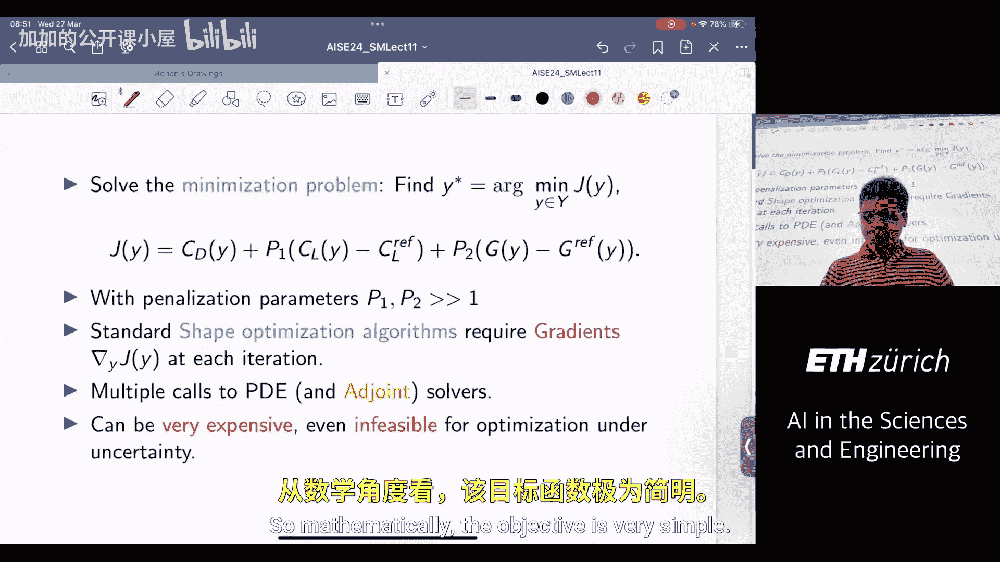

The objective is very simple， you have an objective function。

 the objective function is several elements， the first element。

 of course is the why do I have pink my children they play with this all the time。

So this is essentially the rack， the rack coefficient CD for each shape。

 we have the flow conditions that are fixed， these are the cruise conditions that I just told you we want to minimize the drag right but we want to keep the lift constant so this is the lift coefficient。

Okay， there is the left coefficient and this is the reference left， we want to keep it constant。

 so we have some penalty parameter which is let's say 10001000 means that I really penalize the strong deviations from the left。

And similarly， these are what are called structural conditions structure。

What do I mean by that at the end of the day I need to manufacture my airfoil So what happens is that just imagine that your shape the shape that you're designing should have some structural stability and the way in which aerodynamic engineers orerospace engineers measure the structural stability is that they would like to fit a beam with certain structural properties inside the airfoil so that it can't compress too much okay so these are some structural conditions they can be there let's say there are constraints on the area of the airfoil it can't it can't become too tapering it can't become too light in some sense okay so these structural conditions they have also expressed in terms of penalization you want to retain some structural stability。

 you want to retain lift and within those constraints you want to minimize trap so this is done using a constraint optimizationization algorithm or penalization algorithm these are not exact constraints but they should be they should be kept relatively constant。

And then you want to minimize this Now all of you have learned Ben taught you in the very first lecture that when you have this is by no means a convex function okay because there are this inputs。

 they go into this lift and drag lift and drag are not quadratic by any means so this is an nonconvex optimization problem and then what you need to do is to is to sort of minimize it right so you could use gradient free optimization some people use gradient free optimization but the standard one is to use gradient based optimization or gradient descent and you know what gradient decent is so gradient descent will how many times have we written it。

 this should be yk plus1 equals to yk minus some learning rate gradient with respect to y of k of yk right so you need gradients So you take the gradients and you move in the direction of the negative gradient and eventually will converge at least to a local minimum Now the problem is how do I compute my gradients。

This is the hard part。 How do you compute the gradients。

 You cannot take finite differences anymore because you know you don't have this great structure even if you did because this is a high dimensional space remember that the y is at least2 dimensional so you cannot take finite differences in not to compute the gradients So what people do is they use what are called a joint solvers so this this is a direct problem there's a joint problem you write a PD for the gradient this can be done it's a very complicated PD it can be done and then at each step you have to solve the PD itself and then use that to solve a joint PD compute gradient move。

 solve the new PD compute gradient and so on and so forth so the solving the PD remember that it was anything between two minutes to 40 minutes a joint is even more because a joint is harder not to crack okay so per step it could be anything like one hour in 2D in 3D you can imagine the cost accordingly and you have to do it over thousands of steps so this are very expensive。

Process and big aerospace companies they spend a lot of their compute on this almost all their compute is spent on this kind of problems right so that's why I said that it is either it's very expensive or it can even be infeasible will take a little longer maybe before the break。

It can be even infeasible particularly when we are doing optimization under uncertainty so here I said that everything is fixed my cos conditions are fixed。

 the mark number is fixed， the angle of attack is fixed and so on but before that I told you that these quantities these are uncertainty right so there is some uncertainty there and you want to optimize under that uncertainty so that will give you additional overheads so this is this is a hard problem in some sense and this is the same if you have cars if you have whatever in shapes any kind of engineering design this is precisely the problem that is there。

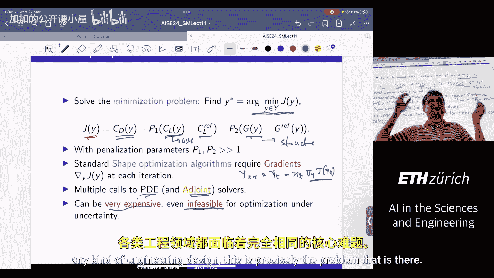

So now of course the simplest thing that you can do is now we know the trick right we take some shapes。

 we train the we have the data， we generate the data from simulation。

 we train the surrogate which is the deep neural network and then simply use the gradients of the deep neural network that neural network all the gradients can be computed with back automatic differentiation so this is very easy right so this is somehow as I said so you just take a training set。

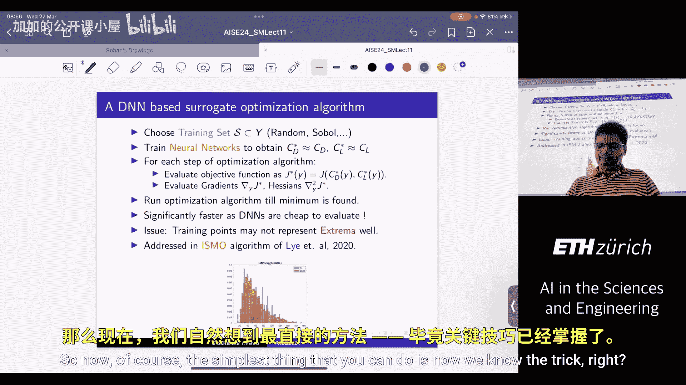

These could be random points or soball points as we know is better and then you take neural networks。

 these are going to output the lift in the drag and then you just use this as your objective function instead of using the the area is anyway independent it's a structural constraint So instead of using the CFT simulation which is expensive what you do is that you just use the deep learning surrogate because you have very accurate surrogate right so in that case evaluating the gradient is trivial you have small networks we do back prop so how much time can it take you can even evaluate hessians。

 if you want if you use Lb of Gs or approximate hessians and then you just run this optimization algorithm So all your cost is in the training process once you've done the training once you've done the three generation and your training then of course the inference is lightning fast right so it doesn't take any time it's very very cheap However there is a little caveat there and the caveat is very。

 very well expressed by this picture here。

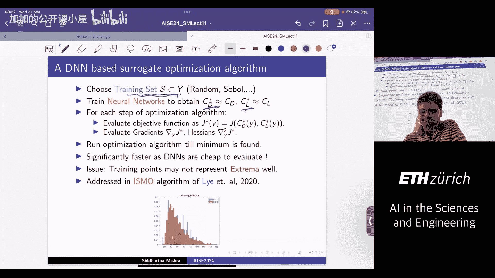

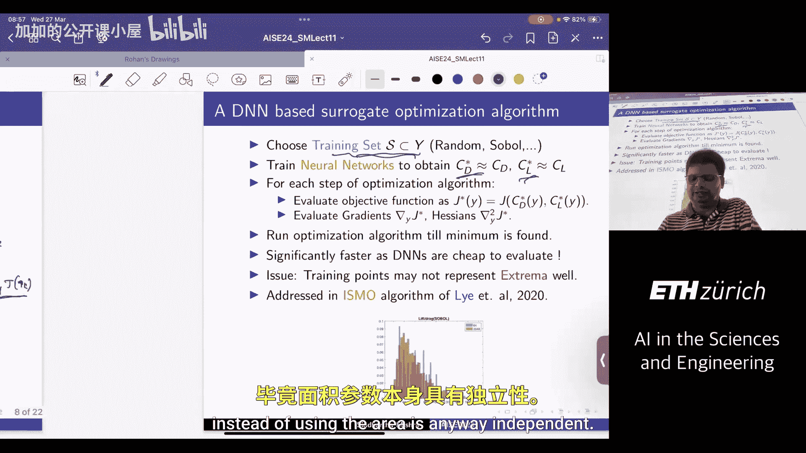

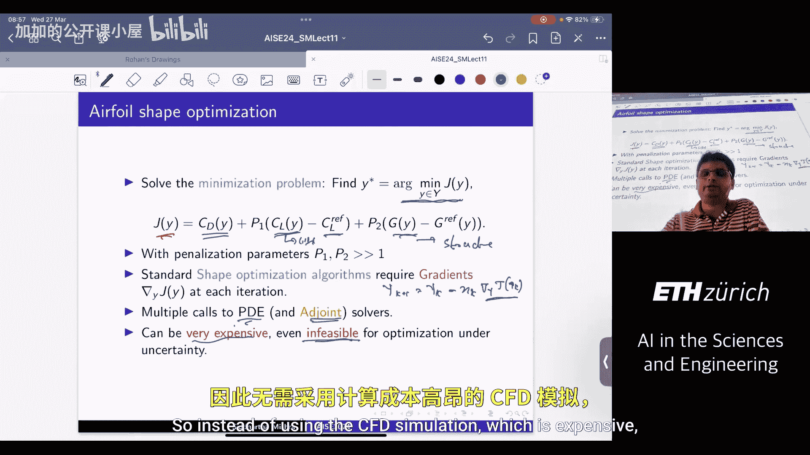

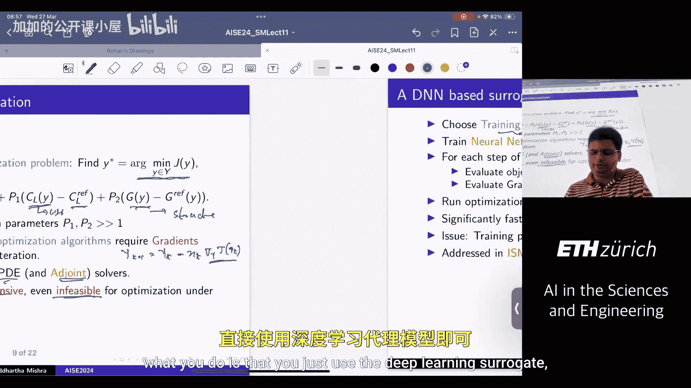

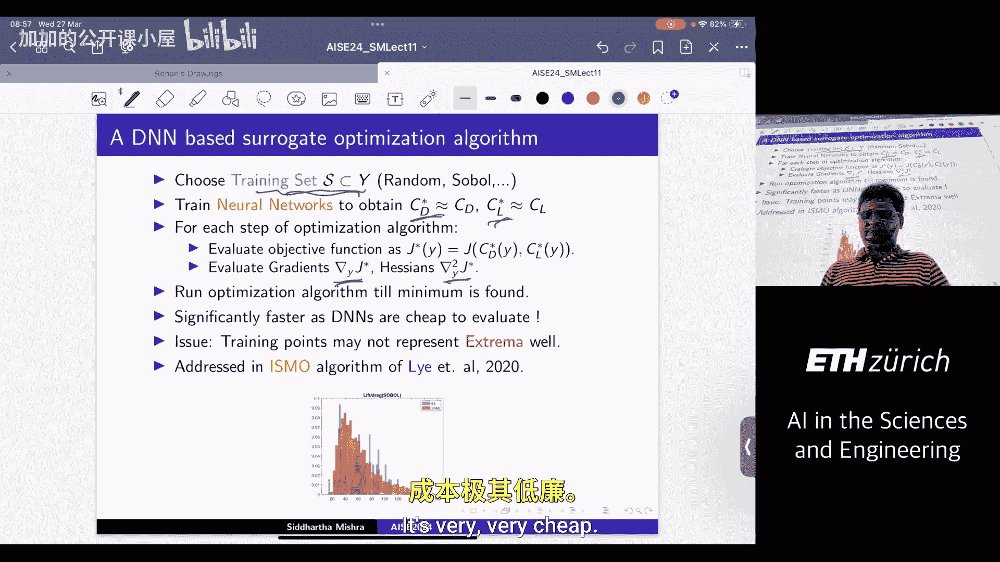

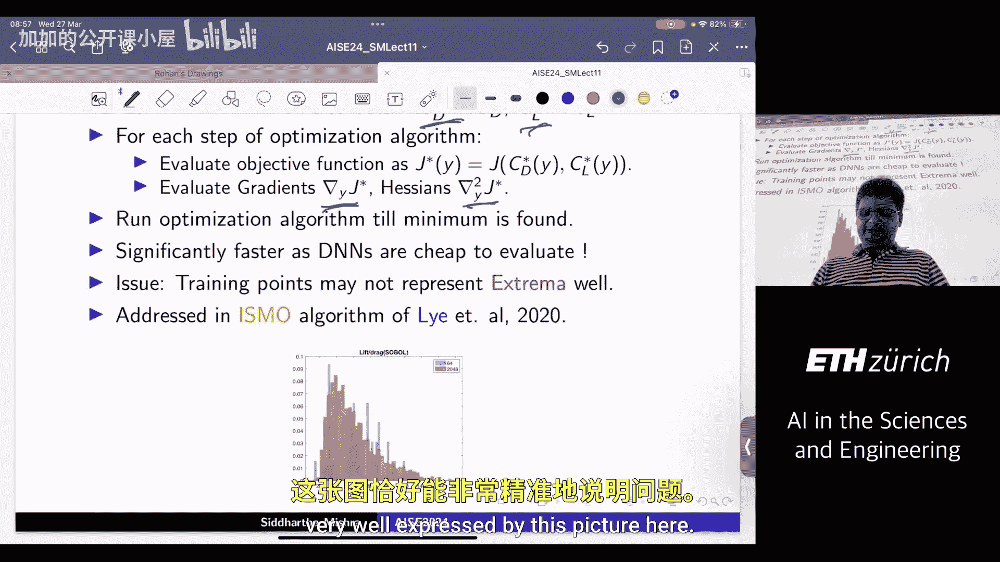

Which tells you that now when we train we take random points or soball points。

 these are spread over the entire space right there is no there's no structure with these points though in fact soball points have even been tailorm made to be distributed over the entire space right over the entire design space however Opimma do not lie at random places typically optimma ions or manifolds and some curves in this space and because of that essentially roughly speaking if you want to draw a picture which is what I should have done instead of giving you this picture。

But I prepared it on the train yesterday， so so essentially your training points are all over the space right。

 something like this。So these are your training points， on the other hand， your optimizers。

你 typically like啊朗神。Cs like this， so this is your optimizers。

So when you take random training points the risk is that you are not approximating the optimizers well right and because of that of course if you take enough training points no because then it will fill up the whole space but if you don't then you don't approximate the optimize as well and this is being shown here in this plot here that this is a lift to drag ratio and if you take 2048 points then you spread and then you see that and you are targeting this region here right because you want high left to drag ratio。

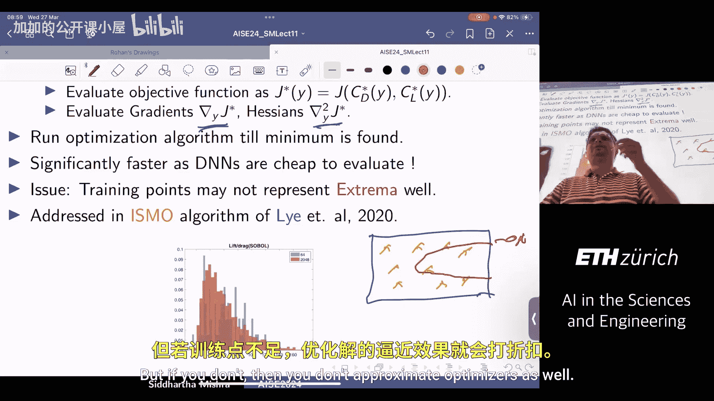

So you want to have as high to track ratio as possible， but if you take 64 points。

 bulk of them because the way things are distributed， they will lie in this area here。

And so you so just imagine that if you'd have optimized most likely you would have gotten a lifted drag ratio of 100 which would be half as effective as the real lifted drag ratio which is out there so you're not able to sort of explore the entire design space in some sense。

 of course if you're lucky there is also 120 but it' still you significantly underestimating the minima and the optimma in this particular case and this is the reason why it is happening because you're not filling the optimize as well so in this paper I can I can send you I can put a link we have an algorithm that somehow iteratively constructs this optima so instead of taking these points randomly it starts with a random version of these points bringss the neural networks。

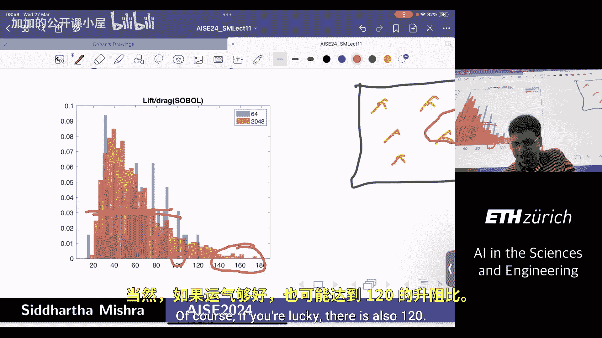

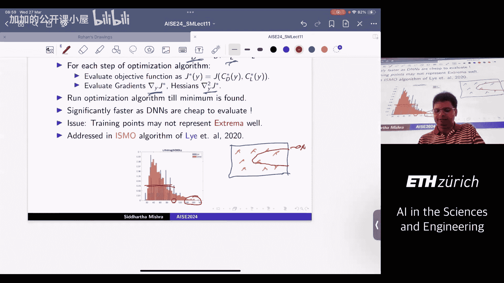

Prorovdes some approximate optimma takes these as your random as your new creatingd points。

 keeps on it rating so that it better fills up the space， but again I'm out of time。

 not space but time， so I'm not going to do that but the point is it's essentially based on having better training algorithm adaptive what called active learning algorithms for this particular for this particular problem and does that work the answer is yes。

 at least in this particular case there are some other examples in the paper but this one is very interesting。

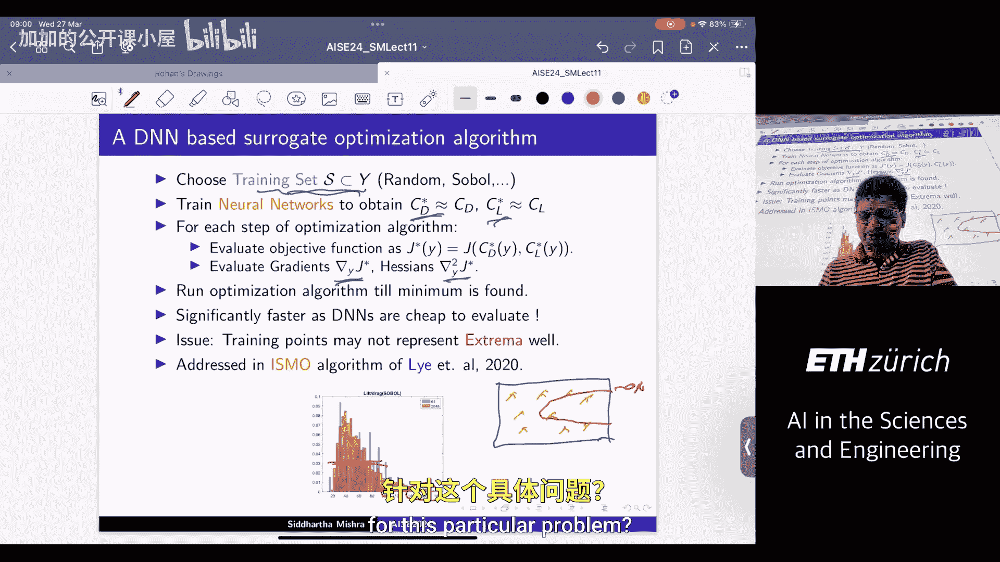

So as I said， my reference drag was 0。 essentially 115 units as this is called and after optimization it was 58 units。

 so you reduce the drag by factor of almost two that's why the lift of drag ratio and by a factor of 200 means it's the lift remained where it was so it was 87 units and it remained at 88 units so almost 50% of the drag was reduced and here is a reference shape and the absolute minimum as you can see this is a very。

 very tiny perturbation the shape itself with a tiny tiny change and in this particular case this is a very idealized case you know in a real airfos wings you cannot get 50% drag reduction you get 5% but 5% is 5 billion less fuel because that's at the end of the day these things have to fly you have to you have to pay you have to pay for the aviation fuel which is very expensive so this is in this idealized case no human could。

Design this tiny tiny perturbations right so this is impossible。 This is why we do automated design。

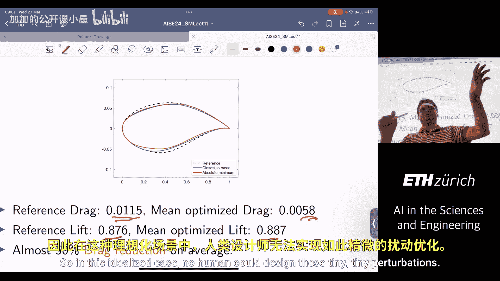

And in fact， if you look at the comparison， okay， that's nice。

 but what if the same these are impressive in some sense as raw numbers。

 but what is much more impressive is if you take the so this iterative algorithm not the base algorithm that I told you with deep neural networks。

 so this is a traditional algorithm it has a name T andC based on optimizer but to get the same results you are in this region here。

 so this region is 2048。

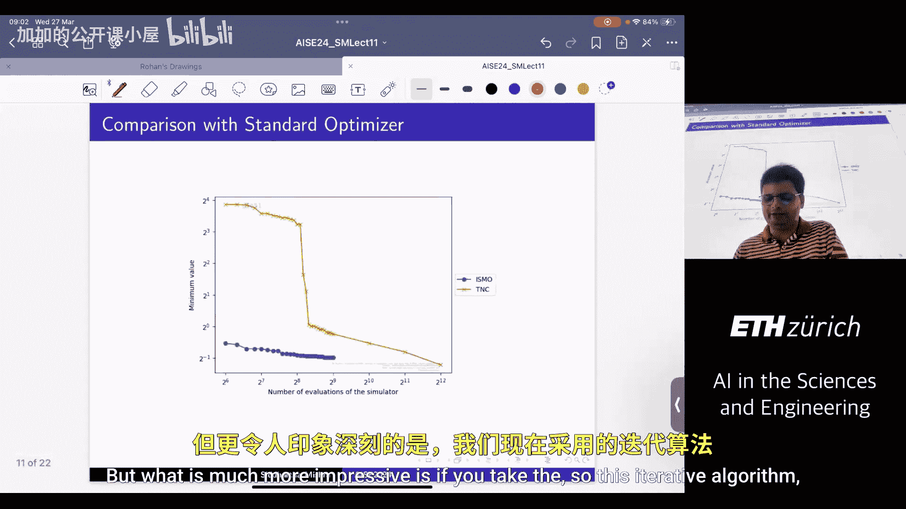

Forward。Okay， and in comparison， you get something here right， so this is like 80。

So 84 excs because you need to train this network and you use 80 simulations to do that that's the way I measure and remember that this is double so it's really 80 and 4000 so a factor of 50 you gain a factor of 50 this was of course proof of concept as I said means in this particular case there many idealizations but with this algorithm it really work we have some version of it in 3D but that's more of a d。

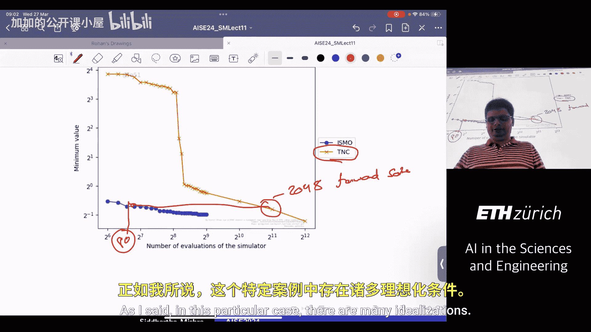

Right but the essential point is a welltrain neural network can be the basis for many many downstream tasks and just i'll end by showing you how the flow looks like so that you have some idea so this is how the flow looked like on a reference airfoil right so that most of the drag is caused by this shock here。

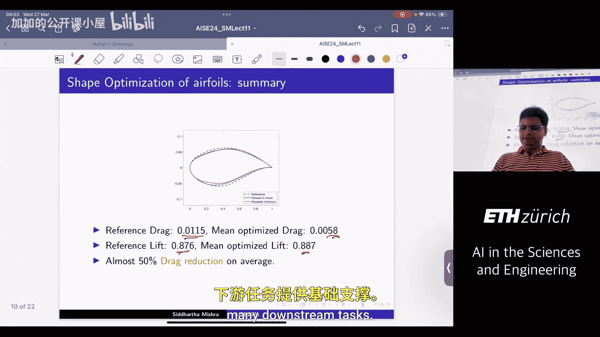

That that's a whole point right But if you look at the best configuration all that it did was this you can't do that there's no visible difference between the shape here and the shape here。

 they's slightly different from each other right but it did change the characteristics of the flow quite quite heavily because there is some tiny the shockt reduced and as a consequence of it there is a 50% reduction and the point is first of all。

 this cannot be done by humans in some sense， second it's expensive to do it by traditional numerical solvers and once you have welltrain neural networks they can do it rather well So you can do these kind of downstream tasks very well and I put this upfront because now I'll not talk so much about downstream tasks。

 I'll focus almost entirely on prediction because once you have prediction maybe if I have time I'll do something on inverse problems because that's very different types of downstream tasks but what I'll do is I'll focus on prediction So from now onwards will not talk about uncertainty quantification not talk about shape。

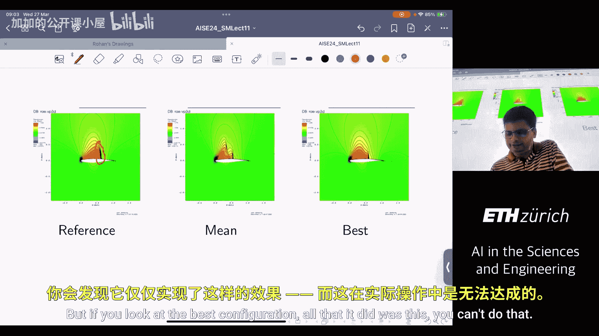

Control， But you know that all these can be done if you have very good predict。 Okay， so with this。

 we are going to stop we we reassemble at quarter past， Okay， quarter past so that we can have。

Second book。我。Okay， so let's restart。 So somehow the。

Native of the course is that we start with something。

 say that it's the best thing and then demolish it and start with something else say that it's the best thing and then demolish it and keep on doing it and keep on doing it but that's how science is you know particularly for a new field you think that oh this is a best thing but then you realize this is on investigation that that's not the case so I explained to you so much about parametric Ps in the last one and half lectures but now I say what are the difficulties with it and this will be the recurring theme that is you'll find out that this is such a things are in such a state of flux there's no ultimate solution yet which is good because then。

Okay， there are things to do。Okay， so what's the challenge with parameterization？

So everything was good now right so I cheated， I had an infinite dimension problem and I simply said。

 oh， we can approximate everything in find dimensions。But well， the difficulties of parameterization。

 So first one， which is a very practical one， is that it's difficult to come up with a。

It's very difficult to come up with one right so remember that these parameterizations that resulted in these shapes these have been done with many。

 many tens of 1020 30 years of engineering experience that's why you were able to come up with parameterizations like that if you are going to design a little vehicle at own of your own means there is no such parameterization that you can use right so you have to handcraft this is this is this is problematic。

But there are even more difficult issues with it， of course。

 needless to say it's not unique so here is and because of that there are some issues with generalization。

So what does it mean that it is not unique， So here is a parameterization。

 which is exactly two different parameterizations give the same answer and sort of。

Very easy to see that。 So I can have a function parameterized function。

 parameterized by single parameter X， which essentially realizes function x squared。

 a quadratic function， right， but if I didn't know that this was the case。

 I could also come up with the following parameterization Y1 is some a1 of x plus B1 Y2 is a2 of x plus B2 and I can take any of these A1 A to B1 B2。

 I can come up with y1 y2 and I can rewrite my function。

 instead of a function from one parameter to vector to an output a scale output。

 I can write it from two parameter to a scale output。And I will here I have taken half and a half。

 but I could take one8 and seven eighth so one fourth and three fourth and whatnot。

 so the bottom line is the bottom line rather not the bottom line is that there is no unique way in which you can do the parameterization so now suppose I wanted to learn this function。

And I wanted to sort of try I learn this function， I take data from one space dimension I train it and of course I I can realize the quadratic function。

 but then someone says okay， take apply your method to learn the function in these parameters and then you fail completely because your method takes one input and producing one output without realizing that its exactly the same function that can be realized by two inputs and producing one output or three inputs and producing one output or 100 inputs and producing one output right so this is the issue with parameterizations that these are not not unique and because of that they don't generalized well and this is sort of the key in machine learning if machine learning is all about generalization and if you don't generalize you have not properly machine learn something。

So what does it mean in this particular context and why do I highlight this so much？

So from now onwards， I will keep on sort of harping on this word generalization quite a lot。

Okay so here is an example which which is quite instructive in some sense。

 so this is the same Higgx Henna Air forces the way that I told you and here I took an input dimension of d equal to 20 so this is how the Air looked like and this is very much in the setting that we had right so this particular set where is it。

You said。20 dimensions。 So you could generalize there。

But now someone would say that okay 20 dimensions you have trained a neural network to produce something in 20 dimensions and this is the ground truth but the neural network can do a very good job in approximating that's what we said right but now for some reason someone came up with the idea that okay actually there's a more optimal version of this airfoil which will be here it's more sort of tapering you know instead of being so flat may not be the case but it's just tell the story here。

So this on the other hand， I cannot parameterize with 20 dimensions anymore。

 I need 30 dimensions because the sp functions， 20 sp functions are not enough to parameterize it。

 I need 30 dimensions， so this is how this effort looks like。

So what can you do Canyon neural and the flows there are of course there is a slight difference but they are not completely different from each other maybe the as you can see this is the flow is more or less of the same type right so in principle generalization would have meant that my neural network which has learned on this shape of airfoils。

I can apply it either zero shot to the new configuration or find tune as some people call it。

 use a little bit of data and find tune。I am finished right because remember what did my neural network do it took 20 inputs。

 of course it also took the spatial coordinates as inputs。

 but that that's the same it let's say it took 20 inputs and produced me the left of the right。Now。

 suddenly you are giving me 30 inputs。What do I do I don't have any training data to go from 20 to 30 even though the F themselves are very very close to each other right so in principle。

 I should be able to learn one from the other， but because I use this particular strong parameterization or strong reduction of my compression of my information I'm left with no choice because okay now how do I go from 20 to 30 I don't know I certainly cannot do with zero short I need some mechanism by which I can go from 20 to 30 but then someone will say okay the mechanism is very simple。

 you should have started out with 30 parameters and instead of taking the 20 parameters 20 active and 10 passive parameters that would have done a job but then someone else will come okay let's have something 40 parameters maybe it's even more and what do you do So essentially parameterizations are necessarily limiting because the input remember the end of the day you had to work with a function space input。

Because if I had deal with functions and just think of these shapes as functions level sets so these are level sets of some functions then this guy here and this guy here they are close to each other there's not a huge difference between them but if I think in terms of parameters they are far from each other they did not even in the same they cannot even be compared something is 20 dimensional something is30 dimensional and another way to do it to think of it is just imagine that if you are a function just think of it it's a very intuitive way so let's say I have a function F okay I can rewrite this function as some Fourier series。

Let's say sine k x26 expand the function right， and I take another function G。

 I expanded GL sine L X。I never say that my。诶FK。Is equal to G K for one less than k less than 20。

 They have the same coefficients。 Okay， so， but in one case， I have my K from  one to 20。

And in another case， I have my L from 1 to 30， and let's say that GL decays like one over or exponential to the minus cell between L and 20 and 30。

They are going to be very very close to each other in some sense， So these two things are very。

 very close to each other， but suppose I would have used my FK as my parameters and Gs as my parameters for the first 20 parameters theyre exactly the same I would have done whatever right but as soon as I go for the whole function even though functions they are very very close as parameters not they're not comparable at all right because one has 20 and other 30 So you see so this is necessarily limiting it's just a concrete example of this problem that this is not a natural way。

 of course it's a pragmatic way， it's a practical way that you write everything in terms parameters but it's not an natural way because there is no sort of connectivity between the two one is sort of disconnected from the another So unfortunately even though these are sort of good baseline they can be useful in certain contexts but in general you have to stick back to operate to learn you have to work with functions。

 you have to but we learn some tricks we learned that we could use。

Some some representations we could do some downstream taskss and so on。

 so it's not completely useless but nevertheless we have to deal with with the beast as it is we cannot just drop it off into pieces and the beast is that you have to learn the inputs and outputs are functions so here is a function。

And here is another function。And in the next。fewew lectures。

 we are going to we are going to deal with that right， and this is the operator that you have。

Okay so this is the this is a setting again I keep on this is my abstract PD I keep on changing it slightly all the time。

 but you understand it from context and the solution operator so you have to find now is sort of get based on DNAs from the data itself and you have to deal with there's no way so we have to do some sort of smarter reduction to finite dimensions because computation have to be anywhere done in finite dimensions but do you have to do something smart some sort of smarter reduction how do we do that。

So okay so here's a solution okay that the cheating was to have a finite dimensional problem now we don't have finite dimension we have an infinite dimensional problem and let me try to explain this because this is going to be rather rather germane to what we are discussing so let me try to explain this relatively well so what are we seeing here so we are seeing a fluid flow so this is the navi to equation。

Incompressible。Now Vi tos equation。Indy。Because most of our examples are in 2D， things scale to 3D。

 but of course the computational challenge is forid。

But let's say this is in 2D and what you're seeing here is a vity of the fluid。Okay。

 Poity is just the curve of the velocity。velocityloc field。

 this is the curve of the velocity and this is the initial whatity， let me call it as omega 0。

And this a verity at a certain time。As a function of space。

 both of them are functions of space so as a function of space。

 so you can see that okay you start with some verticity there are some vtices here。

 some vtices here some negative vtices vticity going to be the sign right so some negative vertices here in 2D it's a scalar in 3D it a vector and that makes all the difference for fluid flow。

But the point is then then it evolves and you cannot have predicted just by looking at the initial verticity。

 how the final verticity is going to look like it's impossible to predict there's no formula to write down here two this has been done with some numerical method。

 some spectral method or I don't remember what's a numerical method， it's some numerical method。

So essentially I have been given an input function， initially a function。

 and I have been given an output function and my task is that can I have a surrogate。

 can I learn this function from data， I have some data earlier I use parameters but now I cannot use parameters anymore these are genuinely given as functions。

Okay images in this in this sense right so the first solution which is actually a very trivial and a useful solution is the follow and let me explain it with some context otherwise because this is important。

The point is I have to do computations in finite dimensions there is no way I can do this in infinite dimensions so I have to do something in finite dimensions so I have to do some finite dimensional reduction okay this is how I do my first reduction which is I use sampling。

So I have a function which is an infrdimensal object because this can be evaluated at every point What I do is okay I say I cannot this is numerical analysis right I cannot have every single point because I cannot store every single point on a computer I take a bunch of these points discrete and I set up these points so in this particular case just visually I have taken 16 by 16 points。

 16 in this direction16 in this direction just for simplicity okay but in practice during my training I'll take 64 in each direction because I don't want to show you 64 points so I take 16 by 16 points 256 points in practice 64 by 64 so 4096 points so 128 per 128 which is a much larger number。

16384。 But anyway this is 16 by 16 points and I sampled the function at these 256 points。

 so instead of having a function， I now have a vector vticity and each entry3 is the vticity at these points so I have a vector which is 256 dimensional 496 dimensional 16384 dimensional so that is roughly the scaling that I'm thinking about right so now my function is effectively being reduced at the input level to a vector a large vector much larger than the parametric vectors that we had before。

 So this was the advantage of parameters right because they were representing my function we much more compressed manner with 20 parameters instead of having 256 even on the very coar grid and much larger when you take larger grids I can do the same for my output right my output is also a function I can sample it to256 points or496 points and so on so essentially。

I have just by taking this one very simple step， I reduced my infinite dimensional problem。

 which is mapping a function to a function to find a dimensional problem just mapping a large vector to a large factor right so remember that this problem here instead is mapping。

W 0 at X J。J from one to capital N。And this is mapping it to W。

The mega rather omega this a vector now right you can put whatever order you can take the ra order like what people do in images' that's not that important this is at time1 but at point x J same points I could take different points no one stops me but let's take for example the same points。

Now as I said， n is the number of points 256， 496， 16384 and so on it sort of starts scaling in different manner right so now all that I have to do is I have to now go just by doing this sampling I reduce this into finite dimensional problem and I can use deep neural network I I can map between them using a deep neural network。

Of course， this will be a very， very big network because if you have 4000， yes， James。嗯。

The sound can also be seen as prior transition with like a hot basis is something。

 so it's where's the exact difference。It can be seen as a parameterization except that it is not a fixed parameterization because when you change the number of points the parameterization also changes right so this is not a we're not reducing everything to one fixed set。

We have a set that can grow or contract depending on the number of sample points。 Indeed。

 you can think of it。 and we will we will see that in a second。 but you allow these points to change。

 That's the whole point in some sense， right that you allow this points to change。 But nevertheless。

 the first challenges， But even if I have 4096 points and 4096 outputs。

 It becomes harder to sort of put in deep in neural network because it's input dimension is 4096。

 output dimension is 4096。 So my network would be rather big。

 So already from image processing image computer vision， We know that for images。

 it does not make any sense to take this fully connected MLlP multileersrons。

 we should take more structure。 and this is where CNNs come in right And this is。

 I think you had a lecture right in the very beginning， you add some introductory material。

 at least on CNNs。And roughly speaking what they their convolutions means we are going to see that in later on today。

 but essentially what you can think of is that if you remember the neural network is essentially。

T blue， let's say this El layer。Let me call it us。Okay VL let's say plus some P so this is the weight matrix this is a by vector so this weight matrix would have been a 4096 by 4096 dimensional matrix if I would have taken the entire structure a dense matrix so this would be a sparse matrix right so you have a sparse matrix structure because this is what convolution does it has a very sparse matrix structure so it has some non。

There are some non zero elements。 This is just a simplification， and then it has some zero elements。

 So this is the structure of the matrix。So it has a a pass matrix and this is what is shown by this little sort of moving window。

 this moving window is what hits you and gives you nonze values and you keep on changing it so this year is a representation of a CNN but you could take MLP if you have a computational resources you could take MLP a CNN there is a MLP but with some structure。

That's that's all that you're doing right and then so you have this mapping between 4096 and 4096 instead of a DNM you take a CNN more structure good and then you get a 4096 dimensional output。

 but remember that my target is not something which is sample my target is a function。

RightSo I have this function on 16 by 16 grade 64 by 64 grade 128 by 128 grade。

 so what I can do to get it at every point is to use interpolish。

Right interpolation tells me that if I have a discrete set of values I can automatically interpolate and get a continuous function right so this is a very。

 very simple way where we do a finite dimensional reduction and yet we are able to do the process in the sense that I start with a function sample it in a grid。

Uses CNN， this is one particular architecture， I could have used something else。

And then I have values on a grid as outputs， and then I go back to the function by using interpo。

Is this scheme clear it's a very very straightforward scheme in some sense and the question and then of course our training is done at the level of discrete grids right so the weights and biases of this network is W elses they have more structure than what I'm saying but these are done at the level of this 16 by 16 or 64 by 64 grids does it work。

The answer is yes， to some extent， because just to give you an example。

 I took a slightly more difficult problem because this problem is too easy in some sense。

 we will will talk about that later， but it is the same setting。

 so I still take perhaps this the velocities instead of the aticities。

So it's still obvious talks。With a very high anse number so that it's essentially approximating in flow so that interesting things happen and this is a very wellknown problem in fluid mechanics computational fluid dynamics which is that you take a she layer can happen here in the atmosphere so you take a shear so the velocity score like this and the verticity is concentrated along this little shear and then what is is a she so this is how the solution evolves this are the velocity evolves the velocitylocities this is just x velocity for visualization and this is what happens to it so I do the training on a 64 square and then of course what I have is I have a ground root right so this ground root is generated by numerical simulation but I can do this if I want at 160384 squared I have the code and the compute compute to do it but it is done 1024 square okay 1024 squared is fine enough resolution so I have a ground root and because。

have this function and this is a question that James asked I have the freedom because it's a function right it's not a it's not a vector so I can evaluate it at 16 squared。

 32 squared， 64 squared， 128 squared， 256 squared， whatever resolution that you want。

So I train it。

At 64 square， I compare it to the ground truth at 64 square and then let's say that this is your training error or generalized or。

Test error let's call it as the training error okay and this the number that I get is 5% this is this is neither here nor there some norm or theyre 5% it's satisfactory it does a good job so you say oh okay good that I really solved the problem in some sense but this is precisely the issue that I haven't solved the problem and why haven' I solved the problem because remember that I can evaluate this function at 128 squared or a 96 squared。

So and I can also so I train at 64 squared it's very important so pay attention。

 I train at 64 squared my weights and biases， everything is trained at 64 squared but my evaluation can be a different resolution it can be a 96 squared it can be a 32 squared which is a function it's not a particular fixed vector my parameterization can change this is the point that I was trying to make and then of course I evaluate and I look at the errors I compare the errors and then you see as soon as I change my training resolution for instance if I go to 96 squared then I get an error which is three times mode and if I go to 32 squared which is a smaller training resolution smaller than the training resolution there is increased by a factor of five so in other words I have not generalized at all I not I' have not learned a function at all Ive just learned one particular realization of the function on a grid。

So this is not operator learning， this is just in some sense cheating。

 I'm still learning a fixed parameterization， a large parameterization but a fixed parameterization because as soon as I change my parameterization it does not change the device and here the parameterization is in terms of the sampling because as you said this is is the parameterization and this is not my discovery or anything this has been known for a while that you cannot just learn functions by sampling the amongs because that is not that is that you lose a lot of information doing that so is there is an issue there because what you learn what you need to learn is the underlying operator and not just one discrete representation。

So this tells you that there is a little subtlety here that you have to learn some equivalence between the continuous and the discrete because a function is a continuous point。

 this in a container， whereas vectors， sample points of the functions。

 these are discrete quantities and there has to be some connection between them。

 otherwise you don't learn the function。These are very， very important point。

 Are there some questions about this particular point that I made So this graph is what is somehow absolutely crucial it's very。

 very important because it tells you that as I said。

 everything is about generalization So no generalization is happening in other words if you remember coming back to there for example。

 even though we had the possibility of evaluating on on 30 basis functions。

 the answers will be very bad because you are simply not generalizing learning only on 20 basis functions So that's why I keep on I took my time to explain this because it's very pertinent to what I'm going to say questions。

No， anyone on Zoom who wants to ask a question about this？Okay。

 so this is this is the key point right， so we have not learned the function。

 we have just learned one particular realization of it。

And this is really a challenge from various angles and let me try to explain that so remember that at the end of the day more my operator my mapping so this is for DarRC right so this was the elliptic case DarRC。

So my operator is a mapping between the input and the output right these are functions these are functions but in practice of course I have to work with discrete there is there's no choice I cannot even unless until I use some symbolic package I cannot even write a function on a computer I have to approximate it with something discrete but the problem is that there are multiple ways of doing a discrete you could change the resolution of the grid you can grid you can have the same grid or you could change the resolution as we did in this particular example or what can be even more frustrating is that your input can be on some random points point clouds as these are called outputs can be on point clouds and so on so there are multiple discrete representations of the same function the same function you can approximate at 16 square。

 32 squared， 64 square or you can approximate it to fix sort of uniform points you can approximate it to random points quasi random points and so on all of these are one a day representations of the function。

But at the same time they have the same underlying reality。

 but to us when you look at them discreterely， they look very different even though they are representing the same reality right and this is where you need to understand this concept。

Of some equivalence between the continuous and the discrete you have to go between the continuous and the discrete in order to be able to solve this problem okay so what I'll do in the next 15 minutes is really try to attack this particular question。

 how do you link the continuous and the discrete so that you can design architectures frameworks which go seamlessly between the two。

And this this is mathematical， is not mathematically that difficult。

 but it little it's a little subtle， so you have to pay a bit of attention。Okay。

So let us try to continuous discrete or discrete continuous equivalence。

 whatever you call it I should have switched now I made a mistake here so essentially what is the problem here the problem here let me try to explain is that this is my let's use some pen here so this is your continuous。

World this one here right so these are function spaces， so this is this guy here。

 these are function spaces right and the actual operator your ground route is sitting right here。

But because of the way in which our digital computers operate。

 that will probably change when you have analog computers， but at least for digital computers。

 we have no choice but to work with the discrete so this for instance could be a grid。

Values on a grid， of course， this is values on a grid。Let me use another pen。

 and this is your discrete operator。Right this is your discrete operator so what is important is that there should be ways of going between one and another So this for instance。

 for sampling I showed you sampling here I showed you interpolation sampling and interpolation such that this this happens seamlessly that when you operate in the continuous or when you operate in the discrete rather is the same as operating in the continuous because that that would solve the problem right so how do we do this and this is sort of the crux of the argument。

And let me just continue this and the framework is very recent。

 but it sort of is not hard to understand， so what's going on is the following。

So at the end of the day to go between the two， you need two elements， okay。

 so let me give them some names， I call them as an end quoting。E。

 so this is a mapping ring between your function space and your discrete space， so this guy here。

Right there is a mapping between the function space and the discrete screen place this could be sampling on a grid for instance and then you have decoding or I prefer to use the word reconstruction because it's really not between vectors of different sizes but between vectors and functions。

 otherwise it would have been。So reconstruction。So I called it as R。

 which is mapping the other way up， it goes from the discrete to the containers。ですか？

Okay and the same place here， maybe they are different。

 but just for simplicity I took the same okay so now the point is that the continuous in the discrete can be related to each other in a particular month。

 so if you think of it now now focus that this was a mapping between x and y one way to realize this mapping is I go from x to this x or calligraphic x to x from the continuous the discrete with E so I do this。

Then I do my work here G and then I go back again by using this guy here R right so this exactly what we did before that we could have where was the picture here that first we went from the let's say from the continuous to the discrete by using the sampling so this was my E。

Then I did some processing there， this was a CNN this was my operator G discrete operator G and then I went back up with the interpolation Okay so this is the algebra structure。

 this is the scheme somehow in how I operate。Okay， so now what we want is that these two things should be exactly the same。

This is what we want because then working with the discrete is the same as working with the containers I work I do my all my work at the discrete but then there is something which is going on at the level of the container right unfortunately that is not always the case because if that were the case then I would not have gotten this picture here right because then it would have always corresponded to the same continuous function but it did。

So the error in doing this， there is a name for this error。

 means some of you who have done some signal processing in electrical engineering probably know this error。

 so this error is called what is called alias signal。

Okay aliasing error is when the equivalence between the continuous and discrete so now this this is a way if this would have been true then there would be some equivalence between the continuous and the discrete well that fails then you end up with some error it's an operator because it axon functions and this is what is called the aliasing error operator which is precisely the gap between them so this is the mismatch okay a mismatch between the continuous and the discrete I'll give you some concrete examples in a minute but this is the abstract level。

And all that we asked is that this should be made seen right so this so the operators。

 let's say the neural networks these are called there's a name for them。

 these are called representation equivalent or resolution equivalent。

 but I prefer the word representation equivalent neural operators or rhnoos。

All that they do is that this by construction as such that this error is equal to zero so they don't alias at all okay so you want to construct them。

 they're not available there you have to construct them in such a manner that there is no alias that whether you work with a continuous or whether you work with a discrete you get the same answer okay of course you can say that maybe in some problems it is impossible to have an exact realization of this but at least they should be small this aliasing errors should be small。

Hopefully vanishingly small， right， But now remember that neural networks on neural operators。

 as we are going to call them， these are compositions， right， so I missed something here。

 So these are typically compositions They are done Lewise。 So what we demand is that。

I don't even know why I wrote this。But this is equal to。Is identically。So we want that this sorry。

This was a bit。So you want that for each layer， whatever layer that you're in this aliaing error should be  zero but once you have a composition then0 composed with0 is0 composed with0 is0 so if every layer of your neural network or neural operator as we are going to call it satisfies this property that there is no aliasing and the whole operator does not have aallias so that is that is the construction and what is advantage of this construction and as I said these objects need to be constructed they have not yet been there they need to be constructed but if you are able to construct them then an immediate corollary of this construction is the following。

That if you have different grids， for instance， remember that these Gs here。

 these are mostly different is G here is on a grid right so this you can think of it as on a grid so you have different grids。

So one grid would be called as。G and the other grid would be called as G prime， for instance。

 then what happens is that there is a natural connection between them What is the meaning of this natural connection。

 the meaning of this natural connection is that remember that your underlying operator is capital G and you're going to approximate with this G similarly underlying operator is capital G the same operator that does not change what changes is your grid resolution for instance so you have a new grid resolution G prime but you have the corresponding R prime E prime and so on and these two things they are sort of related to each other because you can go from one to the other you can go from G to G prime and the way you go from G is you start with G go back to your function space So this is what you do so you go back to your function space then you work with the continuous operator which works here and then go to the discrete again by using this R prime here so this is the construction that is。

对。And this links G and G prime， the operator different grids， because all that it says is that okay。

 I first went from this grid to the continuous through this operator and then composed again to so in other words。

 so we start with let's say let me take a minute to explain this because this is important。

So I start with this grid， let's say 64 by 64 just for completeness。

 then I go up to the continuous by using this art， this reconstruction operator so I started here so I go up to this here。

I started here rather and go here to the continuous and then I go back to the 128 by 128 grid through this so there is a natural connection between them and the same at the output side right and when you combine them this is what you get if this was not zero if there was an error here。

 then it would automatically show up because we used to derive this expression it's very very straightforward that I use the fact that the aliasing error between these two grids is equal to0 in other words you start with one discrete go to the continuous then come back to the other and when you combine them because these diagrams。

 these are called commmutative diagrams the commute you can easily transfer them it's rather straightforward and if you did not have this if this was not zero and this was not zero there would be discreterepancies because once you go from the discrete to the continuous you make an error and then when you come back from the continuous to discrete you make another error these errors can sort of couple with each other and give。

largearrow of course， they could also if youre lucky cancel out and this also sometimes happens。

 but mostly by design， you shouldn't have this you go so if you have two different grades。

 you start with the course grid， let's say course and fine it could be fine in course also but you start with the course grid you do the calculations the calculations are done there but there is a continuous analog So essentially what is happening at the discrete is mirrored at the continuous level you do that and then you come back to the final grid so there is a natural way in which this transfer happens and I'll give you a concrete example so if you had this representation if equivalent will neural operators which allows for a seamless match between the grids then you are able to do this let me give you an example and then perhaps it becomes clearer。

Because what I haven't given you is what is the function space。

 What is the encoding what is the reconstruction and so on Because there are of course multiple examples of it But the example that we are going to concentrate on quite a lot。

 just for simplicity in 1 d but this can be done in any dimensions is by using what are called band limited functions so if you just use arbitrary square integrable functions you cannot do this because there's no way you can marry the continuous and discrete but if you take band limited functions。

 what are band limited functions， So simply think of it if you had a Fourier series for instance。

 you had U of x is given by you had K E of Ikx something like this。

 that's a Fourier series all that you do is that you work with a finitely many Fourier modes so that is band limited so you only have finitely many bands and these are very very important class of functions because of course the bands can be large if you take10 frequencies you can represent quite a lot but the bands are not infinite right so this is。

This is the important point so in that case if you have band limited functions then the encoding here between the band limited functions is given in terms of pointwise evaluations so you can just take a function sample it on a grid and then you can go back by using a interpolation using what is called a sync basis so all of you I hope know what the sync function is so sorry。

To think。Where is it sink of x is roughly sine of x roughly， there are some constant sine of x by x。

Okay this is a very well defined function very common in signal processing and the point is that you can so these VJs are my so the continuous is a function the discrete is given by point values and once I have the point values of a function then all that I do is I can use the sync to go back to the function okay so in this case there is a nice match between the continuous and discrete and if you have a dense enough grid so this is。

What is given by the barrier。 So if the number of grid points that double that of the frequencies that you are keeping。

 then there's a bijection means the continuous in the discrete are identical So whether you have a function or whether you have which point values on a dense grid they are one and the same and the link between them is given by this particular particular thing So if you if you have this setting which is setting that we are going to use quite a lot a Cartesian grade equi based with enough points to resolve the functions that you are approxiating。

 then whether you are working with a continuous or the discrete the answer is identical okay and this is the shaum sort of theorem some people call it is very common in signal processing and you can look up Wikipedia if you see that what does it imply。

 it simply implies that if you have enough frequencies if your function at certain number of frequencies and if you sample it at enough equis based points。

 you can exactly deconstruct the function。Okay， so this is a setting that we are going to utilize and let me very quickly tell you that based on this setting。

 it's a very concrete setting， we can already prove or show very simply that convolutions。

 CNNs or MLPs for that matter， these are not representation equivalent because what are convolutions convolutions are first due to convolution activation convolution activation convolution activation。

Right， so if you start with a discrete convolution。 So these are discrete convolutions。

 So essentially， I have a。I have a function C， I keep on changing notation， I have a function C。

 and I have some convolution kernel okay。And the action of the kernel is I have a a fixed window right so I have a fixed window as it showed you and I multiply the kernel functions shifting the underlying functions so in other words the way it happens is that I have a signal。

 let me call it a C here。

And then I take a convolution kernel， this is my convolution kernel， which I give here。

 and then at every step at everyeration of this kernel。

 I hit a certain number of values at the next iteration I'm going to hit these values at the next iteration I'm going to hit these values sorry。

At the next iteration I'm going to hit these values and so that's what convolution does right you you run through you slide a window through the signal now why is it not a rhno in this particular case。

 the simplest argument is if you take a finer grid it could also be a qua circuit。

If you take a fine grid， so this is the fine grid as you can see here I have the same kernel I'm using the same kernel because a kernel is is exactly the same whether I have I'm not resizing the kernel then let's do the so I take these three values remember that the orange here had three very different values This values that you're multiplying are exactly the same right this is exactly the same values but these three are very different from these three and of course they are not not identical and then when you slide the window so for the next one which was in red I take these three points。

Again， they don't match the three points in the red here。 and then for the green。

 I take these three points。Again， they don't match the three points on the green here。

 so you start making so the multipliers are exactly the same but the point they are close to each other because of course it's a signal on the grid but they are not identical because the kernel is not going to change it's exactly the same kernel so algebraically you see that they cannot be resolution dependent because the values on different grids are exactly completely different from each other so because of that you cannot get this answer here。

 they are not not identical to each other because of that it is not the kernel the convolution is such that it cannot be you know it cannot be representation equivalent and this sort of justifies what is happening here right so if you remember it started out with this picture so on a fixed grid you got whatever results but as soon as you change grids you resize your kernel you did not resize your kernel but you are multiplying the inputs and outputs with different values so of course you got different results and these errors group because of。

Each time I slide the window I make a small error， but there are like five layers。

 so of course these errors accumulated they might be small in the beginning but they could accumulate exponential in the number of layers because of that you got five times error even though you just resize the grid a little bit so this was sort of the effect of not having this property of having aliasing errors so what we are going what's the solution that so we have to design architectures we have to explore architectures that reduce this error of best eliminate them right so that would be that would be the objective already in the tutorial you saw one such architecture which might have that potential and this is what we are going to do but only after how many days now we have a break next to week right so after。

In two weeks， right， so in two weeks so you know you can you can rest for the remaining two weeks so finish your assignment good okay。

C度。

