# 苏黎世联邦理工【中英⚡科学与工程中的人工智能｜2024 AI in the Sciences and Engineering】 p12 P12 Fourier Neural Operators -BV1smxgzHEPC_p12-

Okay， welcome everyone to E of as well， I hope that you had a good spring break。

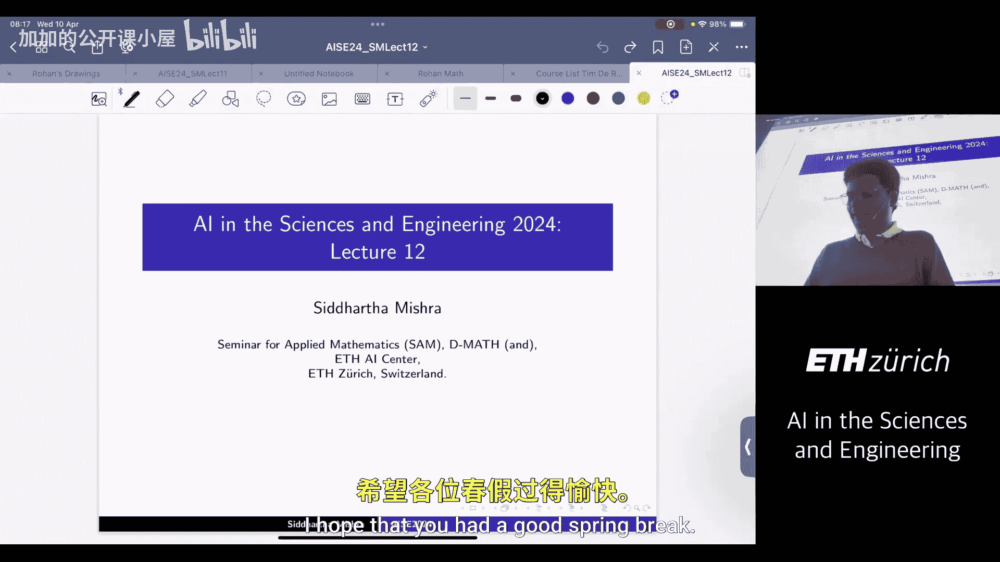

So let's get started right away。

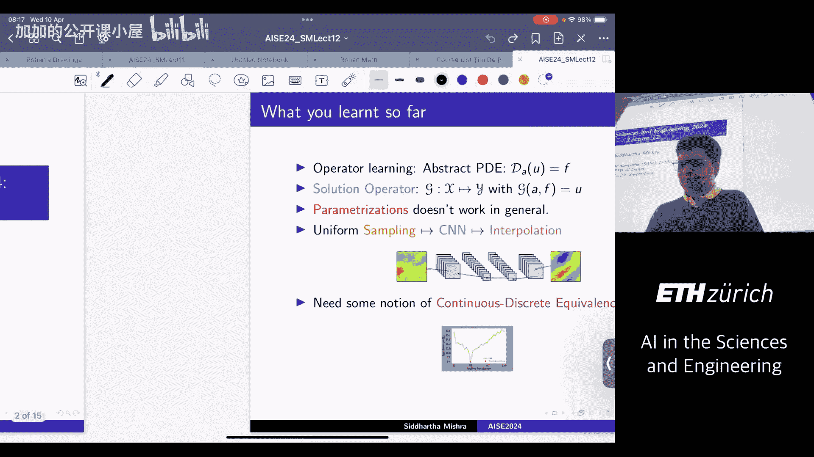

Okay， so just a brief a recap of what weve done so far。你好。😔。

oneSo we are still with the problem of operational learning and this's just too big。

Operator learning and we look at this abstract P， which is right here。

And this could be any differential equation， right it could be your or differential equation。

 it could be a stochastic differential equation。The stochastic version differential equation doesn't matter。

The main point is that the sort of the problem set up itself， the setting itself， so the target。

What we are going to learn is this guy here G， the operator and this maps function space to a function space right so it takes the inputs to the PD in this case the coefficient a and the source F and it produces the solution view so this is the setup that we are in and just to recall from the last lecture that we cannot paraized in particular what we can't do is we cannot work with let's say finite dimensional subspace or a small parametric finite dimensional subspace of the space X we really have to work with something which is which is infinite dimensional in some sense or at least the large finite dimensional subspace。

Okay so with that setting in mind let me remind you what we tried to do to solve this problem right so one way we thought we could solve the problem was as follows so we started with the input for instance this the vticity field in the nats equation this was here a vticity field in Navitokes equation and we sampled it on a grid you can see that the grid points are there this was a 16 by 16 grid but in practice it's a 64 by 64 grid。

And then we applied you could have an MLP， but we applied a CNN so different layers of the CNN and that gave us a finite dimensional output which was also on a in this particular cartoon on a 16 by 16 grid So you take a vector which is 256 dimensional and you produce another vector which is 256 dimension so that was the objective and then we could interpolate right so interpolation led us to an infinite dimensional back into an infinite dimensional space so if you do that then of course we think that we solve the problem。

 but the reality is that we don't solve it means this was this is the main point for instance in this graph here as you can see at the training resolution we got satisfactory results。

But as soon as we changed the resolution we got into problems so was this was the whole point of my last lecture that you are not learning a function to function mapping what you're learning is a particular finite dimensional approximation to finite dimensional approximation mapping so you are only learning something at the discrete level and not at the continuous level but since we're dealing with functions we have no choice but to work with the continuous spaces right function spaces。

Whereas because of computation we have to work with the discrete。

 so that's why it's important to enforce some form of discrete continuous or continuous discrete equivalent。

 right？And in the towards the end of the last lecture， I tried to sort of introduce that。

 Maybe I was a bit rushed。 So what I'm going to do is to start by。Start by decapulating。

 recalling some of the concepts and perhaps explaining them better。Okay。

 so how do we sort of formalize and formulate this continuous discrete equivalentence？

So we do so with this framework which is called Reno representation equivalent neural operators right so this is the framework that was introduced last year from my lab。

 but it's essentially what it does that it provides some sort of a notion proper notion of this continuous discrete equivalence and the key is this picture here means this is this figure here is worth a thousand words so let me try to walk you through this figure so our problem。

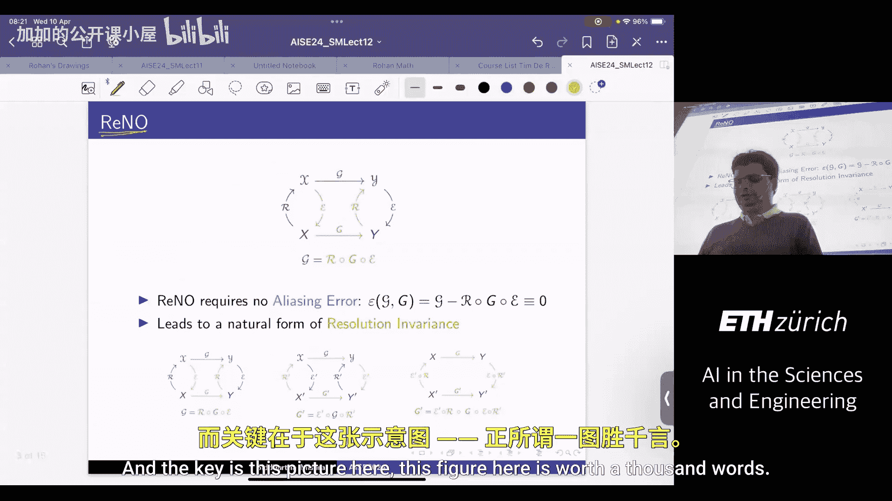

Let me pick colour that is not their orange is good。系。

So our problem is right here so we start with a function space X and our outputs are in a function space y so in reality or in principle we need to approximate this quantity in the script G the operator right the object that maps infinite dimension space to infinite dimensional space unfortunately we don't know how to work with infinite dimensional spaces we can't work with infinite dimensional objects with continuous objects and the digital computer so we have to work with some sort of finite dimensional representation of it right and this is provided by this spaces X and y so these are finite dimensional spaces these could be for instance。

 as you saw in this example points on a grid right so the function is an infinite dimensional object its values on points on a grid are a finite dimensional approximation。

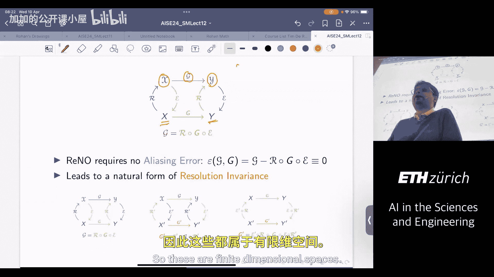

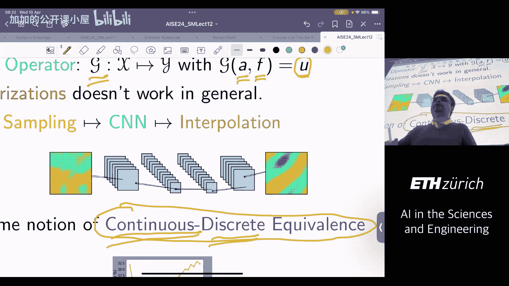

And then， of course， there is a link between the infinite and the finite。

And these are provided by this。Encoding， so let me recall。 So this was an encoding。

This is E this goes from infinite to finite right and reconstruction as the names js。

This is a mapping which takes you from finite and back to infant。

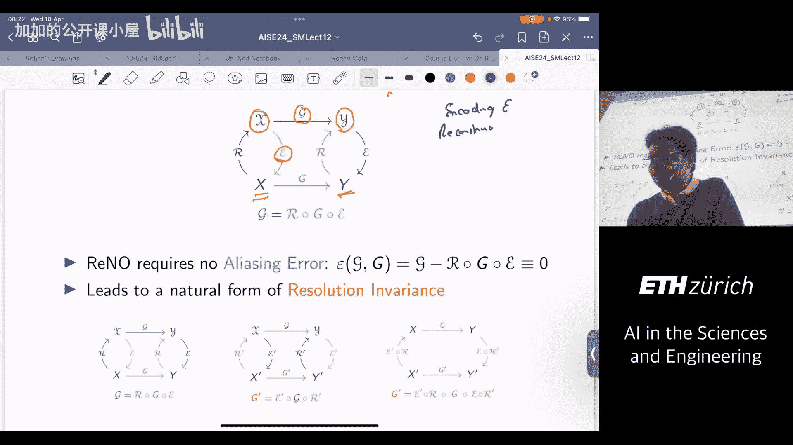

Right， so this， this is the setup that we are in。

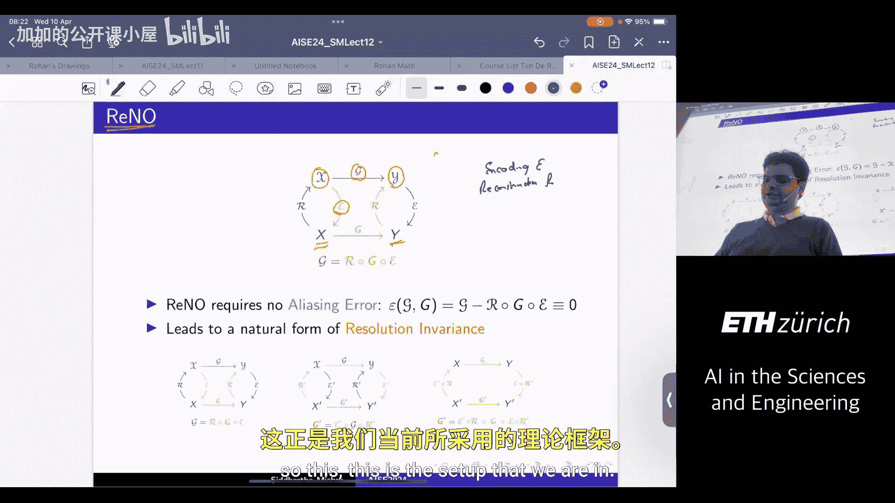

So of course what you ideally like to is to connect the two right you want to say that when I go back from the infinite to the finite go from the infinite to the finite and go back to the infinite I don't make an error and this is sort of conceptualized or formulated in terms of these alien signalss right so these are the key。

Key objects here， eing error， and it's a very， very automatic error means for those who are more mathematically inclined。

 all that we are asking is for this diagram here， this guy here to commute。

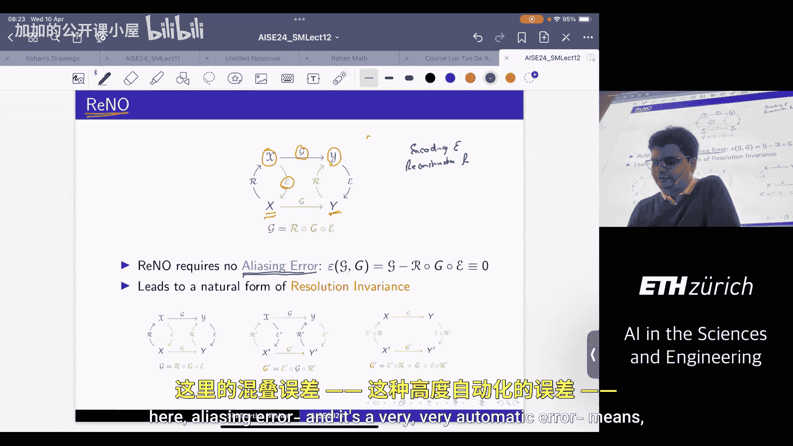

How does that happen so let's let's try to understand it remember that there are two ways in which we can go from x to y either directly by the operator G。

 which is what we would ideal like to do。But in practice。

 we would not be able to do that or we can go from the infinite to the finite， so this is。

 for instance taking the function and putting it as point values on a grid。

 so we do this through this E here， right？Then so we come here and then we use whatever the MLP or the CNN that takes the finite dimensional values on the grid to values on the grid。

 so this is this step here and then we try to go back to the infinite dimensions and to do that we have to use this R here right so we come down like this we work like this and go up like this so this is a very very simple construction and this is the composition here and ideally by doing this by coming from infinite to finite working in finite and go back going back to infinite we want to be exactly able to approximate the operator G or exactly able to realize or represent the operator G。

And this， if you don't do so， if you make an error and this is precisely what is the aliasing error。

 this is an operator because it adds on operators and this error has this functional form right so it essentially says that by going through this route what is the error that I'm going to make。

As long as it is zero in per layer， remember that I had this layer construction because neural networks are layer wise you will see several at least one prominent example later today。

 so if I did not have this layer if I don't if I make an error at one layer of course the error can grow right so maybe the error is only1% in the first layer but then it goes the second layer it becomes 2% then it becomes 4%。

 8% you can expect geometry growth right so then that can become large。

So you want to stench it we want to sort of kill it at each layer itself and we say that we try to have operators so this is something that is given to us right we cannot we cannot manipulate that but what we can do is we can design the E here。

 we can design the finite dimensional spaces， we can design the G here。

 the R here such that there is no asing it so this is somehow the objective。

 the mission that we have the goal that we have and once we do that there are several goodies that come our way but this construction is absolutely essential and sort of the core of operator learning。

Is that clear， Are there any questions here， Because last time I I rushed this。

 or I thought that I would try to explain it again。

 and we will do a couple of concrete examples today。 So you'll see that。

Really hit by the poll analogies。 So struggling a bit。Okay。

Okay so then what is the first goodie that drops our way so first of all this is structure preserving in the sense that what you do at infil dimensions is mirrored in a finite dimensional ver so there's exact mirroring of what happens between the two and an immediate consequence which is something which we realized is an issue if you remember that once we change the grids we were in trouble right so let's see what happens if we change the grids or change the resolution or a representation for that matter then we have this picture here。

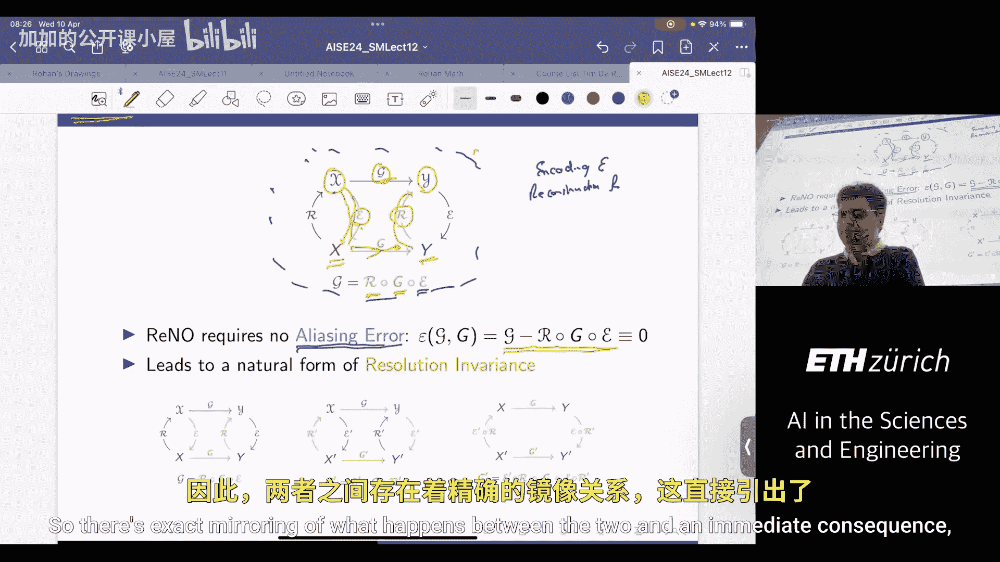

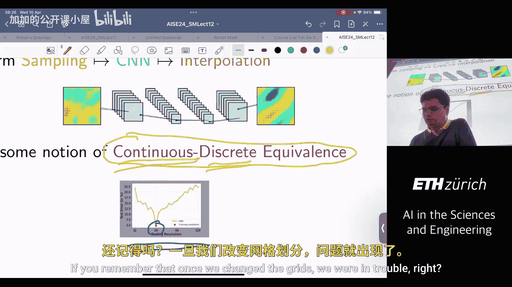

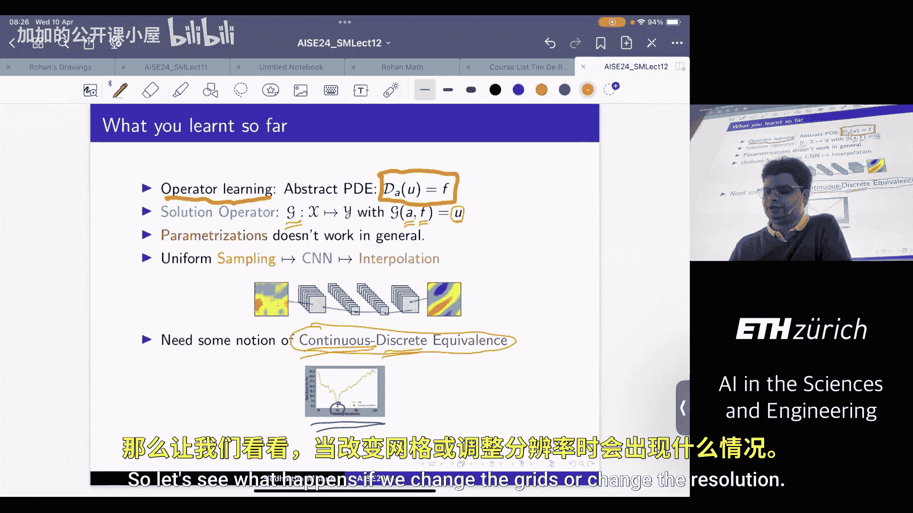

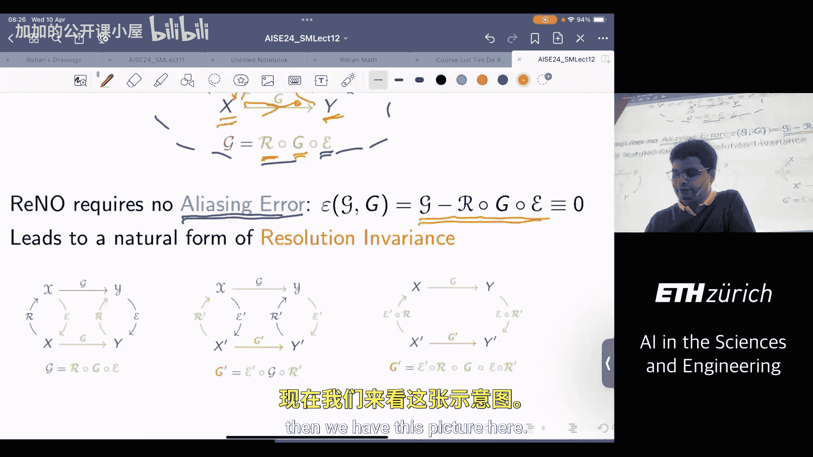

So now we have been two different grades， so for our purposes here。

 this is more abstract than just grades， but for our purposes here。

Just imagine that you have two different grids right so you have a grid which is given by the operator is given by G and you have another grid where the operator is given by G prime okay so now we want to connect the two we want to say that if I train on G and if I go to G prime and I test on G prime I shouldn't be making another or at best I shouldn't be making a smaller right let's ideally I shouldn't be making another。

But the point is how how do you do that So if you have this renal property。

 if you know that there is an exact mirroring between the continuous and discrete。

 this is a triviality， Why is that。So remember that I want to go between G and G prime。

So what do I do。I I'll work out an example in the next slide。

 but let's let's look at this abstract concept， so I have a mapping which takes x。

 the discrete space values and a grid to y another discrete space values in a grid through the mapping G but I know that there is an exact mirroring to the continuous and how do I go to the continuous I start with so how do I go to the continuous how do I realize this I start with。

Maybe it's incorrect here or remember that we always have this formula here right maybe it's the other way around that the continuous is represented by the discrete in these forms right and similarly I have another grid here G prime where the same representation holds so I have the same representation here and the same representation here。

Now I want to go from G prime to G right I want to use G prime and G together So what do I do I start with G prime right I start with G prime。

 but I know that from G prime you can go to this operator G here and how do I do that first I use this R prime So to go from here to here。

Then I use this mapping and then I can come back so this is a mapping which is given here Okay straightforward but I know that this mapping here is given in this form。

 So in order to realize this mapping I go back through here to the finite dimensional space X use G and come back and I compose the two okay when I compose the two so to go from G prime to G what I do is first I go from x prime this is the discrete space let's say resolution on the grid first I go so this is operator here I go to my infinite dimensional space here and then I go to this finite dimensional space so this is this block which expresses that I work with this finite dimensional space which is given here and then again in order to do so I go back to the infinite dimensional space right and come down。

And this is this is a formula which is given here and remember because this diagram commutes whether you use the direct evaluation or whether you use this you get the same answers okay so this is a very。

 very simple construction you just compose these two diagrams and once you compose these two diagrams you know how to relate two different discrete representations because as I said in practice if you remember the last lecture I also have a picture about it you don't have a means there could be multiple discrete representations。

 multiple grids on which I can represent the function and the way in which I relate them I will do a concrete example in a minute is precisely through this construction that you start with one particular grid go to the continuous level and then come back to another grid and then come back you see so this is the way in which you can move between grids and then it's a sort of very elegant way of moving between grids。

Any questions on this？

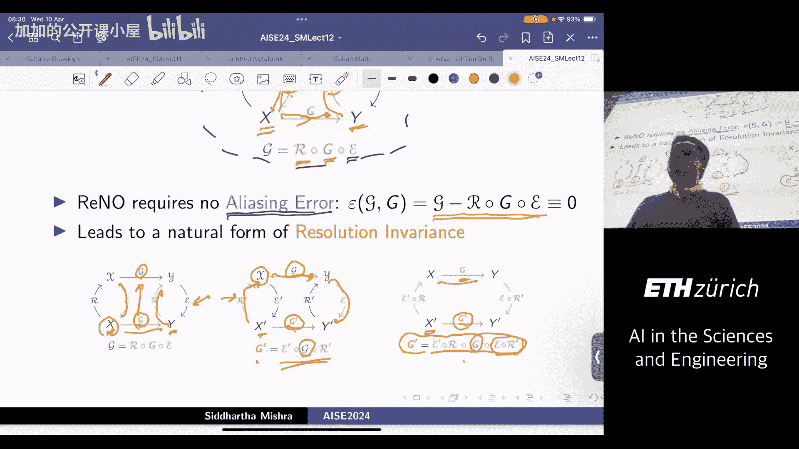

Let's work out an example just to sort of con also people on Zoom if you have any questions。

 don't hesitate to ask it in the chat box。O。So let's do an example just to realize this in some concrete。

These constructions， in some concrete manner。Okay， and then we will check for different architectures。

 whether this holds or not。So I just take a very， very simple example。1D。

 this can be done in multily， is there is no issue there and let's take a picture。

So let's take so this is one D， let's say this's a unit interval and let me draw some picture of a grid。

Just for our visualization like this， you can't have a grade with three points。

 but just for our visualization， so we have。This is a discrete representation this will be migrate G and what is my continuous so usually whenever you' have given functions these functions belong to some sub of spaces some spaces of continuous differentiable functions twice continuous differentiable functions and so on so to realize these constructions these function spaces are too big so we have to work with let's say smaller function spaces and this is well justified okay this is well justified in most cases at least for PDs this is well justified so instead of working with this very complex spaces like square inteable functions what we are going to do is to look at infinite dimensional subspaces of them。

And the space that I introduced last time is the space of band limited functions。

What are band limited functions these come from signal crossing just for simplicity。

 means this is not a rigorous definition by any means。You know that any function。

 let's say periodic function， U of x can be written as the UK sine K pi x for simplicity right and all that you do is that you truncate the number of frequencies to some capital gain。

Okay， so you have a function， you expand it in sinus sort basis。

 will we will look at the Fourier transform later， but let's say for simplicity。

 you have a Fourier basis representation okay and then you expand it in the Fourier basis and you just say that the high frequencies beyond a point old matter。

Of course this can be suspect because some functions have lots of frequencies but at some level there is only white noise which has equal content in every frequency and that's why it's white noise if you have any structure in a function what you know is that beyond a certain frequency the frequencies are going to decay so essentially I can sort of throw them out we will have we'll see a rigorous version of this argument not in the next lecture but in the lecture next week。

Okay， but so this is the first step that we are going to deal with functions。

 which have finite many frequencies could be 100 could be 200， you know， something something large。

 but in practice it's probably less than that。So in other words。

 the support of its Fourier transform， so essentially the support of the Fourier this is a Fourier series version of that。

 a Fourier transform version is that it is sort of compactly supported within some band right so here the Fourier series is from beyond a certain point。

So these are banner limited functions， and this is a particular example you could think of some other functions and these corresponding operators are going to change。

Now what is encoding in this particular case， so this is given now these are band limited functions。

Then encoing in this particular case， you can work with point5 evaluations， so you take a function。

 so whatever function that you have。JustJust an example and you just take its values in the grid so you take this value。

Take this value， the value here， the value here and so on。 Okay， so this is the values in the grid。

 So this is the encoding and what is the reconstruction So encoding takes an infinite dimensional objector function which is given in green here and takes represents it by a finite dimensional object。

 So in this case just a three vector representing the values of the points right。

 and then to reconstruct the function we have to go back from something which is finite dimensional back into the infinite dimensions and this is done by in this particular case by using what is called a sync basis。

So all of you should know what is the same function， the sync of x。

I could get the constant wrong here， but morally it is sine of x by x right So this is this is roughly sync function。

 and then what you do is that if you have been given。Finite many quantities Vj。

 so you take Vj so this is the values in the grid and then you just form this basis expansion。

 so this is the sync basis， right？And as long as your grid is dense enough。

 so let's say that your cutoff frequency is k right and if the number of points is twice that or little more than twice that then you have a very famous theorem from signal processinging harmonic analysis which is called a N shannon theorem。

What it tells us that whether we work with the function itself or whether we work with the values in the grid there's a one to one correspondence okay so how many of you know about the Shanon theorem everyone should know somehow right so all that it says is that if you have a dense of grid or these binary limited functions then you can represent it just by the point values in the grid but if you don't have a dense of grid then you get what are called a classical aliasing errors okay。

I usually have a picture， but now I don't don't seem to have this。

So the picture is if you take sine 3 pi x and sine 20 pi x and if you don't have enough resolution。

 these two functions will agree at many points so you cannot distinguish between the like it's very easy to read it up for instance on Wikipedia there is a nice article on this so the setup is very clear so you have a byjection byject means one1 everything is sort of equivalent there is a complete mirroring provided that you are in this setup so this is band limited these are values in the grid。

 this is the sync basis， this is just the point values taking the point values of a function and you can do the same at the output level so you can also do the same at the level of this grid。

Okay， so now aliaing error is just computing what is going to be the difference between these two because these are all okay。

 so all that you have to do is to ensure that your G is such that this quantity is identically equal to0。

Okay， so this is a straightforward task to check and another way to think of it is how this program is realized what happens when I move between the two grids so let me try to explain this a little bit so let us say that I have a G which is you know which is aius free and it has taken values or it has been trained on these three point values just for simplicity now let's refine the grid right let's take the black here。

Let's take some additional in this one， Let's take some additional forms。

Let's take that these are your new points， right？So how do I evaluate this。

 how do I know that this is going to work out so now remember that my input now are values on the new grid。

 so the values on the new grid are the squares as well as the circles right so this is a new grid squares as well as the circles so this is a finite dimensional object right so the first thing that I do is that since it's a finite dimensional object I want to go to infinite dimensions how do I go to infinite dimensions I use these spaces here so I have a finite dimensional object let me call it as v1 v2 up to v7 in this particular example I go to infinite dimensions I know the positions of these points so I go to infinite dimensions using the sync pace no no problems I'm assuming that my density in both cases is enough so that the conditions the nu barrier is satisfied I can represent the functions。

So now I at infinite dimension， this is a function and then remember that I have to project back to the original so the original bed is just these three points。

 this guy here， this guy here， this guy here。So I have this new function which is infinitefrar dimensional and I can just evaluate it that these three points right so I evaluate the function at these three points I just these these three values here。

 then I use my operator， the neural operator that I have designed this key here。

This will give me the value again at these three points， right， so it takes three points。

 it goes back to three points again。No problem。 So this is a finite dimensional operation and then remember that I have to go back to my new grid So what do I do I again go back to my infinite dimension by this reconstruction So now I have been given some new values here let me call them as we had one we had two we had three。

And once I have this， I again use the sync paces， go back to infinite dimensions。

 and then I evaluate them at these new values， that's all。I evaluate them at all of them。

So in a way I'm performing sync interpolation twice and then I'm completely there is complete fidelity here between the infinite and the finite dimensions and then I can realize that this formula。

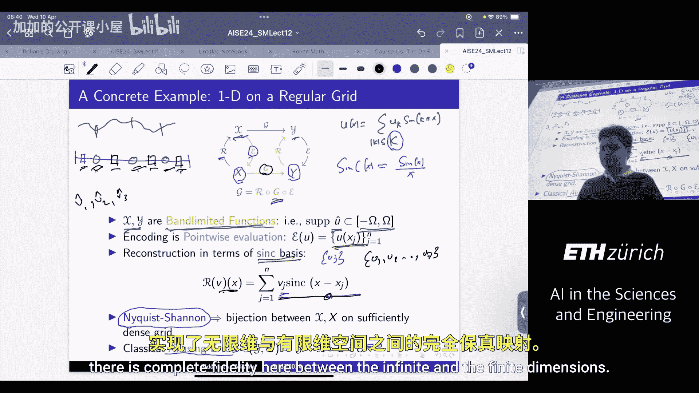

Tells me that this error is going to be zero， ideally， Okay， if your construction is solid。

 this error is going to be zero。

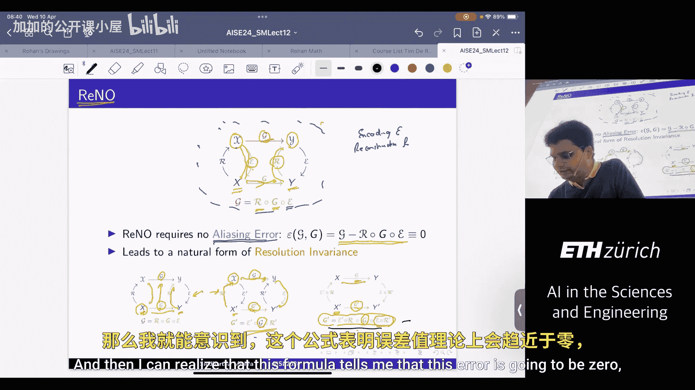

So this is a concrete way in which you can evaluate。

 you can go between grids that you start with a particular grid， seven points。

Construct the function of course you are never going to construct actual function because that's an infinite dimensional quantity there's no point in doing that evaluate it on the new grid do all or on the old grid rather in this particular case do your operation which was anyway drained on the old grid。

 go back again to the infinite dimensions and then project back to。

Okay so this is the this is a systematic procedure in which you can go between these spaces and this also explains to you how this link between the infinite and the finite dimensions works in practice okay so is this example clear so this was precisely sort of I did it in a manner so that you can understand this this particular construction so my suggestion is afterwards go home try to understand this and if there are any questions you can always ask me in the next lecture。

Okay， so let's move on and this tells us that first of all。

 the original the starting of the story was this this particular guy right which somehow has the same flavor。

 but there is something which is missing， which is this continuous discrete equivalence。

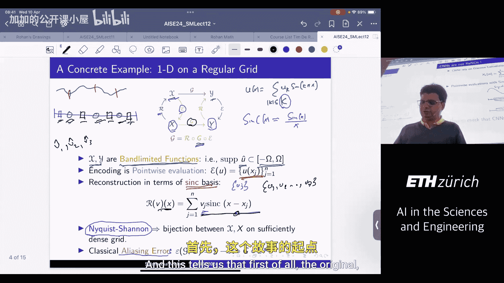

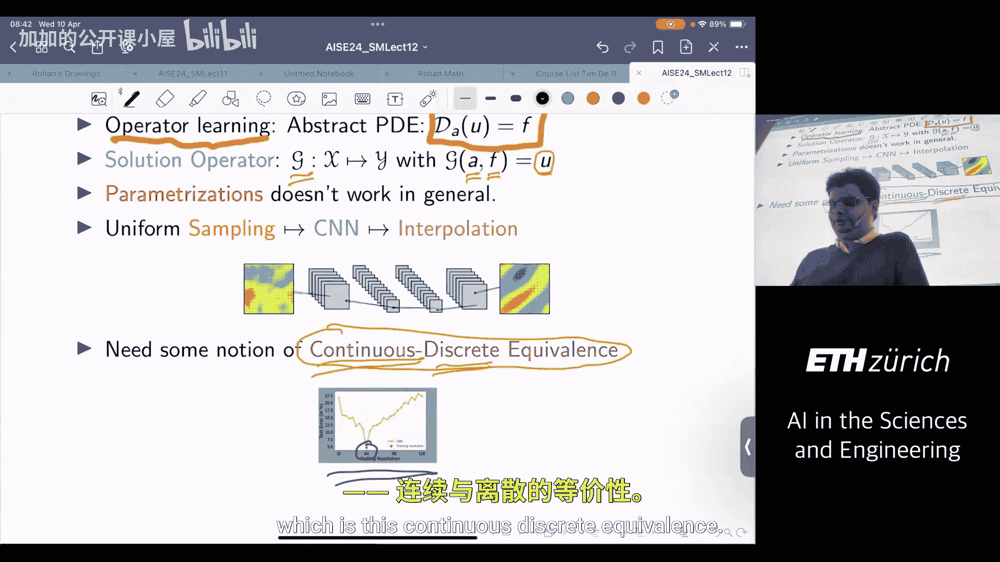

And then of course， we realized that I did it very quickly。

 That's why I'm repeating it because I felt that。

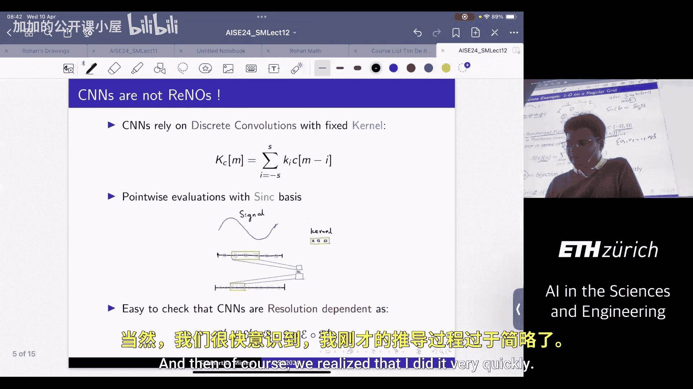

One needs a proper explanation。 So the first thing was， of course， the fact that CNNNs， as we expect。

 these are not reallyos means this is。No， I'm not able to change。

What does that mean remember that CNNs are nothing but discrete convolutions。

 so you have been given a signal which is on let's try to expand this a little。

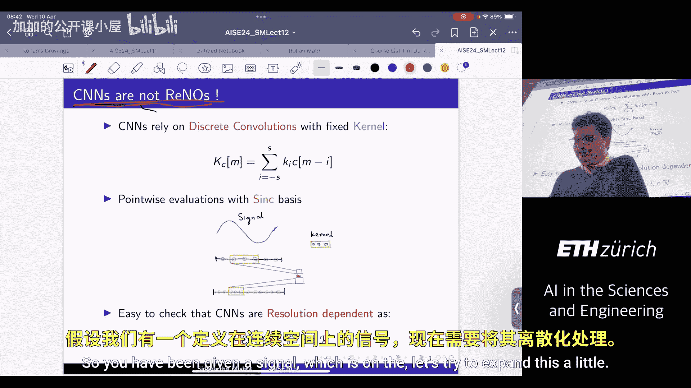

我度七点六啊。Because I， for me， it's very difficult to see when it's in small print。

Okay so as you can see so you have signal which is given on a grid so this could be band limited functions for simplicity right and then what does a CNN do it doesn't do this sort of complicated gymnastics that I just to explain that's why it doesn't work of course but what it does is that it always has this convolution kernelnu which is given by some k okay so graphically I'm representing this by this kernel here。

Okay， all that it does is that it so there is a window。

 so for each point it just multiplies these three points。

 gives you a value then it moves on at the next level it goes to these three points。

Then these three points and so on so this is the this is the way in which CNN works and what is being trained during the training process is of course the kernel right because the coefficients of the kernel are what are unknown to us and these are the things that are being trained so the kernel is fixed now when you go to a new grid so as you can see this grid is a refinement of the grid just exactly in the sense that I did before this is a refinement of the grid I've added a few points I can also reduce points means that's that's equivalent。

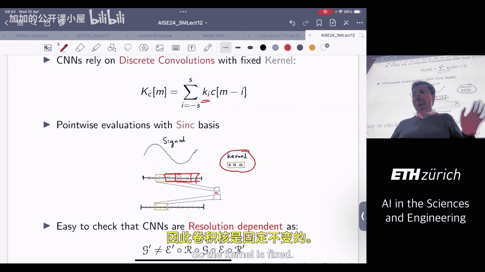

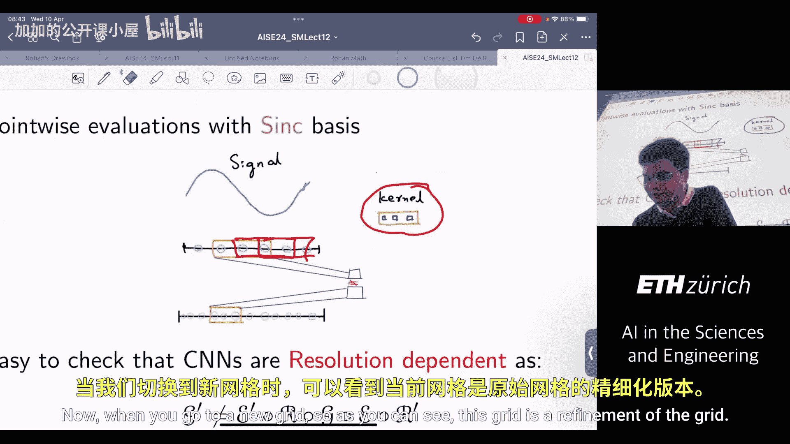

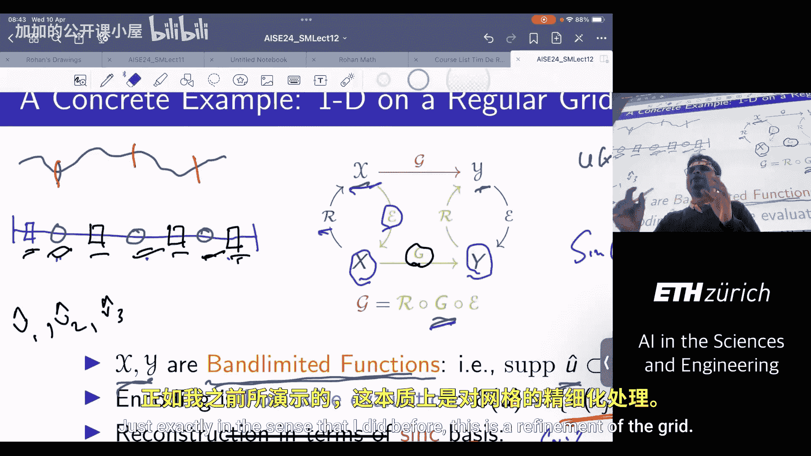

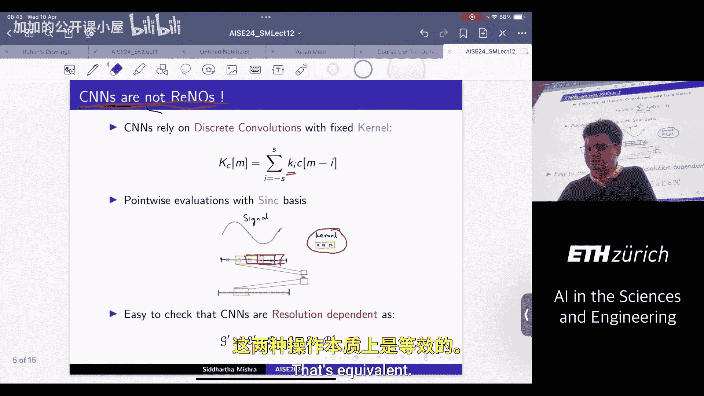

And again， I'm assuming that the density of the points is such that this condition is satisfied。

 and there is a fidity There is some。Byjection essentially between the containers and the district。

 Now， what happens I have this trained kernel。 This is the training process。 I train the kernel。

 and I want to evaluate it on the new grid。Convolution makes it very simple you don't have to do any fancy things I take the train kernel and I just keep on multiplying with the new points Okay。

 so I take these three points and I multiply now I change the color。

Then I take these three points and multily these three points and multiply。

 I have a train kernel so theres no this just evaluation， this can be done very， very fast。

But now you see what the trouble is， right， So the trouble is that if I just focused on on this point。

 I just have to focus on one particular point。Okay， let's use the black here。

 so let's focus on this particular point， so for the grid this course grid here。

My convolution kernel would have multiplied these three points right now for the same grid point which is here。

 this would have multiplied these three points。Is the same con。

 but it's multiplying different points or values at different points and of course the signals amplitude is different at these points it a's a smooth function so these are not very very different。

 but they are different。So what does it mean that per evaluation。

 since you're not doing all these gymnastics， you're not doing this same interpolation automatically what happens is that you get different values right so you definitely have different values when you multiply with these three points or with these three points right there is there is going to be different different values you make an error Yes some sort this is what we will do later as you'll see this is an important point。

 you have to use you preciseize your convolution kernel in some automatic manner otherwise you cannot but with the CNN the picture that I produce。

 I was not doing this right so this is this is the essential point that that is to be remembered so here I was not doing this I was using the same kernel and I just window it across I can do it no one no one stops me people were doing it and then you see what the effect is going to be。

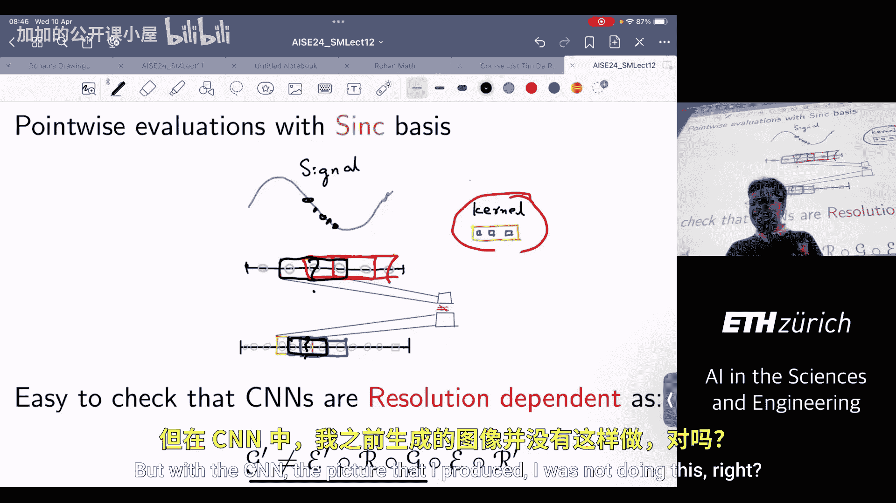

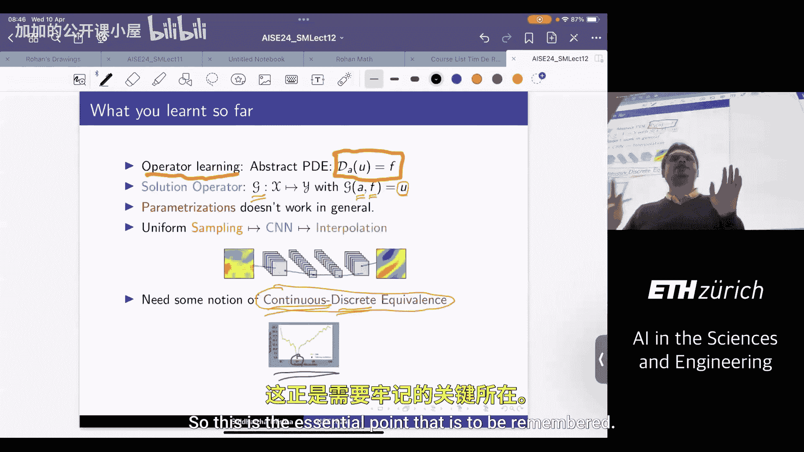

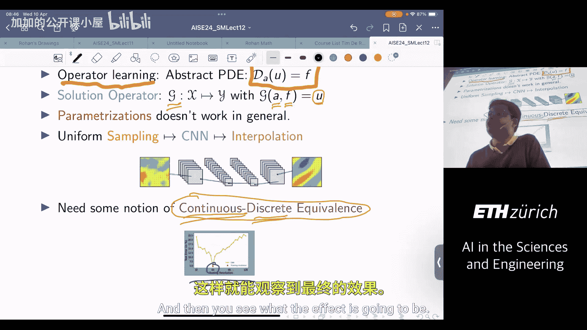

So now because of this thing you make errors and you see what you see so there is no there is a resolution dependence here there is no resolution independence and as a result CNNs are not their are neural operators in the sense that you can always take an infinite dimensional object and you can map back to infinite dimensions that's straightforward right but the fact that they don't have this structure preserving property means that they will make erasing errors and these things will accumulate right so this is a very。

 very important point that we should we should remember so essentially I repeated the contents of the last lecture at some but I needed to do so I realize that I was。

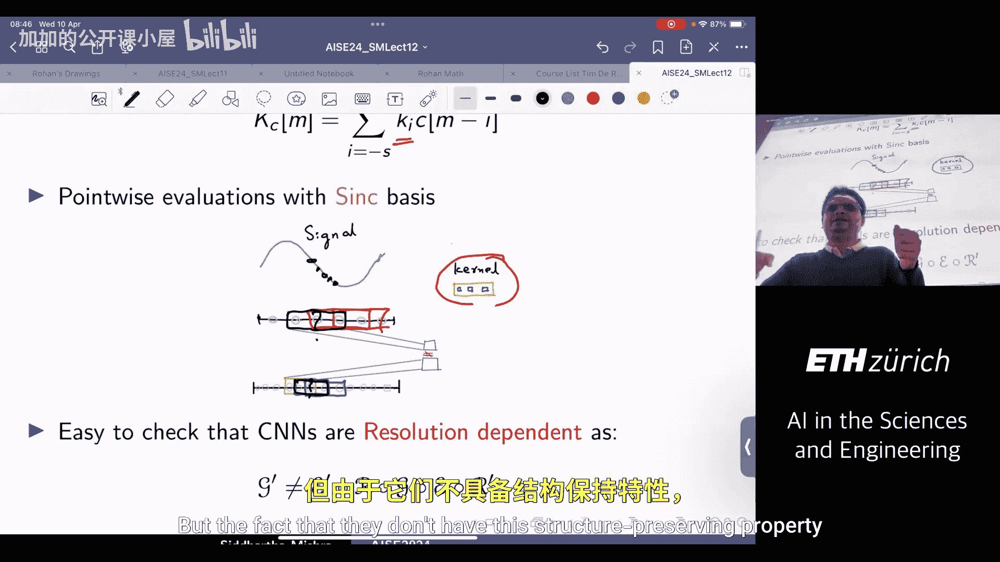

Too quick。 Okay， good， Any further questions on this。 So this doesn't work。

 So our first approach that we use doesn't work。 So what are we going to do now。

So let me introduce some alternatives so in the next few lectures we will look at different kinds of alternatives and already start with an alternatives that you have seen in your tutorials because tutorials a little ahead because next Monday there is a holiday so eventually we will catch up it has been done on purpose and also I am teaching very slowly so anyway so the first alternative that we are going to deal with is what I call new operators。

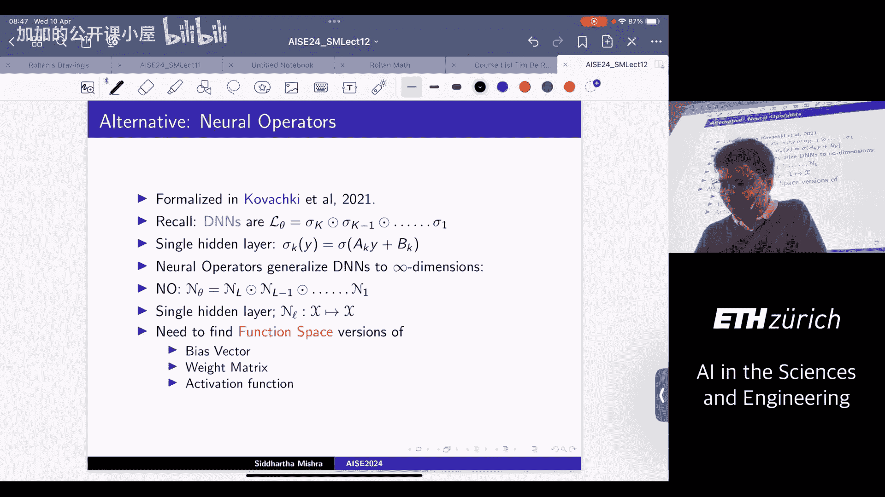

And they have been around for everything here is fairly recent， right like two three years。

 they've been around relatively long within this time scale， right？So they were introduced。

 at least formalized by the group in Caltech， Nick Kobaki was the first author。

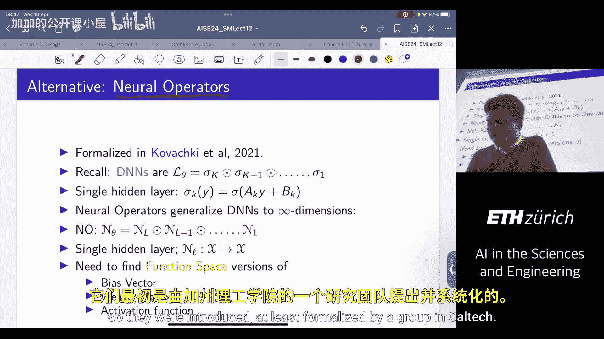

And the idea is extremely simple idea is also elegant right in in some sense so what do you do is following remember that what are neural networks at the end of the new day neural networks are compositions remember that this is my definition of neural networks these are compositions。

Of different layers and each layer has a particular structure and the particular structure is it takes a vector y right。

 and it outputs another vector。 let me call it as z。Z K in this particular case。

 So Z K plus one or something like that。So it inputs a vector or potentially high dimensional vector。

And it outputs also had dimension dimensional vector so this is the sort of mode of operation and the operations within each layer are very simple this is do a matrix vector multiply so you have a matrix vector multiply with a weight matrix add a bias vector and do a nonlinear activation so these are the three things we have a bias vector a weight matrix or a matrix vector multiply and a nonlinear activation and you keep on doing it you keep on doing it and so on of course that there is more structure to it in general but this is the simplest construction that you can you can imagine。

So the contention of these authors was the following that if you want to work with infinite dimensions。

 all that we have to do is to generalize this construction to take as inputs and outputs。

 not vectors， functions right because here everything for a neural network it' vectors。

 input vectors output all that we have to do is to take function inputs and function outputs and this is what it does。

It is also a composition of layers as you could expect and each layer now for simplicity。

 I just mapped the function space to itself， but there is nothing nothing sacrost about that。

 So you take a function space， you take a function and you get out a function。

 Let's say that I take a function V which belongs to X， I take my script N。

 which is a layer wise neural operator and I produce。A double。

 which also belongs to x just for simplicity， it could belong to a y， but it belongs to x。

So this is the basic construction and in order to realize this construction， we have to find analogs。

 we have to find extensions or the following objects。

 so instead of I have to generalize a bias vector to infinite dimensions。

This as you can imagine will be pretty straightforward right we have to generalize the weight matrix or the matrix vector multiplly to infinite dimensions。

And we have to do the activation function in infinite。

If I can provide these ingredients then in principle I have extended something which is essentially a finite dimensional construct into infinite Everyone agrees with me is is a very straightforward sort of a sort of a thing and how we do this of course is where the action is where the fun is right so let me just try to explain to you how we do this。

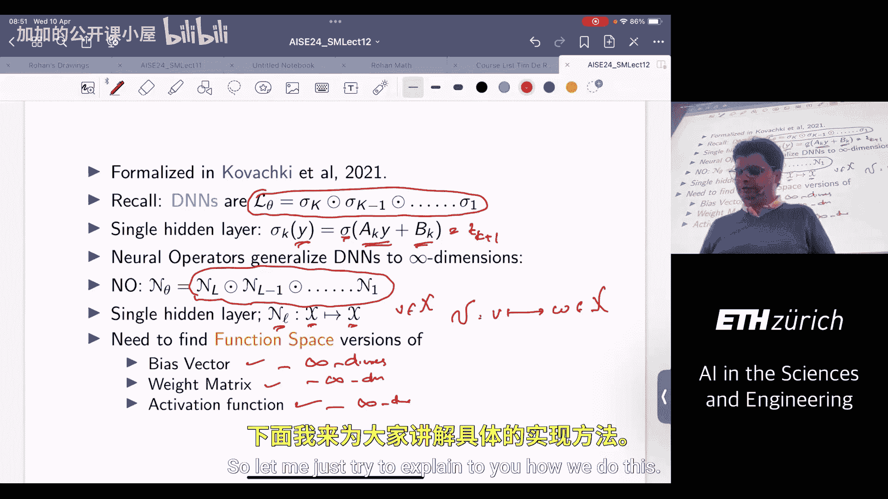

The first thing remember there are three ingredients， I have the wise vector。

 I have the matrix vector multiply and I have an activation。

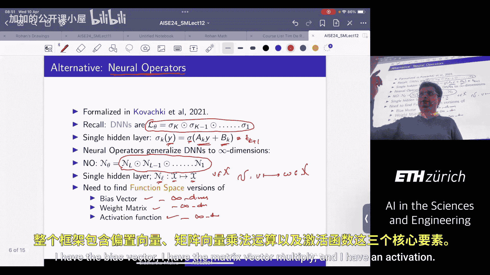

So remember that now my N， okay， this is N L， but let me for simplicity。

 I don't even know why I put an L there， but。Let me put an N here。N is a mapping。

 which takes function to function。So my w is equal to n of V。Okay。

 so this is the setting that I'm going to work with that I'm working with the matrix I'm working with the function input and a function output right so of course I need a bias I have to replace my bias vector with a bias function and this is straightforward so instead of having a bias vector you just add a bias function right so sort of a vector just take a function of course in practice we I have to deal with large vectors but this is a function。

The harder part is what happens to the matrix vector multipier。Okay。

 so here we need a little bit of thinking， but not too much of thinking because essentially what we do with the matrix vector multiply。

 I have to write a few things here is that let's think of it So remember that I have。A of。

Why remember this was a of y， which is of course， pointwise。

 so a of Y I is nothing but summation of AI J Yj， right。

 so this is what a matrix vector multiplier looks like Now what would be an infinite dimensional analog period an infinite dimensions what would happen is that this object。

 okay， maybe I give you the answer and then you see why is an infinite dimensional analog So infinite dimensional analog to a matrix vector multiplier。

 which is given here is given by what are called kernel integral。Okay。

 and they are given by this object here。喂。So now remember that I don't have a vector。

 I have a function， right， so my function is given by a V。

So I take the function at each point and I multiply it with a kernel okay so kernel of course by definition has two arguments x and a y so just like you'll see what is the analog in a second so we have x and a y I multiply this and I integrate over y so then I get a value w x right or w bar of x。

So it's a way in which I can use a linear operator to go from a function to a function and why is this an analog。

 of course it's an obvious analog that can you just have to use a quadroature。

Let's even do Monte Carlo Qua right so Monte Carlo is the simplest you just take some random points and D and you're going to approximate this object here。

 you're going to approximate it by 1 over M。Smation of J from1 to M。Of gay of。IJ。

 let me write down K of Ij Vj。And what is K of I J， K of I J is nothing but the kernel at X I Y J。

And Vj is nothing but v of Xj。So you take point values on a grid and you take the values of the kernel on a grid then you get precisely this form so now you can see that this is precisely the same form as before of course we have a scaling factor but this we can push the scaling factor inside right so the discrete version of a kernel integralte operator is precisely a matrix vector multi okay so if you have a matrix vector multiply and you want to work in a function space version of it that is a kernel integralte。

So this is also obvious means it takes two lines here of argumentation and all of you are convinced this is the right infinite dimensional angle right so this is a very simple infinite dimensional angle。

Good， so we have replaced this by the bias function。

 this by the matrix vector multiply by the kernel integral operator。

 and then we are left with just one ingredient remember that there are three ingredients in a simple neural network。

 the third ingredient is an non nonlinear activation。

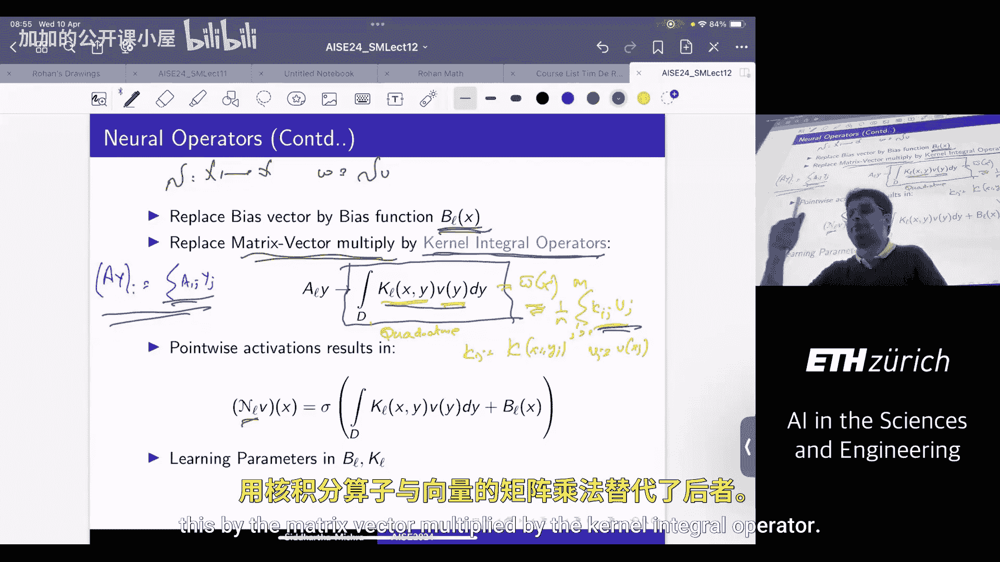

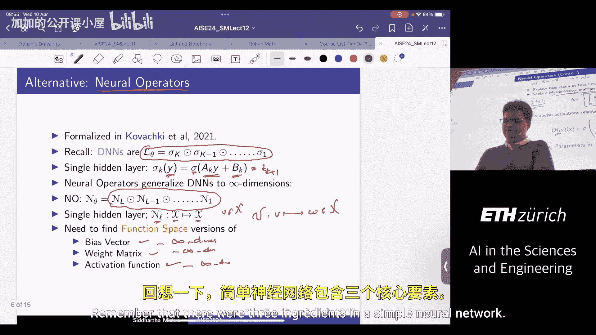

Now the simplest thing you can do here is just pointwise activation。 What do I mean by that。

 So if you have a function。

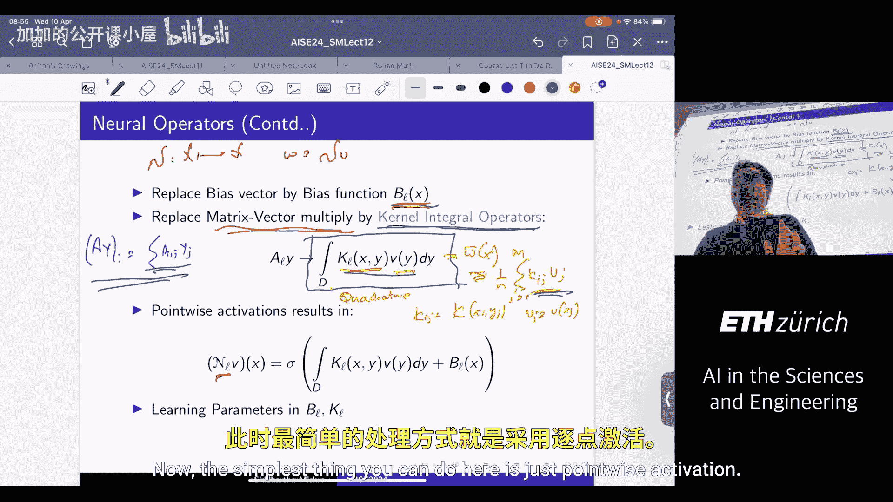

Okay let's directly work with it because then we we are sort of running out of time so if so this is the aine part of the neural operator right so now all that you have to do is to if you evaluate it at any point X you can evaluate this you can evaluate B at that point and you can evaluate this integral at that point all that you do is to act on this point twice what does it mean so take these values let me call it by a W。

So psi of W is nothing but acting at x is nothing but psi， oh know， sigma acting a w of x。

So evaluate the function at any point and then apply a loop。

 or evaluate the function at any point and apply the hyperbolic tang or a sig glue or get glue。

 whatever， the entire zoo of activation functions that we have。So Vla， you're done， right。

 so you have an infinite dimension generalization of your records。

All that you have done is you replace the bias vector by a bias function。

You have replaced the matrix vector multiplier by a kernel integralte operator and you have replaced the you have not even replaced it you have just realized the activation point by so you have an automatic recipe of how to construct these objects right so where is the catch there so what are the learning parameters they are in this BL means this this is a function right we have to learn this function and you have to also learn a kernel K of L so all the learning parameters are hidden here but once you have done that you do that from data you have a。

SoThis was the contention of these peoplema right it turns out that there is a little caveat even for the realization of these things because at the end of the day。

 how are we going to store a function right we can't store functions we have to sort of store them in some finite dimensional representation how are we going to compute the integrals exactly we can't compute integrals exactly we have to use a quaroture and so on so there are some computational issues with this construction but in terms of just the construction in terms of just an abstract framework this is very nice right because it provides you a very simple one to one correspondence between neural networks and let's say neural operators but after the break what we're going to see is what are the difficulties where do we get stuck okay and we start from there okay so let's meet at just for simplicity let's meet at 10 past okay10 past 12 minutes is enough I think is。

We are sort of running out of time at the best。我事管你。Okay。

 so welcome back and let's see how we realize these things in practicets， right？So， now。

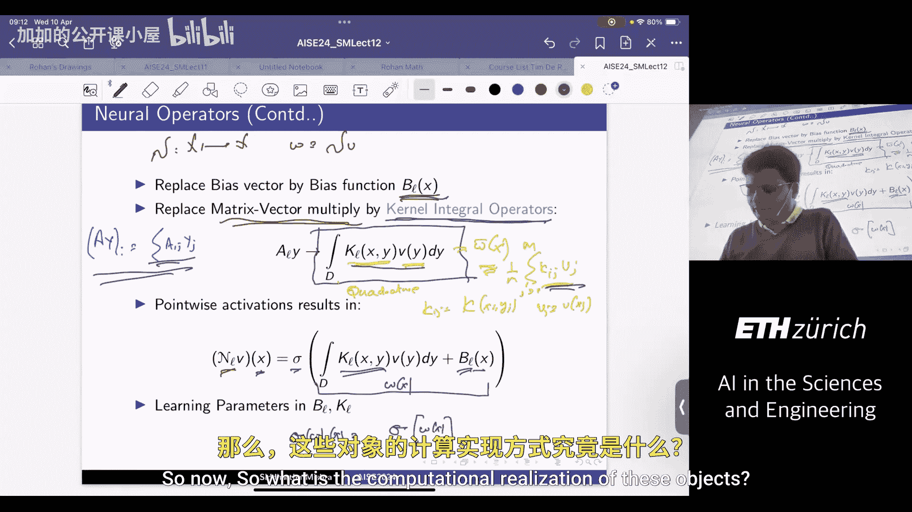

So what is the computational realization of these objects so perle？You already see the issue。

 but let me explain it。

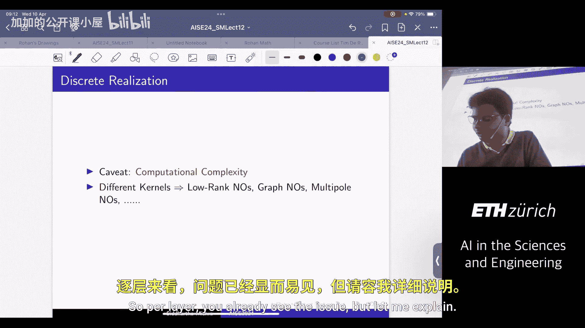

So。不对。So at every layer， but there。So I will not give you the layer index。

 I will simply give you the final answer， so nv of x was given by sigma， this is activation。

Then we have some bias， P of x plus the matrix vector multiply。几 of x y v f y。点位。

so this is how it is at the level of functions， but in practice we have to work with discrete objects。

 so of course we have to work the simplest thing is to work with grid points on a grid。

So instead of v of v， the function V， what we can do is we can build it with point values。

 which is completely。Fe。If you have band limited functions， for instance， J from 12。Let's say。

 And right， So this is these are the these are the values， similarly K， the kernel。

 which is a two dimensional function。Okay will be approximated by so let's do this。G I J。

 which is key of。Okay， this is Y j sorry。K of X， I， Y J， right？And now I and J are from one to M。So。

Okay， so this is this is the throughput here and similarly for b。

 so b of x is going to be approximated by bj， which is b of xg。

So we have replaced the functions by these discrete vectors and we will replace the integral with a quaroature。

So integral of D of k of x y。by why。Dy can be approximated by submission。Over J， some weights。

 So these are the quadature weights， omega J。Of K I J， So this is E。

Right so this and then the finite dimension realization， so nv at the point I。

 so this is the red point I is given by sigma it looks very much like a neural network right except that there is one little catch here。

So this is Pj plus a B， sorry。Plus submission of个 j of omega j AI J v j。

So omega is just a quarter of weight， this could be 1 over m， for instance。

 if you do Monteicado something right so the J is from1 to n。

So n is the number of great points or the number of points that you have so what is the computational cost of going from one function to another function right so the computational cost would be so this is I is from one to n right？

So for each I， how many operations do you do， so at least of the order of n operations。

 so the total is of the order of n squared operations。

Now what is this n n is the number of mid points。Number of grip points。

And this in particular is given by some m to the power t right so in one dimension you just have 10 points in two dimensions it will be 100 points 10 squared in three dimensions thousand0 points and so on。

 so the total operation count is of the order of m to the power 2 d。

So it grows exponential in dimension and it's quadratic the growth not linear So in some sense you can see that already there is a this is this an issue that we have to deal with right because we have a big cost of computation So just imagine that you're in improving which is the standard thing that we often deal with and you're doing processing on 100 by 100 grid okay so this is a grid on which you have the inputs and outputs So now you have 10000 points。

Right， and the computational cost is going to be 10，000 times 10000 which is 100。

So per layer it is going to be 100 million and if you have 10 layers it will be a billion operations and this is already on a very very small grid this is and this is just the basic number right because we also evaluate evaluate the bias vector you have to do this you have to do that the very basic number is already a billion operations for a very very simple network and thats that's unaffordable very very quickly and this is also not necessary right so we need to have some basic structure so this is why I explained this particular caveat。

Which is that there is a computational complexity。A large computational complexity which is inherent because it's essentially taking MLPs into infinite dimensions and you know the reason why we don't work with MLPs in finite dimensions is because in general they are they have other issues with them but they have computational already at the baseline they have computational serious computational complexity issues like some people are suggested different kinds of operators we will we will look at many of them。

So for instance， there are what are called low ranks neural operators， graph neural operators。

 multiple neural operators and so on there's a whole whole zoo of these objects which try to confront this computational problem head on。

 how do I do a compression， how do I go away from this quadratic cost and arguably the most successful version of it is something which we are going to have already see a bit of that in the tutorial but this is what were going to look a little bit more closely and a little bit more closely deeply。

 what are called foier and neural operators。

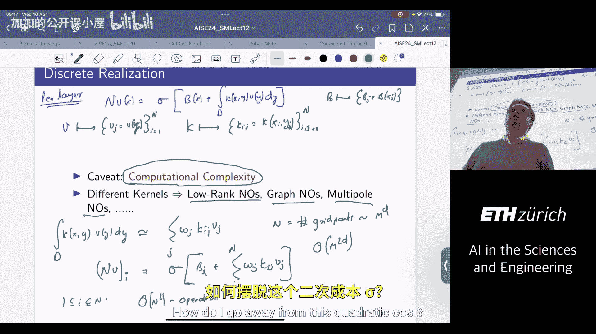

Or otherwise called as FNO。So this is widely considered to be， let's say， the most， let's say。

 popular， at least of all the neural operators that are there。

 it has been around now for a few years， very well cited and so on。

So what are the structural properties that it uses and I'll give you a little bit of detail here so that you understand what's going on。

Of course， you have also implemented this in the tutorials。

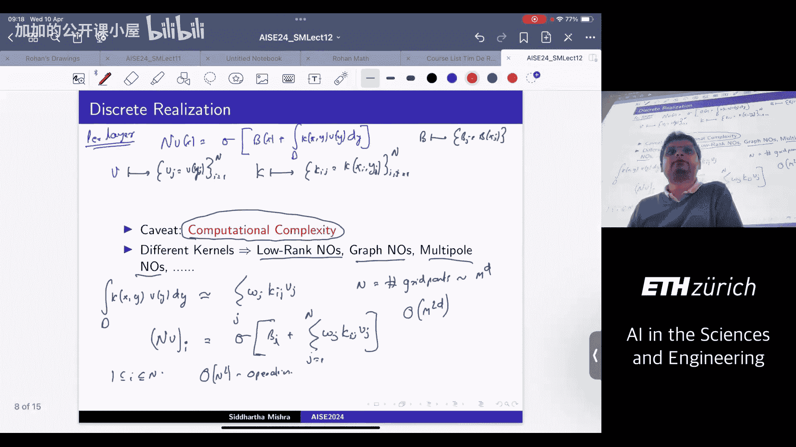

Okay， so what is the basis of food neural operators？

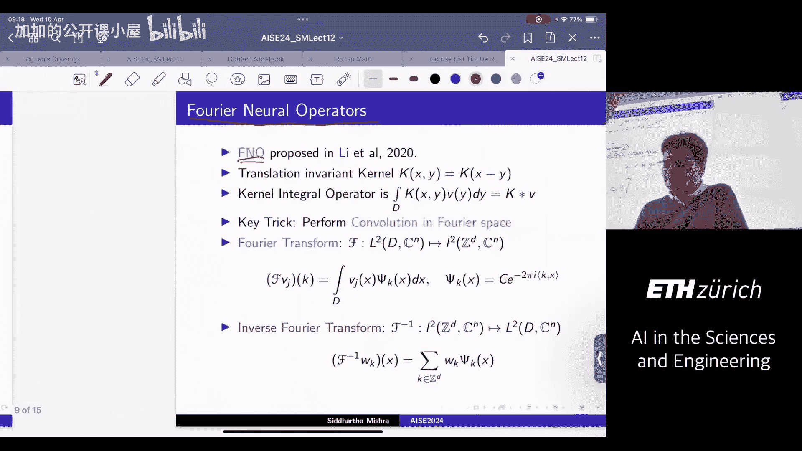

So the key here， as one of you suggested you to me during the break。

 is that this kernel is what this。Curl integral operator。

 which is this matrix infinite dimensional analog of the matrix vector to multiply。

 This is a bottleneck right because this is where this quadratic cost comes from。

 So how can we sort of solve that problem。

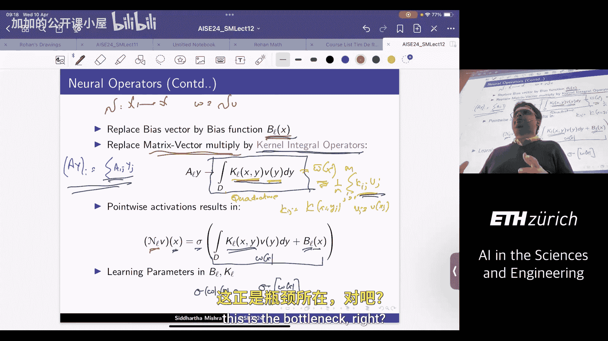

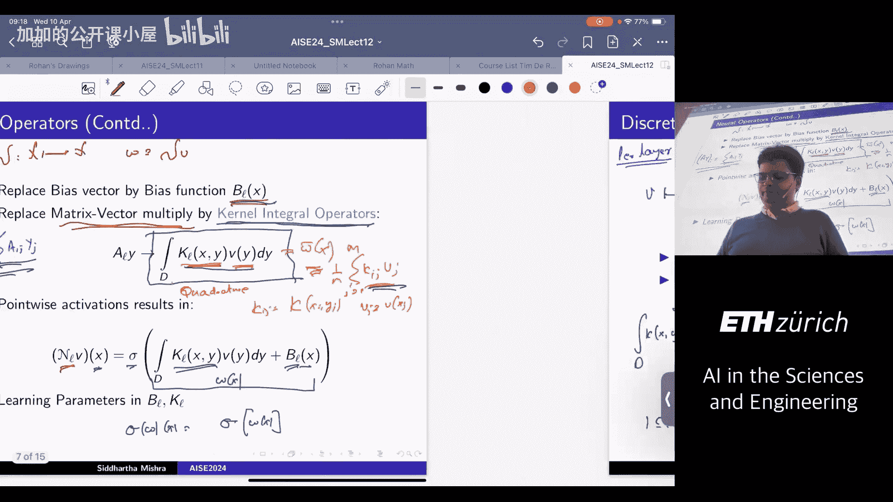

So the first thinking about it， which is also how CNNs came into being in the first place is that there's no reason to consider gender curls。

Okay， your first condition is what if we do a translation in income？

So translation invari kernel gives you a special structure of that the kernel this is exactly what happens in CNNs。

 so you have translation invariant kernel now which is given by k of x minus y right so and the inductive bias here is that a lot of the inputs and outputs that you see in physics are translation invari so this is automatically at least in this particular form it's a motivation right so now this kernel which was given in this general form here is precisely a convolution because this is k of x minus y v of y。

So it's a convolution Okay we are back into CNNs we could have also used convolution there right but the key trick what these people came up with is that so convolutions automatically reduce the cost right because now instead sort of a dense matrix that is being multiplied those fast matrix which is being multiplied So this is somehow the key trick but now what they said is that okay instead of performing convolution in physical space why don't we perform it in Fourier space and you'll see that there is a payoff because we saw what is the issue with convolution at the beginning of the lecture right so by doing it in Fourier space you do overcome some profit。

And to do anything in Fourier space we have to work with a Fourier transform right so what is a Fourier transform if the function would have been just periodic I could have just used Fourier series。

 but here it's in general you have to work with a Fourier transform。

Now Foururier transform cryptograph is a Mac pain which takes the function okay it takes a function and it turns out the frequencies that's roughly what it is so now I have given it in some generality in some detail or in some because my point is that these functions they are defined on domain D right and they are okay courier coefficient of complex value so we have taken the general in generality you have taken complex valued functions here but then it not means the imaginary parts could easily be zero so this is a generalization whenever you work with a Fourier transform one one typically works with a complex valued functions they could be real value。

And the key here is that these are vector functions okay because just imagine that they are outside the features are not just given by the temperature。

 the temperature， the pressure， the wind velocity， humidity precipitation。

 whatever so these are vector functions so just just to keep the generality and the J now here is giving the vector index here okay so you can also think of J as not being there everything being a scalar but I have to present things in some a little bit of generality。

So the Fourier transform is given in terms of what is called the trignometric basis。

 so this is the complex exponential signs and cosines because in general you cannot rule one out or the other and then what you do is that you take the function which is square integralte at the very minimum so that these integrals are well defined and you churn out the frequencies and the frequencies are defined on the lattice right so the D is the underlying space dimension the frequency are defined on a lattice and the K frequency so the K is a vector now is a d vector is given by just taking the function。

 multiplying it with the trignometric the K trignometric polynomial and integrate so this is just a Fourier transform all of you have known this since analysis one or two right so everyone knows all that you do is to represent the function in terms of its case frequencies。

Now， there is a。You can get back from frequency space back into physical space by using the inverse Fourier transform。

F inverse， so this the mapping which takes values on a lattice。

 so just let's take the two dimensional version of it， right？So the frequencies are discrete。

Not just these are integers right we don't take continuous frequencies。

 these are discrete so let's say that this is one frequency。

 this is another frequency and so on so you have been given the values of frequencies and you want to reconstruct the function all that you do is that you take the corresponding frequencies and you form the sort of the basis expansion of the geonometric basis so there's a one to one correspondence between physical space and frequency space you can work with one or you can work with the other and the idea behind what these people it was Zonggili from Caltech the first author in this paper what they essentially propose is to work with Fourier space so we do many many things in Fourier space you know there are numerical methods spectral methods which work in Fourier space so why not use that right and this seems to be veryid successful in different ways let me explain that。

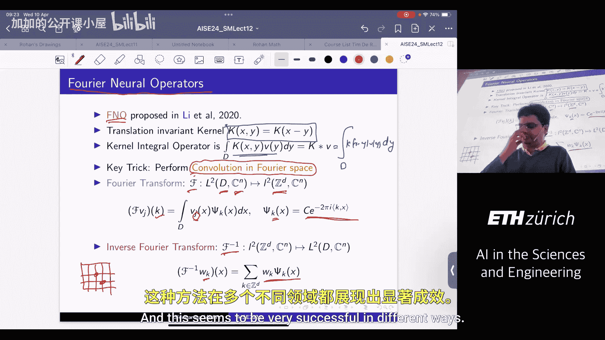

So now the basis is the fact that we do convolution in Fourier case， right？

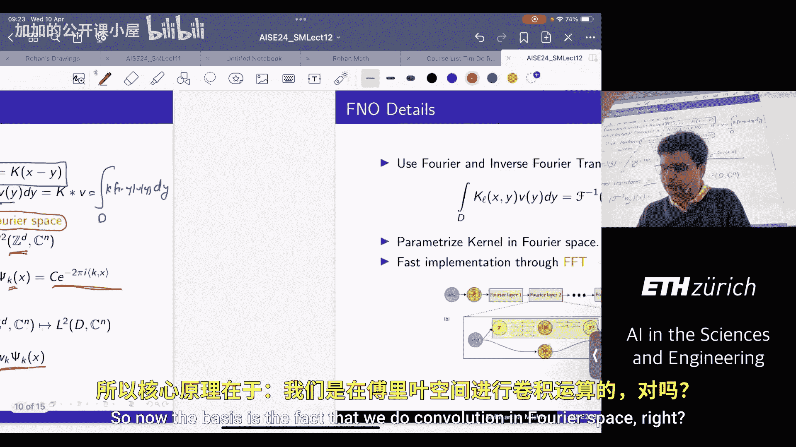

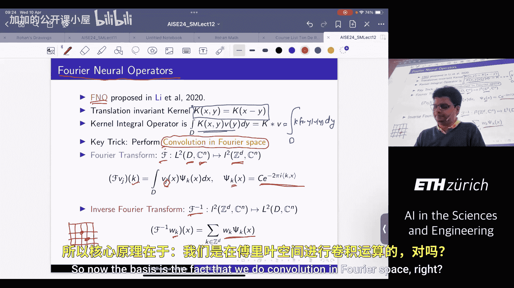

So there's a cartoon here or a representation， but let me try to explain what what really goes on here the most important thing。

 let's see if I have the space to do it generally I clutter up all the all the space but。

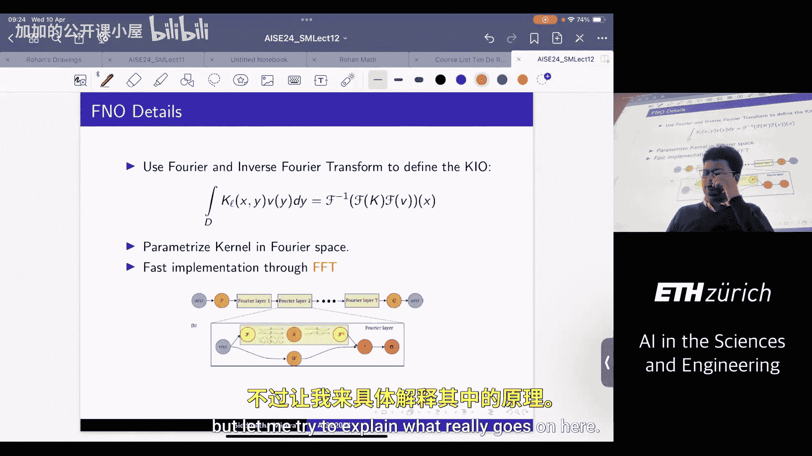

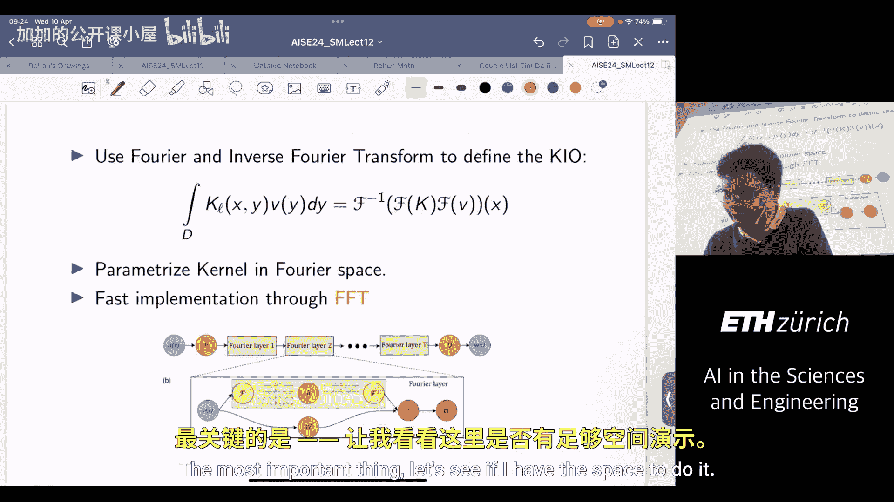

Let's see。Okay， so remember that at the end of the day。

 I am carrying out my convolution k involved with3 in Fourier space。

So all of you know that when I take the Fourier transform of a convolution， what happens to that。

 so Fourria， multiplication very good， so this is the one thing I remember from my harmonic analysis classes is that this becomes a multiplication。

So this is in physical space， this is in physical space in Fourier space this becomes a multiplication now I want to come back to physical space what do I do I take the inverse foier transform right so you take the inverse foier transform so this means that。

I have en words。Of F of k times F of V。Okay， so now this is the throughput here。So studying。

So of course we have to do it， we have to realize that at discrete level and this I'm going to tell you in the next slide。

 but now just for the sake of argument here just for the sake of understanding let's think that we can work with functions right if we can work with functions so what do I do I take a function I compute its Fourier transform okay then I do a multiplication with a kernel this kernel could be either it could be in physical space but I can also do it in Fourier space who stops me from doing that so this I will write as a sorry。

This I write as an art here。 So this guy here。I'll call as an art。

 So this is just a Fourier multiplier。 I do this。 this is a learnable object and then I take an inverse Fourier transform and this is precisely so remember that this thing is this layers layers layers。

 So these are these Fourier layers and let's unroll one of these Fourier layers so you take a function you take its Fourier transform there is there is a trick here that I'm going to tell you in in a bit。

 but when we do the discrete realization So what the Fourier transform does is that it sort of gives you different frequencies of the function you multiply this Fourier multiplier you get back some frequencies and you take some inverse Fourier transform So that is that is sort of the basic workflow here right So once you do this then we have nonlinearity we have the bias vector So you bias vector is just this B of x you just add it So that's nothing nothing special about that but there are a few additional tricks here that let me let me explain to you So the point is that we have to。

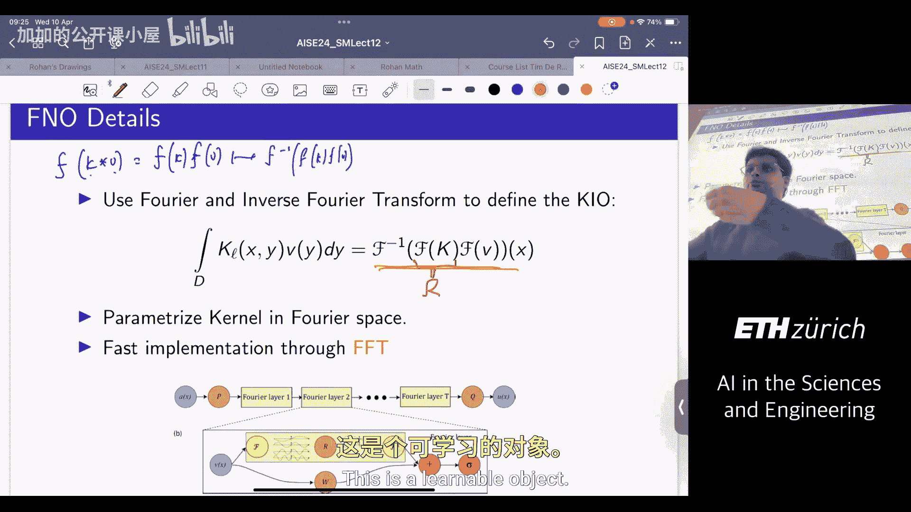

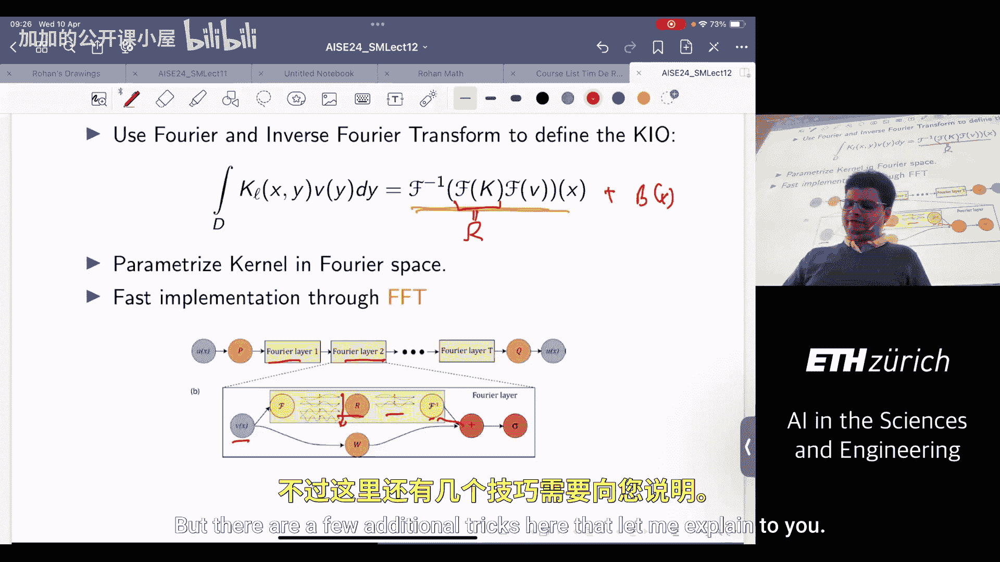

I it tries the kernel and Fourier space。And this bias vector is not that important let's for simplicity today let's set it to zero let's focus on what is important so we set the bias vector to0 if's a mass function to0 this can be readily added there are three additional ingredients that give the power to this method so these are this P here。

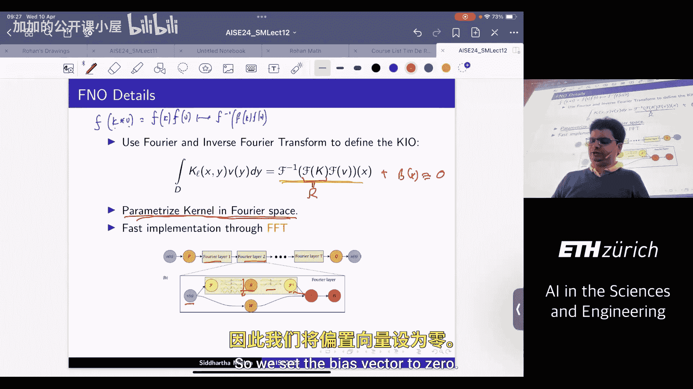

Okay， this Q here and the W here。 So the P。And I'll explain that a in a second。

 these are very easy operators to explain so this P is what is called a projection。Q is what is no。

 but the。嗯。Okay， so P is what is called a projection。Bin is my brain is not because。

brainrain is simply not work。lifting。U is what is called a reconstruction or a projection is their notation or mine I would not have used this notation right because it's sort of non intuitivetu but I want to be sort of have some consistency with the code and this top view here represents a residual connection。

All the symbols are sort of not nicely done， but this is from their paper so I sort of state residual connection。

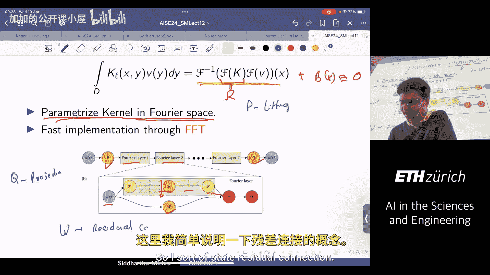

Maybe in the next version of the course， I use my own notation。

Okay， so what are these lifting projection and residual connection lab They are they are very simple。

 So let's start with P。 So P is essentially what is also called a channel。Augmentation。

So remember that my input is a vector function right in general it's not a scalar it's a vector function。

 so V is a mapping from D to let's say R n。Okay， so what the P does is just a linear in general。

 you then you can make it into an MLP， some people use an MLP。

 but the simplest version of it is it's just taking P takes this mapping V and it produces a PV。

Okay， PV is a function， so PV belongs to PV is in R。Now I'm out of notation。

 let me call it as some M， where M is much bigger than it。So in other words。

 it takes let's say pressure， density， velocity and so on。

 So these are the natural variables in which we describe our system。

 these are the features and then what it does is that it says okay who says that the machine learning algorithm will use the same features let's send out it with some additional features these additional features may or may not have any physical representation typically they don't have any physical representation so you take a vector which is four dimensionional your input which is four dimensional physical or one dimensional let's say temperature which is physical and you take it to 0 dimensions I'm just giving a number10 is not that uncommon right so this tells you that already from the data have we are equiuping it with some additional features or additional channels okay iss very。

 very common in the image processing where you take RGB but then you suddenly expand it to I don't know。

 12 channels 16 channels，128 channels This is a very。

 very common break or a very very common realization intuitively it says that。

We don't know what features the machine learning model is going to use in its algorithm so let us provide it with the possibility of additional features okay so this is what this lifting operator does it takes the input and it lifts it to let's say not a higher dimension physical physical space but in feature space okay so it's a feature feature space lifting and projection is just the inverse of that so you lift it to a high dimensional feature space you do all your processing in a high dimensional feature space M dimensional feature space and then you want to come back to your physical space because at the end of the day I only have information about my temperature pressure density humidity。

 things like that right so projection is just the opposite it takes W which belongs to RM point wise and then it produces Q of W belongs to RM。

M and okay so these are this lifting and projection operators these are linear They are learnable right we are going to learn them during the learning process because we don't know what are the features if you know then that will be the point about machine learning is to have as little human crafted and as much end to end learn features as possible Okay so this is this is a way to automate that it's very very common in computer vision to do that and some of these features I can have a scientific intuitive interpretation。

 but I don't need to okay and the last point is that clear what we do with this very simple just a matrix essentially discretely we will see it in a second how this is done discretely it's just a matrix and then we do the process okay and then what is this one here this is a residual connection or a weight matrix essentially let me write it down。

So remember that you have the sigma。You have your convolution kernel。

 which is done in Fourier space now， right？V of Y D1。Plus， now this is the fun part of it。

 so this is top view。Of p of x。Okay so you take each point and you have a learnable representation。

 This is like essentially a residual connection。 this a parallel route Here is all the processing which is happening here。

 no processing is happening except for keeping some information on the previous step okay so that's why it's a residual connection in machine learning it's useful to have this residual connections so that youre better gradient properties essentially and then it turns out we have done some analysis of this that this particular map here is very。

 very important okay so this is again， linear does not depend on space at all。

 it just depends on the features right so you can some people also call it as channel mixing because all that you're doing is that you're mixing up the different features together some form right so this is fO at a continuous level so what do I do I take a function I've set the bias to zero that's not important I keep some of the I mix some of the features of this function locally at each point in space means。

So this gives you some global information somehow， because all the points are the same。

Let's say the same constant that is multiplying the same matrix that is multiplying and then I do things in Fourier space。

 I take Fourier transform do a Fourier multiplier， take a inverse Fourier transform。

 add them up and pass them to the nonlinear and I keep on doing right so how is the processing done you take a function you take your input function you add channels to it。

 do the Fourier processing and the residual connection， Fourier processing residual connection。

 Fourier processing residual connection at the output projected back to your original feature space and your variance okay so this is how it is done at the level of functions is is a very simple architecture in some sense。

 and we will see that these computational complexity caveats that we had these are somehow very nicely resolved because we do things in Fourier space There's one trick here which is that we need to compute the Fourier transform and we need to compute the inverse Fourier transform right we've been given a function Of course we do it。

vicice so we have to compute a discrete Fourier transform and a discrete inverse Fourier transform So this all of you know can be done very very fast through Fft right so we have the fast Fourier transform and the Fft does this if you are on a grid for instance。

 equals based on a grid this takes you analog log and an operations so this is a very very fast operation Okay so is that clear are there any questions about how FNO works yes James。

So as part with the ethanO in the three states。five frequencies this is what I'm going to describe exactly in the next slide。

 so again good anticipation of what I'm going to do。

Because I've still not given you the discrete recipe and right this is all at the level of functions。

 but I need to sort of translate it at the level of actual vector so great values right there is what because I want to。

sortrt of explain it and I don't have to explain every every pitly little detail because some of these are very obvious and then you understand the thing that is the most important here is to work with the Fourier layer like this Fourier processing layer。

Yes。嗰排咪嗰定冇啊。Okay， so let me try to precisely raise address the point that James raised。

 and let's try to understand this at a discrete level。 So what do we do And again。

 I just look at one layer。 I'm assuming that this。Okay， let's， let's take。 let's try to explain this。

That's why I have a whole slide blank so that I can fill it up。

So remember that I have for each Fourier layer。So that you understand what's going on。

So for each query layer and now I'm not going to use a layer index L anymore right so this is the same across all less so my input。

If it was a function would be given by some v of x， right that is a function。

 but in reality I have a discrete input。Discreet input。Whi is the J。

 which is P of xj and this j runs from some1 to capital n so these are points in the grid because at the end of the day we have to work with points in the grid there's no escape from that and remember that for each j。

VJ is in some。 it could be complex value， but let's let's keep things simple and it's real value。

 This is an RM。 RM is this high dimensional feature space right so I have lifted to this high dimensional feature space and I'm processing along this high dimensional speech space。

 So I've been given this vector， but since this vector itself as many features。

 I can write it as a m cross N matrix for in in implementation It is usually done as m cross N matrix。

Then I do the Fourier transform， right， So the next step is。Okay。

 so let's take the Fourier transform。So in principle， if you remember， and this was why James。

 I think， asked the question， the Fourier transform allows you to evaluate any frequency。

So if you want the thousand thousand frequency it can do if you want the million by million frequency it can do right you can evaluate any frequency in practice you cannot do that because that would be an infinite object and we have to make approximations so what kind of approximations can we make we have to cut it off right so this discrete Fourier transform is so you have a discrete Fourier transform。

This great Fourier transform。Okay， so you take this V chase and then you take。

Let me know I'm running out of mutation， but that's try。

So V hat because Fourier transform is always given， but this is v hat of k。

 so this is a discrete Fourier transform F of Vj。Okay。

 so you have values and a grid you take the Fourier transform of this matrix and then what you do is that you have minus capital k less than or equal to little k less than or equal to capital because you have both positive and negative frequencies so you take this so in other words what you do is that you take a signal and you cut it off into frequencies okay and typically the idea is that this 2 k plus1 so these are the number of frequencies capital k is less than it could be much less than the number of points and。

Okay so this is somehow the key to the computational complexity as well as the working。

 it need not be but then you pay more in terms of computation and evaluating this Fourier coefficients is fast this is the fast Fourier transform right the complexity is quite nice so you take it and you do some truation of the frequency and this is this is what they express here that you don't need all the frequencies you keep only some of the three。

You could also do that by taking a matrix which is R which is a multiplier matrix and having a lot of zeros in it。

 but the simplest conceptually is to think that you take a signal and you let's say the signal is on 100 100 grade but you don't have to keep frequencies 100 by 100 frequencies you see you can give 20 by 20 frequencies and this is sort of the in some sense a key point here。

So this is the Fourier transform， then is the Fourier multiplier。我 a multi lier。

So this matrix now is 2 k plus 1。By。2 k plus one。Times2 k plus  one。Much smaller of course。

 times whatever M features right so you have all these frequencies in each direction and then you have M features。

 then you have Fourier multiplier R。Which is going to take these values。And I made a mistake。

Give me one sec。It's 2 k plus one， of course，2 k plus1 times。Thankss。

M and then this Fourier multiplier matrix， you really do it in terms of a tensor。

 so it takes it and it takes so essentially it takes c of 2 k plus1。

And it produces a complex number which is2 k plus one for simplicity。

 it could be something else so it takes 20 frequencies and it transforms them into 20 frequencies。

 it could transform it to 30 frequencies if you want or 15 if you want right so there is this this is learnable so this is the part which is learning。

And in the code， it is realized as atenor。And then you have the inverse for。

Inverseice for your transform。I have to keep some look on the time otherwise I'll be in trouble Okay so you take the inverse Fourier transform and then the weight matrix you have this W matrix multiplication that is trivial right because now you just have a pointwise matrix that just mixes up the features so essentially the key here is that you do a Fourier transform through Fft which is very fast you trunccate it you don't you only take only few frequencies you do the remplication with this Fourier matrix then you take the inverse Fourier transform add the residual connection and you keep on pressing so the cost is is in several places where you have reduced the cost we have taken Fft so that bit is very efficient and you have taken much smaller much smaller but smaller sort of frequency compactification of the entire thing so that there is also source of efficiency and then we keep these things in and this is sort of the。

Somehow the key to this this particular feature and anyway。

 you have seen this construction in the court during the during the tutorial。Good。

 so this any questions on the implementation of the FO where this is an important baseline that we will also consider in the exercises。

 yes。It to。Usually that's a very， very good question， right， usually it's a hyperparmeter。

And it's sort of there is a ballpark， I there are people have done our experiments for many。

 many years and somehow 24， 16 not more than 30。你。You could。

 but no one does it you could you could do it as a learnable parameter。

 but then it's harder right because then the code becomes very complicated。

 you have to put several zeros you have to pad with zeros in order to keep the so one1 you could you could write that code but what's the point so it's sort of there is some good theory to say that you don't need so many frequencies because remember that some of the frequencies it's not like you're killing all the frequencies because just imagine that you have a signal which has many non-zero frequencies okay some of it are a lot of it is also retained through this guy here because remember that this sky retains all the frequencies so you keep the part of the signal and only a part of the signal is the high frequencies are kept in some sense and then the low frequencies are processed so there is some additional additional parameterization there okay so but it's it's a good question 20 order of 20 Yes。

It is acting in Fourier， but it's just matrix or attempts tense the interpretation is that it is a kernel parameterized in useful。

 but its interpretation is purely that of implementation is purely that of a tenseor。

Because it takes a vector of frequencies right it transforms them into another vector of frequencies。

 but then it has to be a matrix， but because each frequency has different features it has to be a tenor of the appropriate order。

Yes， it continues to enable fully transform this seaequl this equivalent into the ground integral where problems when when the real are negative false。

 yeah， how do you deal with this problem？Why is this a problem because？Okay。

 when the real part is is negative。It's not it's not defined and stable there but if you it's only for functions which because these functions are typically you are taking band limited functions in some sense right so you don't simply have the frequencies that cause problems yeah。

For the questions， good。 So keep the questions coming。 Then we all understand better。

 including myself。 So so always good。 So now good。 So now the point is that。

And this I have to go a little bit quickly because otherwise we'll be out of time so I then just end up repeating in the next lecture so it doesn't really help maybe as I said this a very widely used in practice we will see some numerical experiments next week probably but as one of you asked means the whole point was to construct res right so are these res。

The answer is yes and no it's a mixed answer of course Reno the concept came much later than FNO so there's no reason to so there are two elements to it right so first of all this lifting and weight matrix and so on these are these are just linear operations which have nothing to do with space you know they have to do with channels and so these are by definition rhnoments they don't change anything the spatial structure so that is so the two essential things right so you have a convolution in Four space and you have an on nonlinear。

So it turns out that one can show that if you have the right spaces x and y。

 so in particular if you take periodic band limited functions pk so this is a space of periodic functions。

 then there is an automatic convolution and the reason why the convolution let me give you the intuitive reason and then there is there is a proof which is given in terms of this diagram the reason why it works is because you do this low dimensional Fourier projection So you might take your signal and any grid okay so you might take it on a coar grid or a fine grid but at the end of the day what you do is that you project it onto the same Fourier modes and as long as these Fourier modes have this liquid barrier being satisfied so it does not matter if I take a 64 by 64 grid or 128 by 128 grid and' at the end of the day projecting them onto the same Fourier phase I'm working with this Fourier phase so there is no ambiguity in terms of the convolution if I would have kept that changing if I have changed this k with the grid then I have be。

But since I don't and this is where the proof is because a Fourier transform of course， is a。

For these by unlimited functions， this automatic relationship here so this is in continuous then you're just multiplying a Fourier multiplier so you do nothing here and then you take the inverse Fourier transform right and you can just use the Fourier basis so this T of psyK is simply using the Fourier basis。

Po5 evaluations and then you just use the Fourier basis and these diagrams are all commuting。

 So this is is a very simple argument to see why FNO。

 the convolution part of FnoO is real because unlike in the previous case where I was keeping the same kernel here because Im working and then I was getting into trouble because I was operating in physical space here by keeping the same sort of Fourier multiplier for a fixed Fourier space I'm avoiding that problem。

 Okay， so of course the designers of FNO didn't have those considerations in mind。

 but this is what it turns out to be however， it's not just the convolution we also have an only linearity。

And this is where the trouble is， and let me explain to you where the trouble is。

So the point is that all this is done if you take the right spaces if you have a right connection between the continuous and discrete and this is provided by for instance band limited functions right because then you know that certain frequencies can't be amplified certain frequencies are completely damped down and so on and so forth now when you take nonlinearities you really get into trouble so let me explain to you why because let's say that you have a function which is 10 nonzero frequencies so it has sine x I do x sine 10 x and so on now you take the simplest nonlinearity that you can think of the square right。

You takes the square of sine 10 x what do you get sine 20 x right because and then of course you have started with 10 frequencies and you automatically end up with 20 frequencies so all linear is what they do is that they can break the structure they can introduce additional frequencies and this is where the trouble is and this is best shown in this picture here。

So I've taken a signal let me use a black maybe I've taken a signal which is an orange so this is a signal and I've applied different nonlinearities to it okay so I've just used the frequency as a barrier let's just focus on really。

Because Genlu is just a smooth version of it Relu as you can see it clips all the negative parts right and it just keeps the positive parts so this is where Relu works in frequency space the same functions so these are the frequencies so as you can see I have taken 20 frequencies。

My original function had 20 frequencies， but as soon as I apply a you see my original function it remained within the frequency box right but as soon as I apply a loop I have this leakage。

 you see that there is this leakage which is happening。

And this leakage means that I'm introducing hybrid。And because I'm introducing high frequencies。

 I break the band limits and even if my convolution keeps them。

 if my convolution provides that structure， because I am using nonlinearities which are not keeping the band limits。

 you end up in okay so even if one part of the chain works。

 the other part of the chain does not activations are going to introduce high frequencies。

These are not necessarily resolved in the grid， and that causes aism。

 So this is roughly what for the story with the。

FNOs， and let me give you a couple of examples just to illustrate that and then we finish。

The first one is a very dramatic example it's not a PD example PD in PDs what happens is that frequencies have some decay as a whole point very high frequencies are amed down but this is an example where high frequencies can remain high okay so it's an assignment problem it's a random assignment it's a perfectly kosher well definedfined operator so what you do is that you have some inputs。

Wwhich is a random field and the output is also a random field and you just assign different points randomly across okay well definedfined operator not continuous but measurable so all the everything should apply to it and then when you train it on a particular grade so it is trained on 61 by 61 one is because of this 2 k plus 1 okay 61 by 61 it is 30 frequencies and you can see whether I take the CNN or the FNO at this resolution they almost give no no error right you can you can easily learn and then I just evaluate the output on different grids。

As soon as I change even one grid point。All help breaks loose so here the nu barrier is not satisfied anymore okay since the nu barrier is not satisfied anymore。

 you can you can't expect that errors will remain low because the projection that we had is broken but here the nu barrier is satisfied so we should expect that errors are low but they are not right almost immediately as you can see both for CNN because the convolution itself has issues as well as for FO because here the nonlinearity has issues you don't have the same resolution errors are very very large Of course this problem has been constructed in order to make it extreme okay so in some sense it is a contrived example so the nonlinearity not preserving the band limits leads to that issue。

It turns out that even in practical problems， you cannot avoid it。

 even though the people who invented FNO thought that they could get away with it because the errors would be low。

 but that is not the case。

So this was CNN unit but it's essentially CNN and you remember that how the results were。

 so we have the mapping between the velocity and in the beginning initial velocity and final velocity for obvious strokes and this is the corresponding vorticity so you start with sub sheia and then you start introducing ves so if you take FNO then what happens is that you end up with trouble。

Even in this part here the ni barrier is satisfied。

 so theres no reason why it shouldn't be but you can see that there are very reasonably large increases in error here on the other hand。

 there is an increase in error， but it's not as dramatic as before right so but it's not zero so there is alias in error because the high frequencies are damp down so you can see that error goes from I don't know 3。

6% to around 3。8% there is a mild growth and if you would have continued it would have continued growing probably this direction so by design it is not we know in this particular case it didn't lead to as many problems particularly when you evaluated it that highly dissolve higher resolve meshes but in principle it can it can lead to problems right because CNN both the nonlinearity as well as the convolution broke the band so of course it was it was worse so compared to CNN of course FNO is better but it's not a solution。

that's in this particular sense it's widely used but there is an issue so we still have this challenge which is to design something which is generally operator learning rather than just learning maps between particular finite dimensions to particular finite dimensions okay and this is what we will do on Friday and we continue also next week good so we finish a bit but we also took less time during the break。

Bye拜。

