# 苏黎世联邦理工【中英⚡科学与工程中的人工智能｜2024 AI in the Sciences and Engineering】 p13 P13 Spectral Neural Operators and Deep Operator Networks -BV1smxgzHEPC_p13-

Okay， let。一个英文。welcomelcom to today's lecture。

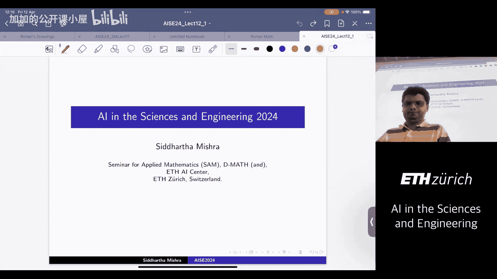

And we continue where we have left， so。As in the last several lectures。

 we are working with operator learning and the setup is the same so you have been given an abstract PDE。

And associated with that PD is a solution operator which maps a function space to a function space In other words。

 it takes the inputs coefficient and forcing in this particular case and then turns back the solution So this is as before and since the problem is essentially an infinite dimensional problem we have to sort of think about how to represent it discretely In other words we have to think about what is this continuous discrete equivalent this was the key concept that we wanted to think about and in this context we introduce Reno representation equivalent and neural operator and the idea let me repeat it again because it's very important is that you never be able to have our work with this operator directly even if you want to learn it so what you have to do is to have some finite dimensional representations approximations of this operator which is given here and the link between the two is what really defines operator learning。

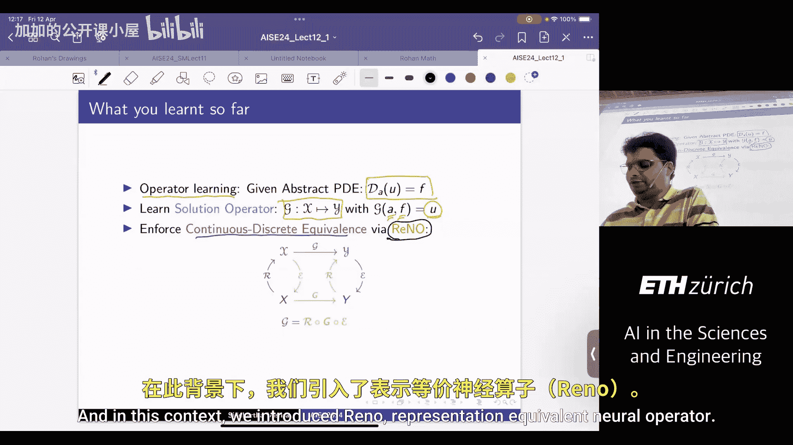

In particular， if this diagram commutes， that is whether you work directly at the continuous level or whether you start at the continuous function space。

 go to a grid， discrete， operate at the level of the grid。This is a discrete operation， CNN whatever。

 and then you go back if this entire thing is exactly the same this good diagram commutes so you have no aliasing error。

 so this is the aliasing the difference between the two is aliasing error here。

And as long as there is no aing， you can do some genuine bonafie operator so this this is the setup that we're in and we saw that CNNs。

 they broke this。

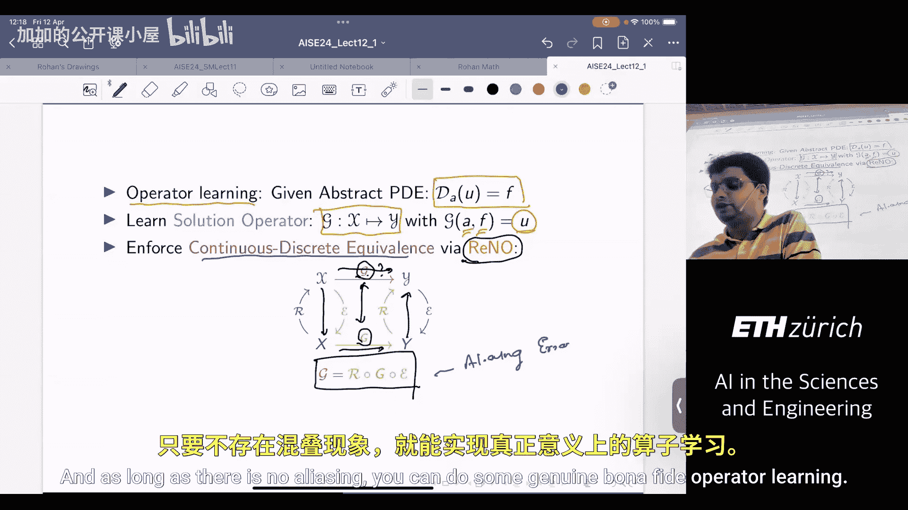

And in the last lecture， most of the time you' spent with FNO for your neural operators。

And let me just recall what four your operators are so that it gets imprinted into you。

So we have some input a here and some output which is you similar to what we had in the last slide and now what you do is you have different layers in particular this is lifting right just to recall so this is lifting where you simply add more features add channels so that instead of working with physical variables density pressure and so on and so forth you work with some sort of representation。

 some more abstract representations of these features and once you have lifted you've added more channels you also project them so this is the projection So these two are typically linear layers or you could use MLPs here this is the choice is wide but all the action takes place in the processing which is done through this what are called fourier layers and this is the cartoon of portfolio layers so you start with a function。

You go to fullier transform it， so if you're on a grid。

 then you can do it fast with the fast Four year transform。

And then you truncate you truncate the number of Fourier modes and this is and do some Fourier multiplier so this is the learnable parameter and two things happening first of all you transform the Fourier coefficients in some some way and then what you do is you also truncate them but so sort of having four you just take two of these harmonics so as you can see in this picture that's as a representation you go back to physical space through the inverse Fourier transform also through aFT and then you are going to process it with you keep some of the signal so some of the signal is kept through the what is called a residual connection。

Good for training and it has some other retain some spatial information and so on and then you apply the nonlinearity point bias and you do it over and over again so this is F&O but as I explained at the end of the last lecture。

There is an issue with ethanol in the sense that there is an issue in the sense that the activation function。

 this the nonlinearity there， that sort of broke this commmutative diagram。

 it broke this because at the end of the day what happens is that there has to be a neat correspondence between these spaces。

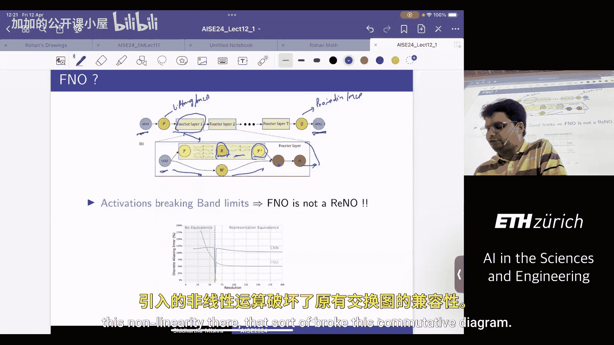

And if you take these as spaces of band limited functions and you apply a non nonlinearity。

 then that equivalence is broken， and once that equivalence is broken。

 then you end up with situations like this， the example that I showed you last time。

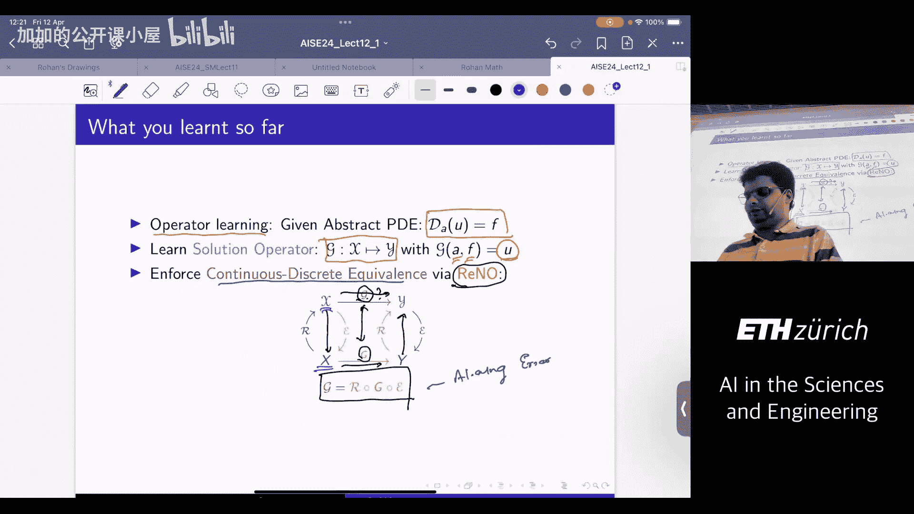

Of random assignment where you can train on the grid and you get very。

 very good results with both CNN and FO。 But as soon as you slightly change。

 this was an extreme example。 as soon as you slightly change the。Let's say the representation。

 the resolution， even by one point， then you start getting larger errors。

 both for CNO and FN FNO and CNN， and this is the regime where you don't have the conditions satisfied so you don't expect。

That this there'll always be alien because there's simply not enough point density there Okay。

 so this showed us that we have to sort of continue the search and this is reinforced when you take practical examples。

 realistic examples， so this is again back to obvious talks。

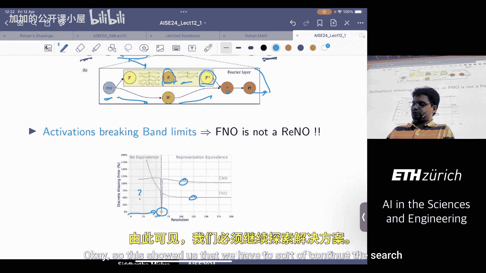

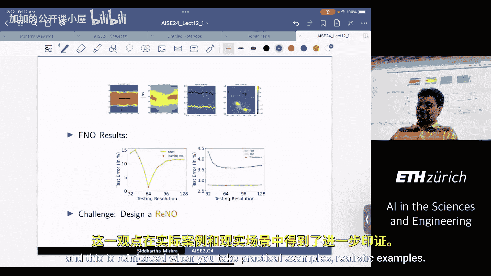

Whi is more or less a main equation that we have in the course and this is operator it takes a velocity field and it turns out another velocity field and we sort of visualize it through the vorticity so you can see that there is this initial she and that leads to the shedding of vortic thread so this is this is the picture and if you take fNO what happens in this particular case is that the training resolution is here and then the test resolution you have at different grids so when you increase the resolution。

You do get small errors because these high frequencies are probably small。

 but when you reduce the resolution， while still keeping within the barrier， you get large errors。

 So this is again the fact that it is not in so there is no representation equivalentvals you end up there are asing errors and this will affect the quality of the solution depends on the problem sometimes you know the high frequencies are really damped out in the problem in some other cases high frequencies remain so there is there is the issue right so the question is we need to challenge the challenge here is we need to design an operator a neural operator that sidestep this issue that is able to do this processing between different grades that can operate at any resolution and so。

That learns the actual operator instead of just a map that takes a particular finite dimensional representation and turns out another finite dimensional representation。

月。只号六一六的。So in today's lecture， as well as in the next lecture， well see some examples。

 the next lectures well see some examples。

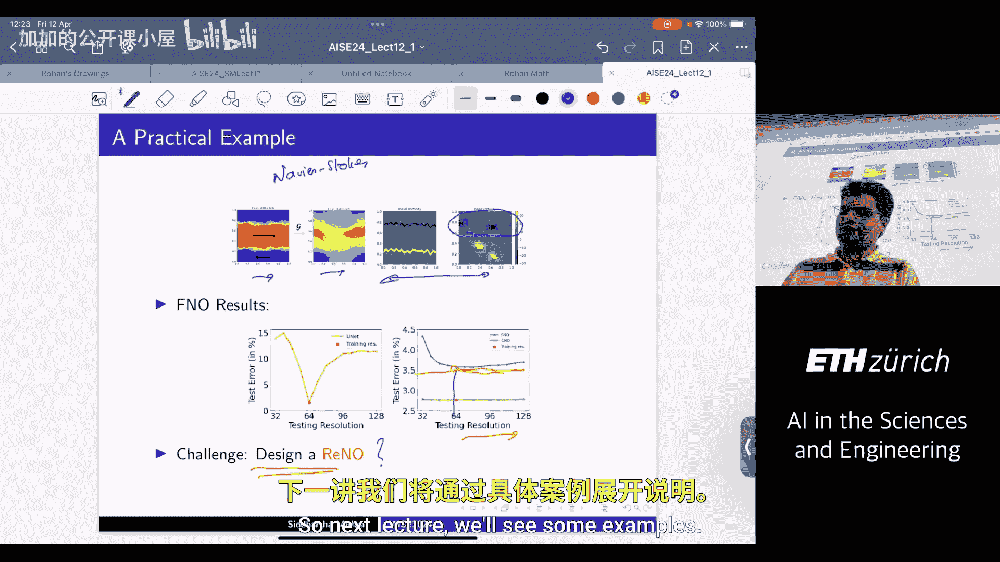

And for today's lecture we take some inspiration from traditional numerical methods so as I said in the very beginning of the course。

 perhaps in a second or third lecture that there is a wide sort of menu of numerical methods。

 they go by different names so you have。Finite differences， your finite volumes。

 finite elements and spectral methods and many others。

 some of you have seen these methods in your scientific computing。

 computational science or numerical analysis courses， numerical methods courses。

 So there are a wide variety of these methods and in some sense。

 these methods also have to work in the same paradigm right because they whether you approximate the solution operator through machine learning。

 or whether you approximate the solution operator through numerical modeling at the end of the day。

 you're approximating an operator So you are essentially dealing with an infinite dimensional property right they are also the inputs。

 for instance， if I wanted to solve this with a spectral method， which generates the ground truth。

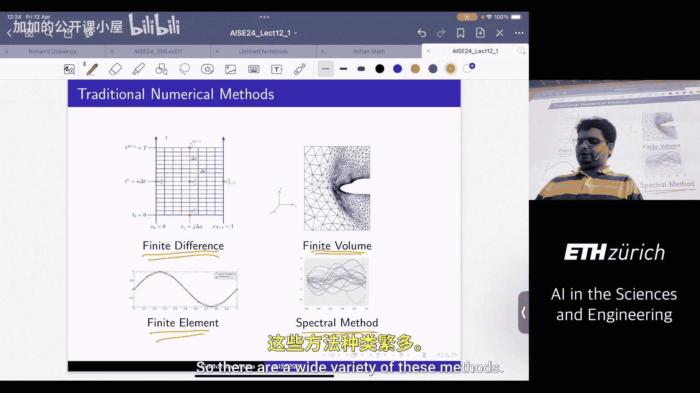

You can see that I start with I have to project it onto some grid or to some basis process with the basis and then proceed。

 So how is this done？

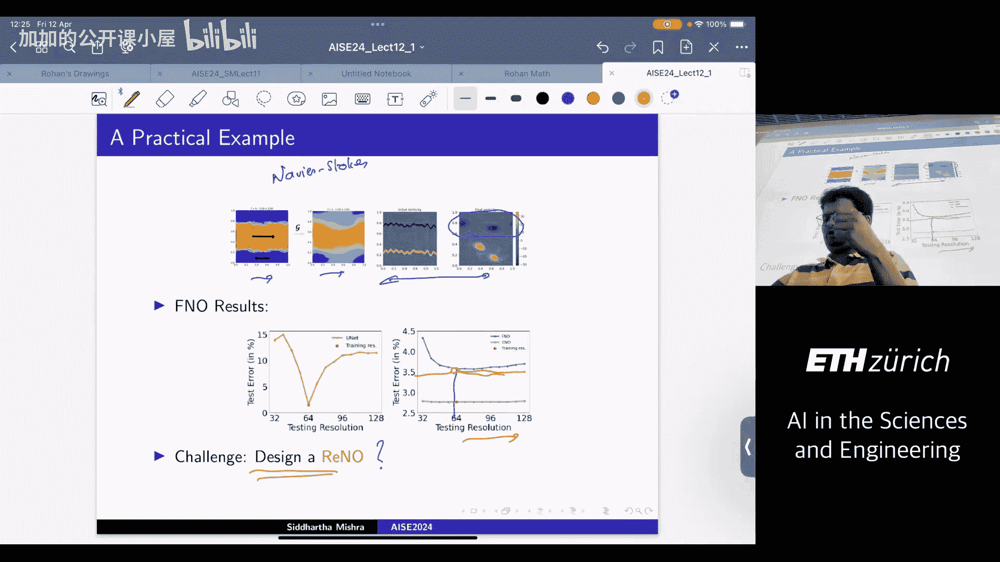

So here is again the same figure which comes again and again again with similar notation with slight slight forturbations here for a reason as you'll see so in fact numerical methods can very much be represented or interpreted in exactly the same paradigm as the machine learning methods that I just showed you so again you have done operator so I don't know why this is a is an old name instead of G I said a to distinguish between learning and numerical approximation but essentially at the end of the day you want to approximate this operator out here capital G or script G calligraphic G which takes I'm sorry about。

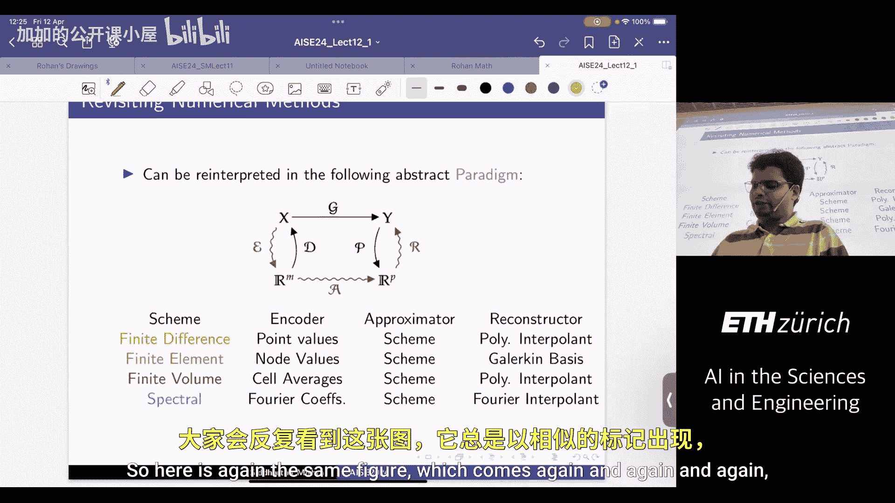

Mistake here。 it should be script， of course， script text。X and script Y。 But again， what do they do。

 These methods all rely on the same principle that you start with an infinite dimensional function space。

 you project it down to something in finite dimensions。You work in finite dimensional spaces。

 time stepping or whatever solving， inverting a stiffness matrix， whatever is the necessity。

 and then you go back to infinite dimensions through some interpolation right So if you think of finite differences now those of you know。

 I think I introduce the finite difference methods for instance， quickly。

 if you take the heat equation So U T minus UX x equal to0 and you take a grid in space and time。

So something like this and then to calculate U n plus1。At some point， Jay， this was you。

 and what was the me。是的。So it was delta T by Dlta squared of U J minus1 plus 1 minus2 delta T by D Dlta squared。

Of U and J plus Dellta T by deelta squared。Of you and this one。

Right so this was the this was the picture we had done this in one of the lectures so I take these three points and then I evolved to the next time step and I keep on doing this right so this bit here which is what I call us appxiator this is the numerical scheme we have no learning there but so this replaces the role of what where is the picture this replaces the role of this guy here this G here okay it replaces that。

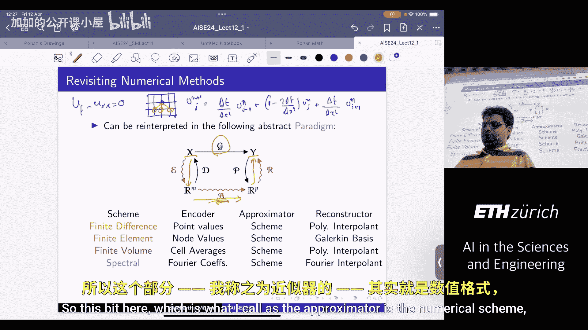

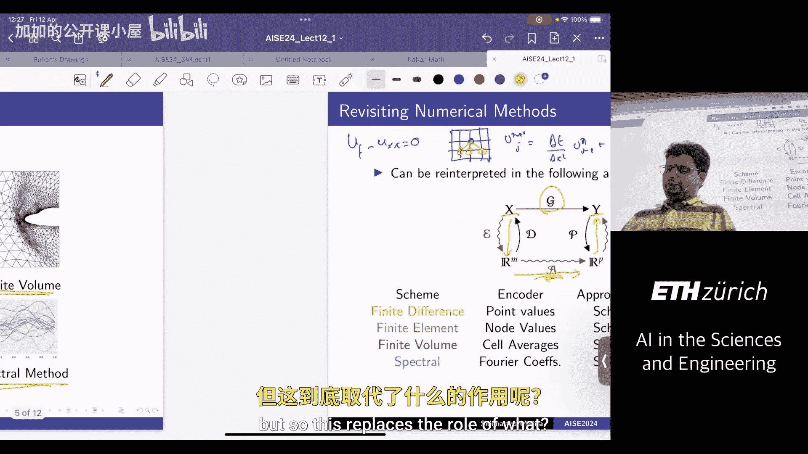

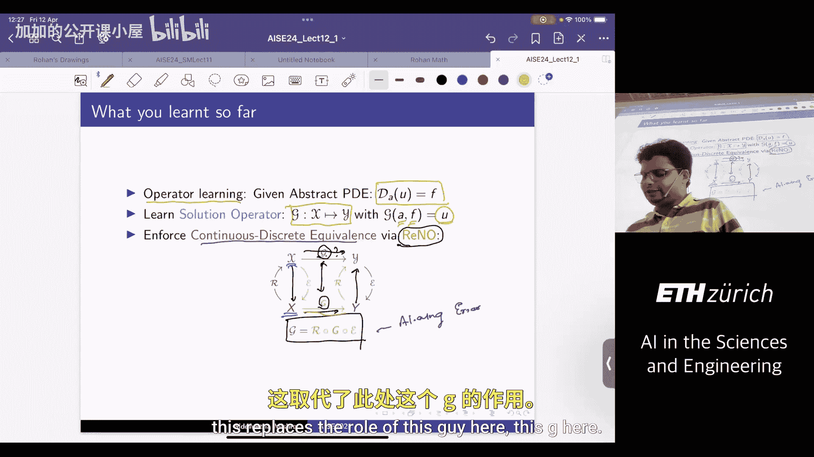

Because it's not based on it's based on first principle physics。

 you have access to the equation so you can solve it。

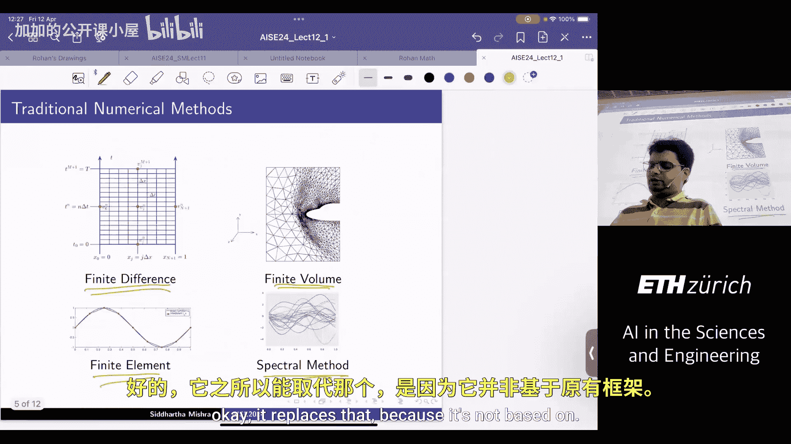

Similarly， and then once you have the point values。

 then you can always use a polynomial interpo fact some sort of interpolation so this part is this is the interpoator。

 this is the encoding which is just point values point evaluations and this is some processing similarly for finite elements for those who know this it's exactly the same principle now what you do is that you have a basis which is consisting of finite element functions and then you take these point values which are node values these are the corresponding coefficients you do some work with them for instance invert mass sorry a stiffness matrix and then you go back to infinite dimensions through the finite element of the Gal basis same principle for finite volumes spectrum you do this for Fourier coefficients so what is the what's objective or what's the bottom line here and when you have an infinite dimensional problem you reduce it to finite dimensions this could be coefficients of a basis in the most general case even point values。

The coefficients with respect to the sync basis that I introduced in one of the last lectures right so all of this is essentially so this part here。

 this E is some sort of a basis。Projection。Right。An R here， the reconstruction is a basis。

Reconstruction。So if you have been given a basis whether it is same called finite element basis of piecewise constants or Fourier Fourier is the basis for spectral methods。

 piecewise constants or the basis for finite element methods find volume methods and so on and so forth right so one you project down per a basis and on the other side you just take the coefficients and then you just form the basis expansion that's why it's called a basis or reconstruction all numerical methods somehow fall into this let's say this scheme right and in between this is where the physics takes place right you sort of have a discrete version of the equation and you are going to propagate the discrete version of the equation but all the time you're going to work with these basis coefficients right and this is not what we did for instance with FNO with FNO this was a little bit more complicated that where is the FNO picture now that we did some extraction but at the same time we kept some elements of it we are learning it as some sort of function to function rather than directly working。

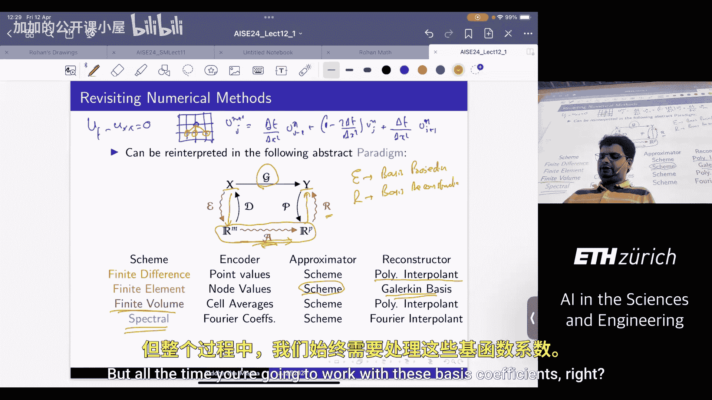

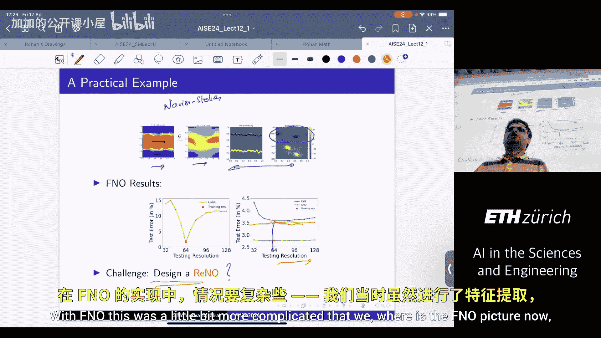

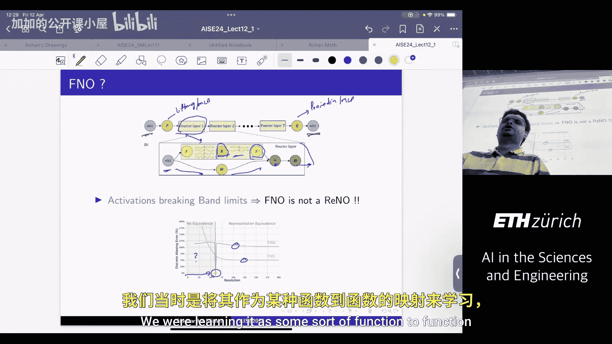

Some basic elements。And it turns out that you can sort of imitate this scheme。

 this picture that I just presented here， and you can end up with the class of machine learning or operator learning methods。

 which I introduced in the next slide。 So in some generality。

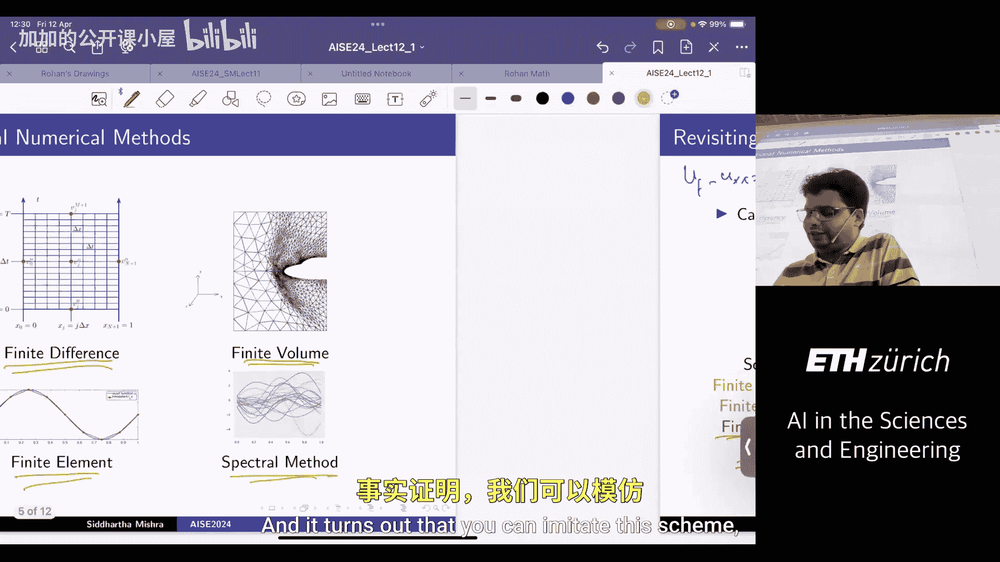

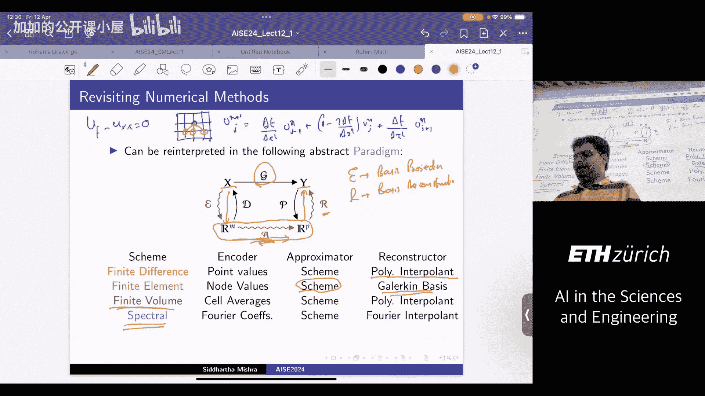

These methods can be termed as spectral neural operators。This is this is a general name， but。

It's's a good name and the idea is exactly as before right so just like a numerical methods we drop things down to a basis and we project them up using the basis in between instead of having a numerical method I strictly work with some DNs right some sort of it could be MLPs it could be CNNs it does not really matter mostly these MLPs because now they can't be CNNs because CNNs are based on functions or on。

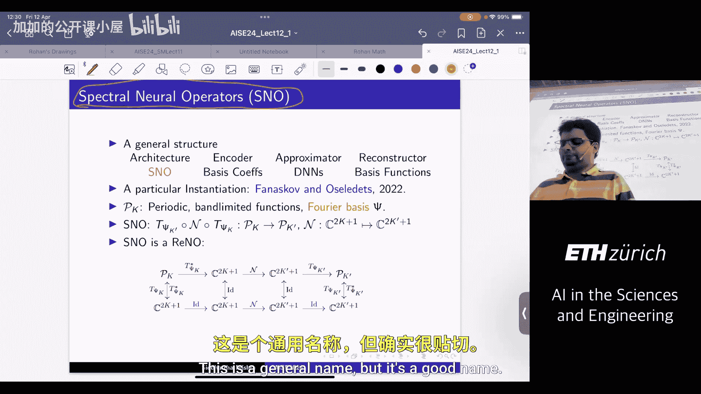

Pixels and so on。 These are just based on some sort of MLPs。 So let me repeat。 there is some。

 some math here， which is fairly straightforward in some particular example。

 But let me just give you a very simple idea。 So you have some input。

So this input is going to be let's say a， that is how I express my input。

 I express it on on some basis AJ。sij rightsij is some basis that I'm going to choose now I have access to the vector Aj so this is J from1 to n and I take a neural network let me call it a L I take this Aj and I churn out some huge。

U J J from1 to M， it could be the number， so you directly work with a basis you you forget all this notion of space that we have all this notion that these are parts of a function。

 you just work with this discrete coefficients and you process them okay by your DNA and finally in the last step you just take your U as an approximation of this UJsi J again。

 let's say that the basis in input and output is exactly the same。

So this is what is being done in the spectral neural operators okay。

 and now based on what basis you choose， you get different classes of functions。

Remember that FNO is not exactly in this framework because it does not necessarily always have this representation。

 you still have a notion of space and similarly for CNNs。

 you still have a notion of space here you remove that completely。

 you work with these objects as discrete objects。 and you expect that somehow this information that these come from a function is represented in the fact that the Fourier coefficients。

 for example， are going to decay right if you have a smooth function。

 they're going to have a certain decay Okay， so is this is this scheme clear and see what what is the difference between what we did before before we were sort of processing an entire image or an entire pixel here we are not doing that we are taking a function。

 an image and we're taking first 204ier coefficients。

 we are sort of processing them in a neural network。

 we are getting another 20 coefficients and then we are coming back okay and that is dramatically different from what not dramatically。

 but there is a subtle difference from what we did before， which was that we。

opperated the image by itself and did some processing with it now as long as a particular realization which is done by these people here it takes and you will see that there is there are some good things and bad things is with Fourier basis that's the simplest that you can think of right so in particular if your periodic problems periodic problems it's very natural to express them in terms of science and cosines which is Fourier basis so of course you need to work with band limited functions because otherwise the space is too big to carry out this program and then this construction here so because we are always with Fourier coefficients I take it complex value but in practice we take it real value right the imaginary parts going to cancel up。

So what is idea it's precisely to what I said here。

 So this T of psK and psK prime is just operators which tell you that you can drop things down to a basis and reconstruct them up this as simple as that okay but the idea is。

 of course this is ano now because here everything is done in a finite dimensional way means there is no notion。

 So even if you are so the simplest way to imagine it is that if you have two different grids。

OkayIt does not really matter because I take function from one grid and I simply project it onto some fixed number of Fourier coefficients and I take function from another grid and I project it onto the same number of Fourier coefficients and then I do the processing and I do the reconstruction so to me it does not really matter whether the function is on a fine grid or a course grid as long as I don't change my number of Fourier coefficient。

RightOf course， the point is just imagine that you have a function on a core grid and you project it onto 24 coefficients and maybe perhaps this is a good representation of the function on the other hand。

 when you have it on a finer grid。You might want to project it into more fully coefficient。

 but you don't have that flexibility here， Yes。It is not very different in some sense。

 but here the parameters you'll see a in a second that you can extend this to cover the on is not strictly parametric because earlier you you did not。

In in a way， you were sort of constrained to。You could never use a function in some sense right so this this adds one additional layer now all that it tells you is that you start with a function and you project it onto some fixed number of parameters earlier you were directly working with that so you did not even have this first step here so this part was written you didn't even need it so you have one additional layer but in in some sense you hit the nail on the head because it suffers from some of the same problems that a parametric representation has right so I'm not saying that all the problems are going to solved by this but this is one particular way where you solve one problem which is that you have different information on the grid。

You don't care because you're projecting around to a finite basis。

 Of course this is very limiting because it tells you that this is a straight jacket that we have to wrap around ourselves。

 which is which is not nice。 So there is a generalization which is or a variant you could also I should have used the word generalization。

And this was one of the first operator learning architectures that was introduced even though the name was not yet there it is called deepponnets some of you might have seen that so this actually comes from the 90s by two Chinese computer scientists in the 90s but the modern version of it is three。

 four years old like everything else So the idea here is so here the problem was that we somehow to supply the basis right some expert knowledge is required we say okay these are periodic functions so Fourier basis or these are some other structures of every general basis or these are on a spherepherical harmonics and this is sort of some expert knowledge that we are going to use so what these people argued is that what if you also learn the basis and not just it seems to be a smarter thing to do to have that kind of a generality to be able to learn the basis and this is what deepponnet does let me fairly quickly sort of explain that so that you learn some of the history of the topic also。

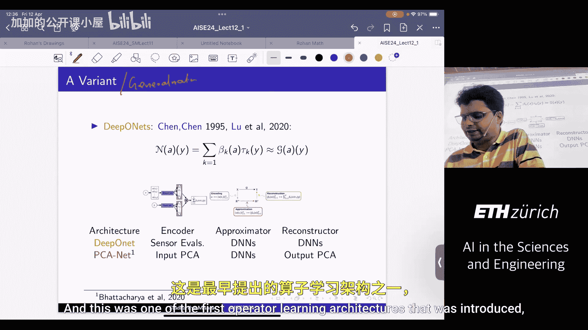

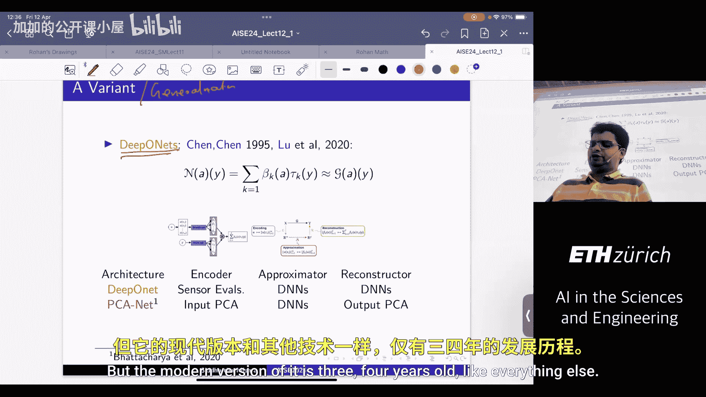

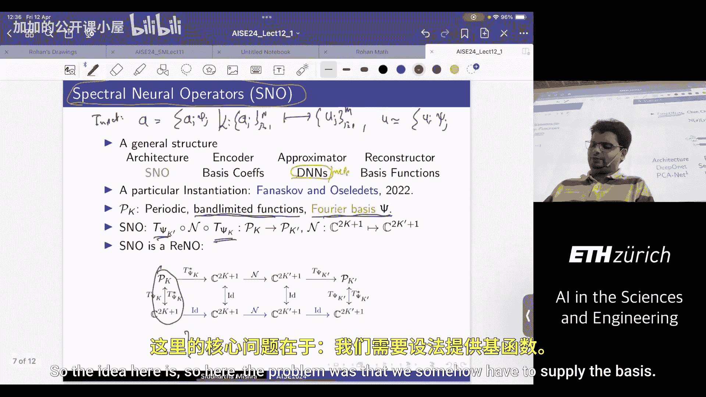

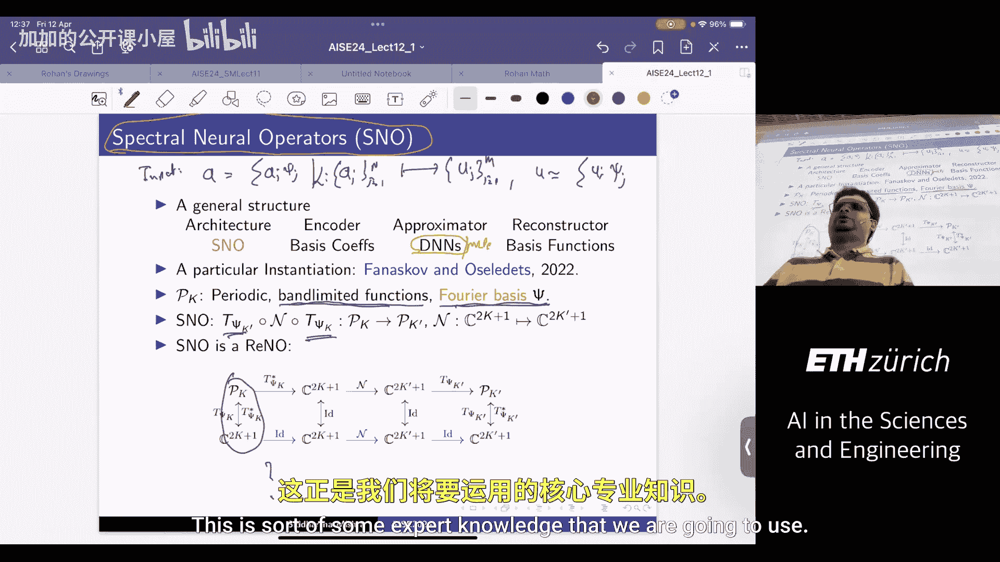

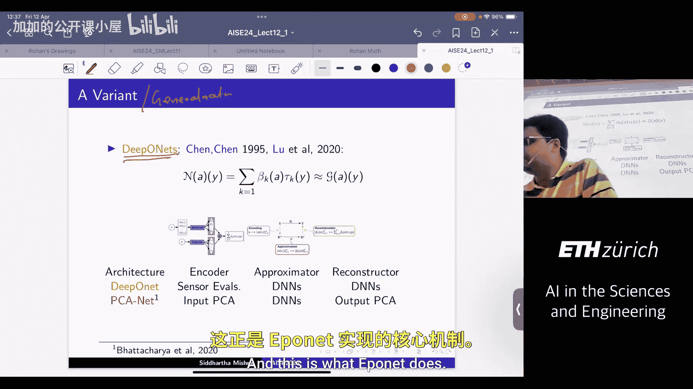

You'll see that this is it has its problems， but you see where it comes from so it's exactly the same picture as before。

 maybe I show it in terms of。

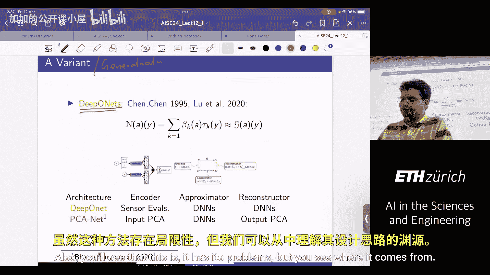

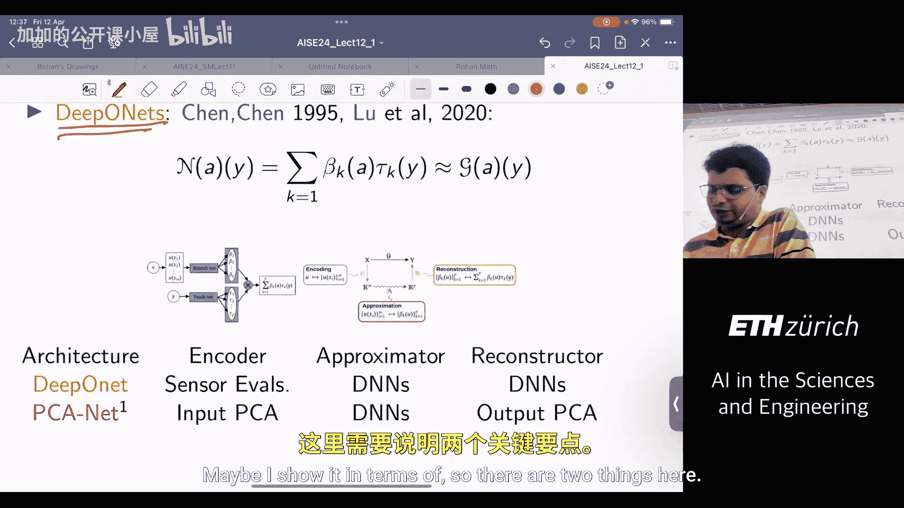

So there are two things here， there are two elements， one is of course coefficient。

 let me try to summarize them， so these are coefficients。G before。Okay， but this guy here。个陶记。

Is roughly approximating a basis In fact， it has even as a name， it's called a trunk net。

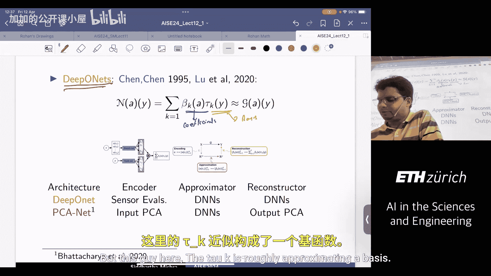

And this， on the other hand， the coefficient is a pro。

So at first side it looks like a very very complicated construction but in reality it's a fairly simple idea except that you now have a learnable basis so you first from the data that you have you of course learn learn a basis first or together you learn a basis as well as you learn the coefficients okay so both things are done simultaneously and of course this you can imagine it seems like a smart idea but this has its issues together have to learn probably too much so what is the basic idea let me explain it in the。

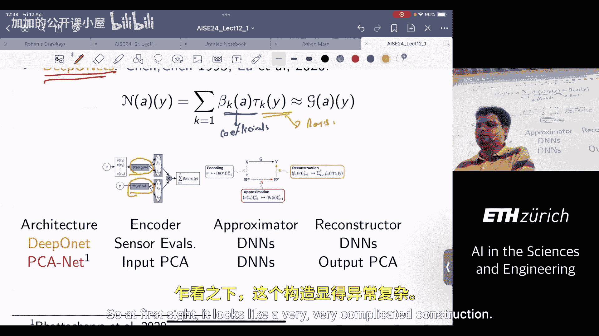

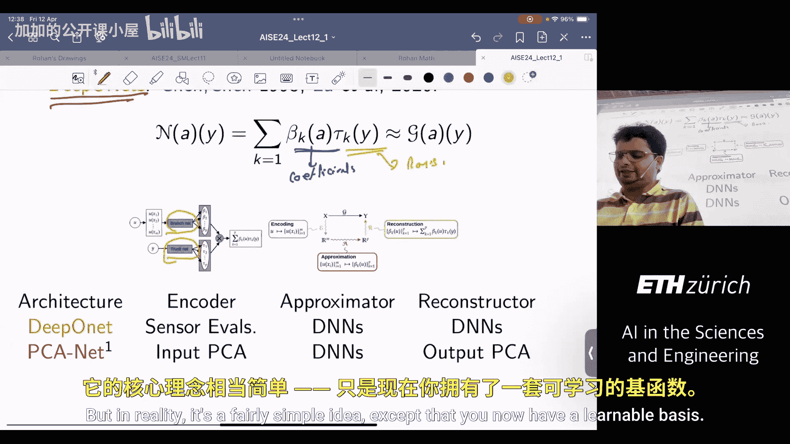

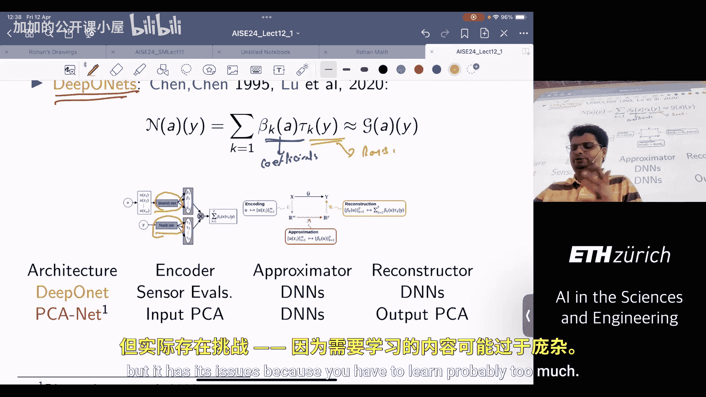

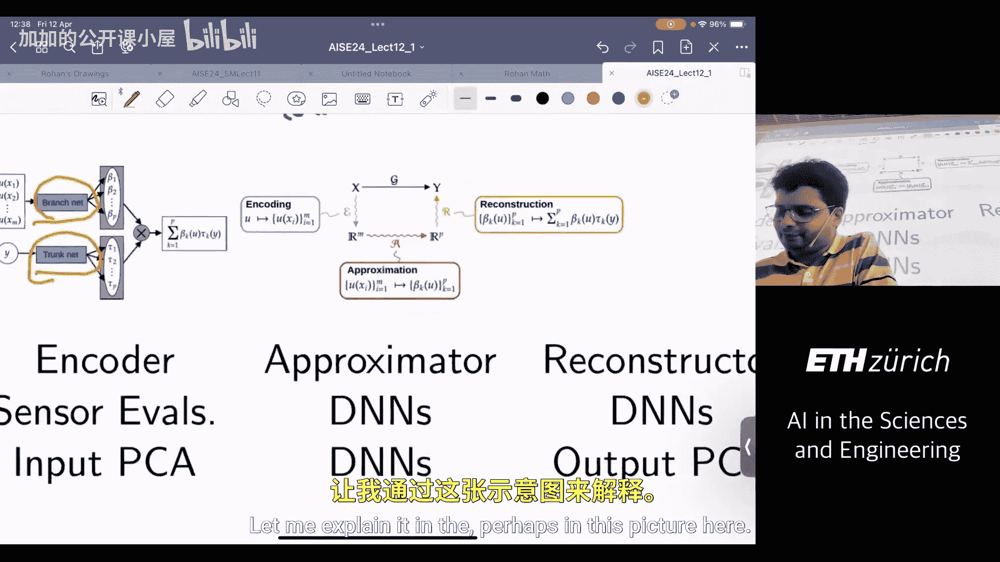

Perhaps in this picture here so sorry for the confusing notation because I copied the picture from somewhere so this is your input now it's not called a anymore it's called U but nevertheless doesn't really matter so the encoding is given by pointwise values。

这里是啥。Point I think I say it here sensor evaluation。 So these are point values。

So the heuristic is that you have some temperature。

 let's say this is your input temperature and you want to predict the temperature up to six hours right as we do in a weather forecast so you're going to observe this temperature by using some sensors which are precisely point values of the temperature。

Now these point values are allowed to in this particular case they not even lie on a grid they're even allowed to be random points that's not that's not a problem。

 However， for different realizations， these have to be the same kind of sensors or the same points okay so point evaluation so this extracts so these these coefficients the input coefficients are extracted just by point evaluations like we did the convolutions it's exactly the same same principle except here the flexibility is that you are allowed to have arbitrary collection of points as long as you keep the same sensors for every like you measure the temperature now at the same sensors in six hours at the same sensors in 12 hours at the same cus and so on so this is somehow。

Some restriction， nevertheless， that's the first thing。

So and you are going to process this right you are taking this coefficients just like we did with spectral neural operators we are going to throw them into a neural network and this neural network churns out some output coefficients so these are the output coefficients。

Exactly as before there is nothing nothing special about this right。

 but now what about the basis we also have to learn the basis in which we are going to represent the function right so the basis are these taus。

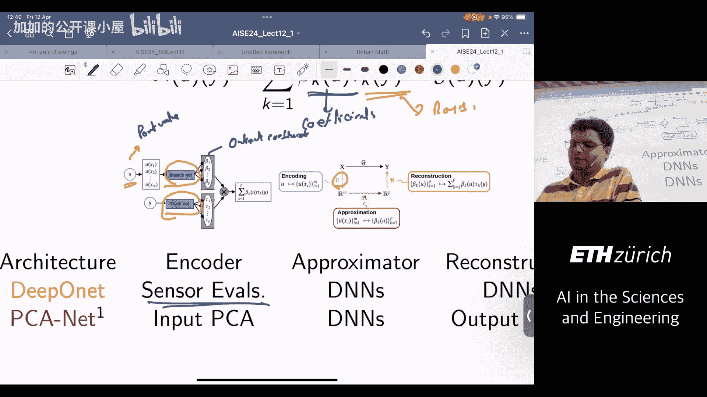

These represent the basis。 How are we going to learn them So remember that the basis is now a function Each basis function is a function。

 So let me isolate a single one of them let me call it a star okay So this is a function of y y belongs to B the domain on which all action is taking place。

 So of course the input to this function is going to be the coordinated at which you are going to evaluate the function right we are we are going to form a function So of course the function。

 for instance， let's do a picture here。 let's say that your domain is 01 This is a01 and I need to I have a function some sort of a function that I'm going to evaluate。

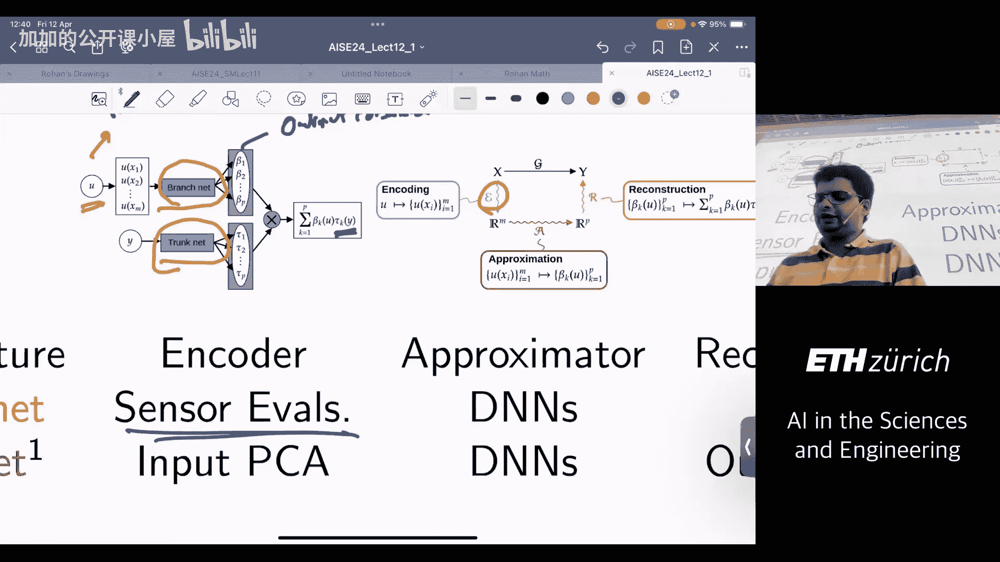

So what I do is as input I give any value and as output I extract the value and you have to do it for m basis functions。

 10 or 10 or whatever depending on the problem that you have you do so you have some basis function and this is going to be a general function right this should not be a sine or a cosine or Chevi chip polynomial or rational function or whatever now this is where the universality of neural networks comes in right in one of the lectures you saw that neural networks are universal in the sense that any continuous function。

 any immeasurable function any inteable function can be approximated by neural networks so the idea of these people was okay let's do these to be neural networks。

So each of these guys are DNNs or MLPs， let's say so each okay。

 it could be more there could be more structure， this could be CNNNs and so on and so forth。

 but in this case the simplest is to have it， this is an MLP。

There is a multilayer perseron so you have now M neural networks which are going to represent your basis。

 you are going to have M neural or M neural networks which are going to represent your coefficients right and these are sort of running parallel to each other they have different semantics they have different heuristics there there is a difference between them So this approximation now is entirely done in terms of the coefficients that we are extracting here just like we did in SNO and then the reconstruction is done in terms of these two basis of these spaces functions So remember that there are two layers that are happening here So one the coefficient is being approximated but the basis in which it is going to be expressed is also being learned at the same time from data okay so both things and this is this feasible problem it's not an impfeas problem that is that is what is going on right and at the end of the day you form the sum put a fine sum and then you have at least neural operator。

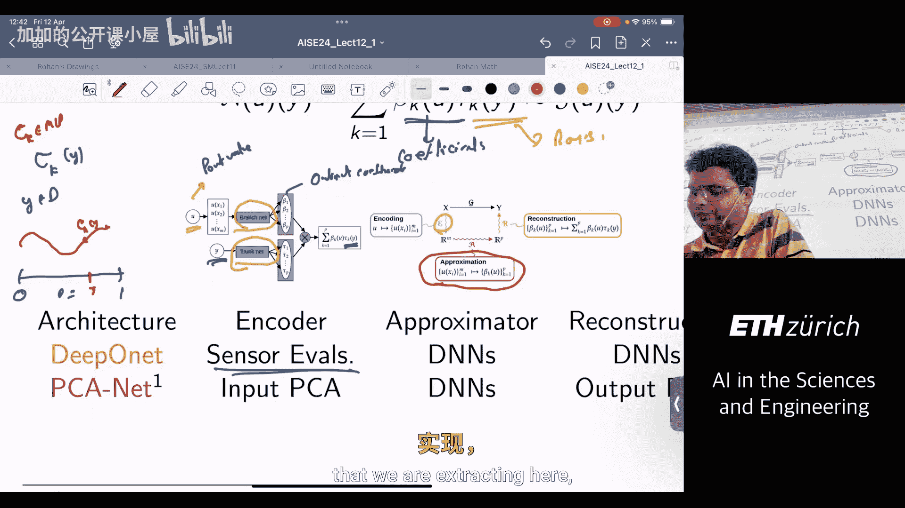

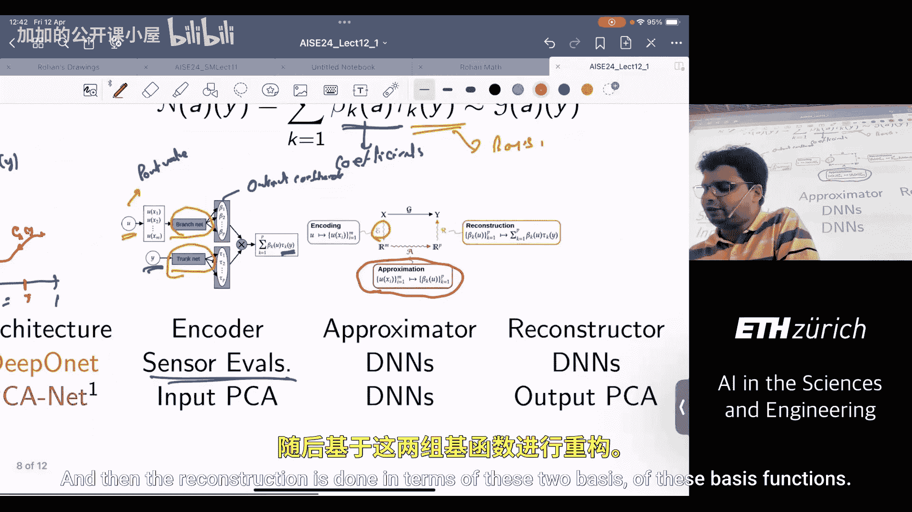

Something that takes into account functions， so the inputs， you take that point values。

 you use them in the coefficients simultaneously you are learning a basis for different problems。

 of course you will have different basis right so seems like a very smart idea it's not very unrelated to something if people know some statistics or basics of statistics there is something called PC principal component analysis so it is similar so in principal component analysis also youll learn basis and these basiss are based on the principal components on the statistical structure of the data that you are given so it's a little bit like that instead of taking the principal components you take neural networks because in principal neural networks can approximate anything。

So the construction itself is very neat in that sense。

 that you have a learnable basis and you have learnable coefficients where these spaces are going to be expressed。

Are there any questions about this， everyone on just yes。嗯。Can just describe more how you see that。

there is a difference because PC head is a more a little bit more in this period that yeah I can also describe it quickly so what is PC PC is that if you I'm not going through too much of detail here right because I need to write on a lot of stuff for that in particular I need to introduce what is called the covariance operator the covariance matrix because the PC is nothing but eigenfunctions or eigenvalues of this covariance matrix so think at a very abstract level what PC does is that it looks at the data that you have okay it just looks at the data that you have and it extracts the basis from the structure of the data it does not do any processing of the data it extracts the basis from the structure of the data and this is so you have this inputs here UI。

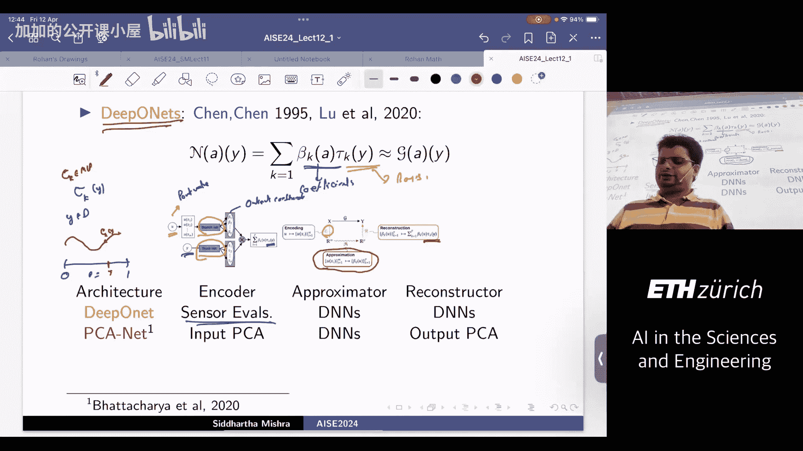

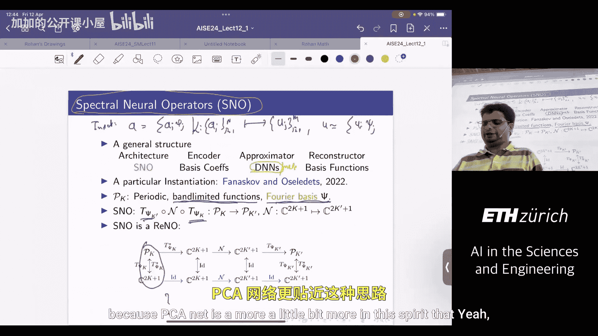

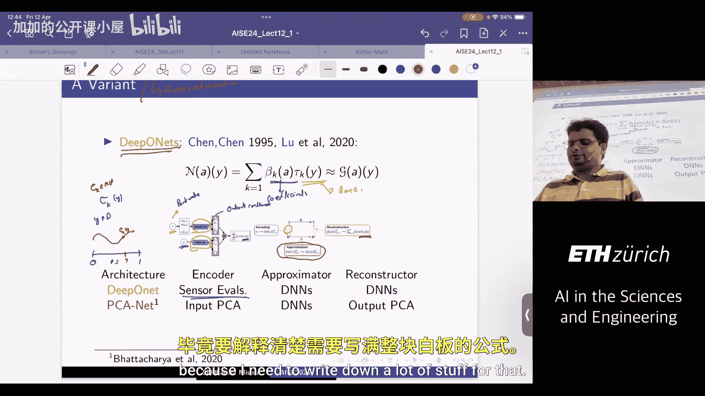

AI I don't know how how I express them and then there are I don't know thousand data pairs let's say thousand examples let's do a concrete example here and then I can explain so let's say thousand examples of these guys right these kind of sheer initial sheer layers and then what you do is that you put them all together and then you compute their covariance this is is a matrix there are some efficient algorithms available on how to extract its saigenvalue so you an itsig vectors and then you rewrite this in terms of any input a is now written in terms of some AI。

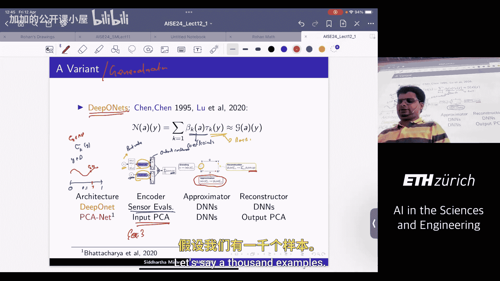

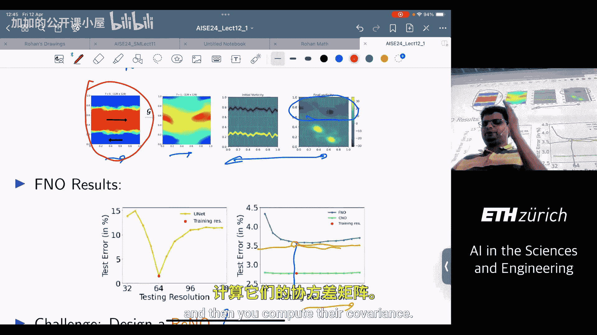

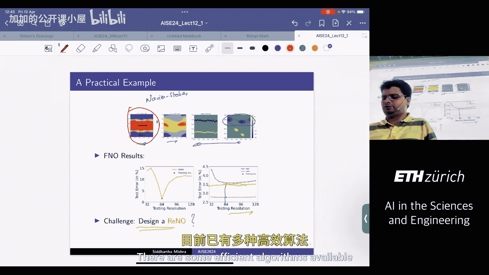

Or a J。PJ and this Pj is this PCA basis for the input okay and you do the same at the level of the output you just look at the data and you are extracting the output PCA basis also means these are pre and or preprosing in some sense right you' have been given the data and you form a basis if you get new data that are also algorithms on how to augment this how to augment the basis and so on and then in between so you have similarly for the output you would have I don't know let's say U is the output so it's some Uj cij right and then you need a link between this Aj and this UJ and this is provided by a neural network。

Okay。So in some sense you are also using learning， but you just use statistical learning at the input of the output and in between you use neural networks so there is a difference here in the sense that you're not simultaneously learning the basis as well as the and now here there is a different basis for the inputted now output potentially whereas with the dePonet you're trying to learn the same basis okay so these are somehow intrinsically connected to each other because of course I can approximate my PCA functions by neural networks。

Or I can also approximate my neural networks by PC of functions。

 So theyre they're all somehow close to each other in spirit。 They are sort of。

As I said slightly different from what we did before。

 which was that we directly work with the image or we directly work with the function。

 the sort of the spatial structure of the function here you just take the function。

 you put it into a bag of coefficients and these coefficients they sort of implicitly represent the function you process them and you come back okay so you are just doing all the processing at at a very parallel level in some sense is that clear okay so now what is the good thing about it is that of course you can you can train it like you train defno and so on and in fact people have done that that's and the good thing is that these are also ares because again for the same principle because now you are always restricting things into some finite dimensional space irrespective of what grid that you' are looking for because now it's just a fixed set of sensors so of course there's no issue there and in fact there are some conditions for instance this even though。

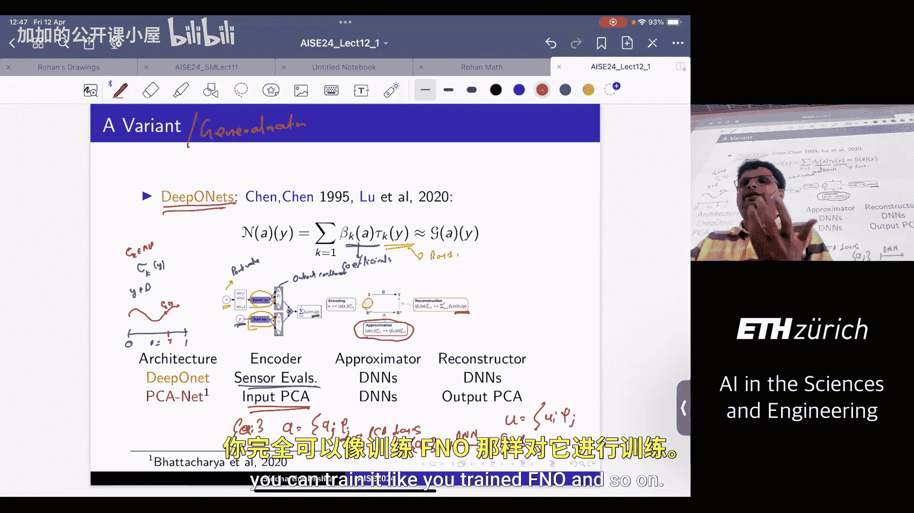

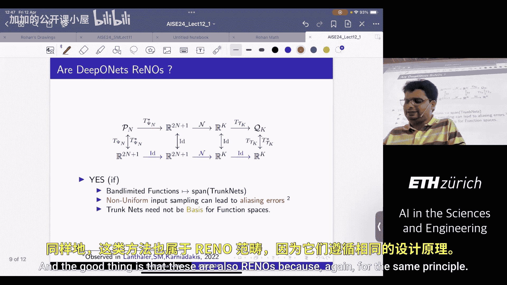

You are sort of training it as a basis。With the PC there is no ambiguity whatsoever if you have infinite number of samples then it will be a basis that is a guarantee there here on the other hand。

 there is no such guarantee you're just trying to have the semantics of a basis and you think that your learning problem is going to provide you a basis it need not be a basis okay it need not be a basis these functions actually they look nothing like a basis in practice but it need not be a basis and in fact that is not necessary the theory is such that it's enough to work with what are call frames these are not basis functions but frames and then of course because you' are doing it on nonuniform grids。

 random grids and so on there is some aliasing error coming from there you know so if you do it on uniform grid there is no aliasing error because nu conditions are satisfied and as I kept on saying that this need not be a basis。

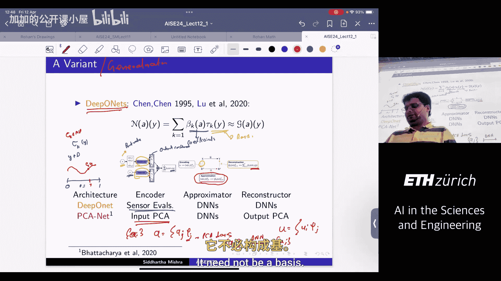

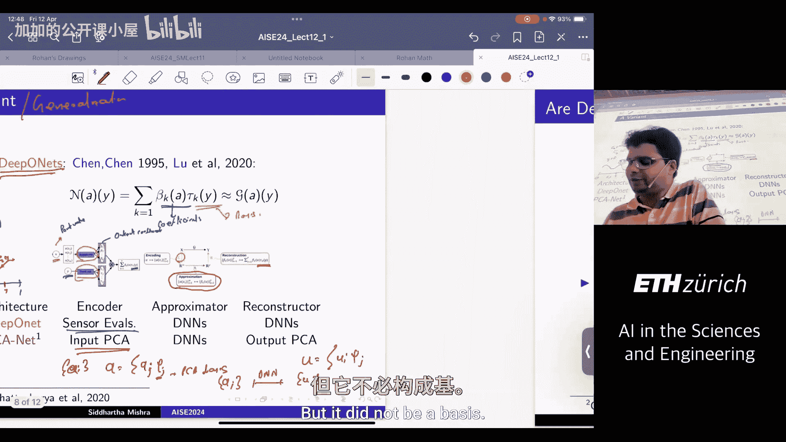

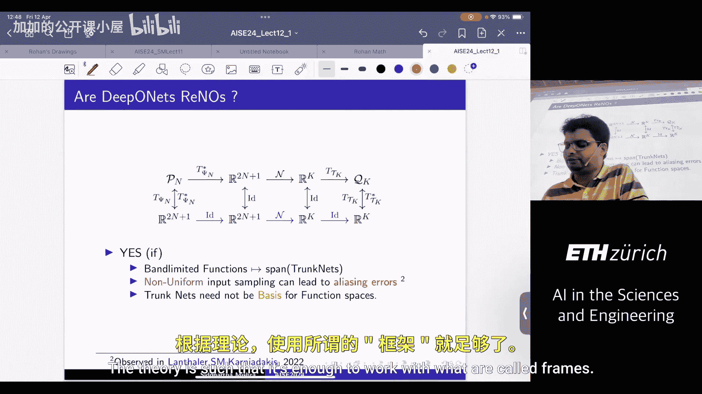

Okay， because there is no reason why we sort of impose orthogonality and so on。 This is objective。

 but in the training process， we are not doing it。 we could impose it in the training process。

 we could say that there is some orthogonality condition that we are going to impose but that is not fair because you don't know exactly what nor or what in a product that you are going to use right from the data how are you going to know what is right in a product to use。

 So it's it's not is' not that clean in that sense。

 you see so this is just this is an option that is always available to us and in fact。

 it's it's a baseline in some sense。鱼。But it has it does what it does in this sense right that it is you know it is able to represent data from different grids simply because it projects them onto to some particular bag and then process system them。

 so in that way there is some cheating。

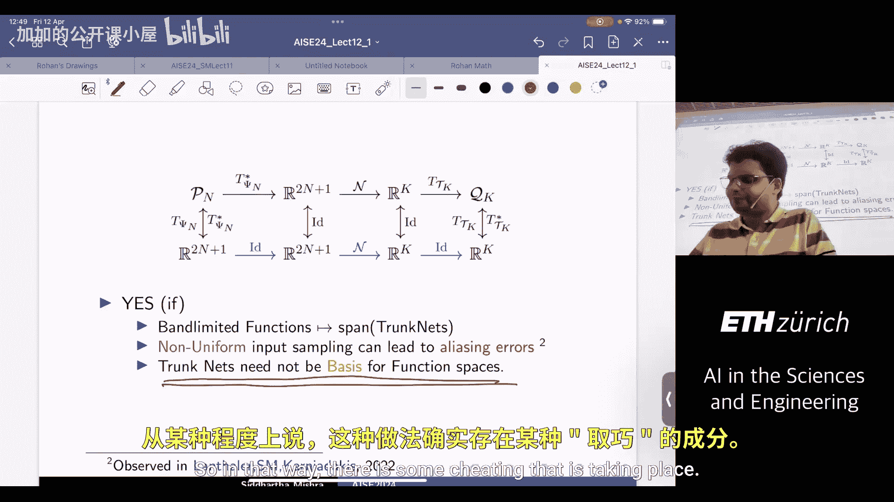

That is doing that is taking place but what is what is the issue with this then so is this clear what is the construction here so what is the issue do they work in practice some cases of course they work in practice but however I'll give you a very simple example where some of the problems of this approach comes up so the simplest and nonlinear equation that you have a PDE that you can think of is what is called the Burges equation。

That is a Burges equation。It was invented by burgers as a model for obviousvi talks。

It turn out to be such a good model， but it is what it is。

 So the equation itself is given by this form in it's it's a 1 D equation space time。

Sometimes people add viscosity， but this is not important here。

 let's look at the invisit form the invisit per equation and then well have some initial data。

Which is a of x， and that is chosen from some measure mu， which is a probability measure。安心方一只话。

Okay so this is a very， very simple setup and in fact in this particular case。

 our initial data was chosen from what are called Gausian random fields So Gausian random fields are a simple generalization to functions of brownian motion for instance So something which is related to brownian motion so these are essentially noise So you start with some sort of colored noise。

 some structure of noise Gausian random fields， but that is just to give you a concrete numerical example other examples will work equally equally well So you start with Gausian random fields as initial data。

 and then you let the solution evolve at relate to times So let's say that what happens at t equal to one So typically function with the Gausian random field might have the following shapes。

 something it would look something like this that would be a typical example of a Gausian random field now you put it into the nonlinearity and what an nonlinearity does for those who come from fluid mechanics。

 this is obvious that this is going to sort of steepen steepen。StucsSo because of that after a while。

 if you have initial data like this， these little noise structures will clear out and you'll get the formation of what are called shock waves sharp fronts so this is what happens for instance when the aircraft is flying across the sonic line faster than the speed of sound the sound waves that are coming out they sort of breach the sound barrier and create shock waves okay and this is how the solution looks like the solution is an orange as you can see the ground root which is generated by numerical mental method but now we use theponet with I don't remember how many samples for training maybe around1 thousand I really don't remember this and then you can start seeing what the problem is right so of course it provides you some answer but several things are wrong it does not get the right position of these discontinuities and of course once it does not get the right position it does not get the right amplitude and in this particular case the error is very large it's like 30%。

The relative error but it's the percentage is not as important as what you see on the picture right where sometimes 30% is acceptable if the problem is very hard。

 but there' is a very simple problem and this is a lot of errors so clearly somewhere even though all this nice structure preserving properties are satisfied something is going over otherwise we would have solved the problem and this was somehow answered a little bit because now we compare it with the FNO right because fNO does not have this structure preserving property that doesn't mean the structure preservation is bad but it's just one dimension one metric along which you evaluate things so for instance there is some theory from my lab what we do is that we compare the two theoretically very very simple problem。

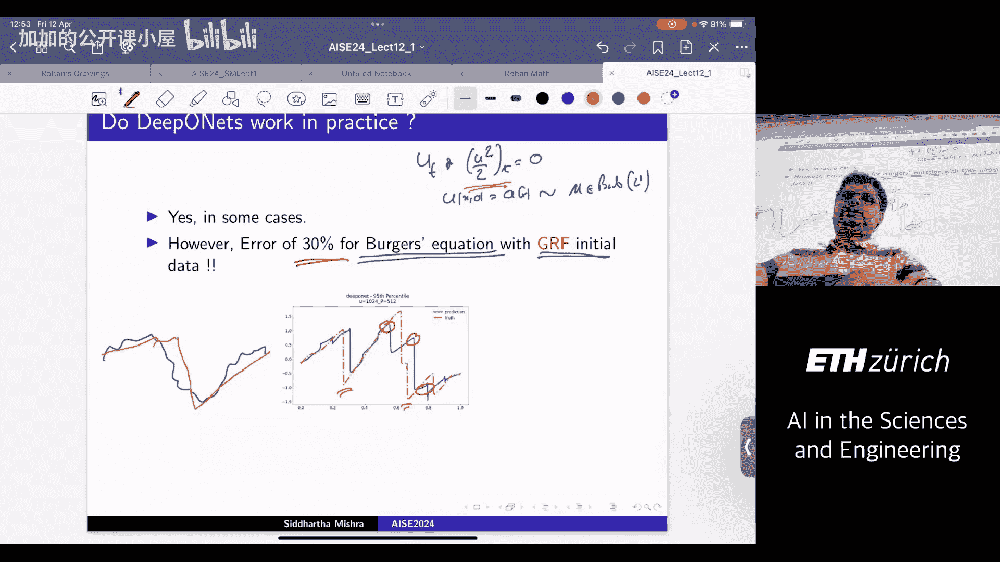

The same can be done for Bvis equation also， so if you take linear fact。

 so this will be Ut plus UX C U equal to 0。And you know what the solution is going to be right so you of is youre not the initial data minus c right so for instance。

 if you start the bump like this， you just transport it right and you start with a slightly different bump you transport it to the same location but just the shape is different it depends on the initial data so one could prove in this case rigorously mathematically that in principle assuming that you can train perfectly。

 which is never the case， but even under the assumption that you can train perfectly to get an error of a certain magnitude epsilon in this particular case with a deep net you need it's quadratic in the in the sort of in the error so to get 1% error which is one over 100 you need let's say the number of parameters the size is like 10000 is just a rough calculation right there are some con here but say of the order of the 10000。

Nothing but that that's that's a number because F&O for the same problem。

 you can prove rigorously that it scales like a log aathon。

So it is not let alone being linear it's not like you need 100， you need 10， you need log of 100。

 so this is a rigorous proof which says that for solving exactly the same problem。

Albe a very academic problem for FNO， you need something which is logarithmic in complexity and for deepponnet。

 you need something which is quadratic in complexity。

 So even if you are trying to learn the basis and so on and so forth。

 it does not really pay off with respect to accuracy。

 you preserve some structure well done good but it does not pay off in terms of accuracy because you are far off from what you want to do and this is also shown。

 I think this is for action equation， even for this very simple problem。

 you can see that deepponnet gives you around 8% error whereas FNO gives you one-1th of that okay for the same size。

 you get one1th lesser， Of course this theorem is what it is means it' it's a neat theorem but there are constants and it's difficult to evaluate the constants。

And so this tells you that it's only a part of the story to preserve the structure in FNO also has its own advantages and by。

Sort of putting everything into one fixed basis or one learnable basis you don't really solve the problem because some of the vital information is lost and this is the reason why DONe actually does very very poor in practice so here is an example of same problem that we have seen before so this is the ground truth and this a prediction of FNO which is a fairly reasonable prediction there are as you can see there is some interference here there is some issue here so there error I think with FNO was like 4% I don't remember you will see it in the next lecture and CNN this is unit the one that we have seen before you see that there is this aliasing but it also did does a reasonable job and look at what happened to DONe it just predicted the average over the entire sample so it simply does not have the performance so this is in this particular case it's 12 or 15% but it simply did not work in any reasonable way。

And this is primarily because of course there is some theorem which tells you what's going wrong。

 but intuitively what is happening is that we are losing some structure of the problem by somehow putting it back into just one fixed set of parameters which is precisely the point that you said right What is the difference in terms of parameters in some sense there is not there is a little bit of a difference but morally youre doing the same you're not really keeping the sort of infinite dimensional structure。

 you're solving one problem but you are creating another that you lose the expressivity so the challenge very much remains which is that we need to design something that really works and I would say it's still a challenge。

We have not solved this by any means， but in the next lecture。

 I'll start showing you architectures which go further in this direction that they preserve the structure while at the same time they also work。

But it's also important to know what are the things that are out there and what works and what doesn't work。

 So this was sort of the main objective today。 Okay， so let's stop here。 We are almost on time。

 which is editing。 But and then we next week we we continue with。This this team further。

