# 苏黎世联邦理工【中英⚡科学与工程中的人工智能｜2024 AI in the Sciences and Engineering】 p14 P14 Convolutional Neural Operators -BV1smxgzHEPC_p14-

Okay， so welcome to lecture number 14 of the course。

And let's start with a very short summary of where we are。 right。 So again。

 the task is the same as before。 So we have the PD D。

 which is given in this abstract form and underlying the P D or along with the P D。

 there is the solution operator script G calligraphic G， which maps functions to functions。

 So it takes in the inputs here， it could be the coefficient。

 say the source terms F and it turns out the solution here。 So this is the setup that we are in。

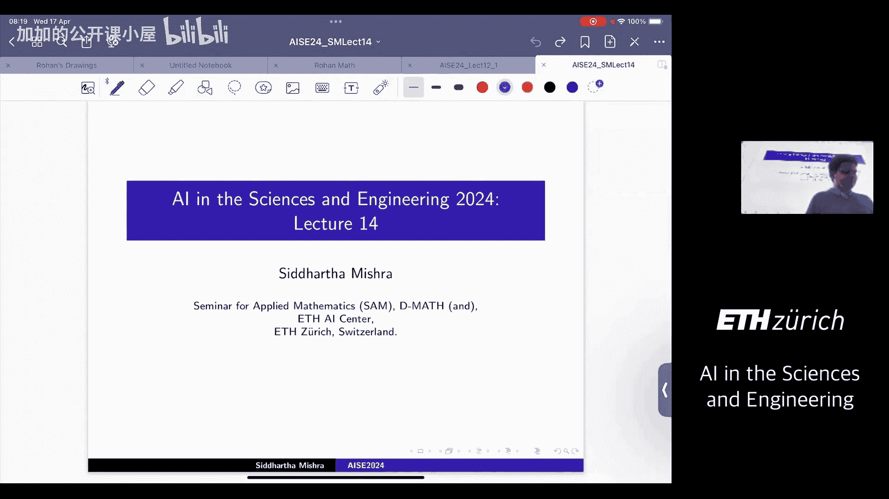

And since we are dealing with mappings between function spaces， as we have seen before。

We have to be careful。In particular， what we have to do is to ensure this principle of continuous discrete equivalence。

That I've been rollinging on about for long。And we do that through this representation equivalent neural operators。

 The idea is very simple that instead of looking at mappings between function spaces。

 we do an exact correspondence and an exact equivalence by going through discrete spaces。

 For instance， functions on a grid。 So you start with the continuous function space。

 you go down to the discrete space like this。 you operate here。

And then you go up back through some reconstruction operator， right， And this diagram should commute。

 So this is the basic principle。And we are still in the search of what can be an effective reno。

 So in the last lectures， we saw that CNNs are not。

Because even the convolution operation is not preserving this structure， nor are FNOs。

 even though the convolution operation preserves， the nonlinearities don't preserve this structure。

 So neither of them are rhnos。We did see some examples， for instance。

 the spectral neural operator and the bot。 But these have， they performed rather poorly。

 So we still the objective， as I said in the last lecture。

Is to find a structure preserving continuous discrete equivalent map where know that actually works。

 And hopefully we will do that today。 Of course， there are always issues with everything that one constructs。

Okay， so this is a setup。 We are trying to find something which takes as inputs functions。

 which turnss as outputs functions。 and it does it in this structure preserving manner。

 which is illustrated here through the diagram here。Okay， so let's do that。 And to do so。

 what we are going to do is to essentially bring back convolutions。 if you remember。

Both CNNs and FNO， they were doing convolutions， right。

 So the essential mode of operation was always convolution。

So CNN did it in physical space and FNO in Fourier space。 if you recall correctly， and then。

Sorry about this， I don't know why this。Why it went back。Okay， so here we are。

 So there is convolution， and it's always followed by non linearity。 So convolution， No nonlinearity。

嗯。And what we are going to do is to see if convolutions can really be， because。Both S and O。

 as well as deepponnet， they did not use this convolution。 right， They don't。

 they sort of broke the structure of space， which is what I was trying to allude to in the last lecture。

 They broke the structure of space。 Somehow we have to bring that back the relationality between spatial elements。

So can convolutions be brought back into the reckoning。 And why is that。

So before the rise of vision transformers and diffusion models。

 convolutions were essentially the main models in vision。 So if you consider image processing。

 classification， generation and so on。 convolutions play even today， a very， very big role in it。

 right？ So this is one point about convolutions。 Second。

 particularly when you do them in physical space， there is a concept of locality。 In other words。

 if you think in terms of image or a one dimensional function。

 then what convolutions do is that nearby points， they are taken together。

So that neighborhoodhood relations， locality is somehow constrained。 And， of course。

 there is a computational efficiency in convolutions。

 because essentially what you can think is if you think of in terms of a matrix vector multiply。

 then convolutions， this matrix is going to be sparse， right。

 extremely sparse because it has this localization structure。

 So convolutions are computationally efficient and also one can realize that there are some links between convolutions。

 CN N Ns。And finite difference methods。 finite difference methods are a very popular way to solve P Ds。

 And it turns out that you can rewrite finite difference methods in terms of convolutional kernels。

 I won't do it here。 This has been done sometime back。

 So there is an intrinsic link between these methods。 So given these considerations。

 it sort of make sense that we bring back convolutions into the reckoning right we somehow bring them in。

 There is， of course， a big issue。 If you remember， even in our last lectures， two lectures。

 we know that they are not renos， CNN NNs are not renos。

 they are there is some inconsistency in functions space。And somehow， we have to work with。

 and we have to remove this inconsistency to be able to solve this problem in some sense。 Okay。

 how do we do that， So this will be the main focus of my lecture today。

Let me start by essentially saying convolution strike back。

So I'm going to describe in the next half an hour，40 minutes this architecture。

 which was proposed last year by essentially in my lab。

 And this is called convolutional neural operators。

 And you'll see that it has many of these desirable properties that we aspired for。

 So in in particular， it keeps convolutions。 So it has all these nice properties， locality。

 computational efficiency and so on and so forth。 In addition， it's also are。

 we are going to construct it in such a manner that it is going to be areno。

 But remember that the reason why we fail last time is because convolution itself。

 So remember that we always have this， let's say workflow， right， So we have convolution。

 We have no linearity。So what we have to do is to modulate these two。 So remember that for CNN Ns。

 convolution itself was no longer structure preserving。 And for Fno。

 even though convolution was structure preserving， the nonlinearity was not。

 So we have to work with both these layers or both these objects in order to ensure that the right kind of structure that we want is going to be preserved。

And that is what is done in CN NO， for instance。 So the idea is。

 and I will describe it in quite some detail。 But here is sort of a graphic。And again。

 the point is that we always have convolutions and linearities。

 There are many other operations that I'm going to describe in some detail。 So the picture。

 as you can see， is that there are many， many layers。 as always， these are sort of layered。

 There there is a compositional structure to them。 and what we are going to do is to see how convolutions。

 So convolutions play a role here。 This K is convolutions。😊。

And the nonlinearities are going to be given by this sigma。

 But there are some additional elements to it that I'm going to describe during the lecture。 Okay。

 so let us start with where we stand。So remember that with res。

 the point is that you have to work with the right kind of function spaces。

 So the function spaces cannot be too big。 Otherwise， we will not be able to retain the structure。

So the function spaces， this is， of course， a special case。

 but it's a very illustrative special case。 So what we are going to do is that we are going to build an operator。

 Let me call it as G a G star。 I don't remember。 how did I call this。😊，Do you start。

This is operator that is going to take functions to functions。

 And these functions are going to be band limited functions。

So remember that I define band limited functions。 So essentially， what you do is you take a function。

 you take its Fourier transform and you cut off the high frequencies beyond a certain point。

 So essentially for BW this is all the functions。 So you had you belongs to B W implies that the Fourier transform is the support of the Fourier transform。

 I should have used that。Support of the Fourier transform。

Of U is contained inside minus double double。 just for simplicity。

 It could be a vector space or a multidimensional space， of course。

 So we are taking band limited functions。 This allows us to work with this continuous discrete equivalence。

 because for band limited functions。 Remember that we can essentially the discrete version of it is essentially point values and a grid。

😊，Point values on a grid。 So in other words， if you go back to the diagram and this diagram is very important。

 That's why I keep on repeating。 So if you have band limited functions here。

 So let me use another color Bw， perhaps then this is just functions on a grid。

 So little L2 functions on a grid。 So there is a clear correspondence between the two。

 as long as this conditions are satisfied。 And nu conditions say that the grid spacing is essentially less than one over two times the frequency right Thats that's the basic。

 the basic idea behind these functions。 So we are always going to operate between band limited functions and my input here。

 U。

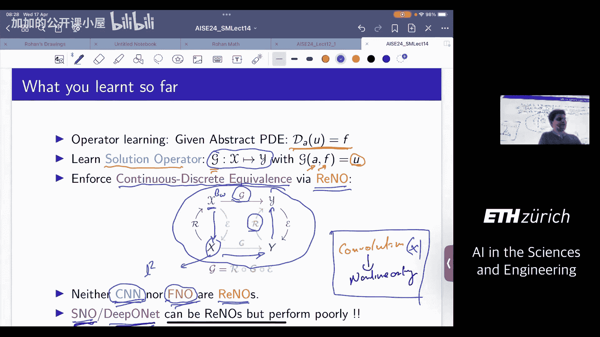

Okay， sorry for the notational confusion here。 but okay， does not matter。

 So my input is given as a band limited function， and my output is also going to be a band limited function。

 And in between， I' am going to process it through different steps through different layers and through different objects。

 right？ And so what are the building blocks， the obvious ones。

 which are similar to that of FO this lifting and projection operators。 So remember。

 the first thing that we do is that let's imagine that we are looking at the state of the weather。

 The state of the weather outside is given by several variables。

 essentially temperature pressure velocities， things like that。

 So there are fixed number of So this input here， So let's say that my U。

 which is input is some function， Let's say that this is a band limited function。

 which maps the domain D， the domain that we are in to some vector space。 So this is to are。啊。M。

 let's say。Okay， so this is the sort of And D is some domain inside R D。

So this is so there are m dimensional inputs。 Okay， think of density pressure， temperature。

 velocities and so on。 So the first thing that we always do is that these are sort of the physical features。

 There is no reason why this is the right kind of representation of the system in machine learning for a learning algorithm to work。

 So what one does is either to em it。 So typically what you do is that you embed it into a high dimensional feature space。

 Okay， so this is precisely this operator that it takes U So P U belongs to some R D in。 Okay。

 so D in is some high dimensional feature space D N is much greater than。We already saw that in F MO。

 So you can think of it as adding channels or channel augmentation。

 So this is the first step that you take your input。

 which has M features and you embed it into a much bigger space， which is let's say D in。

 let's say four features。 you go to 20 features or 100 features or something like that。

 So that provides some effective coordinate system where the learning algorithm can function better。

 So this is needless to say almost in every algorithm。 This is this is fairly standard。 Okay。

 so this a lifting operator。 Then you work with this v0。 This is the sort of the lifted version。

 So this has more channels than much more channels than your original signal， right。

 then you do your processing。 This is these other steps。 the processing steps。

 And then you end up with some output after x number of layers， usually to 10 layers。

 and then you have to come back to your density， your pressure， your velocity。

 the number of channels that you have。 And this is typically your back to your。RM， right。

 So this is the thing back， the projection back。 So you take all these channels and you shrink them back。

 Now， P and Q， this can be simple linear maps。 That's the easiest way ten source， essentially。

 or you can take them to be M LP in general， M LP。But at least in the implementations that we have。

 these are mostly linear maps。 Okay， so P and Q， these are linear maps， they don't do anything fancy。

 They don't work with space at all。 So they don't change space。

 So all that they do is the add channels or take out channels。

 So these are by definition re means they they don't affect the structure of space。

 So there is nothing nothing fancy happening there。 So is that clear。

 So this is a part of every this is a part of every package that you。

 you sort of associate a new coordinate system that is better able to learn features in the data。

 Okay， this is， this is sort of standard。So now what we have to operate is given these two operators。

 we have to work with the two essential ones。ませ。You know what I have actually forgotten to start the recording。

Okay， I have to somehow batch this。Sorry about that。 People miss half an hour。Okay， coming back to。

I will， I will patch it up later。 So essentially， what you do is that you do this projections and this lifting and this projection back。

 right， So what is left then is that you have to work with convolutions and nonlinearities。

Do you have a question， I can no。毎し。Mh。Yes， I will。 I will just， just hold。

 hold your patience a little because I will talk about them。 Like。

10 is just a number that I threw out。 It could be 3。 It could be 6。 It could be 12。

 I think the biggest models that we have probably have 16 layers。 So it's sort of。

It depends a little bit on the data that you have。 It depends a little bit on the compute that you have and so on。

Okay， so now let us look at the key building blocks because this lifting and projection。

 they generally come with the， with the basic structure。 So the key building block is， of course。

 the first key building block is convolution。So， this is convolution。In physical space， Okay。

 this is the difference from FO， because we are going to do everything in physical space now。

 which is good because it keeps some locality。 It doesn't matter what boundary conditions you take and so on and so forth。

And what is the contrast now。 So remember the contrast is always with the CNN， because the CNN。

 Remember that this was the structure of the CNN in the CNN。

 we had everything working at a discrete level。 And as a consequence。

 we fail to have this structure preserving property。

 But let me now try to explain how the convolutions were。 And this requires a little bit of time。

 So what we do is that we have continuous convolutions。So， of course， everything is continuous。

 We have continuous convolutions， But， of course， on the space of band limited functions。

 So in other words， the you have to do a convolution。 So you have F。

 which belongs to band limited functions。😊，You have a convolution kernel。So this is as before。

 So you have a convolution kernel K Dler。And then you have to do a convolution。

 So KW star F is nothing but the integral over D of Kw x minus Y， f of y， d Y。

 which could be the same as Kw Y， F of x minus y dy。So this is in the function space， right。

 But we have to do something at the discrete level。 So what we do。 And this is the key trick here。

 There are two key tricks。 The first is that our convolution curl itself is actually discrete。 Okay。

 what does that mean， That means that this K W function， K W。😊，Of Z， for instance。

 is nothing but a sum of some K J Delta。 I'm just talking in one D， but this is our in 2D，3D，4D。

 whatever the generalization is obvious。Z J。Okay， so what you do is that you still keep the kernel discrete。

 In other words， so this is a direct。 Okay， all of you should know this notation。

 This is the direct Dlta function。So in other words， if you have a picture。You pick some points。

 These are generally points on a grid because remember that we have band limited functions。 So we。

 we have points on a uniform grid。 And then essentially。

 what you do is that you have different values at these points， some K2， some K1。K 4， K 3， K 4。

 something like this。 You fixed the size of the kernel。 The size of the kernel is fixed a priori。

 And these are discrete points。 So what does that mean。 So if you now evaluate this integral here。

 follow。 So this is discrete。 So this will simply mean that this is a summation over J。

K J of F of x minus Z J， right。 So this is what it is。

 So what you' are doing now is that you're fixing the discrete kernel as before。

 as in a convolution in neural network。 But you are acting it in a continuous manner。 Okay。

 so this is sort of the first key point that we are and we are with band limited functions。

 So we are always having a clear correspondence， a clear sort of mirroring between the continuous and the discrete。

 But why is this a means how do we apply it on different grids and so on。 So， first of all。

 I will explain it in two stages。 So in terms of the commut diagram。

 this is fairly straightforward because you take band limited functions。

 and it is straightforward to compute to straightforward to calculate that once you take this discrete kernel。

 then this mapping that I define here is going to map to band limited functions。

 It' it's a one line argument。 You can check it in the paper， for instance。

 But at the discrete level， what happens is that band limited。

Functions are related here by the sink filters。 So the remember that this size here。

Are given by sync functions。Or you can think of a band limited function。

 F of x as the summation of F of x J。Thinkk of X minus x J， roughly speaking， right？ So this is the。

 this is the basis interpretation that we have。 And because there is this clear correspondence between point values。

 it is a little argument to show that even this entire diagram。 so you can come here。

 you can work here。 you can go like this or the other way around。 It does not really matter。

 It is the same。 It is the same problem that is being done。But okay， so this， this structure。

 this algebraic structure is very， very clear。 But how does it contrast with CNN means what is the difference that we did with CNN that changes things。

 Okay， and this is best explained。 So remember that we have this discrete kernel。 Okay。

 and we are going to keep this kernel fixed。 We are not going to resize the kernel as some of you suggested what we are going to do is to resize the functions。

 Okay So the inputs。 So here， remember that this was the issue with the with the CNNs。

 Let me revisit this。 So what we did was that I took my kernel。 is similar to what we have before。

 I took my kernel。 I took my signal。 So I took the let's say on a course grid。

 I took these values multiplied them and I got some answer。 and then I took a different values。

 because now youre on a final grid。 I multiplied them。 and of course。

 I got a different answer because I was not changing the kernel。 nor was I changing the input signal。

Now， the difference here is because we are working with these man limited functions and because there is a clear correspondence between the continuous and the discrete。

 This is how you do the convolution operation。 So let us say， so this is， this is as before。 So okay。

 so this value is as before。 Now when we work with with this let's say new signal。

 What you do is because you have a correspondence between the continuous and the discrete。

 which is exact if the barrier is satisfied， So what you will do is that you will take this function。

 you will take this point values。 Remember that you take this point values。 you go。

 you are going to lift them up here to the continuous level。

 you are going to pull it down to the discrete， right， because then by the sync filter。

 you can pull it down to the discrete。 And then you apply the discrete kernel again。😊，Okay。

 and because these two functions are identical， what happens is that by reinterpolating like this。

 you are going to essentially do this operation here。That first， you start with your discrete inputs。

 pull them to the continuous function space。 then resample them to the new or the coar grid。

 which was your original grid where the kernel is defined applyly the kernel。

 push it up again to the continuous case。 and then go back okay so this is the reason why by working with these discrete kernels。

 And while by at the same time keeping the convolution kernel fixed。

 but resizing your input functions back into the size of the convolution kernel。

 you are able to enforce that this re property is satisfied。

 Okay so it's somehow the fix was in the understanding of the problem itself。

 because we understood that the problem was that you are working with different function spaces。

 different grids and you are using the same kernel Now all that you do is to resize back to the same grid。

 you can do that because you have this band limited functions。And then when you do that。

 you can see that you can apply the same grid just by reinterpoolating。

 you you get back the original function。 So is that point clear。 So in other words。

 this evaluation is not done directly。 It is done like this。 So， of course， obviously。

 this renal property is going to be satisfied。 So convolutions are done in this particular manner。

 And these are sort of the key points sorry。あ。I'm very allergic。 So it's sort of。Its not a cold。Okay。

 so this is the key point behind the convolutional left that you have this sort of resizing of the input rather than resizing of the convolution kernel。

 Okay， the kernel is always going to be fixed。 or this is one way， of course。

 the way in which we implement。 perhaps there are the ways where this can be done。Okay。

 that's so much about the contrast with the CNNs， how we change and how this is kept structure preserving。

 Now， what about nonlinearities， Because remember that its always convolutions and nonlinearities。

 So now we fixed convolutions， But you can say， okay， what's a big deal because in FNO。

 convolution was already fixed， right？ So there's nothing， nothing new that is happening。So。

 but the new is also the level of the non linearity。 And this is where interesting things happen。

 So let me give you a quick recall。 So if you remember for F MO， So this is a quick recall。 Now。

 I really need to。 you guys need to really focus。So if you recall sigma。

 this is the application of the nonlinearity。Was the mapping， you take an F， right？

 So you take a function。 you apply the nonlinear nonlinear linear narrativeity on the function。

 you evaluate it at a point x。 This was nothing but sigma。

 your usual nonlinear nonlinear narrativeity。Applied on F of X。 So this is how you did it in F MO。

 So you took a function and you just applied point vice relu， for instance。

 or some other activation function。 And remember that this was the problem then。The problem was here。

 So the orange here is the signal。 the， the， the function that is there。

And then you apply an nonlinearity。 Let's focus on relu。

 smoother non nonlinearities don't make a big difference， but you take relu。

 and then you get the function in blue。 So all the negative parts are copped out right。

 So this is the action of relu。 But when you look at it in Fourier space， remember。

That we are between band limited spaces。 So if you go between。

 So what happens now is that the original function， the function in orange。

 it was between -20 and 20 in frequency。 Okay， it was capped because if we just took band limited functions。

 As soon as you tooklu， what happens is that lose is an on linearity。

 Just imagine if you have the square。 were anything between -20 and 20 sine 20 x squared becomes roughly sine 40 x。

 right， So you introduce higher frequencies。 Of course。

 what happens is that the coefficients of these high frequencies could be small。 because。

Function as some decay properties。 But you still see that there is some leakage outside。 So。

 for instance， if you take 40， for instance， here， you can see that there are non0 frequencies。

 Even at 60， there are non0 frequencies。 So what happens is the linearity breaks the band limits。

 So all this nice picture that this leads to anything because this continuous discrete equivalence is going to be broken in this particular case。

Instead， so what are we going to do， How do we solve this problem now。

 So the solution of the problem is in identifying the problem itself。

 just like we do with convolutions。So here is the idea。 It's a very simple idea。

What if at the application of the nonlinearity， instead of working with the point by nonlinearity。

 we do the following。 Okay， so remember， that this was my barrier。

 This is the frequency outside which as you can see that there is leakage， right？

 So what if during the application of the nonlinearity。

 I allow my frequencies to grow in some manner。 I allow my functions to have higher frequencies。

 in particular， let's use the double the cutoff。 let's go to 40。 Al right， if you go to 40。

 you can see that the frequencies beyond 40。 It's still not cap because relu， you know。

 it's infinite the response is going to be infinite， but if it were would have been a square。

 this would have been between minus40 and 40。 But now the higher frequencies。

 the leakage here is much smaller。 compared to the original leakage that was here， right。

 So you would expect that the effect of aliasing would be reduced。 Okay。

 so the idea is to somehow accommodate。This feature of nonlinearity。 What do nonlinearities do。

 They take a signal with K frequencies。 and they increase the frequencies。 So then when we apply it。

 we know that the frequencies are going to increase。 then， of course。

 the nice structures that we have a loss that are aing errors。

 So what if we do the following that we start with the function。

 allow it to have higher frequencies artificially potentially apply the nonlinearity with this high frequencies。

 and then bring back to your original frequencies by using a low pass filter typically， right。

 So this kind of an arrangement will imply that we will leverage the fact that new frequencies are created by sort of steming it in the beginning。

 we say， okay， find new frequencies are created。 So what Because I allow for that。 Okay。

 so this is roughly the intuition behind it。 And the idea that and to carry this out。 This is。😊。

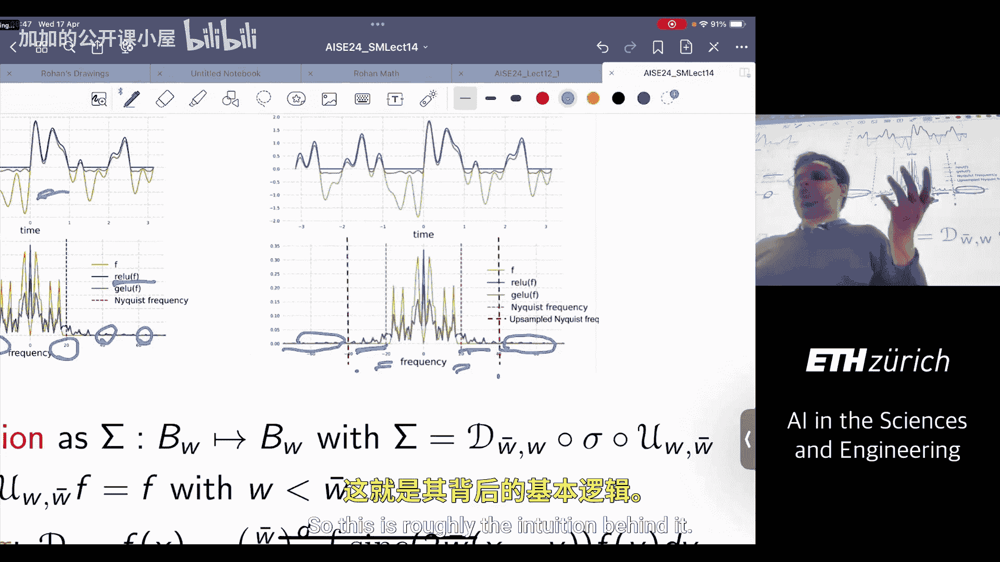

This， these kind of ideas were around in the world of vision， but we brought them with this sort of。

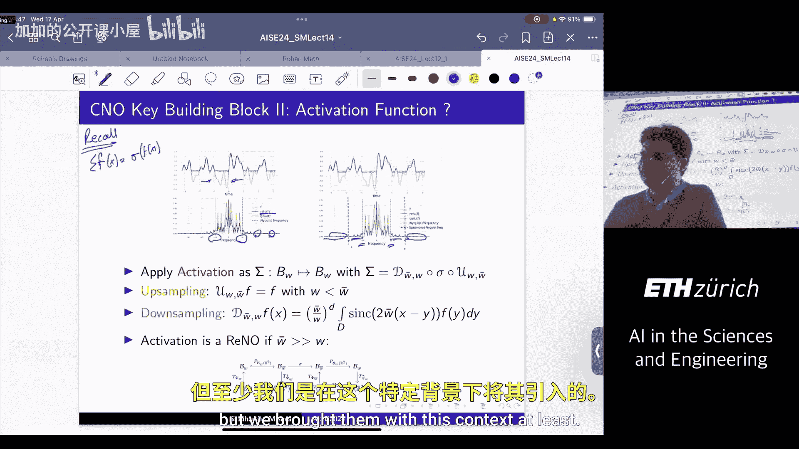

Context， at least we provided this kind of context and this clear mathematical understanding of these ideas。

 So what we are going to do is that we are going to apply two key operators。

 which are going to be new sort of objects that you have probably not seen before in this context。

 And this will be what I call up sampling。And down sampling operators。

 So up sampling is allowing for the creation of these new frequencies。 Then you apply the linearity。

 and down sampling is coming back to your original frequencies。 because remember。

 at the end of the day。

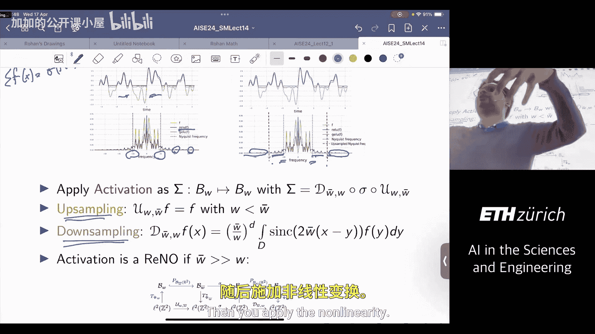

I am always working between these band limited functions。

 So I have to somehow come back to my original band。 But while doing so。

 I am introducing these new frequencies and these new frequencies are through this up samplingling and down samplingling operators。

 So before I write down the expressions， let me try to explain what it is。

 Perhaps I can use a figure， maybe this one。

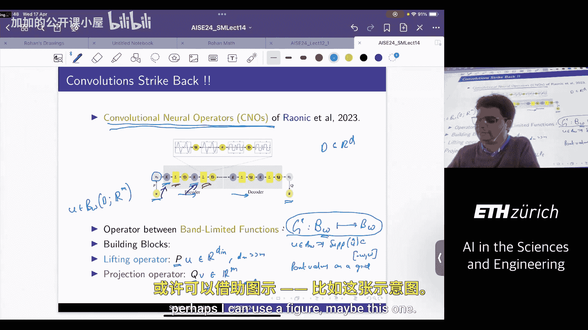

Okay， so this is the nonlinearity。 This is the nonlinear activation module。Activation module。Yeah。

Of C。Okay， so what what does it do。 And please try to focus。 So youre given your input。

 you do the convolutions。 Convolutions Keep the band。 This is what I have kept on saying。

 So you do a convolution。 and then you apply this activation module， which is capital sigma right？

 So what you do is your signal， your input to this layer to this band to this module is here So this is the function with just for illustration here。

 we have taken 10 frequencies or 8 or something like that。

 So these are given by these points or four frequencies and that evaluating at  eight points。

 So what upsling is going to do is to increase the number of frequencies。

 If you increase the number of frequencies， you can evaluate more points while still keeping the same structure right。

 So trivially if you if have access to a continuous function。

 It simply means evaluating this continuous function at more points right So this is these are the new points as you can introduce you are introducing a new grid here。

Okay， depending on which band you want to go to。 So this is done by saying that you want to double the band。

 but that not be the case。 you can increase it by a factor of 4 by a factor of 8。

 depending on the nonlinear nonlinear narrativeity that you have。

 depending on the problem that you have。So you have this additional introduction of frequencies in the continuous case。

 you do nothing because your function is anyway defined at all these points。

 But in the discrete case， you have to do some sort of an interpolation。

 Okay and then you apply the nonlinearity， this will be point wise。

 okay so the up sampling is a non localal operation because you are introducing new frequencies。

 and this is not done physical space。 it is done Fourier space。 So this is new frequencies。

 non local。 This is still local。 You can apply a Galu， whatever nonlinearity s。

 whatever nonlinearity that you have here nothing nothing strange here。

 But now you have a allowed for this high frequencies， right。

 So this means that even if high frequencies are created， they remain within the same band。 ideally。

 then you have to come back to your original function。 and this is， again。

 the sync interpolation because now you you have these functions， which are defined on this new grid。

 roughly speaking， And then you come back to the original grid So you take the。

ctions you take the sink inter po and project it back。 So this is your down sampling。 Okay。

 and this is the way in which you can go from a band limited space to the same band limited space while artificially growing frequencies and then quenching them later。

 Okay， so this is roughly the intuition that goes in。 Of course， you can to realize it。

 you need some formulas。 And these are probably given here。

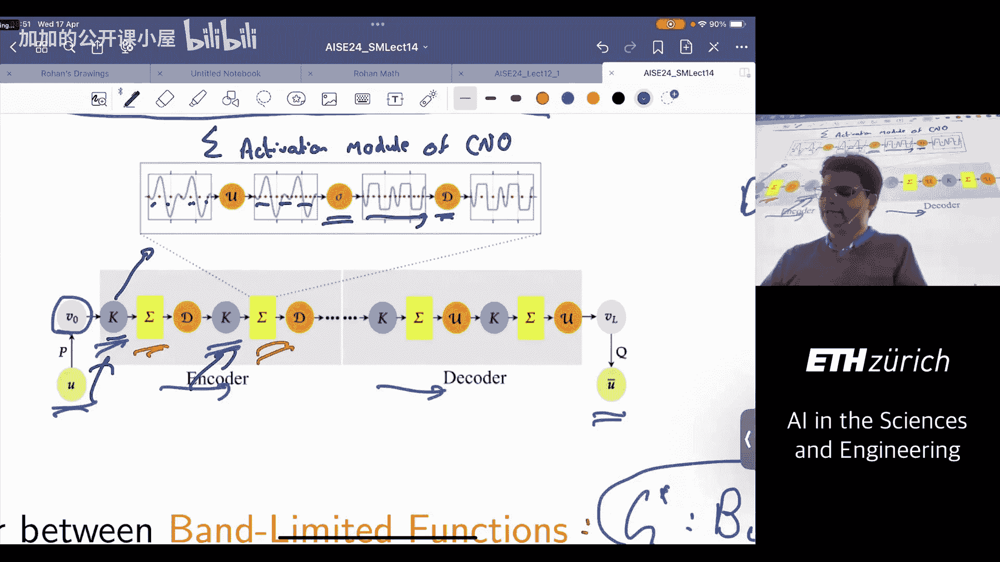

So as I said， at the continuous level， up sampling is nothing because you are just evaluating a function at new points。

 So these are the this is your original band。 But this is your new band。 Okay， this could be double。

 in practice， actually， we say it to be double。 But you'll see that there is a subtle point about whether it should be double or four times or eight times and so on and so forth。

So this is straightforward。 In discrete terms， you have to do this with some interpolation。

And this is interpolation with sync。I think you saw that in the。

 in the tutorial on CN and down sampling is again an interpolation procedure because you have to go to the sync functions。

 and then you project them back to the original points。 And this is again， done through this。Sorry。😔。

Again， done through this formula here。 Okay， but the， the detail is not important。

 What is important is the intuition here。 So at all times。

 we have this up sampling and this down sampling operations。 And these two things are very。

 very important because they they have to work in tandem。 Now， it turns out that， for instance。

 if my linearity was a square。 Okay， if my nonlinear linearity was a square。

 I know exactly that as long as this omega bar is greater than or equal to 2 or omega or w bar is greater than or equal to 2 W。

 then this entire process is completely areino。 Why this is for a square linearity。

 I'm going to illustrate it further linearities in a bit。

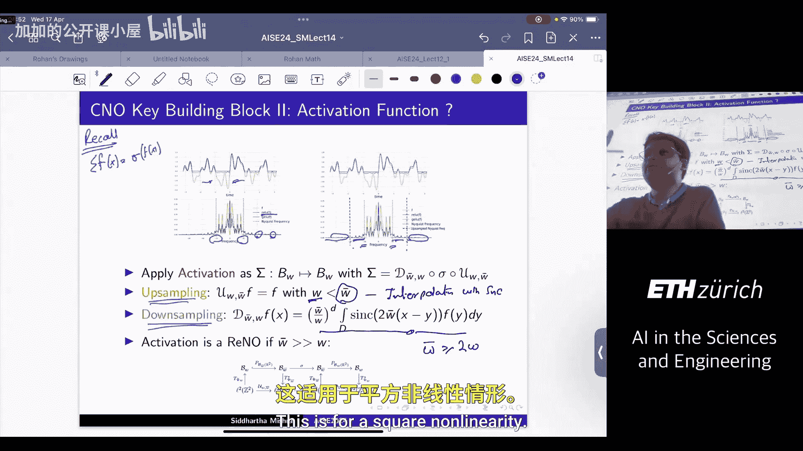

Because what do you do here。You go from W to 2 W。 This is and this is done by this up samplingling。

 and this is precisely this sort of lifting operation in some sense or raising it to a higher frequencies。

 which is trivial in some sense， because of course。

 these functions function with 20 frequencies is contained inside functions with 40 frequencies。

 there is nothing nothing to be done here， then you apply the nonlinearity。

 So now remembers that since it is 20 frequencies。 When you go to take a square。

 itll have 40 frequencies。 So this is， of course， well contained here。 this mapping。

 it is between W prime Pw prime to Bw prime。 And then from 40 frequencies。

 you can always come back to 20 frequencies by using this interpolation。

 And this is precisely the discrete version of these nice operators， which is what I just described。

 So of course， this entire thing commutes And this is why this particular realization is is a。

 Now just imagine that instead of applying the quadratic the。was not quadratic， but the power fourth。

 Then， of course， this double prime would be four times W， right？ Similarly， if it was power 6。

 it'll be six times double。 So if you take any polynomial， essentially。

 then you can compute the based on the highest degree of the polynomial。

 what this double prime could be。 So for polynomials， this is exact。

 this construction is going to be exact。 Of course， it is going to be expensive because to go to。

 you have to have four times more grid points，6 times more grid points。

 eight times more grid points and so on。 So you pay cost， it's not for free。 However。

 if you take rational functions。 So polynomials， this is exact。 right。

 if you take rational functions。 if your sigma of x is some polynomial divided by another polynomial。

You can still do this because you have polynomial。 you can solve an linear equation by Newton。

 You have polynomials on the left， polynomials on the right。

 and you can still do it exactly for rational functions。 But if you take things like relu。And s ss。

 for instance， can be approximated by a bi quadratic polynomial。 Then， of course。

 what happens in that particular case is that if this w prime w bar goes to infinity， Of course。

 everything can be approximated by polynomials and you can you can do this。 But in practice。

 you cannot go to infinity， right， you have to fix a band。 So you will have some error。

 but as you can imagine this error will be smaller， then it would have been。

 if you did not do this upsampling， because if you did not do this upsling。

 then these high frequencies would have corrupted your signal， right， But by doing this upsling。

 even a double， then you sort of quench these high frequencies and youre left with low frequencies。

 So this is not exact。 It's an approximation。 but in practice。

 we saw that nothing changes if you just take two。 You see。

 So there frequencies are high enough or the the coefficient of the frequencies are low enough。

 as a consequence， you don't really need to process beyond twice the number of frequencies。

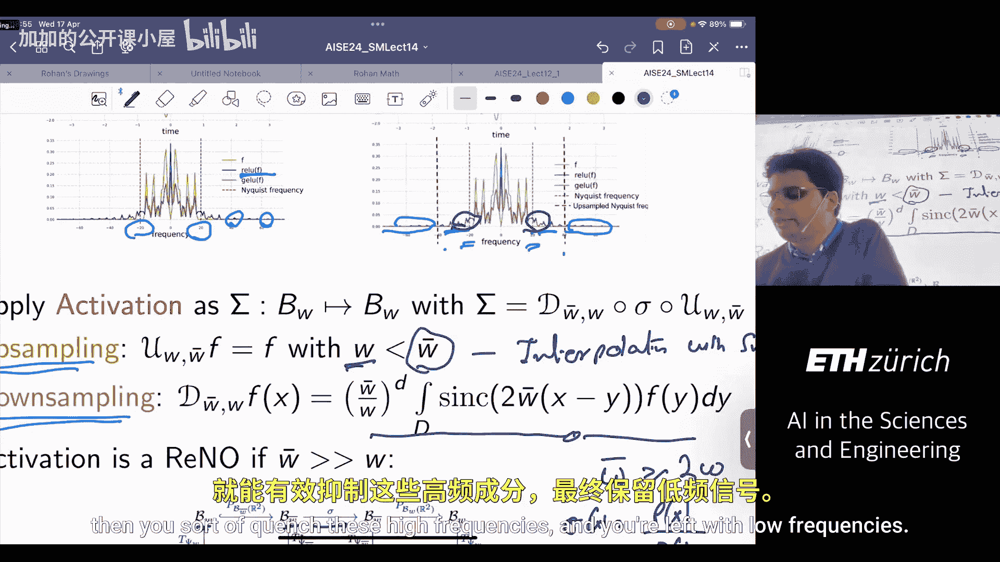

But in principle， you can do it for any order。 Okay， if youre polynomial or rational nonlinearities。

 but if you don't， you have to， you have to make some approximations。

 but you have to reduce the aliasing error。 and you'll see that in in the numerical experiments in the next part of the talk。

 This is going to be clear。 So this is how you are going to sort of do the convolutions and you're going to do the nonlinearities。

 And you have to put them together。 Okay， so as you can see in this very simple structure。

 I start with a signal， I raise it by using the by augmenting the number of channels。

 do a convolution， then apply the linearity， And then again。

 you can see convolution linearity convolution linearity till I end up with some stop and then you go back to your original functions。

 Okay， But so this is the plain vanilla architecture that you can use。

 But as you'll see I'll take a break now and let's meet a10 past。 you'll see after the break。 that。

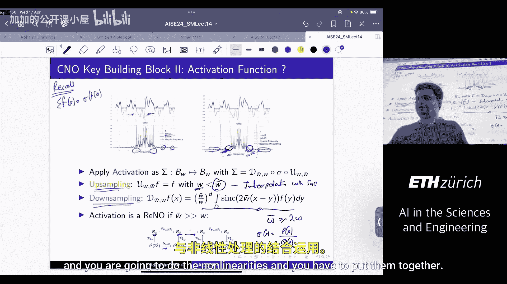

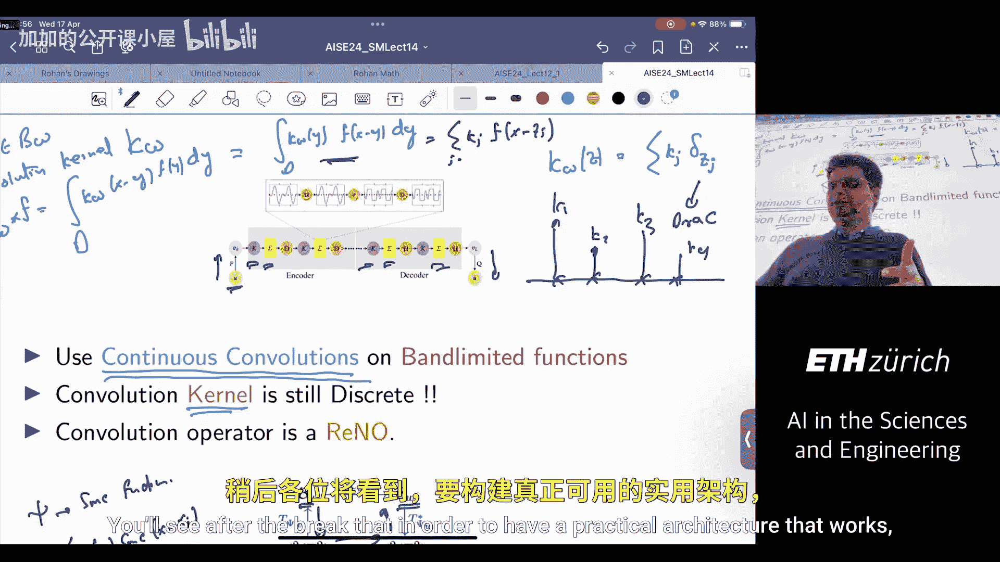

In order to have a practical architecture that works， this basic building blocks are not enough。

 This basic building blocks of convolution and not linearities with this upsling and downs are not enough。

 We have to put them together in a more intricate manner。

 in order to sort of have some proper processing of the signal。 But this is after the break。

 And let's meet at10 past。 Okay， so and see how this is done in practice。

 This is in principle I've given you all the basis in principle。

 and now we have to take it and look for a practical architecture。 But that's after the break。Okay。

 so let's restart。 So as I said before the break， what we need to do is to put together these ingredients that we have con and on nonlinear narrativeity。

And we do that in a very sophisticated manner because we know from computer vision because these ideas of using convolutions and linearities come from computer vision that this has to be done in a much more intricate manner。

 You can't just stick a convolution next to a nonlinearity。

 put them in layers and get the results that you want。 Okay， so here is how it is in practice。

 That's why it's it's more complicated。 So as you can see that this has this sort of a unit type architecture。

 this is what works from long experience in computer vision。

 So the idea is that you have to do multiscale processing of your signal。 So in other words。

 if you have an image or any signal for that matter， it has structures that many scales。

 even if it's a band limited function， a band limited function might have structures nonze structures at 30 frequencies of 40 frequencies of 50 frequencies。

 depending on the problem that you have。 So in that case。

 what you have to do is from computer vision。 people have realized。

That you should process these frequencies somehow separately。 So in some cases。

 you process high frequencies， some cases you process the low frequencies。

 and you put all of them together。 And this is done in this sort of a unit kind of an architecture。

 and let me try to explain。 So the building blocks are exactly the same up sampling downs nonlinearities convolutions。

 it's exactly the same kind of structure as before right So what you do is the following。

 Let me first give you the heuristics。 And then we can look at the。

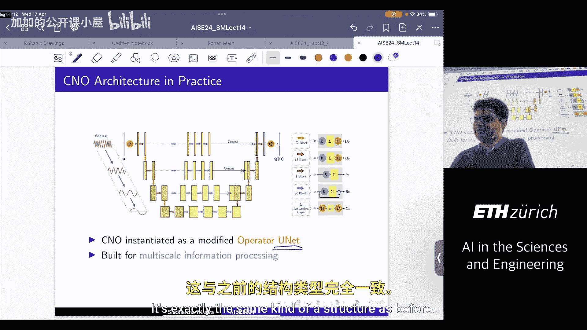

Details in a second。 So you have a signal， which is， of course， and multiple scales， usually。

 And then what you do is some sort of a scale separation。

 And then processing at different scales and then mix them up。 Okay， so， of course。

 this is your signal。 it is for channels， for instance。

 the first thing that you do is through the lifting。 you add more channels。 Okay。

 so that is you provide better coordinates for the learning system。 so that it can learn better。

 So this course， this course without saying。😊，Then the there are different kinds of there are different kinds of layers here。

 So as you can see that they have some names， let me even expand it further so that that you understand that。

 So the first layer here is what is called an invariant block。Okay， so this is， as you can see。

 this is a dark red color。 I can't see it at this resolution， but I think you guys see what it is。

 right， And what does it do， It takes a signal band limited function。

 It puts a convolution and it puts the nonlinearity and the linearity itself。

 the activation and this up sampling and down sampling layers， right。

 So this is what we have constructed and when you stick these to convolution and nonlinearity。

 convolution is re， linearity is areno， When you add them together， of course， when you compose them。

 you still get a re。 So this the first thing that you do。 So you take the input。

 and then you just apply this convolution and linearity。 This is what you would expect。

 and you would think that I just stack these together and then I get my architecture。 No。

 we have to do a little bit clever stacking。 And this is done in this layer。

 It is called roughly an encode。 Okay， so this part is what is called an encode。

And this part here is what is called a D code。So what the encoder does is that there are two things it does。

 First， it takes a signal and it keeps on， let's say down sampling it。 So it sort of applies。

 keeps on applying low pass filters， keeps on applying low pass filters but at the same time。

 So it also adds more and more channels。 So essentially visually just represent the cartoon the height of these boxes is your resolution。

 Okay， so the height of these boxes is your resolution and the width of these boxes is a number of channels。

 So in the beginning， you have been given some resolution。 I don't know hundred28 squared。

 And then you you just add more channels right， And then here you keep the same resolution。

 keep the same number of channels to some processing。

 But now you do some processing by reducing the resolution。

 Let's say you go from128 squared to 64 squared。 That's why you do this with this down sampling operation right。

 So this is what is called a D block。 this one here is a downs operation。

 but you increase the number of channels。Okay， so you add more features， but you reduce。

 you just process some scales in the signal， right， And this is what is done here。

 So this is this town sampling block。So you take the function， you do a convolution。

 you do a linearity， and you do a down sampling。 So you reduce the resolution。This is okay。

 means you're just reducing the resolution。 You are keeping the same band limits。

 So it is still a reno。 But what you do is that you increase the number of channels。 Okay。

 and you keep on doing it。 So you take hundred28 squared in the next one， you go to 64 squared。

 Then you go to 32 squared，16 squared，8 squared and so on。 Somewhere you have to stop， of course。

 And this is what is called the bottleneck。Or this is called the bottleneck。

So the idea is that you at different resolutions， you're processing different features。

 which is very clear from vision， right， because what do we do in vision。

 there are if you look at my face， there are some gross features， for instance。

 the outline of the face， outline of the hair and so on。 And there are some sharp features。

 than the exact location of the nose， the exact location of the eyes and so on。

 All that it says is that different parts of your network， processing different inputs。 Okay。

 some are focusing on the broad features， some are focusing on the sharp features。

 and we think of functions， mathematical functions in the same manner， high frequencies。

 low frequencies， different places， I am processing different things。

 Okay so this is this down D block。 Okay， it consists of convolution， No linearity and down sampling。

 but down sampling， youve already seen before what it is This is this interpolation with the lowpa filter。

 and you go in this manner， as you can see， I took a high frequency signal then and here Im just processing some parts of the frequency Here I' am processing。

😊，lower parts of the frequency。 So this is the decoder part of it。

 which is very standard in this unit architectures。

 But now you process and you have to build it up again。

 right so you have to you have to get back to your hundred28 square encodeder。

 sorry I should have said So this is done by the decoder。

 So you have to you have to now take the low frequencies。

 combine them with the next high frequencies， combine them with the next high frequencies。

 combine them with the next high frequencies and so on。

 And this is done by using what are called ups blocks。

 U blocks as you can see here So this is this part here， again。

 convolution No nonlinearity and up sampling。 What do you do in up sampling you increase the resolution。

 So you go from 32 square to 32 square in a gradual manner and you reduce the number of channels。

 So as you can see you are making something which is fat and short into something which is thin and tall。

 that's roughly the sort of heuristics here。 So this is sort of a very basic unit kind of an architecture where we take。

And all of this， each of the ingredients ares， right， because we are taking nonlinearities。

 which are down sampling up sampling and the convolutions， right， So this is。

 this is the basic structure。But this is not enough because there are some new features that you are also adding。

And what you do is you used what are called residual connections。

 because what are you doing is that you are stacking a lot of layers。 So when you compute gradients。

 you have to do back propagation， right， So you have to do back propagation。

 when you compute gradients， you have a lot of layers。

 What happens is that the gradients could explode or vanish。

 You have seen this in some the first lectures。So you have so many layers。

 you have to put in residual connections。 And these are done through these R blocks。 These。

 these are here at the bottleneck。 These are also here at all the intermediate frequencies。 Okay。

 so what is what is happening at this bottleneck， for instance， So you take the signal。

 you apply a convolution in an on linearity as before。 But you keep the signal。 Okay。

 so that means that the gradient properties， there is another， another channel。

 another route through which the gradient can come。 So you don't have the smallness of the gradients。

 So this is roughly the heuristic here。 And it is done at all levels。 Okay。

 not just at the bottleneck， because in a traditional unit， this parts are not there。Okay。

 these are our sort of fixes here because we want to keep a lot of high frequency content in the signal。

 Otherwise， high frequency content get gets lost。 So you have this residual connections and then you have them at every sort of intermediate layer。

 Okay， at every intermediate layer， you have this kind of residual connections。Of course。

 all of them areos， but these are in order to ensure that this multi scale signal processing really kicks in。

 That's why it's a very elaborate architecture。 Without that。

 you won't get the sort of results that youll see in in a moment。 In addition。

 you also have as in units， what are called concatenations。 So what are these。

 these concatenations is， So， for instance， let's focus here。So now you have applied this resnet。

 So this is short and fat。 And then you want to make it tall and thin。

 but you have also kept some features from this side here。

 So from this frequency here and you just couple them together。 Okay， you couple them together。

 You concatenate them and you transform them back。 Sam here。

 So you have something which is short and fat， you make it to be tall and thin and then you sort of you have some features from here that you're processing through renets and you just concatenate them and then you plug them up and you keep on doing this。

 right， So this a very， very elaborate architecture in some sense。

 because it takes into account the fact that you have information which is contained in different frequencies。

 Okay， yes。Yeah。Is what。Yes， this is， this it's just by how do you do， you did it also here， right。是。

No， no， you have these are learnable mappings。 So what you take is a linear layer。

 which sort of increases the number of channels。 it reduces I think in the tutorial。

 they covered this。 if I'm not mistaken， They must have covered it。 So when you look at the code。

 All that you do is that you have learnable transformations。

 which takes 10 vector and makes it into a 20 vector。

 You see these are learnable linear transformations， they don't do anything with space。

 So these re properties are only dependent on the spatial information。

 these are just adding channels。 So you can always do that by using learn these are all learnable。

 So these architectures have lots of parameters you will see in some of the examples that these are lots of parameters。

 I think the biggest models that we are running have like 400 million parameters。

 So as you can imagine， are these are not cheap in that sense they are not cheap to train。

 They are not expensive to in。 So the key So I would say that these are details。

 these are details in order to get。Sort of good performance。

 Even if you don't have all of these ingredients。 if you just stack things together。

 youd still get something which is reasonable。 Okay。

 it's just that these things increase the ability of this network of this operator of this model to do this kind of multi scale information。

あダメ。To do what is called multiscale information processing。

 that's the name of the game that you have multiscale information processing。

 you have information at different scales。 and you need to process them in in a neat manner。

 So otherwise all these layers， all these blocks and so on。 these are in some sense details。

 you know， when you when you work in machine learning， it's very。

 very important to have architectures that have the best performance。 that are state of art。

 And then you need these kind of additional features。

 But even the bare bones version of it which will just be convolutional linearities。

 convolutional linearities that that sort of works it's not it does its job in some sense but now you have to remember that it was the same with F in F also there were these additional elements that were there。

 you had some residual connections somewhere。 you had some MP somewhere these are all there to add information processing capacities。

 Okay， yes， James。😊，Yes， you can。 you can。 This is so this is you you can easily do that。

 We have done that。 and yes， so that that that that functions。 you can。 you can do that。嗯。

It made it into Reino， but it worsened the performance。

Because what it did is that it clipped off some features。 You know。

 So the idea is that by making it things into reino， you have to sort of take out some frequencies。

 Right， means you have to take out information。 Otherwise， some of the information is lost。

 So all these other ingredients， they bring back this information。 Okay。

 somehow you have to keep the high frequency content。 And by the way， I forgot before the。

Before the break， I forgot because yeah， there are many things to say。 But the whole point about。

 maybe I said it and didn't emphasize it。 The whole point of this activation layer is that now it's non local。

Right， earlier， it was local means because you were just applying a function point twice。 Now。

 why is it nonlocal， Because when you take a function at a fixed number of points。

 you increase the number of points essentially by this upse procedure。 Then it's local。

 But then again， it's non local because you're going back to the function and coming back to the So this is a non localal is a genuine operator。

 It's not just what is called a the Misky operator。

 which is the application of function operator and a local function。

 So this is somehow the key trick in order to， in order to make this work。 So again。

 I emphasize that these are details， this does not at a of the performance。

 actual deployment of these architectures， but in principle， it does not change the flavor。

 Okay the flavor is still contained in this basic building blocks that I explained before the break。

Good， so I， I proceed。 yes， absolutely。

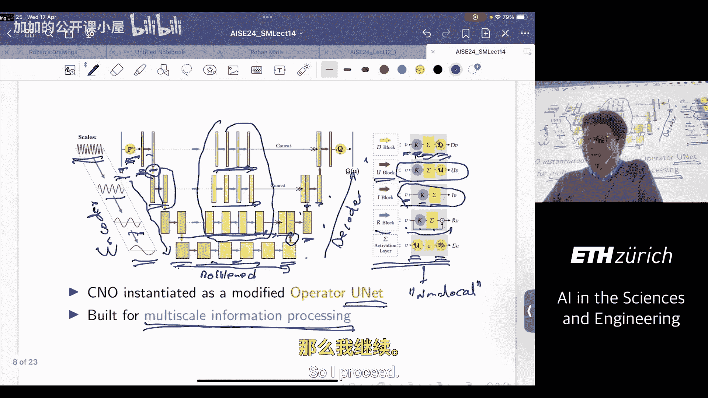

We。don't stand。問題で。Yeah， you can there are different choices here， right。

 But at the at the end of the day， you have only a finite amount of compute and a finite amount of mental bandwidth to work with these things。

 So what what you do is it's essentially a binary processing。

 So you start your images are always resolution which are powers of two So it makes a lot of sense to use powers of two in this right So so let's say that you have an image which is thousand24 squared by thousand24 square It's a lot means but what you do is that in the first step。

 you reduce it to 512 squared by 512 square then256 by256 and so on。 you could do it for any。

 there is no in principle， this up sampling downs need not be done just in the powers of two。

 But you can imagine that to have an optimal implementation caching and so on。

 it makes sense to have things in powers of two。 But otherwise， you can always go from hundred to 80。

You can always do that， but it's not optimal， you know。

 in terms of how you retrieve information from the cache， how you store things and so on。

 There is also a implementational perspective to it。 And people who do computer vision， for instance。

 they have to work with images。 you know， for instance。

 Soa is working with 1920 by 1922000 by 2000 images。

 they are doing this kind of processing because they they need to they you cannot push in 2000 by 2000 images straight into a transformers。

 So they they， they do this kind of dimensionality reduction information compression in an efficient manner because otherwise。

 how will you mean so usually powers of two other trick。 Okay， so you use the powers of two。

 but there is now， in principle， you can do anything。Further questions。 No， Okay。

 let's have a quick look at what are the properties of this construction。 So again。

 as long as your polynomial or rational nonlinearities by construction， as I explained in the。

Before the break， by construction， you get a reno。Of course。

 if you don't have polynomial nonlinearities or rational nonlinearities by construction， you， you。

 you only get something approximation， right， this is， this is obvious。

What is also important here is that there is a universal approximation theorem。

 I did not focus so much on the theory last last year I did。 but this year， there is little time。

 So what we are going， what， what is the meaning of this universal approximation theorem。

 we have explained that in the context of functions， right， So essentially for functions。

 as long as the function is continuous， There is a neural network。

 which would approximate to the desired accuracy。 You can do the same for operators。 Okay。

 so now you can think， okay， you have continuous operators。 So this is， of course。

 how do you define continuity。 It's in the right kind of function spaces。

 So here we are using sober lab spaces。 This is a detail。 It's not important。 But essentially。

 let's say that your operator is from x to y。And then a continuous operator would be if you take essentially。

 roughly speaking， if you take G of。V minus G of v prime in y will be small。If。

V minus v prime in x is small， right？ So this is roughly the mental image。

 So if the inputs are close to each other in as functions。

 the outputs are also close to each other as appropriate functions。

 So that would be the definition of continuity。 So we go a little bit further means you can do that。

 But ideally you want what is called a modulus of continuity。 That's why this， there is con plus。

 which means roughly speaking that this is not exact。

 but it is G V minus G V bar and y behaves like little low of。P minus v5 in x。Okay。

 so you essentially， if this guy goes to 0， there is a modelless continuity。

 There is a rate at which this guy goes to 0。 That that's all。 If you have this property。

 then you can prove that C NO FN depon net， all of them are somehow universal approximations。

 those they satisfy this property。 This is an analog of what happens to finite dimensional vectors。

 right， So neural network was approximating functions。

 which are mappings between finite dimensional spaces to arbitrary accuracy。

 What we are shown here is that a neural operator， C N， FNO and so on。

 They can do the same for operators。 Okay， so it is one level higher。

 but the the principle is the same。And anyway， the the idea of the proof， I don't have time for this。

 but it's essentially by by saying that your operator is going to be very well represented by mappings between band limited functions。

 Okay， so because there is this mappings between band limited functions。

 which bands depend on the underlying function spaces。

 And then you use the universal approximation theorem for neural networks and projected back。

 So essentially that's that's the that's， that's the basic idea。 And for C， there is code。

 you have already seen the code。 and you， you are going to experiment with that also for your forthcoming exercises。

 right， so this is the thing with the theory as well as with with practice。

 let us see whether these things work in practice or not。

 And I'll show you some numerical experiments for the rest of the lecture。Okay。

 the first thing is we go back to this very， very simple problem that we had before。

 random assignment。 This was just to show that FNO， for instance， and CNN N， these were not res。

 right， So you trained at a certain resolution， which was 61 squared and because the image was at 61 squared and then。

Okay， and then you could see that as as soon as， of course， here， the barrier is broken。

 So nothing is going to be a reno because there is no one to one correspondence between the discrete and the continuous。

 But here， when the conditions is satisfied， you are taking a finer grid than what the signal requires。

 then what happens is that both c and FNO， these were not res right as soon as you change the grid。

 even by one grid point the the errors were amplified。 But SNO as well as c， these are by definition。

 they are constructed to be。They are constructed to beos。

 and you can see that they were able to keep it at machine precision。

 This aliaing error was 0 to machine precision。 So this was completely expected because we have constructed things in such a manner that this property is going to be satisfied。

 Okay， but let's look at some real numerical results， let's start with an obvious do equations。

 So all of you should know what these equations are。 But if you don't， let me write it down。

 So because they come in again and again。 So this is U T plus U dot crd U plus gradient to P equal to 0。

 the divergence of U is equal to 0。😊。

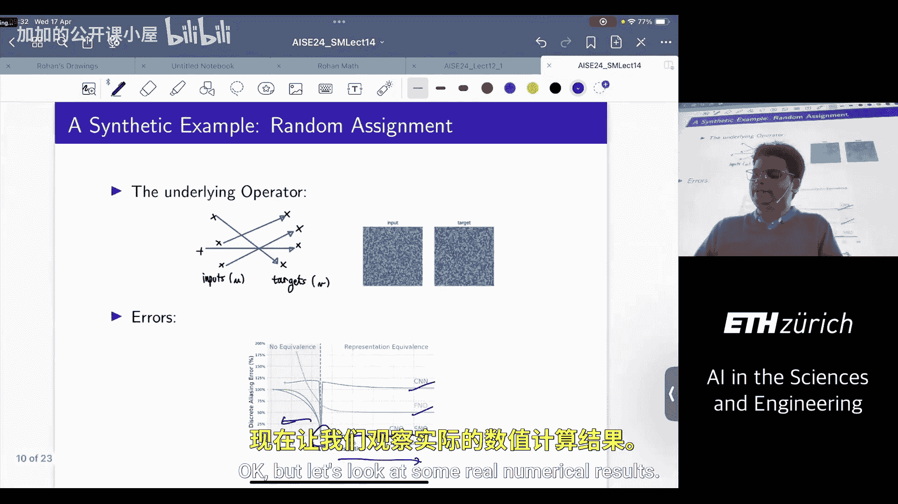

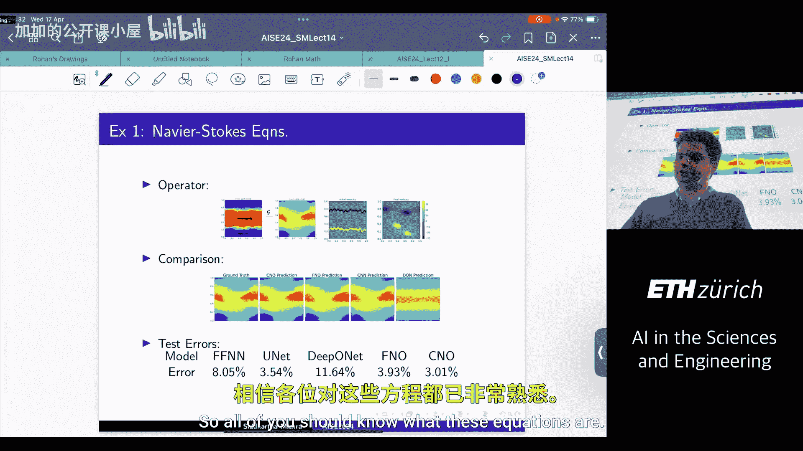

And U is the velocity。 So this is UX， U， Y。 These are the two components of velocity。

 and P is the pressure。 So this is the velocity。This is the pressure。

 So a lot of fluid dynamics is modeled by the navi to equations。 And then we have the forticity。

Because we are going to visualize things in the vity quite a lot。

 So this is the curl of the velocity。Col of you。 Okay， so in2D， this is a scalar in 3D。

 this is a vector。But perhaps I will have time to show you some 3D results。At the end of the course。

 But let's focus on the 2D。 So this is operator。 So it takes in。

 I'm just showing one component because otherwise， visualization becomes difficult。

 So this is some U X at time 0。

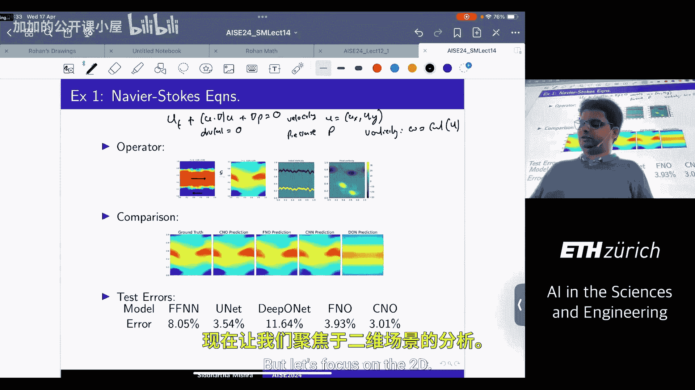

And then I am showing you X at time 1。 Okay， so this is my operator。 So it takes the two velocities。

 and it turns out the two velocities at a later time at a fixed later time 1。

 And this is the verticity。 So this is the verticity at 0 and the verticity at one。

 So this tells you what's happening。 So you have some sheer A And because the sheer。

 the vertices are generated。 So these are the vertices that are generated。

 So this is this a nice problem。 It's sort of not trivial。 but at the same time。

 it's not ultra difficult， right， So now we apply different architectures on it。 So we have C N FNO。

 you saw both of them。 By the way， this is not the correct answer here。

Some reason I have got the wrong errors， but you'll see the correct errors at the at the end。

 I made a mistake。 And then we have unit。 So what is unit， unit is just。

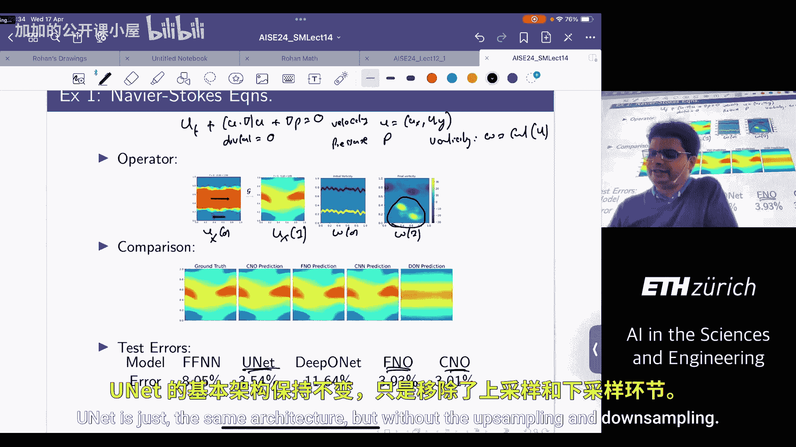

The same architecture。 But without the up sampling and the down samplingling。 Okay。

 so this is no longer a reno， it's exactly the same。

 but you kick out the up sampling and the down sampling。 you a straightforward convolution。

 and you use a straightforward linearity。 So this is an ablation on， on C N。

 It does not have this reno property。 but it has every other feature。 Okay。

 and then there is also a fully connected fit M LP。 So this is roughly MP。

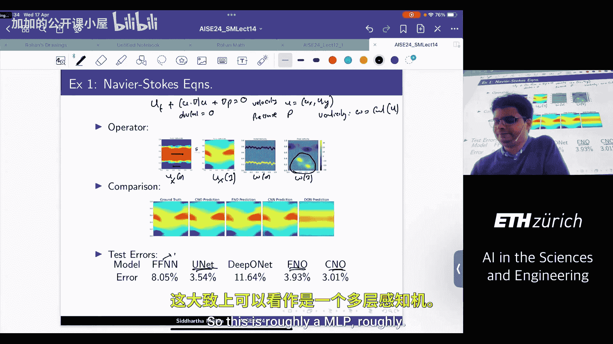

Roughly， of course， very expensive as a consequence。 And then we have deepponnet。

 And you can see that， just qualitatively that， first of all， deepponnet。

 we have seen this before it completely fails。 So this CNN is nothing but the unit。 Okay。

 So this completely fails。 just approximate the mean。

 And that's the result why you get this kind of large errors。 It's not also in the last lecture。

 write to explain why that could easily be the case。

 because you lose out all the spatial relationships somewhat。 Now， if an all does a good job。

 it has 4% error， which is reasonable here。 What it does， unfortunately。

 is that there are some artifacts， some aliasing artifacts。 for instance， this feature here。

 there is some artificial features here。 some ring here。 this， we believe is a sign of aliasing。

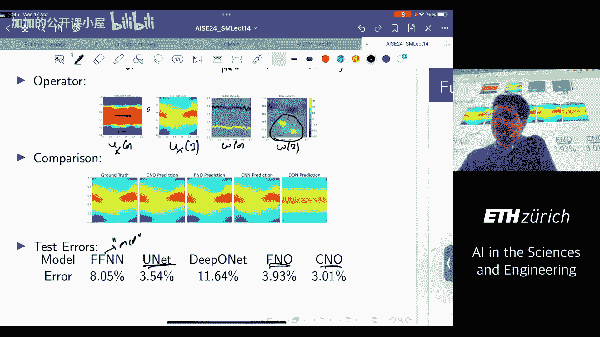

Unit also has the same kind of features。 It has this aliasing again。 You can see here。

 You can see here and so on。 A CNO doesn't have these things， right。

 It it provides a good approximation， of course， and approximation。 It's not exact。

 And this is done with10 samples。 Okay， you need some training samples。

 So this is done with0 samples。 And you can see that this this is a good approximation。

 I think these numbers are not exactly correct。 you'll see the correct numbers。

 I was probably making a mistake with respect to the。

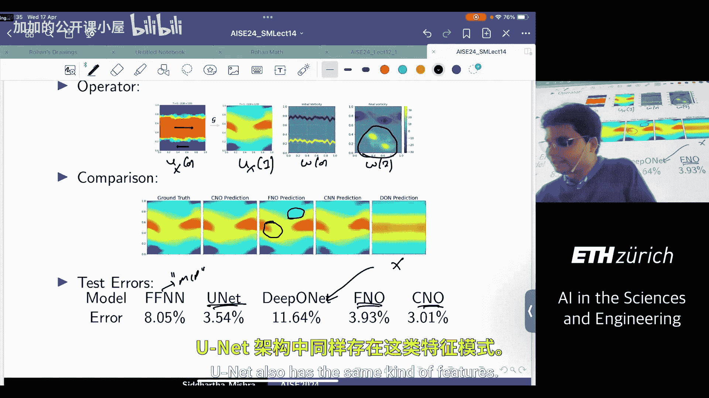

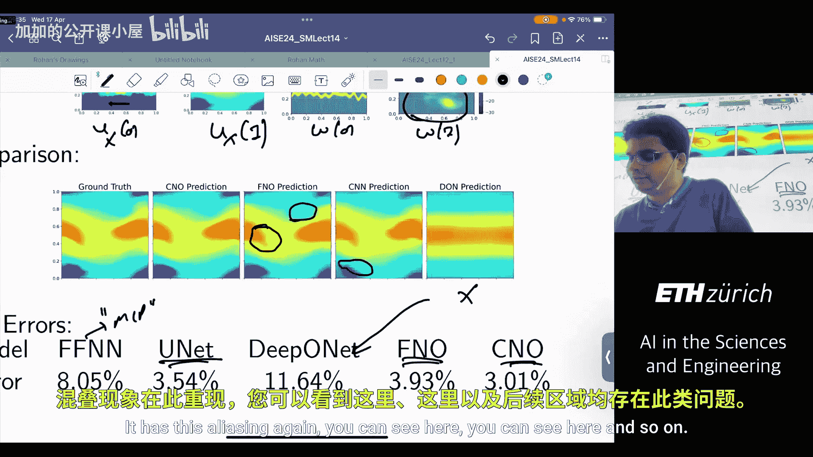

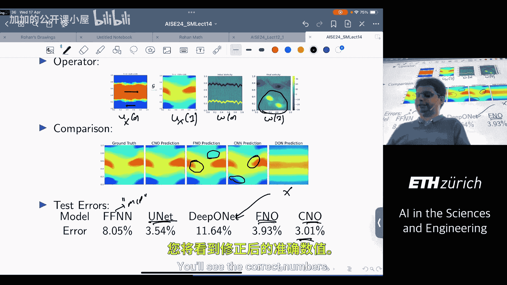

But so this is， this is what you see at a fixed resolution。 And this is hundred28 or 64 squared。

 I don't remember。 Now， remember that what we really need to do is to 64。 Okay。

 because I see that this that's the resolution。 What happens when you change resolution， right。

 So when you change resolution， as expected with the unit the errors really went up right。

 because it's no longer a reno， you have this aliasing effect。

 So it is not a neural operator because we did not have these ingredients in place。 FO。

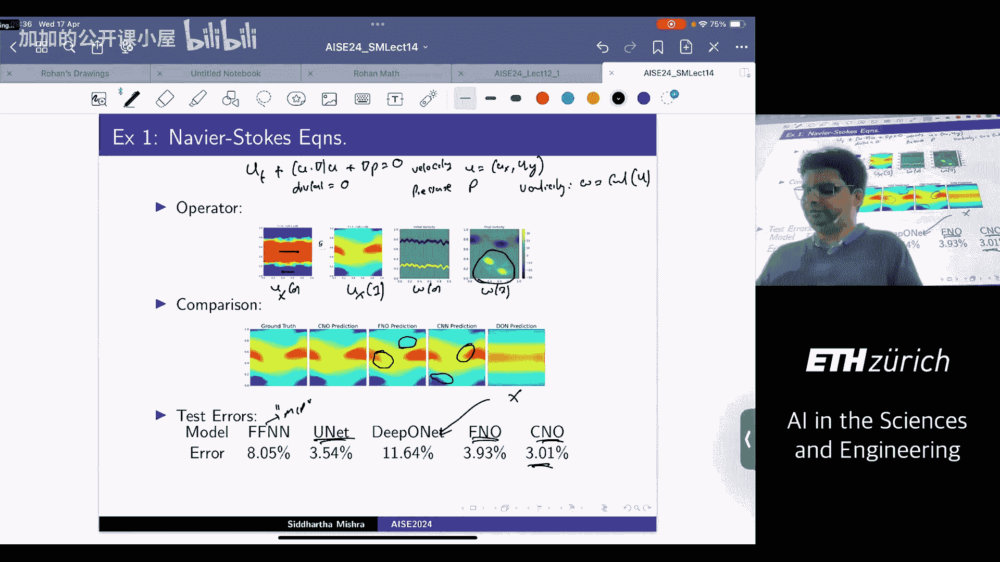

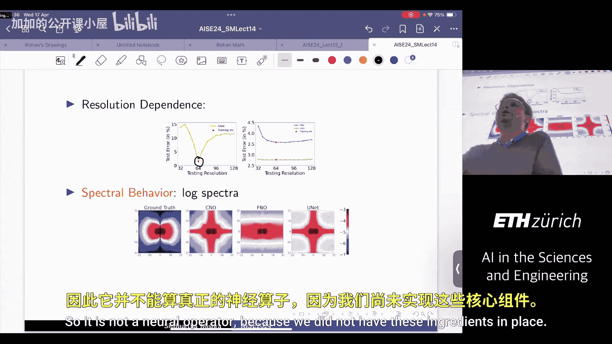

Somehow because it's partially a neural operator in some sense。

 because at least the convolution does not add high frequencies。 Only the nonlinearity does。

 And here the the frequencies are not so bad。 So here this part， you have small errors。

 but there are nonze errors。 This part， you have lots of errors。 you know。

 So it really does not is not able to understand when you are at a lower grid resolution。

 what is to be done。 even though the conditions are satisfied。

 conditions satisfied all the way up to 32。 So that's that' that's not an issue here。 Okay， C。

 as expected， even though we are using nonlinearity， I don't remember now， I think it was s。

 which is not exact， it retains errors of no esing errors up to more or less machine precision here。

 Okay， so this is this is as expected。 It does its job。 and you can see that with the spectrograms。

 What are the spectrograms。

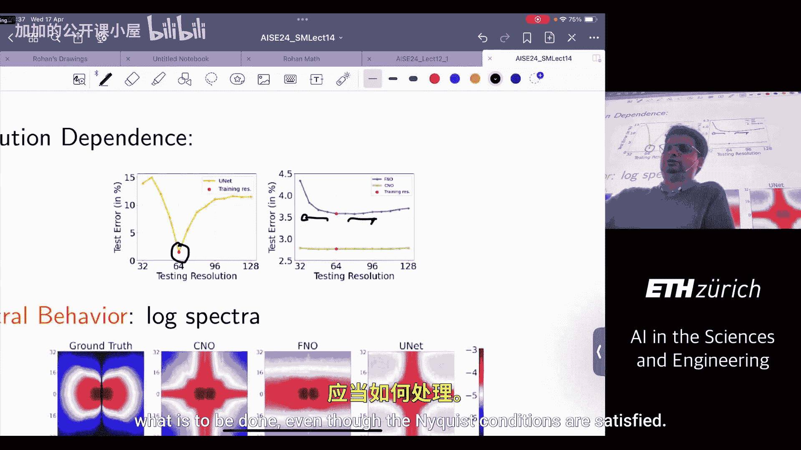

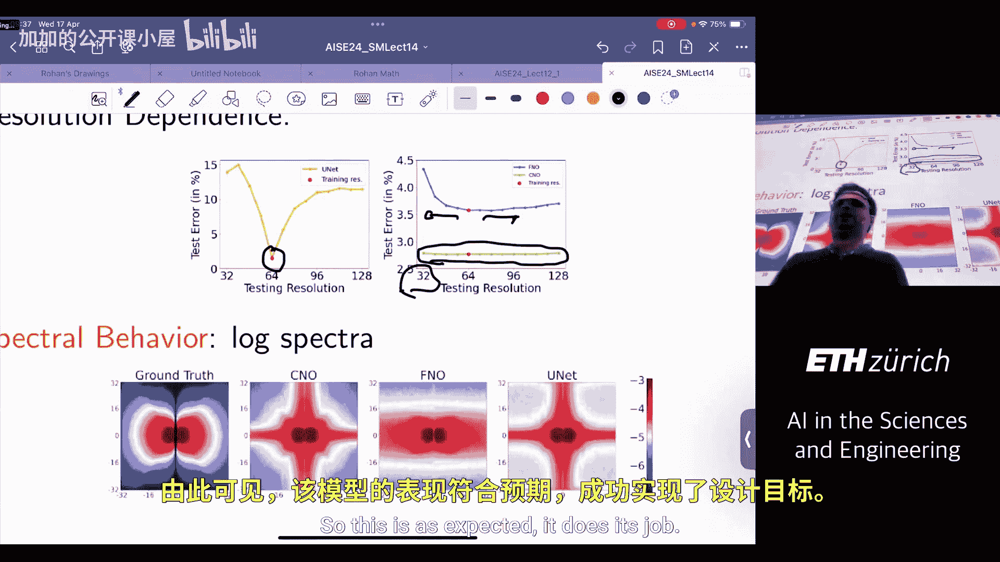

I just take the output， and I plot the frequencies。 Okay， and this is in logarithmic scale。

 As you can see， it goes all the way from 10th per -3。😊，To 10 to the bar -7。

 And you can see that between -32 and 32， a lot of frequencies are represented。

 Most of the frequencies are in this central region， as you would expect。

 But there are some frequencies outside。 Theyre not not completely 0， but they're decaying。

 right Now with C， N， you approximate these frequencies。 You know， it's not exact。

 You approximate these frequencies。 You， you can see that here in particular。

 there are sort of expected to be low frequencies and you have low frequencies。Surprisingly。

 along these lines， there are some higher than expected frequencies still within the band limits。

 Otherwise， it shouldn't be re。 but for some reason， it tries to expand along that direction。

 who knows why that happens with Fno， on the other hand。

 What it does is that it has very large frequencies here。 So these are very artificial frequencies。

 Remember that this should be1 to per-7， it is then the per-3， and as a consequence。

 we believe that these errors here， these errors here。 And these errors。

 these are from this kind of sort of expansion wrong frequencies intake。

 And is the same with the unit。 the unit has similar structure to Fno。

 except that it has higher frequencies in this region。 right， So the darker the blue。

 the are smaller the values here， you can see that there are larger values。 So of course。

 when you change resolution， these high frequencies， they seem to and they are all over right。

 So these higher frequencies， they probably cause these kind of large errors。

 So this is sort of some correlation between what you。

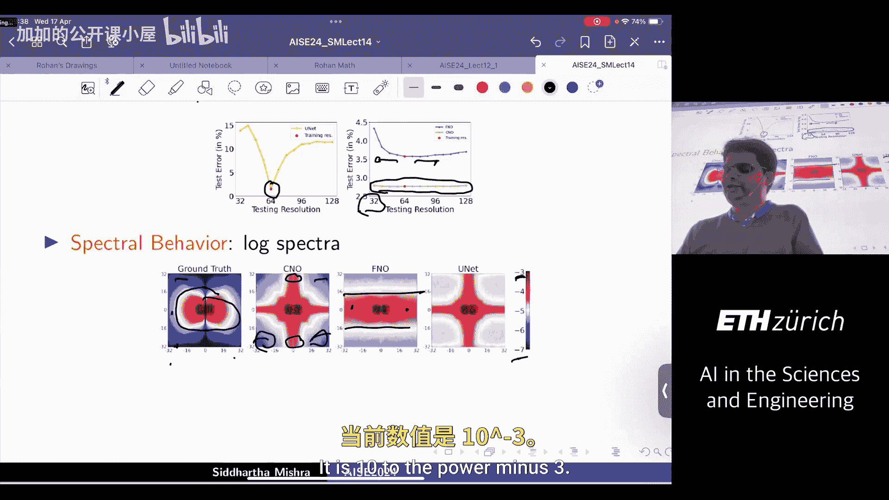

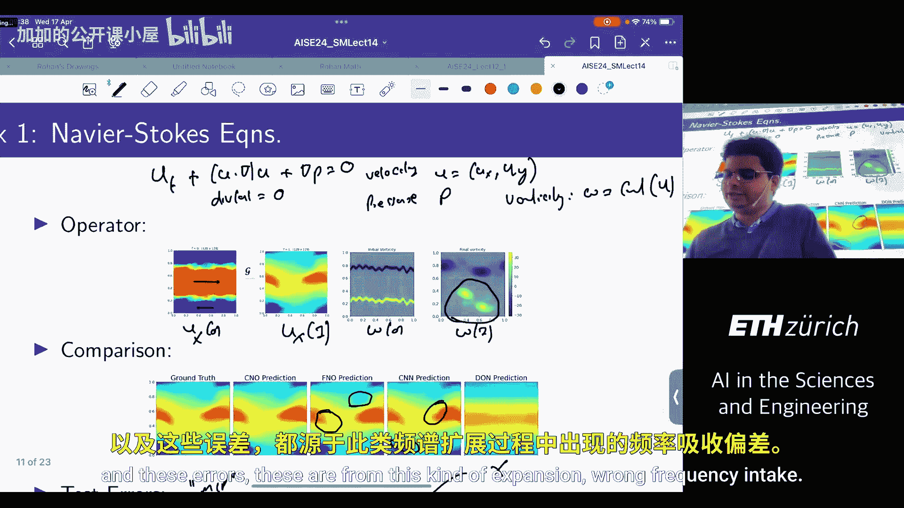

HaveWith the spectrogram， your theoretical understanding and what the actual results also are。

 So this is the situation with respect to what happens when you。

 when you think of it as a neural operator， when you evaluate the output to different grids。 Now。

 what is also very important is what is called out of distribution generalization。

 And let me explain this concept， at least a little。

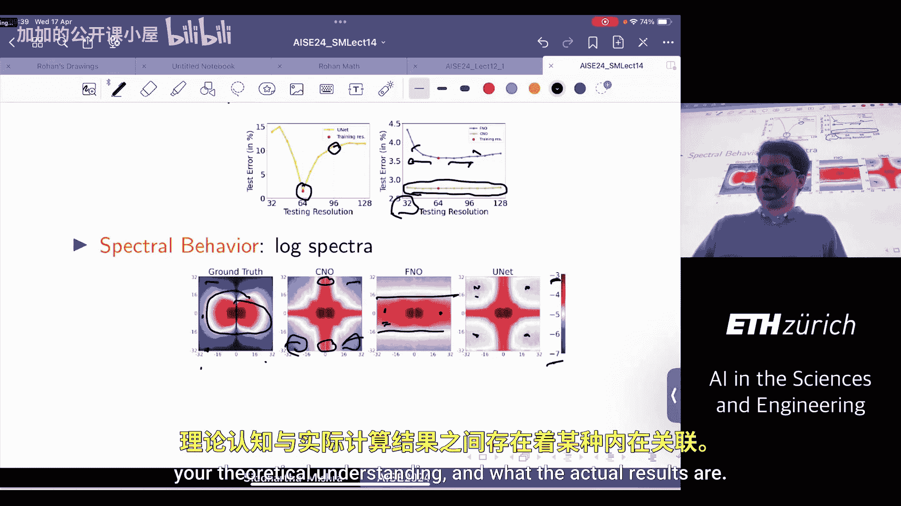

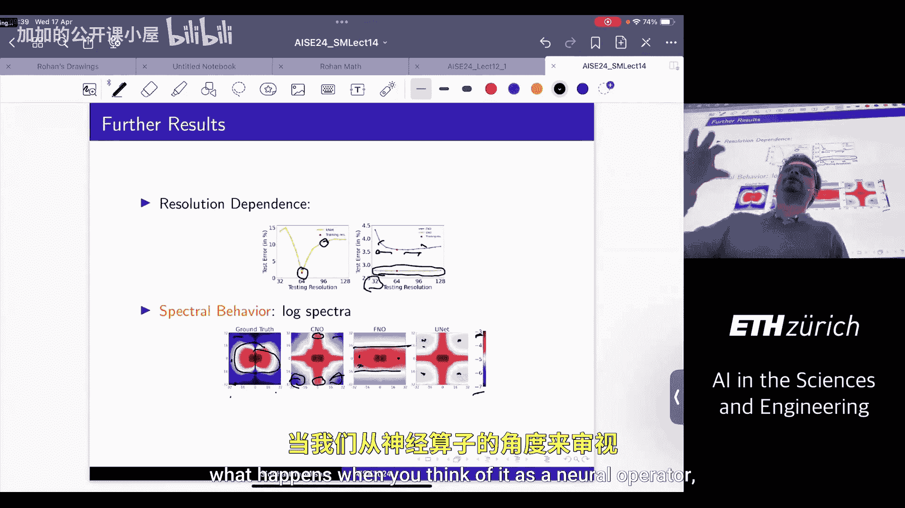

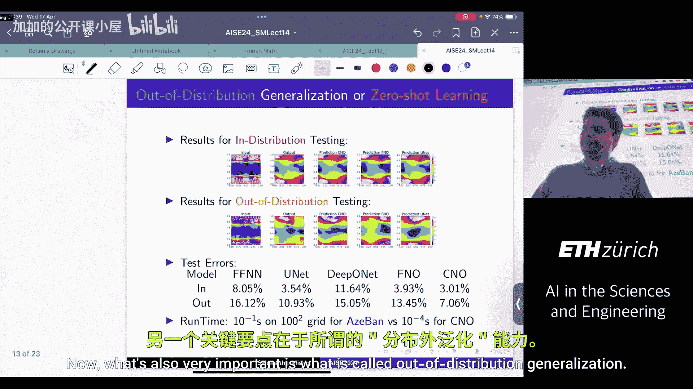

啊。So what is out of distribution generalization？So remember that the end of the day， these samples。

 the training examples and the test examples， they were drawn from some measure， mu。

 which was a probability measure。On your band limited functions。

 B because we are always working with band limited functions。

 So this were on your band limited functions。 right。

 So this is how it looked like your typical sample。 It looked like this。 So during training。

 We generated  thousand24 of these samples。 You trained 768。 I don't remember。

 You trained your architecture on it。 And you got some results。 Okay。

 so this was sort of the sort of the picture。 during testing， you took different samples。

 which you were not seen during training time。 and you checked what the out what the errors were。

 And this was this is the whatever you get this 3。1，3。93 and so on。

 these were results on the test set， right， But now what you could do is what if I take a different measure。

 So all of them are drawn from the same measure。 Now I take a different measure， no。

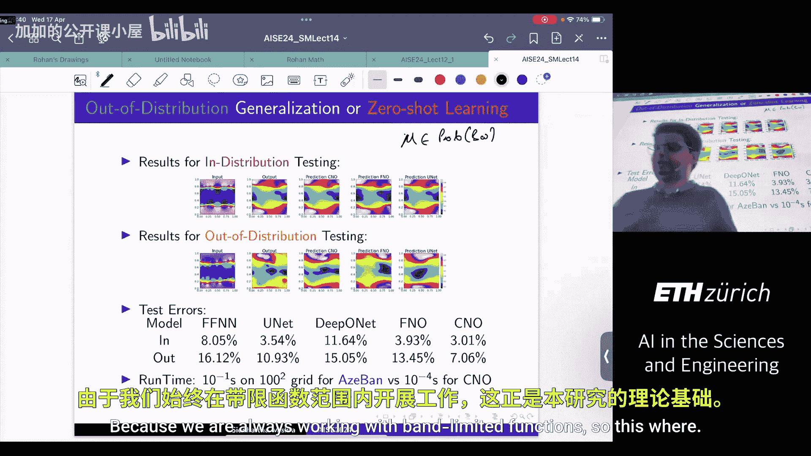

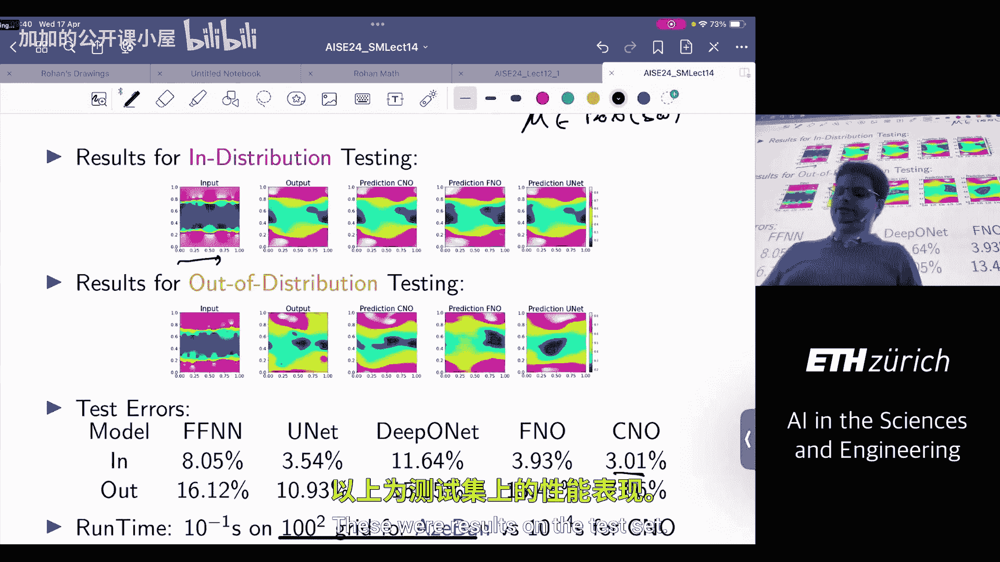

Which is also a probability measure on BW。 and I sample at inference my I train on this measure and I sample or I test on the on a new measure。

 So this is what is called out of distribution， right because now the data that you're giving is different from the data that you generated or how does it how does it mean。

 as you can see here， So this was some initial layer。

 And we had some perturbations on that initial layer and so on。

 Now what we do is that we have bigger perturbations， which are not seen during training time。

 and we also change the location of the layer。 So we move it。 Okay。

 so this is also not been seen by the data during training time。 As you can see。

 the output changes means this an example， the output was here。

 the ground truth and the ground truth here is a bit different。 And the question is。

 can it sort of extrapolate。 Okay， this is always the challenge with neural networks。

 It has never seen this training distribution But this training distribution is not completely off。

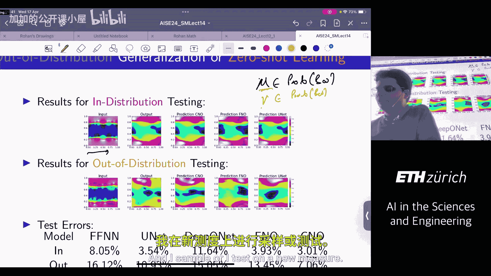

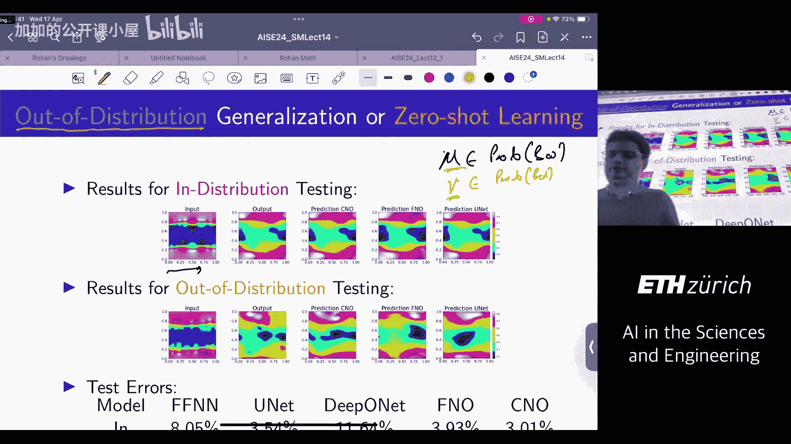

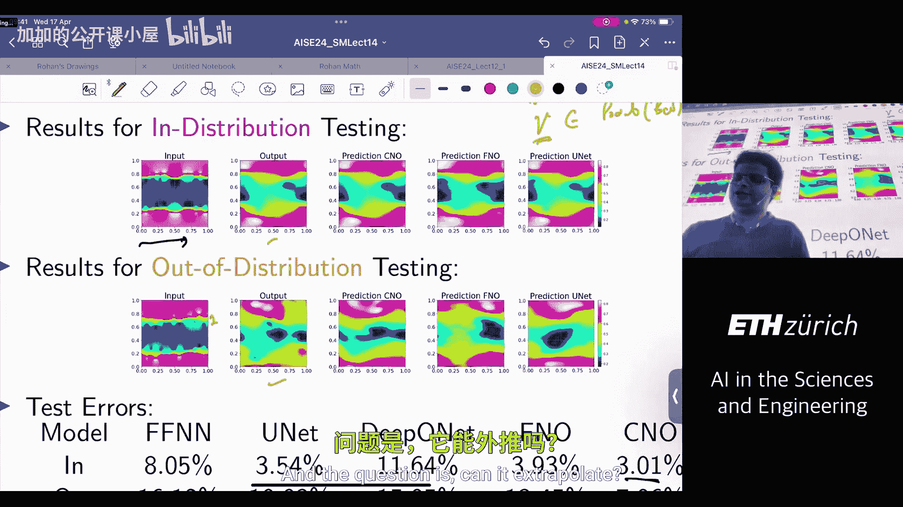

Right it is still relatively close to each other。 In other words， if you take a distance。

 you can't have a distance， but you can have， you can't have a norm。

 but you can have a distance between measures。These are close to each other。 I think this。

 I don't remember。 It depends on what metric that you take。 But these are within。

 let's say 50% of each other， roughly speaking in。 So theyre not， theyre not completely far。

 So how do these methods perform。 So it turns out that the the results that you get a very。

 very interesting。 So let's focus， for instance， on C NO and FNO。

 So now you can see that what does C NO do。 It sort of provides the right resolution to these features。

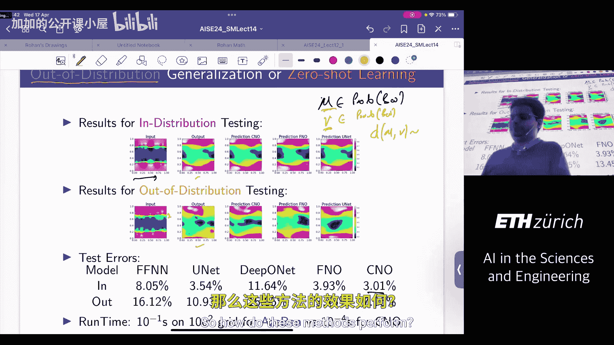

Right， it provides the right resolution to these features here， On the other hand。

 it introduces something that was not there before。

But at least it understands that there is some distinction here。 There is some distinction here。

 and so on。What does FNO do， it does not resolve this feature nicely。

 It puts it at a different place。 And not only that it puts something here。

 which is not there in the ground truth。 And also here。

 remember that there is a connection between these two vers。

 It simply it does not even have them here。 So qualitatively you can see a difference as the same as the unit means even though the unit and CN N are very similar to each other。

 you just have this additional up sampling down sampling。

 you see that unit has completely missed this entire feature here。

 it has just put it here Okay and also it has put these things here。

 So now when you look at the predictions， you can see that of course。

 all of them make bigger errors theyre not going to do this is sometimes also called zero shot。 Okay。

 you are not， you are not having any access to the test to the to this new measure。

 You just do it in a zero short manner。 and you can see that at least in this particular case。

 C had slightly better general。

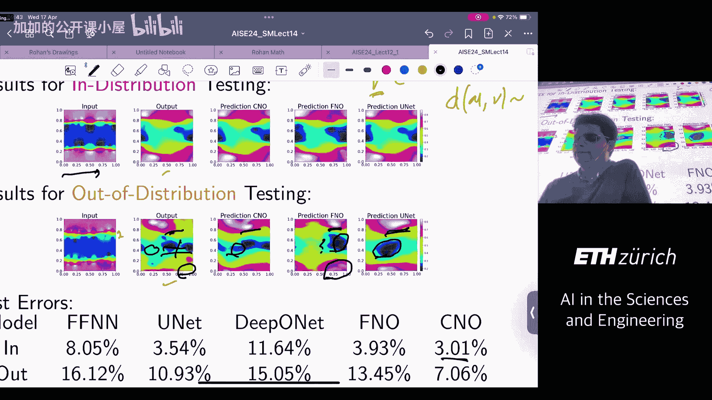

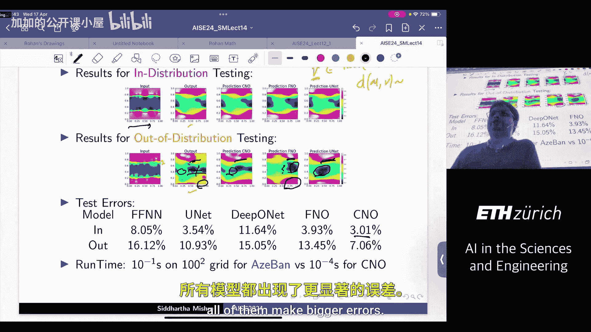

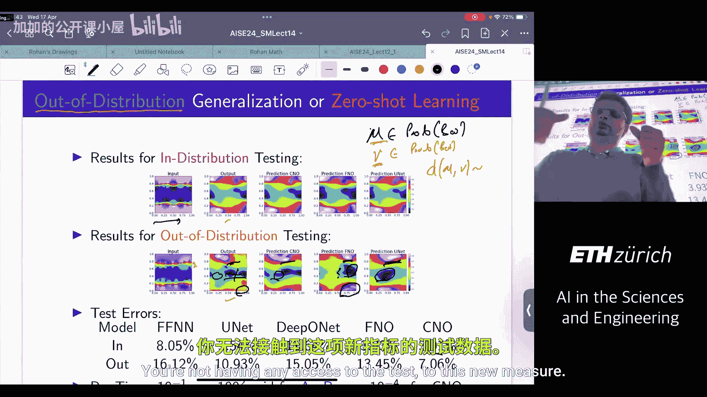

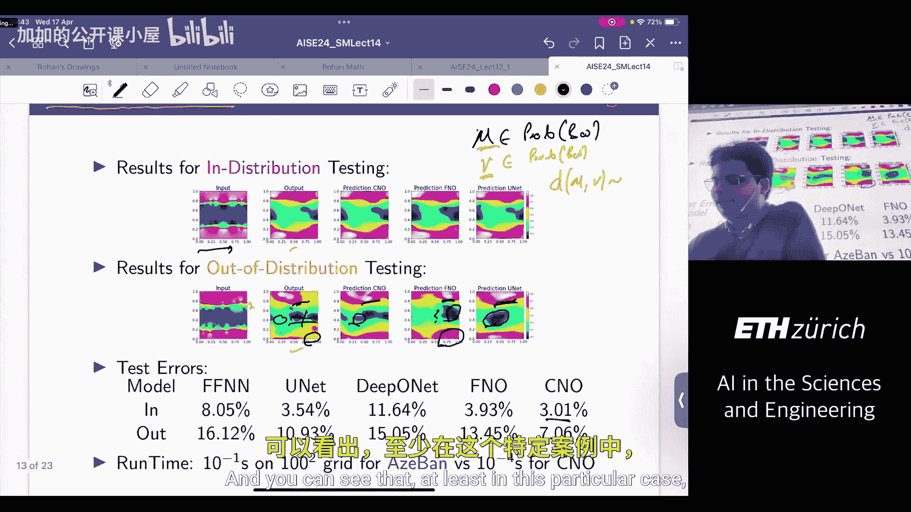

The error was only doubled， which is roughly along expected lines because the measure was the distance was like 50%。

 So we would expect that the error would be doubled。 But here， for instance， if I know。

 the error was increased by roughly a factor of three right and unit also。

 it was increased roughly by a factor of three。Deponnet was anywhere doing very poorly in this in the previous regime。

 and it kept on doing poorly in this regime。 So this is sort of an important test case for any machine learning architecture。

 that how well does it do in terms of extrapolation And we change the measure how well can it do。

 And this is also telling you something about the nature of the data and the nature of the model。

 So if you fix the data like we did in this particular case， It is something about the model。

 So do we gain anything。 Of course， we do gain because we have a code in my lab， which is very。

 very fast。

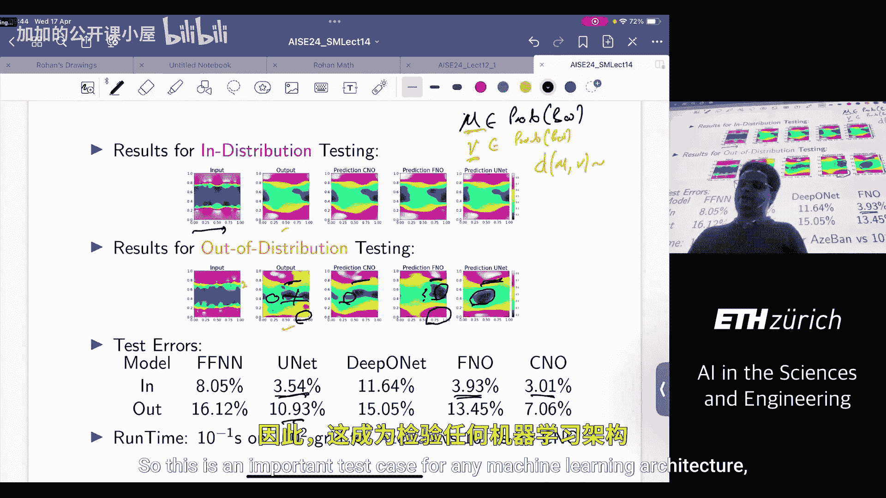

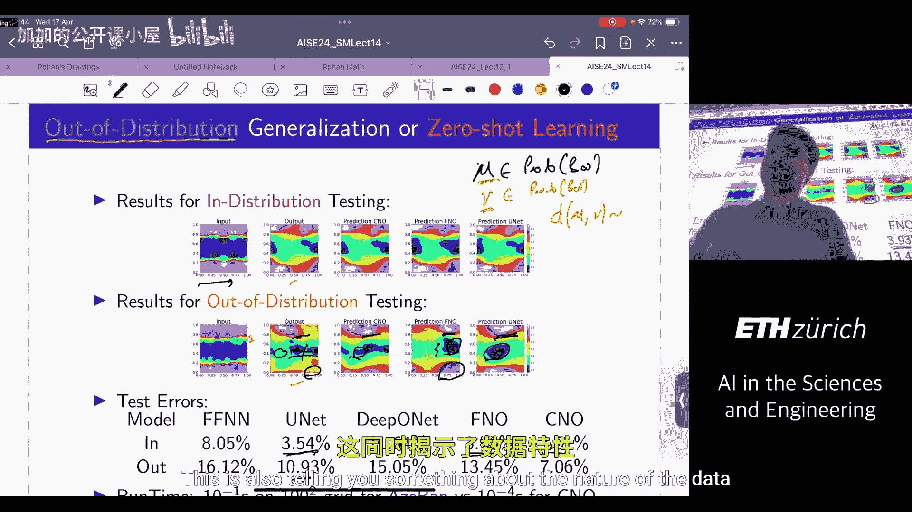

So， for instance， on 100 square grid， it takes one10th of a second to solve this problem。

 So it'ss very， very fast。 But with C or FO， for that matter， it takes 1 thousand0 times less。

 So there is some error， but you get the results in。

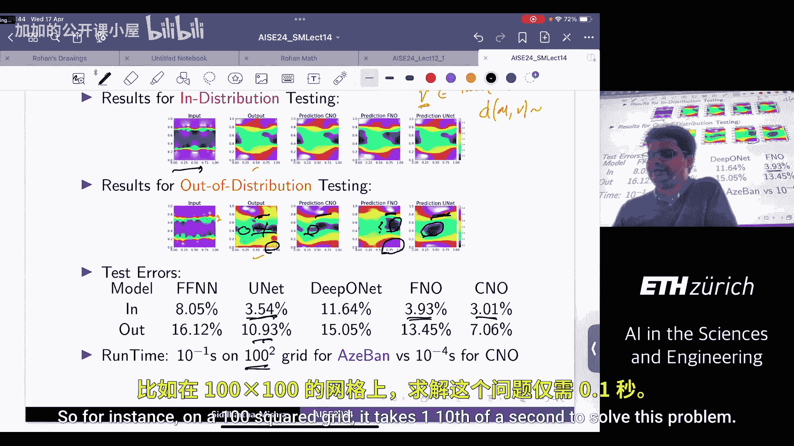

Thousandand times less time。 right。 So this is the whole point of machine learning。

 And you'll see later on that these numbers are going to be even bigger later on。 Okay。

 but is this concept of out of distribution clear that you really change the test distribution from the training distribution。

 And we will see some more extreme examples of it in the， in the coming lectures。

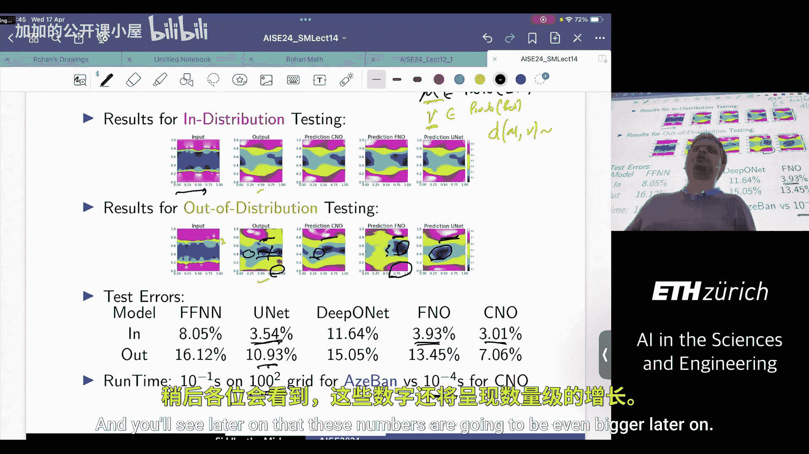

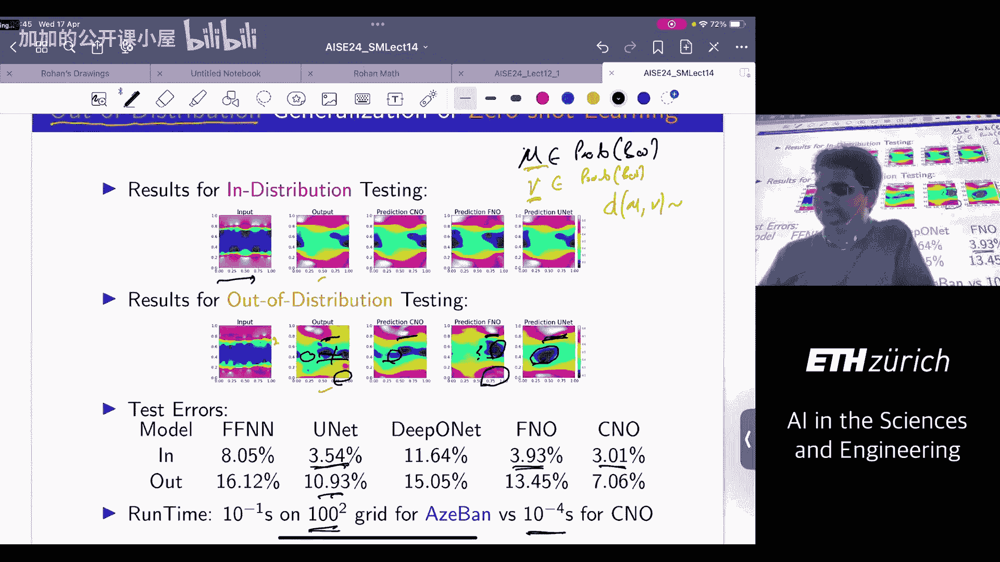

Okay， so this was， I have many， many examples。 and I certainly don't have the time to go through all of them。

 Okay， this is also an important point。 say success is a histogram， not a point。

 because this was essentially now we have， I don't remember the test set is 256 or 512 samples。

 The numbers that were reported where like median over this median errors over this set。 So。

 of course， there is a bigger spread。And if you look at the histogram。

 both in distribution and out of distribution， you can see that in distribution。

 it's clear that FNO sorry CN NO does better than FNO and unit。

 but in out of distribution is where it does really better。

 right because you can see that almost all the errors are between anywhere between 3 and 8% or 3 and 10%。

 whereas if you take FNO， it starts around 9% and goes all the way up to 20% right So it has a better spread。

 in terms of extreme events。 Even the extremes are not so bad， whereas with FO。

 I think in this particular case， but this could be this could be due to aliaing。 That's one。

 we saw some artifacts due to that， or it could be due to some intrinsic signature of the model and the data。

 sometimes it's very difficult to say that。Okay， let me go through some other examples so that， okay。

 this is， this is not important。

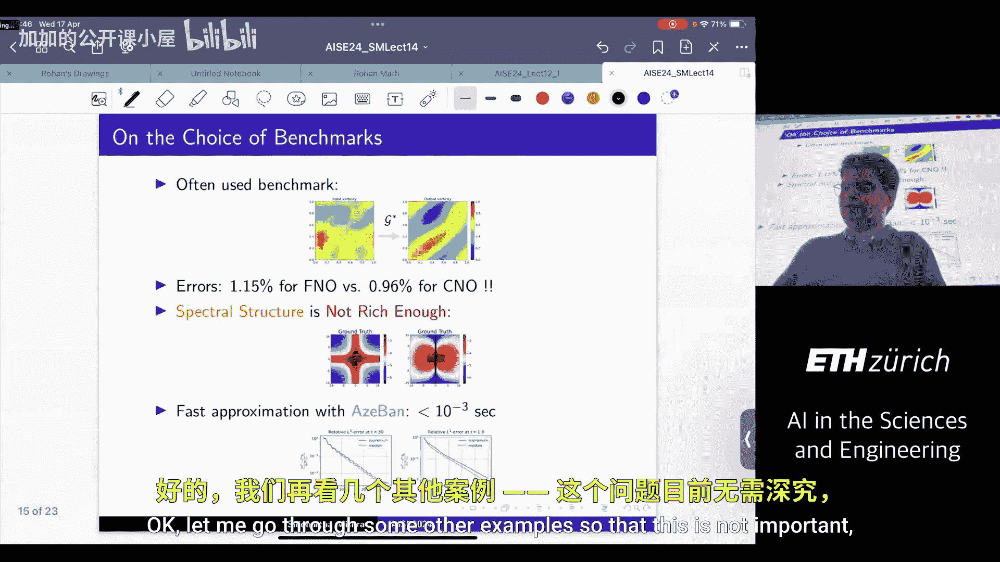

Because I， I have to make a choice now。 So here is another example， which is a very simple one。

 but turns out to be difficult for machine learning。So these are personal equations。

 So you minus lapplian of u equal to f on some domain。 So 0，1 squared。And U on the boundaries is。

 I think 0。 If I remember correctly。 And then the operator just takes the forcing and turns out to you。

 Okay， and the forcing is taken from some measures。

 So the F is distributed according to random field， Gaussian random field。

Or maybe it's not a Gausian randomn field。 It's some science。

 I think it doesn't look like a Gausian randomn field。Let's see， some。Some of science。

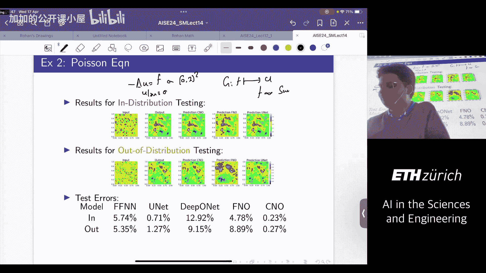

So as you can see， this is my input。 you can see that it's sum of signs。

 So I have taken 20 or 30 signs。 And then， of course。

 what the Poson equation does is that its diffusion。 So these modes are diffused out。

 the solution is still fairly complicated。 and these are the predictions。

 So you have unit C unit and C are the same in this particular case means as you would expect strength of CO is what happens when you go to a different grid。

 FN does very， very poorly in this particular example we still don't understand why。

 but it as you can see many， many new features are introduced and it doesn't it doesn't do a good job at all。

 And you can see that when you do an out of distribution， out of distribution is you add more signs。

 So I think we took 20 signs for the indiriion set up to 20 signs。 And here it's 30 signs。

 So you can see that the signal is much more let's say wavy in some sense。

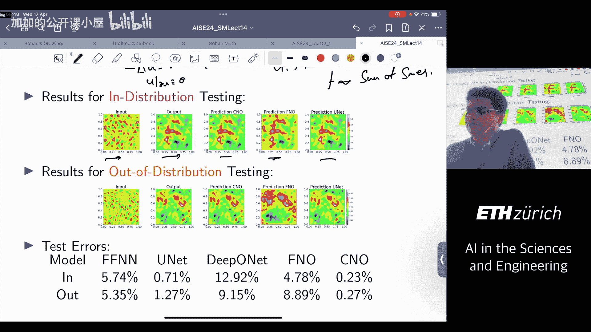

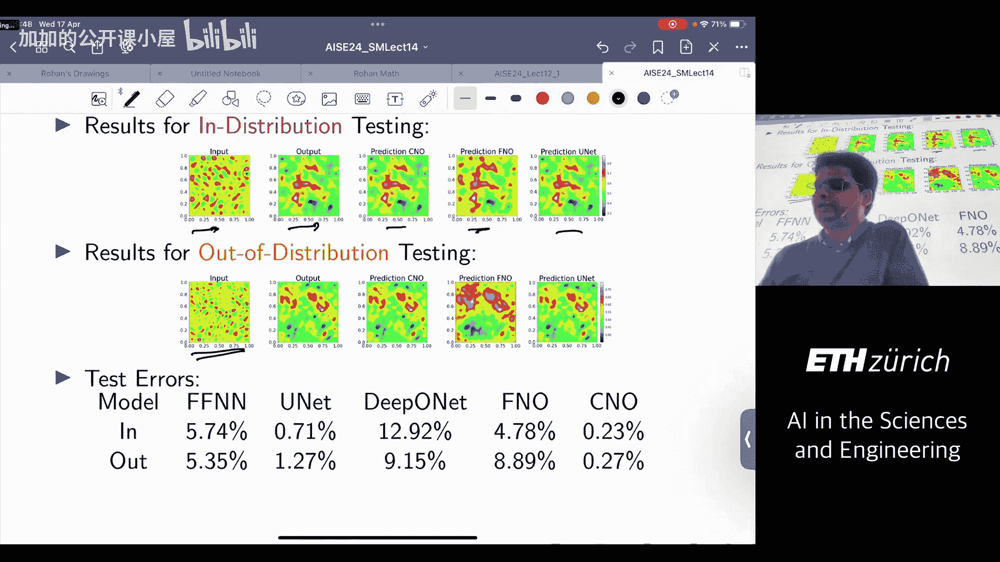

And again， CO does an excellent job。 And FO completely fails， right， it's sort of。

It does very poorly。 And this is also reflected in the in the， in the results here。

 So this is like 0。2%。 It's almost no error。 And this one is like 20，30 times more。 So a lot， lot。

 lot more error in this particular case。

And if you do the same kind of analysis as before。Again， unit as expected， it does very。

 very poorly the as you change the resolution。 it's not a。

 So the errors go up in this U shaped manner。 the same with FNO， actually， in this particular case。

 it did poorly。 So there are there are large errors on both directions。 CO， of course。

 does very well here。 where the nu barrier is satisfied when the nu barrier is not satisfied because remember that it's it's just an approximation it there was there was some small errors right And you see that beautifully in the spectrogram。

 So here is the spectrogram for the ground truth for C。

 it's almost an exact match FNO has all these high frequencies where there shouldn't be as does unit right。

 So there really， it shows this problem shows that aliasing is a real concern。

 If you have aliasing then then you end up with these kind of。

With this kind of artifacts， right， And then I have many， many examples。

 I don't want to give all of them because there is no time。 Maybe I focus on a couple。

So this is a very， very simple problem。 Transport equation。 Okay。

 and what does transport equation do， So transport equation is essentially U T。Plus。

C dot gra U equal to 0 in 2 D。 So all the all the tests are in 2 D。 C dot gra U equal to 0。

 C is a vector now C 1， C2， and then your solution U of X， Y T is equal to U not of x minus C 1 T。

 Y minus c2 of T。So a very， very simple problem。 Of course。

 the machine learning algorithm doesn't know that it is a simple problem。

 It just has data and is going to see the things with respect to data。

 So now we take a very simple for the indiri。 we take essentially a Gaussian bump。

 we take a Gaussian bump， which is given here， and then we transport it right。

 So we transport it to the velocity field， which will take it in this direction。

 So the output is like this。 and for the initial distribution。

 What we do is that we change the strength of the bump， which means the size of the bump and so on。

 The location is always around this this points。 Okay and you can see CO gets almost a perfect answer。

 FNO also gets the perfect answer as this unit。 nothing nothing changes。

 And if you look at the numbers， they are like 0。3%，0。4%1。4% and so on all of them are good。

 But now the challenge here is out of distribution。 So out of distribution。

 what happens is So during the training。

Always sees the initial location of the bump in this corner in the bottom left。 Now。

 what I do is that I keep the same sort of problem。

 but I seem to translate the bump to the top right。 Okay。

 and when I translate the bump to the top right， Of course， this is just a。 So it will just go there。

 All that is happening is essentially a translation， right。

 and remember that convolutions are translation invariant。 Okay， that's the whole point。 of course。

 N know does a very， very good job。Not exact， but almost， almost as before， unit 2， almost as before。

 there is some a thing。 That's why there is large。 we believe larger。

 FO is not translation environmentvari。 Why is that。 Can anyone tell me why。

He， James。Yes， so this is once you go to Fourier， you destroy the locality and then you no longer have translation invariance and you see that。

 So it does some translation。 It but at the same time。

 it thinks that there is some feature which is still left behind， right？

 So they hear you the out distribution performance is not good。

 It's like so translation invaris it's good to have because in a lot of physics you have translation invaris。

 right， And what is left is the very， very poor performance， for instance。

 of these guys of MP and of deep means these are like insanely bad。

 And this is not because we made a mistake。 they just don't understand。

 means there is no notion of space here whatsoever。

 so translation is not even understood here because it's a spatial operation， right So you see here。

That it just keeps it remembers that there was something here。 And now it is given something here。

 So it just interpolates between them。 right， Its it completely fails。 and deep on net。

 it does not understand the shape at all， but it does some translation， but it keeps a very。

 very large feature here for some reason。 So sometimes。

You know， the theory and practice are not completely uncorrelated from each other。

 You understand the theory， and you expect certain things， and that is what is borne out in practice。

 So this was a good test for out of distribution performance of a neural architecture。 And you see。

 see the results here。

The last example that I'll give are what are called the compressible oiler equations means we have seen these equations before。

 So I'm not going to rewrite them。 And again， this is this flow past the airfoil， right。

 So our familiar problem that we have dealt with many， many times。

 So now the difference is what is in the definition of the operator。 Okay， so earlier。

 you have seen that the operator was from the initial data to the final time。

 It is from the forcing term to the final time and so on。

 And now you can see that this is slightly different operator， because operator， roughly speaking。

 is a mapping from the shape。

Do the flow。Okay， so that is the definition。 And what is the shape here。

 The shape is defined in terms of the shape of the airfoil， which is given as a mask。

Okay， so it gives you0 values here and some non0 or one values here and0 values here。

 It's like a mask。 That is the input。 And you you check it from in distribution and out of distribution out of distribution。

 You simply have more basis functions。 Remember that we had this his he functions。

 if you recall from some of the previous lectures。 So I think here we take 20 and here we take 32 or 16 and 32。

 the numbers could be wrong。

Then they， they do a good job。 The， the machine learning architecture， C NO， for instance。

 where is it here。

This is in distribution， and this is out of distribution。 Does， does a does a good job。

 In distribution， very， very accurate， out of distribution， fairly accurate， but not， not completely。

 As you can see that the shock is right here， it has moved a bit。 It has diffused it out a bit。

 but it's just， just a bit。 That's why you get 0。62。 If I know， for instance， does also a good job。

 but it has this artifacts。 You see here and here， again， this is the sign of we believe of aliasing。

 Okay， unit similar， but the unit does not alias as much in this particular case。 right。

 it has perhaps more diffusion for some reason。

And why did I show this， First of all， the performance is very good。 The point here is。

 you know to generate any of these results with a traditional numerical method。

 even with a very optimized code， this will take me 10 seconds。 this is a harder problem。

 This will take me 100 seconds。 C， N O， FO， any of these， it takes again as before。

 the inference time is 110000 of a second。 Okay， so once you have a train neural network。

 you can do things even in 2D，6 orders of magnitude faster。

 So if you wanted to do design airfo design as before。 and you needed a thousand00 iterations。

 This will take me10 times1 hundred seconds， which is a lot of time。 This will take me 1 second。😊。

So this is less than one second。 It takes time to， of course， set things up， yeah。Yes。

E this is because， you know， the set of shapes is you can't go completely crazy with shapes。

 For instance， if I would have taken 50 of these Xx N functions。

 I'll get shapes that are not feasible anyway。 So even the。

Even the flow itself does not make any sense around them。

 So in the regime that we have for this particular hairfall。It will work in every case。 Okay。

 what is interesting is what happens if you change the inflow conditions。

 because the inflow conditions here can be very， very different angle of attack and so on and so forth。

 I think without preliminary tests it because you can't change the angle of attack from1 degree to 5 degrees then your plane will certainly crash。

 Okay， so you don't want to simulate that or 10 degrees。 So within the bands。

 because engineering is along narrow bands。 You see， then it sort of extrapos quite well。

 but that doesn't mean that if I change the shape entirely， it will do a good job。 You know。

 change a different parameterization altogether。 that that may not do may not do such a good job。

 So these methods have the limits。 they are not without limits， you'll see the limits very soon。

Okay， so this was actually the sort of results。 I somehow made a mistake because the number was not。

3。1， it was 2。76 and 3。57。 But roughly it is， you can see that there are different examples。

 as's always similar story。 The strength of C NO is in the fact that it has this three no property。

 right， so you don't have asing errors and so on。

And the last point， which I want to talk about is a little bit about computational efficiency。

Not in terms of inference， because inference is always very fast。 What about training。

So training is epochs， right， you have to run for different kinds of epochs。So。

 in this particular case。I think。Roughly speaking， we just compare with FNO FNO is the most sort of good baseline in some sense。

 And you see that in terms of time per epoch model size also， but in terms of time。

It consistently was better performing the defhano。 in particular。

 if you take here is the sort of the bottom line， it's around 4。2 seconds。 And with less error。

 you could train in three seconds。 So， you know， the training time is comparable。 actually， it's。

 it's a bit faster even， right， So in other words， per epo， it takes about3 seconds。

So if you take 300 epochs， it will take 900 seconds to train。 Okay。

 so this is roughly the the constraint。 Of course， these are relatively small models。

 I think these are like 3 million， perhaps the was 7 million in this particular case。

 And C was like 3 million。 So these are not big models。

 There are still much bigger than what we saw before， which was like 10000 parameters right remember。

 I had this examples with 10000 parameters。 but the biggest models that we have are like 400 million parameters。

 and these takes a week to train。 So of course， the there is some scaling issue。

 but we are going to address the scaling issue next week。

 Okay so with this it seems like everything works。 but you'll see that that's not the case。

 there are several issues that we are going to deal with on Friday。 Okay。

 so let's meet again on Friday。 And then we can we can take it from there。

