# 苏黎世联邦理工【中英⚡科学与工程中的人工智能｜2024 AI in the Sciences and Engineering】 p15 P15 Time-Dependent Neural Operators -BV1smxgzHEPC_p15-

Okay， so good afternoon everyone。 Let's get going。

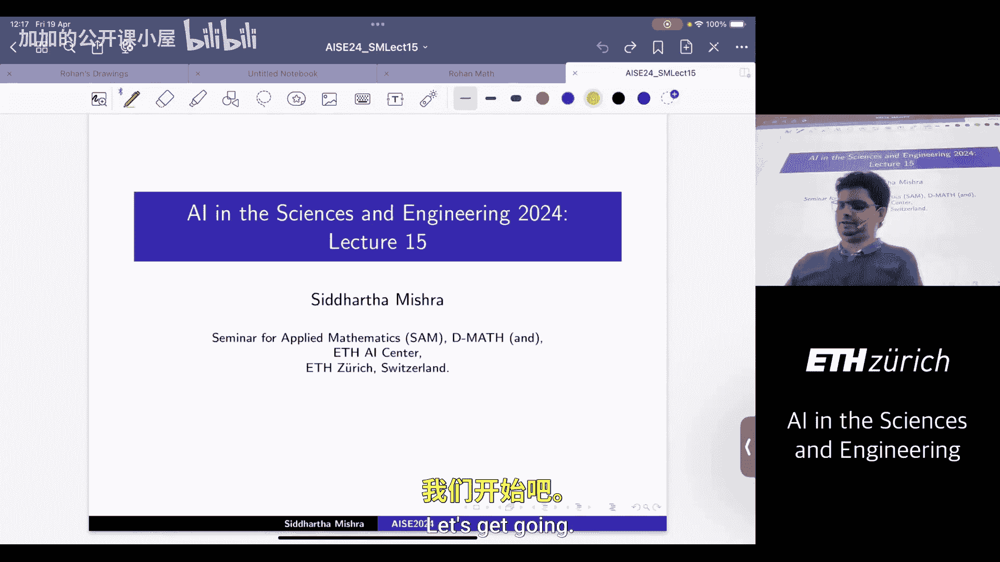

So we have lecture number 15 of the course。And as this customary with me， that's a very。

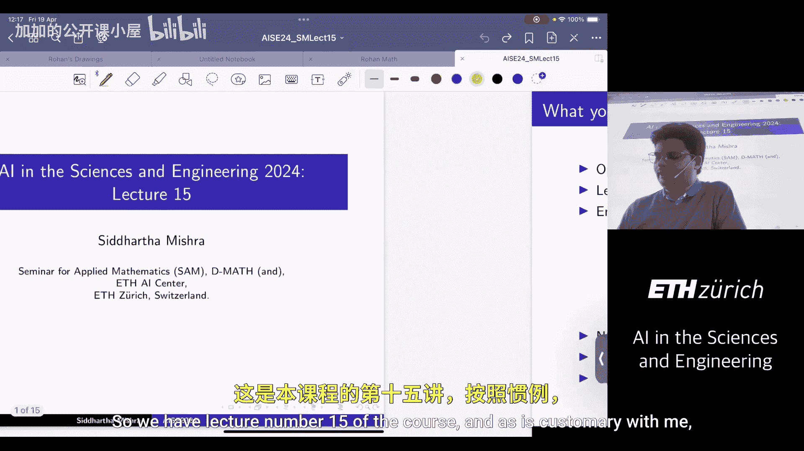

Short intro of what we have done so far。 So again， we are with the problem of free operator learning this is the abstract PD。

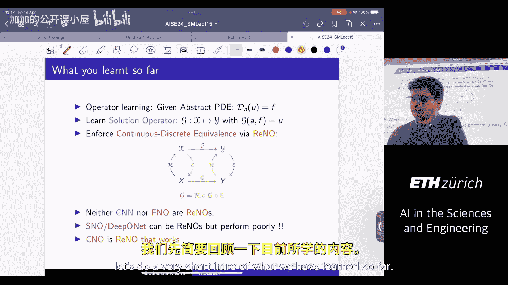

And this is the solution operator which is given here。Which takes us input the coefficients。

 A and sources F and turns out the solution here。And we know that because the inputs and outputs are functions。

 we have to work with this notion of continuous discreteretic equivalence。Otherwise。

 we will not be learning the actual mapping that takes functions to functions。

 well only be learning a certain fundamental dimension of representation。And again。

 I repeat this notion of areno or representation equivalent neural operator。

 which is that you have an operator that works experience functions and functions and the way you go is you go down to some grid by suitable encoding point values。

 for instance， if you have band limited functions。You do your processing there。

And then you come back through some reconstruction。

 This is some form of interpolation because from point values。

 you have to read back the function and as long as this diagram commutes。

 then we are we are okay right and while using this perspective。

 we did some analysis and we found that。Some of them are not renos， some of them are renos and so on。

 and in the last lecture we focused almost almost exclusively on CNO convolutional operator。

And we discovered that as it has some desirable theoretical properties and it also works well in practice right so let me just start with that and try to。

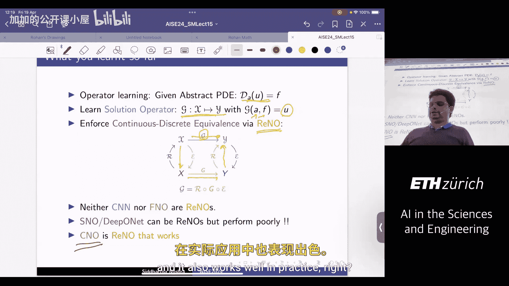

So remember that this is your CNO and the essential bits of CNO where the two operators convolution and Nor nonlineardi and both of them had this nice feature that they were。

 so you have this is only this the convolution K here。Which is and then you have the linearity。

 which is given here。So in particular， you have to use this upsling and down sampling operations in order to in order to preserve the band limits in order to have this re of properties and so on。

 and in practice what we ended up was with a。Operator unit。

 which had this look or this sort of a multi scan information crossing。So you took in information。

 lifted it， then sort of reduce the resolution， increased the number of channels kept on doing that in this sort of structure preserving manner in the encoder part so this was roughly the encoder and there is also a decoder which is on the other side。

And we will see also more and more all sort of vision state of art， vision processor。

 vision machine learning algorithms。 They had this sort of multi scale feature。

 This is an important part。Of the whole thing because it allows for multi scale information processing。

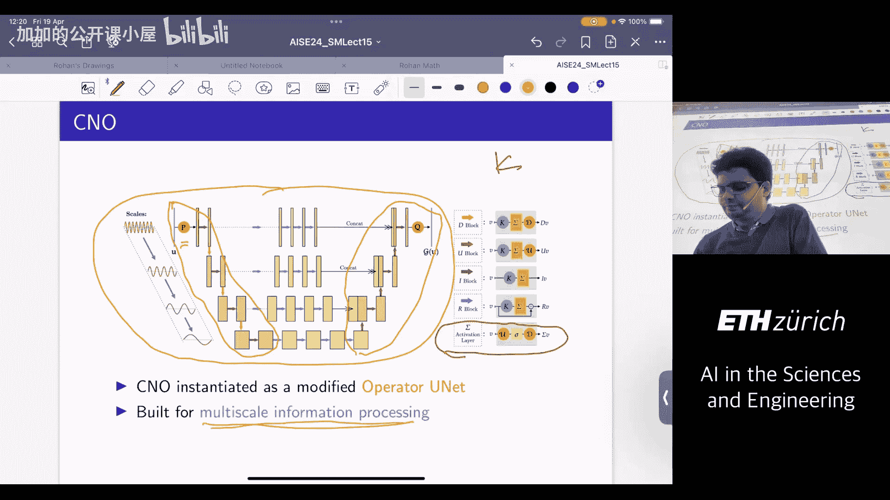

And we showed through various examples that it is it has there's also good performance。

Some cases it doesn't do better than this is what I did not point out in the last lecture。

 for instance， if you take alan K equation， which is an only a parabolic equation。

UT is roughly u1 minus u squared plus some kla plus of u。

 so you have some reaction which is given by these terms here or1 minus u。

 I forgot the exact foun onity and you have some diffusion which is given by this term here here for instance。

 okay， errors were small， but if an over still competitive。Remember。

 so this was this was one example in general that were both these approaches are fairly competitive。

And what we should remember is that the main differentiation between them to some extent comes from the fact that one is ano。

 so if you had error versus grid， so in one case you more or less got a flat one and another case youve got a。

Something like this so this was sort of the behavior that they had this was sort of the major differentiator between them otherwise they are sort of roughly comparable to each other and one depending on the problem that you have one might do better on the fixed grade and the other might do better on another grid okay so now what is so this is so far so good now the starting point of my lecture today is to point out some of the obvious limitations with these approaches okay。

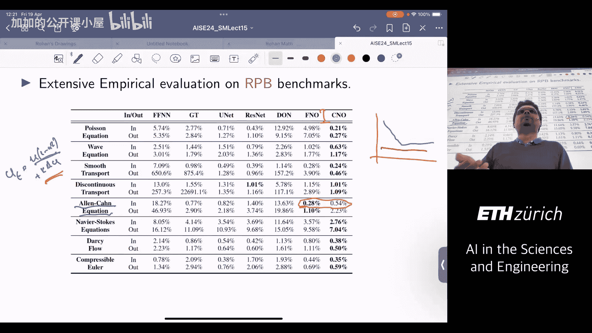

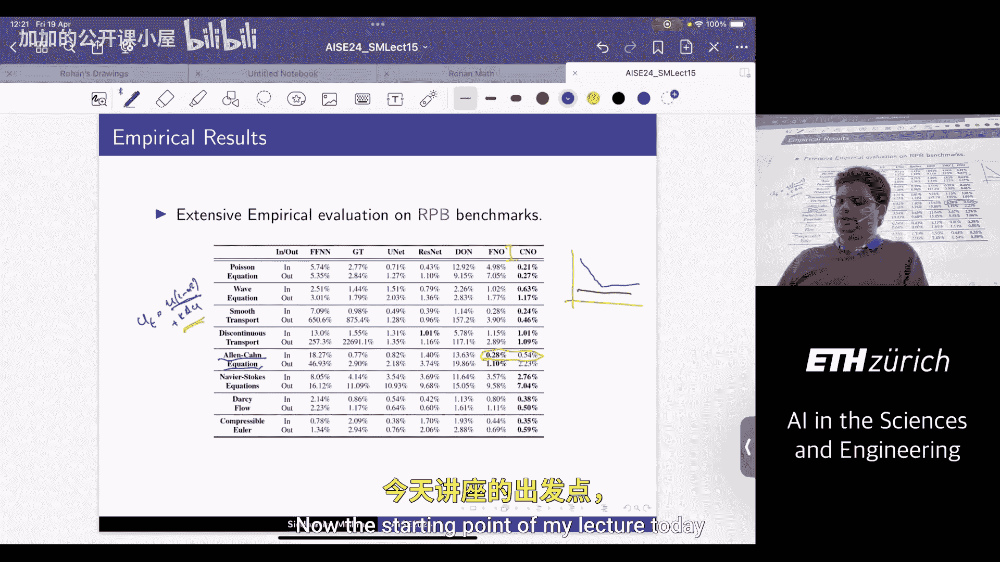

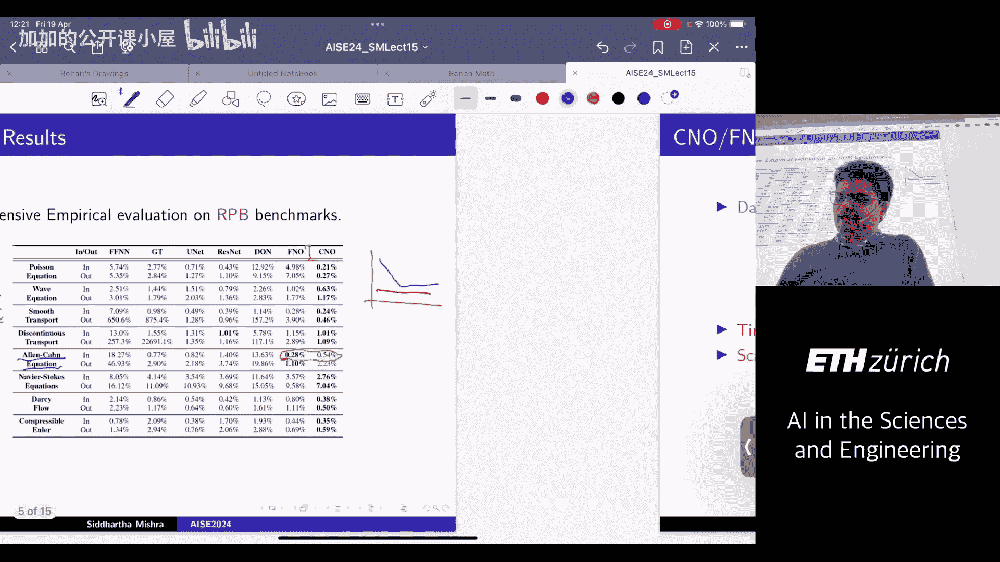

And to that extent， I have identified three issues that we are going to discuss in some detail today。

 the week after and the week after， so that you get a comprehensive understanding of everything things done。

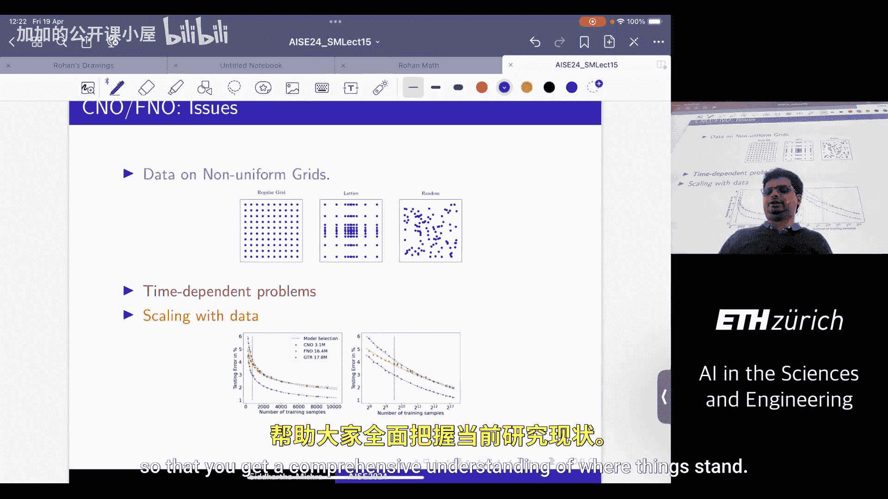

Well， the first point， which you could have guessed。

 and I think I said it is that both FNO and CNO and many of the other algorithms that Ive mentioned。

 some of the other algorithms that I mentioned。They sort of principle。

 even though they don't need it， but their principal mode of operation is always on regular。 Okay。

 so in other words， the data。

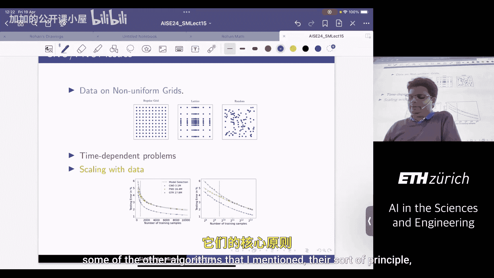

The inputs and outputs and the processing always happens on the regular something like this。 right。

 So this is sort of the。So this is what you allow for。

W which is okay right in many problems we have that structure certainly if you have images images are always in the form of squares or rectangles so it's no problem。

 but in reality we in scientific computing in particular remember that we even had the example of the airfoil right so we had the example of the airfoil so certainly the domain there is not a rectangle even though we reduced it by some mask if you remember in the last lecture I pointed it out right so but this can be an issue if you have very very complicated grids so at the moment at least the way we blur it FNO CN FNO for instance you can do it on。

General grids， but then you don't have the efficiency of the fast Fourier transform remember the fast Fourier transform was the key because we had to transform things in the Foururier domain。

Right， so FO or C N， they in。Out of out of the box。

 they don't allow for sort of let's say irregular grids， for instance。

 this lattice which is a tensor product of two sort of irregular grids in each dimension and these are random points For instance。

 if you have random sensor locations so in order to operate with this you have to do some form of interpolation in other words you have to take data here。

 get back here， take data here， get back here， which is what we did with this masking strategy right so we had data which was generated on points in this domain and then what we did is that we interpolated it onto a regular grid or we just projected it onto a regular grid and put a mask in order denote the boundary。

So there are some workarounds and I think if I get time so in a couple of weeks I'll probably revisit this topic but this is。

This is this could be an issue。The second problem and the third problem they're actually related to each other to some extent and I will deal with them in some detail。

 so the second problem is that of time dependent PDDs okay so what are time dependent PDDs so if you remember in the last lecture for instance we had this examples from the Sheierier so the idea there was that we started with some initial data you will see some examples later today we started with some initial data。

And then the operator simply predicted the solution at a later time step right so you had some boices which were shared so this was at related time step In other words。

 you started with U0 and you finished at UT But remember that time dependent problems。

 they have some natural sort of data availability or data the natural form of them is really in the form of。

Video you can think of it as a video you can think of it as a trajectory you can think of it as a sequence of images so there is some information on time right so this is what we will look at in some detail today and somehow intimately related and even more important is the issue of scaling with data so let me try to just explain it a little bit and we are going to talk at some length about this today and next week we are able to focus on this issue quite a lot。

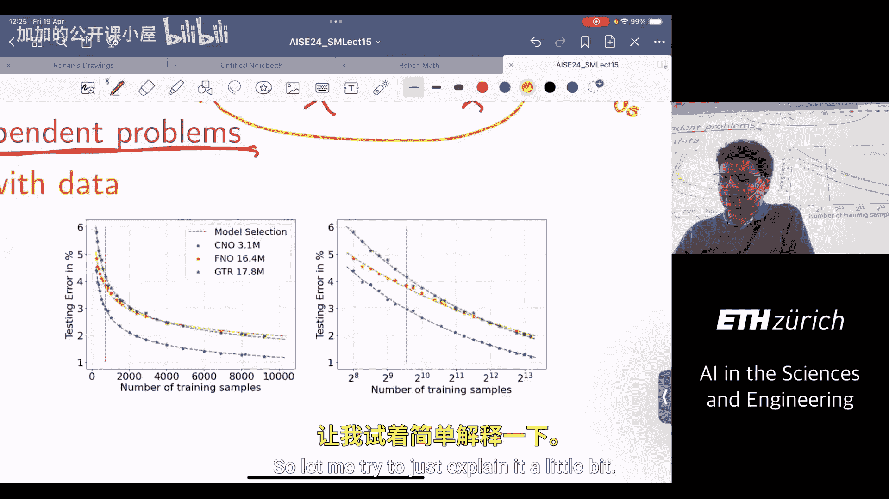

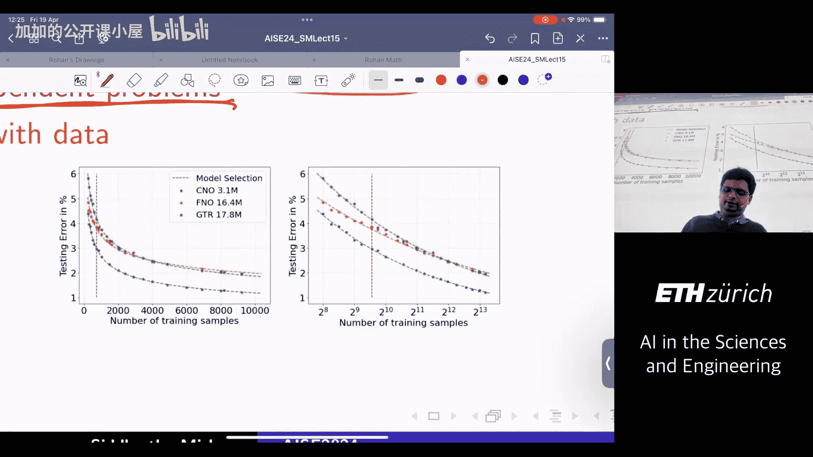

So this is exactly the same problem as before。 Remember this navi stokes Shiier problem So the task is to just predict the solution at time t equal to1。

 given the initial data So I'm taking out the time information completely I'm saying okay。

 you give me an initial condition and I will churn out the solution at a certain time this is the setup right now what I did here is that we took three models CO FNO the number of parameters are sort of comparable one is more than other but。

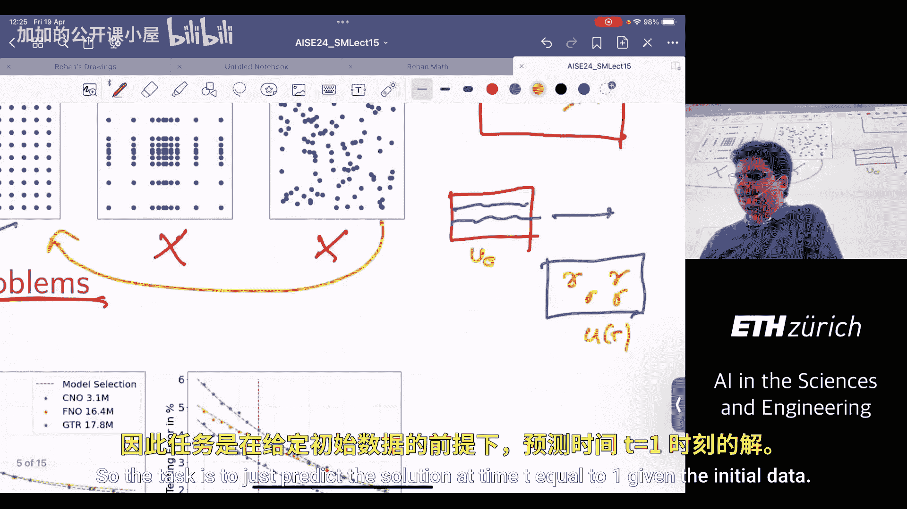

StThis is not a big issue here and we also took some transform what can transform something some of the earlier attempts of using transformers in this domain and the questions that we asked are very simple and we train the model with X number of training samples what is the training sample here this is the pair here right so you start with some initial data。

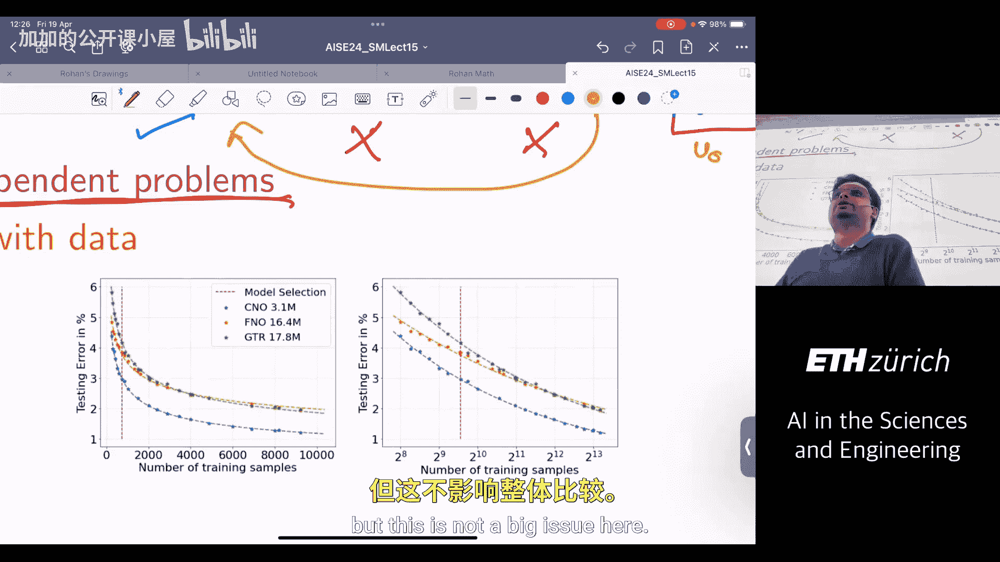

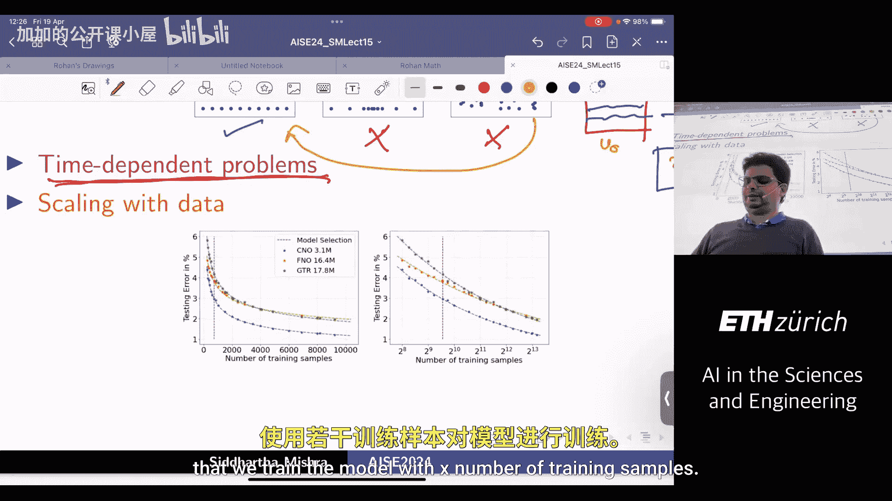

You start with some initial data and you go to the final solution so this is so we start with also we have for here means we have 20004000。

608000 and so on we increase the number of training samples and we want to see how they error So the idea is as you give more data you should get better results right so this is roughly the idea that we operate with and you see that this is actually happening there is very little theory regarding this you know this is what people believe there is very in fact I was only one with some results in this direction maybe I get some time to describe them in next week but there's very little theory but what we observe is that there is some what is called scaling right so this is this is a key issue in machine learning。

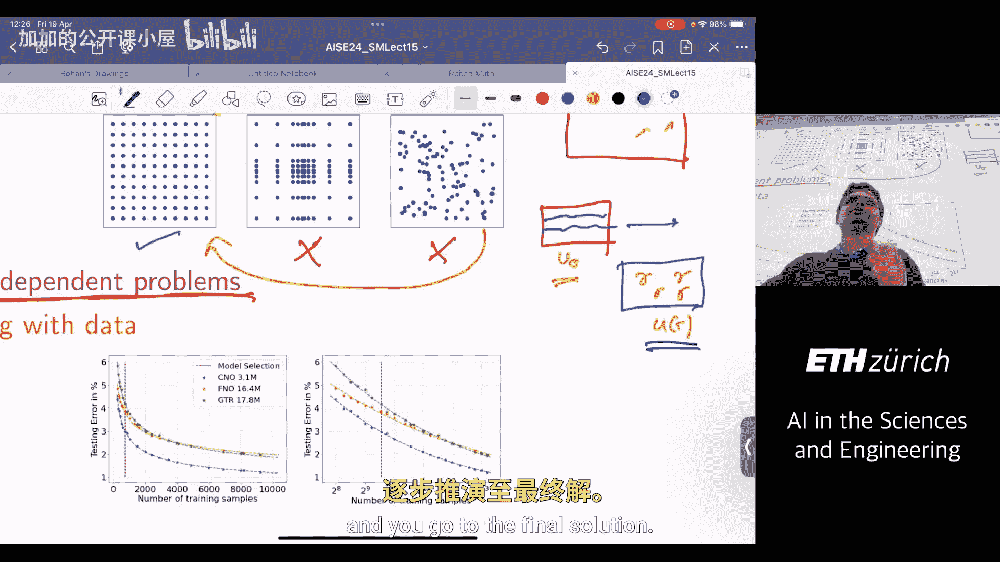

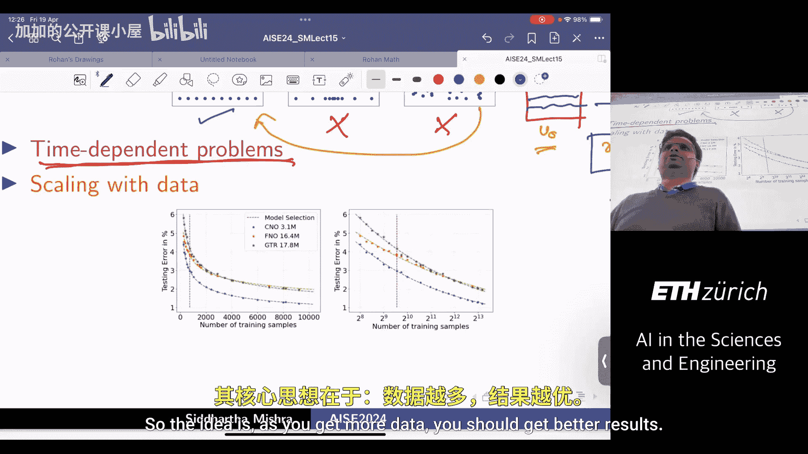

So you have some scaling。 What do I mean by that， The best way is to look at a log log plot。

 So here you have the log of the number of training samples。

And here we have the log of the we have the error So it's a semilog log right So as you can see now what we do is that we increase the number of samples。

 it goes all the way from 512 no256，5120242048，4096。

80192 you see that in all the cases we have some scaling right in other words。

 as you increase the number of samples， the total amount of data that the system is ingeestte。

 you see that the performance in terms of the error gets better and better and better So more samples there are some bottlenecks here and the bottle size is going to be a bottleneck well talk about that later。

 but assuming that we have a model that trains， you see that this is a test error and the test error goes down in a predictable man right it goes down a predictable manner in this case。

 the rate is roughly one thirdd。So if you have eight orders of magnitude， more samples， which is。

It is difficult to say because we don't have8 orders of magnitude here。

 but  five orders of magnitude， you can see that it goes from 8 to 13 and the error goes from like4 and a half% to approximately 1%。

 So the。It's somewhere between 0。33 and 0。5 right because if you would have reduced by two and a half times you would have seen that it would be 0。

5 but it did not so it's it's roughly in that ballpark So there are some predictable scaling loss。

 Of course in this particular case we see that。Somehow CNO does better than we also saw that with a fixed number of samples。

 but it does better than the other models， FNO and the Galan transformer， these are very。

 very comparable to each other， but this one is better。

Even double is better right so as you can see here it's roughly 1% and this is like 2%。1% and 2%。

 but what is interesting is that you see the amount of data that is necessary right because okay。

 this is not the hardest problem on earth， but even to get 1% error here。

 whatever 1% means some number that we fix some desired level of accuracy。

 you see that we need about 8000 samples。

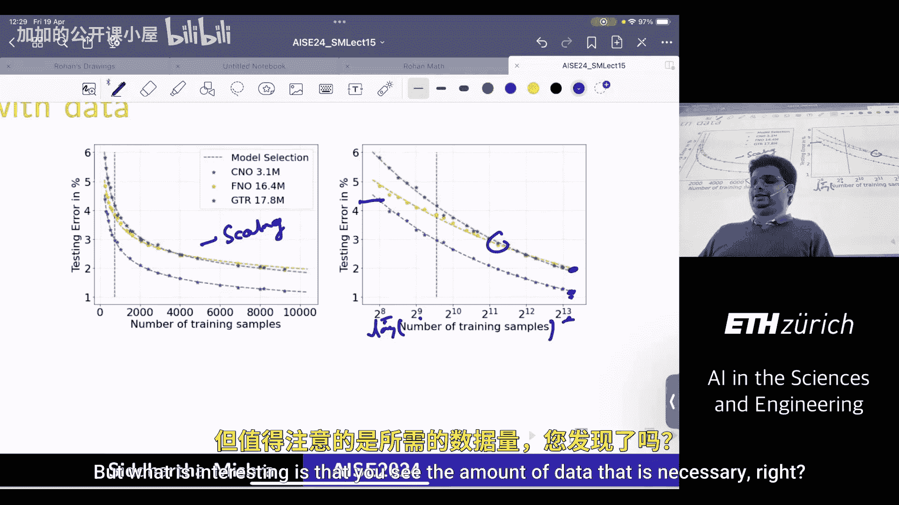

And this is expensive each of this is a CFT simulation。

 It takes some time We have very fast codes so this can be done fast。

 but in general in reality you don't have that advantage right so each simulation can take let's say 10 minutes in 2D and then you have 800 of these tests too much So it's already the fact that you need data there is scaling with data。

 but it tells you that if you give more and more data you get better and better results but how much of data is enough and what kind of constraints you have with data because the difference in scientific computing and in imaging is different right we can see in images you just code the internet and you try to take all the talk images and but here we don't have that we don't have that advantage So one has to think a little bit about data and so this is intimately related in time dependentent problems because how do things scale with data because as you can see in time dependent problems we have some more data than we expected in some sense this is what I'm going to teach you but is the issue of scaling。

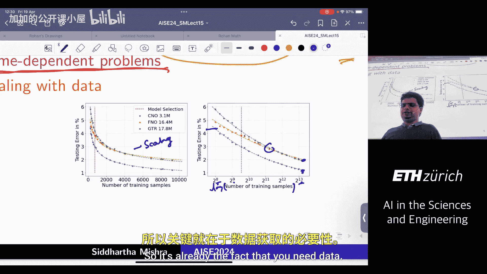

Cl that this is an important consideration， arguably the most important consideration。

And this is what I will really focus on in the next next lecture。

But today let's focus on the time dependent problems， that's the main content。

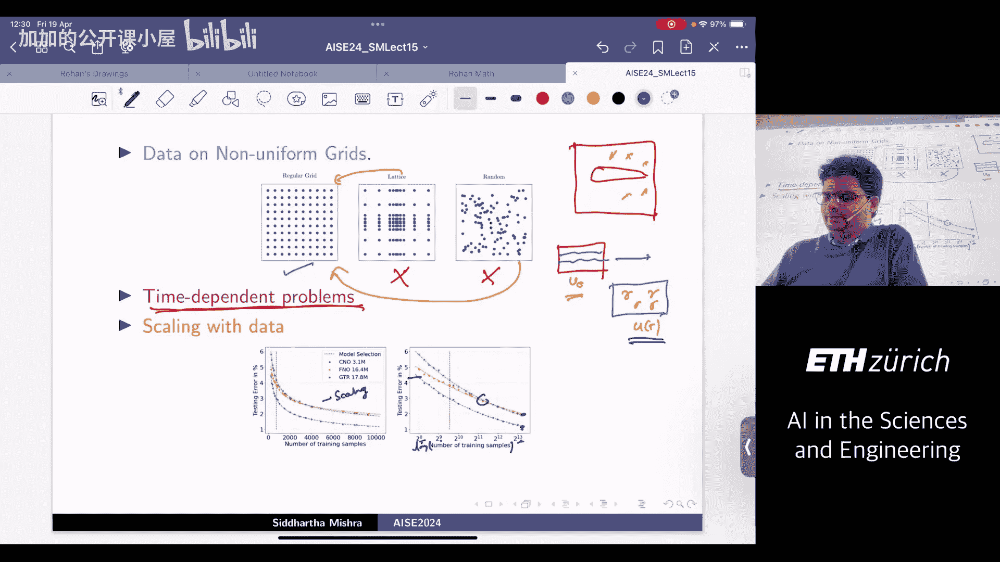

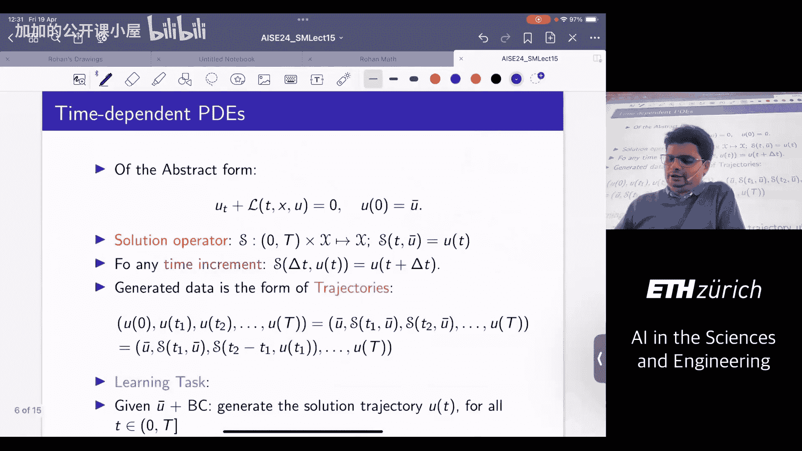

So now let me start with some abstract form because then not becomes easier， so you start with。

This is the abstract form of the PD I have taken a first derivative。

 but you know that first derivative in time here， but you know that second derivative is no problem because you can always reduce a second derivative into a first derivative or a third derivative into a first derivative by considering systems okay this L here is your differential operator。

This is a differential operator。And if you want to think of a concrete model。

 you can think of Ut minus the plusian of u equal to0 the he equation right。

 and the initial condition is of course U bar some function。

So the idea is that we are what we are interested is in the solution operator。

 so this is heat equation， obvious sts， compressible oil equations， sal and Khan， wave equation。

 whatever you want is in this format。不是。No， sorry。Okay， so then what is the what is the target here。

 What do we want to learn is a solution operator S and how do is it defined So now you have the initial conditions because this determine the trajectory。

 this determine the revolution but you also have the time right the time is a continuous variable So what you do is that you supply the time you supply the initial conditions and you know what is the PDE then you know the solution at a later time right so it's it's a causal problem。

 you can always march forward in time Okay backward in time is not always possible only indiverible systems。

So now in particular， what we know is that we can substitute this this solution operator is having something called a semi group property。

食 me佢。And the idea is that if you so let's say that you have done the evolution and you can start at a different time and you move further and you get back the same solution。

 so this is what causality is and what it means is that you can also put it in the time increment here so let's say that you're starting at perhaps it's good to do some geometry。

Well let's say that you have a solution trajectory， I'll just show it in1D means not as a video。

 but let's say that this is a solution trajectory， something like this。For instance。

 a solution of an Ode right and this is your U0， this is your U T。

 So if you start U0 and you supply a t plus delta T you will reach this point here。

Or you start UT and you ask what is the increment in Delta it also reach the same point right so this is a causality but whether I start at the beginning and go towards end time or whether I start very close to the end time and go towards end time。

 provided that the time increment is given as as one of the parameters。

 then we know that the solution can be generated and is unique right so this is this is causality。

This means that because it is causal and we are going to exploit that in in some manner。

 what happens is that the data that you generate or the data that you record。

 the data that you observe is often in the form of trajectories。 So what is a trajectory。

 What is the meaning of a trajectory trajectory is not just the value at one particular time。

 but it's like a video。 So you in principle， you could have the value at all possible times。

 but of course that would be continuous。We can't store continuous things on a computer so you have to put some sampling so it's a collection of time snapshots with the causal arrow being there in the sense that at time equal to110 time equal to two time equal to three and so on so in other words you have been given so again I need to draw some pictures here so this is time。

And just imagine that each time you'll get an image right or a video in general。

 So then you just choose certain sampling points in time So this is t0 T1 T2 T Tk in general right and then t capital K is equal to capital T this need not be uniformly traced this can be whatever your recording instrument。

 your camera or your numerical simulation， whatever this need not be equally spaced of course the equally spaced1 is the easiest one So what you get are this entire set of values So just imagine that you have all these images in the form of a video and this has a certain sampling rate right so this is the way you can think of it and this is of course given in terms it's all determined by the initial condition So given the initial condition and given this lead times t1 t2 and so on in principle we should be able to generate So the data that is given there is having this particular format right you。

generated using increments， but that is that so for instance you can go from U0。

 you can go to u1 and then from U1 you go to u2 then you go to u3。

 go to T4 and so on and so forth and when you do numerical simulations yes go ahead。

Didn't we have the same setting already cost when you introduced use phrase as a signal because this is also a cause function because it starts from0 and you be march forward in time only if you have a time dependent。

 if you have a signal that is static， but it's a function of space， then there is no causal。

So the specificity here is the fact that time provides your direction。

If you don't have the direction， there is no reason why you can't go， just imagine that in this room。

 I can always walk from here to there there to here and come back but I can't go to 10 minutes later and come back So this is where the causality is the key So time has this causal property forces causality and one has to one has to recommend it so now remember that the data is always in the form of trajectories。

 Let's imagine that we are trying to generate data。 we want to go and do a numerical simulation。

 we take the initial conditions and we do a numerical simulation right the numerical simulation automatically as a time stepping so you generate a t to del the T and so on and so forth you don't want to store all of it because otherwise it will be too big you have to sample So let's say that you store at t equal to 0 t equal to 0。

10。2 and so on and so forth So out of an numerical simulation you will get a trajectory。

 this trajectory would have some sampling frequency let's say that there are k samples in it。

Or your video has a resolution of one of a case。 So your K frames in the video right so these are the two ways you can think about it。

 and this is the data set always contains that。 you have to store it。

 of course the computational cost is exactly the same because you order to compute later you have to compute in the beginning all these numerical methods that we also talked about these are time matchinging methods So there is no choice but you have this information and you put them together。

 you store them so there is a cost of storage but you always have information in the form of trajectories if you this is a language of physics in the language of computer science。

 this will be videos okay so your trajectories and you have videos So what is the learning task for a time dependent and this is very important right because in a time dependent problem it is not just given an initial condition and you read of the solution at a final time because the data that is used to generate this probably has information about the trajectories and this is something that we need to leverage because。

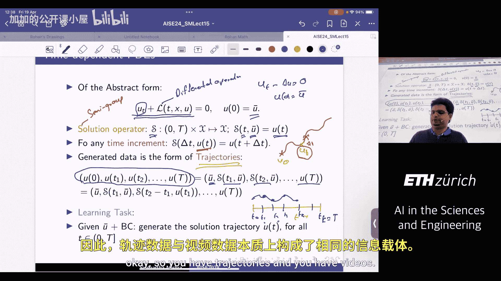

Remember， more data is better。 Why is that Remember this particular graph right。

 so more data is always better is a somehow other the principle of machine learning。

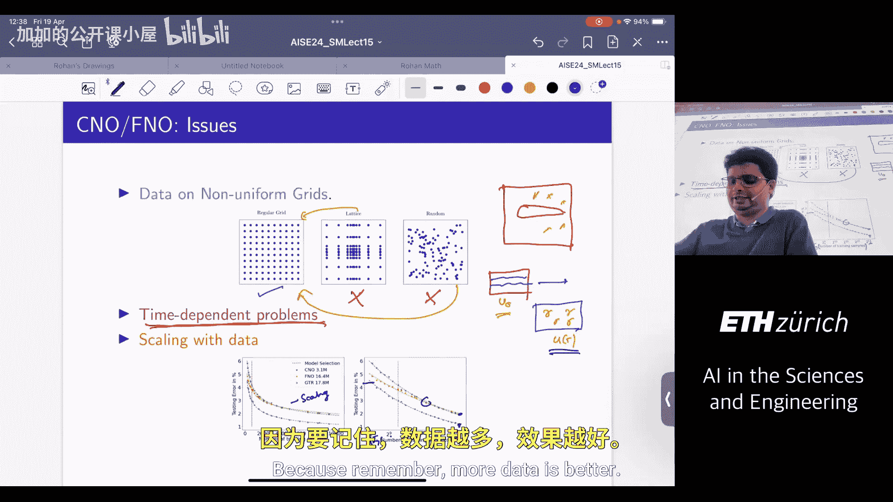

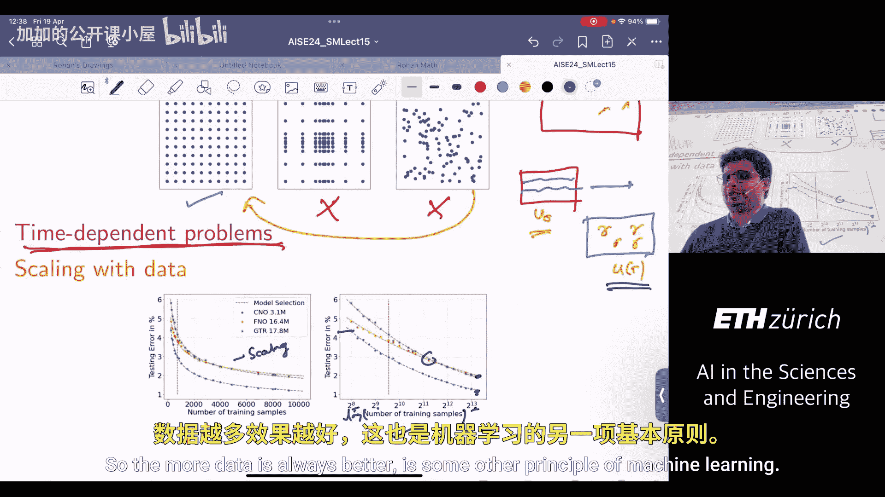

So what what is the learning task learning task which I wrote in text here is very simple given the initial conditions and the boundary conditions。

 domain coefficients and so on， all the other material properties at the medium you have to generate the whole ideally because this is what an numerical simulation does you have to generate the solution trajectory for all times okay at least for those times that you want to sample you should be able to generate that so in a way this is a harder you have data but our task is also hard so what I'm asking now is that if I' am given the initial conditions if I'm given the boundary conditions。

 the domain and so on， I should be able to predict the solution for all times in the future because that is what the solution of the PDE does so this is harder than what we had seen before which was given the initial conditions I wanted a solution at a certain time now I'm asking something which is a harder question that I also need some continuity in time in the sense that time itself is going to be a container now。

Often this issue and this is important to make a remark here that this issue is when people who come from computer science and try to do these simulations。

 they don't necessarily operate within this framework， they say no no。

 give me 0 20 values of the trajectory and then I'll predict the next value。

And so they always assume that there is some stream of data that is coming in and they have to keep on completing this stream you see so for instance。

 just imagine the weather data in principle I have access to the weather six hours before 12 hours before 18 hours before 24 hours before and so on and I could use these guys to make the prediction for the next six hours this is this is always possible。

But this is very special and it's only possible for like weather data data where they' is streaming happening in general。

 this is not the situation that we are going to work with because in general。

 when you have to generate data for a time dependent problem you have to generate it from the initial conditions like a numerical simulation does you know so what is the point of having a numerical solver for the first 50 time steps and then making the 51st or the 52nd time this is many people do that。

 I think 80% or 90% of the papers that are written in this field。

 they assume that there is trajectory data because they're basing everything on the weather but this is a very。

 very specific domain in general， you don't have access to that right you are going to design something you have to set up your numerical solver and that setup costs very。

 very large So what you would ideally want is that you give me the car and I should read off the flow field。

You see give me the material and I should read off how the temperature feels spreads so you should always remember that there is this distinction here which is very very important so for us we are going to be in the exact situation as a numerical solver。

 which is if you're given the domain you're given all the coefficients you're given the boundary conditions。

Given the initial conditions， you march forward in time okay。

 and so we want to replicate exactly this problem。Is this clear the difference between streaming data and the sort of learning tasks that I have set here。

 which is harder because you don't have access， you only have access to initial conditions。

And then you to， okay， so this is an important point that I wanted to mention。

Now how how do you do that right？ so now we have this and how does neural operators。

 what do they do For instance， what you have learned so far with FO and CNO how how is this done right well。

 it can't be done because the way F&O or CO， the way have introduced them for you。

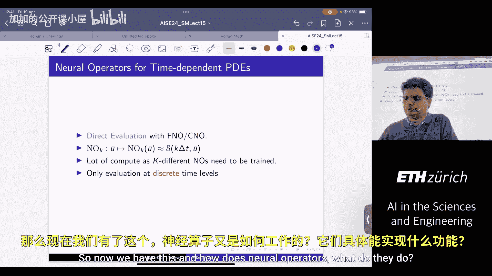

You don't have that you so so far， what you have is that you have a neural operator， it can NO。

 it could be CNO FNO， or whatever it takes， let's say the initial conditions and it produces a solution at a later time。

And to train it， you are exactly using the same kind of initial conditions right you always give an image and then you produce a solution at a later time。

 So of course no one stops me from predicting the solution So what you could do is I could take the case neural operator actually some people even do that I can take the case neural operator and its task is given the initial conditions I produce a solution at the K time So the neural operator one will produce it at the first time level。

 neural operator2 will do it at the second time level third time level and so on and so forth then you can use whatever we have right because okay it's just a fixed time prediction I just have what I have and I just plug it in Now what is the issue with that as you can see then we have too many models right we have to run capital K different neural operators and this is not not the best computational investment particularly if you want a continuous evaluation right because then in that case maybe we。

100 neural operators to be able to represent the temporal variation so this by itself is not going to be enough for sure and in particular。

 as I said， it only gives you discrete time levels。

 it's very expensive and it does not give you some data advantages in the sense that I just let's say I have the trajectory but I'm not using the trajectory I'm simply using the fact I'm not using the fact that it's a time evolution at all I'm using I'm taking my initial condition I'm producing the solution at time1 and this is completely unrelated to taking my initial condition and producing the solution at time two I could have used the solution at time1 to predict the solution at time two this is not being done in this naive approach right so if you want to take something out of the box apply F this is a way to go but this is very。

 very inefficient and no one does it so this is。

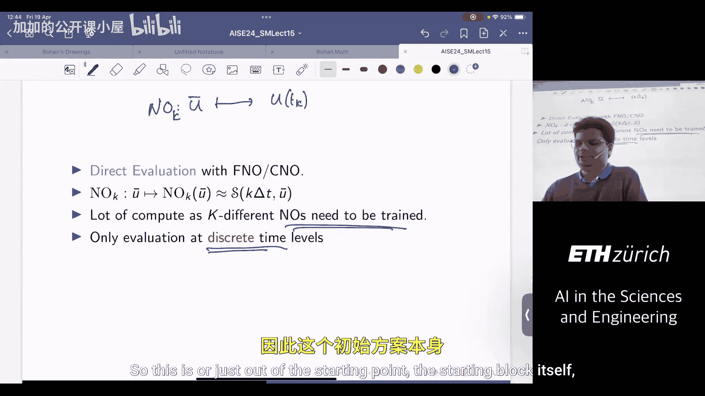

Just out of the means out of the starting point， the starting block itself this can be thrown up。

 but this is so we have to somehow introduce time into the scheme otherwise it does not work so what people do is what I say next that they use what is called an autogress maybe have seen this before。

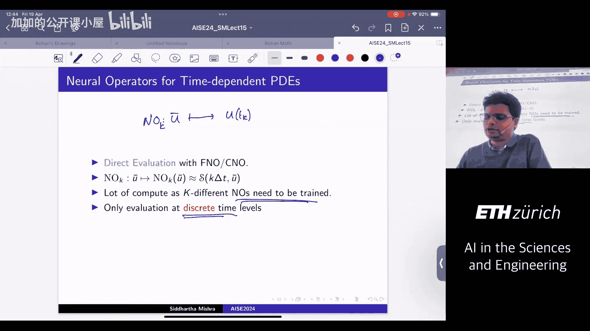

Auttoregressive evaluation。What does it mean means okay， this is a simplification。

 it's a reasonable simpl well actually you need it in this particular case。

 so the main assumption here is that you have uniformly space time points。Okay。

 let's say that we have that just like we had regular grids。

 we could have uniformly space time points and then the data is given at these uniformly spaced time points。

 Let me draw a picture。So you have the initial condition you have the next time point the next time point the next time point the next time point and so on right so what is what does it do so what the neural operator does and as I said many。

 many or what you can give if no or CN or whatever what what do you do or CNN whatever you have is that you give it you make it predict the next frame so this in computer science this is called next frame prediction。

Because now the delta t is fixed right I know what the delta T is the delta t is not and so the delta t is the direction here so what I'm going to do is that I have I just predict I'm able to predict the next frame similarly from here to here I can predict the next frame from here to here I can predict the next frame from here to here I can predict the next frame so given the initial conditions if I want to come to this point what am I going to do at inference is I start with my with my neural operator I predict the next frame first so I go from here to here。

That's a neural operator。Then I use that， predict the next frame。

 So it's like a time matchinging scheme。 then I use that further， I predict the next frame。

 use that further， I predict the next frame So by using it four times。

 this is what is autoregressively So also in language when people model text for instance。

 they model it token by token roughly word by word right So they say I then there is am then something else and something else So it uses that context right so this is common in language it's also in scientific computing it's a very。

 very easy way So all that you're doing is that you're predicting the increment of the solution to the next times okay and so this is so this is exactly what I what I just said in formulas this is exactly this。

That if you want to predict a time Tk， so what you have to do is to apply it one times then two times and you have to do this k types。

 So if you do it intuitive intuitively， then you are able to evaluateva it Okay。

 is this clear now so the this kind of autoregressive evaluation。

 you just keep on feeding the neural operator again and again and again。Okay。

 so this seems like a very attractive， we will see some numerical examples later。

 this seems like a very attractive way of doing it。Unfortunately and many。

 many people do it so this is the most common way in which neural networks are trained and for time dependent problems。

 but there are several caveats here right so first of all you need some uniform spacing。

Because it is agnostic to the value of the increment， right， It says that the equal increments。

 So you learn something。Second is that you always have and this this process here is called a rollout right rollout is simply I have a trained neural operator。

hi just learned to predict the next frame or the next time step so I just give the solution the initial condition and I roll it out I take I apply it once。

 it'll give you a value， apply it twice， it'll give you a value and so on and so forth。

But when you do long rollouts particularly during training。

 remember at the end of the day we have to train these objects also right so the back propag algorithm is to take you back to the initial time otherwise how else are we going to do the computation so while you do back propagation this is called back propag through time BptTT if you have lots lots of rollouts then the gradient you know that each step the gradient changes so if the gradient is less than one if you do it 50 times you know you can get zero gradient and if if the gradient is greater than one then it blows up so it's sort of you end up with this problems that you have due to exploding and vanishing gradients so this is an important element that's why you can't sort of do long rollouts during training so during training necessarily you have to do this a whole field how to do this efficiently I don't have the time to go into details but essentially what you do is that you can only train for shorter rollouts in the sense that you take three。

rollllouts and try to match the solution or you take four rollouts and you try to match the solution The problem is at inference you might need to do it 50 times and this is where this could be an issue but of course it's also evaluation only at the discrete time levels we cannot predict continuously in time。

 but the biggest issue here is error accumulation。

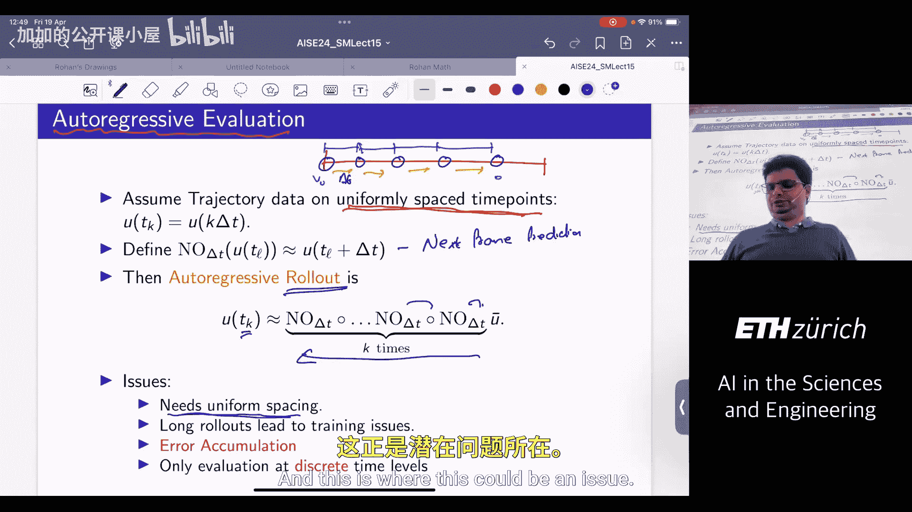

And what is the meaning of that？So let me without writing in formulas。

 let me try to explain it in words what a accumulation is so remember that we are trying to solve a time dependent problem okay so of course we start with the initial conditions。

And the solution at a later time is going to be very different from the initial conditions provided that you wait long enough right for longer times。

 just imagine the weather now and the weather it was in Monday， for instance a Sunday。

 Sunday was 28 degrees and today is two degrees right So as you waited long we saw that there was a huge change But of course。

 if you have taken the weather at on Sunday and predicted to 6 a on Monday。

 then there would have been a much easier prediction because there is some continuity there right So now just imagine that you have learned only this is this a cartoon of course。

 but you have learned only sort let's say summer weather and so you have made this small predictions。

Okay， when you do short term predictions and now you have to compose it again and again and again。

 just imagine that if you were have used weather till from last week because last week was very warm。

 you would have managed to predict the weather quite accurately on Monday。

 but then if you kept on using the same operator again and again and again of course there is an obvious mismatch here there is an obvious error So as you try to predict for longer you are going to get error accumulation because you are making the same operator around again and again and again。

 of course you would have avoided it by during the training process having this but then you have the issue with the long rollouts that the training is hard so this is as I said means this is a very。

 very common strategy people use it all the time but it has its let's say drawbacks right it has this kind of issues so you'll see that this is not exactly this error accumulation is what makes this basically unfeasible so we need to come up with。

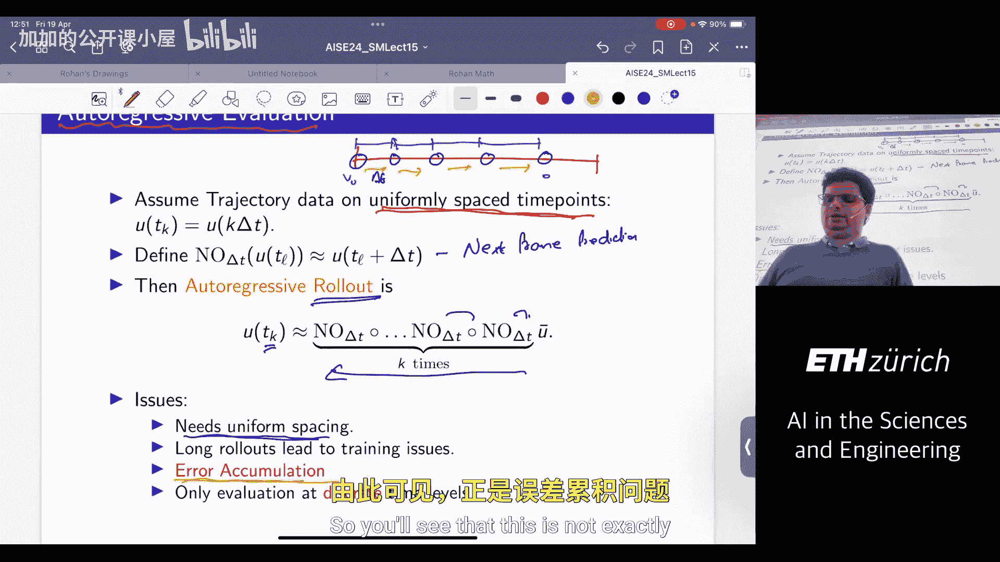

Alative and this is what I am going to describe very quickly and also in the next lecture I'll give you some more details which is called and it's not the only issue it's not just a accumulation we also wanted a continuous output right we wanted to be able to evaluate the solution operator pro bit at any point。

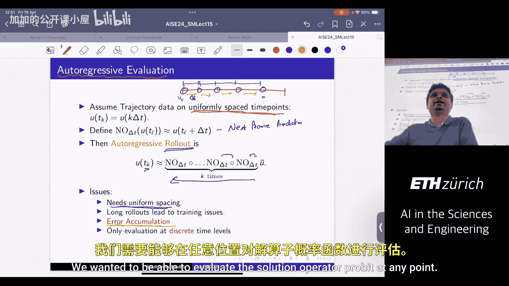

So what do we do， it's called time conditioning Min it's。

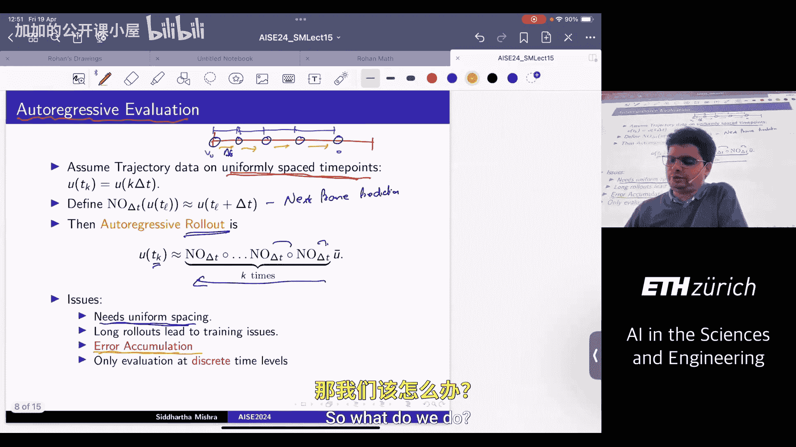

It's it's fairly recent， but there are some couple of papers， including our。In this direction。

 so let me describe。And for instance， when I taught it last year， we did not have this。

 so this's a very fast moving field。So the idea is very simple that we should evaluate and also in terms of data。

 if you remember that the amount of data that you have。

 you you are restricted by the fact that now you exactly have k frames right because you're predicting the next frames or you're predicting the next frames so you have exactly kframes in some sense and then what we do in this lead time conditioning or time conditioning is。

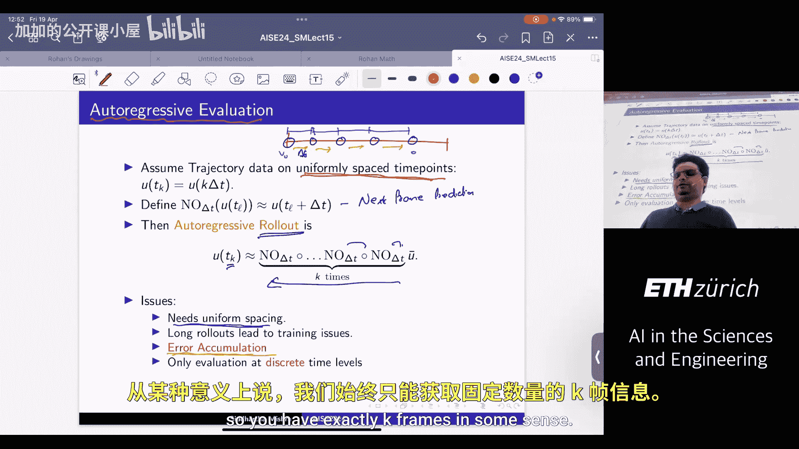

Time itself， just like in the solution operator， time itself should be in the input right so it should be an additional channel it should be in the input that's already some advantage because then it allows you to have continuous in time outputs so you take C for instance。

 or if you know for that matter it does not really matter this diagnostic to the model So what you could do the first element is that you could give the time。

 lead time as it is called the time to forecast you can give it as an input In other words。

 your solution operator takes time and it takes initial conditions or the previous image and it turns out the solution at a later time okay and this is usually added as an additional channel because remember that I have already temperature pressure velocity。

 whatever So I can always add time as an additional channel and then after that so this in some cases this is sufficient because now you have access to a richer amount of data because in principle you can say that I can start with the initial。

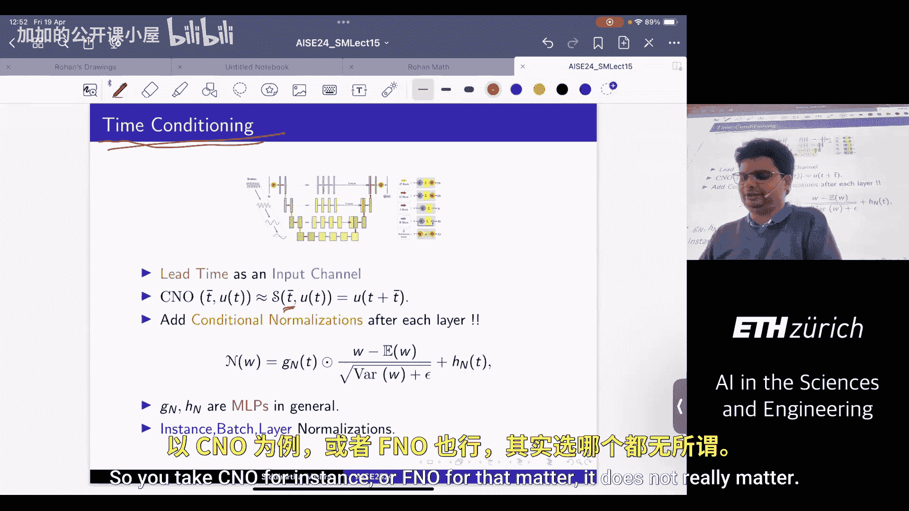

Conditions and predict up to 0。1 I have the data for that I can start with the initial conditions and I can predict up to 0。

2 I have data for that and so on and so forth， but in this form it does not really work because this is too little an input because what happens is these networks have lots of layers right and by the time you go to the1 layer the fact that you are time as an initial layer or as an initial input is forgotten you know because you have to somehow process that time have to keep it as as a running input somehow right and this is done by using what are called conditional normalizations So let me explain this and maybe in the next lecture I give you a little bit more detail because we are really running out of time。

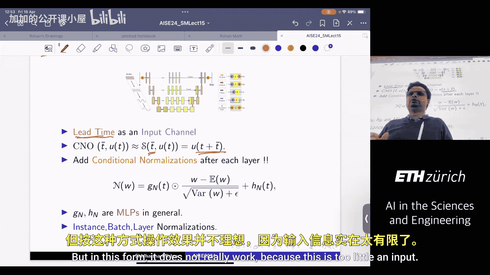

So what are conditional normalizations？So remember that in machine learning and this you have learned also in your practical in your tutorials that you need normalizations there are batch normalizations。

 instance normalizations， layer normalizations and so on and the idea is very simple that before you do the processing so you take the let's let's take a concrete example here let's take C for instance。

 So let's say that you do the processing here， you get a output。

 let's say the output is W another image right So what you do is you normal double because also the inputs are normalized because otherwise machine learning doesn't work the gradients will have very different scales and you can't train so you normal the way in which normalization works in general is that you take some。

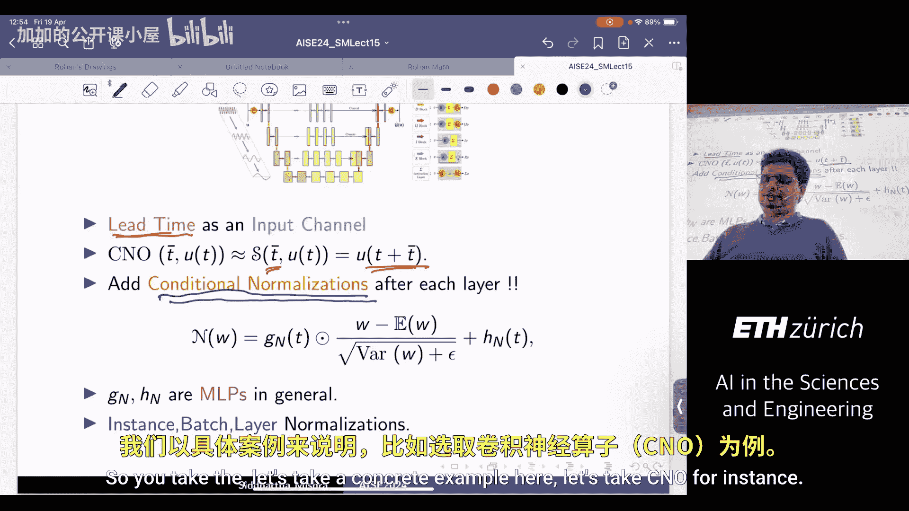

Normalization means that you take your current input。对的咧。

You take some mean some expected value this could be over the batch it could be over the layer means all the outputs of the layer it could be over the instance and so on。

 there are different kinds of normalizations I will tell the boys Victor and Bob done to talk about it perhaps in one of the tutorials there's no time for the details here which is essentially some form of normalization right so once you do the normalization of course you take out the you take out the。

You take out to me and then you sort of divide by the variance or divide by the standard deviation。

 So you want to get things back within -11 or 01-11 in this particular case right just and this was the key trick by which machine learning and deep learning architectures work because without batch normalization or layer normalization it was simply not working So you anyway have to do this depending on the architecture that you have like for CNO。

 you use batch normalization for transformers it layer normalization and so on。

 So there is this normalization that happens for the input to each layer Okay first you process normalize process normal process and so on。

 And the idea behind this is why don't we leverage the fact that we have this normalizations to keep on giving time as an input。

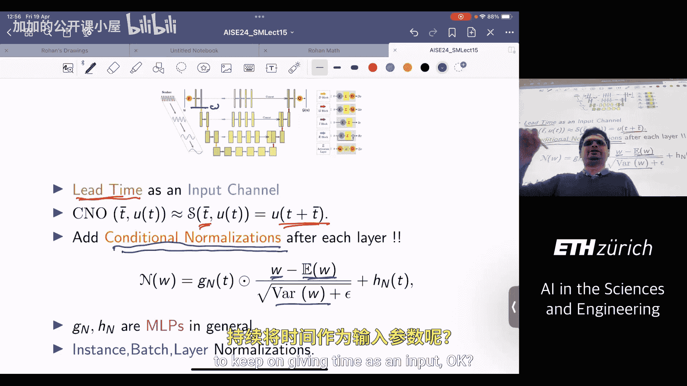

Okay， because so that the effect of time is not forgotten。 So instead of just giving time once here。

 you also give time here， you give time here， you give time here， here， here， here， everywhere。

 So roughly that is the idea。 And what what we do is that we just modify the normalizations we simply introduce。

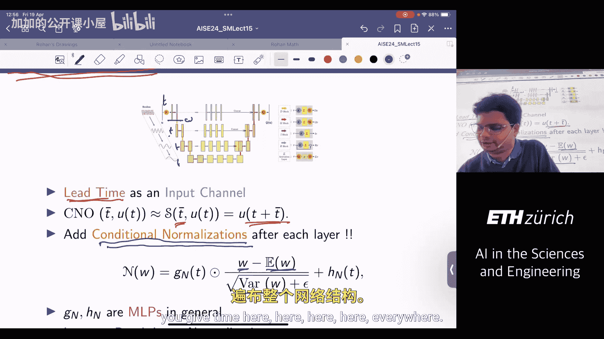

Learnable functions。 So these could be neural networks， but in general。

 these are really so G N of T is typically some matrix， G N T plus some Ghat and some vector。Okay。

 so this is a fine function， but it could be a MLP， some small neural network。

 And what you do is that this gives the effect of time。 As I said here。

 it gives the effect of time at every input more or less So every layers remembers that it is doing something for this particular time step or for this particular time instead okay and it's obvious how you normalize it because how you initialize it because this guy should be close to one and this guy should be0 at initialization But of course。

 these are learnable mappings So they are going to learn what is the effect of the time for this particular layer at this particular input so this is roughly what what the idea is So you have to give time as some sort of a conditional so that you condition output of your model on the time so is this the details about how I take the expected value is not important here okay so this could be that。

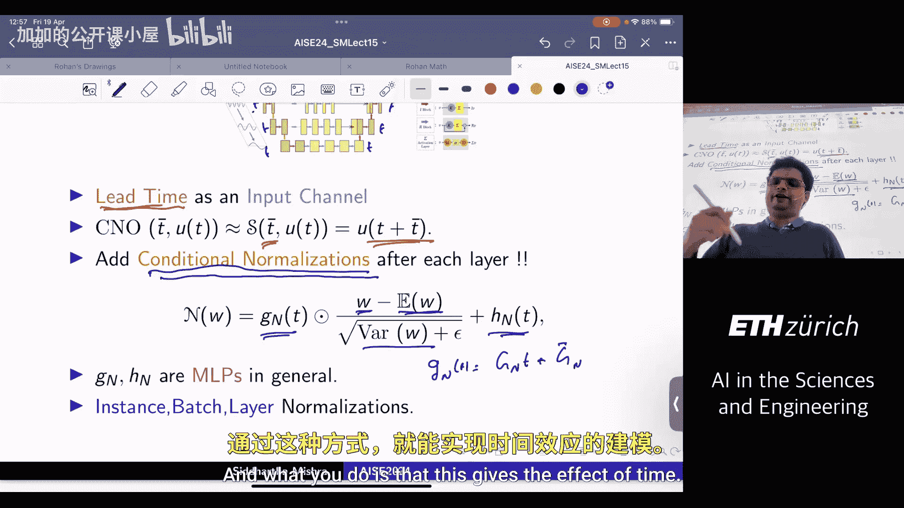

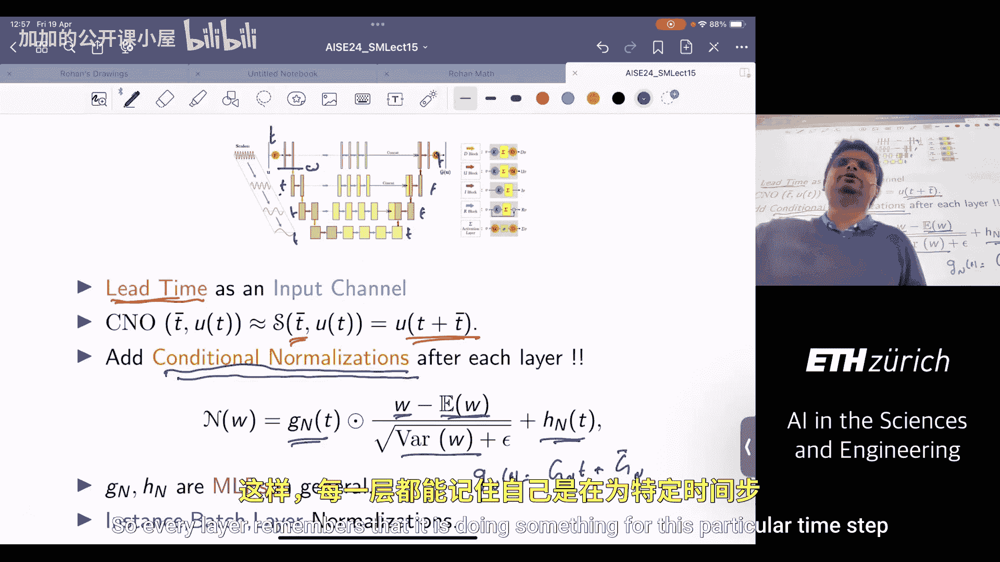

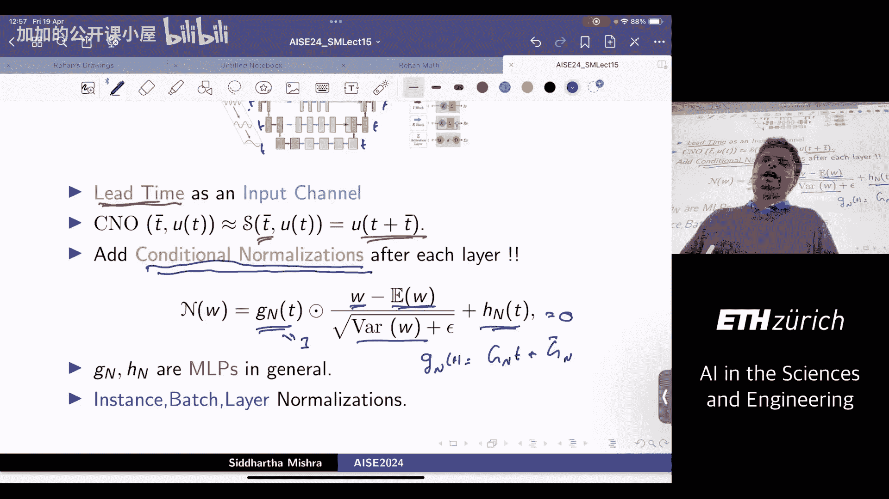

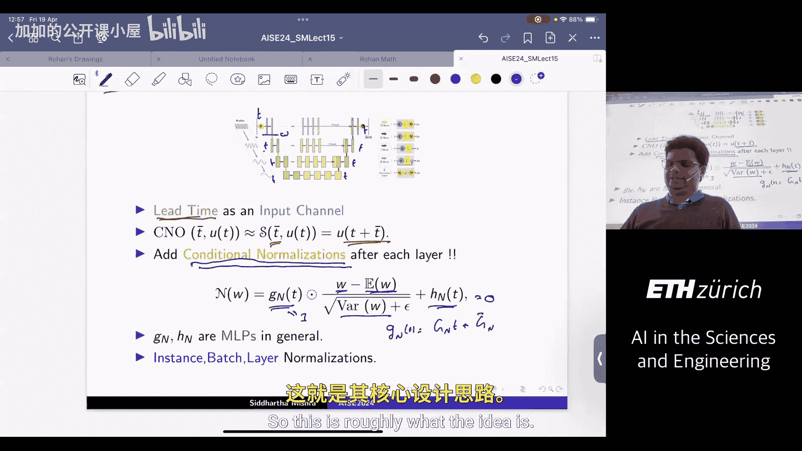

Now all the neurons in that given layer produce some outputs and you could just average over them or it could be some other kind of some sort of an average Okay think of this as some sort of an average so that you normalize with minus and one and1 and then you're going to modulate this average by this time dependent functions So the heuristic that you should remember is that in addition to feeding it as the input value I'm also going to feed it during all all layers so this is sort of the basic heuristic of this lead time condition。

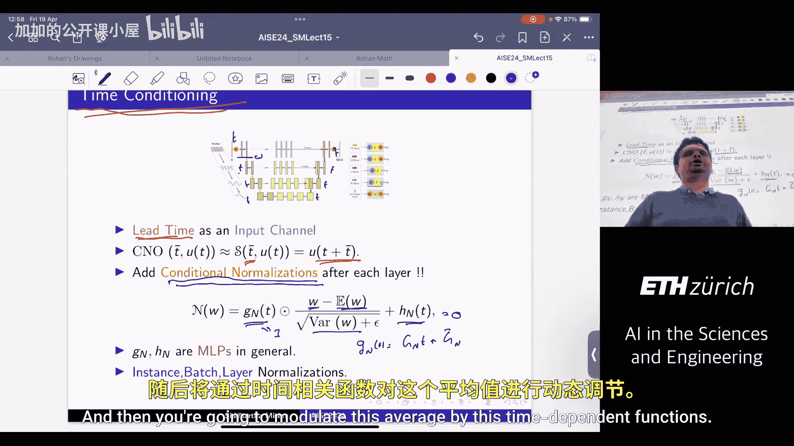

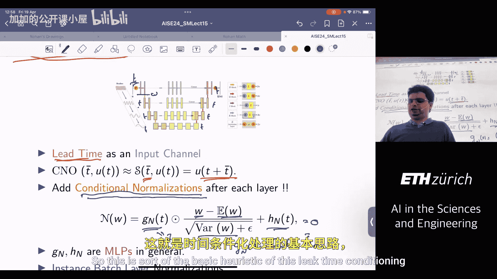

And Ive really run out of time today I was slower than usual。

 but in on Wednesday what I'm going to do is that， okay so now we have this so the time dependency know。

 what does it do， it is this additional layers， additional inputs and additional layers and the same with FNO means all all architectures can be modified because all of them use some form of  normalization So you give the input in the input channel time and you give this within each layer So now we have this let's a new architecture how are we going to train it how we going to leverage the data and so on and this is going to be the task of the next lecture because if I start the next slide I will not be able to finish it so I don't want to rush it Okay so on Wednesday we start with this and then we go towards the issue of scaling and transforms。

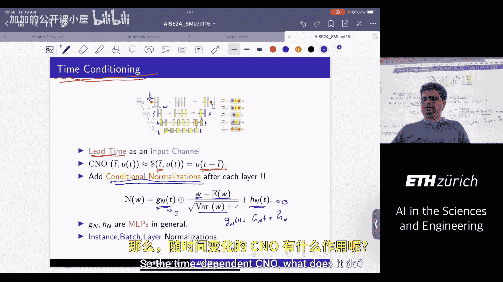

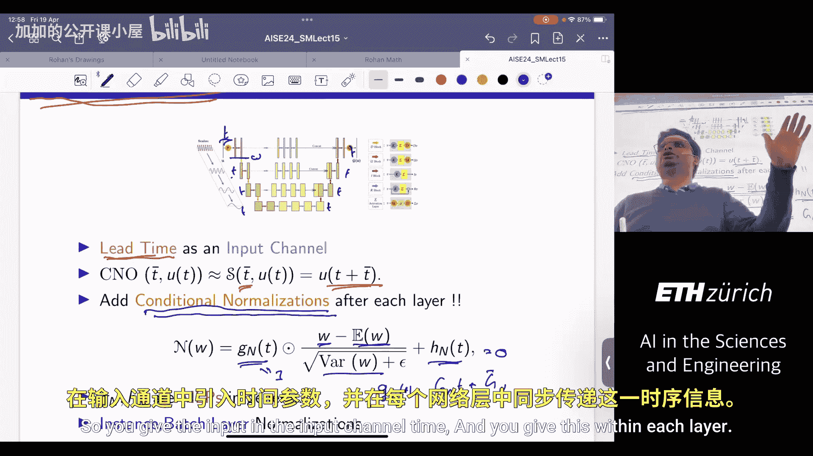

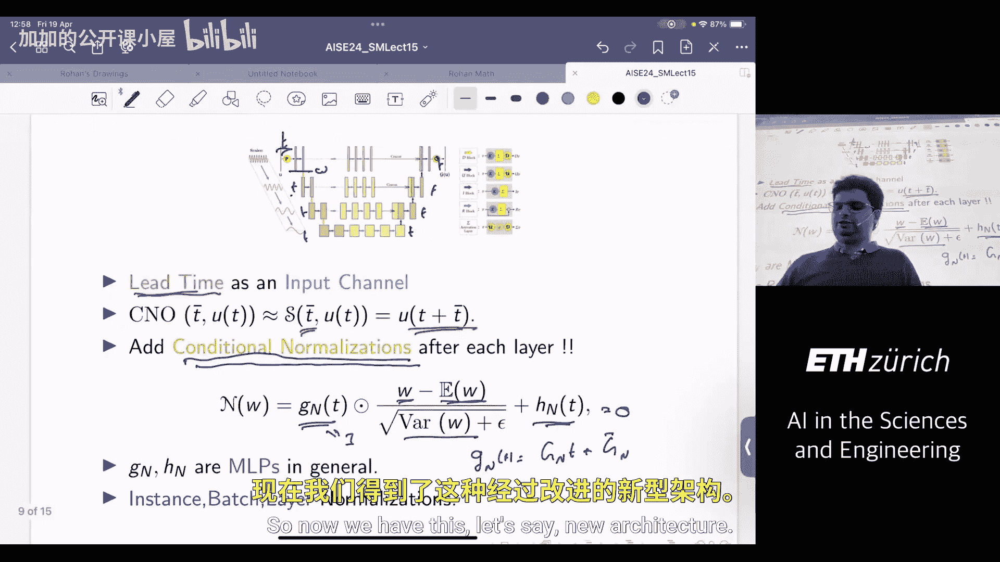

Okay， so let's， let's stop here。

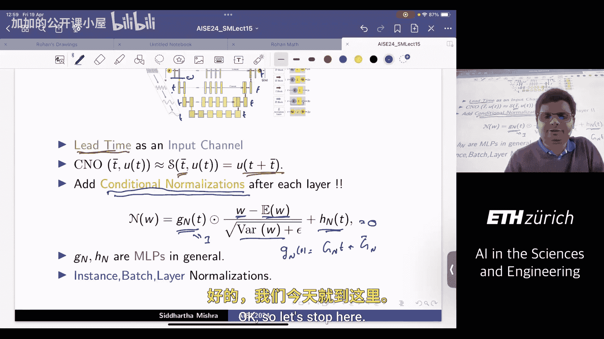