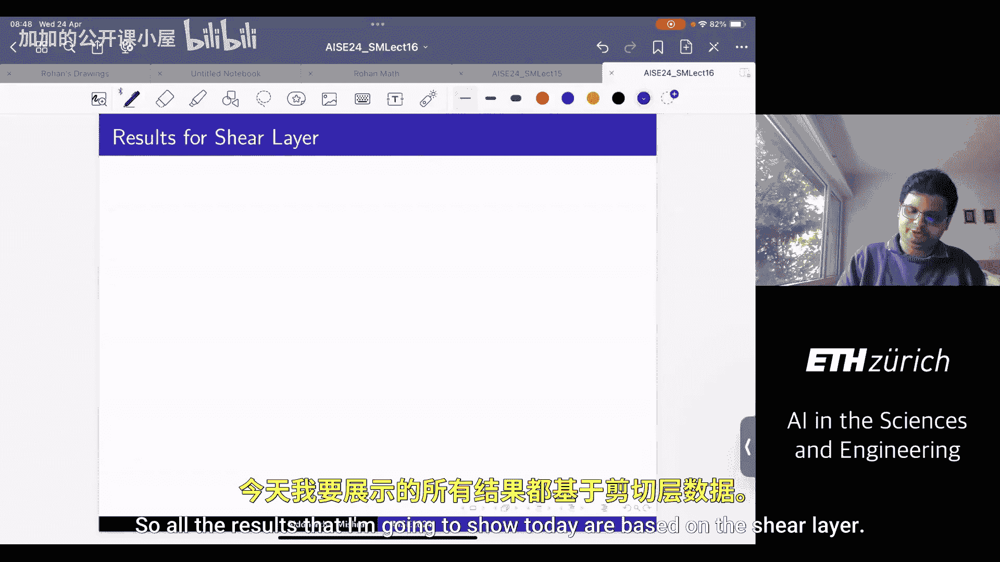
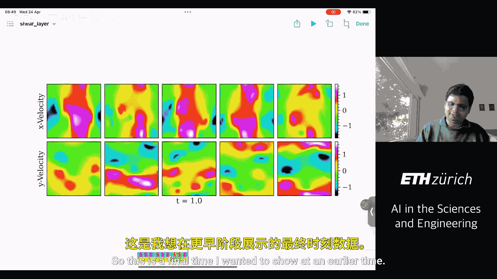
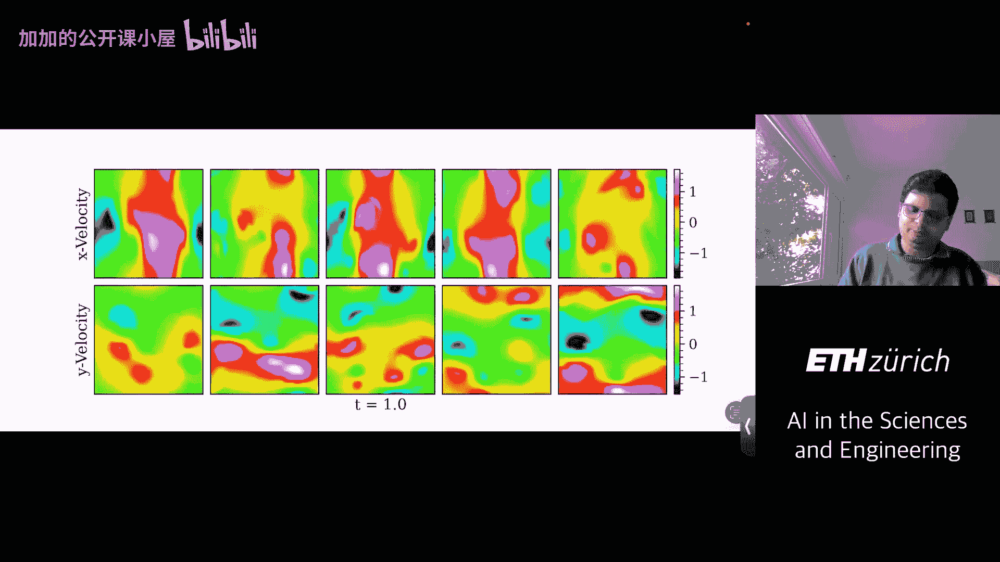
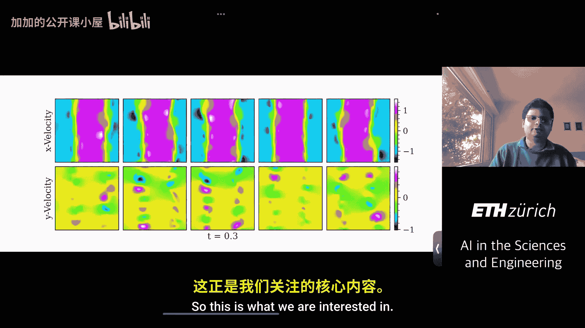
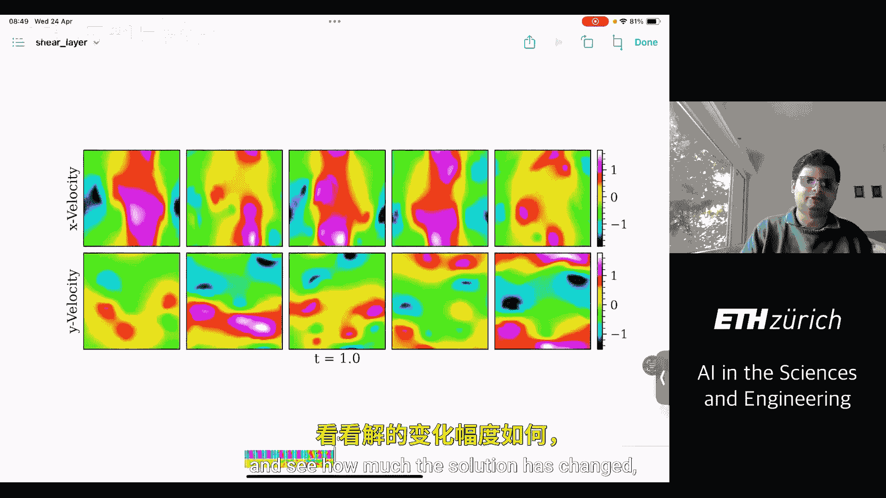
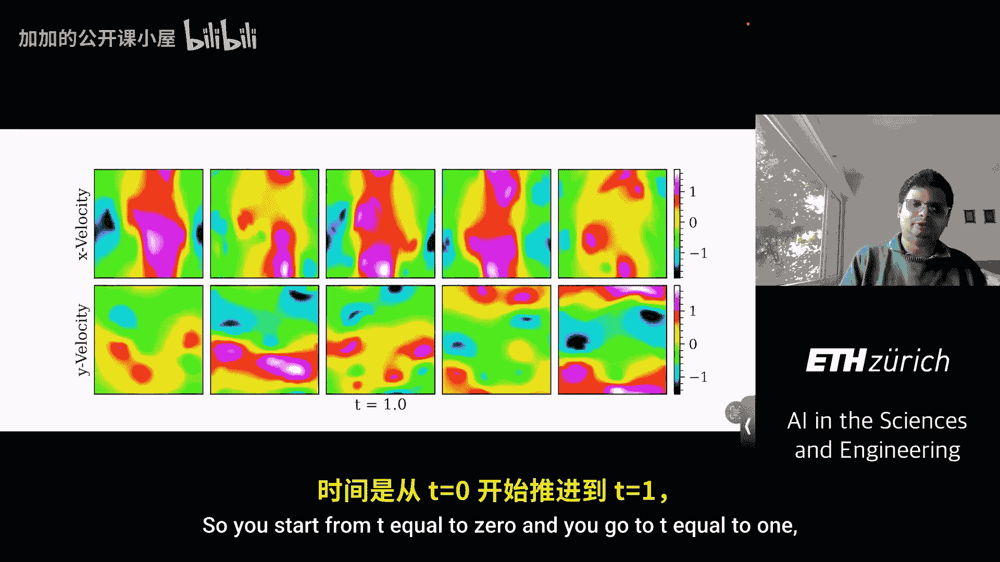
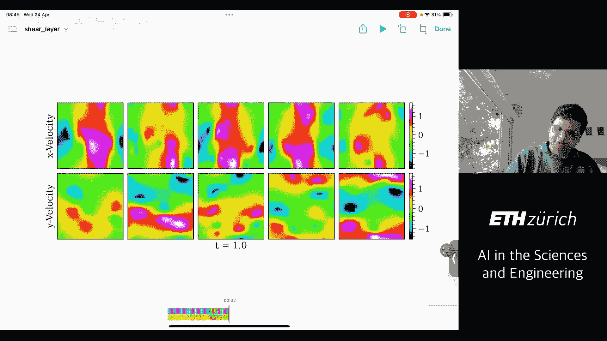
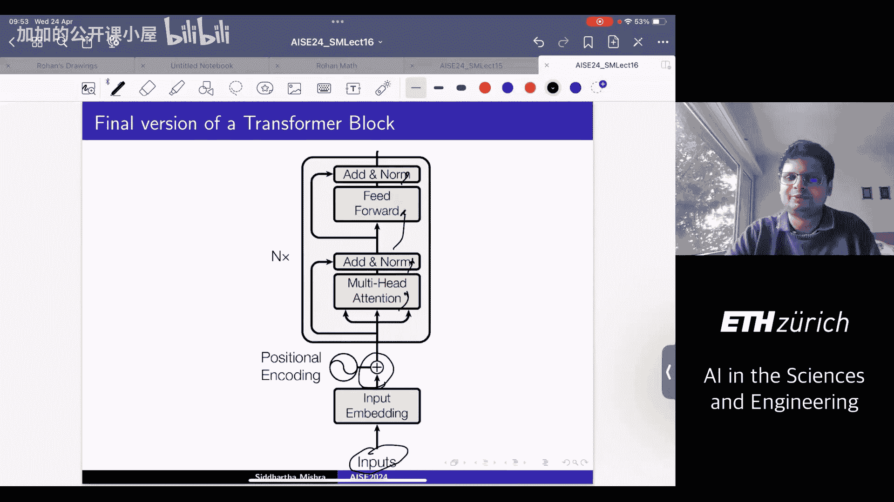

# 苏黎世联邦理工【中英⚡科学与工程中的人工智能｜2024 AI in the Sciences and Engineering】 p16 P16 Large-Scale Neural Operators -BV1smxgzHEPC_p16-

Okay， so let's get started。 Welcome to lecture number 16 of the course。

 and we more or less start where we had stopped in the last lecture。

So we're still working with operator learning， so which means that we have an abstract P of this form。

And we are interested in learning the solution operator。

 the operator G that maps the input X to the solution of the P D Y。 right， So this is the basic idea。

 And so far， we have seen a whole plethora of operator learning algorithms。

 whether it is C N Ns or Dbonnet， F M O， C， N O and so on。 They have different features。

 different attributes， different strengths and weaknesses。

But the point that we have been doing this in the last lecture was to look at what time dependent problems。

And this would be the starting point of today's lecture。

So what is special about time depend problems So first of all， this relies on time depend PDs。

 so that's the first first thing。And the abstract form is given by this right so this is abstract form。

 so perhaps in the last lecture I did not mention it explicitly， but example。

 a typical example would be the heat equation， So you have u t minus lap plusian of u equal to 0 and u at x0 is u of x。

Or you buy。 So this is a typical example of of a timedepend B， Another typical example。

 which a prior is not in this particular form， is given with a wave equation。

 So this is the heat equation。But if you consider the wave equation。

The wave equation models the propagation of waves in different media。 let's say for a uniform medium。

 So U T T minus lapplian of U equal to 0 U at x 0 is some。I should have said wee， perhaps。哦。

Because sorry for the notation of confusion。 So we are dealing with a wave equation just to illustrate the beast that we have to confront。

And here， the displacement VTT is equal to a minus lap plus of v equal to 0。P at x 0 is some v bar。

And V T at x 0 is equal to。嗯，那不管。So a priorityi， it doesn't look like that this equation here。

 the way the equation is fitting this format， right？But， of course。

 many of you perhaps know this this there is a simple trick by which you can。

 you can put one in the form of the other。 and the trick is simply to identify what is called the velocity V T with a W。

So then you can rewrite the equation as sorry。I'm going to write the equation as。U T equals to sorry。

 Vt is equal to W， and W T is equal to the lap of。V， right， And then you got back in this form。

 So you can write even high order time derivatives in the form of first order time derivatives by simply expanding everything into a system。

 In other words， your U， your unknown now is V and up。So that solves the problem。

 So any time dependent PD D can be written in this abstract form good。

So what is the solution operator， This is what we were looking at in the last lecture。

 So the solution operator is now a mapping， which takes into account not just functional input。

 but also the time。 So time T is one of the inputs to this solution operator and it turns out the solution at a given time T given that you input T and the initial condition right So this is what determines the whole thing。

 So if you think in terms of data， So what you have is trajectories。 So in other words， of course。

 ideally we would like to have the entire time history of the solution， we would like to have U T。

40 greater than0。 but of course， in practice， we have to sample them at discrete points。

 nothing on the computer can be continuous or contium。 So as a consequence。

 what you do is that you start at the first time step， the zero time step。

 the first time step and so on and so forth。So whenever you generate data numerically or through observations。

 what you really have is this kind of let's say trajectory of the solution right so what is a learning task as I said。

 so that and this is very， very important because not every algorithm fits into this framework。

 but that is what is essential because when you when you think of a solution operator of a time dependent PDdeE all that you do is that you give it the time and you give it the initial conditions and it turns out the solution at that particular time and this is what I expressed here that if given the initial conditions boundary conditions and so on about inputs to the PDdeE you have to generate the entire trajectory。

The entire solution trajectory for all time state， so this is sort of the the basis of this entire method that you have to generate the entire trajectory。

And as I explained in the last lecture， you could do it with neural operators。

 you could have used either direct or autoregressive evaluation。

 and this was not efficient in any way shape or form。

 So what I had stopped with in the last lecture and which is what I want to start with again is to use what is called lead time conditioning So this is the principle here said you have to give time as some sort of input channels everywhere So let me try to explain that a little more I was a bit hasty in the last lecture。

So perhaps we can do this so here is a typical example so you have C this just an example could be F&O it could be D onnet whatever。

 and you remember that we have a sequence of layers which are stacked up together as in any any neural operator so you start off with the input and then you have this convolutional layers。

 you have this residual residual layers and so on and so forth。

So what you have to do now in lead time conditioning is first and this is perhaps not as important as what you have to do second。

 but nevertheless you have to provide the lead time itself as an input channel。

What do I mean by that What do I mean is that in the set of inputs， apart from the solution。

 you also have to provide the time。So in other words。

 let's think of this neural operator some S star， you have to give it the time and you have to give it the input right just like we did of the solution operator because in the solution operator you have to provide it with the time to be able to output the solution at a given time。

 so this is part for the course you need。Good。So that is， as I said。

 for instance you you try to give the time， you try to give the solution at some earlier time and then it can produce the solution at a later time so this is at the very beginning itself。

But remember that what we are doing is that we are stacking up lots of layers。

 So even in a CNO some of the largest models that we have。

 we could have anything between 20 and 30 layers。 So what happens is that if you only give time as input at the very beginning。

 there is a potential that the effect of this time is not properly propagated right it has to take into account time it has take into account initial data。

 So time is just an additional channel。 So this is an additional channel。

It has to take into account the input data it has to take into account various things。

 so what happens as a consequence is that you have to somehow keep the information about the time in subsequent layers and this is where one has to add or one has to modify what are called normalization layers。

So remember that at least in the practice of deep learning in the tutorials you've seen it。

 that you always have to normalize it so whenever you have to give an input to the machine learning system in order to sort of reconcile the different scales in order to enable the gradient to propagate smoothly。

 So what one does says that one tries to normalize the inputs。

 let's say between minus- one and one a typical range for normalization Now what layer or So this is what you do at the level of the input right but what one does also is that after each layer you keep on normalizing because output of the layer can be whatever so you normalize it so that you have better gradient propagation properties So you have different kinds of normalizations I'm not going to define later today I'm going to define one of them explicitly。

 but you can do it over the instance over the whole sample you can do it over the batch you can do it over the layer there are different ways of in which you take normalizations。

 So in particular， just imagine that in the time。Depenent case。

 what you do in normalization is that you take the output， for instance。

 you take the output here of this particular layer。

 and then this is what happens right So you take the output and you take out the mean So you you average over different things and these different things where you take the expectation gives you different examples of normalizations。

 whether it is instance norm or batch norm or layer norm。

 So this depends on where you take these expectations。

 So you normalize across different channels or you normalize across different inputs or you normalize across different layers So these are the different sort of things that you you can potentially do So you take the mean out So you extract the mean that takes out the trend and then you divide by the standard deviation So this roughly forces things between -1 and1 and of course you make it learnable right so this is there are some scale factors So the scale factors G and H。

Are the learnable scale factors so that you learn how much of these inputs and outputs are to be modulated Now in lead time conditioning。

 what we do is that we directly target this particular normalization and we simply say that you feed in the time here So you feed in the time here and you make this learnable things as MLP。

 So in other words， this G N， let me write down。And。Gn of T could be， for instance。

 sigma of some w of T plus P， something like this。 So you have some weight factor。 These are small。

 small neural networks， right， so small。MlP。And these are learnable parameters。 of course。

 you learn them along the process so that you don't。

You allow the machine learning algorithm to discover its own normalizations。 So this is a very。

 very simple trick。 remember that every sort of machine deep learning architecture has this kind of normalizations and you just condition them with time that's why these are called conditional normalizations or time conditional normalizations okay so what does it mean practical terms now let me try to explain this through this picture here。

 So remember that all these layers So for instance if you take this layer these are all independent layers right you do some convolutions you do some nonlinearities。

 convolutions， nonlinearities patching concatenation and so on。

 each of these you can put in a time conditioning So here you have time conditioning here a time conditioning here time conditioning here and so on and similarly up here you have to do a time conditioning a time conditioning a time conditioning time conditioning time conditioning So you have an additional learnable element everywhere so this is。

way， an elegant way to imprint time across the entire neural network so that it learns that at this instance。

 I still have to predict something， I have to do something。

 attribute or deduce attributes compute features related to some sort of some sort of time dependent process right so this is a very。

 very useful trick and later on in the numerical experiments。

 I'm going to illustrate how this is going to be useful。 Okay， so you give time initially。

 but that is certainly not going to be enough。 You give time as an input as a sort of input at every layer through this layer normal or through this normalizations。

 Okay， so this is going to be the key trick by which we can put time into the neural network。

Is that clear， And if you have questions， of course， the interaction in a Zoom call is much limited。

 but you can always ask questions through the chat box and will Ill try to answer them。Okay， if not。

 let us try to see so this is at the architecture level， at the model level。

 what we can do in order to put time into into the mix into the equation。

But we can also do some things at the level of training。And let me try me explain that。Yeah。

So there are different kinds of training strategies that you can do。

 let me try to explain at least two of them which are which can be useful and let's concentrate on that。

So first we can do what is called one at a time training。What does it mean。

So in this particular case， remember that whenever we have data it's always in the form of these trajectories。

 so in other words， perhaps I can write it down here that you have trajectories。

 so let's say your trajectories。发jectory。And this is you at T K。Okay， this is K from1 to capital K。

So this is what is given to us whenever we have been given data。

 we have been given trajectories like this。 Ive made a very simple assumption that in all across all samples across all the training samples I have access to the solution at the same time point which is okay when you're doing numerical simulations which is perhaps not okay when you are for instance。

 having deal with observational data if you have observational data then you can you can sort of bring it you can also deal deal with that。

 you know this is not limited to just having sampling at the same points you can sample at different points okay that's not going to be an issue So what you do is in this one at a time training what you do is that during the training you give as inputs your initial condition which is you bar which is given here and you give the times Tk so you give them as and then you get K samples per trajectory In other words。

 that we write down the loss function。So the loss function L is equal to L is now the loss function it is not related to the differential operator right so it is 1 over k。

Okay， then you have the sum， this is a little k from 1 to cap2 k of the output of your operator。

 so let me call it as S star， So you have U at Tk so some norm U at Tk。Minus S star。of d嘅腰品。

Some norm okay， some norm over X。 So remember that in space。

 we are assuming that these are functions， right， of course。

 we have to discretize them further in space because， but in principle。

 the neural operator is able to deal with spatial inputs which are continuous， right？

 So you have reno and so on properties to take care of that。 So what do I do here。

 Let me try to explain that。 So I look at all these times decay。 Okay。

 And so this is the loss at the sample I， so this the I at sample， right。So AI， and then of course。

 the overall loss is also a summation overI。I from one to M of。诶来。So there so first of all。

 per sample， what you have to do is you look at the solution at different times Tk。

 you take the initial data， you output the solution， you can compare the losses。

 and then you bring them together add them together and you sort of。

Do the optimization over all samples。 So as you can see here， if we have different sampling points。

 there is no issue right because each of these losses are taken independently so you can of course have different sampling points So this is what is called one at a time training So the advantage of this compared to before is that you have K training samples per trajectory okay and we will see that this this can be a very effective strategy sometimes that you you just evaluate at different times。

 but this is not really taking out the full potential of the method because the full potential of the method is by using what is called all to all training。

So what is this all to all training So remember that we have the trajectory so we have the C of Tk So the idea now and please concentrate on this point because it's an important point is that what we are going to do is at the time of training we are not only going to consider what happens when you take the solution from initial data to a given time but we consider all the intermediate times。

 so perhaps it's not a bad idea to draw a picture。And try to。

 So let me explain that with at some so one at a time。Usetiful。

So now let me draw the picture in the following manner， so we have0， T1， T2， T3 like this sub2。

DK DK plus one of the capital decay So imagine that at each of these points you've been given a function right because that's that's what we have not not a single vector or a single value。

 but a whole function then what we have in one at a time training is that you first give the initial initial value here So this was U bar U bar and then you give so you you compute the solution at this time So you do this then you compute the solution at this time then you compute the solution at this time computer solution at this time and so on。

Right so these are the key versions of the trajectory。

 k applications of the operator and then you sum them up the way I've just described them so that is one at a time sampling but what we want to do is something radically more more sort of not complicated but extensive and this is all all to all what does that mean so all to all roughly speaking is along the following lines。

So okay， so let me draw a picture here。So again， you have zero， you have t1。

 you have t2 T K E k plus one。Blah bla blah all the intermediate times。

 So now in addition to going So imagine that from 0 in principle。

 the solution operator can take Q to T1。 It can take U to T2， it can take Q to T 3 T4 and so on。

 just like we did before but we also know that this is a semi group。

 the solution of a time dependent Pd is a semi group。 So in principle， if I' am sitting at T1。 Okay。

 I can go to T2 by just taking t1 minus T2 Dlta T as my time increment right but I can also go from t1 to T3。

 by having two times delta t as a timecrement。 I can go from T1 to T4。 I can go from t1 to T5。

 All of this is possible I can start at T1 and then go to T5 to T T6 to T7。 All of this is possible。

 Similarlyly， I can sit at Tk。 I can't go back in time there is causality So time always as an arrow。

 you always go forward in time。 You cannot go back except if the problem is irverible。

We don't know a priority whether the PD is reversible or not。

 but just imagine that you are at Tk so you can't go back but you can go to Tk plus1。

You can go to Tk plus one with deelta Tk S increment， you can go to Tk plus2 Tk plus3， so on。

 And finally up to T capital K。 So all this is possible。 So essentially from the initial conditions。

 you can go to all time steps from the first time step。

 you can go to the remaining K minus1 time steps for the second time step。

 you can go to the remaining k minus two time steps and so on and so forth。

 So we are going to exploit this because this data is already given to us。

 it is it is very much there。 So this is a smart idea that we came up with because this has not been considered in the literature。

 So essentially what you can do is that probably I have written down this here， exactly。

 So if you start at a point P。You can go to any J， which is greater than9 Okay so in other words。

 if you start at Tk， you can go to Tk plus 1 Tk plus 2 Tk plus3 and so on。

 you of course have to provide the lead times because that's the amount of time that it takes for the solution to evolve and then you give the value of the solution there right So what is the advantage of this strategy。

 First of all， the data is there right whenever you have been given at trajectory。

 you have been given all these data points they are available to you。

 you don't you don't have to scamper for the data But the advantage is now we have lot more data right because remember that then from the first point from this point。

 we have access to k data than k minus plus k minus1 data K minus2 data points and so on till1。

 And this we know is it's k K plus one by two， right。

So instead of having linear the data content in the trajectory earlier was just linear So your K training samples per trajectory now you have K square training dump samples per trajectory right so it's a dramatic augmentation of your data and you do this for free in the sense that this data is already there right so the advantage of this allto all training is to be able to leverage this semigroup this causality property of the solution operator okay so that whenever you have been doing training what we are going to do is that we are going to take all these pairs images or pictures or whatever you have we are going to take all these pairs and then we are going to be able to access we are going to use them for the training so what is going to be the loss function now this is interesting。

Perhaps it requires an expression so。The loss function。Again。

 this is for the IAT trajectory because you also have sum over the trajectories， right。

 So Iot trajectory。 So use sum over。OkayPerhaps L lets， maybe L， So you do the following， Okay。

 so you take U at TJ， okay， minus S star， So this is your neural operator。

 which takes into account TJ minus D。Of you at D I， the data is given to you。

 so you generate the data。And then you to the norm here over some function space x。

 and this is Ij from 1 to capital k， I less than J。

Okay so this is a trick so now what you can do is that you can take all these intermediate points。

 you use your neural operator so in other words， take give the neural operator the time t1 and ask it to generate the solution at time T2 and then compare using this method Similarlyly you take it at Tk and ask it to compare it at Tk plus5 and then you bin it together compute the loss function and then of course overall you have to sum over all the trajectories right so in addition to this you also have sum over all the trajectories So the amount of data is quadratic in the number of time steps per trajectory and it's also quad not quadratic of course it's linear in the number of trajectories So let us imagine that we have1 thousand0 trajectories which is nothing exceptional and we have let's say 20 times steps 20 saves that we have then per tra we have 210 right because yeah 210 samples and then in addition we also have 10 trajectories。

SoWe have 210000 projecties， so this allows us to augment our data seriously and we need all this data you'll see later on that this data is very。

 very important。 Okay， so this is the basic principle behind this alltoall training I that clear this is sort of it requires a little bit of concentration and it requires a little bit of thinking about how we are inputting the data how we are outputting the data and so on Are there any questions。

 any first questions on this on this approach you can either unmute yourself or you can ask through the chat box。

侬。Okay， think about it。 And if there are any questions。

 you can hopefully I'm better on Friday and I can come to class and then you you can ask me the questions。

 Now this is what happens at the level of training that you take into account this additional data this let's say quadratic in the number of saves quadraing in the number of time steps per trajectory。

 and so remember that this is a complete contrast to what we had in the last lecture。

 So in the last lecture， we were just using the fact that per per sample per trajectory。

 we have exactly one sample because we are simply using endpoint evaluations。

 Now we have increased it by a factor of k squared which is a lot more right So instead of1 thousand0 samples we will have 210000 samples and this is this is an important point。

 Okay there is there is a subtle point that I'm going to mention in a second。

 So what about the inference at the time of inference。

 what do we do The inference can be the way it has been set up that it can be direct or it can be autoregressive。

So let me try to explain this again。 Maybe I have an additional。Beach。你讲成情播。Comト。I didn't want that。

 do I。ok。I wanted a blank page， you know。It 됐어吗。So is what happens to the level of inference？

So let's try to take this inference。😔，嗯是。So now you have this trained operator a star and what can it take。

 it can take T and it can take you and it can produce what it wants to produce。

 Now your task is let's say that you are again let me draw a picture。

So you are starting at t equal to 0。 And let's say that all that you are interested is that the solution at a later time t equal to T。

 Okay， you train the way you want to train， but what you want to infer is just a solution at a final time T。

 Now there are different ways in which this can be done。

 The first thing that you can do is that you can do a directive evaluation direct inference。

What do I mean by that。So simply take S， so this is the U bar， so simply take this。

Or it has been trained。 but now and at the level of inference。

 it just takes this value and it inference。 So that is direct。 and this this can be effective。

 This is very cheap because it's only one evaluation of the neural operator。

 But of course you can say， well we have trained all to all we have information about intermediate time points。

 Why don't we use that during inference you can。 So in that context what you can do is you can choose。

So this is the autoregressor， let's write it down， autoregressive inference。

So what you can do is you can start by doing one at one step or regressive rollouts right so what does that mean that you can go to you can apply a star to t1。

And then you bar so you go from here to here， no problems， then you apply again。

 so you take this as input and take T2 minus t1， apply your operator so that's the next rollout do here。

 then you apply your operator one small t3 minus t2 and you get the ri right so you can do this one step at a time。

 one step at a time。This is1，1 possibility that it's a 1，1，1 autoaggressive rollout。

 but remember that the way my neural operator time dependent neural operator is set up。

 I don't have to do this， I can do any combination In other words。

 let me try to explain that let's use another color right and I say that in the first step I go three steps I go here So in other words。

 my operator would be let's say E star of T3。T3 U okay for some reason， I say， okay。

 I can go all the way I can jump three steps。 and in the next step。

 I can say I want to jump five steps or four steps or something like that。

 So I have my my operator can output any solution right So then what I do is I take T7 minus t3 so it jumps four steps and then it goes to a star and so on and so forth。

 right so you of course have to take finite many steps so that you reach capital T steps。

 but so you can do any of these choices now So we have the flexibility So what and this is at the level of inference。

 So we just have to check for ourselves of course there is a price that we pay right because in terms of the cost there are two things here cost and accuracy So in terms of the cost it is quite straightforward to see that the direct evaluation is the cheapest because I have to do one computation of the neural operator But and this is the most。

Expensive autoregressive is the most expensive autoregressive in the sense that all these steps right because that will have to do k evaluations of the operator and anything in between is between1 and k I can do3。

 I can do six depending on what I want to do but the accuracy is going to be very very different right because it could be that for a particular problem and we will see examples of that that direct since you have to go far out you are going to make more errors because it has to learn something much more complicated autoregressive is simpler because you just have to predict the next time step。

 the next time step and so on but your error can accumulate So oftentimes what happens is that something in between is the optimal strategy as you will see in some of the numerical experiments So this is a choice that is left to the user by doing this kind of a training and by setting things up in in in this setup that I just explained what we have is that we have multiple possibilities for autoregressive rollouts and in particular。

We can predict at any time because we can just give the lead time and we can predict。

 So in principle， we have a continuous time prediction。

 And this is often what is lacking because people can only make discrete time predictions as I explain in the last lecture what we can make continuous time predictions in particular to what are called out of distribution times。

 So what do I mean by that。 These are times that have not been seen during the training process。

 and I'll give you examples。 Okay， so good， so we have a new training strategy。

 which sort of assimilates accumulates data in an nice manner and inferences based on it gives you a lot of flexibility at the time of inference。

 and it allows us to learn the entire operator。 Okay。

 now let us try to see how how this works in practice。Okay， I'll delete some of this。

 So why do I have this， Because I wanted to show you a movie here。

 So all the results that I'm going to show today are based on the Shiier。 So let me see if I can。

 I can。

I should have。Yeah， exactly。So this is this is a final time。 I wanted to show at the earlier time。

So again， let me show you what it is so this is the x velocity， of course now I can't un it。

 but on top is the x velocity on bottom is a y velocity and this is a movie so this is what we are interested in。

So okay， so it plays so you start with something and then the solution looks particularly concentrate on the y velocity and see how much the solution has changed。

 right？

I should have slowed down the movie now。 I realize that the movie should be slowed down。

 but you see that there is a lot of complex phenomena that is happening and there is a big change in terms of time。

 So you start from t equal to0 and you go to t equal to1， I think in this particular case。

Okay， so let's see what are the results this was a ShiLA。

The first thing that you do is to compute error versus time。 Okay。

 so there are two plots here and the this plot is this is the actual error。

 This is the number of training trajectories。 perhaps what is more interesting is this is a log log plot。

 as you can see this is log and log。Or semilog at least so we have this so we get a particular trend the important thing here is a number of training trajectories is what is being used So we go all the way from 256 training trajectories to 8192 training trajectories and here we are just doing a direct evaluation means this is that the training is one at a time training not all to all one at a time。

So in practice， if you have 256 projectories， I don't remember。

 I think there are like 10 saless or 10 snapshots here。

 so it is2560 or 2560 time steps the important thing there are two things here first of all。

 as you this is C。Time condition CO the first thing as you can see is that as the number of as the amount of data increases。

 the error goes down in a very predictable manner， the rate is 0。

33 means a very very predictable completely nice scaling and what is very very important here is that it's true for every time so whether I want to evaluate at time t equal to 2 0。

2 or all the way up to t equal to 1 I get the same kind of a scaling。

What differs are the constants Okay so as you can see that as you go forward in time So of course from 0 to 0。

2， it's easier to predict and error is going to be smaller。 So for instance。

 if I take1024 trajectories it is 1% error for the first for0。

2 and it is going to be little less than 2% error for for the 0。4。

 it is going to be something like 3% error for 0。5 0。6 for 0。8。

 it is going to be a little 4% error and then it is going to be something like 6% error So if you if you look here error is going to increase somehow linearly right it's not going exponentially。

 it is going to increase linearly So this tells you that this strategy works you are able to scale with respect to the amount of traininging data error of course has to grow because it's harder to learn what happens at t equal to1 then from the initial data than is to learn at t equal。

zero and here the inference is direct， so this is one at a time training inference is direct。

Just the base configuration。Okay， so it it works as as expected and what is also interesting is that now we are able to we are able to sort of evaluate at times that had not been seen before。

 So for instance， you you trained that so these were the data points that were given0。20。40。60。

8 and 1。0。But in between also we were able to train it very nicely in the beginning。

 there is a lot of error， of course because remember that there's a very sharp transition。

 particularly in the y velocity， but other than that even though 0。

5 was never seen during the training， it is able to predict the solution at 0。5 the same is 0。

7 it was never seen and during the training its able to predict that and so on and so forth。

 so it does it it's a continuous prediction in that not just a discrete prediction。Okay。

 so then these are the different training strategies， so no。

 this is the different inference strategies。So remember that the simplest is of course direct as as expected。

 it gave you whatever results that it gave you， so this is inference strategies。

So this is what I explained just before I went into the numerical results section right so I explained these different kinds of inference strategies whether we do direct。

 whether we do water regressive and what kind of auto regressive rolls we can do。Okay， so here。

 as you can see， direct was not as efficient as so autoregressive this is one step rollout。

 So 1010 times one means so we we want to predict the solution in 10 saves not 10 times steps。

 but 10 snapshots So what we do is that we first quote from0 to 11 to 22 to42 to 3 and so on from 9 to 10。

 So already you can see that the orange is better than the better than this one。

 Of course this is more expensive， but perhaps the orange is more expensive than blue but perhaps the inference costs are not not considered that seriously And then as I said we can go different different ways。

 It has slightly better scaling properties so eventually maybe we will catch up。

But as you can see we have different kinds of strategies that we can take so we can take two jumps right we can go from 0 to 5 then  five to 10。

 This gives you the answer here， not not as good but then as you can see the two which are better are somehow intermediate。

 for instance， this one， the green one it takes one time step in the beginning and this is take into account that there's a fast transition in the solution things happen much more quickly in the beginning and then the heuristic is that they happen more slowly so it goes one time step and then three to4 and three more to 7 and then three more to 10 and this gives you the best results。

And the training is exactly the same。 iss the same neural operator。

 It's just by doing a slightly different form of inference。

 You can see that you can bring down the solution quite a bit。 for instance， let's。Let's look at。

 let's look at this one。 So this is  thousand24 trajectories。不 so。Someone here is the solution。

 I guess。And this is the corresponding one here， the direct evaluation。 And as you can see。

 So this was like， I don't know。6%。 And this one is more like less than 2% even so by factor of three。

 you bring down the error simply by using a different heuristic where you have some knowledge of the solution。

 and you use that to have this heuristic evaluation。 Okay similarly。

 another strategy that one could use was to go five times in the beginning and then two and three and that also seem to be affected。

 This I have no no heuristic explanation。 I can understand why the green is better than the orange in the blue。

 but I don't have any reasons to understand why the why the red is better than the other things。

 but this is how it is。 So the idea is to tell you that there is there is a variety。

 There is a choice that you can do at the level of inference okay。

And then I want to go for the break by talking about different training strategies。

 so these are training。🤧嗯。Okay， so remember that so D1 is one at a time。And T2 is all to all。

And as you can see there are different inference strategies so T1 and T2 are represented here。

 as you can see that there is a consistent gain because you simply have more data so with the all to all you get you get a big gain or not a big gain but a gain nevertheless right as you can see for every the same number of training trajectories one is consistently better than the other and if you sort of couple this together with a autoregressive rollout。

 this is 442 then you can see very clearly that there is a significant gain So for instance with 2048 rejectories you can go down from about 5% to two and half percent or something like that right so this really pays off and of course the training is more expensive now because you are taking into account more data points so the training is going to be more expensive but this is a strategy that we are going to leverage from now onward that we are going to train all to all and in terms of。

Inference we can either do direct or we can do autoaggressive depending on the context that we are Okay so this is what I wanted to say with respect to time dependent operators just to summarize just by putting in time conditioning into the architecture。

 we have been able to predict the solution， not just at any point in space that was the whole point about Reno and neural operators but at any point in time。

 we have been able to leverage the fact that it's a time dependent problem。

 there is causality and so on in order to be able to predict in order to be able to use more training data and we are also been able to leverage that to have inventive autoregressive rollouts。

Okay， so with that I stop here and let's meet at 10 past 12 minutes break。

 And then from there we change gears a little bit and we try to solve some of the other problems that we solve with neural operators。

 Okay， see you in a see you in a bit。Oh。Hello， are people back。Yeah， so I can only see of it， but。

Okay， let's anyway start hopefully people will back soon。 So during the break。

 there was a nice question by Luca Lua Gharpo。 So Luca asked this all to all training strategy and autoregressive inference technique specific to CNs or can it be extended to any time dependent neural upgrade。

So yes it has nothing to do with the spatial structure of the neural operator any all this is true for any neural operator because you know all neural operators whether it's fNO Dponnet and so on these all use different kinds of normalization layers and you just put time into those normalization layers exactly in the method that I described So this strategy and all to all is at the level of data and the loss function So it has nothing to do with the specifics of the neural operator that you're dream So this is going to be as generic as you get Also do we see similar scaling as we saw in the sheer layer benchmarks Yes in all problems we have evidence of this kind of scaling。

 of course the exponents are going to be the constants it is the rates are going to be very different the constants are going to be very different and a problem specific but the qualitative picture is exactly the same but there is always consistent scaling and what I showed in the last slide。

absolutely holds okay， so with that answer to that question， which was a very relevant one。

 let me move to the next topic essentially and let me start by reminding you some of the issues that we started off with right so we have these three issues that we identified data on non uniform grids。

I'll give you some ideas， but I don't know if you'll have time to address them time dependent problems is something that we address now and the last point is this concept of scaling with data means how much of data is enough data right and let's start with that so in some sense the fact what I presented here is a different ways in which we are able to add data to scale better with data and so on but this is still the key issue you know that the key is going to be the scaling。

And we know that whether we take the time dependent version or not we have very consistent scaling rules。

 so this was again the sheL air， but just without the time dependent version just end time prediction and you saw that there were these different rates here also you saw that there were different rates where was the picture that I did different rates so the question that comes in is automatically can we improve the rates okay。

So the key somehow is indeed scanning。So the question is， so then given that we have this context。

 this background， the correct model or the model that we need to use is the one that scales the best it in the sense that if you provided enough data it would have the best performance in some sense and this is what has been understood now for the last to three years in the in the machine learning community。

 not not just for scientific machine learning， machine learning for scientific problems but machine learning of vision for text and so on and so forth and this idea came essentially from language modeling because text。

 NLP， whatever you call it NLP in natural language processing where people realized that the key to everything is scaling and this happened around 20202021 so a very influential paper of Jaret Kaplan at all at that time at openaiI these people moved to anthropic now but this was around 2020。

And they discovered something which is interesting and fundamental。

And that is what I'm showing you here so this was not about not about the kind of problems that we are dealing with it's about just language it's about modeling natural languages right and the idea of Kaplan at all was the following that they just took So you know in language is also somehow a currentrent task so let's say that LSTMs RNNs were sort of state of the art and let's say 2017 2018 and so on and the point is these are the number of this is a loss and this is how things scaled right with respect to model size with respect to data and so on and they observed that LSTMs scaled but they scaled very slowly and they were saturated very very quickly and the architecture that managed to sort of beat this was transformers。

Okay， so essentially from this capital Ne all paper。 So this is。Kplan at all this， you know this。

 all that they did is that they took a bunch of models and they took a bunch of tasks and they studied how things change when you increase model size and how you when you increased the amount of data And these people became famous Jared Kaplan recently was even profiled in New York Times。

 you know， so so it's sort of so what are the observations。

 So essentially what they did is for natural language。They try to study scaling。With respect to data。

With respect to model science。And somehow data and model size together， they constitute compute。

because during training now we are not even talking about inference but during training you have to loop over all the available data So you know you do through batches and in each batch you have to loop over some set of the data then the next batch you loop over another set of the data and so on and so forth so somehow the compute is roughly the product it's not exactly and it's roughly the product of data versus model size and the discovery was that compared to all architectures so there was first of all。

 there was consistent scaling there's no reason for it。You know， there's always consistent scaling。

The exponents， of course the rates， the constants they change in different in different settings。

 there is no universality in terms of the rate， but the quantitative feature is exactly the same So the idea is that this problem will be solved in some sense if we if we take large enough models with large enough data right so that's and this is the beginning of LLMs。

 the beginning of large vision models and so on and so forth people understood that they have to scale up their models and as you saw in my previous lecture or in the lecture before。

First hour of today's lecture， we observe similar kind of scaling rules with what we are doing right so that realization has also caught on to us but let's say three four years later。

 so there is consistent scaling and the most important thing is that among all these architectures at least for language modelling transformers they really shine in terms of they have scale better。

So this was sort of compared to other architectures right so transformers are going to scale better。

 if you have more data， you have better model size， they're able to scale。

 they're able to use the information， the compute better right so this kind of considerations which are there in language modeling coupled with observations that we saw in the last couple of lectures that there is this consistent scaling that inspires us to move towards transformers Okay so this is just a representation of transformers and today and in the next lecture potentially in the lecture next week also to some extent I'm going to give you at least beginning an input feel for what what transformers can do in this in this particular world and it can't be arbitrary transformers because you saw that with this sc in transformer it didn't really scale right so what's the principle here。

So we change gears， so the basis of transformers is something called attention。

 many of you might have at least read it in the media that transformers are all based on a mechanism on a mathematical object called attention。

And this came in in 2017 with this very influential paper from Google waswani at all。

 which told us that， okay， there is a different way of processing inputs and outputs of neural networks。

 and let me explain it in terms of discrete objects。 And later on。

 I'm also going to explain it in terms of functions。

 everything that is that can be done at a discrete level can be sort of lifted up to the level of functions。

 So what is the principle of attention。 So first of all。

 let's imagine that so the point is we think in terms of sequences and attention or transformers they were introduced for sequence modeling。

 but we can convert our problems to a sequence modelling problem very easily。

 So think of your input in terms of input sequence。So this is the sequence。

Think of a one dimensional function。 Perhaps thiss the easiest to understand。Okay。

 and what is the input， So the input is going to be vector V。Okay。

 and so this is V1 V2 all the way up to v capital okay。

 So think of discreteretization of a one dimensional function right and each of this is a vector of n dimensions or n features。

 So you have， for instance， a one dimensional vector function discretize the different points in space It's a very。

 very simple understanding。 So what convolutions would do this is what we have looked at so far in C and F。

I am not seeing any shared screen。Someone is complaining that。People can see the screen， right？ Yeah。

 it seems that everyone can see the screen。O， thank see。You can see it right？

 Then the whole lecture have been redundant。 just check it for yourself。

 What's the versus the situation。 So remember now the pay attention to this。

 pay attention to attention。 So what you do in C or fN as you do convolutions。

 So what what would have been convolutions is you take a kernel of a fixed size and then you apply the kernel to bunches of these points。

 right， first to the first three points next to the next three points next to the next three points and so on。

 But the selfatten as completely different from that。

 So what you do here is that you are not going to sort of scroll through。

 you're not going to p plow through the entire sequence by using discrete blocks。

 rather you're going to study the cumulative effect of each of these features。

 these are sometimes called tokens。 Okay and from language modeling， these are called tokens。

 So each of these features。 So Vk is the k token。I it came from language modeling。

 but think of it as the value at a certain point， right？

 So what we are going to do is we are going to define。

Mattrix in this case or a function in this case， not a matrix valued function。

 such that the following mechanism works。 And maybe the best is to explain what goes on。 Perhaps I。

 I need to。Blank， yeah， perhaps I need to explain it on a piece of paper。

So remember what we are doing now。 So we have。So these are your tokens， So you have V1， v2 V3。

 V4 and so on。 V5 v6， so on。 So what you do now is that you are going to study the cumulative effect of all of them together。

 So in other words， you can see unlike a convolution you're going to see what is the effect of V1 to v2 We want to v3。

 V1 to v4。 you want to v5。 v2 just like all to all right V2 to v3， v2 to v4 V2 to v5。

 you are going to study these correlations in some sense。 and how do you study these correlations。

 There is a particular method。 There is a particular sort of throughput through which you study So what you do is that now now we have to be a bit careful about defining different things here。

Okay so the first thing that we are going to do is that we are going to fix so this is the output of the attention function A of V so we are going to look at the result of this attention at the K point So this is going to be your UK and there are several elements to it So first element is that we are going to sum over the contributions that are made by all the points to this point okay the information that is the correlations。

 the information that is carried over from all the points to this point so we are going to attend to this point from all the other points。

 that's why there is sum over all the other tokens okay so the information is' not like a convolution because in a convolution only the information from the nearby points is going to be taken into account here on the other hand the information from all the points is going to be taken into account okay this is an important important issue to mention here and how is this taken into account So first of all you take there are three objects here three matrices。

Very key and value。 Okay these are again nomenclature from natural language processing。

 but why these things come about is not important to our context。

 We just have to remember that these are matrices these are matrices of a certain size they don't depend on the token itself So remember the size of all these matrices is fixed。

 So it is so they have n columns and they have M rows。 So what is n n is your feature dimension。

 remember that each of these tokens has n features right so that's your feature dimension and M is what is called an embedding dimension or an attention dimension or whatever key query value dimension So this is a sort of an internal representation dimension Okay so for instance。

 n can be 10 and M can be10 demon this is a hyperparameter that you're going to choose。

 it is independent of the number of tokens and this is the most important thing。

 So for all the tokens you're going to have the same same objects that are。Going to come in。

 So you're going to compute these are learnable matrices。 So at each point。

 So remember that I'm going to update the value or update the input at this particular point K。

 So what I'm going to do is that I'm going to loop over。 I'm going to sum over all the points V1。

 V2 all the way up to v capital K。 And what I do is that at each of these points I compute the value。

 So this is a matrix vector multiply each of these points So at V1， I compute the value v of v1。

 v of v2 and so on。And each of these points， I compute the key。

 the same same principle here k of Vj I compute the key。

 and then comes the interesting part of attention。 So so far so good。

 but as you can see that here I don't put a k， I compute the query。

 so essentially what you do again coming back to the picture here is that at all these points so I have I compute v of v1 v of V2 all the way v of this is very bad。

ok，十 of。The apple to K， similarly， when we compute the key easier K of V1， K of V2， K of。

Capital okay， but I also compute the queries。 So Q of V1， Q of V2。And so on， give a figure。

Now what I'm going to do is that I fix the J entry3。

 so I have k of Pj and then I do a all to one broadcast okay。So in other words。

 I compute this in a product。q or v one几 o v j。G a v do a v j。And this is your fixed J。

 so now when you move J， you can see that there is this quadratic multiplicationq of Vk k of Vj。

So what we are going to do is that at each point So there are two loops here right So first in the outer loop。

 you are going to fix my J and you're going to sum over J and then there is an inner loop here in the inner loop。

 what youre going to do is that you're going to compute query at all the points all the other points here。

 So in other words I could have Im interested in computing here。

 I fix this point and I do all the loops and then I compute all these values。

 and then what I do is that I do a softm。 So all of you might have seen softm softmax is a way in which I can convert a vector into a vector vector arbitrary entries into a vector probabilities simply by taking a weighted exponential So in other words。

 what am I doing here。 So what I'm doing here essentially is that so there are two loops as I said So in perhaps I add another。

I had another blank page。 So there are two loops， as I said。 So maybe I put this。Okay。

 so at the end of the day I'm interested in computing the value at this point。

 let's let's call it as k okay little k and what I do in the first in the outer loop is I look at all the values。

So。Okay， something like this。So now loop， I'm going to fix， let's use another color， let's say J。

So I'm going to fix this J， and I'm going to sort of sum over all of these Js。 Okay。

 then there's another third loop， which is the inner loop here， which is given by。

So now I have fixed J。你做先嘛。😔，Victor。Something like this right。

Something like this now I fixed J and then what I'm going to loop over is all these points。

 so I compute the queries。And I took this kind of a broadcast。请嚟你 here啊。

Yeah so essentially what you do is that this guy here。

 this operation here is the key point of attention。

 This is a scaled dot product you'll see in the next lecture that we can take another function or different other functions is a scaled dot product what it tells us is the effect on the value on the token the J token from the K token a relative effect right because we are taking sort of a softmax over all the possible values so we are taking the relative effect Okay so what what is the computation then the computation is that you in order to find the value here I'm going to so I'm going to sum over all these points。

Okay， especially the j points。 So this tells you the relative contribution of each of the surrounding tokens。

 including the token itself， right， So there' is also self attentionten。

 including the token itself from all the it receives information from all the other tokens。

 but the information that it receives from all the other tokens also involves a further loop where this information is weighted by the relative contributions of each token right So this is why so you can see that there are k and K elements。

 K operations here and K operations here。 So there is this entire mechanism is going to be quadratic。

 Okay， So when I show you the functional version of it， it's probably going to be clearer。

 Som is just one way of so this is telling you the weighted average of the information So what is attention。

 attention tells you that you know to make some update at this point。

 How do I take into account accumulate information from other points in a smart man。

 So heurically it is not a very， very difficult concept at all。 And then finally all this。

Gives you matrices， which are m cross n。 so you have to come back to n times n matrix。

 So then you have an output matrix， which is given here。

 Okay so it's all based on some very simple matrix operations it is independent of the number of tokens so you can take whatever tokens you want because these learnable matrices。

 Q KW and V these are these are arbitrary So there is no there is no particular sort of structure to them in the sense that these are only dependent on the feature dimension and on this embedding dimension M and you should also think about why this is permutation invariant because there is no ordering here so I can I can just jumble these things together and I will get back the same value perhaps this will become clearer when I look at it from a function perspective So at this level at the vector level is where you implement things so that you have to compute essentially these two different。

OopsWhere you compute these square key and value vectors and you do a soft max and you can understand it very well from okay。

 perhaps I explain this here as a neural operator， maybe it falls better in our in our yardstick okay。

So again the same principle， so your input now is a function， it could be in arbitrary dimensions。

 but let's say for simplicity I in one dimension things are things are simpler than the geometry is exactly the same and then what is attention attention can be thought of in these terms okay it looks ugly but that is what it is。

So what am I doing， so now let's think in terms of functions。

 so I have a function here which has been given its different values。

At different points so as you can see that there are two loops or two sums or in this case they get converted into two integrals even output the integral which is in y so these are all the other points so how do I do this maybe again I had。

Black paper。 So let's let's for simplicity do it like this。So zero to1， let's say。

 and you have fixed number of points that you have discretized in at each of these points you have let's take three of these right because。

嗯。Okay， let's。I don't know how to copy it because I think there is a function by which I can copy this thing。

ItTakes me longer to copy than to write。Okay， so this is your input V， right， So your input is here。

 So these are called Vk。So this is xk Vk is sitting here。

 So in the there are two integral so first is outer integral the auto integral is taken over y So the effect over y is computed。

 So in other words， what I' am going to do is to integrate here。

 so which means that I take all these guys and evaluate them at this point。Okay。

 and then in addition I have this inner integral。 So this is where the softmax comes in。

 the softmax has just been rewritten in this form。 So at each point y。

 so I'm integrating over y at each point y I compute the value。

 I compute the key okay but I also have to compute the key。 I also compute the key here。

 but I compute the query at every other point z， So this is the second integral。

 So this is the integral over y this is the integral over z Okay。

 so I have to compute the key the query， sorry Q at all these points and I fix y here。

 So I have to broadcast up to here。So there are these two loops that are。

there okay so as you can see that this is a weighted sum of weighted integral。

 there is an inner integral that gives you the weighting and there's an outer integral which provides you to sum overall okay and then w is also some fixed matrix all the while this Q k and w and V these are sort of fixed matrices。

 So this is sort of a function so given a function。

 attention can be interpreted as operating on functions rather than as vectors means the way to link them is to simply take a uniform grid and pass to the limit and this is indeed what you're going to derive okay so in other words。

 if you think of it So what happens is that in terms of operators So this is operator attention so you can think of it as a kernel okay so this is the integral So you can think of it as a kernel but now the kernel is going to be nonlinear okay so this is a kernel K which takes values at x and y as you。

can see， but the kernel itself is no nonlinearous。 The kernel is here， so this is capital O。

Let me drink some water。嗯。Okay， so the kernel itself is nonlinear and this is going to be the big difference that we had before。

 because if you think of FNO c and so on and so forth。

 so there also these were kernel integral operators。

 remember that we had changed the matrix vector multiplies into kernel integral operators。

Especially with this translation invari kernels， that's why these were convolutions。

But this was linear。 Okay， now what we do is that we do something which is not linear。

 So this is sort of the strength of this method in some sense that the kernel is also being trained。

Based not just on on it's also being trained， not just the kernel dimensions。

 but the kernel structure， but also the kernel itself is being trained depending on this nonlinear data points okay so this is sort of the essentially if you want to think of attention itself you can think in terms of this particular integral So what does it do it takes relative contributions。

 So there's a kernel So this guy here is a kernel and what the kernel does is that it provides data dependent relative contributions to the point Y or to the value of the point Y okay so of course it say it's in that sense a very very powerful method because now what you're doing is that you have a kernel which takes into account the data that you are giving and it provides your relative information or relative weight okay so you expect this to be a powerful method from that perspective because are you are getting information from all the points in a data dependent manner rather than in a。

Sort of a fixed manner like you do。 So first of all， compared to convolutions。

 you don't have any locality anymore， right convolutions are locality。

 this is much more global in nature。 And second it is nonlinearage sort of data dependent in nature。

 So hopefully this a good thing Of course there's a price that we are going to pay which I'm going to talk about it in a second。

 so this is at the level of the continuous function at the level of the discrete function which we implement。

 This is the this is a formula。 Okay so of course this a new new object。

 So think about it and I think it may mean the next tutorial they are going to introduce some vision transformers and they are going to walk you through how this is done in practice。

 Are there any questions so far this is a completely new concept so if you have any questions feel free to ask so that I can also see for myself whether you have understood or not because otherwise I don't see your faces So it's impossible for me to Are there any questions。

Okay， if not， please feel free to ask in the next lecture so that by that time you have seen these objects and then you have understood。

 so again I repeat this is you are essentially to a kernel operation just like in convolution except that your kernel is global and it takes into account every other point in the domain。

 but now you take into account you do this in a data dependentent way。

 So the way thing is based on actual values of the data。

 of course in some latent spaceis because your learning representations So this is one of the ways in which you can think of attention。

 usually people don't have it in textbooks they operate at this level not at this level but this is where we from operator learning can understand this So transformer is very much a neural operator whether it's a reno or not is a different question but at the moment it is it's certainly a neural operator in the sense that it takes functions as inputs and it churn out functions as outputs of course。

Any things that you can do which are done in practice and let me just walk you through them。

 The first thing is you can do what is called multi head Okay so now a single head would have been just this operation。

But people are not just content with that。 They say a。

 there is no reason why there should be only one route in which this information is being passed。

 it can be passed in different ways， So they introduce multi head So multi head is essentially now you can see that for each head so edge is the head。

嗯。Again， the notation comes from natural language processing。

 but it's a it's a very simple sort of sum over different groups essentially so now the value query and key。

 these things are dependent on the number of the on the head dimension on the head and then you sum over each head Okay。

 so that's that's all that is happening So instead of having a single way in which attention is being done。

 What you do is that you have multiple ways in which you put attention。

And then you accumulate them altogether。ok。So this is a generalization。And this can be seen。

 of course， from an operator perspective， So from an operator perspective。

 all that you have to do is to add some edge dependence and take a sum。 this is not an integral。

 You just you just take a sum。 So multiple heads is just multiple ways in which you you take into account this information and in practice。

 people have to take multiple heads。 Okay， so typically I think in the large language models that take anything between 10 and 20。

30 heads it is an easy way in which you can scale up your compute So and there is an intuitive reason why this will be better because you have multiple routes。

 multiple channels through which information can be processed。

 So that's the first thing that you can do。The second thing that you can do is that the attention is not not that easy。

 there are many others so first， so this is what is typically called a transformer block。

It has many different ingredients。 So this is what I have already shown you。

 what is multi head attention， but there are also different normalizations， skip connections。

 feed forward networks， normalizations， skip connections and so on。

 Let me try to explain that in the next slide。 So there's a very important point。

 and it again comes back to the first hour of today's lecture， which is about normalization。

 is remember that all the time we want the inputs to each block to be roughly between minus and 1 and1 to be scaled right So for transformers almost always the right kind of normalization is layer normalization。

So what is layer normalization？So Leno is and I interpret it as a function because we can view things in terms of functions。

 so you' have been given some input features， n dimensional input features so it's a mapping between n dimensional vector and n dimensional vector all that it does is that you have some learned scale parameters alpha and beta so this is a point pointwise product。

Po twice product？So you take out the mean and you divide by the standard deviation okay and the mean and the standard deviation are simply over the features over the channels。

 Okay so in other words， if you think of an attention layer。

 whatever the output of the attention layer is coming coming out whatever the output is coming out all that you do is that you so this has different input features。

 again， it's independent of the tokens that you are getting right So for every token you do this normalization by itself So you just average over the channels okay and it is a very simple operator。

 all that you do is that it' it's independent， different tokens are independent So of course as a function of space。

 you take a vector Ex and you just layer normal So this is layer normalization what it provides is that information across different channels is normalized across tokens it can still be different So this is this is this a very very simple operation and it is almost universally used in transformers right so when。

We want to use our neural operators。 What we do is that we will make this alpha and beta time depend So alpha of T and beta of T。

And you can imagine that these are always initialized。

 Al is initialized around 1 and beta is initialized around  zero during2。

So that is one thing and then we need some MLPs， we need some feed forward and again I will give you an operator interpretation so you have your feature input feature input vector。

Is V， which is in Rn。And then all that you do is a pointwise。 Now this is totally pointwise。

 You take this Rn dimensional vector。 you multiply with the d times n matrix。

 So just like you do with an MLP， you add a bias vector。

 which is the dimensionional and then what you end up and then you have another one to normalize。

 So this is N cross D。 So this a very， very local operation。 So for every token。

 you have this MP and this is pointwise。 you do it across all the tokens and you share the weights。

 of course， so this is some feturization across each of these across each of these tos。

 So it's a very straightforward operation and then we have everything that we need。

 So we have this operator transformer block， which is which is given here。

 So this is a sequence of operations。 So you start with your input function。V， okay。

 this is for instance on a grid， then the first thing that you do is that you use multi head self attention MSA。

So you start with V。 This will give you your U bar we have interpreted as an operator so you attend to the values at different points。

 then you do a normalization a layer norm， first you add of course you have a skip connection so you take V you have U bar and then you do a layer norm so you add so there's a skip connection which allows for good gradient propagation。

 then you do an MLP， so you take this， you do an MLP。

 this is the pointwise operation that I have already explained to you and once you have an MLP。

 then you again you do the same so you add the remainder the residual with the new new input and you do another L and you stack several of these blocks together so this is the structure of a transform okay this is the main building block of a transform。

Is that clear so you start with attention you have some layer normalization some MLP and so on Okay。

 so the MLP are to give you some and why okay， perhaps I should have explained it So remember that at the end of the day you need nonlinearities to be very very general right because without this sort of value type or you linearities need to be something like this in order to be able to universally approximate functions unfortunately if you if you have just taken the self attention。

if you take the self attention， the only only nonlinear near processing that goes on is through this softmax。

 right Now softmax by itself is not good enough to provide you universal approximation。

 because you can ask， why do you need an MLP。 So softmax is not good enough， You need softm。

 What it does is that it provides some spatial mixing。 things are mixed in space。

 But you still need to do some universal approximation pointwise。

 And that's why the simplest thing is to put in put in a elu or a gallu or whatever whatever function that you have。

 So the MLP， the nonlinear linearity in MLP comes from there。 Why is the last residualid connection。

 We add the result of pub bar and not the normalized version you had。

 There's a question from Lorenzo。 What is he asking。 I don't understand。

You barSo he's saying that why do we add dessert result to you bar。What is your burden now。Okay。

 this is the mistake you're right， Lorenzo， it is your hat。So I will correct the mistake。

 It is is you hat means it was just a typo。 So what you do is that here you have your hat， right so。

You have you hat and this is the object that is added。 Okay， so thanks for pointing out。

 There was a typepo there。 Okay， it's not your it's you hat。 Good， so then that that clarifies it。

 but there is there is a slight twist here which is that so remember that this is the last point that I'll mention and then in the next lecture will continue with transform that all these objects。

 these are permutation invari because there is no no notion of space here So for instance。

 selfatten I could have reordered things whatever way if you remember in self-at means there is no sense of location here because I could have just reordered things in a permutation invari manner and I would have gotten the same output everything else is applied point bias so the notion of mixing here。

 spatial mixing is completely sort of position independent so there is no sense of position and this is problematic。

 So in other words， whether I give。This is my input。Means the values， this is my input。

Or something else as my input。 I just transpose these guys。 put them in some random order。

 So this is meant to be permutation invariant， right I get the same answer。

 So the the sense of location is completely gone right So what we have to do in order to in order to understand this is we have to encode the position。

 and we have to add something called positional encodings。 Okay， so this is a very。

 very key part of transform architectures。 we have to take into account position。

 So let me try to explain this in a discrete manner because this is where it is implemented。

 So what you do is so remember， let's let's try to think in terms of tokens。嗯。

So we have no sensor position now。 So all of these are position independent V1。

 v2 V3 up to Vk and so on and so forth。 So now we have a K dimensional input space。

 right K number of tokens， and we have no sensor position。 So what do we do。

 We introduce a sensor position by introducing the basis vectors， Ek。

 So these are the socalled one hot vectors。So Ek is going to be 0，0，0，1，0， something like this。

 So in addition to this， I have another input。Whi is。Capital K dimensional。let me explain that。

 So each of the token。Okay this is a very poor drawing。 but here you also have Ek。

 So you have an n dimensional input feature here。 you have a k capital K dimensional input feature here。

 So this automatically tells you essentially that this guy here is located at the case location。

 So it's sort of an absolute coordinate system that you're providing with the token。

 This guy here is the third location。 This guy here is the capital K location and so on。

 So it provides you some sense of some notion of position and then of course you use some levelP you know to lift it you know to lift it into the right kind of dimensions。

 So in other words， we we want so now our input features are n dimensional from the actual features and capital K dimensional for the position。

 So what we are going to do is I don't understand why I didn't do I don't even know why I said it's T bar。

It's there is a mistake it should be so replace the D bar with K。With capital K。 sorry， again。

 I will correct this in the corrected slides。 So D bar should be replaced with capital K here。 Okay。

 so what you do is that you just take this。Now this is this， sorry， sorry， what am I talking about？

There is a mistake， Let me correct the mistake， so the N here is a capital。So this is correct。

 So W E is d cross a K。 So you take something which is k dimensional represented with D and then bring it back to n dimension。

 sorry so I was I was correct。 You know I'm6。 so I'm not completely following what I'm doing。

 but this is correct。 So this will give you learned n dimensional embedding of encoding of the position。

 and this will give you another learned n dimensional embedding of the features。

 So this is a very general way in which position can be encoded。 but in the original paper。

 they did not even use this kind of learned they use the learned encodings。

 And they said learned encodings are no better than just using fixed encodings。

 So fixed encodings essentially is a sine cosine representation of the location number K。

 So they just say okay the location number K is represented by sine of K over something so you can think of this as a simplification of position。

 So we need to provide this positional encodings。 So the sense of position is。

ed in some form or the other and this gives you the final version of a transformer block where you have your inputs and then you have the positional encoding which and together you go through multi head attention。

 you do a layer normalization MLP layer normalization and every time we have skip connections Okay。

 so this is sort of the the basic architecture of transformers。 Of course there are some caveats。

 but this is what we are going to do in the next lecture So I think I stop here。

 we have almost we finished almost the allocated time。 are there any questions。No。

 so hopefully on on Friday I come in person and if you have any questions you can always ask me there Okay I will correct the typos and I will send the corrected slides which will be uploaded in due time see you hopefully on Friday take care bye bye。

