# 苏黎世联邦理工【中英⚡科学与工程中的人工智能｜2024 AI in the Sciences and Engineering】 p17 P17 Attention as a Neural Operator -BV1smxgzHEPC_p17-

Okay， so welcome to lecture number 7。Let's， more or less。Go from where we left off last time。

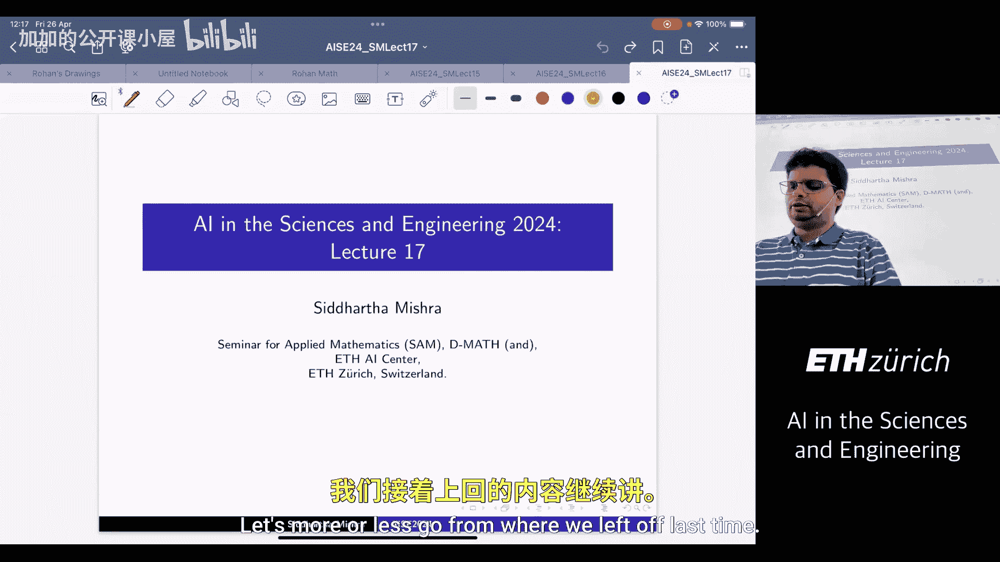

So the objective in the last lecture was to use transformers。

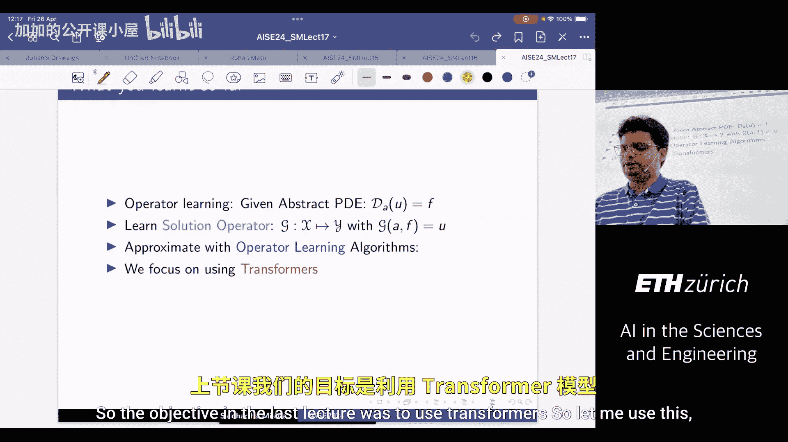

So that use this so use transformers to do operator learning right so I'm not going to reiterate what operator learning is we have been looking at that for last 10 lectures so。

But the idea of why we wanted to use transformers is to scale right so this is the keyword here is scaling。

So you want to scale with respect to data。And with respect to。Model size so overall。

 with respect to them。So that's subject right and we started in last lecture by giving you some ideas of how this works。

 and this was the let's say summary。

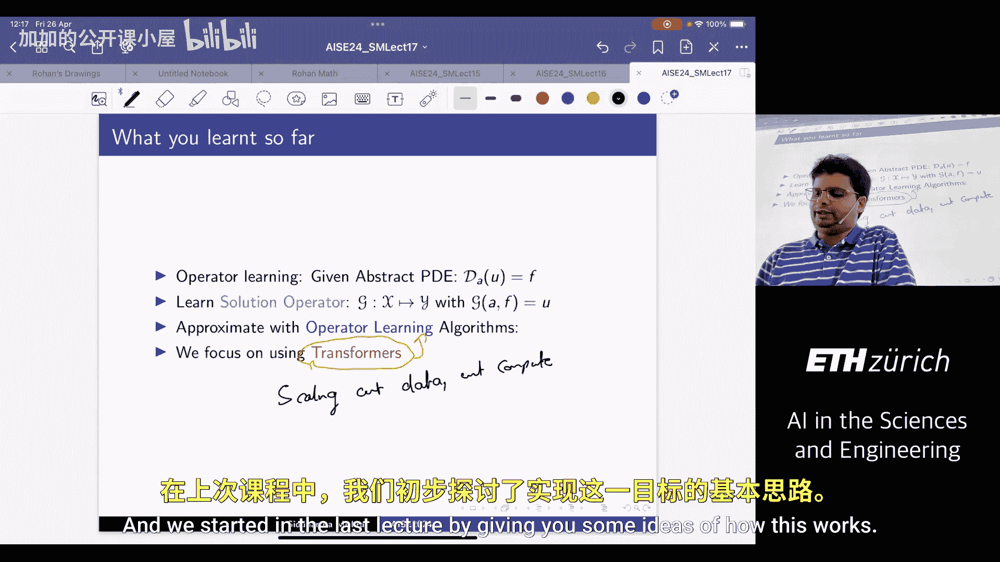

Slide summary box。 So your input or input embedding doesn't really matter。

 Let's say that this is your input function。V of x。

Because we can interpret all these operations in terms of operators not in terms just of matrices or of。

Functions between vectors and vessels， but as operators between functions and functions。

So we needed some positional encoding in order because otherwise everything is prohibitutation andvari and then essentially there were only three elements。

 three essential elements， there is MLPs， which were here。There are norms。

 So this was the layer norm that I just described in the last lecture。

 and the most important element， of course， is attention right， and this is where。he's this， perhaps。

So this is the element that was the most important and that's sort of in some sense。

 a new element when it comes to transforms。

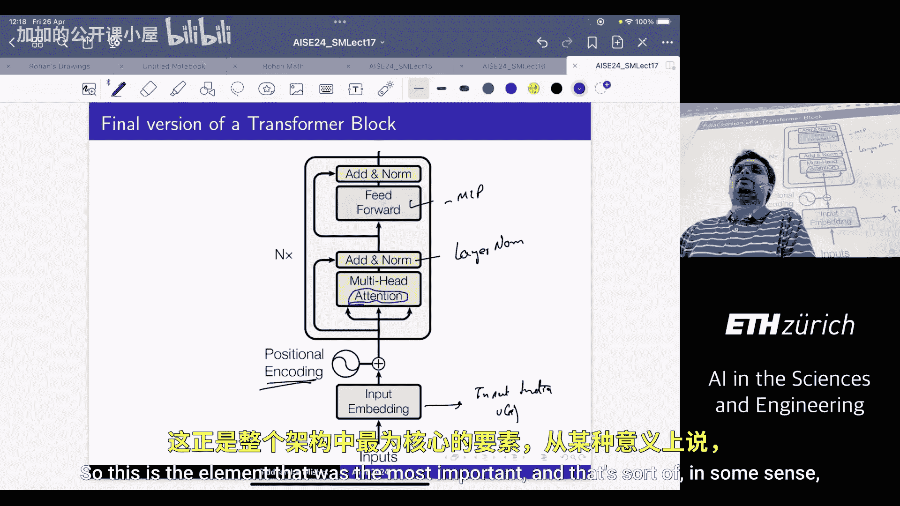

And just to reiterate what that is， again， at the level of functions。

 even though everything can be done with respect to discrete quantities， functions in the grid。

 So what you get is that the attention has this single head attention。

 Multied attention is just summing over。

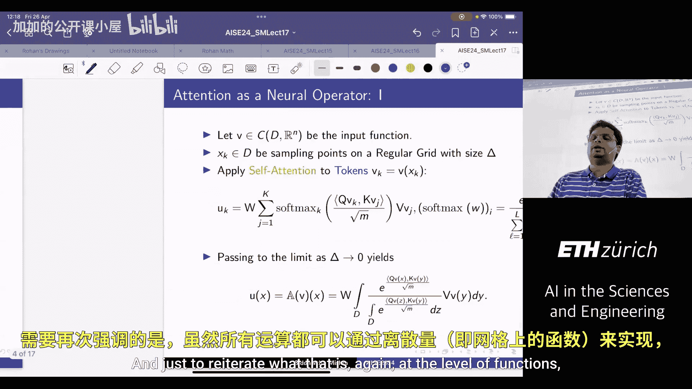

Over all the heads， so you get this structure here。So essentially， what you do is that you。

 it's sort of。Point to point connection， if you want to think of it that way。

 perhaps with putting a picture。

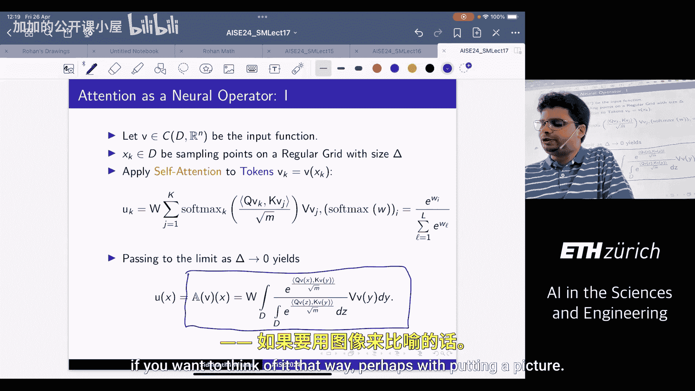

So in other words， you have these points here this what we called tokens。Our values at these points。

 So let's say that this is。Something like this。And then you have the same points again because we want to indicate connections。

And you can just imagine that this is your Vk。This is your Vj and so on。

 And what attention does is that it in order to update the value at this point。

 you look at the sort of relative information that each of these guys throw throw to this point。

 right。So this one， this one， this one， so on。So everything is thrown out here。

And then the idea is that you take a relative weightage of how important the information from all these points are okay and this relative weighting is done through a softmax。

 which is in the integral version it is given by this term here and in the discrete the Quadature version is given by this classic formula here。

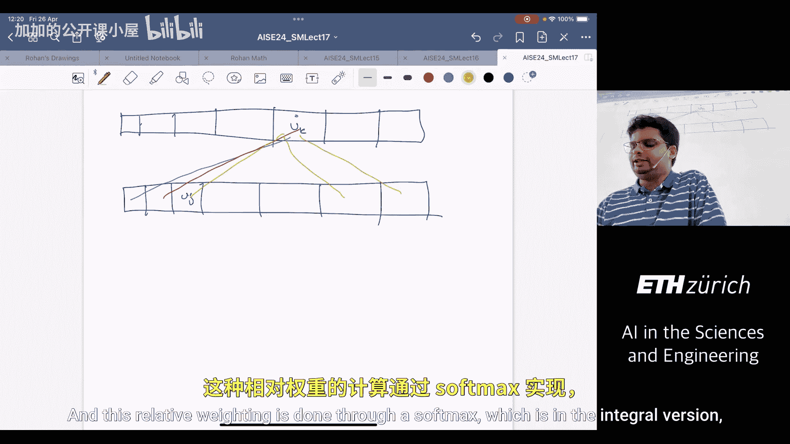

So in some sense， attention is a very， very intuitive mechanism because it just takes into account correlations or relative contributions of different parts of the input to that that's a heuristic and it is easily seen now when you when you do this means when you think of it as a kernel because in contrast to FNO and so on where all the time whenever we do the work at the level of functions operators we have to do some sort of kernel operations So for FnoO C we know that the kernel itself was translation invariant and it was sort of a fixed kernels learnable kernel。

 we infer the kernel from data but during the inference。

 for instance this is not the case right it's just something that has already been there here on the other hand because we take into account the relative relative contribution of each each of these tokens each of these points then what you end up is some sort of a- nonlinear a data dependent kernel so perhaps I should use the word data dependent。

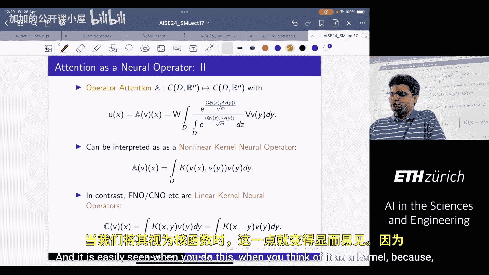

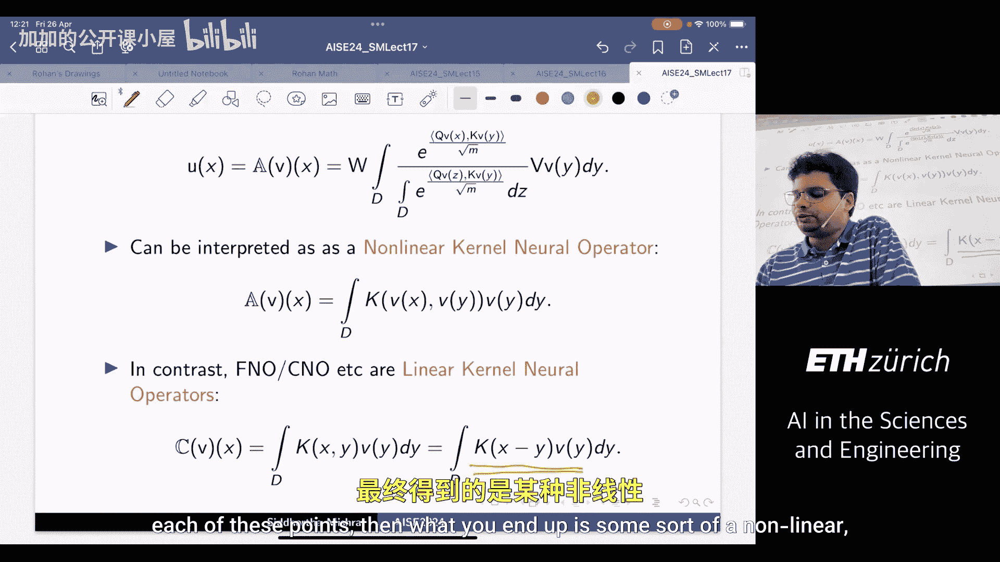

So this is why in some sense， transformers has some desirable properties that you' will see here。

 So this is a way to think of it that instead of having a kernel that is in build。

 that is something that we give。Using some prior knowledge， for instance。

 the inductive bias that is used here is translation invariance equivariance， right。

That's why we take this sort of put it x minus y type kernel on the other hand here we have no such in built implicit prices or inductive prices。

 what we have instead is that it has to learn it from the data okay and we offer it a lot of scope to learn from the data because as you can see there are lots of all all data points make a contribution。

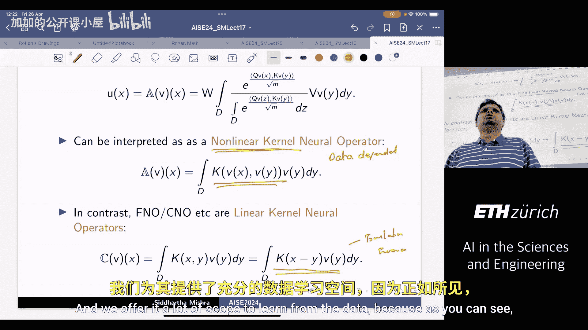

It could be that the nearby points made much larger contributions than the far up points。

 That's the structure of the data。 In that case you can imagine that you're slowly hinging towards this right because here it gives more weightage to the neighborhood actually it gives all the weightage to the neighborhood then to the others right but in some sense you can see intuitively that if that is the case if that there is more weightage to the neighborhood all that it will do is that the attention the relative that attention weights or the neighbouring points So let's say these three points would be almost 100 percent and the rest fall up very very quickly So you can somehow recover this locality also from having this kind of a global structure but of course in some other problems perhaps this is not the right kind of an inductive bias then it is able to leverage。

 it is able to sort of understand this and should be able to learn so this is some let's say very rough heuristics into why of course it was proposed more from the perspective of language where if you think in terms of language。

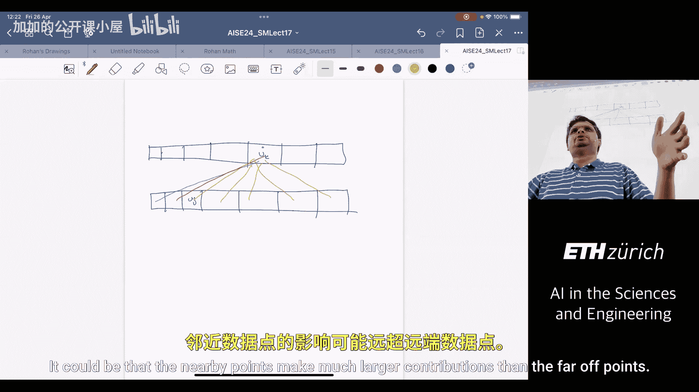

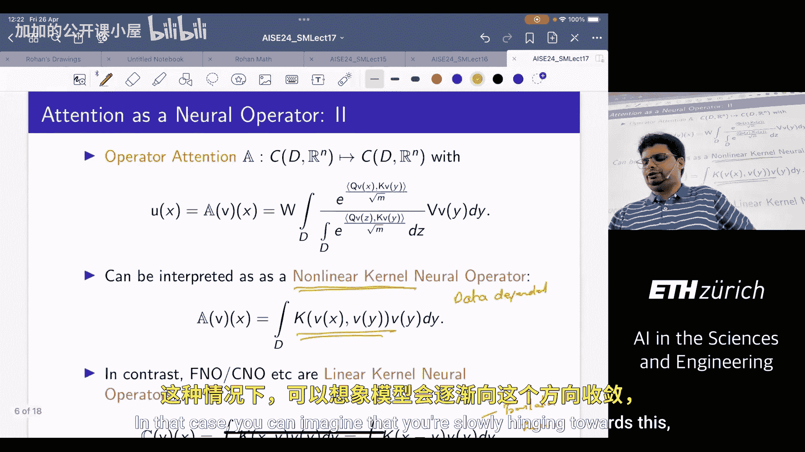

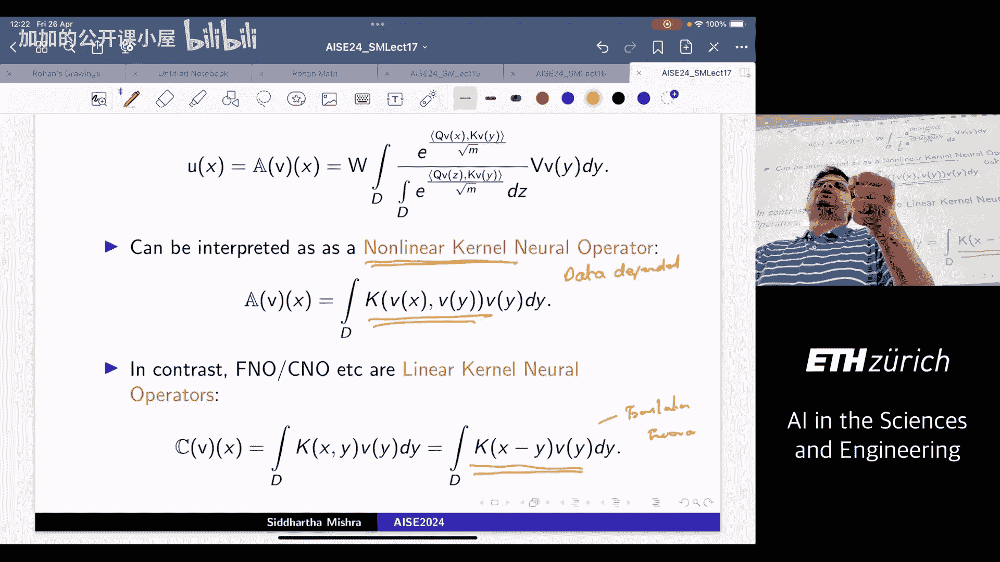

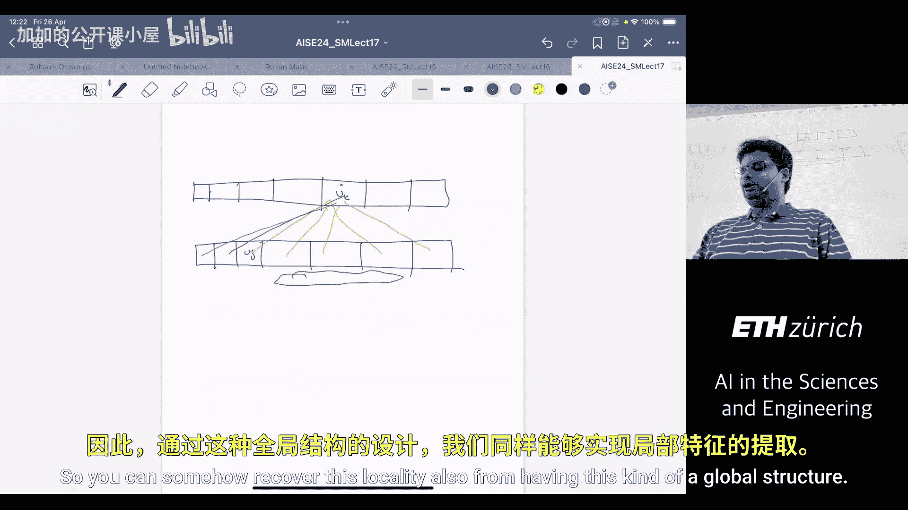

Attention makes a lot， lot of sense， right in vision and in Ps， it's a little bit less。

 But if you think of it in terms of a nonlinear kernel， then of course。

 the intuition becomes in some sense stronger。 So this was sort of the key element right this was a key element and the rest were。

 of course， some details because as you can imagine that the other elements where like pointwise operations MLP La normalization。

 And in some sense， they are not a sense of attention。

 a sense of attention is really this a sense of a transformer is really this attention。

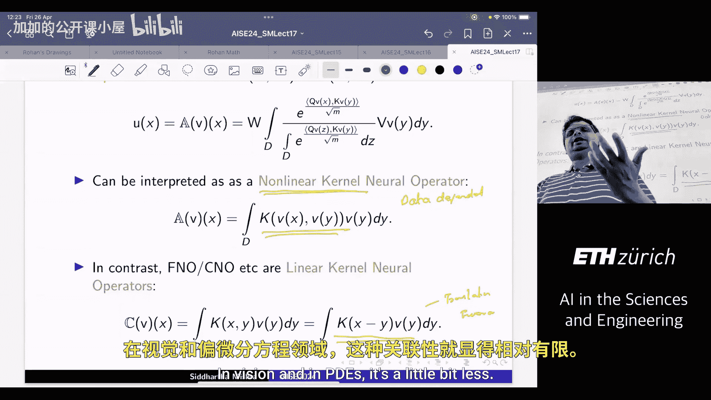

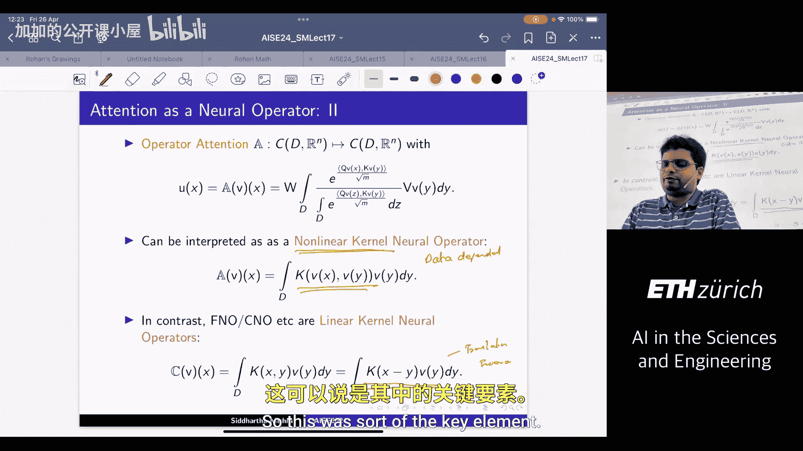

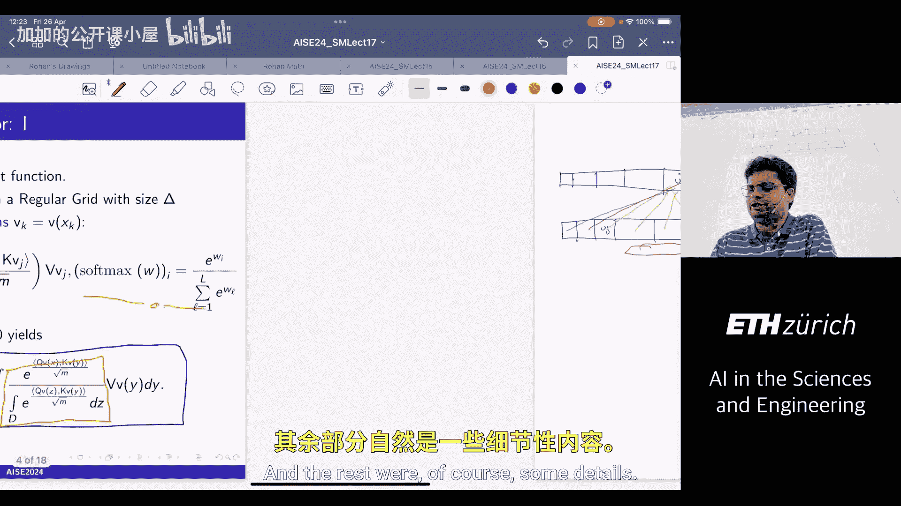

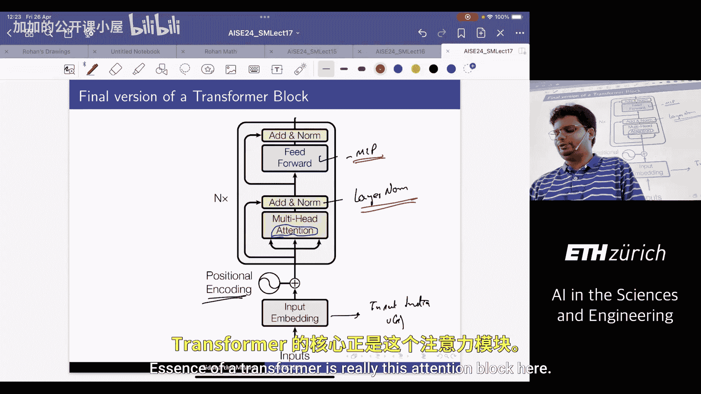

Block here good， so now that seems all well and good。

 but there must be a caveat right the fact that we are allowed to be so general that we can interpret local locality。

 we can interpret global information so on， we should pay price and what is the price that we pay remember that are already alluded to it that you know to compute this relative weights we had to do another look here right so we had to go again。

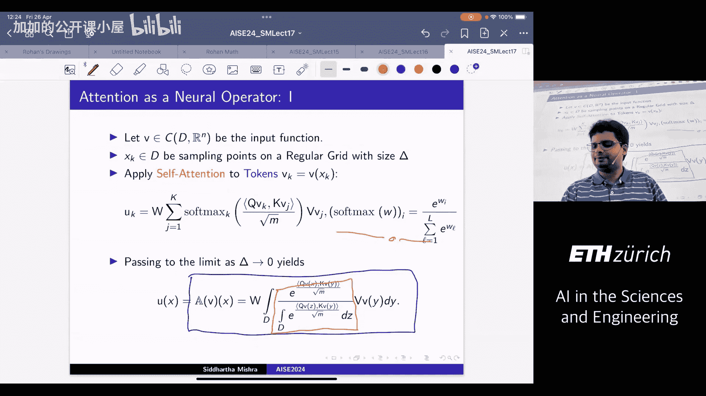

And then compute the attention weights by doing a So we fix this point。 And then again。

 we do a broadcast。 So essentially， all these points make a contribution。 And then you compute that。

 So you here you have K operations。 Okay tokens here you have K more tokens。

 So you have this quadratic complexity。 And this is exactly what I wrote down here。

 that in terms of the number of tokens， the cost is actually quadratic。 So the compute in the。

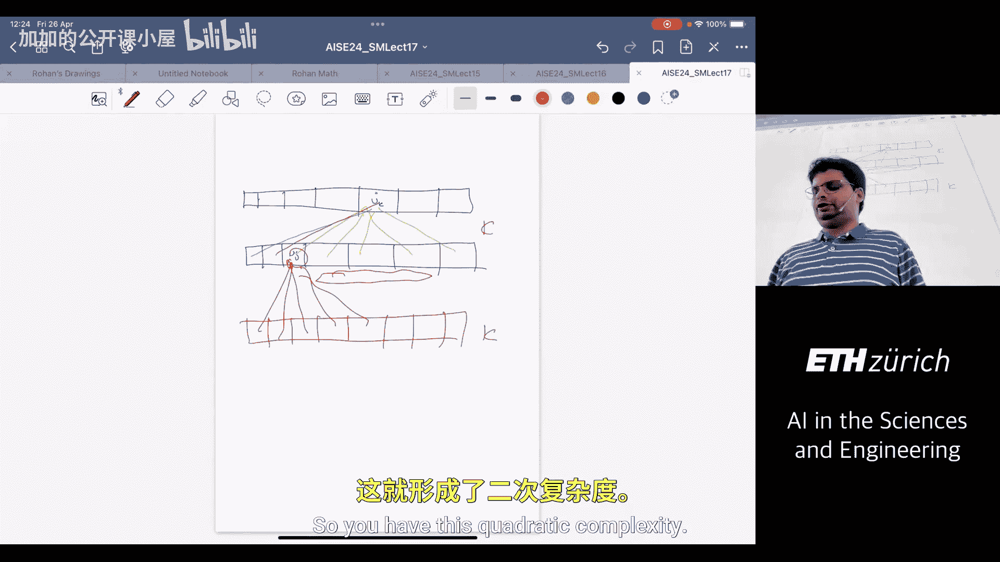

Even just one single inference， remember that with respect to machine learning algorithms。

 the two distinct processes there is inference and there is training so inference is when you deploy your architecture right and this is during training what you do is that you repeatedly loop over keep on inferring through all the data that you have so there is a so training of course is much more expensive but these are not completely unrelated to each other right because during training you have lots and lots of inference arounds。

So now how does the compute look like So essentially this can be computed。

 It's rather straightforward to compute。 I could have gotten some something wrong。

 but the key point here is that it's quadratic in the number of tokens Okay so this is serious implications of course remember that we also have some input features and this is a hidden dimension So hidden dimension was here right so this Q k and so on if you remember the query。

 for instance， is a M times n matrix So what you do is that you take information from n dimensions and typically you lift it to n dimensions the way on you start with n dimensions and you lift it to M dimensions So you can think of M being much larger than n may perhaps not much larger but certainly larger than it because it's a lifting dimension so it's in space in some sense So this is of course also quadratic in the number of features but that's less mild compared to the number of tokens。

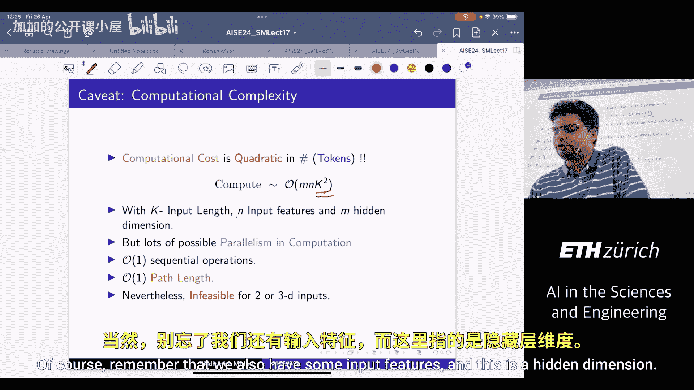

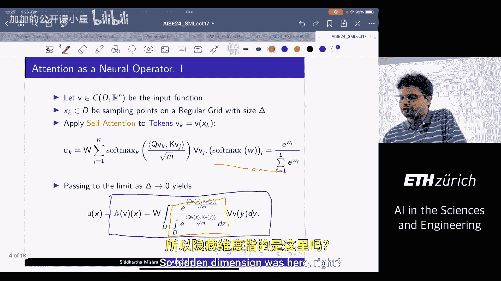

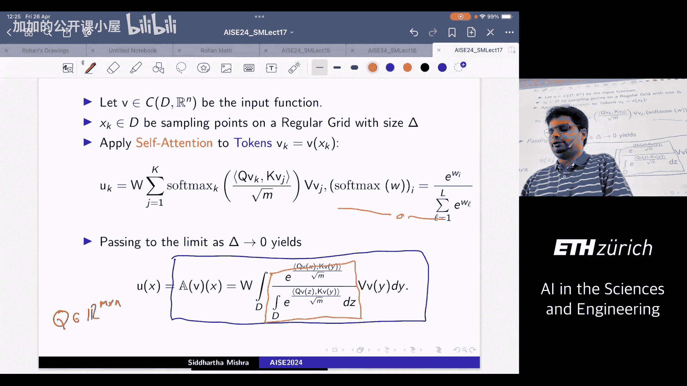

Why is that let us imagine that we are talking about forget about the weather but let us take a very very simple situation we have fluid flows。

 incompressible fluid flows so obvious toxicx equation so our unknown in some sense is the velocity V and this is two components the x and y component。

And so in 2D， it has two components。 So this means that n is equal to 2。Even if M was equal to。

Hundred， let's say 10 Okay this I'm just putting some numbers here。

 usually it's not 10 it's more closer to 100 than it is to 10， but let's say that it's 10。

 So this you can see is just 20。 It could be 200。 It does not really matter。

 Now what is the number of tokens。 So remember the heuristic that we have now is that if you think of an image in 2D。

So we have an image so this is the domain then each point corresponds to a token right because in each point the point value at that point corresponds to a token there are two channels let's forget the channel dimension because that is included here but so there are how many points now in 2D so it depends let's say that we do some let's even take 128 squared right so 128 squared is2 to the power how much is that so two to the seven so two to the 14 right？

2 to the 14 is a very， very big number already， so that's the number of tokens。Okay。

 k is 2 to the 14 because each of these points gets expanded into a line right so you have two to the 14 tokens so what is the complexity now of a single inference run is 2 to the 28。

So it is 20 times 2 to the 28 now 2 to the 28 is a very big number I don't really want to imagine how big it is right roughly speaking it is2 to the 28 is like 10 to the its3 so 10 to the nine it's more than a billion right so it's more than already more than a billion which is which is a very very8 it's big this is just in 2 d at a low resolution now just scale the resolution up and just let's start doing some numbers if you're in 3D and you're at 128 cubed then all bits are off right because now you can see that the number of tokens k is2 to the 21 right no isn't that that correct。

2 to the7 cubed is 2 to the 21。And the number of parameters。

 the number of total number of the cost in terms of the number of tokens is due to 42 and that is you're talking about trillions already right so this is even for the even for the biggest machines that are available there。

 these are still forbidding numbers okay so this is it's okay because the point why transformers were very good was for text in the in the beginning。

 you only had text and you know that text， the spoken text or written text this is not very rich information because this can be stored with a very few number of tokens usually there are these embeddings by pair wordpiece and so on and these stored it in very very few even the whole of human knowledge as encapsulated in Wikipedia for instance。

 is not that many tokens you in terms of tokens but as soon as you come to images and as soon as you come to sort of scientific data sets which are more closer to images and even videos three dimensionmenional images and so on you get into。

So is this is the problem with transformance， right because they have this quadratic cost。

And that can hit you hard in some cases， of course。

 there is also a way out and the point about transformers is that there is extreme parallelism。

What does it mean， parallelism means that different processes during computation can be chopped off。

 and this can be sent to different parts of press different threads， different GPs， whatnot， right。

 And， in fact， it's very easy to calculate this that there are exactly order of one sequential operations。

 Nothing depends on anything else。 So in particular， if you think of the。Operations here。

 let's state the operations here because this is the expensive one。

 right MLP and layer norm and so on。 These are very， very easy operations。 These a pointwise。

 there is nothing， nothing that is happening。 As you can imagine here for each of these points or whether here for each of these points。

 we we could have computed things in parallel， there is no interaction between them we could have taken the query。

 you would have applied it onto the vector and we could have just done it for each of these points independently of each other and similar all these operations are only things that depend are similarly the computation of the keys。

 the computation of the values， These are all can be done independent of each other。

 only when you take a dot product have you got to combine them but that's not a very dot product is easy operation compared to the actual computation of this matrix vector products and similarly softmax can be computed all all the things that go into the softmax。

 exponentials they can be computed completely independently。

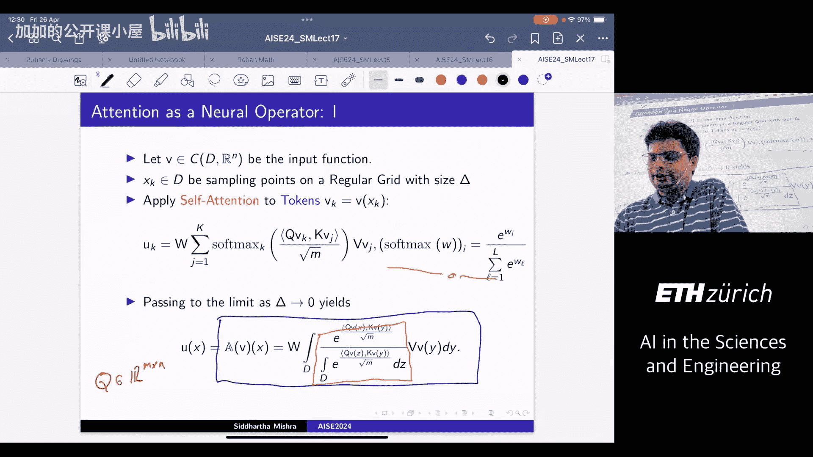

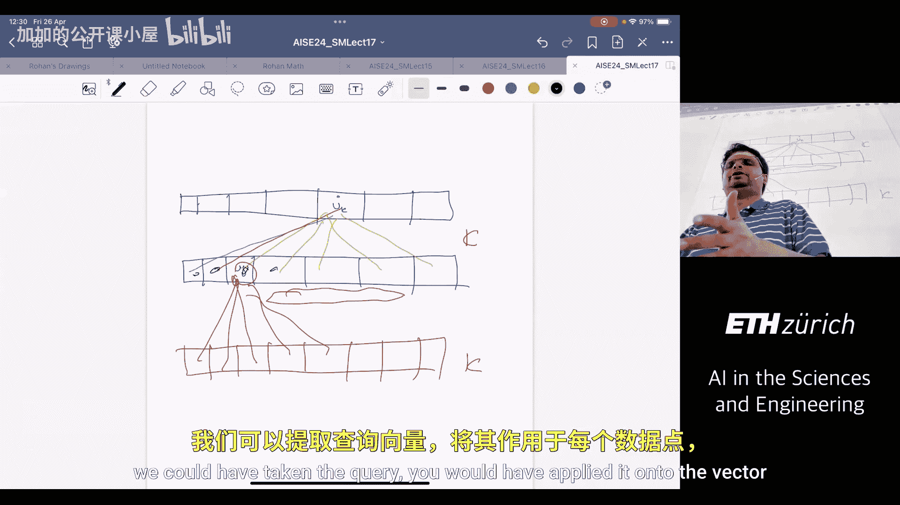

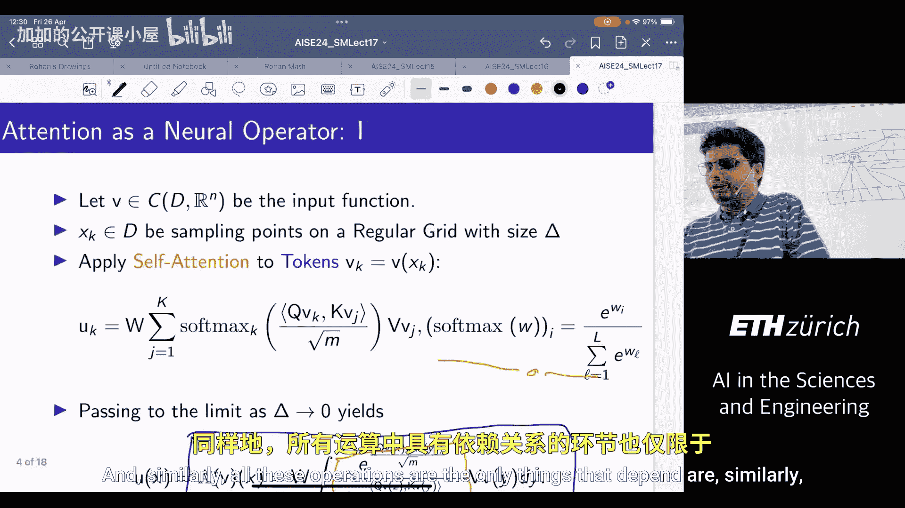

each other and they just have there is one accumulation operation so you can imagine that there is a lot of parallelization and this is the reason why even though the compute can be expensive。

 you can parallelize and you can extremely parallelized and that's why it transformers work so well because you have this parallelization features that I explained and also there is a concept of part length that I don't want to go into any details it says that in the same around you can go from any point to any point so Part length is how well are different parts of a computation connected to each other we know and transformers every point is connected to every other point or every point including itself So of course there is a unit one part length so it's very very easy to leverage those those facilities here so the parallelism helps but it doesn't help if you still have 100 million compute size right so there is a limit to so in 2D potentially you could get。

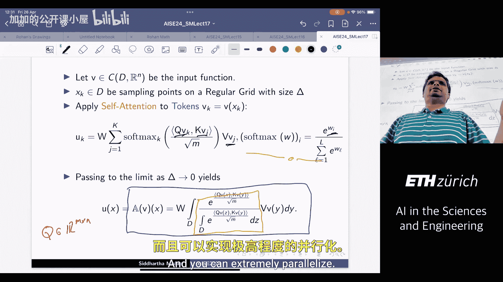

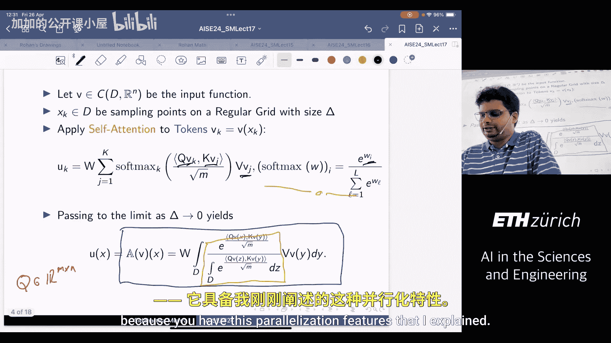

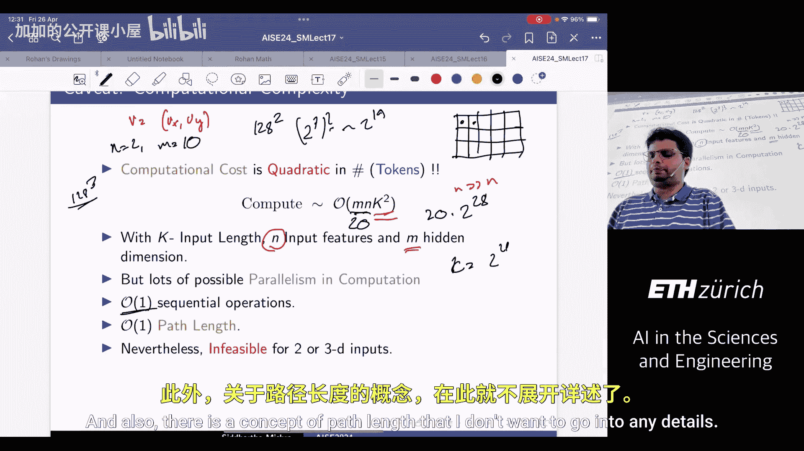

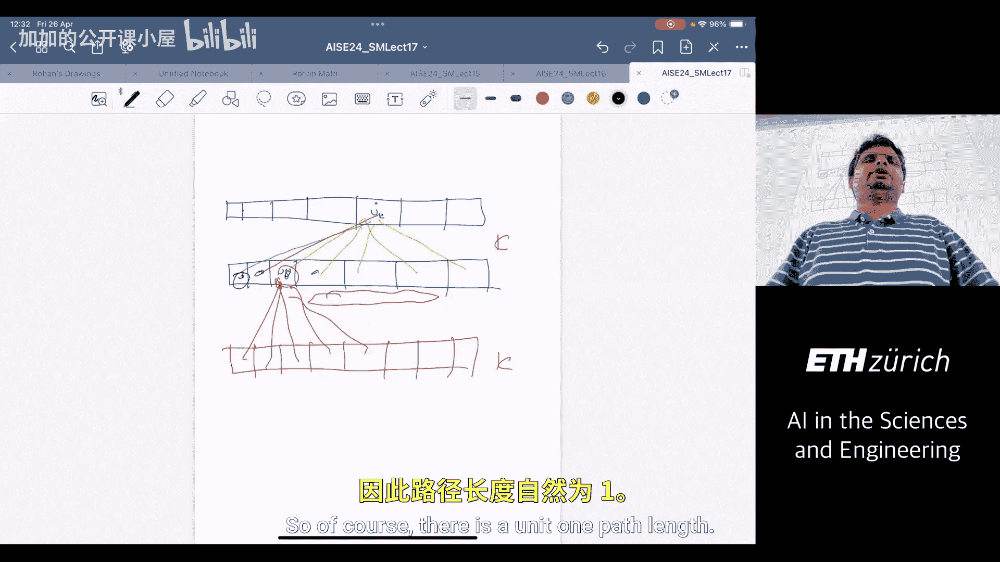

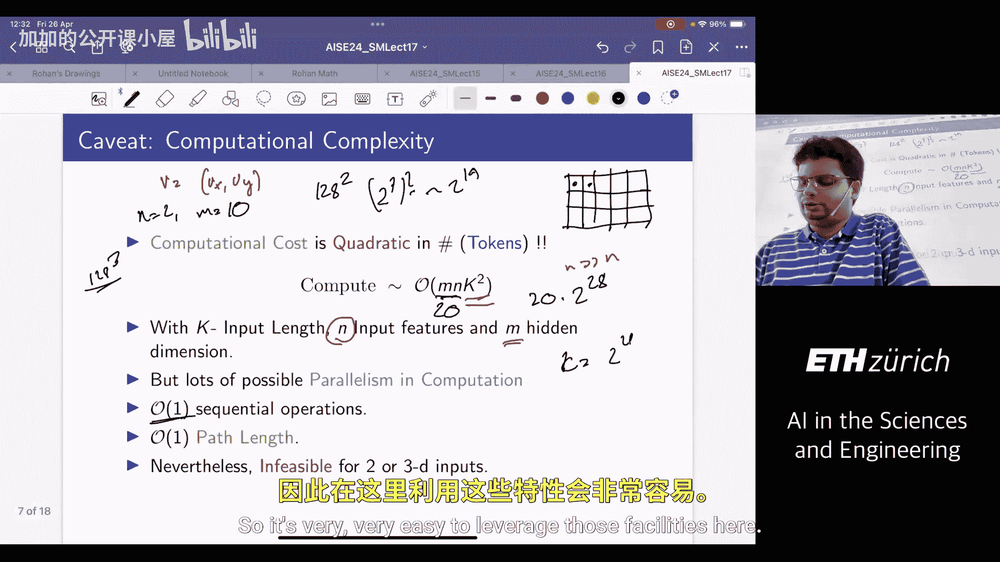

way but no one does that， even for images， no one does that because yout want you don't want this large computational volumes so we need some sort of that's why its sort of attention point wise attention is this would be considered still infeasible。

And perhaps unnecessary also because you don't need that kind of local information。

 after all the difference between text and image or text and scientific data sets is that if you think of this room。

 for instance and we are interested in temperature in this room There is a much more regularity in the temperature in this room there is a lot less variation between the temperature here and temperature here compared to of course。

 you can argue compared to temperature here and far away so there's a lot more regularities。

 So you could leverage those regularities， it's the same with an image when I look at you guys。

 there is much more regularity than at a pixel level then it would be。

 for instance when I'm talking because each of the words that I say there is no regularity as such you know there are discrete events in some sense。

 So we are going to leverage those regularities that these data structures have in order to reduce the cost of computation and this is what I will try to do for the rest of the lecture today。

Are there any questions about the computational aspects or what are the computational challenges of transformers。

 no， it's obvious。嗯。我。Let's move on。

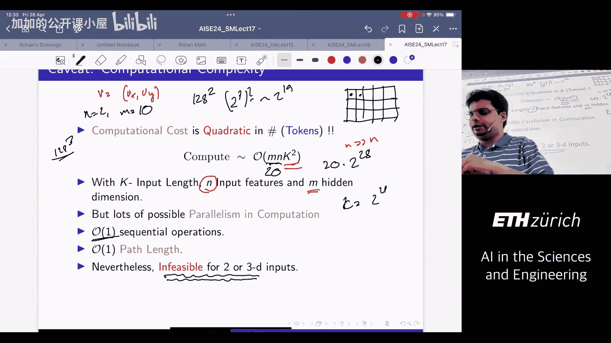

So one possible solution which is widely used in vision because vision has exactly the same problems。

 remember that being input images is what is called vision transforms。

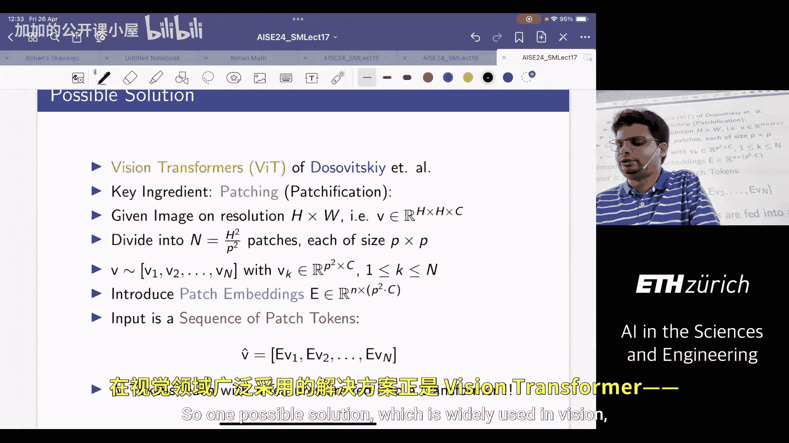

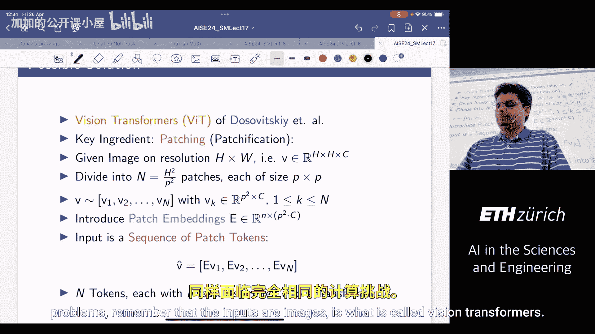

So this was actually proposed by some mostly people sitting in Google at Juric。

And this is called efficient transformers。And let me explain what it is and then we can look at some of the details。

So the idea is to use images as the main sort of concept here。 So think of an image。So。S poor dry。

 but。It was serve a purpose。And you can think of a domain， a computational domain。

 and you know that at the end of the day things are discrete， so there's a bunch of points。

At which we are going to sample the solution， right？

A bunch of points at which we have the image represent。Something like this。

Usually 128 squared 256 squared512 squared and so on So the idea as I said。

 is to leverage irregity the fact that locally things change slowly。

 but of course if you accumulate these changes of global scales spatial scales then there'll be larger changes right so the idea behind these people who propose vision transformers is very simple but why don't we divide the domain or divide the image into what are called patches so what heurically what it is is actually very。

 very simple writing it down in formulas is a bit cumbersome but so I divide it into blocks or patches。

I've just done a very， very crude approximation fit right so instead of looking at these how many points did I draw 20 points I just look at in this case six patches。

 this just some numbers that I'm throwing here right so six patches and the idea is that there is so little variation within the batch there is so much of regularity within the batch that I could essentially instead of having these four pixel values I could replace them with a single feature。

 a single attribute from the batch or single feature， single attribute from this patch。

 single attribute from this patch and so on。So by dividing into patches。

 instead of having 20 potential tokens， I went down to six tokens， Of course this process scales。

 Just imagine if I have 128 square image and each patch is 16 by 16 and this was typically what the original vision transformers paper result then instead of looking at 128 squared point values I simply look at128 divided by 16 squared and that is 64 point values right So there's a dramatic reduction in the number of tokens all that you leverage is the fact that neighborhood information is taken into account that things are don't vary dramatically within the neighborhood as you'd expect also solutions。

 yes James。Once that part item by most important that bear is like somehow。Bultip， like fast。

 multiple。5。Yeah， it's a very simple partition of unity type idea in some sense， right？

Multiple is a bit more hierarchical this is much simpler because when for those who know multiple methods or these are called three methods anyway。

 so there is a hierarchy where you leverage the hierarchy you don't use any such deep sort of you could do it you could also patch based on that kind of a futurization but this is much more naive way of doing。

Because you see that multiple would work very well if you have a lot of regularity right then you can just cut off some some parts here images and solutions to very complicated PDs。

 they have some regularity， but they don't have that minute there are jumps and so on that probably is just as well to do this Okay so let's let's try to look at some of the maps。

 So the idea is very simple right that you just take this non overlapping patches and in each batch you aggregate the features of these nearby tokens nearby points。

 let's say and you form them into this so-called visual tokens Okay so each of these guys is a visual token。

Visual。 It's like a word。 You know， token is roughly a word in natural language processing。

 So it's like that。

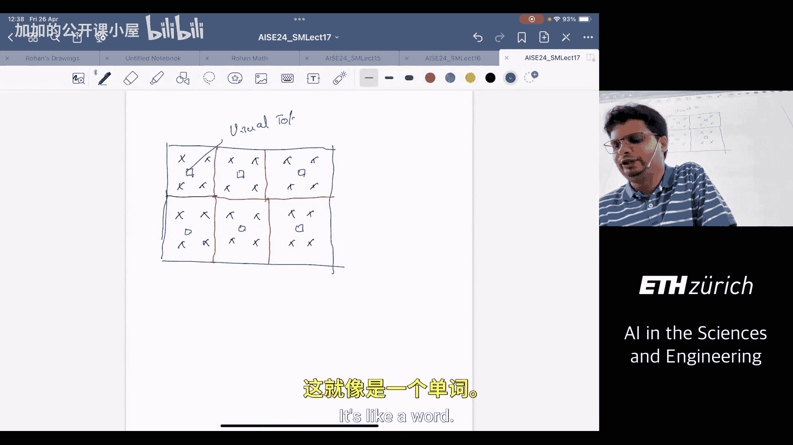

The key key point is dispatch formation。

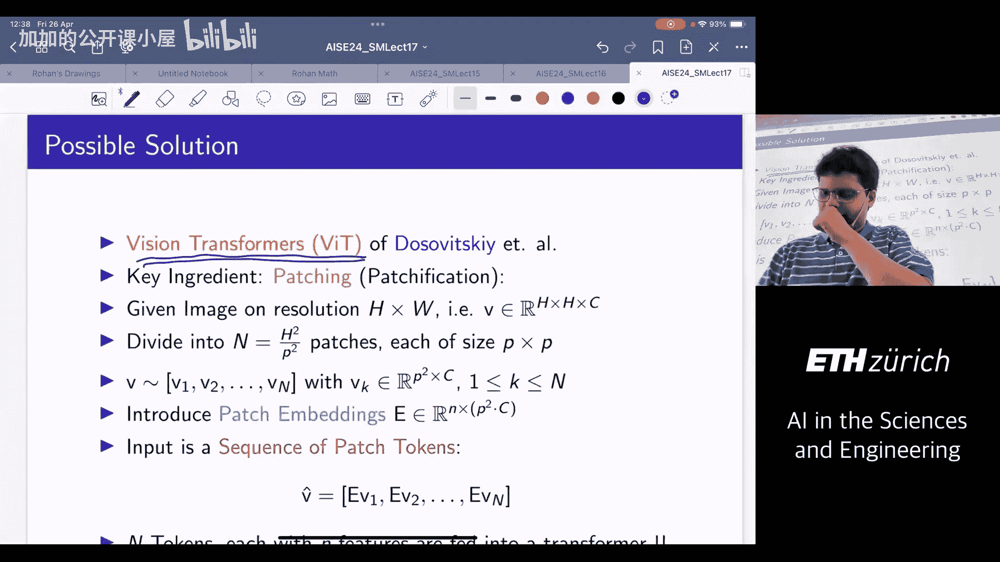

Sorry。Let's use this So this is batching and I just explained what that is by the way I made a mistake here h equal to double just for simplicity so all of this can be done with unequal sd images there's nothing nothing fancy here So now you pick up batch size P by P as I said 16 by 16 versus4 choice in the numerical examples that I'll show you in the next lecture we would use4 by4 because we expect that for solutions of Ps the patches are to be even smaller but anyway so so you have so you have n patches so you can imagine that if h was 128 and p was 16 then this is a severe reduction okay so instead of having 128 squared which is2 to the power 14 tokens。

 you'll only have 64 tokens which which is much much easier to work with right and then the point is that this is where do we so there could be a loss of information so the loss of information could be from the fact but okay you're just cutting off the image。

Into discrete points and then so what means you're losing information also you're essentially taking averages right But what you do is that always in machine learning。

 you learn something you learn some additional features you say okay。

 let me learn the best roughly speaking there's a heuristic right there's no guarantee that that heuristic is taken care of during the training process but let me learn instead of just taking an average of these four points。

 which is what I could have done this the easiest aggregation that I can do let me take a learnable。

😊。

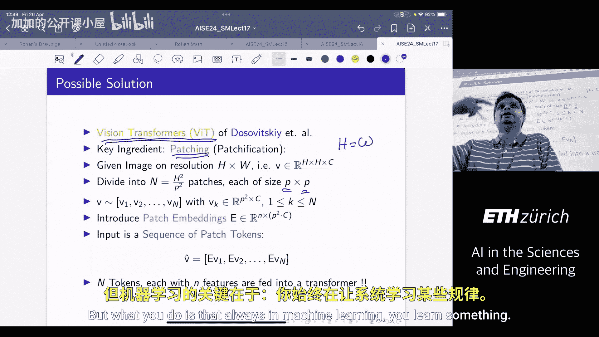

Sort of feature extraction。 Okay， so I what does it mean roughly speaking is that you take weighted averages。

You'll see when the operator version comes in the next next slide。

 you take some sort of roughly speaking averages means with shared weights so the patches are so is the same features that are being learned。

 the same types of features that are being learned across the different patches and then of course each time you embed it into a latent dimension plus some latent embeddings。

There's always that okay we lose some information because we are taking into account the regularity but perhaps we keep that information because we are projecting into a bigger space this is always the trick well also with remember with the unit architecture this is what we did recoscent were downsampled but we increase the number of channels because there we could we could learn something and remember that sort of the increasing the number of channels would have been a very very mild operation because this is this is a very mild thing to begin with right so even if I go from 20 to 120 it is nothing like the two to the power 42 numbers that we saw with the number of tokens so this is what happens here again the detail is not not that important so what you do is that you extract this local averages so these are the local point values they are just bin together into into into these objects and then you embed them into a bigger space so these are some learnable embedded。

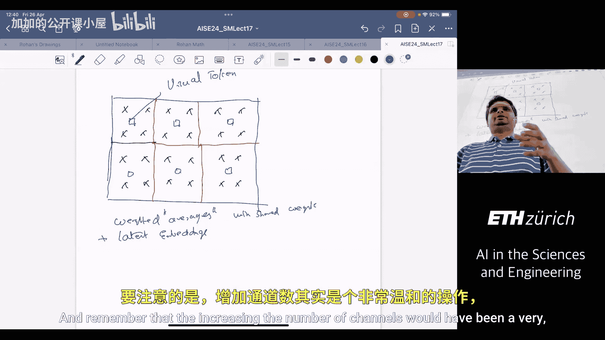

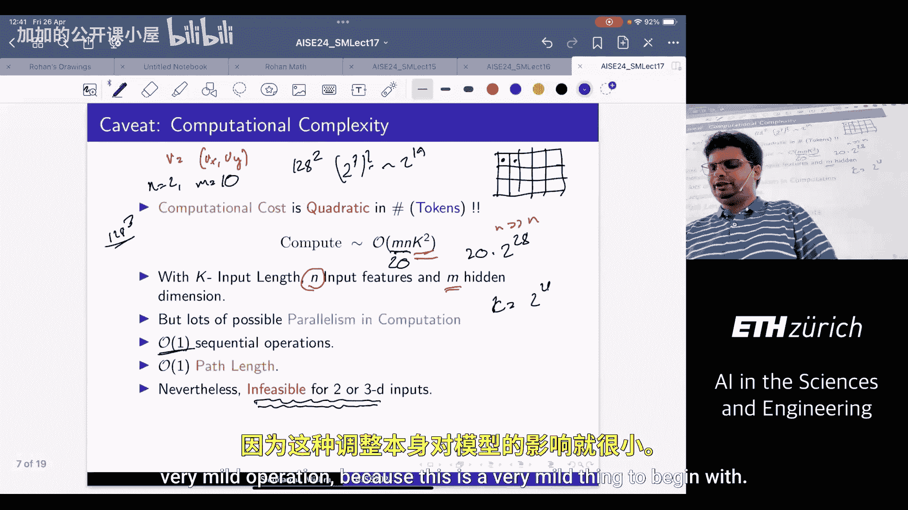

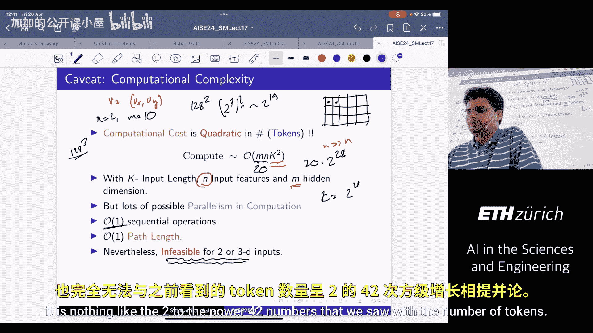

So at the end of the day， instead of having an image。

 you have and instead of taking every single pixel and laying it out as a very。

 very large vector large sequence， what you do is that you do this in clever manner so each of this is the same embedding as you can see so that as I said the weights are shared it's like a local average think of this V1 v2 as local averages weighted learned averages with the same features that are being extracted across each each batch for instance right so the advantage now is that we have exactly end tokens we have reduced the computational complexity considerably and at the same time。

 hopefully by taking this learnable elements we keep some of the information that that that is available and these are the things that are fed into a transformer so the transformer remains as before that it is going to attend but now what it is going to attend to is different earlier I could have just attended every single point value now it is attending this learned。

Averages okay， so there is a subtle point here and this sort of becomes very。

 very clear once so at the end of the day， if you think of it heurically all that you are left with are these tokens so I just bunch these things here。

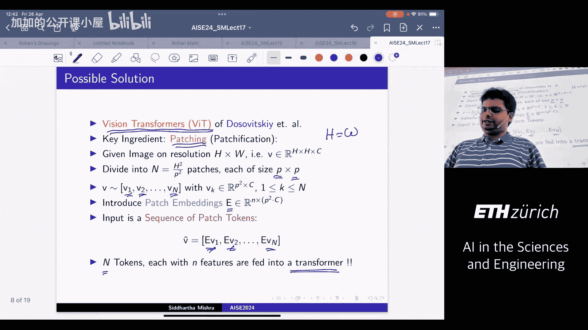

And I have extracted them， of course the channel dimensions are different right So instead of just temperature pressure or humidity。

 whatever it has 20 different parameters which are supposedly learning some features that are lost while patch patch this a very。

 very simple heuristic in that sense it can be written as operators means this is exactly sort of justifying what I have just said that you do this you divide the domain into this non overlapping equal patches possible it may not be equal。

 but that's the simplest then you take weighted averages across each batch and these weights are shared right and then finally you sort of embed them into into a latent dimension this is roughly what these formulas indicatedicate As I said the emphasis is to aggregate information while at the same time keeping some of it through additional channelss the heuristics is very simple these are very。

 very easy to implement operations because all that you do is you just multiply right kind of matrices a tense source。

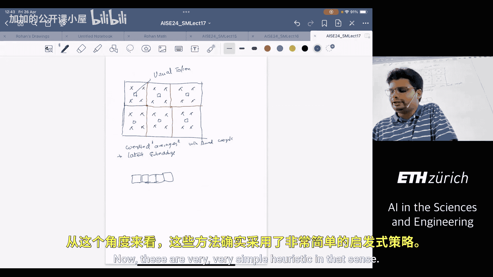

on the right kind of embedding dimensions that you take so is prification clear the mental image that you should always keep is this that from this complicated image you come to a simple sequence instead of coming to a much longer sequence that that would have happened right？

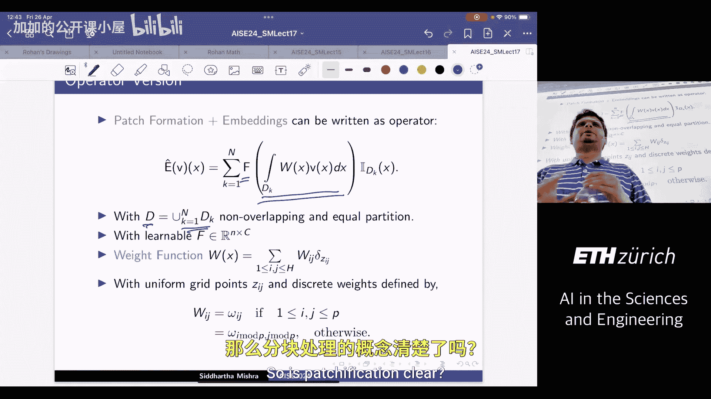

Any questions about this， yes？We absolutely need a position and， you cannot because now this。

It is still。There is some some information， there is some inductive bias。

 I will talk a little bit about it in fact。

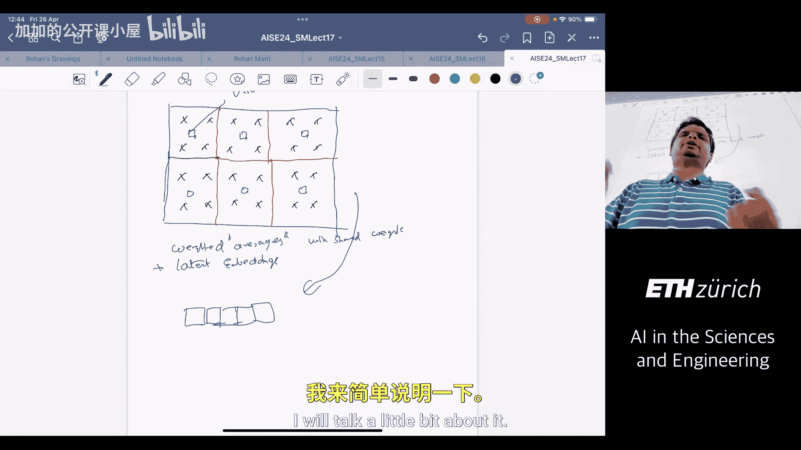

啊。That was the next slide。 So okay， let me， let me get to it so that I， I discuss it。

 We still need to add position em because there is no sense of once you put these tokens。

 there's no reason why I I I just took them in one particular order， right。

 I could have just juggle them around。 and I would have gotten similar thing， right。

 So there's no sense of any kind of position in this process。 So what do we do。

 How do we put position， we put learnable ones， Just like I explained in the last lecture， Actually。

 it's very simple， So I just append。😊。

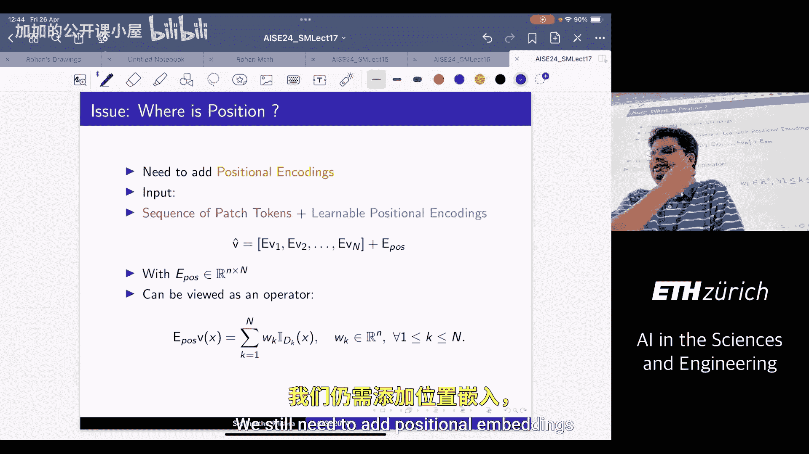

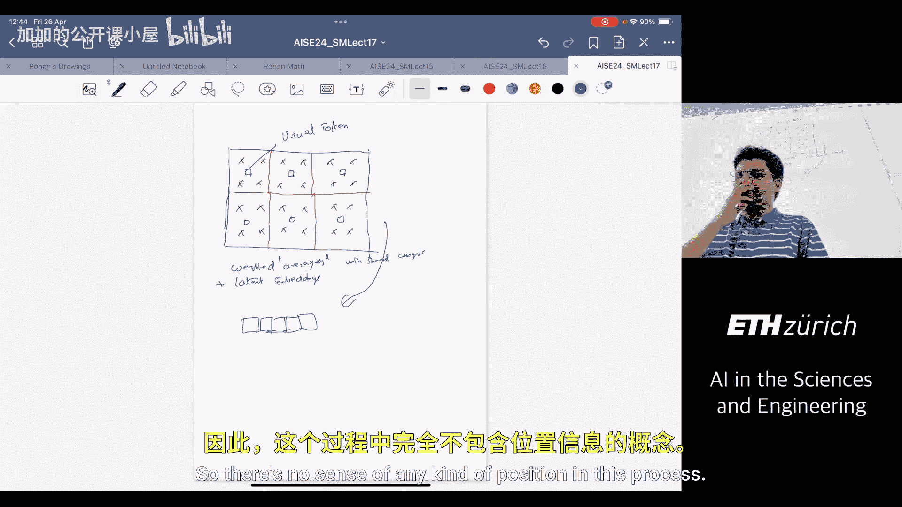

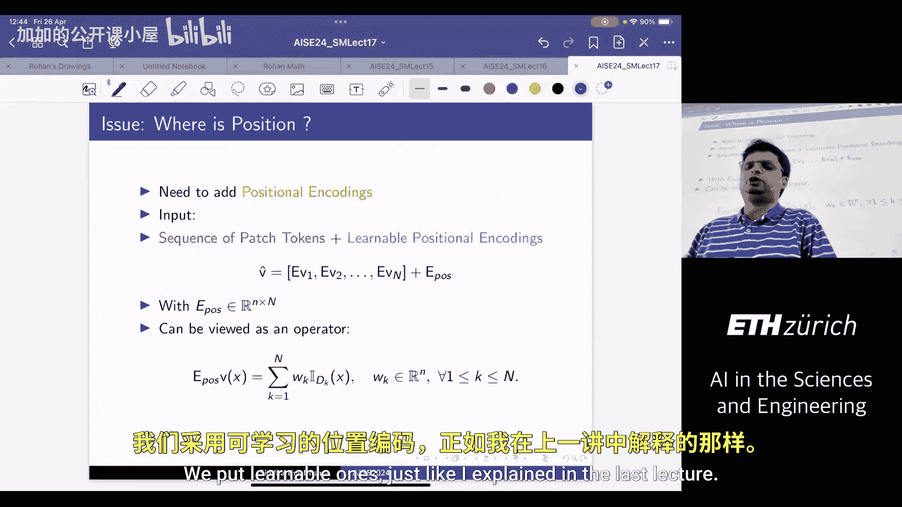

Now instead of doing last time I said the most general case in MLP。

 but in practice people use just linear， very simple linear positional embeddings so remember that this guy here。

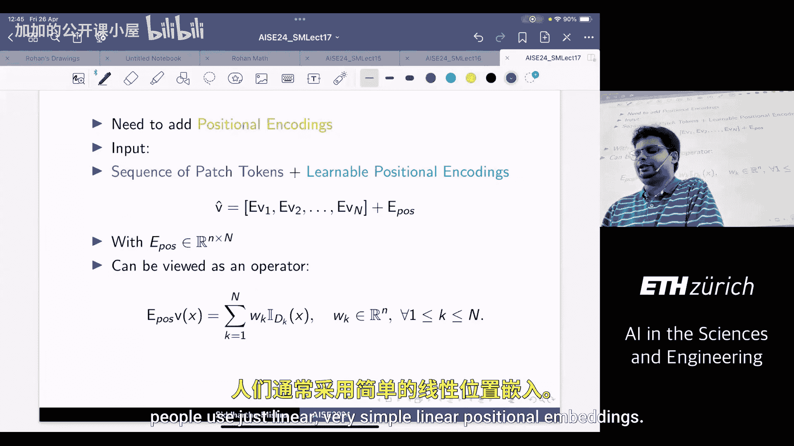

是的。嗯。So each of these so these are so this is a vector right each of them is sort n of these capital n of these tokens。

 each of them is I probably made a mistake with number of dimensions here， but maybe not。

So each of this is an RN vector， RN vector， so these are no features。

And then all that I do is I add an additional piece of information Iend to it an additional piece of information which simply tells you what the location where the position is right so roughly speaking this here which is a vector which is in cross and vector so each of these components。

 so for instance e+ one。E+ one is essentially telling me what is the position of Ev1 E+2 is telling me what is the position of Ev2 and so on and so forth Of course there's a trivial way in which you can view it as an operator that's that's not important it simply tells you where the thing is inside the room okay inside inside the which patch does it belong to and so on and where what is the relative position of this patch。

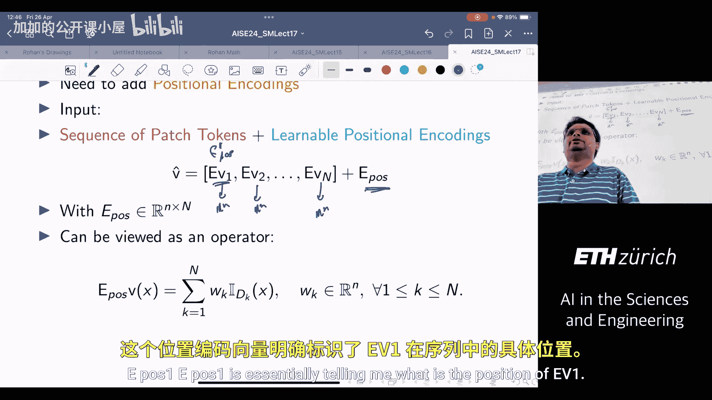

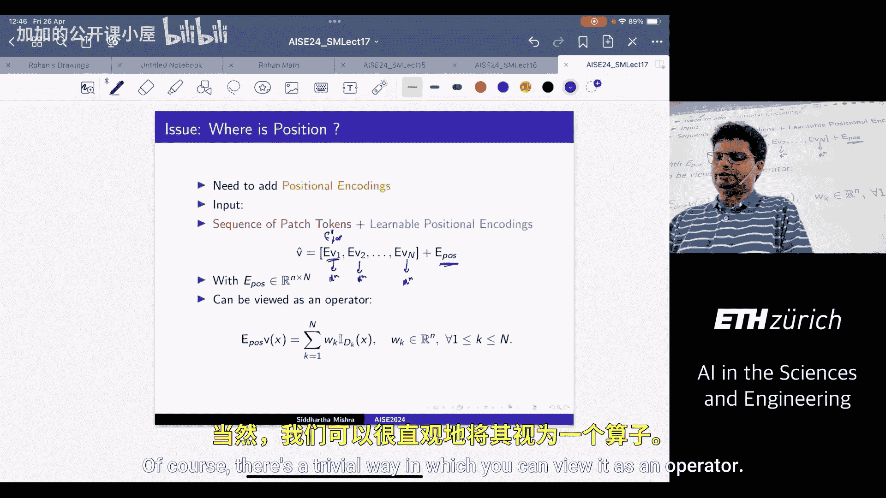

Good so you always need position embeddings， you have the position embeddings。

 you have the new features， the patched features， and these are the ones that you feed into the transformer。

 so the w operator block。

As you can see， is the following form。

没错。

O。So as you can see that you have， this is in 2D， you can do this in 3D or you can or 4D。

 Any dimensions you can make patches， but。The algebra becomes complicated。

 That's why I explained it simply in 2D。Okay， so now you have your domain computational domain you have your input which I'm assuming is a continuous function with C channels and then it's a sequence of operators So as you can imagine the first step is to do the patch embeddings so do the patch embeddings and the positional embeddings and these are the new set of tokens right so this is roughly the set of tokens that are。

That I just extracted with the position embe so these tokens tell you where roughly where these things are and then you throw them into attention right so you start by layer normalization so you normalize then you put some attention I hope I didn't make a mistake here I don't think so and then you do a residual connection as before and similarly you repeat the process you again take the output here you do perhaps I should have。

O。It's roughly， don't I have a picture no。But its it's along the same lines as before I should have had a picture。

 I'm sorry。So except that now you have the input embedding is in terms of a patch。

 this is the patch formation。Okay， and then it's the now the order of these things is reversed。

 you know。So the norm comes first and then its attention norms comes first and then its attention and this is simply to do with how well gradients this is empirically observed but in some cases。

 putting the norm before the attention is better in some other cases putting the norm after that tension is better and this keeps on changing based on the architecture So there is this there is no no no sort of proper way to say which is good and which is bad because this is whether you normalize and attend or whether you attend and normalize you should roughly be in the same order right but the difference now is that in terms of the gradient propagation because one has to train the algorithms there could be some marginal differences So that's that's a detail I just want to give you what what people have done in this in this regard right So okay where is it now。

Here， so as you can see， so you start with your input。

 so let's let me write it down so you have your input。Then you do patch。电你咧我。Right so patch Leome。

 then the multihed self attention right and then the input plus the residual， this is your new input。

And then this goes through to this plus。Then it goes through Leome again。Then an MLP。

 So this is an MLP。And then again， another。Plus here， and this is your final out。

So this is how it looks like right， I have I should have done this before。

 but you get the you get the sense and you have to stack several of the yes。

Is that correct let's see so what is we hat now we hat is just the input of the patching。Oh yeah。

 course。I always made this mistake I the last time there was a mistake right Okay good if I prepared these things late at night and Im myself not having the full concentration good you're right of course everything is done in terms of patches so at the end of the day you get features per patch so the very final thing you have extract things at the level of the image so that is a very very simple upsling operation right so you just have each batch and you have to get the local information to each point So again reverse what you did when you get patch formation right so in terms of matrices this is very straightforward I think in the next tutorial they are going to teach you guys how to code up a vision transformer so you you'll learn it there so what is the computational complexity now and then where where do you stand with a computational complexity the point is that again given terms of an image but you can imagine in terms of function defined on a grid right so the resolution is here and the compute just。

In terms of the number of tokens right I've forgotten the fact that you have so many channels and so many features and so on those are not important the dominant cost is given by the number of tokens So if you take a standard transformer point to point transformer then this would have been my cost right and just imagine for 128 by 128 image this is quite expensive right but now if you have patches then this is much better so let's do the math here so you have two to the seven times two to the seven squared so this would have been two to the 28 right but now when you do the patches so you have two to the seven。

做。Okay there's the same number 2 to the 28， but the patch was how much did I say 16 right so2 to the 42 to the 16 So this becomes much more manageable right So2 to the 12 is very。

 very mild number so it's not a lot of compute So of course it really so as you increase the patch size it's very very clear that the compute becomes better However。

 there is a twist here right and what is the twist as you increase the patch size okay you can take the whole image is one patch So at the end of the day each time you do patching。

 you lose information you're trying to recover that information by adding additional channels and so on。

 but you can imagine that if I had a  four by four patch yous a much better representation of the function then I would have taken a 16 by 16 patch right So there is always this tussle this push and pull of four between computation and accuracy means you want things to be computationally feasible which would mean that。

You want large patches， but at the same time you want reasonable amount of accuracy so you can't have very。

 very large patches so by for some applications like an imaging and so on。

 it is okay because at the end of the day， a lot of imaging is about classification you see so you just look at image and you identify boy or girl in our case it's only boier So it's very。

 very easy right but men or women but then you could have so in in the classroom Of course and then this is a very。

 very easy classification， it doesn't require a lot of detailed information about the face and so on。

 However， if there was a much more quantitative question being asked like what would be the temperature given a certain amount of pressure then can we really go to 16 by 16 patches or 32 by 32 patches it becomes harder and hard right so it depends on a question that is being asked So for most imaging applications 16 by 16 is a very good patch size but。

Eically you can imagine that if you want to do temperature calculations or structural strength calculations and so on 16 by 16 is not so good and we have produced the path sizes to four by four or eight by8 and then again the computation scales up because just by taking four by four I would have gotten another factor of 64 here and that's a big number you see so this is in some sense doesn't scale for the applications that we have so what do you do when you have relatively smaller path sizes we have another trick of the sleeve and this is the one that seems to at the moment work the best let me just briefly describe it because I have five more minutes and in next lecture we sort of focus much more is a very interesting and a very natural idea very recent in imaging of course all these ideas come from vision and then we just reiterate and recycled them for our purposes so this is called window attention。

Is there many， many ideas， Min there's axial attention There is。

Shifted attention there are all kinds of long attention hierarchical attention。

 but I think this is the intuitively the simplest in some sense and the idea is that you go to another level of complexity or another level of representation and work at that level of this was introduced approximately to three years ago by two two and a half years ago perhaps for some people from Microsoft in Beijing and idea is window attention what does it mean。

So remember that this was my original image it's some sort of a castle as you can see it's not a it's just at the level of an image and that's good enough to explain and then what you do is that each of these boxes here are patches okay？

So each of these boxes here are patches and we have whatever number of patches that are there and when you do attention all that we do is that we take let's say we fix a patch here let's save this patch and then we compute that tension weights from all the other patches right we calculate the value here we calculate the value here of course we calculate the neighboring values and so on and so forth。

And this particularly if you have small enough patch sizes which is what we want to do then this can be expensive and this is what I just explained that this can be expensive The idea of these people was very simple that instead of doing attention of patch over each patch to patch instead of point to point we to patch to patch now they say let's not do attention over patch to patch where that's the expensive part right that's where it's quadratic let's do it over windows so these windows are an additional layer an additional level of description of of detail which is that you divide the image in addition to the patches you divide them into these kind of windows。

The windows are much bigger so each window contains quite a few patches this can be equally distributed in practice they always are because the more equal things are。

 the easier it is to call things from memory to cache things and so on。

 So you make it as simple as possible at the level of computation although in principle you could make this differently sized and so on but each of them contains quite a few number of tokens。

 let's say in this particular case， each of these windows contains 16 patches okay each of them contains 16 patches。

 and attention is only happening inside the window What does it mean that when I' am computing the update for this particular point here。

 I know that I have to compute attention right but this to compute attention I have to compute the attention with respect earlier。

 I did it with respect to all these point， this point here。

 this point here as well as this point here Now I don't need to do this I don't need to do this。

 I don't need to do this。 I just look at the nearby。What。So the global information is lost。

 I'm just looking at local information。Like I would do in a CNN for instance。

 right in a CNN and I would do exactly the same I'm taking local information。

And I'm using that to update okay so of course this makes things much easier because now instead of attending to all the other 63 tokens。

 I'm only attending to the 50 other including itself so 16 tokens instead of 64 tokens right so and similarly here in order to compute attention I just compute over all the neighboring points here I compute over all the neighboring points here so this is not global anymore it is local so we all just imagine in terms of kernels this kernel has a support inside the window right and that of course reduces computation considerably because now attention is not happening across the entire domain it's only happening across this windows and M is a number of windows。

M is the number of windows。And of course this is the number of windows is much less than the number of patches so of course if I have 20 windows 20 squared is nothing compared to the total number of patches then of course the question that youll ask is okay then how am I ever going to learn anything about then what's the difference between this and essentially in CNN because at least in a CNNnn you're sliding across each of the your window is sliding so you are sort of intuitively taking care of other points how do you do that and the idea is and this is what I finish with okay I'll talk about it the idea just to give you an idea is that across each layer you shift the window。

Just like so okay so acrossing so intuitively it's very simple。

 let's say that I was never attending to these two points。

 but now if I shift the window in the next layer， then what happens is at this point and this point are exactly in the same window。

 And if I shift it in the next layer， then two other points will be in the same window and so on。

 So intuitively by shifting the window across layers in each layer， you still keep it constant。

 but across no one tells me that the window size should be fixed across layers。

 you're going to stride over the whole image。Okay and this is sort of the key feature by which one can attend to all the let's say all parts representative parts of the image right。

 but perhaps this requires a little bit more detail which we will do in the next lecture but you can think that where these ideas come from its the ideas are rather rather simple and by doing this writing you reduce the path length across toolki so you do have a global information propagation by just harnessing the fact that you're str the windows okay simple and a very elegant idea that that works quite well okay with this let's stop here today was again this short lecture not very effective because half the time I'm reminding what I did in the last lecture but。

But yeah， so and next Wednesday is holiday。We are all supposed to stop working on that day because of workers' rights but。

But then we are back on the sixth。 don't know， third， third， sorry， Okay， child then。

谢谢。