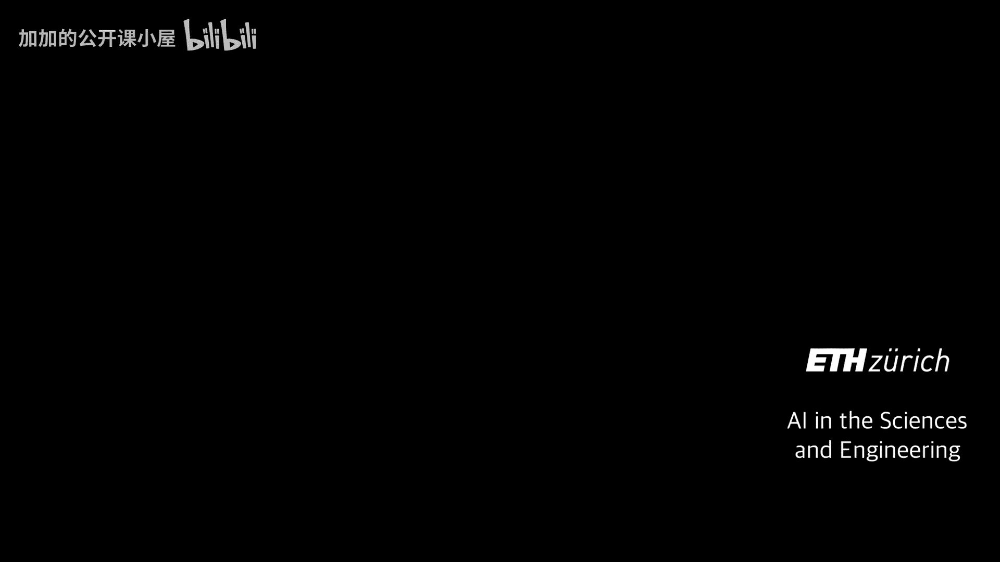
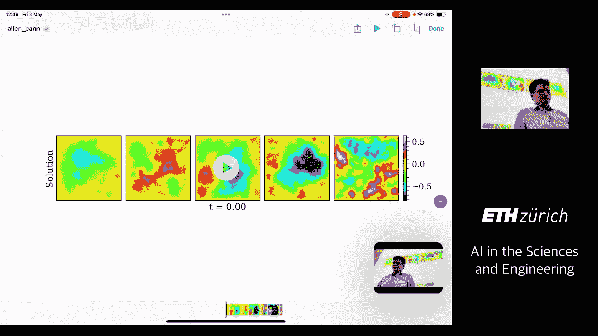
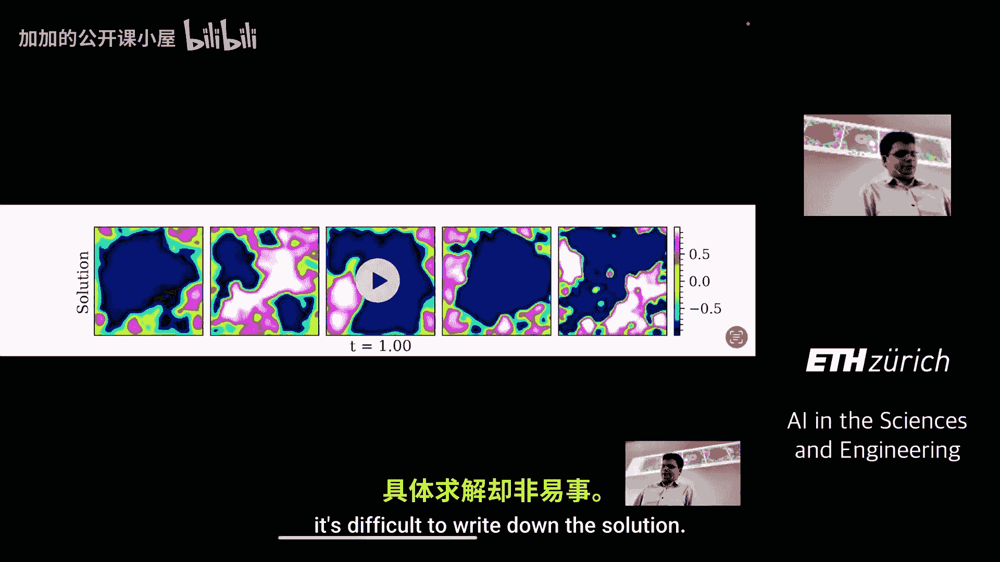
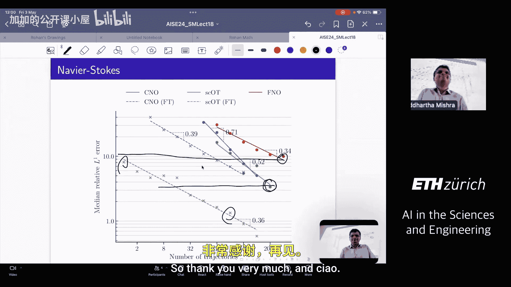

# 苏黎世联邦理工【中英⚡科学与工程中的人工智能｜2024 AI in the Sciences and Engineering】 p18 P18 Windowed Attention and Scaling Laws -BV1smxgzHEPC_p18-

Okay， so without further ado， let's。Embark on lecture number 18。And let's start where we stop。

 because we have to cover some substantial amount of content today。So， yeah。

 so we focus in transformers。 And the idea is to use transformers for learning solutions or P Ds。

 right， So some up here。And our first attempt， that is with the classic plain vanilla transformer。

If you remember， what you can do is your inputs are functions here。

And then you have this positional encoding， you have attention which can be written as an operator。

And then you have these different kinds of land norms。And M LP。And so on。 Right， So this。

 this workflow has been very clear and。You also know what is the issue with that。 So， again。

 the fact is that it's quadratic in the number of token tokens。

 And that's enough to sort of destroy the computational complexity。

So it's quadratic as you can see here， at the same time。

 it's also important to realize that there's lots of parallelism。

The computation itself doesn't take a long time， but of course， it's a pretty intense computation。

Particularly if you are in 2 or 3D， because in 3D in particular， this is almost infeasible。

So what do we do， So in the last lecture， we had discussed vision transformers， right。

And all that you do in vision transformers is that you have patching。 So this was a key operator。

 So you cut up the image into smaller patches so that these are more manageable。 And so you not。

 in some sense， you aggregate local information in know to form this patch embeddings。

 And then the usual thing。 So you have attention， self attention。

 But these self attention is now on patches rather than。 rather than on the pixels themselves。

 rather than points， these are on。 Let's think of it as cell averages， okay。

And then you have the usual la norm， you have MLLP and so on。 so is the usual thing。

 And by doing this patching， what we do is that we reduce the number of the computational complexity。

 the computational cost significantly， because everything gets divided by the。

Pa patch size essentially， right， Because remember that。 So you have a image。 And then earlier， you。

 you were sort of taking it at the level of each pixel。Or at the level of each point。

 this made attention expensive。And now what you do is that youre divide it into patches。

 So let's say four patches in this particular case。 So， of course。

 the computation scales based on the batch size。 But as I said。

 means the batch size can't be too big， particularly in the sort of applications that we have。

 usually in imaging In vision the batch size is 16 by 16。In fact。

 the original vision transformer paper， it even called it as learning images 16 by 16 words or something like that。

 I'm paraphrasing the title。But the point is that 16 by 16 is probably two coarse for us because a lot of features are lost。

 Just imagine that if you have some vortex and you're averaging it over 16 by 16， nothing is left。

So you need to take smaller patch sizes。 So the experiments that I'll show you will be at a patch size of 4 by 4。

 The computation is reduced by a factor of 16， clearly。

 but this is still a lot of tokens to attend to。So towards the end of last lecture。

 I had given you an idea that can reduce this even further。

 So the idea would be to use what I call Windows。 So let me explain this visually。

 So here is an image that is being divided into patches。 So each of these are patches， okay。

So even in a vision transformer， what you do is that， for instance， you would compute attention。

 Now attention is roughly speaking the correlation between patches， right， So you take， for instance。

 this guy and compute its correlation with respect to somewhere here。And you take。

 let's take another one。 this way here and compute its correlation with respect to the patch here。

 So you do these kind of long distance computations， this long path computations。

And this is what makes attention expensive， right， because this is intrinsically a quadratic process because you are taking pairs of points and you are attending to them in a pair based manner。

So what do we do in this is that instead of attending to every single batch。

A let alone every single point。 What we do is that we divide the domain into another layer of division。

 These are windows。 So each of these blocks here is what is called a window。 So this is a window。

And now the attention is at each layer， you have fixed division into windows。

 a fixed partitioning into windows。 And all that you do is that you only attend to points inside the window。

 So， for instance， if you want to update the solution at this point for this particular layer。

 you take the value from here， you compute the queries in the keys and then the attention meet attention weights Similarlyly here。

 here and so on。 But if you take a point here， No， you don't take that or if you take a point here。

 you don't take that into consideration at all。 So all the attention is somehow localized。

 it happens inside each window rather than inside the whole domain。

 right So this is sort of the basic idea here。And now you can imagine that attention is only happening at the level of the windows。

 So it's a window size that is quadratic， right， Because inside each window， if there are windows。

 then inside each window， you have attention。 And that's what gives you the complexity。

 And if you only have 10 windows。 of course， it does not matter how many patches you have。

 it reduces the computational of cost considerably。But， and how do we write that。

 So in terms of operators， it's very straightforward。 You have another layer。

 So you divided things into patches。 But now you just bin them together into windows。

So what you do is that you divide the domain at each layer so you can say that L is the layer index。

And then you divide them into these non overlapping windows。 And then how does the tension look like。

 It's given by this formula here。 So the key difference from the traditional tension is， So as usual。

 you take points。 but these points are now just attended。

 These are now no longer points These are really patches。

 So think of these are even though these are point values。

 these point values are constant across each patch， right， So that is the heuristic。

 These are like averages。 So you still compute to this computation， right， you do this computation。

 And when you do that， you see that the domain of integration is now only across the patch on which this point is sitting。

 So in particular， if you have not to patch， sorry the window。

 So if you have a division into windows， and if you are sitting at the point X。

 you only look at points Y， which are inside here， right all the points here。

 then you take them into consideration。 if you move to a different point here， again。

 you get similarly all the points inside。This window， similarly， if you get a point here。

 you take all the points inside this window and so on and so forth。 So， of course。

 this reduces the computational cost considerably， the risk now is that all these nice things about attention。

 this global mixing， this global information propagation that goes out of the window， one intended。

 right， So it's sort of。It's a mixed blessing in some sense。 you you reduce computation。

 but at the same time， you potentially take away some of the expressivity。 So what do we do。

 There's a very elegant idea， not from me， but from the people who invented this in vision and the idea is simply and it's a very natural idea。

 All of these are very very natural things that one can do。

 which is to shift the windows across layers。 So for instance， in layer 1 or layer L rather。

 you had this kind of a window description， So remember that these points were attended to these let's say that this and this point。

 they had no connection with each other。 But now when you shift the windows。

 And this is you just moved them， you shift the windows。 So that this becomes a window。

 And because after all， the image is finite So that's why just for visual depiction。

 these things become windows。 So you can see now that this point and this point。

 which are no connection with each other。 Now these are perfectly sitting inside the same window。 So。

 of course， in the second layer。😊，The points that had very little so in the first layer。

 it learns this sort of a local heuristic local information aggregation。

 Then when you shift the windows， it learns local information aggregation in different sets of points。

 then you shift it again， it learns it in different sets of points in different sets of points and so on。

 So eventually， if you have enough windows。 And if you keep on shifting them。

 it's very easy to imagine that the whole domain is filled up， right， So this is a very。

 very simple heuristic。 And the implementation is also straightforward。

 You you just move the windows。s it's just a shift。

 And the idea if you want in terms of technical terms。

 you reduce what is called path length across tokens。 So earlier， for instance。

 if you fix the window size or the fix the window locations。 The windows size is still fixed。

 then there is no path to do this computation， right。

 So this information was only happening through some global aggregation。

 But now there is a fixed the path length is only one because in the next layer。😊。

You get this connection。 So that's all。 So it reduces path length in this sort of iterative manner。

 And that's why the heuristic works， right， because then things are attended to。

 and you have the aggregation of global information。

And this is how the whole combination takes place。 Things are combined in the following manner。Okay。

 so this are two different layers。 So this is layer L and this L -1， and this is layer L。

 So you have a function input。This has already been patched up。

 So think of it as piecewise constant functions on each of the patches。 Then you do a layer norm。

 This is as before means nothing nothing fancy happens here。

 Now you applied the Windows self multi head self attention。 W MA。 And what is W MA。

 This is that you attend to tokens in the same window。

 You attend to tokens in the same window and so on。Right， so this operation is well defined。 Then。

 of course， you do a residual connection。 You have a residual connection， as before。

Then you do another la norm， each time you take an output， you do a la norm。

 and then it goes to an MLP， and then you have another residual connection and you get the answer and then you move the answer here。

 So this is the locally attended information Again， you do a la norm each time something comes out。

 you put it in the la norm， But now the difference is that you shift the window。

 So precisely do this operation， right So you move the window， once you move the window。

 then of course， the tokens that were not attended to before in pairs， they get attended to。

 And then you aggregate residual connection La norm MP and keep on doing it right So this is sort of the basis behind Sw transformer block。

 And you can expect。 So what what are the things Why did we do this。

 Because patching was necessary for computational efficiency and windowing was necessary for even further computational efficiency so that the sort of the heuristics came together。

 and then， of course。The usual processing M LP is to allow for general nonlinearities。

 because otherwise the only nonlinearity was softm， which was throwing things between 0 and 1。

 You need arbitrary nonlinearities in order to get the right kind of answers。 This could belu， Galu。

 whatever nonlinearity that you find layer norms is always to normalize so that there are good gradient propagation properties。

Okay， so all this is well and good。 And this is the Sw transformer interpreted as an operator transformer here。

 But as we know， and we saw it with C NO also that this was certainly not enough right。

 because at the end of the day， just having this kind of single block。

 not block because these are different blocks， but we have to combine them together。

 And this is what is done okay， before that， I forgot that people， the key on。

 So the idea is to scale up means in the sense that if you。😊，How， how， if you are more compute。

 how are you going to scale the model up， right？ So in particular。

 can we add 20 layers on top of each other。Yes， but then what could be the potential problem with that。

 The potential problem could be that there could be issues with parallelization。

 There could be issues with gradient propagation and so on。

 So there are some small changes that people have suggested seems to be very important changes to scale it up further。

 So there's one additional layer。 but these are very， very。 So I。

 I don't want to go into details here， These are very。

 let's say straightforward changes just for computational， easier computation。

 So one of them is that the key was the scale dot product， right， So what is the scale dot product。

 If you go to attention。It's here。So you take the input， you multiply with the query。

 you take the input here， you multiply with the key， and then you take a product。 and you scale it。

 right， because otherwise this will be M members， then you have to somehow get the dimension in。

 And what people have realized is that when you have very large scale operations。

 this is an operation that doesn't scale as well as it should。

 And they have replaced it with what is called a cosine similarity。So this is the first innovation。

 So remember that I want to replace the dot product with a cosine similarity。

 which is gives you an automatic scaling。 And what is a cosine similarity。

 I think all of you know this means if you have two vector， A And B。A and B belong to R D。

 So cosine similarity cost is simply co of theta co A B。Is the angle between the two vectors， right。

 And what is that。A B， this is the inner product， mode a mod B。Okay， so instead of。

 so it's the only change is that it has some self normalmalization properties。

 that things are automatically normalized。 So you do this computation。 And this is the first thing。

 It's and there is some， So as I said， it's a scaled cosine。 So which is this number here。

 So that's the first。Its not an innovation， but it is something to improve the scaling properties。

 And then there is something with position coordinates。

 Remember that all the time we have this position coordinates。

 So instead of giving the absolute value， people give the relative value in the sense that if you have a patch。

So you take the log of the relative value， and this seems to scale much better。 So you。

 these are the windows， right， and these are the various patches inside a window。

 So instead of giving x and y。You give the relative position， which is in no particular order。

 You can say this is 1，2，3，4，5，6，7，8，9。 and you take a log。 Okay， you take a log of these values。

 There's a very simple mathematical transformation by which you do it。

 And this seems to be a trick that enables better gradient propagation better understanding。

 So this is one small trick。 And then， of course， different ways of moving la norm。

If you remember in the original transformers， Lenon came after the operation。And here they say。

 and then with the vision transformers， it came before the operation。 As you can see。

 the Le norm came before that tension。And then for scaling purposes。

 people realize that it should be the other way around again。

 So this is normalization is something that you have to determine based on the problem at hand。

 right， Sometimes it's better to do it at the input level。

 Sometimes you it's better to do it at the output level。

 But essentially you change very little because anyway， it is done iterative。 Things are layerwise。

 right， So the inputs to one become the output to the So outputs of one become the input to the other and so on。

 So these are some minor technical details。 These are not very important。

What is important is how you put them together。And now you can imagine， because you saw C。

That at least for vision， as well as for P Ds physics based inputs。

 it makes sense to have things stacked together in a hierarchical manner。 So this is a sorry。

Actually， I've forgotten to。To record today。 But there is a recording available there so they can at least see the slides。

Okay， so this is a hierarchical。multiulti scale。Let's say algorithm。

Is a hierarchical multi scale algorithm。 So what does it mean， It means that。

That you combine different things together in a multi scale manner。

 So just so the basic structure is always that you start with the input。

 Let me let me walk you through the entire throughput。Start with the input。 And then as always。

 you have the patch partition and the embeddings， right， So the beginning。

 what you give as the input to this algorithm is going to be the， let's say the patches。

 the value in the patches， the piece cell averages。 And these things have to be gotten back。 right。

 So patch recovery is the opposite of that。 So think of this as some sort of a downscal operation。

And this is an upcal operation， because from the patches。

 you want to go back to the pixels to the point values， right。

 And now you give it in the Sw transformer blocks。 you recover in the Sw transformer blocks。

 But you can see just like we did for C that this is an encoder。And up is a decoder。

So it has this encoder decoder architecture。 And what is the point about the encoder that you start at whatever scale that you have。

 You keep on reducing the scale and increasing the number of channels， reducing the scale。

 making it coarsin in space， but increasing the number of channels and so on。

 And the decoder is opposite， right， you increase the number increase the resolution by two each time。

 let's say and you reduce the number of channels。 So that's essentially the same idea here。

 But taken to transformers。 So in particular， this patch merging is。Up downscal， right。

So let us think of it heurically， what does it will do， what will it do？So you have a image。

You have batches。So these are patches now， right， And let's say that these are patches。

 And what the downscal operation does is that it takes some of these patches together and makes them into。

Bigger patches。 So instead of having 16 patches， you have four patches， right。

 So that's the next level of iteration。 And you keep on doing it。So this is the patch merging。

 And similarly， there's a patch expansion， which is the opposite of this。

 So just like your patch merging， you have patch expansion and so on。 So what you do is that， again。

 you do the same heuristic， which is you reduce the resolution。 increase the number of channels。

 This is what happens with patch merging。 and patch resolution。

 Pat expansion is opposite that you increase the number of patches。

 which is means that you upscale and reduce the number of channels。 And， of course。

 there are some connections。 There is a bottleneck。 So this is this typical unit type architecture。

 right， theres a bottleneck and in between。Earlier， we had some residual connections here。

 These are CNN Ns。 These are some scalable CNNs。Thecom next are just CNNs， okay。

So there are residual connections。 And so this is this allows it for a multiscale information processing。

 because this is exactly the same principle as you， you know， if I just had。

 if I cut off here and just have one layer， this is probably not expressive enough。 Okay。

 so all these operations are entitled or are constructed so as to allow for the most operative word here is multi scale。

Information processing。So information at different scales is processed。 It's moved up the scale。

 moved down the scale and moved within the scale by using this CNN N Ns here。

 This come next this CNN N N here。It's a fairly elaborate architecture。

 but it's not surprising after you have seen the C NO， right in C NO， we did exactly the same。

 And we had this kind of elaborate multi scale architecture that seemed to do the job。 Okay。

 so now this is what is called this one particular transformer。

 It's called a scalable operator transformer。 You understood its design principles。

 And now let's see whether it works in practice or not， right。So let's see。

 So here is the first example。 So you have the Poa equation。

 just the simplest example that you can think of， minus laplaian of u equal to F。

 and the solution operator S takes F to U。And F here is some Gausians。 Okay， essentially Gausians。

 So you can see that this is F1， F2， F3， F4， and all that it will do is that it will diffuse out the Gausians。

 right， So this is diffusion equations。 So you can see that it diffuses out the Gausians here。

 diffuses out the Gausians。 There is only one Gaussian here。

 So it's very easily diffused out and the same here。

 So it's sort of it just diffuses out the Gausians。

 It's difficult to write down an analytical formula for this， right， now on this。

 we are going to run different kinds of algorithms， FNO N， So what are the algorithms。

 we will have FO。CN O and Scott。Just as an example of a transformer and what were interested is in the scaling behaviour。

 right， to see whether it scales better or it scales worse or what are the。

 what are the what are the properties。 And by the way， just， okay， let me explain it here。

So as you can see from the figure， we have some error means the absolute values don't matter。

 What matters is a relative performance。 Okay， so let's look at FO first， as you can see， sorry。

As you can see， there it goes down in a consistent manner。 And when you have 80192 samples。

 it is like 5% somewhere somewhere out here。 FO is what it is。

 It's not very good for these kind of elliptic problems。

 C NO is very good for these kind of problems。 And you see that behavior here。It was。Again。

 I'm allergic。 It's I don't have a cold。 So in case you are afraid that you'll catch something from me。

 you can't。Okay， so then you can see that CNO starts very， very strongly。

 And it it's for the same number of samples。 or let's say whatever you get with the FNO with 8000 samples。

 you get with cO with， I don't know，500 samples or something like that。

 So it's a very efficient algorithm。 And what， what does this transformer do。

 Does it have better properties， worse properties。What does it have， So if you look at it。

 So there are two versions of it。 So FNO and C N are roughly 40 million parameters， okay。40 million。

This Scott S is also 40 million， I think。And Scott P is 20 million。Just， just to give some。

 some reference。And the first thing that you observe is that both the。S and T versions here。

 these are able to scale。 They actually do eventually beat FNO in sorry， CN NO。

 They clearly beat FNO。 They do eventually beat C NO。

 But you can see that in this regime when you don't have a lot of data。 They are worse off。 okay。

 so transformers， they， they need a lot of data， I would argue not because I have any theory。

 but because of heuristics that even this amount of data，8000 samples is not good enough。 But anyway。

 this are what the results are。 And you see the fact that actually the smaller model is better than the larger model。

 Okay， so the size is still。There's not enough data to feed the larger model。 But anyway。

 this is how， how the solution behaves。 and these are what the numerical results。

 So at least you'd say that it is， in this particular case， it is scaling better。

And it is competitive， but it's not beating， you you know， by any sort of great margin here， right？

 And this is usually the observation that all this work somehow transformers are not significantly better or worse than existing operator learning algorithms。

 Heres another example。 This is El equations。 So you have minus La plus shn of U plus。

C squared x U equal to 0 with some boundary conditions。 I think0 boundary conditions。

 And this was your。 So what's the solution operator。 S is a mapping from C to U。

 So the coefficient to the solution。 And this is your C 1， C 2， C 3， C 4。 Now。

 it is very difficult to imagine what are the means how this solution evolves， because this is。

 there is no analytical formula。 So these are the solutions in， in these cases。And then you can see。

 yeah。 So now let us compare the same algorithms and see where we are。And very， very similar。

 There is a larger here because there's a harder problem。 If I know clearly doesn't do well。

 Its is not very good for these kind of problems。 And you can see that among the three algorithms。

 So here somehow the larger model has slightly better capacity。

 theyre sort of comparable to each other。 It's not a huge difference。 know。

 they are let's say with 4009 samples， let's put the number here， you can see one has like 2% error。

 something has 2。8% error， N has 3。2% error。 And again。

 neither in terms of computation nor in terms of storage， these are the same kind of models。

20 million，40 million and so on。 So these models are comparable to each other。

 And even though transformers have many， many more parameters they don't have many。

 many more parameters here。 But the compute is the inference time。

 the training time is not different because they are highly parallel lives。 So the point is okay。

 it's sort of competitive comparable。But by no means is it orders a magnitude better or something like that。

 right。The next example I want to show is a time dependent problem。 I think is the wave equation。

 So maybe I have a movie here。Okay， so as you can see， So what is it。 So this is a wave equation。

 So you have， let me， can I， I can't write it down here。 So， okay， let me show you。

 So this is down are the coefficients。 Okay， down are the coefficients。

 You can think of it as on what happens under the ground up is the solutions。

 So these are the initial data。 So these are like little earthquakes that are taking place under the ground。

 And then the waves are moving。 Okay， so as you can see。😊，It sort of， for some reason。

 I'm not able to slow down the movie， but you can see that these things attract not attract。

 but interact， defrac and so on。 and they move around。 Okay， again。

 the solution is not something that you can write down。

 You need either a numerical method or you do what we have been doing， right？

 So this was the wave equation。So， okay， so this was Elmo。 So this is wave。

 So what is the equation here。U T T minus c squared of x Laplian of u equal to 0。

And U at x 0 is sum U not and U T at x 0 is equal to sum U1。 So this is wave equation。

 So you have the displacement as well as the velocity。

 And the solution operator takes both the coefficient， the C and the initial conditions。 U 0 E 1。

 and it maps them into the final solution。 Okay， U at dot T。

So now we are again comparing these three methods， Scott。 Now， this is a 40。

 All of them are approximately 40 million parameters。

And the number of this is the number of trajectories。 Remember。

 now this is the time dependent problem， right， number of trajectories。

 And I think for each trajectory， we have I'm not about 10 saves。 Okay。

 you could see from the image that there were 10 saves。

 And remember that there is this quadratic because we do this all to all training。 So for trajectory。

 you have something like  hundred or 200 data points。 So thiss a lot of data。 Okay。

 compared to theipick problem， the steady state problem， there's a lot of data。And again， same story。

 of course， if the the the numbers here the errors are larger。 But as you can see that again。

 compared to FMO， both CN NO and Sc2 better and Sc scales slightly better in this particular case。

 So， for instance， with 5 and12 trajectories， you can see that it has a bit better error than C NO。

 Okay， So again， similar to what we had seen before。 nothing dramatic here。 No。

 you don't lose anything because it's not like you have more computation。 you don't gain anything。

 Yeah， the data is the constraint in some sense means we even if you increase the model size by an order of magnitude。

 you don't have simply enough data to for the model to digest。 So this was with the wave equation。

 The next one is。I think it was Alan Khan。 How do I do this Don。Alan K。

Saalent Khan is a reaction diffusion equation， right， So you have initial data to solutions。

And here it is very straightforward in some sense， the dynamics。

 It depends on whether there is some material or not， whether it's above the threshold。

 if it's of the threshold， it changes the phase。 If not， it mixes out。 So it's very。

 the physics is not very difficult to explain。 But， of course。

 it's difficult to write down the solution。 right， So this was Allen Khan。

And so the equation was， what is the equation now。I always make a mistake with an nonlinear linear narrativeity。

 but some。U 1 minus u or 1 minus u squared one of these two。 But I think it was cubic。Squad， right。

Its cuubbic。 okay， because 1 minus U is K P P。 Okay， now again， the same， same picture。

 there is not a huge difference。 FNO is better performing in this particular case there it goes down。

Again， you really don't see a huge difference between CO and。And Scott。

 they are all comparable to each other。 And， okay， there is a slight difference。

 but it's nothing much to write about， right， It's sort of they， as I said， they。

 they are really comparable。And the last example， which is from Navia talks。 it's not the sheer air。

 but it's also， I put a tracea。 So these are the velocities， initial velocities， and what happens。

Afterwards， so there is， of course， some obvious to type dynamics。You can see that in the tracer。

 there is much more variation as， as expected， right。

And you have some initial data and some final solutions。 Traa is given by another equation。

Just velocity moving it around， sorry。Okay， so this is the last example。 This is still obvious talk。

 I'm not going to write down the equations again。 It's the same story over and over again that yes。

 there is perhaps a slight gain。 So if you take  thousand24 trajectories or let's say 512 trajectories。

1 as let's say， I don't know 4 or 5% error。 the other has 6% error， something like this。 know。

 So they there there in the ballpark they are better than FO， which is more like 12% error。 but okay。

 nothing to jump in bed out， right， so the point is just having transformers doesn't mean that are problems that dramatically solved。

 Okay， we put in a lot of effort， but they are at best comparable to C。 And there there is there are。

 there are some reasons based on data intensity and so on about that。Okay， so now what is。

 so we still have this issue of sample efficiency， right， For instance。

 we still need how many samples to。 we still not reach 1%。 But let's say 2%。

 I still need 2048 samples， which is， which is quite expensive。

 and it's sort of I have not solved that problem in any particular manner。 But now in the last。

 I don't know，10 minutes。 So theres not a lot of time。

 I can give you some rough ideas of what we could do， right。

 So one thing that we could do is what we did in the first part of the course。

 So this sort of connects us with the first part of the course， which is that we can add physics。

What do I mean by that。 What I mean by that is so far。

 what we did is that we did not bother about the physics at all。 We had lots of data。

 and we use the data to train the neural operator。 So can we add physics to it。

 So how would that look like， Let's say whether it's a O C， N Scott。

 the architecture does not really matter。 Let's say that my solution I this S。

 this is your solution operator。And the PD D E is like L of U equal to F， right？

 So what I could do is that I could during the training process。I have the loss due to the data。

 So S of u bar minus S star of u bar。So this is my usual sort of supervised loss。 But with some norm。

 But to with I had a physics informed loss， which will be L。 This is the differential operator。

 S star of U bar。 This is the solution of the P D minus U bar。 It should have been U bar。好。

L of U equal to Uber， right， So minus U bar， something like this。So I have a physics informed loss。

 right？ So in what is the difference with pins in pins。

 we did this with just space and time as the inputs。

 But now the whole initial condition itself is the input。 And these have a name。

 These are called physics informed neural operators。So， physics inform neural operators。

I really don't have the time to cover them。And there is a good reason why I don't have the time to cover them because they don't。

 yes， James。They don't really work for the same reasons that pins don't really work， right。

 that you still have to train them。 that that problem is not not solved。

 So you need similar kind of problems。 They there are some conditioning issues just because you' are using different architecture doesn't mean anything because you're still having to differentiate。

 And so there are some advantages to this， but by no means are the training problems solved。

 you had a suggestion。でやるもの。嗯嗯。Conserv。わの位置。Yeah， you could conserve。

 but I don't think that is going to dramatically improve because with CNO and Scott。

 they were sort of they needed data， but they， they were doing the job sort of it depends on in those problems。

 perhaps 5% error is good enough。 You know， you don't need 1% error pins those are also very hard problems。

 right， So it's Ben might tell you a little bit more about how pins can be used for that problem。

 Ps are nowhere comparable in terms of the efficiency in this in this case。 Okay。

 so this is still very much an open area of research because we still don't。

The same problems that I told you are inherited by these mos。

 right that you still have to understand how to train them that is by no means solved。

So what we could do is， and this is what is at the moment the most promising direction。

 I at some point， I promise that I will cover it， but I am really out of time because Ben takes over from Wednesday。

 but I'll give you a little glimpse is that we can do what are called foundation models。😊。

So maybe if there is time at the end of the lectures， end of the lessons。

 I'll come back and talk about it。 But what are foundation models。

 Foundation models are essentially models， which are trained on very large amounts of data right。

 So like just imagine Cha GP T or whatever Gemini， cl， whatever Lama， whatever large language models。

 This is essentially trained on what are called Internet scale databases， right， So in particular。

 what you do is that like Cha GP T， for instance， it is not just English， French， German， Hindi。

 whatever languages， They club it together and also very diverse kinds of all kinds of text， right。

 they are not just about medical reports， scientific papers and so on。

 So large quantities of diverse data。So and same with vision models means you look at stationary images。

 you look at color images， you look at stock images， objects， semantic information， whatever。

 So you have large。 So the， the key term here is large quantities， large， diverse dataset sets。

And this are coupled with scaled up models。So whatever model architecture that you have。

 whether it is units or whether it is transformers， you have to。

 in order to digest this huge amounts of data， you also need very， very big models。

 That's why you have trillion plus number of parameters and the data size is the whole of Internet。

 right So this is the sort of data scale that we are talking about。 So for our purposes。

 that would mean diverse data sets would be different kinds of Ps And for each P。

 different types of solution operators， different types of data distributions and so on。

 And this is slowly， the research is happening。 Also in my lab， there is some research。

 therell be a paper coming out。 probably before the end of the course。

 And the whole point is that if you couple this， So large diverse data sets would be different types of P。

Different types of P D。And different data distributions， right。So the measure。

 the underlying measure also has to be different。 You put all of them together。

 and then you scale up the models。 And this， for instance。

 we have experimented here with C N O and with Scott Transformers。 And this combination。

 at least the initial results are very， very promising。

 So the idea is that you train on this very large scale data sets。 and then。

This is at the level of what is called pre training。 Pre training is what you do in the beginning。

 But when you deploy the model， you have to do something called fine tuning。

So fine tuning is on your particular distribution， right， So， for instance， just imagine navi talks。

 So Navi talks， we have already seen sheer layer。 We have seen some other examples。 You could。

 you could think of different kinds of initial conditions。

 You train your model on all these different kinds of initial conditions。

You have you store the model。 And now you are putting it for this example that I showed you with piece constant data。

 Then you take a few samples and you download it you sort of fine tune in the sense that you just change a few parameters。

 You， you start the training not from random， but you start it from the existing model， right。

 And this works。 Okay， So fine tuning is with few samples。Few samples。

This requires a lecture of its own。 But anyway， in five minutes， this is what I can do。

 And the initial results are that it works。 And I'll show you one example。So remember。

 it's the same example that I showed you before the Navi stroke example。

 All that I have done is I have used some foundation models in addition。

 So remember that we were somewhere here before， right。

 So in order to get let's say that we are somewhere here with 2048 samples。

 you are getting an error of approximately， I don't know 3% or something like that。

 Now with the fine tune model， you can get the same error with。8 samples。Okay， so。

 or if you want the FO means this was going only here。 And this is the 2048 samples。

You get it more or less with one sample。 You know， that not because there is trained on one sample because it has been trained。

 this model that I'm showing you， it's the one that works。 Yeah。 Also。

 the CO one works not not as well， but the。Transformable one really works。

 This is a 200 million parameter model。 So it's a much bigger model。 However。

 it has been trained on various kinds of equations， obvious talks， compresspressible oiler。

 different kinds of data sets。 So it has learn something about time dependent P or fluids and so on。

 And then it uses that information。 In addition， with a few samples，8 or 16 samples。

 It can very quickly。 you know， to get 1% error you just need around 128 samples。

 So it sort of learns very quickly how to use this information and deploy it。

 So that is the strength of what has been done with text1 language and slowly。

 we are making that move in this domain also， but have run out of time。 yes。😊，呃。

There is even words on the initial large model because the data amount of data that is there。

 So the initial large model is a good question， but this will be even worse because okay。

 so the initial 40 million parameter model is somewhere here。 I I haven't tested it。

 but I guarantee you that it will be probably somewhere here。

 because the initial large model simply doesn't have enough data to deal with the problem that you have。

 It's a lot of data， but still not enough data for for a large model。 Okay， so the initial。

 but this is a good question。 what will the initial is not because of the model size。

 because otherwise， you wouldn't have a picture like this， right， Well， okay。

 this one was not remember this one。This is a classic example where a smaller model， as you can see。

 provided better answers than a larger model， simply because the amount of data was not there。

 So this was 20 million。 and this was 40 million in this particular case。

 And I expect something similar， but we I I don't have the results。

 but I'm pretty sure of what I just said。Okay， so it is because there is a very delicate balance between data and compute or not compute。

 but model size， because compute is the sort of product of these two things。

 And this is still in this field， people are also for LL Ms。 it's more or less in its infancy。

 People have not yet understood。 But here means it's really in its infancy。

 What are the relationship。 How much of data do you need， What is large data。

 all these questions are a little bit up in there right。

 So but this is really contemporary research means papers are not yet out。

 And this is where things stand。 So I think with that， I finish my lectures， I think Ben starts。

 he starts with he changes gear， he takes I think he talks about hybrid models next。

 I don't remember if and then if there is time I can come and finish foundation models。

 but only if there is time Otherwise， I see you towards the end of end of the lectures。

 So thank you very much and。

叫。