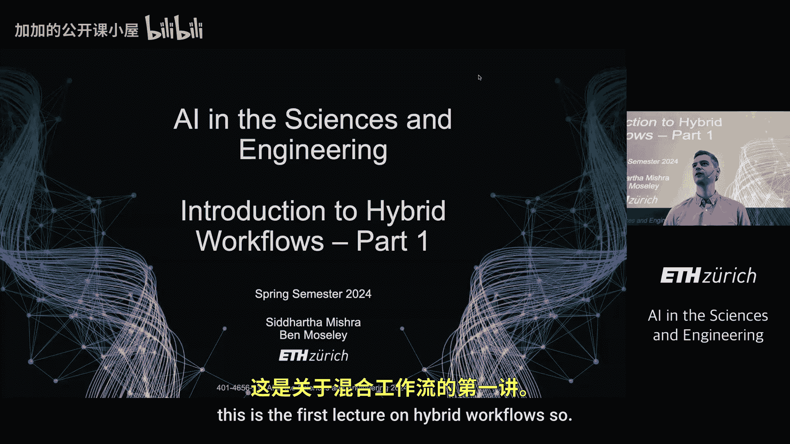
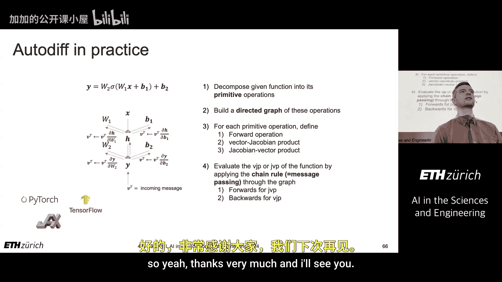

# 苏黎世联邦理工【中英⚡科学与工程中的人工智能｜2024 AI in the Sciences and Engineering】 p19 P19 Introduction to Hybrid Workflows Part 1 -BV1smxgzHEPC_p19-

Okay， I think we get starteded。Everyone， safe。Yeah， welcome to this lecture。

This is the first lecture on hybrid workflows。

So。We are moving to a different SL technique， a whole different topic Siid for the last four or five or so lectures has been talking about operator learning and extensions of neural operators and。

Now it's time to move on to another section of the course。

 which we call hybrid workflows or differentiali physics in general， so that's going to take us。

Over the next four lectures or so。It will also include an introduction to JX。

 which is a a kind of new programming library， which is really interesting and helps do these or code these types of workflows。

And then finally we'll move on to symbolic regression and model discovery as the kind of last lecture。

 then I'll do a course summary and then we have our two guest lectures on machine learning for biology and chemistry。

嗯。So this is the kind of broad course overview that I showed at the start of the course in the first lecture。

So this is just saying what I just said just in pictures。

 so yeah we had introduction to deep learning and then we did a big section on physics and neural networks Sid has been taking the course over operator learning and he's also talked about transformers and their applications。

And now I'm going to be explaining what a hybrid workflow is， what differentiali physics is。

 and how neural differential equations relate to those workflows if you've heard of those types of models。

And yeah， I'll finish with something on equation Disc。

So how does this lecture look so I'm first going to start with a recap of the limitations of some of the SML techniques that you've seen so far and in particular physics informed neural networks and neuralRA operators。

And after we've discussed those limitations， hopefully that will motivate why we want to use these hybrid scientific machine learning approaches。

I'll go into much more detail about what a hybrid approach is with different types of them。

 they can start they can be very simple， they can be very complex。

And then the last part of the lecture， are we showing you how auto differentiation is really the key enabler that allows us to train all of these different SL models。

 things like pinIs or operators and hybrid workflows。

 and so we'll spend quite a lot of time just learning the basics of auto differentiation。

This will set us up for the next lectures on differentiali physics and hybrid workforce coming up。

So yeah， by the end of the lecture， hopefully you'll be able to describe or define what a hybrid workflow is。

 understand why differentiation is so important in scientific machine learning and how it's used to train hybrid workflows。

And yeah， that's it。Okay， so let's recap the two kind of big techniques that we've looked at so far and what I want to do is just talk about their pros and their plans and their advantages and their disadvantages。

So physics informed no I' actuallyve fall in this by now， so I'm going to be to go very quickly。

What we do with the physics informed neural network is we use a neural network to solve a differential equation。

And we do it by just simply saying the neural network is a direct approximation of the true solution of the PDE。

And we train it with a loss function where we have two terms。

 one asserts that the boundary conditions are imposed。

 and the second term is the kind of important term which puts the differential equation into the loss function and says that it should be obeyed everywhere in the domain。

And so as I talked to you through pinNs a while ago now I've tried to tell you about these advantages and disadvantages and I've got kind of the broad advantages here which is generally pins are regarded as mesh3 methods this means that you don't have to create a mesh to solve the differential equation the pinN gives you a functional approximation to the solution so this can be very beneficial when it's expensive to create meshes。

I think Ps best perform on these kind of messy problems where you have some observational data and maybe you want to learn something about the PDE。

 but you also want to solve the differential equation itself。

And also they're mostly unsupervised so we don't need labeled training data to train pins they're just all we need is examples of coordinates in the domain these colocation points to train them。

But as I also showed you in the limitations of PINs lectures， there are big limitations of PINs。

 although there are many extensions that are trying to address these and do so sometimes quite successfully。

But yeah， a standard pin is often very expensive to train。

 especially if we just want to carry out a simulation with a pin。

It can be really hard to optimize pins， it's not guaranteed by any means that you'll converge on the kind of local minima of this or global minima of this loss function。

And pins can be challenging to scale， so we talked about the spectral bias of neural networks and how pinNs can struggle to solve problems with high frequencies。

Okay， now that's a swap to operator learning so this is the subject that Sid's been talking you through over the last chunk of the lectures。

So what is operator learning， well it's a similar idea when it's applied to PDEs。

 operator learning is learning an operator that takes a function to a function。

So one interesting task we want to do with PDs， for example。

 is to take some either initial condition or maybe some like field of the PDEs， so for example。

 this perme field in the DarI PD。And we want to map it to another function。

 which is sometimes the solution of the PDE。And Siid talked you through this whole framework that we have of turning continuous functions into discrete functions and how we can approximate this kind of continuous operator with a discrete operator using our different transforms here。

So I'm not going to go into this into detail， but here's the loss function that we use and when we're training operated there's a supervised loss。

 so we have examples of the PDE solution itself。When we train our newer operator here。

So yeah the advantages of operator learning is you know once it's been trained。

 training can be very expensive， but once you change your operator。

 these are often orders that magnitude faster than traditional simulation。

 it's what we learn as a surro model we can really quickly given a new perme field predict the pressure response。

But the limitations， you know， these are still neural networks that are trained in a supervised way。

 and so we still often need a lot of training data to train neural operators。

They can still struggle to generalize， you know， this is still a like I said。

 the neuralA network that we're training and all neuralA networks can perform worse when they're given inputs that are outside of their training distribution。

 so if I give this operator like a permeity field that's outside of its string distribution that looks very different it still may perform much worse。

And a more higher level， when we do these discretization steps where we take the function to it's very coefficient so that we can actually do some computation with it。

And we have to make some assumption about the regularity and the function。

 we have to choose a finite number of numbers to represent that function。

 so there's always some assumption there about the regularity of the functions that you're mapping between。

Okay。So let's do that even further， let's just think about。

Deep neural networks in general and actually just ask the question like when should we use deep neural networks in our scientific workflows and I think this is actually quite a nuanced question and it's not always the case that you should just use a neural network in your workflow。

Because of these kind of limitations of deep neural networks。

So we know that you know when we train neural network。

 it can be really fast and that can be very beneficial。

And neural networks have this amazing property of being able to learn highly known linear functions。

 which again is extremely useful。But we know these limitations by now and you know if they take a lot of training data。

 they can be really challenging to optimize， we don't really understand how they process their inputs to their outputs。

 they can be hard to interpret and they struggle to generalralize。

And what I want you to realize in the last two slides is that these limitations still crop up in our scientific machine learning algorithms。

So even though we're putting scientific understanding into our machine learning algorithm。

 like either through the loss function or through kind of the architecture of the NoA operator。

We're still coming up against some of these limitations and when we've looked at these methods。

So I've got some kind of general advice here， I mean it doesn't always work。

 you have to really think about the problem that you want to solve。

But this is the kind of general advice that I would give to someone that's considering using deep neural networks in their scientific workflow。

And I would I would say you should use deep neural networks to do these two things like either to accelerate your workflow so if you have a workflow that is very。

 very slow， for example， like a finite element simulation or finite different simulation。

It may be beneficial to put user a deep neural network somewhere there to try and speed up that workflow。

The other place where you could put a neural network is where you don't understand the part of the workflow。

 so for example if you don't understand some of the physics in the model or if you're not sure exactly how to discretize your model or something like this。

 learning that discretization or learning that the physics or something like this can be very useful as well。

But if you don't have a plan about where you're actually going to usually deep neural network in your workflow。

 it might not be a good idea to use it so you really have to think critically about these advantages and these disadvantages。

So this leads me on hybrid S mill workflows， so what is a hybrid scientific machine learning method？

Well， it's taking these two ideas where we should just use DNNs to either learn the parts that we're interested in or accelerate our workflow。

But maybe not to replace our entire workflow and so this is the key idea of hybrid SM algorithms is to say instead of throwing away our traditional scientific workflows。

 these could be things like simulation algorithms or inverse algorithms or denoising algorithms or anything really。

What if we put a neural network really tightly inside of that algorithm somewhere instead of replacing it with an neural network？

So if you think about pins or operator learning， what we've done so far is just using a neural network to do the whole end to end problem。

 nowhere have we showed you examples of say here's a finite different scheme and here's a neural network inside of that scheme somewhere。

So that's what we're going to be talking about for this lecture and the next few lectures coming up。

Does this make sense to everyone as a concept， yeah， everyone's not yeah。How about in Zoom。

 if you can you raise your hand in Zoom， just let me know if you're following。Great， okay， good。Cool。

 so yeah， I showed you again in the very first lecture of the course。

 these kind of three broad categories of SL that I tried to categorize all these different SL methods into。

And I would say we've done a lot on the loss function， we've talked about pins。

 we've also talked about architectural or kind of clever architectures for science。

 for newer operators being examples of that。So now we're going to move on to this final class of algorithms。

 these hybrid approaches。The final thing to talk about a high level before we get into the details is we imagine this kind of spectrum of scientific machine learning methods right so you have on the left a machine learning method that doesn't have any kind of understanding of scientific like scientific understanding and on the right you might have one of these traditional methods that doesn't use any machine learning tool。

And so now we're talking about these hybrid approaches。

 which you might consider to be more to the right where we take a traditional workflow and put machine learning learning into a very small part of that workflow somehow。

Okay， so let's talk about probably the simplest possible hybrid workflow to start with。

 and then we're going to be talking about more advanced hybrid workflows after this。

So the simplest possible workflow is what I would call a residual modeling approach。

So what we do is very， very simple。That's say that we have some physical model。

 it could be any physical model， which has some inputs X and some outputs Y。

This could be a simulation， for example， x could be the initial conditions of the simulation and y could be the output of the simulation。

And。What we're imagining here is the case where you know that second case that I described where we don't maybe understand all of the physics of the model。

 so maybe there's some unexplained physics that we want to account for but we don't know and we don't know how to write inside of this blue box。

so what a residual modelling approach says is okay。

 there's some unknown physics or kind of relationship between Y and X that we don't understand。

 so let's just model that residual relationship with a neural network and we'll try and learn that relationship from data。

So we phrase why here our solution as the physics model plus the neural network。

So I've actually just described when this is useful。

This is useful when we have an incomplete understanding of physics and another reason is when this physics model is like maybe like a full blown physics model is too expensive to run。

So this could be like a more approximate model that's faster， for example。嗯。

And compared to naive machine learning， this is actually an easier task， so can anyone tell me why？

Resid modeling is easier than like training just replacing the whole physics model with a neural network。

Why would that be an easier task？YeahRight yeah exactly so if we're doing a simulation for example。

 learning that entire simulation that's a really complicated function mapping X your initial conditions to your solution。

So if we can just do the majority of that complicated function and then just maybe the residual of that may be very a much more simpler function to them。

 so yeah that' that's exactly it。Another bullet point here I put is that。

These residual approaches are often way more interpretable than just having one big black box model that we're training。

So we might even be able to look at this network and look at the kind of function that it learns and maybe even interpreting physics from it。

We might see that this learns like a nonlinear correction to a linear model， for example。

 and that might be very interesting。Okay。So how do we train this residual network。

 so we train it in how we would train a normal neural network and that we match the outputs of this workflow to some labeled training data。

So what we say is， okay， so we've got some examples of x and y， you know。

 from some real ga set perhaps。And we just matched the output of the whole residual workflow。

 so this y hat here to our labeled data。With a very simple， say mean squared error loss option。

So now all you can do is just well'll just plug in our expression for white hat here into this loss function and you here and then rearrange it。

And what you get is a loss function that just matches the neural network to the residual。

 which is just the difference between the true data and the why physics model so this is just our residual difference like that should be very very obvious。

So that's kind of interesting because what we've done when we when we evaluate this loss function is we've actually。

We haven't facted out the physics model， but what we can do is we can just compute the residual in advance。

So if we've got lots of training data， we can just generate all of the physics predictions in advance and then just use that as a labeled training data set to train the neural network。

So that's how we'll get our our label data to train the network。Does this make sense？Yeah， okay。

So this， let me give you an example， this is what we're going to do is design a residual modeling method to carry out this task。

 which is to estimate the force on an errorero foil。

So this is obviously a really important design task and we want to design efficient aerofoils。

And often we have kind of a few kind of variables that we can play around with and so in particular。

We can just assume for now that we have we want to design the error full of shape and let's just say that it's specified by N coordinates so we have these XY coordinates in the domain。

The other thing we can specify is the angle of a attack of the wing and so。

So the simulation task here is given our aerofoil design and the angle of attack。

 and also we just assume what randoms number is the wing is flying through。

Let's try and predict what the force is on the wing。And maybe the inverse task gets to say。

Given our simulation model， can we get the best kind of wing shape that maximizes the force on the wing？

嗯。So the way that we normally do this is to carry out CFD simulation。

 or you know the gold standard would be to run a full blown。

 maybe a stokes simulation of a flow over this wing。And derive from that the force。

The difficulty with that is that these CFD simulations depending on the kind of resolution that you want to run them are incredibly expensive。

 I don't know if you remember that in the first lecture I showed you that simulation of the flow over an aerofoil and that was run on the supercomputer and took like millions of core hours to run。

So how do we get a prediction of the force faster where what we can do is use a faster but more approximate model。

And there are many kind of simulation models or approximate models that we can use instead of full blowning CFD。

嗯。So this is one model。I'm not going to talk about it in detail it's enough to know that this model is just an approximate model of for giving the force over the wing and it's called the Hes Smith panel method so you can look it up if you're interested in that more。

But what this paper does down here is design a residual method， so this is a neural network here。

 which takes in the inputs of those from the Hesmith panel methods。

 so this is the prediction of the forces from the panel method。

And then it also takes in the afo shape and also the Reynold number and the angle of attack of the wing。

And it combines all these inputs together to then finally reduce a prediction of the lift force。

So you can see how this is a residual model， we're taking in existing predictions from a physical model。

 an approximate physical model， and then we're combining it with some learn function that tries to improve the prediction of that physical model。

 which we're going to train from some training dataset set。So how do you think we should train this。

 what data should we use to train？Yeah。有是个办。Yeah， yeah， so I've written it here。

And the way that they train this model is to generate a few examples of high fidelity。

 like CFB simulation data。And then you're going to try and train the neural networks so that。

 that it matches theel high fidelity data。So the goal is that after training。

 we have a model which is not only much faster than the CFfD。

 but is more accurate than this just single approximate model that we have。

And they train it with this residual loss function that I just showed you this very simple mean squared error residual loss。

Okay， so here are the results from that paper and what we're showing here are two graphs and what we're showing is the prediction of the force as a function of the angle of the attack of the wing for one particular aero foil shape。

And the black line here tells you how the force varies using the high fidelity CFD simulation。

 which we're taking is our ground truth。And then the red line here is the prediction of the trained neuraler network。

诶。And。What what's interesting is the difference between these two graphs here is the first graft is when when we train a neuraler network without any of the physics inputs。

 so we're just training that black box model that I told you about where the neuraler network just gets the errorerofoil shape and the physical parameters flow as the input and then is just trained to predict the force from the CFD simulation。

So this is exactly the situation that you described this function is very hard to compute it's a very complicated function。

And a neural network's accuracy is slightly poorer。Then if we do the second approach。

 which is the residual method， which I've been describing and the accuracy improves somewhat。嗯。

What I find interesting as well is this orange error bars here。

 so what this is doing is estimating the uncertainty of the neural networks's prediction。

So the way that they did this in this work was very simply to train an ensemble of neuraler networks and each neuraler network just had a different random initialization of the waist。

And this is just quite an easy way of getting uncertainty predictions from neural networks is often done。

And so not only was the residual network kind of more accurate in its mean prediction。

 but the uncertainty estimate from that ensemble of networks was smaller as well。

So I think this is really nice evidence that， you know。

 using a neural network in a residual workflow or a hybrid workflow can improve the accuracy and performance of the model。

Just by incorporating physics， you know， as an input to the network。

So can anyone tell me why this isn't exactly the residual model that I showed you up here？

Why isn't this exactly the same as this where I'm taking a physics model and adding in the normal network？

O。How is this slightly different？Yeah， they're not directly locking it giving present。

SYeah yeah so what we've done here is we've not added the output of the network here with the physics prediction here we've actually incorporated the physics prediction into the last hidden layer and then fed that into the last hidden layer computation so what does that do why is that maybe helpful？

一次。Yeah exactly so we're not making an addition is quite a strong assumption that we're going to add some like a correction here we it could learn to just do an addition。

 but it could also learn to do some other maybe more limited but non nonlinear kind of composition that。

So it just adds a bit more flexibility， so this is another thing you can do with these types of residual models is kind of incorporate it or whatever kind of part of the neural network you want。

Okay， so。W I just described as the like simplest possible hybrid workflow。

 they get much more complex than this， but I've given you the basic idea and this is you know this is the basic idea to incorporate a neural network or some learnable component into our traditional algorithm。

So what we did here was we didn't need to know anything about that physics model。

 I didn't tell you anything about that Ha Smith panel method， the approximate CFD model。

What we did in that workflow before was just to treat it as a black box。

 all we needed to train the neural network permit when we derived its loss function was the outputs of the physics model given the inputs。

So。Now what I'm going to move on to are hybrid methods where we don't just treat it as a black box。

 what we actually do is we open up part our existing workflow and we put a neural network into the middle of that workflow somewhere instead。

嗯。And what we're going to do is we're going to put that learnable component in the workflow again。

 either where the workflow is very slow or where we're unsure of the kind of physics assumptions or how we even code the algorithm。

 we can replace that with a learnable component。Does that make sense how we're going to extend this？

Okay。所诶。To be able to describe like a more sophisticated hybrid workflow。

 I need to describe to you one of these existing traditional workflows in more detail so that you understand where we're going to put available component into。

And so the workflow that we're going to try and improve is a finite finite different solver and it's a finite different solver that solves the incompressible na Stokes equations。

So here are the incompressible NavyS Stokes equations and these are all the variables that we have in the equations and our goal is like given some initial condition of the flow to predict the flow velocity through time。

And the pressure as well through time。嗯。So and we have some kind of density and we have some viscosity as well。

Oh。And so。Describing you know a finite different silver or just generally how to solve the Navy Sts equations is a whole course in itself so I can't I'm not going to go into detail and what I'm going to do is just give you the highest level possible for you understand for you to understand how this hybrid workflow is going to be trained or how we're going to put machine learning into into this algorithm。

So one very popular way of solving the Navy Stokes equations is to use this kind of so called operator splitting numerical silver。

So when we solve PDs numerically， we have to discretize them。

And so the first thing that we do in operator splitting is we discretize this equation in time。

So we just replace the flow velocity here with its discrete differences。rearranger a little bit。嗯。

And now the problem is that when we discretize this。

 we can't just evaluate what you T+1 is immediately because it depends on the pressure at time plus one。

So operator splitting uses this kind of nice trick where we define this Ustar velocity here。

Which just depends， it's the same expression， but with the pressure at the current time step instead of the next time step。

And then。When we plug this into the top equation， then we end up with this expression for UT+ one。

And then you can incorporate this divergence criteria in the Navy Stokes equations here。

Plug this into the equations and what falls out is this expression which only depends on the pressure at time plus one and the pressure at time the current time step。

And this U star quantity， which we can compute from the current time step here so that you start here only depends on UT and PT。

So once we've kind of done that rearranging， then we can discretize again this time in the spatial coordinates and that turns these lapplacciian operators and divergence operators into their matrix equivalentvals。

And what we end up with is some matrix equation here that tells us what the pressure at time T+ one is if we solve that matrix equation。

Based on the current pressure at time T and this U star quantity。

 which depends on the current time step。So don't worry if that was too fast and you didn't get that that's fine all you need to know is kind of the basic algorithmic structure this of this solve that I've just described。

And so what I've done is just written it down as like a Louof here。

 and I've also written the pseudo code of this kind of of how this solve will work in this box here。

So to start to time step and to compute the velocity in the pressure as a function of time at each time step。

 we just compute this start a quantity using equation 2。

Then we solve this matrix equation at the bottom here for the pressure at time plus one。

And then we compute the philosophy at time plus one just by plugging all of those quantities back into the first discretized equation。

And so how does that look in my pseudo code， so it's basically just a for loop with some complicated computation inside the for loop。

Where we initialize with some known initial velocity and some initial pressure。

 and then we're given our density and our viscosity parameter。

And then we carry out this time stepping， which at each step does this loop that I've just described。

So at a high level， does this make sense or are there any questions on that？So if I just take that。

 discretize numerical traditional native stokes so。

What I can do is just plot you some of the simulations and what we're doing here is we're plotting the simulation of the flow pasta cylinder。

 so this is like a canonical problem to study in fluid dynamics and a lot of really interesting dynamics happen past the cylinder we get turbulence and lots of other interesting things happen。

But you a big limitation of these numerical methods in general。

 not just in maybe Sttos equations is that the fidelity or the quality of the simulation really strongly depends on the discretization that you used。

So what I mean is。The fidelity of the simulation or how accurate it is really depends on the number of discrete points we use in our mesh when we're solving these these equations。

So on the left here is a low fidelity simulation where we're only using 32 by 32 by 64 cells in our mesh in our discretized mesh we're solving these equations over。

And what you can see is the prediction of this lofi that solve is way different so if we used a much bigger mesh。

 so if we used 128 by 128 by 256 cells。And so this is a really big problem。

 want we want to carry out really accurate simulations。

 but it really depends on the mesh that we use。And the problem really is this that if we go to those hypoellic disorders。

If we use a much bigger mesh， the time it takes to run the solvey much grows very， very fast。

So the lowdity over here， for example， takes like 10 seconds per10 time steps whereas the wholefidelity takes like over a thousand seconds per time step。

So you know， this is really not scalable to like billions of mesh cells that get this is why we take huge supercomputers to run these these big simulations when we're using lots of points。

So yeah， that discretation induces errors in the solve， this is unavoidable in some way。嗯。

But using a finite grid to get over that discretization error is much more computationally expensive。

So this is a question we're going to ask is， can we put a machine learning component into this algorithm directly into this finite different solar？

To try and improve the accuracy of the lowfe thatity solve。But maybe to try and keep the speed。

So can we create a model that is accurate， is as accurate as the high fidelity model？

But as fast as the low fidelity so。That's the question that we're going to try and solve。

So let me just put this traditional maybe at solve pseudocode up here on the left this is the same as I showed before。

And what I've done here is just draw this out pictorialally。So again。

 it's just a for loop where the full loop has some functions that we're computing and also inside of the full loop。

 it has a matrix salt where we're solving for the pressure at time possible。

And so we just think of this as taking our initial flow and then carrying out， you know。

 many low fidelity steps to get the prediction at T+1， t+ two， etc ce。So my question。

 and I want you to have a discussion with just your neighbor for maybe one or two minutes。

My question is this， where would you think is a place to put a learnable component and maybe a neural network？

Inside of this algorithm somewhere。So there's no wrong answer， by the way。

 there are many really good answers。So just have a discussion and then I'll ask for your opinion in a few minutes。

Okay， so I saw some discussions happening， so can anyone give me an idea of where you might think about putting a neural networking into this somewhere？

How could you speed it up， how could you improve the accuracy maybe？

Yeah usually in these matrix andver scale it's very soil just replace。Really good idea。

So the slowest part of this algorithm by far is this matrix solve。So yeah， this if you have。

if the simulation has end points in the mesh， that matrix can if it's not， if it's fully populated。

 it can be n squared。And that's really not scalable。

 it takes a huge amount of computer to invert that massive matrix。

 which is what you essentially have to do。So I mean。

 there are a lot of clever algorithm matrix solves which assume sparsity and all this at of stuff。

But yeah， absolutely， is this is one place that we can have a neural network that can like maybe learn。

Eith to do the holes solving of the matrix or maybe to precondition the solveber is another option or or to yeah there are many ways to learn kind of faster matrix solves yeah that's a really really good idea any any other ideas。

I saw you two having a good discussion what we neural。

The steps are yeah yeah I so you could design a solver which is a multi multiscale solver。

 so this is a solver at one scale at the moment with one sh discretization you could maybe have like a multi scale solver and one idea might be to have the neural network learn the high frequency parts for example。

 where they're too expensive to carry out the high frequency solve。So yeah。

 you can have like a low frequency part with a summation and a high frequency cominging。same as。Yes。

 yeah。Yes， you're imagining like a more approximate model in each time step with a residual correction that we learn in each time step。

 yeah， very good。Any more before I move on。Okay， so what you just described is very similar to what I'm going to talk about actually。

This is one way and what we've realized just now is there's many different approaches and they're very interesting to study the differences between all these approaches。

But what we're going to do to try and improve the accuracy of the lowfidelity solve is to add a residual connection or a residual correction at each time step。

So as a picture the weflow is going to look like this， we're going to take our initial input。

We're going to carry out one low densityity step， just like normal。

But then we know that that single loaf identity step has introduced discretization errors because the mesh is two cose。

And so what we're going to do is we're going to pass that low fidelity simulation to a neural network and that neural network is going to try and correct it or it's going to learn a correction that tries to remove the discretization error from that time step。

And our goal is to end up with still at the same time step。

 a prediction of the flow which is more accurate and maybe more like what the high fidelity solve would have produced。

And we're at time step one， then we just start just to repeat this process again。

 then we take another low fidelity step， and then we add a residual correction from same neural network so we use the same neural network in both steps。

So I've written the kind of pseudolo code for how this hybrid maybe slow so wall would look。

And it's very simple， I've highlighted in the code here the changes to the code。

So the only change the algorithm is this extra line inside the fo loop。Where we take PT and UT here。

 which is prediction of the output of the loFfi step。

And we're just going to pass that through a neural network and to add it to itself so that's that's doing that residual correction that I just talked about。

And we have one other input to the function， which is just the theta values of the network。

 so these are the parameters of the network if we're going to write this as a function。

How does this look to everyone？Yeah。Everyone understands this。Good。Okay。How about in the chat。

 can you raise your hand again？This is an important one to understand。Okay， few pounds。Good。Right。

 so we understand how weve defined our hybrid workflow and our hope is that once we've trained this。

 this network learns a good correction and makes our low fidelity sober more accurate and more like the high fidelity solveber。

So the big question now is how do we train this neural network？

And so that's the next kind of discussion that I want you to quickly have with your partner again。

 just have a try and think about how you would actually train this neural network。

And to help you just try to think about what training data we need so what you know when we normally train neural networks we have examples of the inputs and outputs。

 so what are those in this case and even more precisely can you think about a loss function that we could use based on that training data？

So just have a quick discussion and then we'll talk about that。Okay。

 let's carry on so who can think of maybe first， what should be the kind of training data that we should use？

Or more precisely， what do you think would be like inputs and outputs of a network that we would use？

Yeah。嗯。是。YeahYeah， yeah， so that's。That's good， so you're right that we want。

The output the network to match the high fiity solve。

 that's kind of we're going to use that as our ground truth。

So we can have a loss function which matches the output the network to the highdelity step。

So one way you could do that is yeah， like run a high fidelity solver to generate that with the same initial condition to get your kind of labels。

And so your input would be the kind of low fidelity step。I've got a picture of that basically。

 so this is option one， how we train the neural network。We just think about one step， one time step。

 and we start with some initial input， so initial condition at time T。And we take two steps。

 we do one， which is a low fidelity step。And one is which is a high fidelity step。

The low dedicated step is the input to the neural network。

High fordity step is the label that we use train a neural network。

And so we can then train this neural network， usually we need lots of examples of different inputs and outputs for it。

So we can collect lots of just examples or time steps on lots of different simulations。

And do a low for thatity step and then a high for that step on those example time steps to try and train this in network。

And so the loss function would be exactly this where we have。You know。

 the input of the network here is the low fidelity step， which I've got with this L index here。

So we say because this is a residual connection， we say the low fidelity step plus the neural networks's correction of that low fidelity step。

Should match the high fidelities step at time plus one。

And we can just rearrange this very slightly and we can say the neural network should just match the difference between the high fidelity and the low fidelity step。

Yeah。呃这不。Having photos of this maybe like taking capability simulation of time T is it yeah and then nothing that too like the difference yeah。

So you would do a high fidelity so that's kind of what we're doing to de mean like downscaling this before we put it into the network。

 is that what you mean。呃。Yeah I think I think that's so what you need to do here is you need to when we're matching the high fidelity the low fidelity here we need to damn sample the high fidelity step which is what you suggested already so I haven't written that explicitly here but that is something that needs to be done。

嗯。Maybe your question is answered by the next slide。

So can anyone think of different way to solve this。

 or maybe can anyone see like a floor of this approach？Is there anything that could go wrong？

First of all， do you understand that the neuralA network here is just learning the residual between the high fidelity and the low fidelity step that should be and what's more we can precompute this in advance so we can run lots of high fidelitys。

 lots of low fidelity simulations， compute their residual and then just do the loss function。

It's very similar to those the first simple residual method that I told you about before。

Let me give you yeah， going。Yeah。不好不思。Yeah。So how could you improve the loss function with that then？

嗯。Yeah。😊，Yeah， so you can it doesn't have to be T it could be all T ranges。

 I tried to put it in the summ here but I haven't been explicit。

 but you could take time steps from the whole simulation to do it。Right， so the issue here。

 yeah gone， you got it。But when I do with exactly， so what you're talking about here is the limitation which I'm about to describe。

So。There's a problem here in the。When we train the neuraler network and the problem is the generalization issue with neuraler networks。

 you know they can perform well for inputs that they've seen in their training data。

 as soon as I give it an input that is outside of its training distribution。

 the accuracy of the neural network is going to start to drop off。And what you see is。

IfIf you run this hybrid solar and you have this neural network in the middle of it。

That neural network is going to perform very well when the solve is in training regime。

 the simulation is but as soon as the simulation strays out of that training regime。

 the accuracy starts to really explode and the network gives you really poor predictions of the residual。

So it's this kind of compounding of error three time as the network unrolls through the algorithm。

And you can see this when we use this loss function is the network， you can ask the question。

 what inputs does the network see during training？Because this tells you the types of inputs that it's going to be able to solve when it's used after training。

So the only inputs this network sees are these like low fidelity time steps that that's all it sees what it doesn't see is。

You can imagine when we run this algorithm。After like three time steps。

 the low fidelity input has been corrected by the neural network like twice before。

 and so that's going to be very maybe potentially very different to the training data that it's seen。

 which is just pure low fidelity time steps。Does this make sense how might we have this like like so called train test distribution shift between how we train it and how we carry our inference？

嗯。So。There's another option for training this， which is doing this。

And what we do instead is we unroll our algorithm over multiple time steps to train it instead of just training it over one time step or a collection of many time steps。

So again， we start with some initial time step here。

We carry out again a low fidelity step and a high fidelity step。

 and we then pass our low fidelity step through the neural network to get our neural networks prediction。

But then we don't just match the prediction at the first time step here to the high fidelity simulation。

 what we do is we just carry on simulating， we do another time step and we do a low fidelity step and then do the neural network correction on top just as I described before。

And again， we do a hypotity step to match to。And then what we say is we use a different loss function where we say the final output of this whole hybrid algorithm unrolled over many time steps should then equal the high identity step at the final time step。

Or maybe you could have a loss which says each time step。

 the output should match the high fidelity step， but we're still unrolling it all the way through and summing all of those time step losses together。

So the loss function in this case looks slightly different， what we're saying is the hybrid solver。

 the output of the entire solve should match the high fidelity simulation。

Can you see how this is different to doing like a more what I would say is more naive method of just matching time stepss？

What we're doing here is we're unrolling the solver and matching the entire output of the solve to the high fidelity simulation。

So then you can think about。The types of inputs that the neuralAA network sees during training and what you've seen now is this at this point in the workflow。

 this neuralAA network sees a corrected low fidelity step。So actually， yeah。

 it sees this fidelity step， which has been corrected previously。So when we're training this network。

 the difference now is that it's kind of experienced this kind of distribution shift during its training and it can be more stable when it's over long longer time step predictions。

Okay。So yeah， this is a better situation， the network learns to correct its previous errors and it reduces this shift。

YeahYeah， absolutely you can you can that may be easier or faster to train， but perhaps。

You can also do kind of clever schemes where you just learn one。

 you have a loss function which just unrolls the network for like one time step and then maybe later in training you might enroll to more time steps。

Any other questions on how we train this approach？Okay。So this sounds good。

 sounds like we can train this and learn to correct those previous errors in some way。

but there's a kind of challenge here， which is our hybrid solver itself。

 this whole function that also contains all of our traditional numerical steps like our matrix solves and our other parts of that pseudocode。

They' all called inside of this function， you know。

 we have to do a matrix solve at each of these low fidelity steps。

But then when we evaluate the loss function， we need to differentiate this loss function with respect to a theta the parameters of the network if we're going to do gradient descent on this like end to end loss function。

So what that means is it requires this hybrid solve to be different。

 we need to be able to differentiate or back propagate through this whole workflow。

To collect gradients of the network's weights with respect to the loss assumption。嗯。所以。Yeah， I mean。

 how do you think this is possible？I think I。Just showed you a slide that maybe suggested it is。

How did you think we would do this in practice？How get theHow would we carry out gradientding de on this loss function？

How do we evaluate Yale by a D theta here with this being a very complicated function？Okay。

 so I'll tell you。What's really remarkable is that we can use auto differentiation。

So auto di is this kind of。Toed in modern deep learning libraries that you've all been using in all of your practical so far。

To train your networks。So AutoD， when we're using it to train neural networks。

 lets us evaluate the gradient of our loss function with respect to the parameter of the network。

And what's really remarkable is Autod is more general than just。Being able to train neural networks。

OtD is actually a much more general tool that allows us to differentiate through practically any function or any algorithm that we define in these modern deep learning frameworks。

So what I mean by that is we can define like some arbitrary function in Py toch， for example。

 so this is some Py towach pseudocode。And all we need to do is just define the forward parts of that function。

 just like you define the forward parts of your neural network in Pythilage。

Where their forward path has some initial inputs， has some outputs。

And we just match those outputs of the forward model to some desired outputs。

 which in this case is the output of the hybrid， sorry， the output of the high fidelity solve。

And then we can just to get the gradient of this loss function with respect theta。

 all we need to do is。Pall torch。augrad。grad to get our gradients。So it's pretty powerful， right？

This can be incredibly complicated whether this function is it could be a matrix this particular example contains like matrix solves。

 etca。And the modern kind of auto different frameworks delay are powerful enough to be able to handle these kind of really complex functions that we can define。

So。Let me just compare that to how we would train in neural networks so you can see the analogy。

This is how PToch would train a neural network if I just write it in like a functional form。

 so it's a bit easier to compare。You just define here now your forward function is just the forward function of the neural network。

 so X here is the input to the network the or the parameters of the network。

We do some maybe more simpler computation than the hybrid solve， but at the end of the day。

 these are two just functions right that just functions affect their inputs and they give you vector outputs。

And we would train the network in exactly the same way we'd require gradients on Peterta。

 we'd pass the inputs through this function and we'd evaluate the loss function and we do autocra so hopefully you can see like line for line。

 this is the same same workflow。Any questions on this， this is really important to understand。

These two are the same basically。Yeah。You enroll this over many times that like that。Yes， possibly。

 can you think of analogies in machine learning？Where that also happens。没事。对。Yeah， yeah， this is。

The thing that I'm thinking of or machine learning models that incorporate kind of unrolling。

 can you think of any？Yeah， exactly so like this and this is really cool so you can actually interpret this as an R。

😊，From a machine learning perspective。You could think of this as like a hidden state。Right。

 where we've got some shared parameters of the hidden state and that we're unrolling the RN over。

And the only difference to an RN is that the kind of the cell functions are not like MLPs instead they're like physics functions。

Right。But otherwise， it has like an architectural similarity to an island。

This is really interesting we're going to talk about this a lot more when we talk about neural differential patients and kind of the equivalentvalence of。

Differential equations solve and neural network architectures。

 there's actually really deep there that we're going to discoverol。O。Any other questions？So yeah。

 there might be issues with the gradients getting back to your question and we about we'll talk about that。

So sum up， this is the key idea that I want you to take away with is the auto differentiation allows us to differentiate and learn arbitrary algorithms like arbitrary functions that have learnable parameters in them。

There don't just have to be neural network functions， it can be any function。

 including like simulation functions or even inverse algorithm breathingding functions or dennoising functions like any traditional scientific workflow that we have。

So we train on network choosing AutoDF is just exact great ins of arbitrary programs and so we can use it to differentiate and learn traditional algorithms too。

嗯。So I'm calling these hybrid approaches they're also known as like differential physics approaches。

 this is just a general idea that we can use AutoDF to differentiate through our existing physical algorithms。

 so this is kind of a whole class of or a whole field of scientific machine learning is a yeah differentiali physics。

So here's the results， this is this what I've been talking about is this paper called Sover in the loopop。

 it's a really great paper I'd recommend you reading it。

And they propose this residual hydrate method that I've been describing。And long story short。

 once you train this on many example high fidelity simulations。You do in fact。

 get a hybrid approach which has a much better accuracy compared to the low fi solver。

 but still keeps the same speed of the lowfi solve so so this is working really nicely。

So can anyone tell me where this might？This seems too good to be true right we've got a high fidelity simulation with a very fast one time so what are the limitations or where might this break down can anyone think？

Pro be like resolution。Yeah， it depends on the resolution so we can't change the resolution of assimilation。

Yep， any other limitations。Thanks。Yeah， absolutely so the network when we trained it end to end using differentiate through the whole solve。

 the network does see its previous corrections and tries to correct for them in later steps。

But only to some extent， so if the initial condition changes considerably。

 then the network is still going to suffer from generalization issues。

 it's not going to see an input that it's seen before in its training。So。

 so this is what happens if you actually look at the。

So this is the mean absolute error of the velocity， so this is just the test error。

Comparing the output of the various solve to the high fidelity ground truth。

And this is a function of step of the simulation。And so the orange or yellow curve here is the error as it accumulates in the low fiity solve。

 where you can see it starts the with zero error and then rapidly it starts to explode。

And then the different lines there are， the different options of training that I just showed you。

 so option one is where we don't differentiate through the whole silver。

 we just learn individual time step updates。And option two is where we do end that training。

And I think what you can see is all of the methods have accumulation of error。

 so we can't just learn a method that's perfect three time that's incredibly challenging to do probably be impossible。

But the end end training seems to be a little more stable at larger time steps。

 and I would argue it's because it's seen examples of its previous corrections in its training。嗯。

So we've covered this hybrid Sel section of the lecture， so I've told you about residual models。

 told you about the simplest approach and then we talked about how we can open up the kind of traditional algorithm and insert neural network more tightly into that algorithm。

So I'm going to spend the rest of their lecture and we'll see how we go。

 maybe we'll carry on into the lecture on Friday as well。Talking about auto differentiation。

 so what I've tried to tell you is or show you that this is such a powerful tool that is really important to understand how it works in more detail。

So I'm going to explain what AutoDF is in more detail and how it works。

 so we'll take a break and then we'll get back to the next section。So yeah。

 I've been trying to explain to you that water differentiation is this kind of really incredible tool。

We've developed from these deep learning， modern deep learning libraries。

And it really is the key enabler that allows us to train these Sel techniques that we've studied so far。

So not only does it allow us to train these hybrid algorithms。

 you've already been using AutoDF to train all of these other models that you've been studying so far I say。

You know waterD allows us to differentiate through these really complicated loss functions when we're training physics informed neural networks。

It lets us get the gradients of our networks with respect to his inputs and then differentiate through those gradients again to get the gradients with respect of the loss function with respect to the weights。

We use AutoGd to get auto G to get gradients of the loss function of new water operators to differentiate through these operators。

And then these hybrid algorithms are now showing you that we can use autoDF to differentiate through our existing traditional numerical algorithms as well。

So it's well worth kind of understanding more deeply how AutoDIF works。

 how the machinery behind it works， so that you really fully appreciate and understand how these sile algorithms work and train。

嗯。So I'm going to talk about AutoDF as a general concept and how it works。

So what I showed you just now was。We can think of most or nearly all of our kind of programs or scientific programs。

There's simply functions。The vector functions。So what I mean by that is。

The input to many of our programs that we write in Python or when we're doing scientific workflows。

 just take inputs that are vectors or matrices or something like this。

 we can think of other matrix as a vector by just unrolling the matrix and just flattening the matrix。

So we can just in general， think of these functions as having an input vector with some usually quite high dimensional number of elements in so we just say the input。

Concatenation of all these imp is x。Then the function does a bunch of really complicated。

Series of primitive operations on this input vector。

These operations like multiply trigonometric functions， divides， powers， et cetera， et cetera。

And then eventually the function that we're running just outputs some other transform vector to y。

 which maybe has a different dimension I to x has like M elements instead of n。

And so if we were to write this mathematically， it's actually quite simple to write down。

 we just say that our output is some vector valued function with some vector output。

And it's just composed of a series of primitive functions that act on X。Does that make sense？

So even though we have like matrix solves here， like if you actually went into that matrix solve algorithm。

 you would just see that it's a bunch of like linear algebra operations which are just can be then decomposed into multiplies and sums and maybe divides and things like this。

So this could have many， many steps in this composition of the functions。

 but we can write it in this way。So this should also remind you of a neural network right so a neural network is a composition of layer functions so already you're starting to see the analogies between you know each line here could be a layer in a neural network somehow if you thought a bit that way。

Okay。So then we ask the question how do we get gradients so what we care about in AutodF is in general we want to know the gradients of the output of this function with respect to his inputs that that's a more general question than saying what's the gradient of a loss function with respect theta。

But it's the kind of same idea， how do we get gradients of y with respect to X？Where in this case。

 y is a vector and x is vector。So what we do when we're concerned with these vector functions is we care about evaluating objects like the Jacobbian。

所以。Everyone hands up if you understand what the Jacobbian is or you would seen it before。Yeah。

 most people， I just want to double check。So this is just a matrix which just has all the possible combinations of partial derivatives of this vector function。

 so you know Dy by d x1， Dy1 by the x1， dy 1 by d x1， et ce， et cetera。

And we know from kind of our kind of differentialiable algebra。

 we know how to evaluate the Jacobcobin or how to get it if this vector value functions is just a composition of primitive functions and all we do is just apply the multivariate chain so you know Dy by the x here is just the chain apply to these vector value functions。

 so each of these individual contribution to the chain is just another matrix。

Which is all the elements of F2 against all the elements of F1。

So this final matrix here has a shape of n by n if our vector value function takes something from n to N。

But each of these individual Jacobians in the middle might have different shapes depending on the number of kind of elements of those intermediate functions in the composition。

So is this making sense so far？Yeah。Okay。So what is also differentiation now I've given you that mathematical framework just to say。

 you know most programs are vector valued functions， at least scientific programs。

So what auto differentiation allows us to do in general， Py to watch。

 jackXs Tensorflow is they allow us to efficiently compute these two quantities。In particular。

 the vector Jacobian product and the Jacobian vector product。

So if I define y is a function of x in my in my deep learning library or my autodeF library。

 that library will give me an efficient algorithm to compute these these two quantities and I don't need to。

And write what these Jacobians are， the algorithm will just do it automatically for me。

 this is what AutoDft does。So what is the Jacobbian product if I just draw that out as a diagram。

 you know you have your Jacobbian here that function that I just told you about and vector the vector Jacobian takes a vector of n。

Times is it by the matrix and gives you an output of vector n and then the Jacobian vector products is where the vector is the other side of the Jacobbian and gives you an output of vector n。

Okay， so hopefully simple so far。So here's my question。

 why is it useful to evaluate the vector Jacobian product or the Jacobian vector product why can you think of a use case？

Why did we design alternative libraries to give us these quantities？Yeah，可可。Okay， back f。

 can you be more precise， what is it about back？对 time。有。Yeah， yeah。是。yeah。Yeah。

 so how does that relate to a vector to Jacobcoan product or a Jacobian？啊。都嘢。Oh。啊。Yeah， yeah。Yeah。

 yeah。Okay， so you've got it basically。Let's think about training in neural network。

And let's think about the loss function so what we care about when we're training a neural network is the gradient of our loss function with respect to the weights that's the quantity that we want or to di the compute。

So。If we think of that as a vector function， it takes the vector's input。

 which is the weights of the neural network。In this case the function is the output of the function is a scalar value。

 so it's a vector to scale a map。So then if I remember the loss function is composed of， again。

 lots of complicated other functions inside of the loss function when you compute it。

So we can apply the change rule to this function here。

To then go one step back in the loss function to decompose it in terms of the gradient of the loss with respect to the network and then the gradient of the network with respect to the the just using this multivariate chain organ that I said before。

And what you immediately see is。😊，Because the loss is a scalar value here， it's the Jacobian here。

 which is the loss with respect to the neural networks outputs， is actually not a matrix。

 it just collapses into a right。And then this row times by the Jacobbin for the neural network with respect to the weights。

It's just a vector matrix product。So this is exactly a vector Jacoban product that we want to compute when we evaluate the gradient of the loss function。

Can you see that？Yeah。Okay。所以嗯。This is it basically like every single workflow that I've described。

 we have a loss function with respect ways。whether it's a pin。

 whether it's a standard neural network， whether it's a hybrid workflow。

 so in every situation I've described， we want to compute a vector Jacobian products。

 want we want to be able to value what this is。O。We'll talk about where you might want to use the other one that Jacobian bagss products may be evasive。

嗯。So then the question is how do we evaluate the electricity program product。

 how does the water di library actually compute this that's the question that we're going to try and answer now。

So we can just decompose the VJP into using the train wall again。

 assuming Y is a function of X is just a series of primitive operations。So again。

 we just have the vector here and we say it's the chain with Df n by Dfn minus1 all the way back down to x。

So again， F2， F1 here might just be very simple addition multiply operations that we're applying inside of our really complicated function。

Okay。So let me draw out that kind of this chain rule so that you can see it in terms of the size and the matrices that we're dealing with。

And I'm going to go back to it just a neural network as our function just to make it easy for you and so I'm also just going to be describing that profit by doing this。

So we're just going to assume y is a function of x is now just our neural network function。

Which takes x and gives me some vector output。And it's just composed of two two fully connected layers。

 so we've got the first fully connected layer is just outputs a hidden state。

 which is G again a vector。And then the final layer gives the output vector。

So then we take the gradient of our loss function with respect to our weights。

 this is something that we want to evaluate when we do gradient descent and this can be decomposed using the chainle to get it with respect to the output of the network and then the output of the network with respect to the first hidden state and the hidden state with a respect to the weights。

And remember the weights is a matrix， but we could just think of that as a vector if we just flatten that and that you could define the Jacobian like that。

Okay。So let me draw that out as like the actual matrices that are involved here because this is very useful to see it as a drawing。

So DL by D W1 is just the same shape as the weights。

 so it has the same number of elements as the weights。

 so let's just say we have P parameters in our neural network here。And then DL by DF is just， again。

 this is a vector with the same number of outputs as the neural network has。

Then we have the hidden state Jacobian， it depends on the number of hidden states and the number of inputs to the number of outputs to the network。

And then D G by D W。Here is this one， so it depends on H。

 the number of hidden states and the number of parameters here。

So you just write out these size of these matrices here， just assuming that we have say 100 inputs。

Let me just check。Yeah， sorry so so assuming that we have 100 hidden units， 100 outputs and 10。

000 inputs so you can imagine say if this neural network has like an image as an input。

So it's like a fully connected network that's doing like a classification of that image yeah that input images maybe have like。

100 by 100 elements or something， so it might have a lot of elements in the input vector。所以。

We have this we have this angle so then we can just think about evaluating it right so evaluating it just means doing a lot of matrix multiplies。

We're going to multiply all these matrices on the right hand side together and get this gradient of the weights as the output。

So we can just think about evaluating this chain and there are different ways that you can actually evaluate it。

One way you can do it is going from right to left and so going from this matrix here。

 times it by this matrix， and then times it by this vectorfi。

And if you just think about the kind of operations that you'll do。

 you'll do 100 by 100 matrix by 100 by 1 million matrix。

 and that will give you about 100 by 1 million matrix output。

And then the final one is to times this vector by that 100 by 1 million matrix and you get a  one by a1 million matrix。

 which is the gradient of the weights。So the problem with this is that you have a massive matrix matrix multiply in this when we're evaluating the chain here。

This is a matrix that has 100 by 1 million elements， which is huge。

 absolutely huge and takes a lot of effort to compute。

There is another way that you can evaluate this instead of going from right to left。

 you can go from left to right and do it in reverse。

And what this allows you to do is to always do like a vector Jacobbian product instead of having to do this big matrix matrix multiply when we went from right to left。

So we do this vector matrix here that gives us a new vector。

 and then we do another vector matrix here and that gives us the final weight vector。

And so what we've done is we've kind of avoided doing this big matrix matrix multiply here in the first step of the forward mode chamber。

Can you see how the order matters here？When we evaluate the manual。

 this is the point that I'm trying to make。Depending on which way you evaluate these matrix multi plays。

 depends on how much computation you do is actually a really important thing to know。Okay。

 so another thing。We can look at is we still have a pretty big matrix multipier here we have 100 by 1 million element matrix here that we need to do a vector matrix multiply with。

So if I actually told you that has like 100 million elements and that's like 0。5 gigabytes in memory。

 just just to train what is a very simple neural network， you know。

 just takes an image's input and gives you a classes or a couple of classes as output。

So this is just not practical， you that takes a lot of memory just to store that thing into memory。

So there's some more tricks that we can do， so what you can realize is that many of these Jacobians。

 so these intermediate Jacobians which tell you what the derivative of these primitive operations are with respect to their inputs。

They're often very sparse。So what I mean by that is they have zeros in a lot of places。

So if I think about DG by Dw， so what is this， this is just the hidden output with respect to the waste。

If you just。You can actually write down the mathematical expression for the Jacobopian because it's very simple。

 linear operation。So it's，'s the gradient with respect to weights of this linear operation here。

And if you can go away and check that this history is very trivial to show that this matrix just has x's along the row here。

 and then that X vector is just repeated acrosss across all the rows of the matrix。

And there are zero elsewhere。So this is basically a very sparse matrix。

 and we can collapse this down into what is mathematically equivalent。

 which is just a flattened as product between。The gradient of the loss with Pta G and the input vector x。

When we're doing this factors yourum product in this step here。So what I'm trying to say is。

We often don't need to compute explicitly or fully populate these Jacobbians when we're doing these vector Jacobbian products。

Often we can just compute these spec Jacobban products efficiently without needing to fully populate that Jacobbiium。

 we can collapse that computation down into something that's much more attractive to compute。

I'll give you a simpler example， this is a a very primitive operation。

 say y sine x where x is a vector and y is a vector。

ThenDbin in this case is just a diagonal matrix with the cox in the diagonal。

So you can if I took a vector and hist by the Jacobbian。

 it's just a dot product between the vector and the cause of the X。

So instead of having to compute like naiveively n squared operations for this Jacobbian。

 I can do it in n operations if I just exploit the sparsity of the Jacobian。

Does this make sense how we can？Increase the efficiency by cleverly understanding what the structure that you can is。

Yeah。Okay， good。So what we've done is。We're going to go from left to right because we know that that's more efficient as we're always doing a vector Jacobian product。

But what we've also realized is that we don't have to explicitly populate that Jacobbian when we're computing that vector Jacobcoan products。

 we can just replace it with the more sparse and efficient version of that product。

So now we take that down from。Like a one by 100 times 100 by 1 million multiplly to just the outer product of two vectors。

And so this is really what makes autode efficient is exploiting this this sparsity in the Jacobian and it really is what allows us to train like billion parameter models efficiently and this is why it is so powerful。

嗯。So yeah， to summarize Be Jacoban products， we just use the chain wall to decompose the function down to its primitive operations。

And then when we go from left to right， evaluating the vector products and coapsing it down to vectors each time。

And each vector Jacobbian product， we just only need to define the primitive operation。

 the forward operation F， and we don't need to define the whole Jacobbian。

 we just need to define the function that computes the vector Jacobcoian product with spa version at that function。

Any questions so far， I realized that was probably quite fast for。

But there was a lot of nodding heads so it seems like you guys are getting it。三个咩。Yeah。Okay。

So I talked so far about the vector Jacobian product。

 the Jacobian vector product can be done in exactly the same way it's just going from right to left instead。

So we have Jacobbian vector products instead that we're evaluating and the same holds true that we only need to define the forward operation of the primitive operation and we don't need to fully populate the Jacobbian and we can just define the efficient version of the Jacobbian vector product when're using B did。

嗯。ok。So my yeah咁。So I don't do anything better to put the back to create the training ground。Yeah。

 so that's a good question when should we use Jacobbian vector products and when should we use vector Jacoban products I have a I'm going to talk about this here actually so we can do that yeah。

So my question is now this like what if we want the full Jacobbian。

 so everything so far I've said we can compute efficiently the vector Jacobcobian products and the Jacobbian vector products。

So what if I told you I wanted all of the gradients all the partial derivatives？

It's going to get them like re with drink and vegetable and going toilet。Exactly yeah， yeah。

 that's exactly it。We can just combine VGps and GDPPs together if you really want the full Jacobbin。

 you can do something like this where you say the factor that we're at times in the Jacobin。

 where there's just a one shot vector to a single one inside of zeros。

And we just place that one in the row of the Jacobian that we want and when we do the product。

 we can just get the first row of the Jacobian。AndSo。嗯。

So what you find is the vector Jacoban products gives you the rows of the Jacobbin。

 like each product gives you one row。And if you do the Jacobbian vector product。

 then each product will give you a column of the Jacobbian。But this maybe answers your question。

 usually if you want to compute the whole Jacobbian。If that Jacobian is very wide。

 maybe it just has one row。Then a eventually program product is more efficient because you only have to do it once to get the whole row。

Rather than if you did forward， if you did a Jacobbian vector product instead。

 you'd have to do it n times for n numbers of columns that you have in that road。

IfThat makes sense we looking have a lot of members and not a lot of problems。P。Yeah。

 so when we train neural networks， we always use the vector's Jacobcoan product because our lost function is that scalar function we respect of the weights。

 which is a very wide Jacobian， it's just a single row so we can get it in one here of the vector's Jacoban product。

The reason why you might use a Jacobian vector product is if the Jacobian is a column and in that case that's usually when you want the of the inputs the gradients of the network with perspective inputs like X。

 for example。That that you。Let me think that yeah， that Jacobbian is a column Jacobian。打开第十。所以谢谢。

Yeah。Exactly， yeah， yeah， if you just， if I go all the way back to the definition of the degree。

So just think about this if I want。Let me think you guys。I think I said this wrong。

 so if you want a column this gives you all the different elements of Wi with the respect to one input。

So if you had like a。Like a new one network that gave you many， many causes。

And you want the derivative each of those classes with respect to an input then you would use the Chicago vector product。

呃。But we want the rows normally because we want the out the network where vector of the parameters。

 which are an in the parameters so yeah， I said that one sorry。Okay。So。

Just a few few more slides to go I'll stop it in a couple of minutes if I don't make it so how does this work in practice so we just。

ButAll we do when we。Using auto different practice is we just write our forward function in AutoDF so for example。

 y is a function of X here will just be a neural network forward function。And。

What we're doing when we're writing that function is just we're defining all the primitive operations that that that are composed to create that function。

 so we define the addition obligations， the activations， etc。

And so what libraries like Pyorch or TensorFlow do is they build what's called a directive graph of these operations。

 they just lay out all of the inputs to the function and how they connect with each other to produce these hidden states and eventually output your Y value here。

So this is done kind of behind the scenes in the autograd when when you track your gradients and ptor when you call lost stop backwards。

 this is what's happening。And then for each periative operation in Pytorch。

 we need to define or Pytorch needs to define the forward operation。

 which is like a summation or a multiplication。And then it also defines for each of those operations。

 the vector Jacobian product and the Jacobbian effect product。

 and in particular the efficient versions of those， so you know if the operation is cordex。

 then it will define that dot product as the Jacob vector Jacobcoian product。

And then when we call auto diff to get the gradients to do either the vector Jacobcoium product or the Jacobopium vector product。

It just does， it evaluates the chle and it does it just by a message passing through the graphs so you start with your input incoming message or incoming vector here。

And then at each node on the graph， it would just evaluate the vector Jacobban product or the Jacobcobian vector product。

And evaluate the chain rule just by using message passing going backwards or forwards through the graph if it'sian data products。

嗯。So does that make sense？So I think we'll stop there because it's past the end of that lecture and I'll just finish the last couple of slides next lecture so yeah。

 thanks very much and I'll see you see next week。

Oh， Friday， sorry' soon Friday。