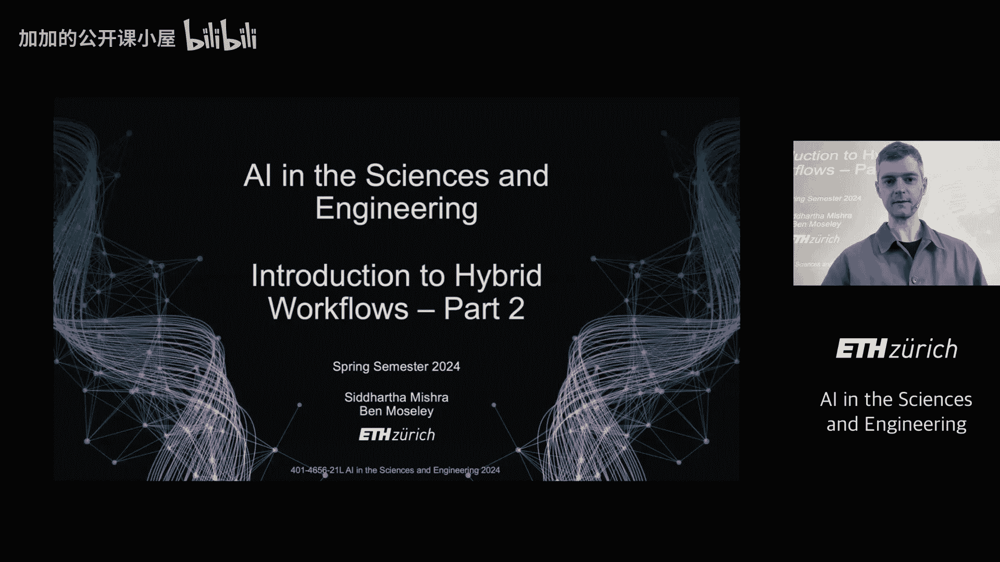
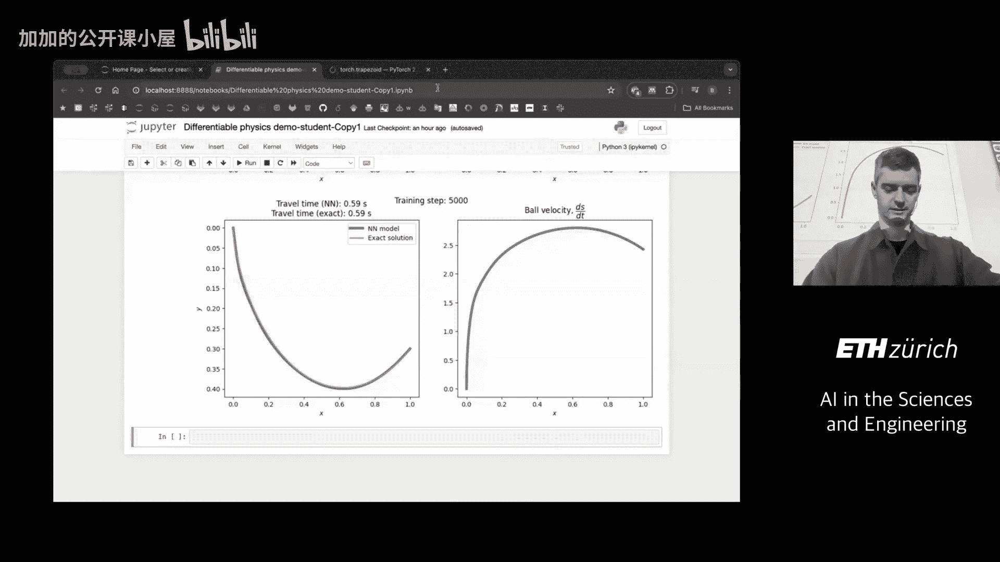
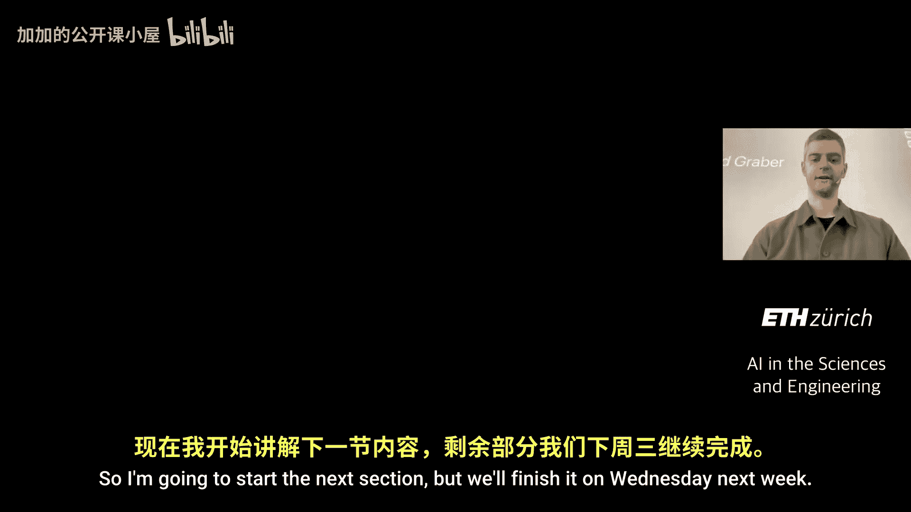
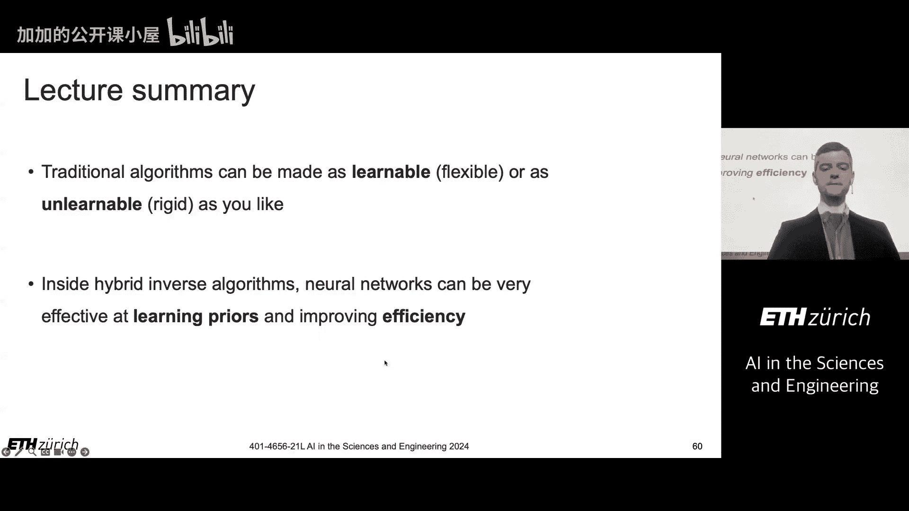

# 苏黎世联邦理工【中英⚡科学与工程中的人工智能｜2024 AI in the Sciences and Engineering】 p20 P20 Introduction to Hybrid Workflows Part 2 -BV1smxgzHEPC_p20-

So this is the second lecture on hybrid workflows， so we started learning about this on Wednesday。

And。From Wednesday's lecture， I didn't quite finish talking about auto differentiation。

 so I want to carry on explaining autoD and finishing that section before I move on。

So I've got some recap here， so what I tried to show you on Wednesday。Or explain is that。

The vast majority of our scientific programs that we write， they can be very complicated programs。

 but they can be simply thought of as just vector functions。Where the program takes in， you know。

 many arguments usually， but these arguments are often just vectors and matrices and scrs and other such things。

诶。And their outputs as similar probably some sort of scaleal or vector or tensor or something like this。

And so mathematically， we can just write this whole scientific program down as just a composition of vector functions so we take some vector x's input。

Apply lots of functions sequentially。And then we get our vector out Y is output。

And we call these intermediate functions primitive functions， so we can。

 even though we have lots of kind of complicated matrix solves and other things in this example。

 hybrid， maybe a stoke solve that we were looking at。 we can。

Pull those down to their very primitive operations， so they usually things like multiplications。

 divisions， trimetric transforms， etcter。So end here is usually a very， very large number。

And so what I told you on Wednesday is that auto differentiation is this super powerful tool that has been developed through our deep learning libraries。

That allows us to efficiently compute these two quantities。

 so in particular the vector Jacobian product。Which is exactly this quantity here and then the Jacobian vector product。

And what I really try to tell you is that whilst we developed ODF primarily for training neural networks。

What's amazing about it and what' makes it so powerful in scientific machine learning is we can also use AutoDF to differentiate through these complicated scientific programs to start learning components in these programs。

Okay。So yeah， just as an example， this is a pseudocode for learning a hybrid mediatoke solver。

 so this is a traditional numerical solver for solving for carrying out fluid simulation。

But inside the so we have a neural network here that's applying some learn correction and to train that neural network。

 we just use autograd to get the gradients of some loss function with respect to the parameterss of the network and we just treat the parameterss of the network as like additional inputs to this scientific program。

So what is this torch autograd block grad doing behind the scenes where what it's doing is computing this effective Jacobbian product？

So in this case， DL by the theta here is not a full dubian matrix because L is just a scalar it's a scalar value。

 so the vectors occurring product of this quantity is just a single number times by that single vector。

Okay。So then I talked about how we compute these vector Jacobcoian products。

 how Autode actually works， the machinery behind it。

 and the way that we get this vector Jacobbian product is just to decompose the Jacobian down to using the train wall so that we can get the Jacobians of all of these intermediate primitive operations。

And then the actual algorithm works like this， it's very simple。

 you just start with the vector and then you go from left to right here in so called reverse mode differentiation。

Applying many， many vector Jacobbian products and these now are vector Jacobian products of these primitive operations。

So to write like an auto differentiation package or library。

 all you need to do is first define all of these primitive operations。

 the forward path of these operations。And then we need to define how we can apply the vector Jacobbian product to iteratively compute the chain wall as we go through and we back propagate through the computation。

The other kind of trick that I talked to you about was that we don't need to usually fully populate or explicitly compute these Jacobcobians。

Usually the primitive operations are very simple and their Jacobbians are sparse and we can take that into account to design an efficient autodff solve。

Okay， is that who's with me， who understands that， yeah， great。Good。

So this is where I got to I was describing how we actually do auto different practice。

 so auto different frameworks like Pytorrch， TensorFlow and jacks， they work like this。嗯。When we're。

 for example， let's think about different or back propagating through an neural network layer here or two layers。

So the first thing you do is when you define this in Pytorch or Tensorflow and you run this function forwards。

 what it does is it computes a directed graph of these operations so you can think of this function as just a directed graph where all of these intermediate elements have lines depending on which previous vectors or tenss computed them。

嗯。And then like I said， these packages for each of these primitive operations that we're applying。

 they define the efficient versions of the fact of Jacobian and Jacobian fact the product of those primitive operations。

And then depending on whether you're doing computing the vector Jacobbian products or doing reverse mode auto death。

 or if you're computing the Jacobbian vector products when you're doing forward mode auto death。

either way you do message passing through this graph to just iteratively compute this vector Jacobcobian product of the entire function。

So this is how it would look for reverse mode you'd start with some incoming vector here。

And remember we're going from left to right so carrying it out in reverse and so we just do some message passing。

Then we呃。Multiply that vector with the DY byDB and DY by W2。

And then just keep going backwards through the graph until we finally end up with the gradient of the output with respect to the first weights。

 for example。This is forward mode， so exactly the same we're just going forward path through the network instead。

So we start with some incoming vector again， and then it should be very obvious what we do we just when we do a computation。

 we just also。Do the vector Jacobbian product of that computation as well。

 so we update this vector as we go through the forward parts of the computation， just like this。So。嗯。

I think it's very interesting to discuss this question about the memory requirements of AutoDF。

So I've got a question here， so can anyone answer this like how does the required memory so if you think about you know the arrays that we have to store in memory to do the forward pass and also the back pass。

How does this memory scale with the depth of the forward computation？

For the reverse mode and for the forward mode and how does that is it different？Does anyone know？

You can also reply in the chat if you have an idea。Okay， so let me show you these animations again。

When we we're computing back， when we're doing back。To be able to compute， for example。

This quantity here， so D by DH。Or DY by DW we need to know what the value of y is before that's part of the kind of Jacobbian。

similarly， when we go backwards through the graph， we need to have stored the value of H and the value of B and W1 to be able to go backwards through the graph。

So to do reverse mode AutoDF， we need to have computed and stored all the intermediate computations that the graphs before we start doing backdrop does that make sense to everyone？

Yeah。😊，So how does the memory scale with depth in that case？Yeah， yeah。

 so the amount of memory required it depends on the depth of the forward computation。

 so it's linearly dependent。So now if I show you the graph for forward mode can anyone tell me how the memory is different so now we're going forwards。

 we start with a vector。We do the first kind of set of primitive operations。

 we update the vector' Jacobn product and then we go through。

So how much memory do we need in this situation？お。Yeah， yeah great。

 so we we don't need to store these intermediate activations because we're already updating the product as we go along。

所以。It's really interesting， not always appreciated is that when we do backpro we have to store our intermediate computations and that scales linearly with that and we do forward mode we get memory independent altogether today so it's very very interesting difference and can be used quite effectively especially when we have really long kind of computational functions we can maybe sometimes forward mode is better than reverse mode depending on the gradients that you want。

O。So yeah， I mean， I've explained in detail now what AlD is that in practice you don't have to worry about this stuff。

 right？So we can just。Just hand this over to Py to watch or Tensorflow and this is what these deep learning libraries are so amazing at is just。

doing all this stuff behind the scenes and what this will just equates imp to watch is just quo。

 for example， lost up backwards and it does updates the gradient for us。

If you actually look at the kind of documentation， that's quite touch。And read it to watch to gra。

gra， you can see it's doing exactly what we've been talking about so。

It computes the Vata Jacobian product here。Of the output with respect to the input。

And this grad outputs here is just the vector that we' doing in that computation。

So hopefully you should fully understand how this kind of function is working now。So yeah， I mean。

 there are also a couple of other misconceptions about what AutoD is or is not in fact。

 so you should appreciate this by now that。Atode is definitely not symbolic differentiation。

 it also isn't doing finite differences， we're getting the exact gradients when we're running Autode。

So it simply is a way of efficiently computing exact gradient。

 so make sure you're aware of the difference of these methods。

Yeah it's just the vector that you apply so when you're doing this vectorjicoin product it's this incoming message。

Pas。はい。So remember， so let me go all the way back to the first slide。So in general。

 we have some vector function， and then we Autoative gets the vector Jacobbian product。

So this could give you a vector vector output whether in fact， we will give you a vector output。嗯。

But when we typically what we're doing is we want the gradient of the loss with respect to the theta。

 so this you can think of this as a Jacobcoian。But it's just one row because the loss is a scalar value。

 right？So what's the better growing product of a single row。

 it's just a scaleal load times by that row。And we always choose that scalr to be one when we call lost our backwards。

In Pytorch， so typically we don't even specify it because it's just assumed student as well。

But if you're trying to differentiate if here the output is not a scalar， but it's actually a vector。

 then you need to define like an actual vector that you're going to compute the vector youre cookinging product with。

And。So yeah， usually usually we don't really。Yeah， see here。

 it's just one when we're doing a lost stop backwards。Okay。Any other questions before we move on？

Okay。So yeah， then so I was introducing P approaches last lecture。

 so I said throughout the course so far we've mostly concentrated on replacing our scientific workflows with a neural network and that neural network has some interesting understanding of scientific understanding either through the loss function or through the architecture。

But now we're really focusing on these hybrid approaches where we're keeping like traditional algorithms and instead we're putting learnable components very tightly into those algorithms。

And I showed you last lecture how we can use AutoDF to train those learnable components end to end。

And so why are we doing this， why a hybrid approach is useful。

 well as I was talking about you know deep neural networks certainly have their advantages。

 but they also have some big disadvantages， for example。

 they need a lot of training data that' hard to optimize etc。

So this is the key kind of idea of these hybrid approaches is why don't we directly incorporate a neural network or some learnable component into our algorithms just to either accelerate the workflow or to kind of learn the parts of the algorithm that we don't understand or maybe。

Allow us to learn kind of incomplete physics that we haven't put into the program。

I also showed you this hybrid negativet solve so we looked at simulating fluids。And we realized that。

traditionalition numerical algorithms have a problem with discretization error。Or said differently。

 accuracy or the accuracy of these simulations strongly depends on the number of mash cells that you use。

And so with a small number of mehe cells， we get a really inaccurate kind of simulation。

So we looked into this hybrid approach here where we took the low fidelity solveba。

 but we added a learnable component of it to try and improve its accuracy。

And what that learnable component did is it just just put a neural network into the inner loop of the hybrid solve。

the network took each low fidelity step and tried to learn a correction to make it look more like the corresponding high fidelity set。

嗯。And so yeah， this is the pseudocode for the hybrid solver and it has the neural network in the middle of the code and we're using autograd to differentiate through this whole algorithm end end with a loss function that just matches the final outputs of the hybrid solver with some ground truth hybridity simulation。

嗯。And so yeah， this is the key idea of hybrid techniques。

 we also call this differential physics using AutoDF to differentiate and learn physical algorithms。

Hopefully that kind of key idea you fully understand and appreciate now。O。

So how do we do this in practice or like how would you generalize this to any kind of scientific program that you want to learn is super simple and this is advice I give many people that want to try and try hybrid approaches out for themselves there's like literally four steps that you have to take。

So step one is just to take your traditional scientific algorithm and rewrite it into an auto differentiation framework。

This is usually the hardest step， this can take a long time depending on your traditional code so if you think about high performance code a lot of it is written in Fortrann or like other C++ for example。

 so this can take a lot of effort but once you've done it you get some big gains。So for example。

 Pyor or JaX， we'll be talking about Jacks， I've got an introduction in a lecture coming up。

So then step two is to then。Open up this algorithm and allow it to be more flexible and what I mean by that is putting learnable components somewhere in that algorithm so for example like learning a correction of a discretized numerical sober or it could be even simpler it could just be learning like a single scalealar value maybe a time steppingping value or something like this。

Step three， just grab some training data of what you expect the outputs of that algorithm to be this is where your real world data comes into practice we need to learn these algorithms from some sort of data。

And then step forward， just train your algorithm with AutoDF。

 just compute a loss function of the outputs and just let AutoDF get your gradients for you。诶。

And then add a bonus。All of these deep learning libraries are designed for doing parallel matrix operations。

And they run much better on the GPU and the bonus is that once you've rewritten your traditional workflow。

 it will also run on the GPU and depending on the type of computation that carries out it may well be。

An order of magnitude faster than a CPU implementation or even more sometimes。Okay。So yeah。

 hybrid approaches insert learnable components inside traditional algorithms and autode is really the key enabler for not only hybrid approaches。

 but all the other slimM methods that was talked about。Okay。

 so I'm going to move on to now the second part of hybrid workflows and in this part it's composed of two things。

First， I'm going to do some live coding of you just to show you how easy it is to write a scientific program in Ptorrch and then differentiate through it and learn something about the scientific process。

And then I have one other example of the hybrid workflow， which is more complex。

 really showing you kind of the limits of what you can do with hybrid hybrid modeling。

This workflow is for solving inverse problems， so instead of carrying out forward simulation we're going to try and learn something about some underlying parameters of the system。

So I don't know if I'll get to this in this lecture。

 but we'll carry on next lecture if we don't make it。So yeah。

 we're going to be able hopefully by the end of this part， you should be able to。

Experiment with hybrid approaches yourself in Pythtorch by using the code。

And understand kind of advanced hybrid methods。Okay， so what I'm going to do。Is a switch？食饭。

Sre my cream tab。So I just want to check。People in the Zoom， can you see my pro， my Jupyter notebook？

Okay， good。And you can see here， okay。Okay， so what we're going to do is investigate this problem。

 so who has seenned this problem before it's called the book yeah， all right pretty much everyone。

Okay， so I guess it's been on the internet a lot， it's quite a good interactive demo to teach people with。

So this is just a really interesting problem， which is to say。

If a ball is going to travel from one point to another by rolling down a slope。

What should be the shape of the slope？Such that the bull arrives at the fastest possible time this to the second location。

And it's not actually intuitively obvious， in my opinion。

 what line it should take like a linear line or a very steep line or something in the middle。And所以。

Kind of a long story short， there's a special curve called the Crta cr。The keyto crone even。

 which is this shape here that gets the ball there the fastest。

So there's some really nice math that you can use to kind of prove this or to derive the shape of that curve。

But what we can do here is we're going to say， okay。

 we don't we haven't got the equation for that curve。

 we just want to try and learn it from just using a neural network to approximate that line。

So yeah here's the problem again what's the shape of the curve which a ball st from rest and accelerated by gravity will roll without friction from one point to another in the least amount of time。

So what we're going to do is we're going to say we don't know what this curve is。

 which is going to call it y is a function of x you know in this 2 d 2D setting。

And we just let the initial location be the origin and then the second location be x2 to y2。So yeah。

 our approach is going to be we're going to try and learn what this function is just with the neural network。

 so we're going to say the neural network directly approximates this line that the ball travels on。

So how do we train this network， how would you train or how would you try to learn such a network？

The answer is on there on。Yeahep's just exactlyact yeah， right， so we're just going to。

We're going to minimize the thing we want to minimize。

 so the final thing is it's the time of the simulation。

Well that's important right so we're not we're not going to minimize we're not going to give the network examples of the line。

We're going to minimize some other quantity that we actually care about。

 which is some quantity that is computed from that line。

So this is where the hybrid modeling comes from is what we're going to do is we're going to like given the line。

 we're going to compute the time it takes for the ball to roll them along that line using a physics kind of solver and then differentiate through that solver to kind of learn the network。

So you can kind of see how this five approach being designed them。嗯。

So how do we compute this total travel time for an arbitrary line where we just use you know distance equals speed times time。

 but we need to do an integral because the line is not a linear line。

You can I'm not going to go through this in detail。

 but one way to derive the travel time in terms of F of x is just to use conservation of energy and plug that in and rearrange this integral and what you end up with is the travel time。

Is this integral which depends on the gradient of the line here and also the line itself and also the gravitational constant？

So what we need to do is we need to be able to evaluate this integral in Pytorch。

 given the output of the network。To be able to able to compute the travel time and then differentiate through this whole thing。

 to be able to learn the weights of the network。Any questions on the kind of overall approach before I talk about the code？

Does it make sense that what last one am we using？Yeah。

And it makes sense that the loss function is some sort of integral over the gradient and the values of the network。

Okay。So a couple of interesting things about the loss one is that we don't just need the value of the line。

 we also need the gradient， so how are we going to compute that？AtoD yeah。

 so we're going to use AutoD twice actually we're going to use Autod to get the gradient of the line。

 but we're also going to use Autod to get the gradient of the assumption。

Like we saw in physics inform neural networks， we can use autoDff in a compositional way we can apply it many times。

 which is super powerful。So yeah， the exact solution， if you're interested。

 you can follow this link afterwards so likely， there's a parametric solution。嗯。

And we're going to compare to that when we pull the results。Okay， so first we're just going to。

Import torch and we're going to just define a cycloid so we can compare that to the exact solution。

And then the first thing I want to do is define this kind of flexible function that represents the line the ball is going to travel along。

So we're going to use a neural network， remember what I'm going to say。诶 here。

The line is just approximated directly by the network。

So the network should take as an input the X coordinate and give me the value of y is the output right that's just the line that it's giving me。

So what I have is just a simple fully connected network where it has one input。

 the X value and one output， the y value。With a bunch of layers。And so now in my forward call。

 it's just going to given the X value， it's going to return y。

What I've also done here is give the forward call the value of the x2 and y2。

 so this is the final point that the pool is going to end up at。This is just to normalize my inputs。

 remember we have to make sure we have nice nice normalized inputs for our neural network。

 so that's just going to help me normalize X。Now I'm going to do something a little more clever than just say Y it was the neural network of X I'm actually going to use a hard what I'm going to use a residual model。

 so like we were talking about in hybrid methods we can if we know like if we have an assumption about what the line should look like。

 we don't have to learn the whole thing， we can just learn the residual part of the line。

So what's so a good starting guess for example， if I don't know what this line is I could just say okay let's just start with a a linear line right and we'll just have the network learner correction to that linear line maybe that's an easier learning problem than learning the whole line。

So we phrase our ans kind of of the line is this， we're going to say we're going to assume that the line is linear and then we're going to have the network just learn some residual correction in an additive way。

So it's actually very simple， so first we just compute what our linear line would be。

As a function sorry here and the linearar line is just。

Given the ball starts of the origin it's just the gradient times by x y equals N x plus C。嗯。

So that's the linear part here。And so we then we need to compute the residual part that the network is going to learn so the correction to the linear line。

So then we just pass X through our neuralA network， so this is do。

So they's going it through each layer with the starting layer。诶。嗯。嗯系。And then the hidden state。

And then the final state。Like this， so these are just the layers of the neural network。

 but I'm passing it through I've made a mistake there。And then by the end。

 we're just going to add the linear model。To to the w value about it like this。嗯。

So you can see how were applying this kind of correction。So we need to。

 I'm just going to change this doing a few other kind of tricks to make sure that it converges quickly。

The first is I'm going to make sure that the input to the network is normalized。

 so at the moment x is going to range from zero to zero to x2 as I've defined a problem。

 what range should we normally have our inputs to the neural network？Y。

 zero to one or so I'm using a 10h here， so what range do you think I should use？

So that I don't saturate the10H function。Anyone else yes。

-1 to minus1 yeah so what I can do is just normalize by this。

And now you can see when x is from0 to x2， then I've normalized it to minus1 to1。

Or I think think that's why I at half as fine as long as it's the right order of package。嗯。

And then the final thing I'm going to do is this， so I'm going to times the final output by torch。1h。

Thanks。And to stop。At1 H x minus x2。Can anyone guess what that does， why is that？

A useful thing to do， why does that make any sense？So I'm taking the。

The residual prediction of the network and I'm it by 10hx and 10hx minus2。Why would why it on not？

Okay， so what this is doing is it's asserting our conditions of our problem right so we know that the ball has to pass through zero zero and it has to end at Y2 x2。

And we designed our linear line， remember we're saying。

TheThe line is the linear line plus the neural network collection we already design the linear line so that it already goes through zero and x y2 just by using this。

This equation for the linear line。So what value does the network need to add at the starting point and the endpoint？

Zero， yeah。So what does this do at x2 and x equals0？Yeah， well more precisely， it just says。

Whatever the output， the network is xx x equals2 this thing's going to be0 and x equals0。

 this is going to be zero， so it's just going to force this linear。

 this residual correction needs to be zero。ま。Wai for。Yeah， yeah， so good spot， thanks too。

So let me just take this， I think it's all good other ways。Excellent，6 two。😔，Yeah。

 I think it's why I've written up here I think we're good。Okay， so we create that。

And now what we have to do is train the network。So what I've got set up here is a simple Pythtorch training loop。

 just like you said before so you know。Great creating the model here we've got。

Out eight hidden states and two layers， so it's a very small door network。

We're creating an Adam optimizer to train the network， so this is all standard stuff。

So all we need to do now is to compute the travel time because remember we're going to minimize the travel time with respect to the network's waits to try and learn this curve。

So we have to come up with a way to compute this integral。So how do we evaluate an integral？

But how will we do this numerically， anyone have any ideas？Yeah。

Qudju yeah yeah so we we need to discretize this so we can compute it so we can use quadit trip what I'm going to use is the trapezium rules so like a even simpler simpler method for now。

 but yeah for sure you could use some something better。And。

So what I've got here is we're going to sample x along the whole range so we can compute that into all。

 we need to sample we need to have many values of x。So we're just going to do a linear sampling of x。

And then we're going to compute the model's output， so this is the prediction of the full line。

And what we need to do here is compute the travel time。The first thing I need is Dy by Dx。

 which is this torchdot water Brad。Oh proud。So y and X。

 and then we need the factor of the Jacobopan products so we're just going to do ones like X。

And I have to get the zero output of that output there。

So this is where we're using Autograd to get the DY by theX in the time value。In years ago。

So once we've got this， then we just need to compute the function that we're integrating。

 so I'm just going to write this square root。So we're going to say f equals torch dot square root。

And then I think it's one plus divided by the x squared。IBy two times two times wire。

Like this one poster。I that square to multi G y， okay？

And then we're going to use the trappeian rule to integrate or basically sum the values of X together。

This case analytical yeah， it may well be yeah if you can if you can write that analytically。

 then yeah sure it's much better。But otherwise quotature or Monte coloror sampling or something。

 there's other ways to convey it。And。Okay， so we're going to use the traprappedi roll。

 so torch has this function called torch dot traprapeioids so that makes it super easy。

So it just computes the trappe role， so it's going to approximate that integral with these points。

So I just need to do tea， so this is the total travel time is to watch Dr。Toch。

And we need to give it to function values and then the x values that like this and then we say we're going to sum across the zero dimension。

I think this is pretty much it， the rest is just a cool Tdo backwards。

 this is you know doing back prop to get the gradients of the network。

And we take an optimize the step and we do that in a volume loop and then we're just going to plot the curves as it learns。

There is one thing that I've missed， which is we need to create the graph with。

So that we can differentiate through that gradienting graph off as well。So that's see if it runs。

I think it's going okay， yeah okay so。What I've got here is two plot。 So one is the。

Prediction of the full line， so this is the linear model plus the normal note correction。

And so this is very interesting， so this is before we've done any training steps。

 so what you can see already is。It looks like a linear model。

 so this is why we had this linear model as a starting guess it's got a little bump here so maybe the network's done a little correction from its random initialization。

Also it passes through those two points so we've done these hard boundary constraints which is really nice so whatever the network learns it's always going to pass through the two points。

Then the orange curve is the verquita crone， so this is the cycloid。

Solution and then you can also plot the vity at the ball as they're traveling。

 it's just interesting to look at it。So yeah， as we're optimizing the network。

 we're reducing the travel time that it takes， this is the thing that we're optimizing and we just start to converge closer and closer onto this exact solution。

So that's it， that's an example of using a neural network inside of a physics workflow。

 you know a workflow to compute travel times and differentiating through the whole workflow to learn that component of the program。

Yeah， general。Yeah。Yeah， I think that would be that's something we should test。

 I think it probably depends on the laggoangian， but what might be interesting is if you wrote a general purpose code that could take any lagang in as input。

There's an aside， there's these things called Hamiltonian neural networks which try to learn Hamiltonians。

 this is a whole different subject， but people are trying to learn at this sort of higher level of abstraction as well and I think goes really interesting in those types of techniques。

Any other questions？Okay。

So we've got five minutes left， so I'm going to。I'm going to start the next section。

 but we'll finish it。

On Wednesday next week。So what we're going to do is what I'm going to do is describe one final hybrid approach。

 probably the most advanced hybrid approach that I'm going to tell you about。

And we're going to use we're going to design an algorithm。

 a hybrid algorithm to solve this problem so that this is computer tomography。

Hands up who's seen this before。Or in those of this kind of general problem。Okay。

So this is an inverse problem and the goal is， well。

 computer tomography is used for medical diagnosis like probably everyone's had an Xray scan in their lives at some point。

And what we see when they give us a scans are these images。

but that's not actually what the instrument is recording when you have the X ray scan。

What the instrument actually records are these things called cnoograms。

 which are these really interesting like wavy kind of images that that they record。

And so what is actually happening in an X ray or a computer demography scan？

What you have is some media， so for example， someone's head or some other part of your body and you have an Xray source。

 which you can think of just as a point source。And these xrays just travel through straight lines of this media and end up being detected at some screen here。

And what we actually detect is the intensity of the Xray at the screen so after it's propagated through the whole media。

And so what this cogram is showing is just the intensity along this axis here。

And the other thing that we do in the experiment was we rotate the media around and we record you know the intensity as a function of rotation。

 so that's the other dimension of this image here is the angle of rotation so this is little graphic showing you know if you recorded the intensity through this media this is what you would get。

So the intensity that we record is varies and it just depends on the absorption of the media itself。

 so you can think of each part of the brain here as absorbing the x rays differently。

And this is what we eventually want to end up with is this image of the absorption。

 so this absorption is a function of x and Y。We can write this mathematically using our understanding of the physics。

 we know that actually the intensity is just a simple integration。

 a line integration over the line the Xrays traveled and the absorption function itself or the absorption image。

So does this make sense kind of the problem and the that we have and how we want to solve it do we want to go from this this observed data so our actual underlying image？

Okay， good。And so I'll。Yeah， so here's the invest problem is I've just described the forward problem。

 which is just integrating the image across all these lines。And angles。

But the inverse problem is like given some observed cnoogram。

 can we get back to the image and that's not always easy。

 in fact it's very hard quite a lot of the time。And so yeah。

 I talked about this kind of super high level kind of framework in the first lecture where I said。

 you know， many problems can be boiled down to this where we have some physical system。

 which have some input clinic conditions， we have some forward model of that system and then we get some resulting property speed。

So the inverse problem is given B to decide what a is or figure out what a is。嗯。

And so I'm going to tell you how we do this traditionally and then we'll talk about the high bid approach next lecture。

Traditionally， we often frame these inverse problems in general as an optimization problem。

 fundamentally it's a search problem。Given B， we want to find the possible value of A that reduce B。

So we can write it as an optimization problem， it's just a minimization FB。

Or a minimization where we try to you know， guess what air is。

 carry out some forward simulation of the system and try and match it to the observational data。

So this is an objective function or a loss function and we can learn a just like we train neural networks by using gradient descent so we can get the gradient of this loss function with respect to A and then do a gradient descent step to learn A。

And so what this requires is that our forward model， the thing that so say if I give you an image。

And you have an algorithm that produces the sinnoogram。

 carry out that this forward simulation of the x ray。That needs to be differentiable。

So that we can differentiate through F to get gradients of the lost function with respect to A。

So we're going to be using Autode to differentiate through our forward solver just like we've done。

 just like I've been describing before。You follow who's with me so far。Okay。Good。

So let me just draw it out as like a diagram， so this is the same thing gradient descent just drawn as a diagram so we have to start with some initial guess of what of the image is。

Then we carry out forward modeling using a simple forward simulation。

And then we have some real data here that we observe from our experiment you know。

 after I've had my Xray， this is the data we actually received。tThen we create our loss function。

 we match our predicted image to the real data， then we get the gradients of the loss function with respect to the image and then we update the image。

We do that many hundreds， maybe thousands of times when we end up with some final model。嗯。

So I think I'll stop there and we'll talk about how we would improve this workflow and learn something about it in the next lecture。

Yeah，'s。Yeah， so maybe this label is a bit redundant it just it's just the output of the simulation。

So yeah， you could just have this box here。Yeah。Okay。Thank you everyone。

 so see you on Wednesday next week。Okay， I think we get started。

so we're going to carry on this lecture talking about this computed tomography example。

 which we started talking about at the end of last lecture。

And what I'm going to explain to you is a kind of hybrid scientific machine learning workflow that's going to be able to help us solve this inverse problem。

嗯。So。Let me just recap what the problem is of computer tomography。

 so this is just basically taking X ray images of our bodies so everyone's had a kind of X ray scan before I imagine。

嗯。And what we see after we have a test is an image of whatever part of the body we've scanned。

But what we actually record in the sensor is not the image we record this so called cnoogram。

 which is the measurement of the intensity of the x ray。

After it's gone through the media and once it's hit a screen。

And we know from physics that this is just the integration of the intensity as a function of x and Y。

 so remember each part of the media has a different absorption coefficient。

So we just integrate that absorption coefficient in the line integral to get the intensity at the screen。

And then what also happens in the experiment is the media rotates or actually the Xray source rotates around the media。

And so that gives us this extra dimension in the image， which is the rotation angle。

So it gives you this kind of these snoograms and so the inverse problem here is to take observations of the snoogram here and try and invert back for the image or the absorption profile as a function of space。

Everyone clear on the problem and the physics behind it。对。Okay。So yeah。

 this is the in problem to take this observed snoogram and go back to the image。

And if you look at the kind of images that we actually produce。

 depending on the number of observations we have， so this is you know the number of detectors and the number of rotation angles that we choose。

These images can be very noisy so we can't it's actually quite difficult to invert for the underlying image。

Can anyone give me a reason why this image doesn't look exactly like the kind of perfect image？

What would be a reason why we don't reconstruct a perfect image？Yeah， please。Yeah。Yeah。Yeah。

So you're right， if we just had one observation of the intensity。

 it's like a summation and we're losing information of the absorption through that line。

But what we do have is multiple observations。So actually。

 it turns out if you have enough kind of angles and enough detectors and enough lines that go through the media。

Then you can invert for the underlying image and actually the quality of the result depends on the number of kind of observations and the number of angles that we pass through the media。

So we can frame this as an optimization problem more more fundamentally it's a search problem。

 we want to find you know the image。That if we simulate the observed snoogram。

 so if we pass x rays through that image and produce what we think is a synnoogram。

 it should match what our real world observational data response once we've done this scan。

Specifically， we'll frame it as an optimization problem where we have some loss function which can in this simplest case just be the difference between the observed data and the simulation of the observed data。

And then if this kind of forward model is differentiable。

 then we can just do gradient descent to update the image。

And so I showed you this kind of picture this is just a picture of what I just showed in the last slide so what you do normally is you start with some guess of what the image is。

Usually some smooth or even constant guess。You take in your real world data here。

 you do forward modeling if the image to guess what the forward data looks like。

 this is what the synthetic data is here。And then we compute the loss function。

 and then we compute gradients of the loss with respect to the image and we do a gradient dis。

He's with me so far。Okay。So as I was trying to point out。

 this is actually quite a difficult problem depending on kind of the number of observations that we have。

 the number of lines here and the number of angles that we scan over the media。

And so this is fundamentally， and this is a general property of invest problems。

 this what makes it really hard to solve invest problems。Is that there's in general。

 usually not enough information in our observed cnoogram to be able to uniquely reconstruct the image。

So another way of saying that is this is like a one to many map there's you know many possible solutions that could produce this observation of data。

What makes this also hard is we often have noise in real world settings so there'll be noise from the detector and this just increases the kind of illponess of the the inverse problem。

嗯。So what will you need to do to solve these in general。

 if we have a search task we have to have some prior understanding of what the solution might be so what does a like typical image look like for example。

And we have to the main way to solve in problems effectively is to try and incorporate that kind of prior understanding into our search algorithm to help us kind of find the right image。

And so one way you can do this， there are many ways in invest problems。

 one way is to add an extra term into the loss function。And we call this a regularization term。

So think back to our introduction to deep learning。

 we also regular deep neural networks to find good networks that fit data we're doing exactly the same concept here。

 but they're inverse problems。So what this regularizer will say it will take an image。

 your current guess of what the image is and it will kind of give you a heuristic that says yeah。

 this is a good image or maybe this isn't a good image so this regularer might be higher for a poor image and blow for a good image。

So one that we use very traditionally is called total variation and this just says that you know the gradient of the image should be close to zero。

So what do you think that does， what types of images does that prefer？

Anyone guess why we would use like a why we would prefer gradients to be zero of the image？Yeah。

 please。See。Smooth， yeah， it's a smoothness constraint。So I mean this image is quite noisy。

 so if you think about the gradient， the spatial gradients of this image going be that's going to be quite high or lots of spur values。

If I looked at the real image here， you can see it's actually smoother。

So there are some step changes whether the spatial gradients are high。

 but in the majority of the image， the spatial gradients are quite low。

So this is kind of a good heuristic to add and try to guide our search towards a good image。

Now the other issue with inverse problems is F here， so when we compute this loss function。

 we need to take our image into do a simulation of what we think the observed snoogram is。

And in general， this forward simulation can be very computationally expensive。So， you know。

 if we're doing problems where we have to do like a finite different simulation or finite element simulation。

This can be just expensive to do one forward simulation。

 but then when we're doing gradient descent on this loss。

 we actually have to run the simulation forwards maybe1 thousand00 times。

 10000 times and this makes the inverse problem really， really computational or expensive to solve。

Okay， so what I tried to give you there was just an understanding of the kind of challenges of this existing way to solve in problems。

 which is using gradient descent。So what I want you to do is。

Have a quick discussion with your neighbor about ways that you might be able to improve this workflow。

By incorporating kind of a learnable element or maybe a neural network inside of this work somewhere。

So remember this is we're talking about hybrid techniques。

 this is what we've been talking about for the last few lectures。

And the goal would be to try and insert some learnable component or neural network like in one of these boxes or somehow into into this workload。

To either try and speed up the workflow or to try and improve kind of the accuracy of the final image。

So just have a quick discussion with your neighbor， maybe just for a minute or so。

 and then I'll ask you what ideas you have。For people on Zoom。

 please feel free to write something in the chat and then like I mentioned it。Okay。

 so that was a quick discussion can anyone raise their hand and give me an idea where you might think about。

Puing a neuraler network or some learnable component into this workflow。Yeah， please。Yeah。

 but I will data， which visit to forward yeah， yeah， great idea。So as I explained。

 this forward modeling here is very expensive to run it's like if we have to run like finite different simulation or something of this。

So we can train like a surrogate model， just a neural network that approximates that forward model。

 maybe it takes in the image and guess of what the Snoogram is and that might be thousands of times faster so yeah。

 good idea。Any anyone else， there are many answers by the way yeah please。Right。Very interesting。

 okay。So yeah。Yeah。St。I see， yeah。So you would have a neural network in here somewhere。Do it take？

What would it take as a simpleper？yeah。系系。Yeah yeah， yeah， yeah。Yeah。

 so maybe it learns like a better direction。AndI that？Yeah。ExEx。Very good， yep。Okay， anyone else？

There are many other options as well。Okay， so two two very good ideas。

 you manage to guess exactly what I'm going to show you so well done。

This is exactly what we're going to try and do is we're going to have。I neural network here。

Which tries to take a better direction than gradient in decent。So why is this a good idea。

 well we're just kind of trusting this if you imagine our lost landscape。In general。

 lost landscapes are very nonlinear and non combatvex。

 which means they have lots of local minima and they're very hard to navigate and also very high dimensional spaces to navigate。

So just following the gradientding direction。I's not by any means guaranteed to get us to the kind of global mini or even a local mini of the problem。

so what we're going to try and do is we're going to try and search that space better。

By trying to learn a better step to take in that lost landscape and just to follow the gradient direction。

Does that make sense the general concept， I'm going to go into this in much more detail。Good。

So what is this network we're going to do so it's going to take in as you were suggesting it's going to take in perhaps the gradient of the loss with respect to the weights。

 so you know the step that gradient descent would take if we just did gradient descent。

And then the image， maybe or maybe just everything else we have inside this fo loop available to us that we have the current image。

 we have the original observational data， we may even have some values of some regularization terms that might tell us how good that image is。

 like a guess how the image is。And so we just put this neural network into this inner loop of the hybrid solve。

So I've got some pseudo code here so what I'm writing in the so code is just gradient descent and I've written it out as a full loop as well so again this is just that diagram that I showed before。

And this is the kind of standard gradient descent algorithm So again。

 we start with initial guess we do this for loop where we compute gradients and we take gradient decent steps。

 not nothing new。So what I'm going to write in the right hand side here is the hybrid version where we're going to learn this gradient intercentense step。

So this looks like this。And in the pseudo code I've just highlighted here just the changes to the pseudo code。

 so you can see this as super simple changes。All we do is add one extra line inside of our gradient descent for loop。

Which once we've computed the gradients of our loss function， with a respect to the image。

We just pass that through in neural network。Which has， you know some free parameters data。

Which is just another additional input to the hybrid function。So yeah。

 the four looks like this same thing， all we do is just add this neural network correction to the gradient。

O。Yes。neural networks need pay attention to like first yeah a good question so what you're suggesting is maybe we could have in neural network that does the forward modelling and then does the gradient sense step part you were suggesting so what you what do you think do you think how would you train that？

I wouldn maybe kind of。Fit one first on the dataer。

 and then like add the other one and fit that on the data yeah。

learning forward forward modeling that probably makes sense you might want to train that model first。

 otherwise you're not even doing the forward simulation correctly。But in general。

 you have the option to train both at the same time。嗯。Because you can work。

 so I'll show you how I'm going to talk about that。

So now we need to think about how do we train this hybrid approach？

How do we actually train this neural network？So this is a question that we asked。

 remember last lecture or even the lecture before we were talking about hybrid forward simulation。

 so this solver in the loop where we had a neural network。

 we had for again that hybrid algorithm had a full loop and we had a neural network in that full loop。

So how do we train？This approach， how do we learn Theta？

If you just think back to how we did it previously。Anyone tell me？What loss function would we used。

 what inputs， outputs would we use？Okay， so I'll tell you， it's not immediately obvious。

So what we should do is but what we can do is think about the inputs and the outputs of this function。

 so remember this is just。This is just a function at the end of the day。

That has some inputs and some outputs and we just want to learn some of the inputs of the function this is what I was trying to tell you with auto differentiation and differentiating through scientific programs。

So let's just think about the kind of the inputs to that function and the outputs of that function。

 and that's going to help us define a loss function to train this neuraler network。So you know。

 I've just plotted the inputs of this function here， we just start with an image。

 a guess of what the image is。And our observation of data。

We run this complicated fall loop with gradient descent and a neuralural network inside。

But eventually the final output of this function is just simply our guess of what the final image is。

 the solution of the inverse problem。So now that I've told you what the inputs and apples are。

 can anyone think of a loss function that we might and might use now？We train this。

HowWhat are we going to match？The output of the algorithm too。Yeah。Yes。Exactly， yes。

 it's very simple we just。Our desired goal is to have this algorithm converge on the solution。

So we should just match the output， we should have a loss function which matches the output of the hydro solve to the Grri vintage。

So it's as simple as that。嗯。We just say。Here's our loss function。

 we just say so H here is just the whole hybrid function。

Which takes in you know our guess of the image， our observational data and the premises of the network。

And we just match this whole output of this function to。A set of ground truth images， so A here。

 we assume that we have some ground truth images or many examples of ground truth images that we can do this too。

Does that makes sense to everyone。So our training data is basically many thousands of examples of true images and some observational data based on those images and some starting gap basically。

Which we can generate。And now you should realize that we can just differentiate through this whole thing to get the gradient of the loss with respect to the parameters。

Because as I was saying these scientific programs， we can just think of them as vector functions and we can use autode to just get gradients of the output of that vector function with respect to the weights of the neural network。

So yeah， we're just doing a very simple。Out training gradient descent loop here where we're running gradient descent on gradient descent to train the network。

 so this is where it kind of gets a bit spicy or a bit exotic because we're doing kind of learning to learn we're like learning an optimizer to kind of learn the inverse problem。

诶。So this fo loop here， you start with some initial guess of what theater is。

 you run it through the hybrid solve， you get you a compute loss function。

 and then you just use autograra to get the gradient of this loss function with respect to the weights of the neural network。

So what we call this is like， yeah， we call it gradient descent on gradient descent or like learning to learn or this is also known as meta learning。

 depending on what field you want to talk about this。Any questions on this so far？Okay。

And so this paper from Adler is a really good paper and it basically proposes this technique where we try and learn the update step for CT imaging。

And this， I mean， this is long story short， this is the kind of example of their learned learned gradient descent with this learned update versus just a traditional version of gradient descent and what you see is that the learned learned so once we've trained this neural network to update the gradients and step in a better direction。

Does seem to learn like a smoother and more accurate solution to the ingo problem。嗯。So。We。

We don't just have to stop there， we can actually carry on and so what we just had a discussion on was。

Well why not just add more learnable components to this to this workflow we don't just have to learn the update step。

 maybe we can learn other parts as well that we're not kind of sure of that we want to speed up。

So yeah， we already kind of had this discussion， another place that we could add， for example。

 is in this。For modeling step so this is the four modeling here in this case。

 it's just a numerical integration to to get the。The line integral of the rays。

But we could maybe replace that if that was expensive with an approximatex neural network。

 for example。The example that I've got here is actually a different idea and it's the。

To learn kind of the lambda hyperparmeter of the inverse objective function。So this。

 remember our objective function in the invest problem is to say。

What's the difference between our estimated observed data and our true observed data？

And then we add this regularization term to try and guide the search towards like a reasonable image。

And we have to choose some kind of weighting of these two different loss terms。

 and that's a hyperparameter that we would typically scan across just。

To kind of tune it to work the best。But we could try and learn this in the same way。

 could just treat that as a learnable parameter。So this is two different ideas for learning this work。

So this is kind of the key idea that I want you to take away from this kind of。

Advanced example of the hybrid workflow is that we're not limited to just replacing one part of the workflow with a learnable component。

 we can put learnable components throughout the workflow and we're kind of free to choose where we want to learn those parts。

So it would probably be a bad idea to replace everything。

 then you would just have a really ill defined algorithm。

So this is where your kind of common sense as a scientist comes in。

 you have to really understand your traditional algorithm and know the reasonable places where you actually want to learn a component and whether that still makes a reasonable algorithm as output。

嗯。So， in summary， these are all the kind of ideas that I have of putting learnable components into this workflow。

You could put it at every single step you could have， for example。A neural network here。

 which gives us a better starting model， so it turns out。

The starting model is crucial for these inverse problems to solve if we don't start with a good approximation of the solution。

 they often don't converge at all。So we could have a neural network which takes the observational data and just produce us initial guess of what the model is this could already solve the problem depending on how easy the inverse problem is。

Then we could， as you suggested， have a forward model， which we learn， which is much faster。

We have this update step that we're learning to try and navigate the search base or the loss function better。

We could learn a regularizer instead of just the lambmbda hyperparameter to add the regularizer。

 we could actually learn like a function that takes the image and tells you if it's a good image or not。

Who's heard of discriminator networks or generative adversarial networks？H燥。Yeah。

So what's the discriminator network does anyone know？What's the input and output of a discriminator？

So what a disc yeah gone， you got it I think。Yeah， basically yeah。

 so discrimininate in that when we're using when we apply it to image generation。

 it takes in an image and tries to tell you if that image is fake or if it's true。

So we could use like a discriminant type network here where we could have a network takes the image and tells us is that a good solution to the inverse problem or is it a fake image。

 is it not a good solution？People have done this as well。

 trained like discriminator regularizers and inside their algorithms。

And then what's brilliant and about hybrid workflows and is that we can just。

Learn this so called end to end right so we take the outputs of the entire algorithm and we match it to our desired outputs that we。

We optimize what we care about， which is the final image that's output by the algorithm。

And this is where the power of autograrad comes in。

 Autograrad just lets us get these gradients of the loss different through this whole kind of hybrid workflow to get our gradients。

嗯。Any more questions on this， otherwise I'll move on together。对。喂。That's good。Yeah， and。

What is it unique to kind？没听白。okay， I think you've got the answer there you just said it yeah。

So good question， so the question was if this network takes the observational data and tries to guess what the image is。

 why do we even need this algorithm？Well， the answer is。

 so people have done that as well for sure and it can work。

 it's just that if your inverse problem is very ill posed。

 so there's a many there's a one to many relationship between the observational data and the possible solutions。

Then this will pull out maybe just one of those solutions or more likely if you use like a simple loss option。

 it will actually give you like the average solution。

 which is not actually desirable if you might get a very smooth average kind of type of image。

So there are ways around that， but yeah， this is what I'm trying to suggest here is that is a good first step。

 but then we can build on it and learn So around that to improve it even further。Yeah。Yeah。

problems are so， all， I get practices。Yeah， so for CT imaging。

 yeah there's no grant truth available perhaps， but what we could do and what we usually do is just do a very high resolution image and to get create an expensive training data。

So there are， for example， CT scanners in like research labs that are like super high resolution that have many。

 many rays and many， many angles to give us a really a high resolution image。

 so we can use to use that as ground truth to then solve a problem that has maybe less observational data。

 but yeah I mean its still a limitation for sure。Yeah we go。right so I mean。

 a more mathematically like kind of rigorous way to frame inverse problems is to frame it in a Bayesian inference setting where you're trying to invert for the posterior distribution that's what you really want to do because we know that it's like a one many relationship。

So there are for sure hybrid methods that go that you can insert to basin inference and maybe using a BAE or some that to approximate some of those distributions either the way that I don't have the time to go into it。

 we can talk about it later if。Yep。嗯嗯。Yeah， for example。

 there's this kind of neat thing in radiant descent when you're train neural networks is when the optimizer is bumping around the kind of local minima。

 you can think of that as sampling the posterior distribution so that you can kind of use that kind of concept to it sometimes yeah。

Okay。Right so。What I'm doing here is just summarizing hybrid techniques before we move on to the next lecture。

 which is going to discuss something related， but not quite the same。

So the key takeaway is that these traditional scientific algorithms， we can make them as learnable。

 like flexible or as unlearnable as we like。This comes down to our kind of as a scientist。

 we have to make that decision and what parts of the workflow we think we can improve。嗯。And yeah。

 inside hybrid inverse algorithms neural networks can be very effective at learning friers。

 so to help us converge on a solution when the problem is ill post and also improving efficiency。

 it can replace the kind of slow parts of the algorithm。

