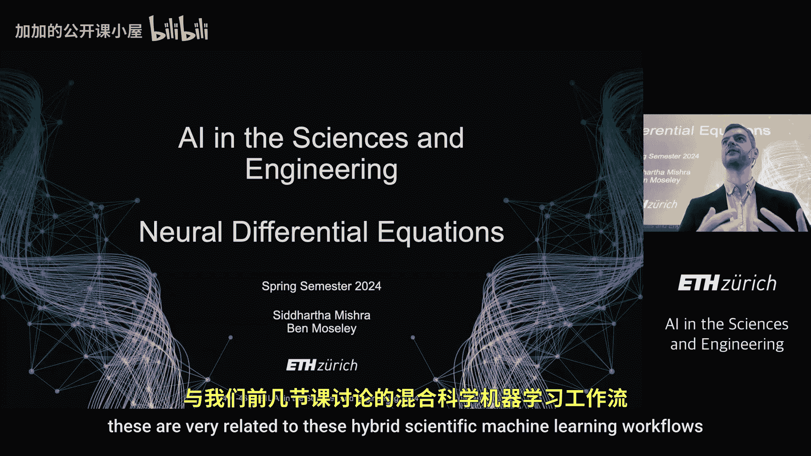
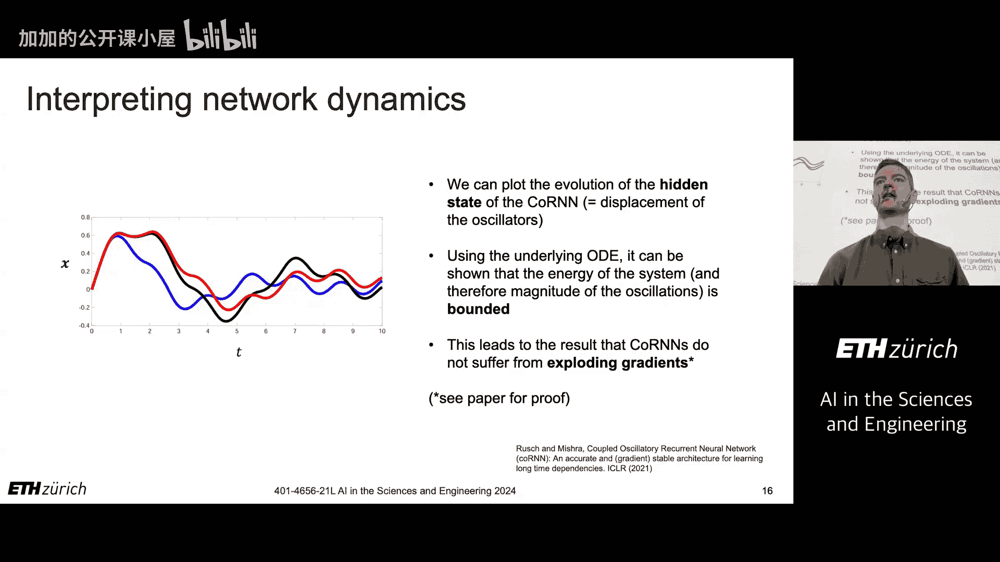

# 苏黎世联邦理工【中英⚡科学与工程中的人工智能｜2024 AI in the Sciences and Engineering】 p21 P21 Neural Differential Equations -BV1smxgzHEPC_p21-

Okay， so in this lecture we're going to talk about neural differential equations。

 so this is a super popular field of scientific machine learning。And again。

 the idea is to kind of put neural networks into our traditional scientific workflows。

And you're going to see that。These are very related to these hybrid scientific machine learning workflows that we've been talking about in the previous few lectures。

So I'm going to skip over this because we just covered this whole example。嗯。Yeah。

 so we just have this one lecture on all differential equations and then I'm going to move on to an introduction to JackX。

 which will be the next lecture。And then we have symbolic regression and model discovery。

 course summary and then the final two lectures， which are guest lectures on machine learning for biology and chemistry。

So this is what this lecture is going to look like we're going to。

 well first of all I'm going to tell you what a neural differential equation is。

 hands up who's heard of this time before or even has used neural differential equations anyone。1。

 yeah。Okay， brilliant say it's a new topic， that's good。

What I'm going to do is tell you the link between neural differential equations and neural network architectures。

 this is really interesting and provides a bridge between kind of our world of PDEs and the world of neural networks。

And then I'm going to tell you about state of the art neuro differentialffer equations and I have two examples of models。

 one is a coupled oscillatory RNN and another are diffusion models。

 which you can think of as neuro differentialial equations。I'll explain all of this as I get to it。

So by the end of that lecture， you'll be able to define what a normal differential equation is。

 you'll be able to understand this connection between PD Ss and neural network architectures and be more aware of some of the state of the applications of these types of models。

嗯。So what I'm going to talk about is this Lo Volta system， so who is in this dynamical model before？

Okay， yeah。It's often used or often studied as well， it's very famous actually。So this is。

An ordinary differential equation is a dynamical system。

And it's heavily used in a biology to model kind of predator pre dynamics。

And so what we're modeling is two variables， x and x and y here in the equations。

Which just modeled the population of a predator population in the prey distribution。a pra population。

And if you solve this differential equation or ordinary differential equation， which is coupled。

 so we have an equation for the population of the prey and the population of the predator。

The types of solutions you get are these solutions where the you know。

 the the prey starts to eat the predator starts to eat the prey and so the。

The prey populations go down and then the predator populations go down off of that because there's less prey。

 so you have kind of a lag system and you also have an oscillatory system so you see the dynamics oscillate through time。

And of course， the kind of。The characteristics of these oscillations like the frequency and the height et cetera。

 et cetera， all just depend on these kind of constants that we choose in our underlying differential equation。

You know， things like the maximum prey you birth rate， the effect of the predators on the prey。

 et cetera， et cetera。Who's with me， that makes sense？Yeah。Okay， so。First question。

 how do we solve or how would you solve this ordinary differential equation if I gave you this ODE？

And maybe I gave you the starting populations of the prey and the predator。

What would be a like traditional way of solving solving this this idea？Yeah，Nummerical methods， yeah。

 so can you be more precise what？Its the problem， so you would use。Yeah。

 a ringer kto would be a really good like higher order， maybe it would be a good option。And。

So for the purpose of explaining what NDE are I'm going to tell you how you would solve it with an Eer method。

 which is the simplest possible way of solving it， this is a stiff problem so it probably would give not very accurate solution but it's for the purpose of demonstration。

 I think that's what we're going to use。So to solve this with the Euler method。

 we would simply discretize the derivatives here on the left hand side within numerical approximations。

 very simple。And then if you just rearrange this， you just end up with a super simple kind of time stepping algorithm for the population dynamics and the pre dynamics for the population dynamics through time。

Okay， so。Now let's get to the interesting bit， so when we created this model。

 you know this is all models are approximate。And we made a lot of assumptions when we designed this ordinary differential equation。

I just listed a few there are actually many， many assumptions of this system。

Some of them are that the prey population always finds apple food。

 the food supply the predator population depends entirely on the size of the prey population。

 the rate of change of the population is proportional to its size， predators limit those appetites。

Who here sees that there is like actually a lot of kind of assumptions that abate into these kind of rate of train equations？

😊，Yeah。 oh you just you just hand up yeah， yeah， that was all I needed so。

What you can see is there's a lot of assumptions， right？

And this might not reflect like a real biological system。

 in fact it probably doesn't because there are so many complicated factors that affect populations and external factors。

 etc。嗯。So what we're going to try and do is learn the right hand side of this equation instead of just saying that we know what these coefficients are。

 we're actually going to try and learn what this differential equation is。

So that this is a setup that we're going to assume。

 so just imagine that we have some observations of the predator and appraised populations through time。

So imagine we have these black dots here that we've gone out into the field and recorded these populations。

So can anyone kind of give me an idea about how you were try and？

made this more flexible and maybe try and learn kind of the right hand side of these equations。Yeah。

You kind of do it in a similar way to like the last lecture where you have parameters in there that you can learn and then you kind of start off with the sub level model or they kind of differentiate back very nice yeah so what parameters would you try and then？

Maybe like just the coefficient yeah I mean that that doesn't really solve the problem of like all the assumptions we have yeah so maybe like direction terms something yeah okay good so so what you're suggesting is like treating alpha beta delta gamma as like learnable values。

And then what you also said is to have like a numerical solver that solves that system given those learnable values and then differentiates through it to learn the values yeah。

 yeah very good say。Can anyone think of any other ways that that's a really good way？

Anyone have any other thoughts？Okay。😊，所以诶。What neural differential equations do or what we're going to do in this problem is we're going to say。

Yeah， we're going to treat some of these coefficients learnable。

 but actually we're going to take a step further than that we're going to say。

Not only some of the coefficients learnable， but actually some of the functions itself are learnable。

So in the previous example， we had this beta equals x times y。

 this is an assumption about the pre dynamics。Where it depends， this is the fact of that。

Modulates the pre dynamics based on the predator's population。

 so we might not that's quite a strong assumption to say it's like a multiplication。

So we might say actually， it might be a more complicated function than just a multiplication function that is the kind of does the crossover between the two populations。

And so we don't know what that is， maybe we're just going to approximate that with some learnable function。

 which we're just going to learn with the neural network。

 so the network itself is going to take in the pre dynamics and the population dynamics and then produce some rate of change contribution to this ODE。

Can do the same for the predator's dynamics as well。Or and maybe for the other term here。

 we might be sure that it just depends on why， but maybe we just don't know what the coefficient is so we can kind of mix and match how flexible you want these right hand side terms of the equation to be。

So what we actually call this， when we have a differential equation or an also a partial differential equation can also be。

When we have a differential equation which has a neural network inside of it。

 we just call this whole thing a neural differential equation that's what we define as an MBVA。

Makes sense to everyone。O。So I think we'll take a break and we'll talk about how we're going to train this afterwards so that it take 1 1050 minutes。

Let's get back into this。So a neural differential equation is very simple or defined very simply。

 it's just to say。It's a differential equation， can be an ODE can be a partial differential equation more generally。

Where some of the terms of the differential equation are neuraler networks。

So someone asked in the break， what's the difference between newer differential equations and pins？

Can anyone tell me the difference， how is the pin different？Yeah。

 appxiating tools are variables so to say X and y yeah， which is one yeah。Yeah。And。哦。Yeah yeah。

 yeah you got it， yeah， so a PD a pin physics inform network。Remember。

 we write for a physics informed network， we say the solution to the differential equation is approximated by a neural network。

So in this case， we would for a pinI would say x and y here is approximated by some neuraler network as a function of time。

And the pinoff is a way to solve the differential equation here that the neural network is not solving the differential equation。

 it's just part of the differential equation itself， so it's a bit different。So yeah。

 how do we solve？This system of ODs numerically。So now that we've replaced the terms with a neural network。

 how could we solve this？Anyone else？Who hasn't answered yet？Can anyone guess？Yeah， please sir。

Exactly yeah， so we can use the same method to solve this， even though this is a neuralL。

 this is just a mathematical function at the end of the day， which is analytical。

so we do the same thing， we just discretize the derivativeives just like we did before。

And now we just call the neuralA network every time we do the time step。

 just like we would call the X times y function when we do the standard Oer silver。So。

We just end up with a very similar time stepping algorithm where now inside this time stepping algorithm。

 we just have some neural networks that are called every time step。So what I can do is just。Again。

 right this is some pseudo codes， so we just have some function which takes our initial values of the populations here in the time step and now we also input the parameters of the neuraler network。

And then we just carry our we just do our Eer algorithm， so we just do our very simple time stepping。

 just rewriting these equations into the code。And inside this four algorithm， again。

 we have a neural network that we're calling。So who thinks this looks similar to these kind of to the solve and the loop hybrid method and also that inverse method that I just talked about？

Look similar。If you just think of it from a code perspective， like again， what we have as a function。

 we have a full loop and inside the full loop and neural network is being called。

This is like algorithmically very simple， even though it's a completely different task。

 algorithmically， it's exactly the same as these hybrid methods that we've been talking about。😊。

So this is an example of a。This is an example of a hybrid simulation workflow is just another way to think of it。

Okay， so now the final question we have to ask is how are we going to train these neural networks。

 so suppose I give you these these population measurements from some unknown dynamics。

These points here， how are we going to train the neuralA network based on this data to learn these neuralA network terms？

Anyone tell me a loss function？Yeah，对啊。Fance function。Yes，是吧。Good yeah。

 I think you're starting to get in now so yeah， it's again。

 we just think about what what the inputs and what the outputs of this of this function。

So we just start with our initial values， which we're told from our data。

And the outputs of the final populations， we can also output the whole population as a function of time from the silver。

 and so we can just say the loss function is you know the outputs of the oiluler silver。

 this function that we're calling and the difference between that and the observed data that we have。

So wherever we have a observed data point， we just spit out that data point from the server and we just create a loss function to match it。

 it's very simple。Again， AutoDF super powerful technique is now allowing us to solve or train neuro differential equation as well as pins as well as hybrid workflows as well as neural operators。

 you know。So yeah， this paper called universalversal differential equations。

 they studied using neural differential equations to solve this lock of voltro system and they did exactly this。

 so they assumed that their PD had this structure with some learnable components in these neural networks。

And this is a plot from the paper and so what they're showing here is the data that they train the NdeE on。

And the。Once the network has been trained， this they're also plotting the solution， you know。

 the population dynamics as a function of time output by the solve。

And basically they were able to exactly match this data。

 this is actually a fairly simple kind of learning task。😊。

So once we've got once we've trained the neural networks， kind of the next question is。

Can we learn anything about the physics so these are kind of still kind of black box functions that've learnedt some function that we're not sure about。

So how could you kind of learn something about the physics once you've trained these networks。

 can anyone think of what you might do？Okay so I'll tell you because it's not immediately obvious。

 but what you can do is just plot the neural network as a function of its inputs the network here is just a function of x and y so I can this is just a you know a scalar value as a function of 2D so it just looks like an image。

So I can just plot this as a function of X and Y。And depending on the data and the underlying dynamics。

 you can just sometimes just do symbolic regression on this function。

We just even look at it like manual inspection and see that this is just x times y so what people often do once they've trained these neural differential equations is do an extra step on top。

 which is symbolic regression of these train networks to try and discover the underlying symbolic form of the expression。

So I mean， it's not always possible depending on how complicated the dynamics are。

 but in this case they did assume that it was just a simple underlying XY kind of curve it to learn。

 is it possible to know。Thanks。诶。系嗯。Yeah， it's in the data that we're training。

I'm just imagining if you didn't have the initial condition。

 I guess you could treat these inputs as learnable values。

I think that's possible because this would just be a part of The and we would just take just two learnable values。

And then it would become some kind of weird hybrid where we're kind of like learning the initial conditions。

 but also the PD at same time， but yeah， I think it's possible。But yeah， we just， as Ralph said。

 we just， it's just in the data for now。Okay。So what's really cool is that I can take this learned PD and just carry out this hybrid solver for longer time steps like I don't just have to simulate。

呃。For the length of the data， like once I train this different neuro differential equation。

 I can just carry on simulating， just calling the solve longer and longer。

And what's really nice is that we see that this model kind of generalize as well。

 so it's actually learnedt that the process is oscillatory and gives us a stable prediction of the dynamics for very long time values。

Y。also of connecting to the previousography itself yeah， what if you have in your loop。

So fish statements， some adaptive size tri criteria yeah。

 it so it depends on the package so some packages can do kind of dynamic also differentiation。

So for example， pytorrch can dynamically like differentiate through dynamic graphs and the way that it does it is just every iteration you just redraw the computational graph so each iteration of the graph is actually fixed and then you can get a gradient。

But the issue is that you know that's a highly dynamic code。

 so it might be quite hard to learn like the actual kind of learning learning task is it might be difficult。

 but people have done things like kind of learn adaptive meshing for example， like that is possible。

 you be able to frame frame the kind of algorithm in the right way。But yeah， so it's a good idea。

 I think。诶 ok 所以。So this when we roll this out， it generalizes really well。

Let's just think about comparing this to a kind of a naive way of trying to predict this data set。

 so what I'm doing here is，Let's just imagine that we're having it。

 we're going to predict the data set by just saying a neural network which takes in the time coordinate and tries to predict what the population is。

So we're just going to forget that we even know about this PD and just say we have some data and we're going to match our observed data to the prediction of the network at each time step。

And we'll train it with a super very similar loss function using our observed data here。

And what I've plotted here is the。Well the paper didn't actually train this network。

 but I thought what I can guarantee you would be the result of this if you train such a network。

And this would be the result where the network is able to match where it has stringing data and give you a good prediction。

But as soon as like weary this naive network for a time value there it hasn't sin in its training data。

 it's just going to give you a really bad prediction。

This is just the generalization error of neural networks showing up here。

So my question is this like why is this left hand side approach。

 why is an all differential equation so much better than just training like a naive network in this situation？

Who knows the answer？Yeah， good。you're not sure， yeah。Not it's going to the problem， right。

 and not the solution so like。Make sense that we generalize it if we， yeah。有有后悔的有有。Yeah。

 somehow it has to the underlying bank distribution and when it is other distribution that it connects it with regular MP。

都要聊得来是 yeah。Yeah， yeah，Yeah，Yeah， yeah。That's the key insight here。

Think about the inputs to these two different neural networks。

This neural network here or both of these networks take in X and Y is their inputs。

 they don't take in the time value as an input， there's no time dependence of these functions they're learning。

Whereas this function only takes the time， Ba。And when we query this for later times。

 this doesn't have examples later times。But what you can observe is the dynamics here are bounded。

 so there's this so called phase space of the system right where you can plot X and y as a function together。

And the x and y values only range between， say， zero and 10 here。So during training。

 as long as we make sure that the NDE is trained on one full cycle， the whole range of the XY values。

 you can be pretty sure that this network is going to be in distribution whenever it's queried at later times。

Another way of saying this is very simply that the NdeE has a lot of structure to it。

Like with as well as these networks， we're assuming a really rigid structure of the underlying dynamics。

 like with the assuming it's a third first order system rate of change equation。

This also just adds a lot of kind of physics constraints into the prediction that it produces。

So yeah this this model generally like as well because the network sees the entire phase space during its training。

 so a nice way of plotting these kind of systems is to plot X as a function of Y and you can just see。

As the system evolves in time， it just goes around this kind of circle。

Youve probably all seen these kind of phase diagrams for。Yeah， okay。Does that make sense to everyone？

How it generalize so I mean。Maybe it depends on your definition of generalising this network is just seeing inputs that it's already seening training。

 but it's kind of generalising in time when you solve the differential equation。

Cool so summary of neural differential equations， so this is the key idea。

 use the neural network to represent parts of the differential equations we don't know。

 this is the definition of a neural differential equation。And then as I've shown you in that example。

 we can solve NdesEs using numerical methods。Just like we do with traditional differential equations。

We can train in these with AutoDF just matching the outputs of the simulator with respect to。

 but just matching the outputs of the simulator with some training data。

They can be used to discover the underlying dynamics。

 that's exactly what the neural network is trying to do。

And they can also just be thought of as a hybrid technique that you know。

 we're just using autograd to differentiate through a solve basically。Okay。

 so I've covered the kind of。First part of the lecture。

 which is what is in a all differential equation。So now we're going to go into this super fascinating link between kind of neural differential equations and neural networks themselves and this is a really kind of interesting bridge between the field of machine learning and PDs and it's really interesting to answer。

We'll cover this and then I think next lecture we'll probably get onto the state of V applications of these models。

So we can define more generally a normal ordinary differential equation。

And so we can just take that kind of lock curve voltro system and just abstract it to just any ordinary differential equation which we can write like this。

Where we just have some vector that depends on the single variable T。

And its rate of change just is some vector valued function here。

And so we can just say this whole right hand side of our ODE is just a learnable function。

 so probably a neural network， but it could also be a combination of kind of mathematical expressions with a neural network or whatever you want。

Okay。So we can solve this using a whole library of different ODE ss again I'm just showing you the Eer method。

 but of course there are much better options depending on the actual difficulty of the problem。

But if we solve this with an oil method again， we just。

Approximate their left hand side with its numerical derivative and rearrange it a little bit and we just get an expression for the solution at each time step。

And to evaluate the solution each time step， we just inside of that evaluation is some evaluation of the neural network。

Everyone with me so far。Okay。So what's super useful is to actually just draw this out as a diagram。

And then you can start seeing connections。If I just。

Write this workflow out as a graphical diagram here， so at the bottom here is the current time step。

 the value of x。And then we're just going to evaluate the neural network and we're just going to add that to X and also times it by the time step here。

So as a kind of graph diagram。What does this remind you of？Anyone。

one think that this looks familiar somehow？Yeah， going。是。Residual connection。Yeah， absolutely。

This is exactly that diagram ran for a residual connection in a neural network。Remember。

 a visual connection just takes X X here in a neural network would be like the hidden state of the network or just some input。

And we pass it through some neural network layer， it could be like a convolutional layer or fully connected layer or whatever。

And then we just add a skip connection， so we just add the hidden state back to the output of the neural network。

So what you should immediately start realizing is that。

This discretized version of the ordinary differential equation。

Is doing a residual step or at least each step is doing each time step here is a residual residual network。

So yeah， this is the kind of key insight here。So what I can do is I can just draw out this is now just a drawing of a reson。

 you know what we do with resonanceates is we stack these residual layers together and have like 10 layer resonances。

 50 layer resonanceates。And what you can see in the resonnet are actually just boiler ODE solves。

 like each resonnet layer here is just doing it one step of an oiler solve。

And kind of in the limit of an infinite number of layers， so it's like our time step goes to zero。

Mathematically， resonancesonates just solve this ordinary differential equation even here。So yeah。

 training a resume is。Also just the same when we're learning these weights of the resant here。

 it's also just the same as learning the right hand side of the ODU。

I just let that sink in because that's like quite a。

Important connection to try and relate those two fields。

So this was this kind of link was just kind of talked about and interpreted in this paper。

 this is a really really famous paper， it's definitely worth reading ordinary differential equations。

And yes， it's simply this Resnets are Euler ODE solves in the limit。Okay， so。

We define the ordinary differentiation as this， and we have thislinable function here。

 but as we've been talking about when we just assumed that we used an oilless over and when we use that oilless silver。

 we saw that it gives us a residual connection or looks like a resNeick。

What else could we use if we know that this is like a stiff problem to solve as we were talking about before？

There are many other numerical server， right？Yeah。Well Kelly comes forward to the explicit oil problems might implicit implicit methods。

 yeahep， any other right any other options that there are many of。Yeah， so you mentioned Rgu Kur。So。

We could use that， for example。So I'm not going to go into how this method is derived。

 but there are many classes you can take on this。But this is the time steppingping algorithm that you would use and it's just a more complex computation at the end of the day。

Where we're computing these intermediate vectors， these K1， K2， K3， K4。

We just have these expressions here。All of these are just calling the neural network in kind of a more complex mathematical function。

But it's the same deal， we just we start with a time step。

 we get an output time step and it just depends on the neuralA network and so what I can draw here is like kind of computational bra of all those kind of goals of the neuralA network and how they're added together and connected together。

So。Now that we already know that that we can interpret these neural differential equation solvevers as neural network architectures。

 right， the Ouler silverver was a resonant。We can just interpret this as like a custom neural network architecture。

This is like a customer residual block that's just more complicated than just a simple skip connection it's got a bunch of other stuff going on。

But you could think of creating a neuraler network。

 which is just composed of all of these residual blocks and then just training that to do any machine learning tasks like we would do a resonate。

So this is the next insight is that kind of other solve define other neural network architectures。

You can have the same PDE， but the way that you discretize it might change the architecture that falls up。

So I have a slide here but it's very dense， I don't have the time to go through it。

If you're interested， have a look at the slide later。

But what I'm showing here is that if you just think of a convolutional neural network as CNN。

 in particular， just a 1D convolutional layer with just three weights in the filter。

You can actually derive the kind of underlying PD that that network solves in the limit of like an infinite number of CNN layers。

So yeah， the question I'm asking here is， okay， so what if we know that neural network architectures in the limits solve differential equations。

 what differential equation does a CNNnN solve？And it turns out this CNN solves this underlying PDA hit。

So it's super interesting to kind of。Reinterpret neural network architectures as solving differential equations and this is kind of the。

The key key link here is that we can。Interpret neural networks has discretized differential equation solvers。

And once we've formed that bridge， we've got some really interesting things we can learn so we can take。

 for example， all of our understanding of PDs and their solutions and how hard they are to solve and all these interesting things we know about PDs。

And we can help feed that into understanding which architectures to use to design neural networks to have certain properties。

 also to help us understand how to train those neural network architectures。

The link also goes the other way， we can take some of our best architectures that we know from machine learning。

 things like transformers or residual networks and such and help us maybe solve PDEs or think about framing PDs in a different way。

So this is a super cool link and Ns can help us kind of interpret the dynamics of neural network architectures。

Yeah。So I hope everyone understands that link， have you got any questions on this before。

 I do have time to move on I think to the next part。Everyone see the link。O。Good。

So I'll I'll start talking about these coupled oscillatory ons。

 so what I want to show you now is some kind of applications of normal differential equations that are interesting。

And。There。A kind of realization here that in that very first example that I showed you where we were using an or differential equation to learn like a physical system。

 that the locker voltro dynamics。Yeah， in that case we actually wanted to learn like the dynamics of the system。

 but what I've just showed you is that neural differential equation solvers can be used as just neural network architectures and in that way we can actually just use neural differential equations to solve machine learning tasks rather than just to learn these underlying dynamics。

We can just think of this Nde silver as just some。New custom neural network architecture with some learnable parameters。

And it just takes some inputs and produces some outputs。

 and we're just going to use that as a machine learning model。

So we can train these Ndes on like machine learning type tasks so we can take we can say the input here instead of it being something physically understandable like the initial prey or population dynamics。

Instead， it's going to be some machine learning input like an image that we want to classify and the output of the solve。

Might be like a classification at the class of that image。And we train when we train the Nte。

 we're just going to try and learn this kind of nonlinear non nonlinear mappingping。So yeah。

 this is the key the next key idea is discretized N software can be thought as a custom architectures why not use an NE to model any data set and not just a physical system。

Yeah the kind of a way discovering the equation solving I mean it is for sure because this is we're assuming we're discretizing an underlying differential equation so which is really interesting because you can not only can you just learn a good function that solves this task with high accuracy。

 you can then look at the PDE that is actually learned underneath and use that to help interpret the neural network。

And that might tell you something interesting about the types of functions that it's learned。

This is why this link is so interesting because these neuro differential agentss help us interpret the kind of dynamics of the neural network。

So you could look， for example， at how this hidden state of the network evolves over time and see how it changes the input to the output。

 for example。不。Okay。So this paper that introducing all ordinary differential equations did exactly this。

 they looked at them from a machine learning perspective and they trained these neural differential equations on machine learning tasks。

So the first thing they tried was just simple classification on MIS。

 this is like one of our most basic benchmarks in machine learning。

And it does a good job of modeling this data set。So they compared like a resnet。

 which we can think of as just a oiluler silver to this arcrane net。

 so this is discretizing the silver in a higher water way。

And for this problem because it's such a simple task， they both perform kind of similarimly。

 but in general there are kind of differences between the that the discretized silver that you choose and the kind of performance。

So we're going to talk about some more advanced applications of using entitiess to solve more more complex kind of machine learning tasks。

So the next task we're going to think about is this this task this is a really important task in machine learning。

 a lot of people work on this and this is kind of carrying out human activity recognition。

So this is like we have our smart smartwatches and those smartwatches have accelerometerters in them and they record。

 you know， the X， Y， and Z acceleration as a function at a time。

And so the task of kind of human activity recognition is to given these time series of the acceleration。

 can I actually classify what the human is doing at that point in time？So in this case。

 the human is walking up the stairs and so you would hope that there's enough kind of information or characteristics in these signals that we can kind of uniquely determine what that activity is。

But this is prime for a machine learning algorithm。

 like we don't really know the map between the acceleration and the actual activity and we want to learn that function or that map。

So how do you think we normally how do you think it would be a baseline approach to do this。

 what would be a reasonable machine learning or neural network to do this prediction？

Anyone know how it's been done before？So this is the task you're given this time series of these three components and you want to produce the class of the activity。

What type of network could you use？Anyone know of any neural networks that can deal with time series data very well？

Yeah，M， yeah。Or more simply， just a。记要。GIU， yeah， so these are examples of re currentrent neural neural networks。

 so RNNs。Who's heard of RNNs before just checking， yeah most of you， okay good。

So this is what an RNN would do， a recursive neural network。

They have a neural network architecture that looks like this。And what it is is just a neural network。

That takes in the input at each time step， so in this case the network would take in the acceleration x Y is Z value at each time step。

That would be one input to the network， another input would be what we call the hidden state of the RNN。

This is just another vector， which you can think of as holding some sort of memory or kind of， yeah。

 persistent kind of representation of the problem。嗯。

You pass those inputs and the network produces a new hidden state based on those or updates the hidden state based on those inputs。

And then we just recursively。Do that every time step so then we feed in the next acceleration value we and we call the network again and just unroll for as many time steps as we have。

And typically this neural network here is the same neuralA network。

 so it shares its weights across each time step so we don't have separate neural networks in each box。

And then once you've absorbed all the or processed all of these inputs。

 all of these time series values。Then you might have an extra network on top or a so called head of the RNN。

 which just produces some classes classes the output， so it dedes the hidden state into a class。

And then you train this with like a cross entrypy， like a standard standard classification loss for the network。

Everyone understand this so far。Okay。So this is how we would do it and these RNNs or variants about RNs。

 for example， like LSTMs or GRUs or whatever more advanced recursive networks。

They perform well for sure they can get high accuracy on this task。But what we。

Struggle with what I would argue we've been doing a lot in machine learning research is just to try and figure out what the right architecture of this RNN cell is。

 like what architecture should we use？Should we use an MLP like a fully connected network for a CNnN or should we use a LSTM cell like something more advanced？

I think that's not obvious when we're training these types of ML problems。So。

What we're going to try and do is use。physics or neural differential patients to try and help us design a neural network architecture that has some kind of physics principle in it as maybe a more principled way of designing this RNN。

Yes。So what we're eventually going to end up with is like a RNN cell。

 which has like a physicss constraint in it that we think is suitable for this data cell。

And what the physics constraint is that we're going to say is， well， this data looks oscillatory。

 I think that's fair to say。The person is kind of walking up the stairs。

 this is an oscillatory problem if you look at the acceleration values it's got kind of a set frequency to the spikes as the person walks up the stairs。

So this is kind of the general concept that we're just going to try and put into this architecture that we're designing。

Okay。So we're going to use a all differential equation that means that we have to use a differential equation to solve or to represent this problem somehow。

 so we have to pick an appropriate differential equation start to start using。

Or to help us design this neural network architecture。

So the differential equation we're going to look at is the one that describes coupled harmonic oscillators。

So what is a coupled hot ho e osllator well this just describes in this simplest case。

 like a mass on a sp， you know， just the oscillatory displacement of that mass。

Well what makes it coupled is that we don't just have one mass。

 we actually have multiple masses connected together with multiple springs and then you get kind of coupled dynamics or coupled oscillations of the masses。

So who's seen this before in like your physics lectures or chemistry lectures like yeah。

Everything is an oscillatory process that's what I learned in physics so can anyone give me specific examples of like where these are used in science？

Where do you see these？都。So what physics systems or chemistry systems can be described as a couple of oslators？

Yeah， sure。Yeah yeah， so one example might be molecules， for example。

We can if you imagine like a CO2 molecule， we often we can describe that as a couple of later between the atoms。

There are other examples of these of systems that we can model with coupled oscillators。Yes。

 molecule is an example of one。Another are just these suspension bridges， for example。

 in engineering。So this is a really famous bridge that broke half because they didn't design the bridge well enough to deal with the wind blowing over the bridge and this caused the bridge to oscillate really really strong。

And eventually break。We also see well we can you can also think of neurons or neuroactivity as coupled oscillators。

So this is a plot of the。Dynamics of neurons。Yeah， and you can think of these as oscillatory processes that might have some coupling between。

So what we're going to do is use this kind of PD or yeah。

 actually an OD to design a neural network architecture to help us solve this activity recognition problem。

诶 so。So this is the 1D downtown mono oscillator so this is not coupled this is just a single oscillator and this is the example that we already talked about a lot when I introduced physics and neural networks。

So you guys should already know this underlying secondcraor differential equation。

X here is the displacement of the oscillator。M is the mass of the oscillator mu is the coefficient of friction k is。

 the spring constant and F is some external driving force that we can also add to the oscillator。

 so a force that we move the oscillator by here， for example。

So what determines the frequency of the oscillator anyone know？Whichhi coefficients？Yep。Yeah。

 primarily， I think actually the coefficientfish and fri also turns up as well when it's stamped。

 but yeah， primarily the spring constant in the massia。

And the coefficient of friction just tells us how quickly this oated decays。

 but you can imagine if we have some driving force and the energy might increase。

 it might actually get higher。Okay， so this is the equivalent equation for a coupled hormone ascillator。

But there's quite a few changes， so I'm going to tell you what these changes are。

So the first change is now we're modeling not just the displacement of one oscillator。

 butsll the displacement of n oscillators in general。

So now x here instead of being a scalar is now going to be a vector。

So what this becomes is instead of just a single ordinary differential equation now as a coupled set of ordinary differential equation。

And so。What also happens is instead of these mass and coefficient friction and spring cons being scalar quantities。

 in general they can now become matrices， which we times so we write this ODE system like this。

And the mass matrix is just going to be a diagonal matrix。

 which just pulls out the mass of each oscillator。But these W and V makes seat here。In general。

 if these oscillators weren't coupled， if they were completely independent。

 the W and V matrices would also be diagonalled。But when we have some coupling。

 when we have like springs connecting these together。

 then these matrices have elements and they're off diagonal。

 so that's what introduces these kind of coupling between these variables。

The last thing that we've assumed here is we've wrapped this whole thing with a tanN H。

So what that is doing is it's introducing a non linearity into the equation。

So what physically do you think that10H does or is it saying？Anyone know。

So the left hand side here is a force term right it's the force the acceleration mass times acceleration is a force。

So we're just saying the maximum force on this later is like bounded， it can't go to infinity。

So it's kind of a weird， weird approximation to make， but why we do that and will be obvious later。

 but yeah， we're just saying this is now a nonlinear version of the ocillator。

So can everyone see how we've kind of generalized from a 1D oscillator to a coupled system where we have these matrices that tell us how they coupled？

In general。Again， I'm trying to explain this at the highest level possible for you just to get the idea。

 but not to go into the dynamics too much。Okay， cool。所以。

We're just going to talk about solving this and then next lecture I'll talk about the actual way we use this to solve that activity recognition task。

So yeah， question to you， how would you solve this system of ODs？

This is quite a hard question to ask， but can anyone have like a general starting point。

 how would you solve this？And just assume that this mass， this is just one。

 so every oscillates has a massive one。Yeah， there often miracle but only solves built for， yeah。

orium systems， yeah， which probably good for this sure yeah。Yeah。

 I guess so what underlying algorithm would they use？I mean。

 it's so simple obviously simple for yeah， sure， yeah， yeah。

Anyone think about the simplest possible approach？Okay， yeah it's hard。

 so this is how you would how you would do it for one way you would do it the simplest way， maybe。

I you introduce a velocity variable so you just， you know this is the velocity of the oscillators。

And plug that into this underlying ODE。And then you end up with a first order ODE just in terms of the velocity of the osllator。

And the x value as well， and then you can just discretize this differential this DV by Dt so the acceleration。

Hummerically， and then that just ends up with two expressions for X by discretizing this and for V by discretizing this。

So again， this is the simplest possible approach it may not be a good approach if you want a very accurate Raish I said。

 I know I'm aware of that so but just for the purpose of this and the example。

 this is how we might do it。Actually， this is an interesting question like seriously。

When you're solving neuro differential equations， should you really care about the solution being accurate。

 like the solver giving you an accurate solution？Especially when you're training them to do these like machine learning tasks。

 like what we actually care about at the end of the day is that the NE learns the inputs and outputs of the task rather than maybe solving the underlying PD。

 but I think that's a kind of controversial topic you kind of have to think about what your end goal is but yeah。

Okay， so。Yeah， we disc with ourselves and time we do this okay。Let me draw this out as a graph again。

And and。Again， this is just the graph is' just showing given the kind of initial location。

 initial position and the initial velocity or the velocity at time T， the position at time T。

This is the graph that computes the displacement at time T+ one and they've lost it at the time T+ one。

And it does a bunch of really complicated operations， passes x through this1 inhch function。

 does a bunch of weights times by the fee values。As it together does some other stuff and it also takes in the force。

 the external force that we're applying to the system as an additional input to this cell。

So now that。Hopefully you're starting to realize that drawing out these time stepping algorithms as graphs is very useful。

 it helps us interpret them so what does this look like to you now？

If you think back to that R&N that I just talked about。

Can anyone draw like any analogies to an R&N in this case？

So if you just forget about all the operations in here。And you just draw this。

 you just have a box here， a black box that takes in some state here。

Takes in another input and then produces an update of the state。

Isn't that just why I described in RNN as？Doesn't an RNN take like a hidden state here？

Take in some input and then update the hidden state。Some people are not in the heads。

So hopefully I can convince you that we can actually just think of this thing as a recursive neural network。

It's taking a hidden state， it takes an input to update the hidden state and then produces an output hidden state。

So instead of this being like a fully connected network like we would use in an RN or maybe a CNN cell or an NSTM cell or a GRU cell。

What we've defined here is like a custom physics cell inside of our RN。所以。

We can use exactly if we're going to still think about this human activity recognition task。

We can just swap out whatever we had in here before in our RnN with this custom physics cell。

And the question is that we then ask is， okay， so what are we actually going to learn？

What is the learnable components R of this RNN cell？And。

One option is to learn these weight and W and VHricCs here。

 which we then just reinterpret is the of the weights of the ion itself。

And now it makes kind of more sense why I put that 10h into the PDE is just it gives it like a nonlinear nonlinear artery theory or like an activation function of this hidden state computation。

Who follows me or who's confused？Any questions？So we're doing the same thing。

 we're defining a differential equation。We're discretizing the differential equation。

And interpreting that as a neural network。And in this case， we can interpret this as like an R&N。

Where these W and V matrices， which if you go back to the underlying differential equation。

The W and VHC here are the dampening coefficients and the spring constants at the different oscillators。

So we're going to learn them， we're going say we don't understand what the spring constant is and what the dampening coefficient is。

 but given examples of the output of the system can we try and learn those underlying coefficients？

That's what we did。嗯。So I think I'll stop there and we'll talk about the performance of this next lecture。

Yeah， thanks， thanks for coming see you on Friday。好以。So yeah。

 we train it just like we would train a standard RNN， same training data， training data。

 all the data you need is just examples of these accelerometer time series and the class of whatever the person was doing at that point in time。

So typically to create a single class prediction， youll just take like a single window of time time values。

 maybe 10 seconds or something。And what this paper did， this is a paper from our lab ETH。

So who proposed this kind of architecture， this discretization of these coupled oscillators and the interpretation of that as they RNAN。

And they， yeah， they compared this co RNN， so it's called a coupled oscill later RN， a co RNN。

Comparare this architecture to many other kind of state of the art recursive neural networks of like LSPMs and GRUs and other more advanced variants of those。

And at least for this task of human activity recognition， they performed very， very well。

 very competitive with these other methods。So what kind of was really interesting for me when I was reading this paper was。

Yeah， for me it's intuitive that such a model with like oscillatory dynamics would perform well when the data is oscillatory。

 but actually these models， these couple oscillatory RNNs also work well for other tasks where it doesn't seem oscillatory。

So this is the kind of accuracy on IMDb， anyone heard of this data set？

This is a movie data set and I think it's to do with sentiment on the movies or something like this。

 so it doesn't I don't think that's what I mean maybe is it's really interesting that these models perform well on that data as well。

Yeah one yes they propose a few different dispattizations， they have an implicit version as well。

And I'm not sure exactly which one they chose to， yeah。嗯。And。

So this is really highlighting the point that even though we're using a PD to define the network architecture。

 we're kind of moving away from。The fundamental system that it's used to model and just using it for some other other machine learning tasks is kind of interesting。

Yeah， was the accuracy measured according to the data you have or was it measured to the transaction？

So I think it's all real data。I think they just did a lab experiment of people walking into labeling。

And I think it's just is test accuracy， so it's not kind of about of distribution tests。Okay。

 so you could imagine you could come up with your own PDE doesn't have to be a couple of later。

 it could be like a nonlinear pendulum or a reaction diffusion equation or what you can just take your pick and discretize it and train it as a new model and it's kind of interesting to interpret。

So that they did one other thing which is very interesting is you can pull up。

 so remember the hidden state of this RNN。Of this coupled oscillatory iron is exactly just telling you how these oscillators displacement evolves over time。

Because that's the hidden state writers telling you the displacesement and velocity of those osllators。

So you can actually just plot the hidden state as a function of time， basically the state。

 the hidden state at each time step here。And what you see is， yeah。

 it looks very much like a coupled ociator oscillator。

 the hidden state is evolving with lots of oscillations that all coupled together。

So that's really cool， it gives us kind of a way to interpret how the hidden state is like evolving。

And what's even more interesting is and in the paper they show this and you can see it the paper for the proof。

If you just think about these coupled oscillators as they're moving around。

 if I don't have any force put into the system， then the system just obeys conservation of energy。

 right？There's no energy put into the system it just keepss if there's no dampening。

 that it just keeps the same。And so what that does is just places a bound on the maximum amplitude of a single oscillator。

 like it can't go above a certain amplitude。And so that's really nice because that actually at least the result that inside the hidden state these coRNNs won't explode like the values is not going to explode and that means that if you think about about propagating through it you're not going to have a problem of exploding gradients in these models。

So they show this more mathematically， but this is a really desirable property of RNNs。

 this is one of the limitations of standard RNNs is this so called like vanishing gradienting or exploding gradienting issue。

😊，So a really nice kind of interpretation of this type of model。And again。

 this is because we've used a PDE which we know a lot about to kind of build this model instead of just kind of guessing what the model structure should be。

Okay。Any questions on this， otherwise， I'm going to move on to something different。

O。