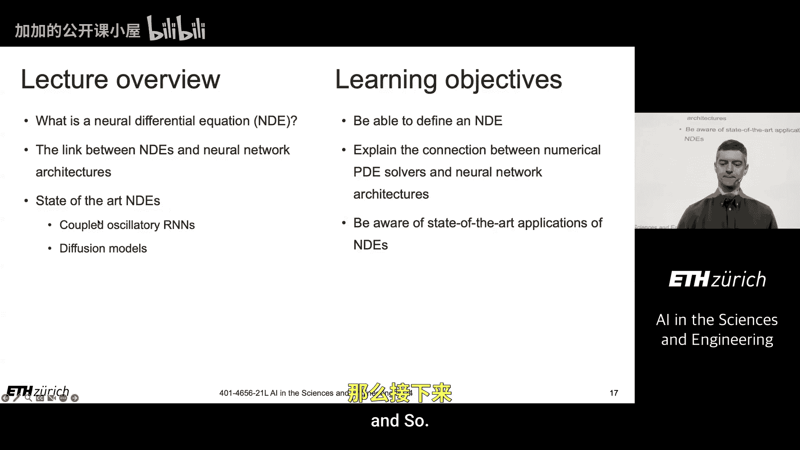
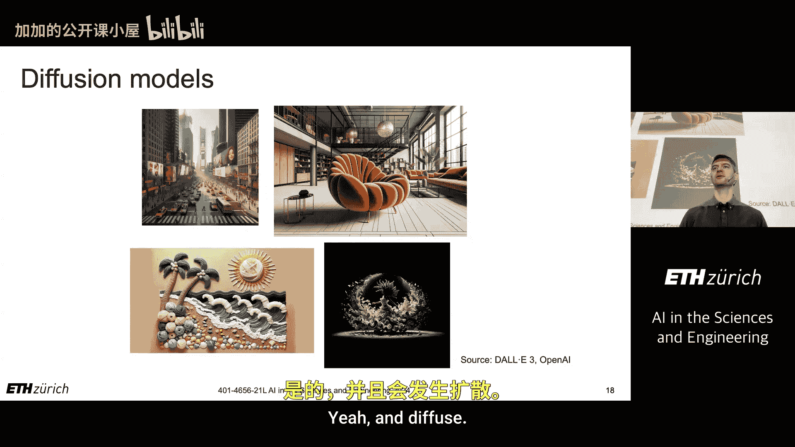
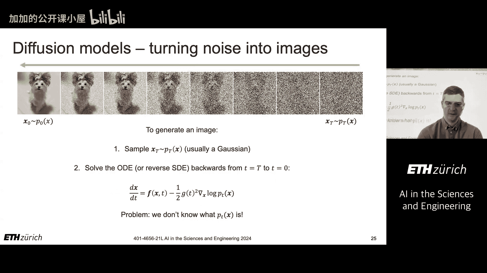
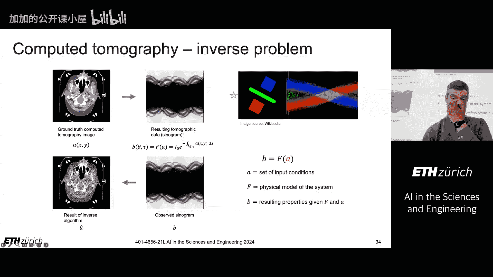
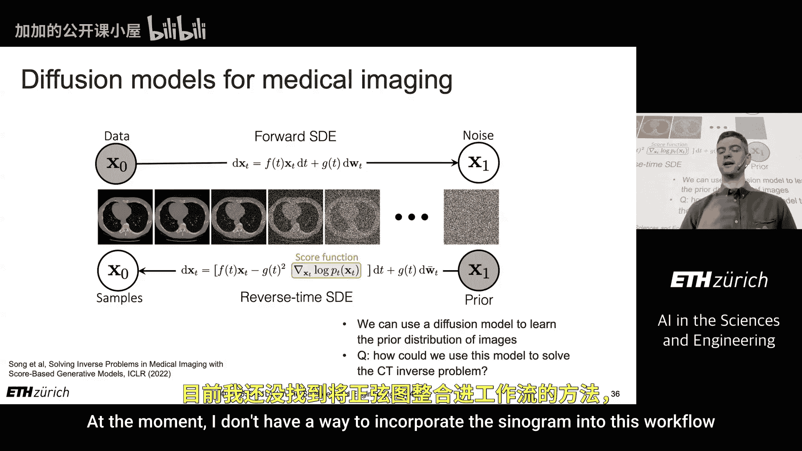
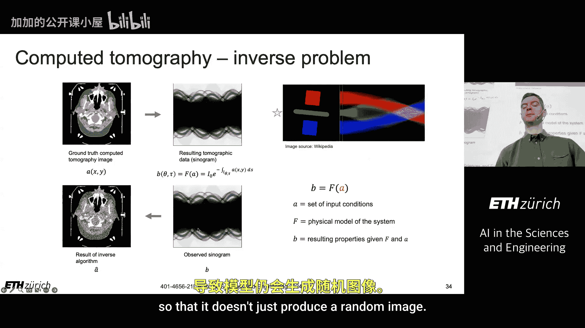
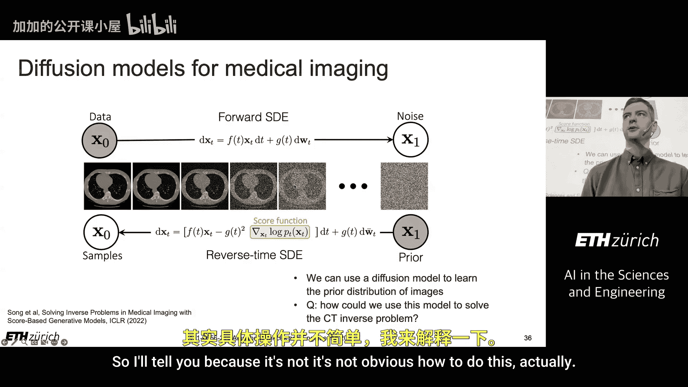
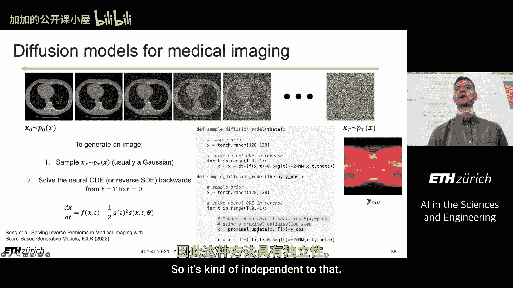
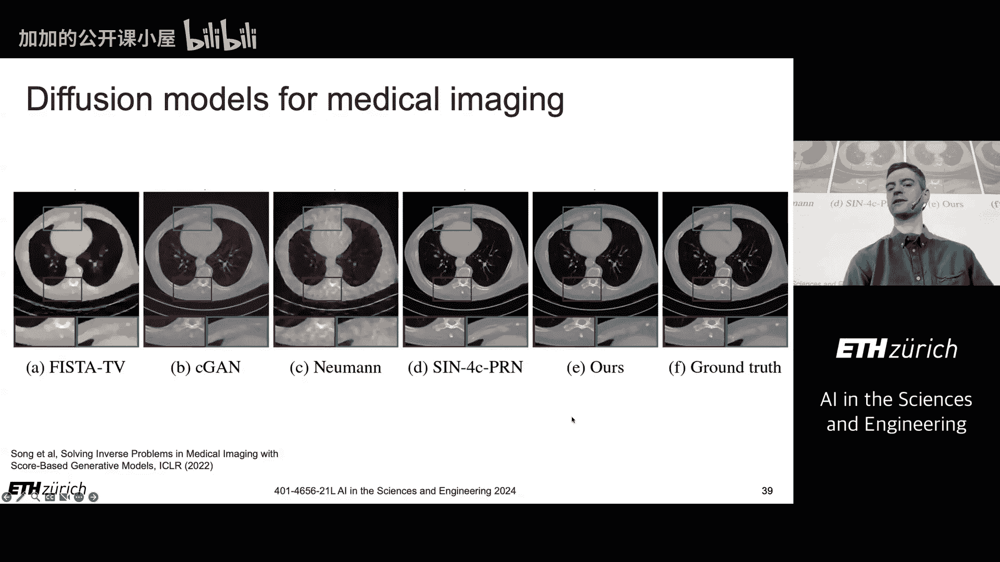
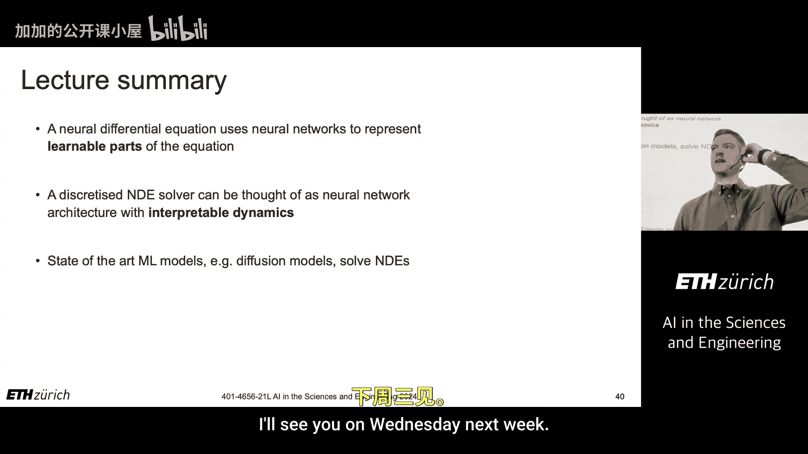

# 苏黎世联邦理工【中英⚡科学与工程中的人工智能｜2024 AI in the Sciences and Engineering】 p22 P22 Introduction to Diffusion Models -BV1smxgzHEPC_p22-

So I have in the last lecture and just now I've just given you the basic definition neuro differential equations。

 I also told you about this link between Ns and neural network architectures。

And then I told you about kind of the state of the art neural differential equation model。

 these coupled oscillatory on ends to solve with high performance these kind of machine learning tasks。

So now I'm going to spend the rest of the lecture talking about diffusion models。

So who's heard of diffusion models before？Pretty much everyone。

 so who's actually used the diffusion model， who's trained one？Okay， two people， okay， great。

So I'm going to explain what a divisionffus model is。

And how it's actually linked or how it can be interpreted as a neural differential equation。

 and it's kind of interesting。嗯。

So。This is examples of outposts of some diffusion models so who's heard of Dli or stable diffusion？

Yeah after all， okay， so you probably played around with it this is now publicly available you can these models you basically type in a prompt。

For example， like。A chair that looks like a strawberry or something I don't know and these models will like imagine or just generate a random image that looks like that prompt so it' conditioned on that prompt。

So they're generative models， they're models that take an input and maybe some random input as well and then generate an image from that kind of conditional distribution。

And they're super impressive like， oh， just over the last five years。

 there's been so much improvement in the quality of these generated images from these generative models。

And kind of the generative model that's doing the best so far is the most popular at the moment of these diffusion models。

So what is diffusion can anyone tell me or give me a definition of what they think diffusion is？Yeah。

 random movement particles。What exactly happens though when particles are moving around randomly？

And diffuse yeah yeah so so see you've got it so this is diffusion is just the movement of it doesn't have to be particles actually many processes in science can be thought of as diffusion processes。

😊。

So let's just talk about particles for now， the movement of particles from regions of higher concentration to lower concentration。

And it's just this movement is just driven by the random motion of the particless。

 the random movement of the particless。Who had a Brownian motion？

 so this is an example of like random particles randomly colliding with each other and moving around kind of on a random walk in some space。

Another example is like gas， for example， particless of gas。

 so say theyre it confined inside this box and then we take out like one of the walls of the box and make the box bigger。

Even though these particles are just randomly moving。

 they'll eventually start diffusing into the wider box。

And so what you end up with with a diffusion process is you go from some highly structured concentration to some uniform distribution。

 that's generally what happens in diffusion。So people also use diffusion to model other things。

 so energy， but also in finance， we can use diffusion models to model the evolution of stock prices that's basically because then they evolve randomly。

诶。From some initial time。So how is it used for images， so for these image models。

 these generative models that are using diffusion to produce images。

It's just applying di fusion to an image， so what we do is we just start off with an image on the left。

And we just interpret that each pixel is like as a particle would you like。

And we're just going to let the pixel values themselves just do a random walk。

 like start randomly moving around and diffuse like that。Mathematically， that just means。

 or most of the case， that means we'll just add some gaussian noise to the pixels time every time step of the evolution。

And so we just start adding noise to this image and what you find is whatever image you take。

 you will end up with some generally simple distribution at the end。

 in this case just a Gaussian distribution。And所以。This is really interesting。

 this tells us that we can go from very easily from an image to source some noise basically at the end and it's just a diffusion process that guesses there。

Everyone moved me so far。Yeah。Okay。So let's try and just define it a bit more mathematically what this process of diffusion is when we're applying it to images。

So we can。We need to talk about probability distributions because diffusion is a random process。

So we can just say that we start with some image here， which is drawn from some data distribution。

 so Pn of x。What does this mean this just means it's just the probability of that image occurring naturally。

 like it's the probability distribution of natural images。If we sample from this distribution。

 we just get a natural image， if you like that's the distribution that we would like to learn。

And then we apply diffusion all the way down and we just we can assume that our diffusion model is going to end us up at some very simple world defined distribution。

 say Gaussian distribution over those pixels。This is a kind of prior。

 we would call it a prior distribution thing。And so we can model many different diffusion processes with stochastic differential equations who learn about SDEs before stochastic differential equations。

Okay， so some people， not everyone that's okay。So we can write this kind of diffusion process as this kind of equation here where we say a small change in the image in the pixel values Dx。

It's just some deterministic process that some you can imagine that maybe over time they just have a deterministic drift to them where their needs just change slowly。

So this is determined by this drift function。But then the interesting thing is we also add this small random noise to the image here。

 so we call this the diffusion kind of change and what we just say is that this kind of random variable that we add to the images here。

 this W is just a Wiena process。Which。Can be a whole lecture by itself just describing mathematically these kind of random random processes。

 but for now you can just think of it as adding Gaussian noise at each step and GFT just tells you how much Gaussian noise we add the kind of magnitude of that noise。

Any questions that on this equation， does that make sense？No， it does yeah again。Yeah。

 so this WiIer process describes like these articles as they randomly like change over time。

And so that it's not a deterministic movement， you kind of have to sample this process to when you when you're forward simulating SD。

 you have to kind of sample many parts to create these distributions rather than just a deterministic part。

诶。So yeah， you have to define kind of the how W evolves mathematically is like a probability distribution。

 you say at times some later time the distribution is like a Gaussian distribution。

So there's a super remarkable result， which was shown， I believe， by Anderson in the 1980s。呃。

We can go the opposite direction and so this is what we want to do if we want to generate if we want to。

Learn a diffusion model which， you know， given some random input can produce a sample from our data distribution。

 basically give us a natural image。What we want to be able to do is to go from right to left。

 we want to take some prior distribution， we want to sample a Gaussian distribution and turn that into into an image here。

And this is kind of a really remarkable result that says there is a corresponding stochastic differential equation。

if we solve this differential equation reverse in time。

 so if we start Xt and do time stepping from t to zero。

We will end up with a sample from the initial distribution from this stage of distribution。

So I think this is a really remarkable result， it gives us a way to take some random image here and then just model it with a through the stochastic differential equation to end up with an image here。

And what does this equation depend on， well， it just depends on the stuff that we already know so this kind of this drift function here and our diffusion function here。

嗯。DW here is just is another WiA process， it's just in reverse so that again。

 can be easily mathematically defined。And the other thing that it depends on which is not in the original form model the way is this p of x so this is the probability of x。

 this kind of distribution of the images it's a function of the time step so ats zero time equals t that P of t is just this Gaussian distribution and P zero it's the data distribution and at t equals t is somewhere in between。

So I'm not going to go into how that's derived。But it's definitely worth looking into and reading these papers to kind of understand why there is such a corresponding SE for the reverse model。

Now you can actually go one step further， it can also be showing that there's a corresponding ordinary differential equation。

 which if you do the same thing， if you solve this OD backwards in time。

 starting from some sample of this prior distribution， so some random noise image。

You will also end up with an x0 here that is drawn from， again， our data distribution。

 our P0 effects。So this is not stochastic equation anymore， this is just a simple standard ODE。

Which is deterministic， so we give it a random image here and it will give you a deterministic kind of sample from this initial distribution。

So I think this is another really amazing result， this is shown in this song paper how to derive this over here。

And it looks very， very similar to this reverse SD which so if we solve the reverse SD we get lots of samples。

 if we solve the OD we just get a single sample， but all of those samples are still samples from this initial distribution。

And it looks very similar， so again we have the drift term。

 we have the diffusion term and we have this the log of the density through time。So。は。ま差。あかさ。Yeah。

 so when you solve the SDE， imagine taking an increment of x like a you have Xxt here and we want to。

 we have to we have to discretize the STE to solve it as we do normally。

So to take one increment effect， you apply this thing， which is deterministic。

But then when you apply the venna process， you have to sample like a random Gaussian noise that youll add to the image。

So you could do it once and just create one sample and that will give you one path。

 but you could also each time step， you could also sample it many。

 many times and generate 10 samples for each time step。

And then take those samples forward for the next time second。

 they generate an exponential amount of samples that way。

Whereas the ODE is just defining one path like a deterministic path。

 but the core result is that the OD still gives。At the end of that path it will still give you a sample drawn from this distribution。

 so it will still be a natural image， it's just a single natural image。Yeah。

similar to the yeah so the black scores model can be is very similar to this so you can use similar kind of syllus as well yeah。

诶。所以。So how do we generate an image， so let me just write it step by step。So it's very simple。

 there's just two steps， we generate a random image。

 you know sampling each pixel from a Gaussian distribution。Or usually a Gaussian。

 so some it depends on the SV that you define socks and the kind of final distribution that it evolves to。

 but often it's just a Gaussian。Then you just sold this ODE or the reverse SD if you want backwards from time t to time zero。

And it's just a simple， we can use any OD silver that we like that fits this this equation， you know。

 so this could be Euler， this could be Rgu kurta， anything you like。

We are obsessed to repeat your best。Right so you've just asked my question or answered my question。

 so what's the problem here， what do you think is the problem？Yeah。😊。

We don't know what we don't know what PT itX。This is like some super complicated function。

Well we know it here we know that this is a Gaussian， but we don't know it anywhere else。

 this is already complicated probably never be able to express analyticalally function。

So what do you think we can do， how can we get around this？Yeah。Yeah。Images add for them， yeah。Yeah。

 yeah。Yeah， so we're going to try and learn it， that's absolutely be right。

So the process of training a diffusion model is actually just the process of learning this distribution。

 this PT of x。But what we actually do is not is nearly that we actually say we're going to learn this whole term here。

 so this the gradient of the log of the probability。

And we used to approximate that whole term with with a neural network。

 so that's that's the goal is' to train a neural network in some way。

 which I'm going to talk about later。So that it matches very closely this probability distribution or at least we call it the score function。

So what are the actual inputs and outputs of the network were it's exactly the same as the as this right hand side so this right hand side depends on the image and the time so the network is going to take X and T and produce。

Some output。So what dimensionality output would that be， by the way。

 if the network takes in an image， what does it output or what's the dimensionality of the output？

Just from this mathematical equation， what should it look like？Yeah。

 we here to use a scalar and the same aesthetic。Yeah yeah you got it so so this is the gradient of a scalar function the problem this is a this is probably an image or a matrix this is now a probability it's a single value this is a gradient with reflect to x so。

The output of this will just be another kind of image or the shape of an image， at least。Okay。

So how can we learn that， anyone got any ideas？Yeah，Yes。诶。

Cale divergence measures the similarity between two probabilistic distributions。所。嗯。

So to be able to match your network to that， you'd have to have some data that you know is drawn from the ground truth distribution。

Which we can do here and here。But I guess we probably could do it here actually if we just do lots of forward sampling so yeah。

 yeah， yeah yeah。Yeah， so I think that could work yeah， it's not howve we've typically defined it。

 but that may be a different way。Anyone else？Okay， so。This is a what the one way。

 it's not the way I'm going to describe next， but this is just a。This is just a no ID。哎。

Once we replace the score function with some neural network with some pre parameters。

 this is exactly an or OD that we've just been looking at。

So how do we train these networks when we train inO ODs？Can anyone remind me？forwardYeah。

 actually yeah。Yeah， so we simulate it forwards and then match the outputs with respect to the input。

We know that if we simulate this the fusion process。

 we know what the outputs of the backward soil should be so we can match it to those outputs so that's one way of doing it。

The way that people actually do it is to use this type of loss function。Where we just say that。

Very simply， like even simpler， we want the the network just to match you know this the score。

 the score of the probability distribution， so I'm not saying anything new just to say I'm just trying to make sure that this is true。

And we're just taking the L2 norm because this isn't this network outputs and image。

 that's the gradient of the distribution。And we want to make sure that this is true across all the inputs of the scores function。

 right so that we want to sample all the values of T and all the possible values of XT。Is that。

That makes sense as a simple kind of loss function。Okay，所以。Again。

 you can I'm taking multiple steps at the same time here to give you the overview。

 but there is another paper you can read which says that this expectation over T and XT here can be rewritten as this expectation。

Well what we've done is we've turned the kind of unconditioned distribution as function of x here into a conditional distribution of x given the initial value of x so this is。

What's the probability of a noise image given some initial noise distribution here？So yeah。

 you'll have to look at this paper to believe me that it's true。

 but this is an equivalent expectation。So now we define this。

 the probability of some some time given the kind of initial Gaussian value。

Or initial prior image is the transition probability of the system。Okay。

 so let's just think of a really simple SD let's forget about the drift terms and the diffusion function and just say that。

The diffusion of x is just exactly a weer process。And so I told you before you can just think of a weer processor adding Gaussian noise at each time step。

But it's kind of a continuous version of that and the Wier process actually tells us analytically what this transition probability is。

 it says， you know， given some star image here，The image at time T is just， you know。

 some Gausian Gaussian different like like it's the same image。

 but with some Gausstian noise added to it， like you know， this is the distribution。

And the kind of magnitude of that Gaussian noise is just proportional to the time。

 so the standard deviation of the Gaussian noise just depends on how long the process has been evolving for。

嗯。Can everyone kind of get the kind of high level concept even though the math might not look too familiar？

Yeah。So this is just an expression that we can take the gradient off with respect respect to x it's very simple。

 you can derive it as this that's very trivial to show。

And so then if we just plug this transition probability into our kind of transformed loss function。

We just say that the loss now is just an expectation of the output of the score network。

 and we want to try and match it till1 of t times by x nor minus xt。

So we're going to average this difference either all times， all possible initial random images。

And then overall path that that image takes。So all， all Xt images。

And if you just look at this in a bit more closely because you just think we're just what we're trying to match the score network to。

 this is simply just the difference between our random noise and the image at time T so what the score network is trying to do is just predict the noise that's been added to that image at time T that's kind of just the interpretation of the loss。

Okay， hopefully that kind of gives you the how like the loss function that we often use to train these diffusion models。

Any questions on this？I recommend going through this in your own time and trying to see if it makes sense mathematically。

嗯。Okay， so。Here's the summary of diffusion models like and then I'll give you an example of how we use them in science。

How do we train a diffusion model so first of all as well as five steps first of all you need to get lots and lots of examples of whatever image distribution you want to model so these could just be many examples of natural images。

Then you have to assume some underlying form of your stochastic differential equation that is defining that diffusion process as that evolves through time。

And we need to understand what the transition probability is， what takes kind of the。Init。

Initial image here to sometime T here what's the transition probability of that happening？

And then we define a loss function just as I said before。

 and we can differentiate through this because we can analytically derive what this score of value is。

So we train the network and then when we want to generate an image。

 then we just sample or we sold this nor ODE or if we want the reverse stochastic differential equation。

 given that learn score function。Backwards in time to be able to generate a new image so we start from some random sample as the initial condition of this ODE and then we solve it solve it through time with like an oilless silver or whatever other type of discretized Soviet you like。

So this review paper here by Yang gives a really nice goes a bit more into the map behind diffusion models if you want to learn more about that and gives some a really good overview of all the different extensions of diffusion models and also their applications today。

I super recommend this paper if you want to learn more about these。Okay， any questions？Yeah。

 in practice， this bowl is curious function。So if I go， if I go to。

I go to this example where we have like a stock for example。

 so what this is showing is the random random walk of the other stock price if you sample it like four times or five times。

So this is like solving the SDD for words in time for a bunch of variables。

 for a bunch of yeah instances。So the drift function you can see here if you look at the Gaussian distribution at the end it's just the center is around zero。

 so what that drift function just does is define some deter termministic drift that would otherwise end up this Gaussian might like just drift upwards linearly for example and that so that would just be a linear function as a function of time。

I pretty interested that。Yeah， I'm not sure how to interpret that properly so have a look at that review paper it's Scott it goes way more into the different choices that people make for these SDs。

And the types of diffusion models that they produce would bes really， really interesting。

O。所以。We're now going to think about using， I showed you at the start。

 the fuion models are the state of the art for image generation， like generative models for images。

But people are also using diff fusion models now to solve scientific problems。

And so what I have is an example of di fusion model solving compute tomography。

 so everyone understands this hopefully we covered this when we talk about hybrid methods at the start。

So again， we have some snoogram that we observe from some image。So we scan ourselves。

 we want to produce one of these X ray images， but what the device actually measures of these sograms is the intensity of the screen。

And so the goal is to do the inverse problem， date this snoogram data and try and reconstruct the image or the absorption as a function of space here。

Okay， so there was this paper that came out very fairly recently from So where they used the diffusion model to generate these CT images。

 so you can instead of learning the space of like natural images。

 now we want to learn to sample like medical images so like you know images that would be output from CT from CT scans。

And you can imagine if I run like a million CT scans。

 I would have a good training data set and I could train a diffusion model to generate new CT images from that training data just using the process or the training algorithm that I just described。

But the problem is if I just train that diffusion model as it is。

When I sample that i'm just going to get a random image I'm not there at the moment I don't have a way to like incorporate the snoogram。

Into this workflow so that it doesn't just produce a random image。

 it actually produces the image that I want the result with the inverse problem。

So can anyone think of a way that we would incorporate our signage ramp into this workflow to。

To help the diffusion model like come up with an image thats solved the problem。

What we're trying to do is create a condition distribution here with trying to condition our diffusion model on some observe data to make an image that is like through the solution。

Any ideas？Well how could you use this diffusion model in a traditional inverse algorithm as well。

 like how could you use it？Yeah， I guess you the image that you're generating compared probably through the to the image that in the video set and probably the iPad has been exchange。

Yeah， I see what you mean。Yeah， but yeah， you're kind of on the right track。

 so I'll tell you because it's not it's not obvious sad to do this actually。

嗯。So what they did is， again， this is just the this's just that we've trained that deffusion model so it generates given some random noise。

 it generates a CT image that is in the right distribution of CT image that we know the image lives in。

So yeah， again， once we train that model we can just sample it just in the process exactly as I described and this is the kind of code that does it。

 you just generate a random image and then you solve this normal OD in reverse where you have this trained score network function that we've pretrained。

So what this paper suggested is doing a very simple extra step inside of that ODE silver。

And it says as we solve this OE solver three times。

 so as we slowly turn this noisy image into the final image， each time step that we're doing that。

 we add this extra update to the image on top of the update that stop that removes the noise from the image。

So this is called a proximal optimization step， that's a very kind of fancy phrase。

And there's a whole theory of like proximal optimization theory， which I'm not going to get into。

 but what you can think of at the highest level is this optimization step is just trying to nudge the image。

Closer to the solution of the inverse problem。And what it does is it just says， okay。

 given the current image at time step T。I want to update the image to that the loss of the inverse problem。

 so if I do a forward simulation light image to produce an expected snoogram。

I should try and minimize the difference between the expected snoogram and the observation and data that I have。

So you could also think of this as a loose level taking like a gradient step in the direction of the loss function of the inverse problem。

So it tries to push the image so that it satisfies the observation of data and then carries on diffusing。

 reverse diffusing the image to eventually end up with an image that satisfies the inest problem。

At the same time。Okay， so that's probably fairly complex， but do you get the high level kind of idea？

Each point of time。Yes and we sign the right thing yes the direction exactly yeah。

So what we're doing is we're like interleaving。A kind of gradient descent algorithm to update the image just like we talked about before we were doing gradient descent on the image to update it to match the diagramogram。

 but at the same time we're also adding diffusion we're assuming our initial images at Gaussian and at the same time we're like adding a diffusion reverse diffusion into that image to like help it。

Give it a prior basically it's guiding the image to like the image distribution that we know of。

So it's really a really cool method like interleaves kind of standard optimization with a diffusion model as the prior asset。

系。So yeah， I then revalu time。对。Evaluation time what what do you mean I wouldn't have label。诶。所 you。

Yeah， so when you do a new scan， you will always generate a new snoogram。

So youll always have this label in the you know， this observed data that you're trying to match to and when you're updating the image。

好，对对。Yeah。So it's actually really cool because this doesn't depend on the observational setup of the scan。

You just compute the gradient in no matter what the observation will itself is。

 you can still get a gradient in it so it's kind of independent to that。

So I mean， here's some plot from from that paper it's just comparing this kind of。

autimization and interleaved with diffusion model method with some other kind of state of the art methods like using GANs as your prior for your images and more traditional total variation method as well。

And yeah， at least on the data sets that they show in the paper。

 this seems to be a very competitive algorithm for learning these CT image reconstruction problems。

Okay， so I need to stop there。😊，Andy is used Nor networks to represent number parts of the equation。

Disretized N solves can be thought of as neural network architectures with interpretable dynamics and that provides this really fascinating link。

And many state of the art models like diffusion models， CORNNs can be interpreted as Ns。

 and it's really interesting to study in。Thank you very much Ill see you on Wednesday next week。

诶 yes知啦。