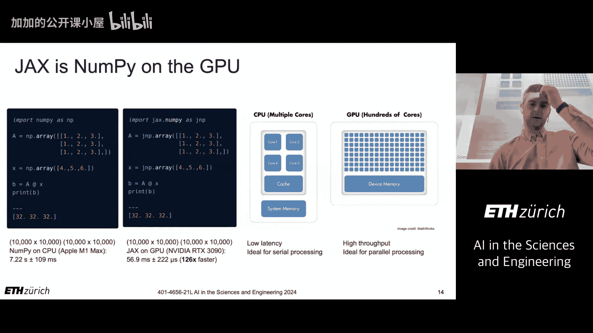
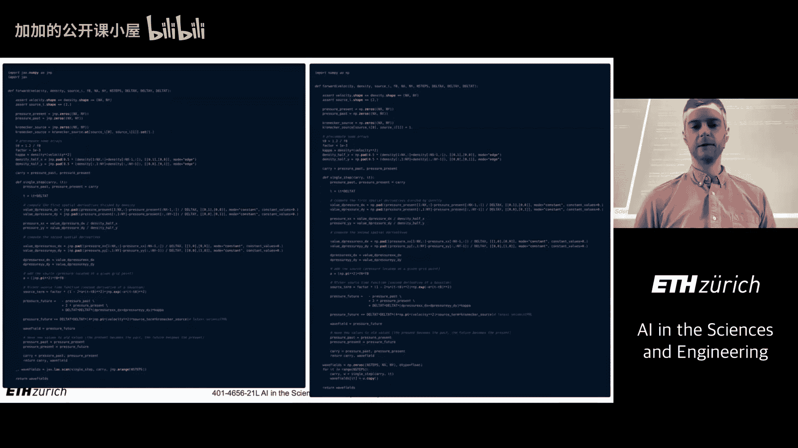
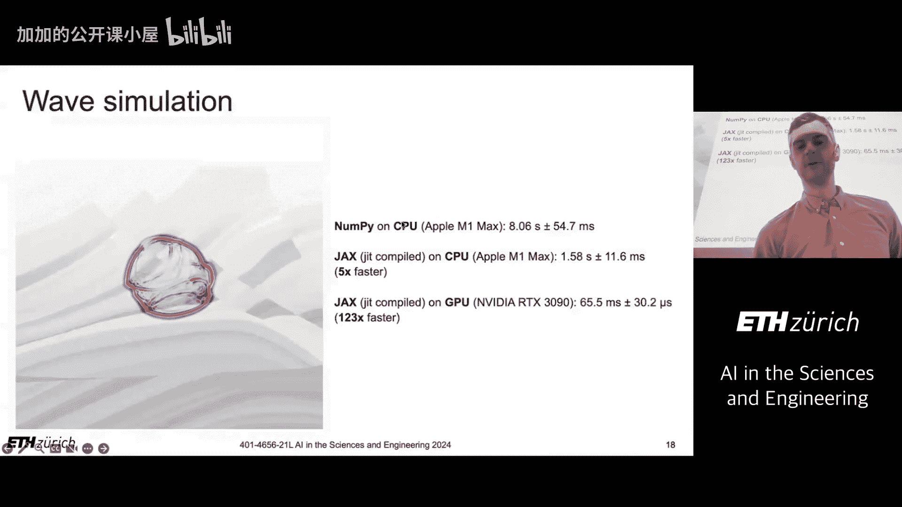
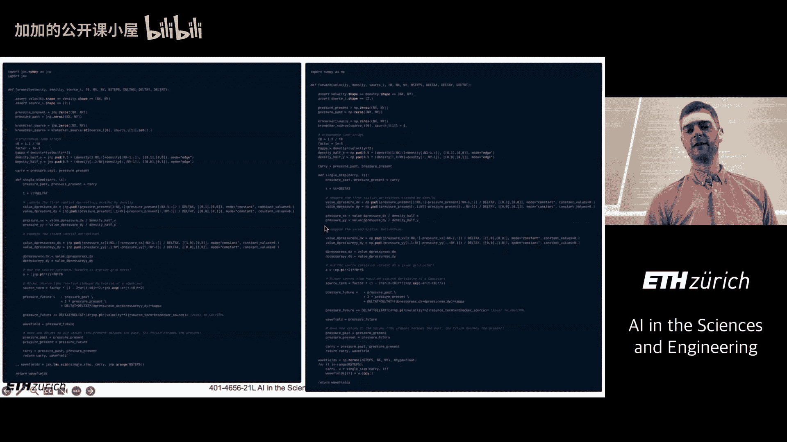
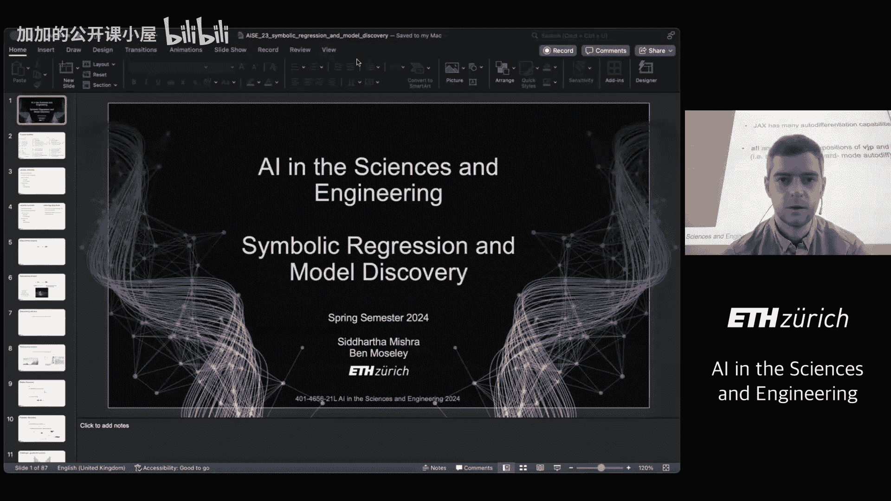
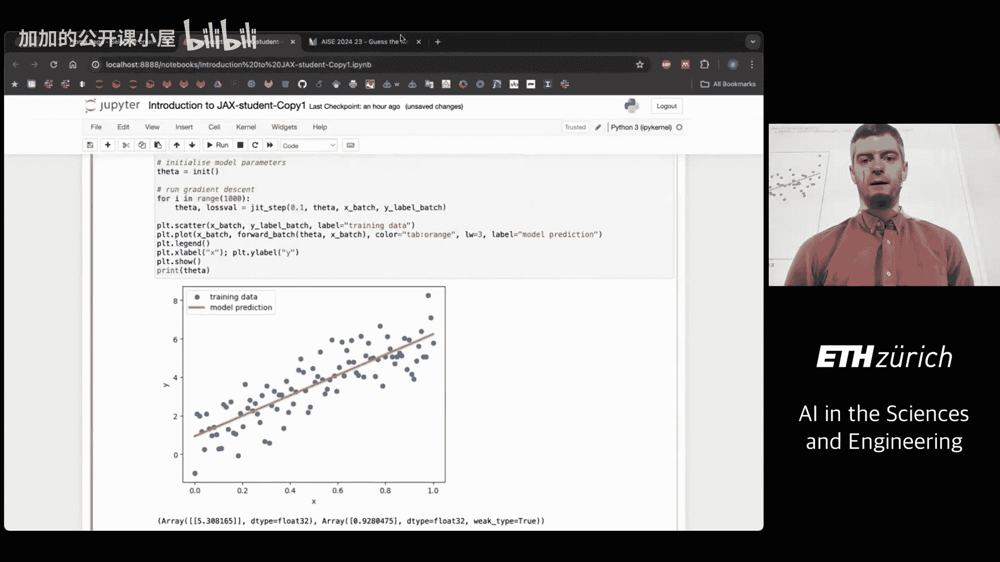
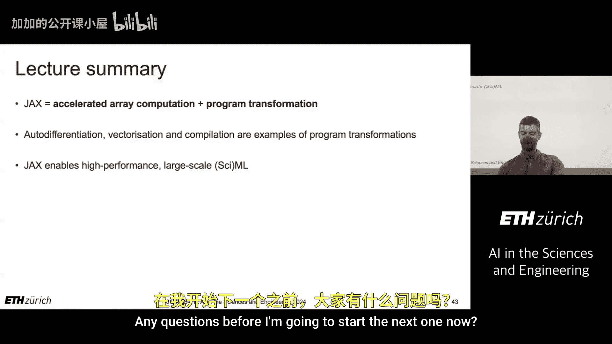

# 苏黎世联邦理工【中英⚡科学与工程中的人工智能｜2024 AI in the Sciences and Engineering】 p23 P23 Introduction to JAX -BV1smxgzHEPC_p23-

Let's get started。So this lecture， we're going to be talking about Jacks。Which is a Python library。

Hands up， who's heard of Js？Okay， most of you hands up who' actually actively use Janice。

What person yeah okay good so so it's something you've definitely heard about I'm sure and it's a library that I'm using a lot now in my research and I think a lot of people who are carrying out scientific machine learning are using libraries like Jas。

To carry out their experiments and so。The purpose of this lecture is to give you a high level overview of what the library is and why it's useful for all of the kind of techniques that we've been studying so far。

 so you know coding up and training things like N operators， physics and problem neural networks。

 hybrid workflows， these sort of things。

嗯，没白。So we'll hopefully spend the first half of this session talking about Jacks and then I'll try to move on to symbolic regression we're a little bit behind。

I won't finish symbolic regression， this lecture we'll move on and cover it on Friday as well。Okay。

So。I'm going to be explaining to you what jackX is。

 I'm going to be talking about the core kind of functionality of jackX and how it's maybe a little different to other deep learning or also differentiation libraries like Pytorch Tentensly。

I'll do some live coding and then I'll also talk a bit about how we can use JXs for SiML。

So you should by the end of the lecture， hopefully have a basic familiarity with Jacks。

Understand what this core idea of Jackson is which is a thing called a function transformation。

 I'll tell you what that is in much more detail。And then be aware of how you can use JX to work on these scientific machine learning algorithms and research questions。

So what is Ja， I already said JaX is a Python library。And it simply does these two things。

 one is accelerated array computation。So this is doing JacksonX's extremely fast array computation。

 so basic kind of linear algebra computations， and allows you to do that not on the CPU。

 but also on the GP and fully exploit parallelism of like our modern GPU devices。

It also has this really amazing feature which is programme transformation and this is kind of the heart of and how JaX is designed so we'll talk about why this is such a powerful idea coming up。

But these two things combined together makes it very easy and very powerful to design kind of these high performing highly scalable scientific machine learning algorithms。

 or even just ML algorithms or even just scientific computing。

 it doesn't have to be both at the same time。So just to give you some motivation why JaX is interesting and why a lot of people using it now。

 JaXX has been used to build some of the biggest machine learning models。

 so it's developed by Google。And so a lot of the kind of Google's biggest products and research are built in Js。

So I imagine everyone's heard of Gemini this is Google's recent LLM model， large language model。

 so this model was trained in JaX and used all of Ja's kind of functionality to train that model across thousands of GPUs and really scale their training。

Also Alphago so this is again Deep Min's algorithm that was able to play chess and go and other games extremely well and exceed human performance this was a massive kind of breakthrough a few years ago。

So the underlying algorithm behind this is a Monte Carlo research algorithm which has some kind of learnable components to it and again this kind of kind of advanced kind of search algorithm is written in JX and there's a whole implementation that you can look at and GiHub for it。

Jackax is also being used a lot in scientific computing today。

 so here's just three examples of kind of state of the art library so we have another library from Google which is Alpha fold so everyone' I imagine has heard of this this is the model that is able to carry out accurate 3D prediction of the structure of proteins。

There's also Bs， which is a library which is able to do kind of robotic like rigid body simulations for reinforcement learning typically。

So this is being heavily developed and contributed to。

And then there's a lot of papers that are coming out using JX to do scalable scientific computing。

 so this is a simulation of the ocean surface velocity simulated in 24 hours across 16 A100 GPUs so this is like state of the art GPU's simulation of climate dynamics。

And again， this paper used JAX to implement this model。Okay， so that's kind of a sale。

 I guess as a sales pitch for why JaX is useful is being used right now so。

What I want to do is get into the library in a bit more detail and tell you why people are using this to do scientific machine learning tasks。

So the first I'm just going to talk about the accelerated array computation so that this is something that you know other deep learning libraries。

 Pyth to Tensorflow also do very well， but JaXs is just the same。

What's nice about Jack's is you can somehow somehow think of it as just nonp on the CPU and GPU。

So one of the core libraries inside Jacks or one of the core modules inside JX is Jack Scott Nompy in and you could just think of this as basically a JX version of Nopay in that the kind of syntax is exactly the same or tries to be exactly the same。

So to be able to port nupi to the GPU or to basically take to run these fast like linear algebra computations of arrays。

 Jack uses this thing called XLA， which is accelerated linear algebra。

So this is a software that compiles the code， the JX code。

 and allows it to run very fast on whichever device you're using， whether it's the CPU or GPU。

I'm not going to get into the details of how XLA works。

 so you can just think of this as the kind of core engine that makes stuff fast in jacks。嗯。

And the program transformation， so what is brilliant about JX is it allows you to kind of also carry out autoDIF and also automatically paralyze your code and compile your code as well and all of these things could be thought of as a transformation of functions。

And this is what really allows what makes Jack's very powerful for our kind of scientific computing methods。

So I'll go through each of these in time later。So let's just talk about accelerated array computation to start with。

So yeah， JaXs simply or can be simply thought of as nonp on the GPpU。So on the left。

 this is some very standard non code I'm just defining it a matrix and then doing a matrix multiplication。

And printing the output。And hopefully everyone's very familiar with Nmpy and how it works and you can just see when we import jack slot NumpI the semantics syntax is exactly the same so we define an array in the same way we can use the same kind of matrix from application operators and we get obviously the same result。

给，所以。All the other functionality in Nnpyy like Npyy。om Nmpy。

8 range all this stuff is also in jack Npy and define the same。对。What's interesting。

 though is that the JX code will run on a GPU if your system has a GPU device。

This is what makes JaAX different in NmI because NumpI is just defined for the CPU and highly optimized for CPU devices。

And so what's great is that if this is a really large matrix matrix multipllyier， for example。

 so if I do a matrix matrix multiply in nup， so this is 10，000 by 10，000 matrix multiplly。

Im probably that takes about seven seconds just to do the matrix multiply on my MacBook computer hit。

If I do the same thing on a NVIdia GPU using the Ja code， it's 126 times faster。

Just to do that single matrix multiply。So can anyone tell me why running a matrix modelplay on a GPU is faster than a CPU？

对。We grow all products。Yeah， yeah because you can do all the row and column products on the same time。

 so why exactly what is it about a GPU that lets you kind of paralyse。That's how GP is about yeah。

 anyone know？😊，Who knows what the architecture of the GPU looks like or how does it look different to a CPU？

's like， yeah。Yeah， so CPUs， so here we go。So I just asked this question。CPUs and GPUs。

 this is a very high level sketch of what the actual device looks like， the hardware looks like。

And you can think of CPUs as just consisting of a small number of cores。

A laptop might have 16 cores or 32 cores。And these cores are designed to be incredibly fast and really。

 really good at serial computation。So that's sequential computation。

 that's computation that depends on his previous inputs。And these types of computations。

 the ones that we usually need when we're running like an operating system on a computer。

 we do lots of tasks in sequence。And that's what they're designed for and they have very low latency and they're really good at these tasks。

GPU， on the other hand， you can think of it as having thousands and thousands of course instead of just a few like 10 or something more 60。

And they are designed for running computations that are highly parallel。

 so you know the same computation that can be done and across all the cores and then that computation can be collected and output by the GPU。

So they're designed for parallel processing and they're designed for high throughput computations and you know。

 originally NviDdia GPUs or NviIdia as a company was like focused on game game development and for kind of。

Computations that you need to render games， but it just so happens that GPUs and these kind of parallel computation is exactly what we need when we're doing kind of linear algebra computations。

Yep， you should have a。Okay。I'd say four questions。What do you mean by overhead？好嘞。

But they see for the vacation。对点。Yeah， I actually think the communications faster because the cause of。

 you know， on the device。So the readout is incredibly quick。I think when you have multiple just CPUs。

 it can if they're on， you know on different nodes and it can take much longer to communicate between。

嗯。I mean， it's worth testing but I would imagine a GPU would be a multi threadd CPU for a matrix matrix multiply。

Given how optimize these devices have become in the recent years as well。所以。Yeah。

 so it turns out pretty much。You know， a huge percentage of the computations that we do in deep learning remember I was talking you through autoD and it just turns turns out to be a lot of matrix operations。

They are very well suited for running on the GPU， we can do those matrix multiplies in parallel。

 or at least all that we can multiply all the elements in parallel before summon them。Yeah。Yeah。

 so JaX knows which device you're running on so if you have a coer installed and you installed the coer version of Js。

 then it will automatically look and use those devices by default。So I don't even have to。

 I know in Pythtor， you kind of have to define which device you have in JX， you just。

 you don't even have to do that。It just knows which device you have。All right。

Yeah yeah you need to install the coer version yeah it's very simple to do have sequential theory Fs。

GPU yes， yes， so the question is if you have a sequential program or one that you know operates on a single value like a scalar value and then does a lot of sequential yeah so then I would agree with you that GPU is not ideal for that and it would likely be slower。

So you do have to think about the types of tasks that you want to put on the GPU so also JaX。

nom also runs very fast on the CPU。In some cases faster than normal N so。

 it may even still be fine to use JS， I have an example of that coming up。Yeah。Yeah。

 there support and。That's a good question， I think so。So XLA which is the back end。

 which compiles all the code down onto the GPU， I think it supports quite many different GPUs not just in video ones for sure it supports TUs which Google's yeah accelerate。

ok。

So。Yeah， I want to make the point， or I want to argue the point that a lot of the kind of scientific software that we use does indeed use。

 you know， matrix multiplierers or like matrix operations or tens of operations in general。

And it's not just our machine learning workflows， it's like our traditional scientific workflows too so this is a finite different simulation of the wave equation。

 so this is a fairly high frequency large kind of simulation of these waves propagating through an earth model。

From some source here and this is the code to actually run that simulation。

You probably can't see it in detail， it doesn't matter that you can't read each line for line。

But what I've got on the right here is just a nonpay implementation。

And this is a finite difference scheme。So what that involves is just you know。

 starting with the initial wayfield。And then doing finite differences on the wayfield to numerically solve the PDE。

And so the final difference is do things like taking that wayfield array and then。诶。

Subtracting it with itself but shifted by one and you can that's obviously a big matrix multiplication that we can do in parallel that's a kind of element wise operation。

诶。So this is kind of what all this intermediate stuff is doing inside this full loop of this finite different scheme。

嗯。So I can do the same thing in Jacks。I can yeah so there's a lot of element wise matrix operation so you could see how this lends itself very well to running on a GPU a GPU could do each of these element computations in parallel on all of those thousands of course。

So。What we can do is just rewrite it in Js， so we just import jack。 Nplay instead of import nonplay。

And in many cases， it can just be as simple as that。

 depending on how you've written your mobile bycode。The Js code can look incredibly similar。

 if not the same。So you can see how similar this jack's version is， we're using again。

 jackstone Ny looks like Ny， so the padding operations， they have the same inputs and outputs。

 for example， all the other functioning pool as well。

The only thing that we change is at the bottom here。

 instead of doing a full loop to kind of update the wayfield through time。

 we do a lower level call which is called Jackla scan， which essentially implements a full loop。

 but allows that full loop to be compiled and run faster than kind of a native Python for loop。

So this is more of a technical detail of Jacks， it's important to understand this but。

But I can tell you more about that later if you're interested。

But what you need to take away from this slide is it can be just as simple as replacing your input statement input statement to change your code in。

So once we've done that we can then run that wave simulation on the GPU and so here's the runtime of the comparison。

 so this is Npy on the GPU and I've tried to fully optimize this Npy code so NI tries to use this。

Kind of vectorized computation so I try to remove as many for loops as possible。

 this is what makes array computation slow in Python。

So I optimize this as much as I could and so this ran on again on my MacBook with eight seconds to do a whole simulation。

Now I can take my JaX NmpI code and compile it and so this is an extra feature that JackX lets us do and once I've compiled it this runs 1。

5 seconds so this is already five times faster just with a compilation on top of the NI code。

So this kind of answers maybe helps to answer the op question that it can be faster on the CPU if you do a compilation on top。

But the amazing thing is when it runs on the GPU and it's compiled， it's 123 times faster。

 so we're going from kind of an eight secondd simulation down to a 65 millisecond simulation。

 which is kind of impressive like given how how like high frequency or fairly complicated this simulation is。

Okay。So hopefully I've argued that you know， Jack's。

 but just like other libraries like P Toch Tentensorflow allows you to run these kind of。

Linear algebra computations on the GPU and really accelerate them beyond what we can do on the CPU。

Any questions so far？Okay。So the next thing I want to talk about。

 which is the really interesting thing for me is Jack's program transformation ability。

And so this idea is what allows Jacks to do things like auto differentiation and auto parallelism。

 parallel your computation across many inputs without you having to write any more code。

And this is probably the most powerful thing about Jackson。

 this is why it's so useful for using it in these kind of SML workflows。

So hands up who knows what a program transformation is or a function transformation。Okay。

 so new concepts。So what is a program transformation。

 so let me just write a very simple function here in Python。This is just a function that takes x。

 a value of x and it returns x squared。So。A program transformation or injects looks like this and this is a program transformation that。

Turns that function。Into a new function that instead of computing the x squared。

 it computes the gradient of this function。So the gradient of this function is two times x。

So this jackstop grab takes in a function as input， this is not a value or anything like this。

 this is a native python function。And the object that it returns is another native Python function。

But when you call that function。Give you the gradient of the original function。

 so this is a programme transformation it takes a program or generally a function in Python and returns a new function。

Who's with me？Yeah，It's an operator， it's an operator， yeah， it's an operator。

If in a mathematical sense here。Did you have a question that。So， let me just。Enumerate that for you。

 we just create an array with a value of x here。And if we print the value of we call this function。

 this new transform function， we print the value of the gradient and we get 1C so two times x。

But what's really nice is we don't we can then call that we can say that function and call it with some other value and we'll get the gradient for some other value effects。

So how' is this different to pieytorrch or Tensorflow 2。0？

How does Plytorch compute gradients or do autograd？Yeah告。I like that。好的。诶。

So how would you get the gradient of FFX with Bibook？What say。えっと。Yeah， yeah。Yeah。

 so Pytorch doesn't give you this like function that you can evaluate at any point in X。

What it does is you define a specific value of x， you do a computation on that value。

 and then you call autograd back through the computation of graph so you get a gradient at that value。

So it's slightly different。So each time you'll have to create a new value of x to do a new computational on X and then call back again。

Yeah， isn't it failing that I found most of the tree that forms the gravity tree。

 so it's actually the same it's slightly a rebel of tree that yes。诶。Yes， it is。It is the same。

 but we can do we get the function explicitly so we can carry it around in our code and we can apply it elsewhere。

Which is maybe more powerful than pie to watch because that's like a function that we can evaluate。

By the way， Jack's I think Pytorch also has this kind of program transformation ability now this is kind of the latest stuff they're working on in PyTtororch。

嗯。So that's also something to note as well。So how does it actually do this so what？

This is where Jax is actually， in my opinion， like a technical marvel。

 how it actually does this behind the scenes is very impressive。

And what it does is it actually takes this native Python function that we defined。

And it turns it into a simpler， more intermediate language， which is Ja's own language called JaASPR。

 so it's kind of a lower level representation of this function。Again。

 I'm not going to go into the details of this language。

 but you can see that it's just rewriting this function and turning it into something that looks a bit more low level with kind of types defined and other things like this。

Once has got by intermediate representation。Then it applies the transformation directly to this intermediate representation。

And it will produce a new function and if you look at the like intermediate representation of that function。

 you can see that that function is。You know， the exact function that computes the gradient。

 if you look at that long enough， you can see it's just doing kind of two times x。嗯。

And giving you the grading。So yeah， it really is giving you the function that you evaluate to get a gradient know2 x。

Okay。So this is what a program transformation is， it's transforming one program to another program。

And the way that JackX does it is it treats the lines of code here that you actually wrote as beta。

And and transforms that into a new function， so this is known as kind of method programming like programs that write new programs。

It's not just doing a rate computation， it's like taking in a natural lines of code and spitting out new lines of code。

Everyone now understand what our program transformation is。Okay。

So this is where JX gets really powerful is that once you've got once you've spit out a new function。

 again， this is a native python function， we can take that function and then apply some other separate transfer to it。

And do the same process recursively if we like。And so this is the power of J is that these program transformations can be arbitrarily composed。

So a simple extra transformation we might do is take this function that you know。

 is just computing to X。And we just call Jackstock right again to get the function that computes the gradient of that function。

 which is just two。So。If we call this new function， again。

 we can query at any point in x we'll get the second order derivative of the original function。

So this is really， really nice。I would argue of much clearer or kind of explicit way of computing gradients and doing autograph。

So this is going to allow us to develop some very highly sophisticated kind of workflows using using this idea of。

Arbitrary composition of function transformations。Does this makes sense to everyone how this works。

had of letter moves out of this。No， it doesn't so it's not it doesn't use analyticsnatic rules or it。

So we talked about auto differentiation。And we talked about vector Jacoban products。

And I talked you through the algorithm that computes vector Jacobbian products。

Where you basically define the forward operation， but for each。Primeter of operation。

 you also define the vegetable carbon product and then as you do a full pass and then a backward pass。

And that will give you the great thing。And so this this is actually exactly what it's doing here if you look at this transformed function it's doing the vector Jacobcoban product computation so it's doing like a forward product here and then it's doing you know the backfb through that the vector Jacobban products through that。

So that's what grad is actually doing is just writing the whole autograd computation down as a function。

Okay。So I'm going to do some coding you can follow the link if you like。Yeah， if you want to grab it。

 you can。So this is a notebook that you can go through。

 it's a very basic introductory notebook on Jacks。嗯。Did I just change my screen？So。

I'm just going to show you some of what we've already covered just in this so we're just going to import jacks like we just import any other Python library。

And again， this is just an example of doing some very basic array computation in Jackson。

 like I said， we just create an array just like we were doing Npi。

And then just do some basic array multiplication or element wise operation here。

The other thing that's happening here is x is just a one by three array here。

 so who's heard of broadcasting， who's used broadcasting in Numpy？Yeah。

 this is where you have like a one in if you have a dimension size， which is one。

 it can kind of paralyze that across another computation or broadcast in general。

 so that's what it's actually doing here when it's creating this is a。

So all of that kind of clever broadcasting stuff in Numpy is also in Jas。

So what we're going to do here is we're going to do auto differentiation with jacks just like I showed you。

 so this time I've got1 H this is my function that i'm going to differentiate so if I just plot this for I've got a。

A factor here of V studies from minus five to five。So this is the10H。

So what I'm going to do is just use the program transformation to transform this function into its gradientging。

So it's very simple， we just say the FDX。Again， this is a Python function that's going to be output is jackpot grad。

Of of my function。And we also want to compute the second derivative。

 so it's very simple all we do is just call jacktGd again。

On this new function and again we return a new function which evaluates the second order of derivativeive。

So we say the D2 F，DX2 function equals jack stockrad。On this guy。Then we run this。

And then what we're doing here is plotting the result across the XRA and you see Jack is giving us the gradient and the second derivative of Tage。

So that's just showing you how easy it is to do autograd ins。对。Yeah。

Yeah so I'm passing over the fact that Jastar grad expects the output of the function to be scalar。

 so it's the scalar gradient of a function。Or it's a it's the gradient of scale of function。

 The function can have vector input， so it's doing the vector Jacobbian product， but in that case。

 the vector。The remote binaryco by is just a simple scalar and it's defined as one。呃。

I'm going to talk about right now the lower left with other jacks。Transforms。

 which can do the VJP in general and the JDP in general。

So this is why I'm having to do a fall loop here because I have to make sure that the input is scale the scaleal。

Okay。是。😔。

ok ，所以。嗯。Okay。这。Lets check that you can see my screen。😔，嗯。

Okay。So诶。I just showed you the gradient， which does the gradient for a sc a function outputs a scalar。

But in general， jetts can do vector Jacobian products and chiicb vector products。

 as I was describing in the also differentiation lectures。嗯。And in fact。

 all of Jackson's auto differentiations program transformations are all based on compositions of the VJP and JDP。

 they're just specializations or compositions of these two fundamental kind of program transformations。

So we can do things like get the gradient of F， we can even get the Jacobian of F。

 so you know all the derivatives all the partial derivative of F with respect to its inputs。

We can get the Hessian， we can do all sorts of really interesting things and you can go back and have a look at how these the inputs and outputs of these program transformations later。

嗯。So。呃的。So yeah， computing the gradient doing AutoDIF is just one type of program transformation。

 this is actually a much more genuine idea than just through it using it for AutoDF。

So can anyone think of any other like useful transformations we might want to make of some if we define some function in Python。

 what might be a transformation that used for？Yeah。

 kind transformation yeah yeah in that's such a quite a good idea yeah like invert the functions so instead of F of x if there's an x function of F。

 yeah so Jack doesn't have that， but that would be interesting。Yeah。Any basis transformation， yep。

 that's good idea。Yeah。Any others？Yeah， integration， yeah， very good， yeah。呃。So。

I'm going to talk about。Some other ones。One is just to vectorize the function。

 so this is a very powerful transformation in Js。And fization。

I you can think of it as simply just paralyzing the function across many inputs。But when I mean that。

 I don't mean paralyzing it across multiple kind of devices， multiple CPUs and multiple GPUs。

 I just mean parallellyzing it so it runs in parallel on the single device or on the GPU in parallel。

So what I mean by that is say， for example， we have this like basic computation here。

 which is just a dock product between two vectors。Plus somebi like this is a very common operation used in like linear layers of neural networks and other scientific workflows。

So say now that I give you many examples of x and I want to times all those examples by the same weight value。

Mathematicically， we can just think of that as a vector times by a matrix operation instead of a dot product that will spit out a vector instead of a scalr。

嗯。And so。The task here is to tape the code， the function that just computes a single for a single example。

 the do product and give you a scalar。And we might want to vectorize that function and say， okay。

 we now want to。Instead of just inputting a single x to that。

 x will now have another dimension which will contain all the examples all the parallel examples we want to run that computation over。

Everyone follow so far。So if we were just going to write this in， we would have to think about， okay。

 X change dimensionality。We're going to have to change this stock product with a matrix multiply or make sure that Nie understands that there's an extra dimension to x。

But JackX means that you can forget about that you can just write your function for a single example and then what you do is you just call jackX。

 V mapap so this is back to rise map。Again， it's another function transformation。

 it takes my function is input in any arbitrary pthon function。嗯。And you tell it？

Of the three inputs they have。Wwhichhich inputs you want to paralyze across and more specifically。

 which dimension of that input we're going to de as having all these parallel inputs or these examples in it。

So what this function F batch is going to say is it's going to again， it's going to take。

W as input it's going to take b as input， but then it's going to take x with an extra dimension added on the first dimension that contains all the examples that we're going to put on in parallel of x。

So now we if we create X here with you an extra dimension with all these examples of these factors that we want to compute。

And we print the output of F batch， you can see that it's now giving us a vector as output instead of a scale。

So it's doing all these in parallel。也是。No so B characterizeize D down buying functions。

 so if LC in there you'd have to rerize the like。VMap can handle ifF statements。嗯。So there's some。

Soleties。So which I don't have time to talk about， but there's one of the limitations of Jack's is。

That the shapes of the output shouldn't depend on the values of the input。

So what I'm saying is the shape should be known statically before you input them to the given the shapes of the inputs of the function。

 you can if you can do that and make sure that it's a static computation。

 then you can use kind of conditional statements and still vectorize those those statements yeah。嗯。

Yeah。I think that's true， but it depends on the program transformation that's definitely true for compilation I think that's true for v but I'd have to actually check properly。

嗯。So if you look at the kind of， again， if we look at the intermediate representation， this is again。

 to transform this function， JaX will take this intermediate representation and then treat it as input as data as input and spit out a new function。

Which is the vectorized format。And if you go into this function and actually look what it's doing。

 it's inside here， it's got。Like a dot product， this dot general here。

In the original function which is what nonp dot dot is doing。

 but what's interesting is that when we' vmapped it it's realized that we can still do this as a dot product。

 this is now instead of a vector dot product this is now a matrix kind of product instead and this generalized dot product can handle that。

So what's cool is that it's not using like a for loop。

 like the naive way of vectorizing this function would just be to say for I in range and call this function with each input each new X's input。

It's realized that we don't need to do that we can actually just write it as a matrix product and this is what when we run that matrix product under the GPU it will then use the cause in parallel to do the computation so this this vectorized function is much faster than just doing like a native hyp fo loop to call the function repeatedly。

Does that make sense？Okay。So诶。

Let's go back。And look at that。

Oh， I do have a couple more examples about OF。For example。

 this is the let's just go back to this sort of of example， so this is doing the tanN H function。

Computerute tonnage。So we can do jackstar Jacobbin this will give us the Jacobin of that function again this is a function that we call with a value of x and it will spit out the Jacobian。

So the Jacobian is a matrix， it's all the partial derivatives of F with respect to x。

And now x here is an array that we're putting so it's a x in the range minus five to5 and what it spits out is an array that is diagonal like a Jacobians diagonal。

 so can anyone tell me why this this Jacobian is diagonal？In this case。

For a function that takes in x and spits out1h x。Yeah。对。Yeah。😊。

So when you call this function with a vector。It outputs a vector。

 so Jack sees that as like a vector valued function that has a vector input。

So the Jacobian effect in general would be a matrix。

But the important thing is that each output of that function only depends on the same element in the input。

So you know。F1 only depends on x1， F2 only depends on x2。

 so there's no the gradients of all the cross derivatives of all the cross partial derivatives are just zero because it's an element wise operation。

So yeah the Jacobian in this case is di one。And we can also do。You know， vector your per products。

Now x is an array， so we do a vector equilibrium product， we define the vector as an array of one。

And this will just give us the gradient element wise gradient。

And we do the same thing with a forward mode auto different instead and again that will give us the gradient。

 the same gradient so you can have a you can look through this again in your own time and just convince yourself what's happening mathematically here。

Okay。So let's talk about vectorization， so that's vectorize this function。

 so now we're going to vectorize not just this kind of simple dot product。

Or actually this is a this is now a matrix vector multiply we're assumings this is like a layer of a fully connected network so we have a weight matrix we have a single example x is a vector。

We're going to add a biospector and then we're going to pass it through an activation function。

So we can call VMap on this entire function and allow it or vectorize it or paralyze it across many examples of x。

嗯。So this is just the， if I just call the function with some random kind of weight matrix。

 10 by three weight matrix and an x vector that has three elements。Then yeah。

 x is the input size of x is just three effectively with three elements。

 the output of the function is vector with1 elements。

 so this would be the hidden state after the layer。But say that I have many examples of X instead。

 so maybe I've got a thousand examples like a batch of training examples that I'd be feeding to the network。

So all we do to vectorize dysfunction is we just do。呃。会。

Just call judge thought female upon this something。嗯。So we' grabbed the function。

We say which axes and which arguments we want to paralyze across。

So if we don't want to paralyze across any of the arguments then we just put a none so just saying that we're not going to paralyse for the first two arguments and then for the last one。

 we're just going to say the examples are in the first dimension of the input。And then again。

 when we run this function forward with a batched example， then we get a batch batch of outputs。

So you can see how this can become very powerful when we have very complicated functions。

 we can vectorize the whole function across all the non operations that we have in that function。嗯。

Okay。So let me swap again。Okay， so next type of program transformation is a compilation。So。

I'm not going to go into details about how Jack is doing compilation， I'll give maybe one example。

 but at a very high level you can just think of this as taking my original python code and just rewriting it。

Using this lower level representation and also Xel this accelerated linear algebra and Pylon。

To make it run faster on the specific device that you're using。嗯。And。

So this is an example of how we might make this code a bit faster。

So this is a function that just computes x plus x squared plus x cubed。

And the way that this function might run on the GPU， if you just call it this way in JX。

Is there are separate kind of underlying kuda kernels？

These are kind of like low level pieces of code that are defined to run like small operations very fast。

So there might be a crudeuder kernel that is defined for like a simple matrix multiply or an element wise multiplication like an x squared。

There might be another kernel which is a different implementation that runs X cubed and then there might be a final kernel that is cool to sum all these things together。

And if the code uses separate kernels， then usually what happens is that each kernel runs independent。

 there's like an independent thread or kind of job on the GPU。

It reads from the kind of global memory of the GPU for its inputs and then saves those outputs of that individual kernel back to the memory。

Back to the global memory of the GPU， so this is the kind of shared memory across all the cores。

So what takes time in this whole operation is the reading and writing to the global memory。

 this is the kind of bottleneck of these computations。

What you would when you call Jack's compilation it realizes that these three kernels can actually be fused into a single kernel so it kind of writes a kind of custom kernel or a fuse kernel that doesn't have to do all these kind of reads and writes to the memory it just it knows that I can just do one read to the memory of X I can do all these X computations and sum them together without having to save and rewrite to the memory so it kind of。

Minimiseizes these communication steps and gives you a fuse con when you can pile the code。

So this is just one example of how this， again， this is a function transformation， a takes function。

 it gives you a compiled version of that function that runs very fast。

This is just one example of how Jt optimizes the code。

 Jt does many other very sophisticated optimizations with with XLA that I'm not going to talk about。

嗯。Long story short， once you've jetitted your code and you've compiled it， it often runs much。

 much faster。 so for example。When we fuse these operations together。

 we can just get a speed up of eight times already。

 so you know by reducing the bottlene of read right to the global memory。嗯。So yeah。

 behind the scenes， this is using XLA， accelerated im linear algebra。

 both for the CPU and GP and I think it works for other specialized devices too。

Like TUs and other devices。But there is a cost here and the cost is that it takes time to compile the function。

 it depends on the function， but sometimes this can take seconds or more。

And this is kind of an upfront cost is to do that compilation so typically your only kind of compile functions that you know you're going to run hundreds of times so that that upfront cost doesn't is kind of the mort story is not important。

So if you imagine like training a deep neural network。

One function that we call thousands of times is the function that does the update of the network's weights。

 so it does the gradient descent step。So when we use D compilation in deep learning usually we compile the updates set and that's expensive for the first update。

 but then for the next million updates is very fast。Any questions on this？ok。

So I'll just go back to the。Jit compilation and then we'll take a break。

So yeah here's an example of exactly that function and I'll just prove to you that if I compile compile that function then I time how long it takes to run that function。

For a fairly large array， this is running on my CPU， by the way， so I'm not even on a GPU。

 but the compilation still makes the CPU run much faster so。Its it going to take？

This is about an eight time speed up like I was showing in the slides。

When I'm calling the Jit function rather than the original function。嗯。Okay， so I'm going to describe。

I think we'll take a break and then I'll describe the final example。

 we're going to put all these ideas together to do some linear regression。Yep。Okay。

 so let's carry on， we're going to put this all together all these concepts that we've learned about program transformations and do linear regression。

And you're going to see that this particle is going to use all of these transformations。

 so we're going to use the vector VM， we're going to use Jt compilation where you're going to use the Gs transformation all together and compose them together to solve this。

So here's here's our training data， we just want to fit a straight line to this data that's what we're going to do in one dimension。

And so。First of all， I'm just going to define a function that gives us our initial guess of what our weight and our bias value is。

 it's just the gradient in of the line they're both scale the values。

So we're going to use gradient tocent solve linear regression。

 obviously we can do it more analytically， but this is just for the purpose of demonstration。

So then this is our forward model， like we would do in Pyth which。

 we would define like a forward function。So you're just going to grab our weight bias value。

 we're going to do the matrix multipl with X。Which is simply just a dot product， or in fact。

 it's just a single scalar times by single scalar in this case。Plus plus of bias。

And then I've got I'm going to Vm my forward batcht so this is written for a single example。

 a single value of x， the scalar value in this case because it's a  D line。

And we're going tove up it so that it can take in all of these examples of X that we have。

 we have 100 different training points here。Then we're going to define a loss function which takes the batch of x values。

 the labels of Y， so the x and Y coordinates that we have in training data。

It's going to call this VMap version of the For function。

 so compute the prediction for all of the training pointss。

And then our loss function is just the prediction of the y value。

 the mean squared error between the labels and the prediction。Everyone， follow me so far。Great。

Then we're going to call this gradient transformation so value and grad is just is another program transformation that just spits out the gradient and also the value of the function at the same time。

 so it gives us both values。嗯。And we're going to differentiate loss with respect to the first argument。

 so this is going to give us DL by D test so this is the gradient of the loss with respect to the weights of the model。

 so with respect to W andB here。So then the final thing we need to do is do a gradient descent step。

 we need to define a function that we're going to call many。

 many times in a fo loop to do gradient descent on the weights。So that's why I'm going to write。嗯。

So to do the step， we just need to compute the gradient and then we need to update the weight's based on that gradient。

How do I compute the gradient？It。The ducks。Yeah。So we did that already。

 we've got a function here grad， this is a function， this is a program transformation。

It takes loss and gives me the gradient of the loss。

So all we need to do is just call that function so we just say the LD Theta equals grad。

And then we pass all the arguments of the original functions， so we pass all these guides。诶s that。

So like I said， this transformation not only gives you the gradient or。

 it just gives you the value of the loss， so we just we get both when we call that function。

And so now we need to update data based on the gradient of theta。We say pizza。

Equals so theta here is actually a jual， it's a Python juple。

 which just contains the weight and the bias values。

So I need to go into that cheaper and update the weight so the output here this the abitheto is also a cheaper。

 which has the gradient of both of those quantities in it。

So I need to go into that Juer and update the Juupal。

 so Jack has like a handy kind of utility function， which is called jacktop treeup。

So what this does is take any kind of python tree， so a tree would be like a nested structure like a dictionary or a dictionary with' Ly or that has some sort of leaves at the bottom。

So this tubo is also a python， a pie tree， which calls these things the pie tree。

So tree map just applies some function to each of the leaves of that tree。

 so the function that we want to do is just the gradient into sense step so we just we specify what the function is。

So the function is going to take the theta value and the gradient。Like this and it's going to say。

We're going to take a gradient descent step by times in the gradient by a school value。

And then we're going to map this function to。That'sThe Theta tree and the gradient tree la。

So can you see how what we're just going through here is we're just going through these tuups and updating the gradients of each of the elements of the shal。

 that's what we do。And then we just need to return。The theater and the all study lattice。

So this is performing one gradient in descent step and then what we have here is just a full loop which is going to call that step function many many times before we call it we're actually going to use J to compile this function so this is what I was saying we typically when we're training training models we compile the highest level function we can which in this case is the function that does the gradient in descent step。

诶。Any questions on this before I run it？O。So if you run it in it does it straight away。

This is why G is so powerful it just runs so quickly on these like small small operations so I just ran100 gradient in descent steps and I did it basically instantly on my CPU。

And we fit the line。O。诶。

So let's go back to the slides。

Okay。So I talked about a kind of fundamental。Features of jacks that accelerate array computation and the program transformation。

In a very general way and these things。Can help us do big machine learning tasks。

 but there is also a lot of effort using JaX for scientific machine learning tasks。

So doing exactly the types of techniques that we've been studying in this course。

Combining machine learning very tightly with our scientific computing algorithms that we have already。

And these are just some of the libraries that have been built on top of jacks that help us do these kind of cL kind of type tasks。

So there's optimization libraries for doing you know gradient descent and higher order kind of optimization methods。

 opt taxs， checks optimistic， there are many， many libraries out there。

There are also other libraries that allow you to train neural networks and define neural network architectures。

So诶。JX is maybe a bit different to P toch in this respect Jas doesn't have like a built in module that does neural networks you have to use one of these kind of external libraries to do that。

There's other ya。Da's talk together like you described and they somehow into each other。

So the question is， can you combine Pyths and jacks together？

I think it would be difficult because of the way they do autograd very fundamentally different。

 where Pytorrchches define this own version of an array or a pytorrch tensor which has this gradient attribute。

So to convert that to a Jackson arrayray would probably be quite difficult。

Inside of some hybrid also grad code。But what you could do。

if there's like some preprocessing step or if there's like some other thing that doesn't need Ptorrch gradientance。

 it's just like a brute force computation， you could offload that to a J compiled JX code that spits out an array that then Pytorrch can just convert into a Pitorrch tank。

So。Yeah， that's maybe， maybe ways， yeah。Although this may possible transform by large model to one of piece。

Yeah， I don't know actually if there's like a library that converts between libraries。Yeah， this one。

Yeah， yeah， I'm not sure maybe。So these libraries are certainly not as developed as PyTch so this goes back to my your question before my advice about should I use PyTch or should I use Js I think both libraries are brilliant just to learn both libraries is very useful for you to kind of develop。

But yeah， in general， I would use Pytorch to do kind of standard deep learning tasks where I want to train like a standard neural network。

 but I would use JXs if I want to do something more complicated where I want like more complex derivative if I want to combine forward mode with reverse mode auto if if I want to do Hesss。

 if I want to do paralleling across multiple devices。

 etca and also if I want to compose all this stuff。嗯。Okay。

 so scientific computing so there there are also libraries that can do you know the types of stuff that we need to do in scientific computing。

 so things like matrix solves or linear algebra computations。

Diffracx is an amazing library that allows you to train neural differential equations so to solve ODEs and also SDEs。

And also define learnable components of those and backdrop through them just like we were talking about in the normal differential equation batches。

There's jackstar So， which does to it's not a full set of the original spe library。

 but it has some of the functionality I see。And then there are a lot of amazing SML libraries some of you might have been talking about these before。

 so for example， JackXMd is a highly performant library for molecular dynamics。

Bracks again is this rigid body simulation in jacks nonpyro is a probabilistic programming language so you know doing like Bayesian influence using jacks super interesting。

J CFFD computational fluid dynamicss on GPU is pretty cool。

DP CD is a Ps library or a physics informed machine learning library。

There's a lot of really cool stuff happening in this Sel ecosystem。

So the final example that I want to end on is to show you an example of using optimization in JX and using the OpTax library。

 so this is a library that's often used for gradient dissem Js。

And I just want to show you how easy it is to solve a scientific problem。

 I'm not doing any machine learning here， I'm just trying to solve the inverse problem for this wave equation example。

So what's the invest problem it's to say if I give you an example of what the wayfield is at some time。

Can I guess what the underlying velocity model is that that earthquake or seismic wave propagated through？

And so we can frame that as an optimization problem。

 we can start with some guess of what the velocity model is and we would just maybe start with a smooth version of what we might think it is。

And then we can just run the forward simulator， you know。

 call the finite difference simulator to predict what the estimated wavefield is and then have a loss function which matches the estimated wayfield to the true wavefield。

Use JX's autograd to get the gradient of that loss function with respect to the velocity model and then update the velocity model using gradient the sentence as like a standard optimization algorithm for this slight inverse problem。

And what's nice， I already showed you the code for doing the force simulation。

 it was like maybe 50 lines of code like basic nuy code。

This is all that I need to add to be able to solve the inverse problem。

 I just define the loss function which takes in my guess of the velocity and the true wayfield measurements here。

Right calls the forward function， so this calls that finite different solver to get the estimated wavefield and then we just match the estimated wavefield to the true wavefield。

And this is where JackX really kicks in as we can then call jack。

grad on our loss to give us our gradient function。And we just define an optimizer in Optax。

 the Adamom optimizer， so again， we can use kind of modern deep learning optimizes to solve this inverse problem。

And then update the gradients， we can also compile this， I haven't written Jack's compilation。

 but we can compile the update function just like we did before。And yeah。

 just with like maybe 10 extra lines of code， we can solve this inverse problem so super powerful。

To have written this by hand， to write the gradients out by hand would have taken a lot more effort to do and this is running。

Very performant in a very performant way very very quickly remember each pool simulation here is only taking 65 milliseconds in my on the GPU。

Okay。Anyone know why the estimated velocity only fills in the circle？不。打俾。Yeah。

Yeah because the true wayfield there only propagates to that that point here and so there's no information that the waves haven't travelled through this part of the so we could never understand what the is in this part yeah it's just。

Probably specific behavior。Okay。So there's my high level pitch for JackX there are other great options so another option people compare to is Julia this is Julia is a whole other programming language that has kind of other functionality which is similar to Jacks and'm just more familiar with Jacks but I encourage you to explore different languages and different options for your tasks that you want to solve。

But yeah， JaX is an accelerated array computation and program transformation and autoD factorization compilation can all be thought of as program transformations and are available to use in JX。

And Jack pretty does enable this kind of high performance large scale assignment that would。

That's the end of this lecture， any questions before I'm going to start the next one now。

