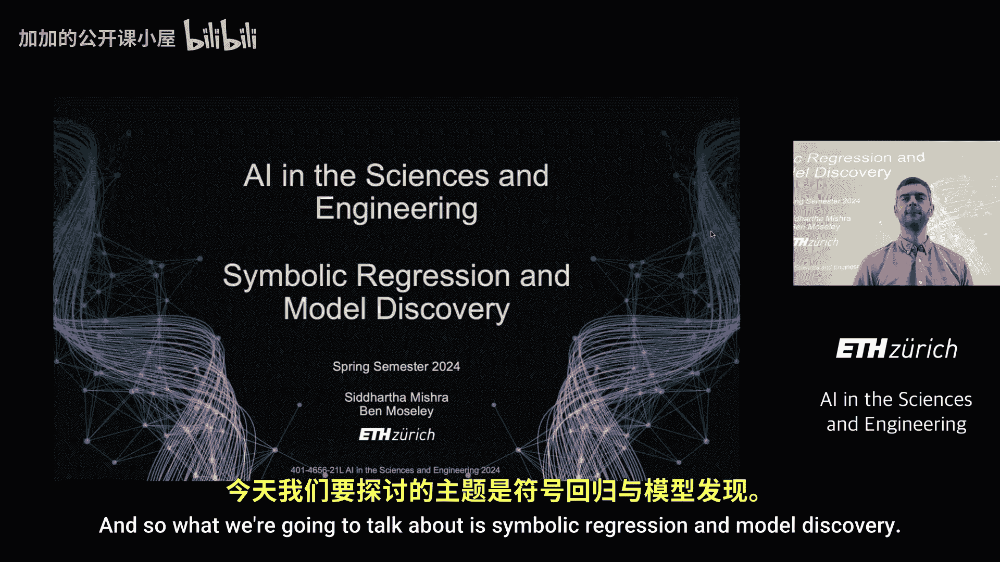
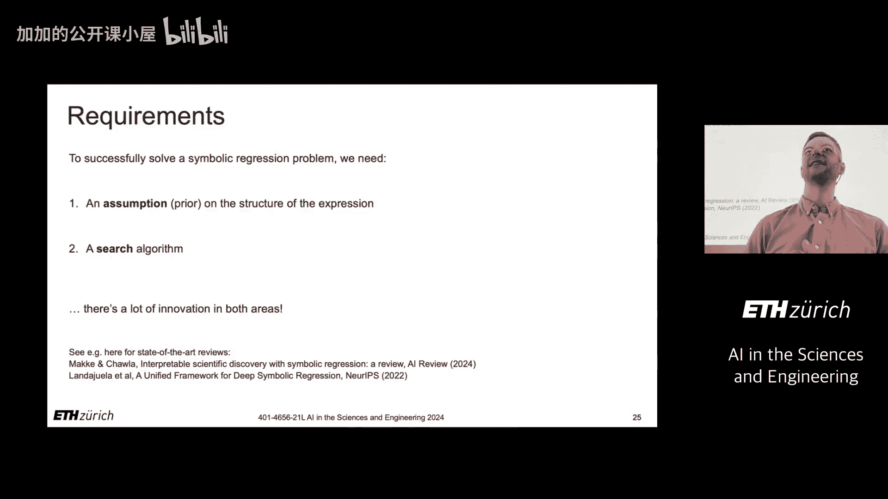
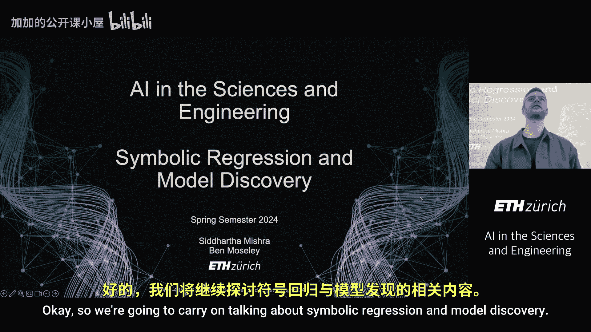
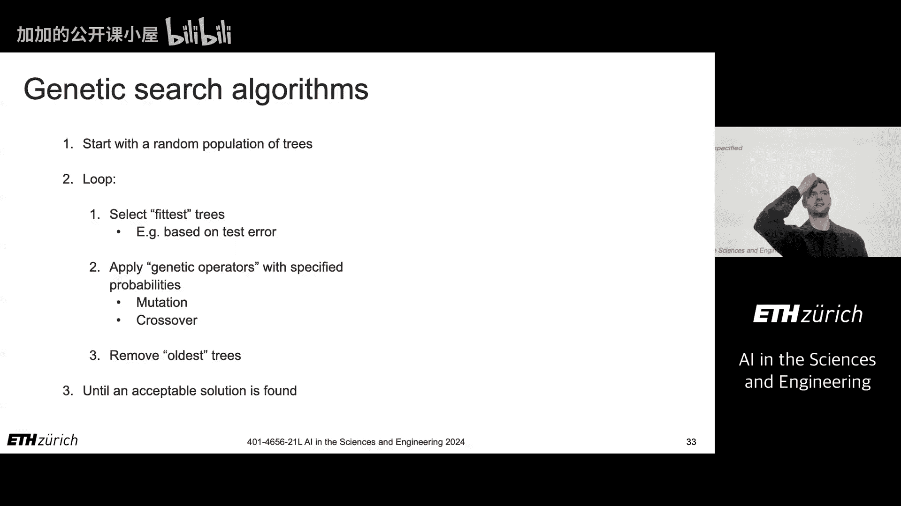
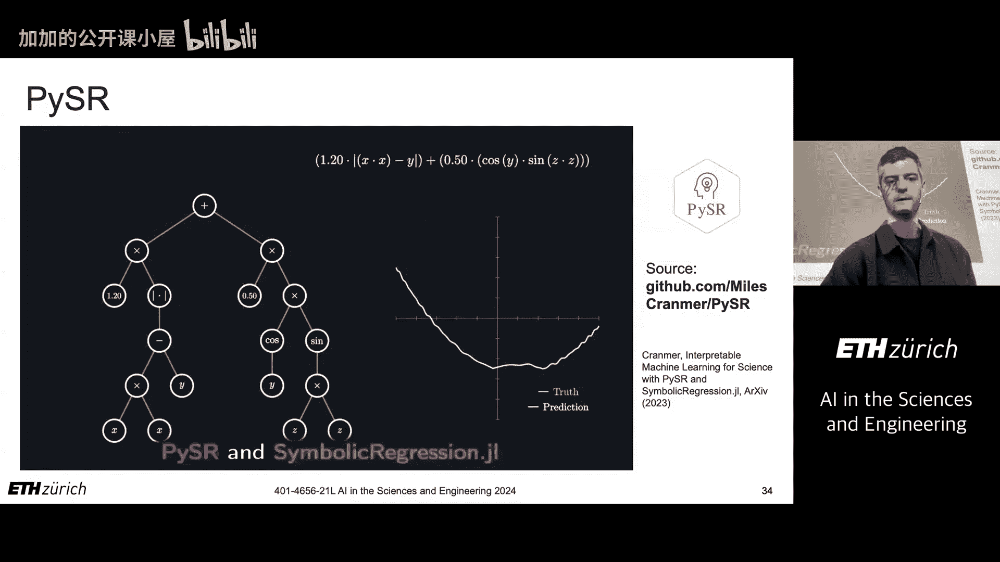
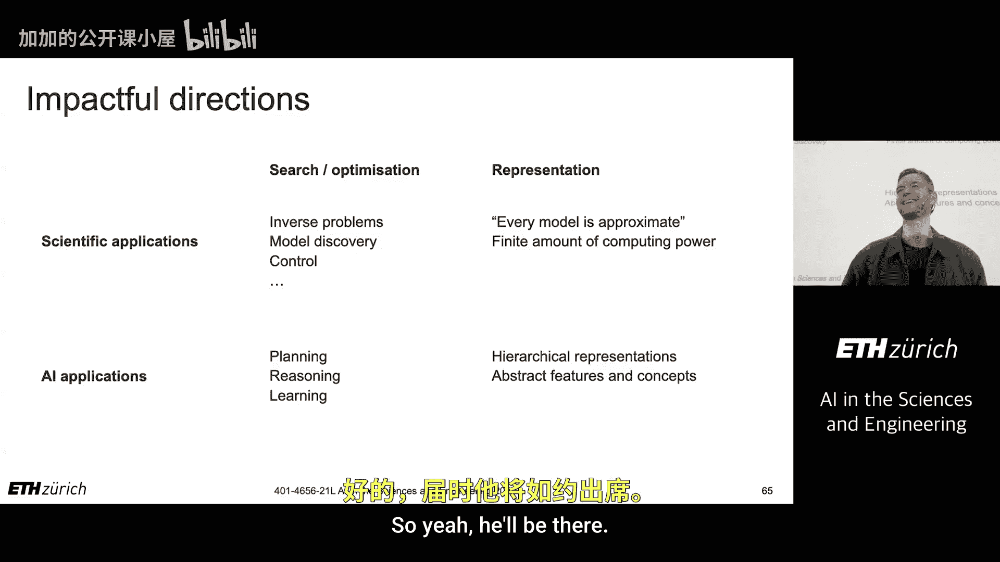

# 苏黎世联邦理工【中英⚡科学与工程中的人工智能｜2024 AI in the Sciences and Engineering】 p24 P24 Symbolic Regression and Model Discovery -BV1smxgzHEPC_p24-

ok。Shor break。But best's move on， so this is kind of the last。New topic that we're going to cover。

 this is the last topic in the course before our two guest lectures next week。

And so what we're going to talk about is symbolic regression and model discovery。

Yeah， so like I said， we just we just had the introduction to Jack and now we're going to be talking about symbolic progression and model discovery for the last part。

同的。So。In this lecture， I'm going to tell you what model discovery is， how we define model discovery。

And then I'm going to talk about symbolic regression as a way to kind of solve this task of model discovery。

And we're going to spend quite a lot of time talking about the challenges of symbolic regression and why this is such a difficult task to achieve。

We're also going to spend time talking about function discovery。

 which is maybe a conceptually simpler task before we think about model discovery。

And then we'll talk about kind of state of the art mobile discovery systems。嗯。So yeah。

 by the end of the lecture， hopefully you'll understand。

How symbolic regression algorithms work or are designed or the kind of theyre important。

Concepts that you need to understand or the kind of difficult challenges that you need to solve for these types of algorithms。

And then you'll understand how we use symbolic regression for mal function and model discovery。Okay。

 so。It has an equation， anyone know what this equation is？One person。

Anyone else who's seen this before hands up？Okay。So anyone wants to tell me what the equation is。

Science stupid。Yeah， Einstein's field equation is the general relativity here。

 so this is probably one of the most famous equations in physics。

Any can anyone tell me what the left hand side on the right hand side says like at a highly conceptual level？

Maybe anyone else like。Okay， go on， yeah right。Yeah， yeah， yeah。Exactly yeah。

This is a really remarkable equation， but Einstein with the help of other amazing physicists kind of eventually worked out。

Is it relates to the kind of curvature of the spacetime with the stress。

 energy and momentum content within the spacetime？So basically saying that like the physics or like gravitation depends on geometry。

And this was like a super groundbreaking idea that has defined a lot of modern physics today。

I'm not going to go into details of the equation， but these are kind of the terms that that we define and it includes things like the gravitational constant。

 the cosmological constant， the speed of light other interesting kind of physics。

 physics quantities and constants。嗯。所。I guess the question that I'm going to ask in this kind of lecture is。

What if eventually maybe not today， that may be in the future？

What if AI could help us do this sort of thing， like meet these kind of groundbreaking discoveries in physics？

Now I want to carry at this and say we definitely are not at this level today in my opinion。

 of using AI to like discover our relationships between geometry and like matter。

 I think that relies on remarkable human intuition。

 but I do think this is an exciting field and I think we're making some like steps towards this kind of grand goal of like helping us to discover physics or other kind of fundamental scientific phenomena and how they work。

And so what I'm going to try and。Give you a flavor of ro in this lecture as just some of the kind of starting ideas that people are trying to get towards this goal。

And why would it be useful to have an A that does this。

 well these are two examples or reasons that I tried to tell you in the first lecture。

Of kind of the struggle that we're having as scientist today in doing scientific discovery and one of the one of the challenges is that。

Just the sheer amount of data that some of our experiments are producing so if you remember this is a plot of the amount of data and terabytes recorded by Cern the particle collider like every month。

And we're recording like thousands of terabytes， petabytes of data every month。And so a human。

 it's just impossible for like a person to go through that data by hand and look at all the events and categorize them and try and reason about those events。

So AI could help us just like pull out patterns and maybe at a more deeper level kind of figure out some scientific theory behind those patterns。

Another example is the complexity of the scientific problems that we're studying like as we learn more about scientific phenomena。

 they often get more complex and again， there might be kind of hidden patterns that AI could help us pull out that we just wouldn't see before。

So example， this is kind of the evolution of the COVID virus and this evolution is incredibly complex and depends on global dynamics of populations and politics and everything else。

嗯。So yeah， can AI help us deal with this data， deal with the types of problems that we're trying to solve today？

So I'm going to define two tasks that people are looking into to use machine learning to help us and one is what I would define as model discovery。

And there are different ways to define this， but for the purposes of this lecture。

 I'm going to keep it simple and just say。Given some observations of some scientific or physical system。

Let's just take a very simple system that we've already looked at so far and this is the dampharmonic oscillator so imagine that we're just watching the spring oscillate and we have we take measurements of its position through time maybe we also know the mass of the spring。

 its constant the dampening coefficient， these sort of things。So given these observations。

 the task is to actually find an underlying model。That describes the system and I don't just mean like a functional fit to this curve。

 I mean like what is the actual fundamental model that describes the system and in this case it's this ordinary differential equation for later can we actually discover the whole equation itself？

So a more conceptually simpler task， but still very challenging， in my opinion。

 is what I would call function discovery。And so this is a task of given some observations of some function in general this could be a vector function or even a vector valued function as well。

So given like say any examples of that function， can we figure out what its actual mathematical expression is so let's assume that that function has like an analytical expression。

Can we discover can we not just fit the function book when we actually discover its mathematical expression so you can see how that's different to like standard function fitting。

So anyone recognize these equations， can anyone tell me what any of these equations are？对，好对。

Ideal gas law， yeah。Any more。Yeah。 yeah。Spcial or disconnect。Yeah， reivistic energy。

Did you have your hand up？对。啊。Yes， step in Bolsman's law for Black body radiation。

oh I'll plank thankss equation， yeah thankss equation。

So I'll go through the rest so you've got Om's Law， the Snow's law。

 this is the Fer direct distribution for phenomenonions yeah these are just famous examples in physics of functions that you know we've often derived by hand。

 but say if we had measurements of the temperature of the black body in its surface area。

 could we actually discover what this equation is thus or similarly if we had it。

Observations of rays going through different media and we know their angles and their refractive indices。

 can we figure out what snow's law is， for example？So that's the task。Okay。

 so I've got a function here so I'm going to give you a challenge of guessing the function。

 so I'm going to try something that I haven't done before。Hopefully this will work。

So you could all pull out your phones or your devices。We can try this。Also for the people on Zoom。

 you can also have a go at this。So up presentism。So what you need to do is just scan this QR code and then it should give you all of these options and you can have a guess at what this function is。

So I've got six different options for you。诶。And I've giving you some help because each of them have things that the function looks like so there are things like cosines there so making the function oscillatory。

There are some like linear dependence， there's some squares。

So tell me if it's working when someone votes， hopefully it should pop up but I've never tried this before。

I'll give you a few minutes。All great， working。Right's a couple of votes to。X cos pi x squared。

Give you a few more seconds。Okay， so I think most people have gone for option  three so x co pi x squared。

 so anyone that went for that option， can you tell me where you chose that option or what was your process？

They're figuring out。Yeah。是是。Symtry yeah。是。So。What do you mean by nominating so the x squared。

Cs x gives you like a oscillatory function， the x squared does what it。

It changes the frequency and the oscillation basically which is actually what you're seeing here so that's good yeah。

Yeah， yes， thanks。Yeah，Okay， so you said yeah it's growing。

 it looks like a linear linear growth here so a good kind of guess would be x times square something or a linear dependence on x。

 so this has got x times covex。Yeah， so no one went for this option。

 maybe it's just too small to see。I put this into of the trick so this is actually the Taylor series of the obory function。

 but you could have chosen this and'd be correct。嗯。Yeah， this is the answer。

 so well on everyone that guess option three。嗯嗯。So， let's go back to。The presentation。Okay。

 so this is the function and I think it's really interesting to like introspect and think about how we would do it as a human。

 like how we would actually guess this function， given these observations of the function over minus three to three say。

So here's how I would have maybe done it， it's hard to say how I would have done it because I knew what it was when I did it。

But I probably would have guessed that it's oscillatory to start with and I would have also made the observation that the frequency increases as x increases。

 so there's some nonlinear dependence on x inside of this cost function。

Also the amplitude is growing linearly like someone just pointed out and based on all of that then maybe I would just actually to get the actual coefficients so these functions I would look at the actual values of y and try and figure out what the coefficients would be and we would find y equal was x caused by x squared。

So I just want to make the explicit difference between symbolic regression。

 which is guessing the actual mathematical expression and function fitting。

Function fitting would take examples of this function and fit some function to that data。

So how we how would we do this with a neural network， we would just say， okay， the function。

 we're going to assume what what that mathematical expression is rather than trying to discover it。

And the thing in that mathematical expression that we're going to vary is just the coefficient inside that function。

Maybe we'd assume that it's a fully connected network with some activation and we would just learn the weights and biases of the network。

So we're only discovering coefficients rather than discovering the operators in this in this mathematical expression。

 everyone clear on the difference， that should be obvious。Yeah。Okay。

 so my question is why why is symbolic regression often harder than doing this kind of function fixing I mean both can be very complicated and difficult tasks。

 but why is this often harder？you have techniques like as far gradient descent or something we could you know change some symbols slightly and yeah right so it can be very difficult to use gradient descent for symbolic progression and the reason is because how do you do gradient a on a symbol or on operation it's like a discrete。

Our operation instead of something continuous to differentiate。Yep， definitely。

 there are many others many other reasons anyone thought of any others？Yeah， yes。

Can you expand on that？哦要到。うんこ say。By。S。Yeah，Yeah right so the search base is much bigger so in here we assume we know the number of coefficients that we're fitting to generally here the expression could contain an like an infinite amount of operators or maybe a very large number of operators depending on the complexity of the expression。

ok， so yeah咁烦。that yeah， so I'm going to explain a lot about how we reduce the search phase basically and allow us to figure out what the function is that's one idea if there are many good ideas。

So here's some of the reasons。Most of them you pointed out， so as you pointed out。

 we need to learn the whole expression and not just coefficients and we may not know the length of the expression。

 so this is really challenging。This is probably the biggest challenges that the search base in general is exponential。

Just think of if we can describe a mathematical expression as a string。

UWhere where each element of the string is like an elementary operator。

 like a place or a mine or something like this。Then you know， basic comb flu。

 if you just look at all the different combinations of all those strings。

 they are like S to the n possible combination， so this is an exponential search space。

Where we don't even know what n is， so yeah， very challenging。

And then the next one is to do with the differentiability， we're now trying to search over operators。

 you know， additions， divisions， multiplications， these sort of things。And。

It's typically not differentiable， like how can we differentiate over an operator if that doesn't quite make sense in my head。

There are ways to do it， but we'll talk about them later。嗯。

The other one that maybe you didn't see is that I told you before。

 generally we just have a finite set of examples of the function。So， you know。

 a finite number of training points of the function。

So why is the statement true that with only a finite number of observations there may be many valid expressions can anyone tell we can always do a polynomial fit however with endpoint away minus one points to fit the function perfectly。

 so it's ill pose it might not give us the true function that generalizes to a new points。

 for example。So we can overfit symbolic regression just like we can overfit。

Normal function regression in exactly the same sense。Okay。

So we're going to go into details like how do we solve how do we how do we overcome these big challenges in symbolic regression and we're going to talk about it in terms of function discovery。

And then we're going to once we've talked about quantum discovery then the last half of the lecture probably our'll cover on Friday。

 it well talk about multiple discovery， how we can use the same types of algorithms to discover like differential equations as well as just simple mathematical expressions。

So one way to think about mathematical expressions and it's very important to choose the right representation when we're defining our search algorithms。

So that we can like efficiently search this space。And so one representation is to think of these mathematical expressions as trees。

He's seen trees before in like computer science or similar，Okay。

So it turns out we can write any mathematical expression as a tree。

And we just say the tree has some root。And then it has some branches and at each kind of node on the tree。

 we have an operation。And then each leaf of the tree。

 so each end member here is just a coefficient value。

 so whether it's the x value or if for it's other coefficients， that's some scalar value there。

So you can see。We can just rewrite this whole expression as a tree where the kind of the root of the tree is this multiplicationpation。

 it's this x times by this cause object here， and then we can decompose cause down into some other lower level operations。

 which is you know pi times by x squared and then x squared is also a power operation。

Everyone see how that can just be represented as a tree。So yeah， like I said。

 the root is basically the final expression once we've got to the root。

 we can evaluate the expression。The nose are all the operations and then the branches are either unary or binary。

So why why not have like a branch of three， why not have an operation with three you why can we just use binary and not unary operations like yeah。

Yeah， exactly most operations can just be written as to input some one output or like this can done into their primitive operations。

Yeah。And then we can define you know general tree quantities。

 things like the depth through the tree is an important thing to to。Okay。

So let me talk about the search base and just tell you again why it's such a large space what I did here is。

Enumerate all the possible expressions。Or trees that only have a depth of two。And for a very。

 very limited library of possible operations。The expression can only contain x。

 there can't be any other like scator coefficients in the expression。

And then it can only combine and plus multiply to the power of two positive sign。

And already with just the tree adapt of two， like in general， the tree app can be 1000。

We have like 65 expressions and you can just see how many expressions we have here。

It's interesting that some of these are actually redundant like a。Like x plus x plus x is like。4 x。

 for example， or like a。I think there's some better examples here。Yeah。

 like x times x times x times x is。Like this expression here， if we just closep it down。

So that that's interesting， maybe you can use that redundancy to reduce the space， but in general。

 yeah this is a huge space to such you can imagine if I increase the tree depth just by one。

 this is going to go up probably in the hundreds or thousands of expressions。Okay。

So how are we going to solve this？So what we need to do is we need to what is often called is pruning the size space。

So there's absolutely no way that we can enumerate in a combinatorial way all of these possible expressions and then test if each expression is going to match our data that's just it's just not possible。

And so fundamentally， whatever task we're doing in symbolic regression。

 we usually have to do something like this where we have to assume some structure of the trees。

 we have to prune the trees， say for example， that they have a less number of operations or a small number of coefficients。

Or more in general， we just have to assume some subset of the possible structure of trees that we're going to search over。

Does this make sense？We're defining in a probabilistic way， we're defining like a prior。

 like all the possible versions of the expressions that we expect the expression to satisfy。

So here's heard of Oham's razor， hands up。Okay， so this is like a often stated in the wrong way。

 but usually right is the simplest explanation is usually the best one this is like a really famous famous quote or kind of observation。

So yeah， I mean， we looked at overfitting in the deep learning lectures。

And I talked to you about this kind of bias variance trade off between machine learning models。

Where as you increase the model complexity， often the arrow goes down。

 but then the variance or basically the susceptibility that overfitting goes up of the model。

And so we argued that there was like some sweet spot where the model doesn't overfi。

 but still has a good good error so like we're choosing the kind of optimal model complexity。

This is just a fun clo conspiracy series like。They are a theory and perhaps they're true。

 but the amount of evidence against this theory makes it very hard to explain the theory and maybe Occaham's rar could be applied to these things。

Okay。Right so at a high level， before we talk about specific symbolic regression algorithms。

 these are the requirements that we need to solve the symbolic regression problem for a large difficult problem。

We need these two things we need most importantly we need an assumption on what the structure that the expression is going to be so that we don't do a combination combinatorial search。

And then we need to define some search algorithm that can efficiently search through those possible structures that we defined and eventually converge on an expression that fits the data that we have。

So this has a huge kind of area of research by its's own bright and there's you know a couple of review papers if you want to go deep into this field。

I definitely recommend looking at these research papers。

 they describe many different papers and research directions on both of these two points。

 the search algorithm and the assumptions。So we're at the end of today's lecture。

 so I'll pick it up and go into this on Friday so that I'll see you then so thanks for coming。

Okay， so we're going to carry on talking about symbolic regression and model discovery。😊。

Let me remind you what we were talking about last lecture。

We started off by thinking about this maybe conceptually simpler idea。

 which is to discover functions or to discover the mathematical expressions of functions。

And once I've done talking about this， then we'll move on to how we actually how we could discover actual scientific models。

 so not just functions， but like underlying differential equations that kind of govern the system。

So we're talking about this specific task so given some observations of a function and so just assume we have n examples。

Can we actually derive this mathematical expression and not just fit the function so actually figure out a mathematical expression and these are kind of some example famous expressions in physics that you know tell us about different physical systems。

so can anyone remember why it's often harder to do kind of symbolic regression than just to fit this function we talked about this last lecture can anyone remember the challenges。

Anyone tell me a challenge？Yeah， these sort of space。

 big such space and thats biggest potentially cycle turn。Yeah， the search base is exponential。

 so yeah， really hard to search inable impact， yeah。Any others？Yeah。Those are often not practical。

Yeah。Yeah， search space is not differentiable， so a small change like a change of one operator can dramatically change the function。

Yeah， any of us？Yeah many other questions。Yeah or so given end data points there are many possible functions like we there yeah so it's ill posed yeah okay so you've。

I think you've got everything so the other one is that we don't know what the length of the expression is。

 so even。The search base is exponential， but we don't even know how big the search base is。

There's not smooth interpolation and yeah there's many valid expressions given a finite number of points。

Okay。So then we I showed you that we can often think of these expressions as trees。

 this is a lot of approaches that try to do symbolic regression use this kind of treey representation。

Where the nodes of the tree of the operations， and then we either have binary operations or unitary operations。

And then the leaves are the tree either the res， either the coefficients or the variables themselves。

🤧K。And I said， well， I showed you all the possible expressions for a tree depth of two for this very small library and we're already getting like 60。

65 expressions。And you could see how this will grow very， very large， very。

 very quickly if we increase the library and if we increase the depth of the expression。Okay。

 so then I showed you this idea that we're never going to be able to search that whole exponential search space it's just impossible。

And so what we have to do， no matter what's the the symbolic progression algorithm we choose。

 we have to。Brein the tree or we have to basically assume some prior structure of this expression to give us like some sort of a chance to be able to search the space attractively。

So we can do many different types of printinging can anyone think of any ways you might try and simplify the search base？

If you think about trees， how would you simplify this tree？Out of the weight last。Any ideas？Yeah。

 about first， yeah， okay。Yeah。So you could just start with like so this might say that we have some prior guess of what the structure of the equation should be so maybe we know that it should be a coastline expression。

 for example， but we don't know the frequency of the expression。

Another thing we can do is just cut off the tree to a certain depth so we can just say expression has to have a depth of no more than five  or1 or something。

Or we can reduce the number of possible operations in the tree so the size of the library。

So as we go through and I show you these types of methods。

 you'll hopefully understand the different ways we can kind of restrict this search place。So yeah。

 these are the requirements to successfully solve this problem we need an assumption on the kind of structure of the expression and then we need some search algorithm。

And there's a lot of innovation in these two areas and what is interesting is。

These two are kind of independent choices， you can have many different types of assumptions and you can mix and match them with many different types of search algorithms and it's kind of interesting to see which choices are the best for the problem that you have。

So what we're going to do first is we're going to think about the first requirement。

 so how are we going to put prior on the structure of the expression？

So I'm going to talk about one approach there are many， as I just said。

 and if you're interested more deeply， you can kind of read these review papers or state of the art papers at the bottom here。

 they go into it in more detail。嗯。So who's heard of AI Feynman。

 just put your hand up if you've heard of this paper。Maybe okay， one not maybe one okay。

 so this is a really nice paper， I definitely recommend reading it。

And this is a way to search for underlying simplifications of the function that you're trying to find。

So before we do a search algorithm， what we're going to do is we're going to look for kind of hidden simplicities that we can kind of derive from the function that we're trying to discover。

So let's just take you know a classic classic function from physics。

 this is Newton's law of gravitation。Between two masses。

And so this expression just describeds the force given their masses and their gravitational constant and their distance between the two objects。

So if you look at this function， what what kind of what makes this function simple？Can anyone。

Just kind of。Tell me why this function is maybe simple。Yeah， symmetry， what do you mean by up？Thats。

对。Yeah。あすみません。Okay， there's there's a fundamental symmetry here that's absolutely correct here so the force on this mass is the same as the force on this mass。

 how does that kind of show up in this expression？Third goals。Yeah。对。

Very very nice so another way of saying that is the force only depends on the distance between the objects。

So there's some kind of like translational symmetry here or that it doesn't depend on the absolute value of x2 and x1。

's what that's really good observation there are other splities on。Right。What do you mean by that。

 a rational function？Yeah， yeah。Yeah， so there's two polynaals here。

Thats that may be related to something I'm going to tell you about in a minute so that's good。

 anything else。Y。Pce has like a particular set of units so you get right。Yeah。

 that's really good so one thing we do in physics all the time is dimension and hasi analysis。

So what it means is the units must match， so the you know， this is Newtons here and we need to。

Have some sort of combination of these units of mass and the graviification of constant and distance to turn it into a Newton unit。

So yeah， that's definitely a constraint that we can exploit。Okay。

 so that's really good so the first thing I'm going to do is talk about this this thing。

 your observation that the units must match。So yeah， Newton's for the force。

 the gravitational constant has this this unit， then the mass is kilograms and then the distance is meters squared。

所以。What we can do in physics and we do this quite often is。Because we know that the units must match。

 we can always transform this function into the dimensionist function。

So we can make it dimensionless。And you can see how we can do this by just dividing， you know the。

So remember the function that we're trying to discover here is we don't know what this expression is that's the assumption so but we do know that it's some scalar function as a function of G M1 M2 x1 next to y1。

 y2， Z1， z2。And we we're assuming that we know what the units of all of these variables are and the unit of F。

And so we can dimensionalize all of these variables and1 can just be divided by sum constant which has a unit of mass。

In this case， yeah， so we divide， for example， M2 by M1 M1 up here。

 so we have this kind of non dimension constant as well as a function。

And so if I rewrite it in this way， we can just say that F this unknown function that we have。

 we know that it can be written as some constant， some non-dimenalizing constant times by a function which is a function of A。

 B， C， D， E， and F these non-dimensional all units。

Can everyone see how we can kind of rewrite it in a way？

And this is true for any function where we know that the units must match。

 that it can be written as a constantized by some function of some non dimensionsal variables。

So can anyone tell me what this does to the search base？If we can say， okay。

 knowing that the units match， we can rewrite F as constant times by some non dimensional function here。

What have I just done to the search base？I'm from this to6。Spot on yeah。

 so if you look at this function now。I've reduced the number of dependent variables of the function。

 so it's gone from one， two， three， four or five。From nine to six， yeah， like you said。

And it's because some of these variables are now just pulled out into this constant at the front of the function。

So so now we just have to search for a function which is much low dimensional and that dramatically reduces the search base。

 the number of possible combinations of these input variables。So yeah。

 it reduces a number of variables。So the question is how do we given that we don't actually know what the mathematical expression of the function is。

 how can we figure out what these dimension of variables are and what the constant is in front of the function。

 I'm not going to go into how that's done but there is a deterministic way to do that so you can do this for every every function and。

I'm just taking that to be true for now。O。So next symmetry or next hidden simplicity is the we talked about this。

 the translational symmetry。So this is just the property that it doesn't this function doesn't depend on the absolute values of the positions。

 it only depends on the distance between them。So how do you think we can exploit that？

Well how might that reduce the search base， how could you reduce the search base given that observation？

Yeah。Absolutely， so we can do a simple change of variables。Where we substitute R or D。

 the difference between these two instead of the two variables themselves。

 and we again we reduce the number of variables that the function depends on。嗯。

So yeah I just give it I just asked that question and you told me the answer so if I just plot f of x。

 so what I can do is I can query this function and I can just test it for x1 and x2 and I can see that the output function is like a linear function。

And that's telling me that we have translation in symmetry。So in this case， we can， like you said。

 we can substitute in。D1， D2， D3 is just x2 minus x1， y 2 minus y1。

Like this and then with you can see how we're reducing the function again to from six variables down to one。

 two， three，Yes。Six， where have I gone wrong here？没有。Oh yeah， so I'm not assuming here。

So I'm not assuming here we did the dimension he analysis。

 but if we did it would have reduced it even further。

So we're just assuming we haven't done a dimensionthe here and we're just using the translational symmetry that gets us down to six variables instead of nine。

Just like we did before in the dimension Irsic。嗯。But we need to know that that's true。

 so how can we test for symmetry like if you're able to query this function。Any set of variables。

 how could you test that this property is true？The F of F of x2 and x1。

I's just some function of the difference between the two。Yeah，Yeah， I think you're basically right。

So what you can do。You just choose some constant a so and then you for all values of x1 and x2 or actually all values of the input function。

 you can add a to these two。And if it equals the same as the function without a added to x1 and x2。

 then then you can， if you stare at that long enough，'ll you'll。

You'll realize that that tells you that it is symmetric。Well。

 that's sufficient condition to show that this is true。Okay。

There's another one that we haven't talked about， which is the multiplicative separability so what do I mean by that can anyone guess？

This function is sparable。How is it acceptable？Yeah。

Yeah exactly so the top the numerator here only depends on masses。

 this only depends on the differences， so another way of saying that is can we can rewrite this function as some function which only depends on G。

 another function which only depends on M etca in a multiplicative way so we've kind of separated out these different factors in the function。

So again， how does this if we knew that this was the case for this function， how would we。

 how does this reduce the search base， can anyone tell me？

So what we've done here is we've now decompose this function into four separate functions。

And suppose that I knew the first three functions。Then all I would have to do is learn a function which has less variables in the initial function。

So。What it actually allows us to do is to carry out four independent searches for this。

 so if we knew that this is the case， we can just fix the values of x1 x2， y1， y2， Z1， Z2。

And then just search for these these three or even go further。

 fix the value of M1 and G and then just search for this I as a function of M2。

And then once we've figured out what I have a function of Ntus。

 we can do the same for the other other three functions。

So this again makes the search problem a bit simpler。哦，6是吧。If you just if you fix the value。

 you would you still query the function at M2 here and you get like some varying function that you could then do just a symbolic regression just in regards to N2。

I'll show you so the way that you can test this， basically if this is true。

's kind of a similar test of that translational symmetry that if you fix the values of one parameter and just bury the one that you want to test for separability。

And you compute this for all values of x and show that it just equals this as if you didn't fix the values then then it's separable and that again this is a sort of thing if you stare it for long enough。

 you can see that it it is sufficient to show that there is separable。ok 诶所以。

That's worth going back to and just convincing yourself that this is true and again。

 if you go into the paper， they explain how they do these tests of the function。

So just to summarize how this is working is。We start off with some mystery function。

 which we know is a function of these nine variables。

And then we do each of these kind of hidden simplicity tests on the function。

So the first test that we do is a dimension anti analysis and we realize that we can write it as some constant times by a function that is non dimensionmenalized with a smaller number of variables。

Now that we know that that's the function we're looking for。

 then we do symmetry testing on that function and we figure out that G and H translationally has translational symmetry。

And that allows us to get rid of scale another variable， then we do our separability testing。

 we find that we can separate our a we can separate our A here。And。That's's as far as it goes。

At which point？We then have to bring in a search algorithm to try and figure out this final function。

 which is only a function of three variables。And given our examples of the function that we have available。

So then this AI Fman does a brief thought search， but you can use any search algorithm if you like。

And then that brief forse will then give us the kind of final mathematical expression。

 hopefully if it converges， and then we resubstitute all of our variables all the kind of variable expressions that we've discovered and we eventually end up at the final expression。

So can people see how by， you know， simply just testing the functioning for these kind of slicities that we can really reduce the kind of final function that we actually need to discover？

对对。Okay， so。This is the full work quote from the paper， it's a bit more complex。

 the actual algorithm they designed， but it it's basically doing all those different tests that I said。

 and then if those tests don't pass then it has to rely on some brute force to solve the problem。

So you might notice that they also train a neural network in here。

 which seems like it's completely different to what I just described。

 but they don't actually the only reason why they train a network here is they just fit it on that observational data of the function that we have just to directly approximate the function。

And this just allows us to query the function at any point in X。

 so it's like an interpolation of those those observation values remember we have to query the function to do these separability tests like whether it's multi whether it has symmetry or if it's separable。

So the network here isn't doing anything like trying to understand the symbolic expressionary than others。

 it's just a function fitting。And。And yeah， just the key takeaway is that this approach looks for ways to simplify the expression before we search for that final mathematical little expression。

Okay， so there's a problem。Possibly is these simplicity tests might just fail if the expression doesn't have any of these kind of hidden simplicities。

And this algorithm， its basic version just relies on brute force。

 so it's then just going to take this unknown function and do a brute force combinatorial search across our library of operators to try and find that expression。

And so what I'm going to move on to now is。Is to think about different search algorithms that are not just combinatorial that might help us solve these problems better。

So yeah， I've given you。One idea on how to。Make some assumptions on the structure of the expression what AI Fynman does is actually allows us to discover those actual underlying simplicities of the function。

Any questions on this before I move on to talking about search algorithm rooms？Yeah。

Yeah yeah it' also a really good observation so in practice observations of F have noise。

And this might really mess up our tests。So that they in the paper， they have kind of threshold。

 right so so when you're。For example， when you're doing something like this you're querying the function at many points and testing if this is true it's not actually a perfect equals they'll just have some threshold that's based on the magnitude of the of the function or something so yeah that's a good observation the other the other thing is when they use the neural network here to fit the observational data that actually can smooth out of the noise and kind of fit like a smooth a smooth approximation and make it more stable。

Y。Any other questions？Okay。所以。Search algorithms， can anyone think of a better search algorithm that's not just combinatorial search？

Who knows of other like search algorithms that work？

Or just general search algorithms that might not require gradients like gradient free search algorithms。

 which ones have you studied before？Againgan。Oh sorry， I okay， yeah。

 haven't I'm not sure I've heard of that。Any others？Concurring device， yeah， yeah。Yeah。😊。

depth and breadth that such， so you're thinking of like three such algorithms kind of yeah。Yeah。

 so you might start out group the tree and do a depth first search or breath first search， yeah。

Interesting。Any others？So who's heard of， yeah？Maybe its Sp tree， yeah。Yeah。So yeah。

 so you suggested quite a few tree search algorithms so you're assuming that we're trying to search a tree。

嗯。We are kind of doing that， but we're actually just searching for trees。

 it's a bit of a different search problem。It's not like we're searching through the tree to find like a end node of the tree。

 we actually just want to discover the whole tree itself so it's a slightly different search but I can see where you're coming from。

嗯。He's had a。Genetic algorithms。Yeah， everyone， so more most people， yeah。

So genetic algorithm is super famous used for many different problems and they're a gradient free method。

嗯。So this is what we're going to talk about next is a better way to search for these expressions using evolutionary search or genetic algorithms。

所以。How is a genetic algorithm like searching this space more cleverly than just doing a combinatorial search？

So what the search does is it relies on some heuristics。

 some like some observations that are maybe empirical。

 but help us search the space in a principled way than just doing a combatorial search。

And so one of the heuristics that you could use when you're searching these trees to find the correct tree that represents the expression。

As you could say， well， say that we have this tree here and we look at how well it predicts our observations here and this expression is x plus cos pi x squared。

And we see， oh， actually this expression is doing a fairly good job of fitting our data。

 it's got the oscillatory behavior， but's like it's got like a linear behavior instead of like a or like it's constantly increasing instead of being centered around zero。

嗯。And so the idea here is that maybe the true expression might look very similar to this tree。

 but maybe we just got one of the operators wrong。And so what we might do in the search is instead of like just doing combator search。

 like varying each of these across its range and in a big brute force way。

 is maybe we would just take one of the operations and just muttate it and basically just randomly change the operation and。

Our kind of houristic or our assumption is that that might be a better way to get us to the true expression。

And so you can see here that this is the case， if I just mutate the top node here。

 we actually do to discover the perfect expression。

So everyone understand how we could use a mutation in the search algorithm to inside the search。Yeah。

Can anyone else think of any other genetic algorithm inspired changes we can make to these expressions？

scross Island is huge and the sub branchess between each other。

So another classic thing that's exactly right， so another classic thing in genetic search is to do crossover。

😊，So I have that as the next slide， see。So a crossover is slightly different， it says， okay。

 say that we have these two expressions and that we know that they're fairly close to the solution but not perfect。

Let's do a random crossover， so that's take maybe a subre of the two trees and swap them over。

And you could see how you could do this crossover for any kind of random subre that you pick in the trees。

So we take this this subter， which in this case is just a leaf and then we just flip it with this smaller sub here and rebuild the expression based on that。

And again， you can see if we do this， I mean， I've picked this to work， but of course。

 but if we do this， we end up with the correct expression of the bottom here after that fossil。

Who's with me？Okay。Any questions？Yeah， we said thinking that we have this problem that last of。Yeah。

 this idea of mutation that should restore a secure direction between domestic， how does it apply。

Yeah I mean so you're making a very valid observation so I said to repeat or I said at the start one of the challenges is the search pace is not differentiable or another way of saying that is that there can be big changes in the function if you just flip one of the operators and that is exactly what we're suggesting here is that actually if you just flip an operator you might get close to the final final at all so I think this just depends on the types of functions and the types of libraries that you're searching over but for sure this is not guaranteed to converge any faster than a brute force for some settings selection Yes in a way most and yes。

But then what I'm seeing is that yeah with their solution there might be the best after this point you might neglect something Yeah no I agree with you I think this is a limitation so this is why it's so houristic it's like our guess of what is a good direction to move in the search base but it might not always be the best one and it's probably not provable that is the best one。

I think crossover is a bit more interesting。One way you can think of crossovers。

 or what I think makes it powerful is。We're not just flipping a single operation， but we're actually。

 maybe you could think of this as like shifting around mathematical abstractions。Like for example。

 this might be the subre if you think about that Newtonian forces example I just showed where one of the calculations was the radius or the difference between two points。

Maybe the genetic algorithm might realize that that's a good abstraction to use and maybe that would be the bit that's crossed over to different other expressions it's testing。

So I think this is quite powerful it's like reasoning on the abstraction， matter abstraction level。

 which is kind of interesting。But yeah， good good points。Any other questions？O。So yeah。

 this is how we would actually write a genetic search algorithm for searching for expressions。

What we do is this kind of this pseudocode so what we would do is actually we would start with a random population of trees。

 this is just a random population of mathematical expressions。

And then we would start this evolutionary loop， so it's just a for loop and generally we would select the fittest trees。

And one way to select the Britishish trees would be based on their test error so you just measure given the data points of the function。

 how close what's the me squared error， for example。

And then we apply these genetic operations to those fittest trees so we might do a mutation of one of them or we might crossss over randomly some of the trees together。

And then we would have to have some notion of the oldest trees this might be the ones that have not never had genetic operators or might have very low fitness。

 we would remove those and then we would just keep looping and the kind of idea of。

Evolutionary research or genetic search as this kind of mirrors what happens in biology。

It's kind of the same， this is what inspires these algorithms。

So we do that until we meet some conversionvergence criteria。

 it could be just number of steps or it could be that we've got a fitness above a certain threshold。

And that's the help。Any questions？

That makes sense to everyone， yeah。Okay， so以。Here's a really cool video。

So this is pi symbolic regression， hands up who's looked at this slide before。One person yeah。

 so this is written by Milos Kmner， he's done some really amazing work in this field along with many other researchers。

So this is。His library that he's got on GitHub so you can go and play with us and this video is taken from that Gitthub page。

And it's a symbolic regression library and the main engine that does symbolic regression here is genetic search。

So what you're seeing here is observations of some true function。

 and this is how this evolutionary search algorithm is evolving over time。so it's。

 you can see in the background， I guess it's meant to represent all the trees in the population that are evolving over time。

But this is。This algorithm has a lot more added on top of it than just that basic pseudocode that I showed you。

One thing that it does inside that for loop， sometimes it will choose， instead of doing a mutation。

 it will choose to do some constant optimization。So the leaves here that it adds to the expressions。

 some of them are constants and obviously they need to be kind of tuned to their values and he does a constant optimization randomly at some steps to try and optimize those before carrying on a genetic search。

So that's what you're seeing in these kind of constant optimization steps。So really。

 really impressive library， definitely worth having a look up and playing around with it's really really interesting to see how it converges。

O。So I probably don't have time to get into this， but this code POSR auto runs in parallel across multiple threads and what each thread is doing is actually evolving its own separate population for a number of steps and then at some point in the algorithm those separate populations crossover their kind of fittest individuals and then you kind of get this ornament selection algorithm。

 it's kind of a more complex version of this genetic search。There's a lot more to be said about this。

 but I don't have the time too。Okay， so I've talked about other genetic search。

 there are also many other search algorithms that I don't have time to talk about。

But I'm just going to give you a quick fire idea of what these other search algorithms might be。

 so again， the goal is to find F given our data set。So one way to do it is just to do it directly。

 to not actually have something like full loop of search going on。

 but just to take all those observations as input and just try and learn some model that fits out the expression at the end。

And transformers maybe a very interesting model to do that because you could think of these mathematical expressions as actually like a language right we have like some sort of grammar which is the kind of operations of the inside the expression。

And so we might think of using a transformer with its kind of attention to like attend to different parts of these expressions and help us kind of derive what their expression is。

嗯。So there's a lot more to be said， but that's a very interesting kind of method。嗯。

Another whole idea is to use reinforcement learning again。

 this is another whole kind of field of symbolic regression。And this is to say， okay。

 we have some environment and the environment is the tree that we're searching。

And we have an agent in that environment that is going to pick the next node or the next operation in that tree。

And it's going to pick that extension to the tree based on its observation of the tree so far and the kind of test error and such like that。

So their agent takes a number of steps in this environment。

 adding noses to the tree and building this expression。

And then it's trained with some of the war at the end of it so did it match the expression or not so you can kind of see how that that would be framed as a reinforcement learning problem。

You can also learn research algorithms you mentioned a few。

 you can kind of think of this as a research as well。

 but if you have a look at this review paper again。

 they split out all the possible different search algorithms that people have proposed and there's a lot going on。

ok ，所以。I'm going fast because we haven't got much time left。

 so I've got one example of or maybe two examples of model discovery that I'm going to try and explain to you quickly。

But if I don't get the chance， then just have a look through the slides and later there。

So yeah we're not going to take a break so modelal discovery is this idea of finding the actual model rather than the function itself and so in this case we have operators we have differential operators that apply to these variables rather than just simple kind of added additions transformations etc。

So we can still use symbolic regression， all of those methods that I just talked about to try and discover these models。

 these underlying equations。But what we usually have to do is we have to add extra operators so we add the derivatives as another possible operator that we can apply to this tree。

This makes it harder and so we have to add some kind of domain constraints on top of this。

 usually to help these methods converge。嗯。So this is Cindy， hands up who's heard of Cindy？

This is quite a famous algorithm， so what it does is it tries to find the equation for dynamical systems that have this form where you just have you say。

It's an ordinary differential equation， so Dx by Dt where x can be a vector。

 basically the state of the system。I some vector function here。

And what they assume in the paper is that you have many examples of both the rate of change of x and of x itself。

So an example is the Loren system。So this is an example X here in this case。

 is the path of this system behaving in this way。And it's a chaotic system。

 so it's really interesting to study， but you can plot the path through its phase based it。

And so what we're just saying is we have lots of observations of its position in the face space and also of its velocity as it's moving around。

So what you can just realize is that we just have measurements of x。

 the directive of x and of x itself。And so you just transform this into saying here。

 this is our data， we have measurements of x and of the derivative， which is F。

And this just turns into a standard symbolic regression task without any derivatives in it。

The only difference here is that we're trying to find a vector value function instead of a scalar function。

And people see how that is kind of。If I know what DxDT is or if I have observations。

 then all I need to do is find F。嗯。所以。Yeah， we just assume。

Cindy makes an assumption on the structure of the function。

 it assumes that we have some library of coefficients。

And that function can just be written as a multiplication of that library with some matrix which holds all the coefficients of those library functions inside of it。

So an example for the Lren system， we could just write F of x here。呃。

It's just this library of operators here times by this coefficient matrix here。

And this kind of transforms the task into just learning what these coefficients are。

 this coefficient matrix。诶。So what you do is you just take all your training data。

For each of your training inputs， you just compute all these these library operators so you just take X。

 you take Ys add all the different operators， you compute all of them into a matrix。

You put into this matrix here， just your observations of the velocity that you have already。

And then from this expression， we know that F can just be written as your basis matrix here times by these coefficients and the coefficients are the things that we don't know。

So how how would you solve？How would you find the coefficient matrix there， what would you do？

Great descent， yeah， is there a better way？What does this look like to you， this matrix equation？

Yeah linear exactly it's linear regression so we know what this matrix is it's just all of our operators applied to X。

 which we know。So it's just linear regression， so we just do matrix inversion we can also use the fact that we were prior that we think the coefficients did probably sparse you can see there's a lot of zeros here that we're not going to use all of our operators in our library。

So we can carry outrs sparse linear regression。嗯。So Im going to well， I'll go through it very。

 very quick。Cindy is using what's the assumption that it's making on this task。

 we're assuming that the expressions have this form。

 which is very restrictive and also that we have a certain library that we've chosen。

And then the search algorithm that we use is just sparse linear new regressiong like lassso or rich regression and like this。

Okay， I'm going to start skipping because we haven't got much time。

This is a really interesting extension of Cindy， which says it takes it a step further and says if we have not observations of the state itself。

 but maybe some transformed version of that state， say that， for example。

 in this equation the state is the angle of a pendulum。

 what if we just have images of the pendulum moving through time？

It turns out you can even discover given this kind of video of the physical system。

 you can even discover the underlying dynamical system。

And they do this by assuming or learning some decoder that takes encoder that takes your image to your state space。

Okay， so I don't have the time for this， but。So yeah it's unfortunate we don't have more time to talk about symbolic regression but it's a huge goal by itself and it's a really interesting new kind of direction of using AI to kind of discover physics or help us understand physics more deeply than just doing kind of some function fitting or black box model prediction with a network。

嗯。ok ，所以。I'm going to spend maybe just three minutes just doing a quick summary if you have time。

 but if you need to leave， feel free to leave that's sort of。嗯。So yeah。

 we've gone through a massive journey in this course。

 we've covered a huge amount of different topics in scientific machine learning and AI for science in general。

And these were kind of our learning objectives that we had at the start and what I really hope is that you have now come away with it。

A much better understanding of the kind of state of your art applications of using AI insights。

 but you also should hopefully understand much more deeply how these algorithms work。

 how you can design them how and the theory behind them as well。

Hopefully you're also you're realistic in that we can't just apply AI to everything it's not a sledge channel。

 there are pros and cons of using especially deep neural networks in these scientific works。

And there's a lot of other kind of broader concepts and themes in this field of SL that， for example。

 like the power of auto differentiation and way you should learn your components of your system that hopefully you've taken away in this course。

嗯。So yeah， this is how we looked， we learned about pinIs and we did operator learning。

 then we did transformers and then we've done a lot of work on these kind of hybrid workflows and all differential equations and model discovery。

And as we've gone through， we were kind of showing you that you can put kind of scientific understanding it in many different parts of your machine learning workflows。

 it can be like through the loss function it can be through the architecture design。

 or it could be more tightly integrated into our traditional scientific workflows and that's kind of what's really amazing about SL is that there's so many different opportunities to incorporate science into our machine learning algorithms。

嗯。So'll skip this see。I think I've just kind of said all this。

 this is quite a heavy slide but this is pretty much everything I just said。

 so there are definitely pros and cons of using deep learning in your workflows you have to be aware of them and not just use it naively。

But in general， adding scientific understanding to ML usually improves performance of our workplace。

And。So I just have one final slide， which is a super high level slide。

 but I think people often ask me what's a good place to like research in science and machine learning。

Or what are impactful directions in the future， I mean this is a sort slide which is。

Both quite useful， but also not very useful because it's so high level。😊。

But I just want to draw a connection here between you know， things that we care about。

 applications that we care about in science and applications that we care about in AI。

And the kind of。Well， you can boil it down to a super high level where it's kind of two big goals that we really want to try and solve。

And look for sure， there are massive outstanding challenges that we haven't solved in these directions yet and this is where I think the most impactful research can be done。

And these kind of kind of tasks search and optimization and representation。嗯。

And if you think about it in science， we have these these problems like inverse model problems。

 model discovery control， it can all at us high level just be thought of like a search problem like we have some goal。

And we want to search for some inputs or some parameters that achieve that goal we actually have the same in AI right we have planning。

 we want to create plans so we want to do some reasoning or even just learning can be thought of as a search problem。

So thinking about doing research and search or optimization。

 like how do we design good search algorithms that have good prior understanding。

 just as I've been talking about this symbolic regression。

Coming up with those ideas can really impact across science and AI depending on where you want to have impact。

And then the other big topic is representation and in science this is basically the statement as everyone heard the quote。

Every model is approximate but some are useful like this， but a really famous quote。

So what that's really saying is like we only have a finite amount of computing power to like do to。

 for example， solve a PDE， like we have to choose some representation or some approximation of our system and that is the fundamental question is what is the right approximation to use？

Like when we're talking about operator learning， like what is the basis that we're going to use。

 is it like a fourier basis or is it something else like these have massive impacts in the in the。

Performance of the scientific code， for example， in finite element methods like what is the basis function we use or how should we use it。

 how should we discriify our mesh， like all of these sort of things。

And the same kind of questions occur in AI， so we talk about representation it's obviously super important。

But what level is it LLM reasoning， is it reasoning about simple features or is it abstracting and telling it that understands what the principle of like thermodynamics is or something like this。

 you know？The latest kind of planning algorithms in AO， for example。

 used like hierarchical representations to be able to like attractively search the world around us and so again。

 thinking about representation at a very deep level will help you impact both of these different fields。

So yeah， useful， but also not useful， but hopefully that's given you some inspiration to carry on and do research。

Thank you very much for being part of the course， I hope you took something away from it and that you enjoy the lectures next week given by David so yeah he'll be there so yeah thank you very much。

