# 苏黎世联邦理工【中英⚡科学与工程中的人工智能｜2024 AI in the Sciences and Engineering】 p25 P25 Applications of AI in Chemistry and Biology Part 1 -BV1smxgzHEPC_p25-

So， welcome。I will quickly introduce myself。 I'm David。 I'm a PhD at Si labla。

And I might have a little bit different background than most of you。

 because I'm originally biologist。And after my master's here at D T H。

 I worked in in industry in biotechnology， as like protein engineering。And after that。

 I did a second master's degree more in the field of data science。And。Now， after this。

 I'm doing my PhD at Sis lab working on my graph based engineering of proteins and small molecules。

And。The focus of this lecture will be。Mainly on AI models for engineering of proteins and small molecules。

And。嗯。So， for example， to develop new drugs or to then develop new enzymes that catalyze some specific reactions。

And this is an extremely dynamic field that has experienced a couple of breakthroughs in the recent years。

And I will just try to give an overview over the state of the research in the field。

And the AI models that are used to like， help reach the goals of protein and small molecule engineering。

So。So， in the first part。I will quickly give a short introduction on like proteins and small molecules just that we are like to explain the basics that we are all on the same page。

And then。I will start talking about text based， text based AI models for protein engineering and small molecule engineering。

嗯。And then I would like to speak also about structure based AI models for protein engineering。

But to do this， I would like to first explain the AI models that are。

Now used to predict the structure of proteins。 So you probably all have heard about alpha fold。

And maybe also， E SM。And。Yes， after this， I will explain like the most common approaches for structure based AI for protein engineering and the engineering of small molecules。

And then in the last part， I'll try to give an overview over the field of like generative AI for like the novo protein design。

 But this will probably。Probably be on Friday。

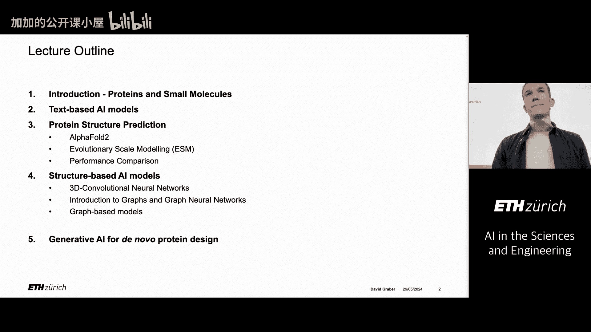

So and if you have any questions， just raise your hand or write into the chat。So。

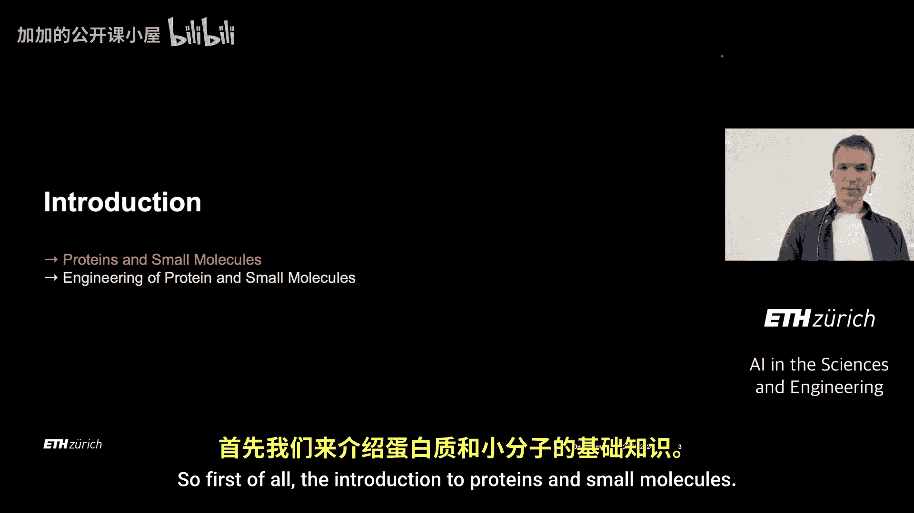

First of all， the introduction to proteins and small molecules。

So small molecules are organic compounds that are small of a low molecular weight and usually have less than 100 atoms。

So like organisms produce such small molecules， for example， as metabolites or signaling molecules。

 for example。Is cortisol here is a stress hormone and drives our metabolism。

And these small molecules， they can normally easily diffuse across cell membranes。

And they can interact with proteins， and influence their function。And because of this。

 it makes sense that most drugs are small molecules because they can go into the cells and interact with proteins and change some disease pathway。

 for example。And。The structure of these small molecules。

Because they are so small can like usually allow for E C synthesis in， in the chemical lab。So。

 and now， proteins are larger， chain like molecules made of a fixed set of building blocks。So。

They are chains， and these chains， they fold into a defined3D structure known as the native conform of the protein。

 so。It's hard to see here， but this is， is a chain， but it's like folding in 3D space。And then。

 these。Chains usually fold into some kind of globular structure。 So as you can see here。

 if with this approximated surface of this specific protein here。And。

This structure defines also the function of the protein。

 And these can be many things like proteins can be enzymes。

 So proteins that catalyze specific chemical reactions。Or they can be structural component。

 signaling molecules， transporters。But。Like in general， they are extremely important。

 They are like the building blocks of ourselves。 They play like a key role in almost every process necessary for life。

So。As I said， these proteins， they are built of a fixed set of building blocks。And there are。

 these building blocks are amino acids。And there are 20 standard amino acids。 You can see them here。

And。All these amino acids have kind of a backbone。 So it's an amino group and the carboxal group。

 And you can always see this here。This triangle of N， C， and C。Is shared by all amino acids， right。

So。These are like the links of the chain。 So if you create a chain of amino acid that folds into a protein。

These triangles here that every amino acid has or like linked together to form this chain。

And what differentiates the different amino acids or the side chains。

 So you can see why this triangle here is identical for all amino acids。

The difference is what is attached here at this middle atom here at this C。

 what is called the C alpha atom。And this attachment。

 this side chain is different for all amino acids and also defines like the。

The chemical properties of these amino acids。And another thing that。

Highlights like the how important proteins are is， of course。

 the fact that our DNA dictates the sequence of proteins。Like the sequence of amino acids in protein。

 sorry。 So each triplet of DNA nucleotides encodes for a specific amino acid。

So our DNA is kind of read and transcribed into RNA。 And this RNA is then translated into。

A chain of amino acids。And then once this chain of amino acid is synthesized， then it。

Folds into a more ordered three dimensional structure。

 which then defines the biological function of the protein。So。How this fold looks like is。

entirely defined by the sequence of their amino acids and their side chains。

So this folding is kind of a spontaneous process of energy minimization that is just guided by interactions between amino acids and between their side chains。

 For example， like hydrophobic interactions， hydrogen bonds or undervols forces。

And then to describe a protein， you can like， think of these three level of structure， basically。

 So you have the primary。Structure， which is just the sequence of amino acids。In the chain。

 And then there are secondary structure， which is， which are like regularly repeating local structures stabilized by hydrogen bonds。

 So， for example， alpha helis or beta sheets。 So this here would be an example for an alpha helis。

 And this would be a beta sheet。And then tertiary structure relates to like the sp spatial relationships of these secondary structures to each other。

So。Primary structure is just。Which amino acid it comes after， of like after which。

Then this defines the secondary structures。 like it forms into an alpha helix or at some point into。

 into a beta sheet。 and then。The third level is how these secondary structure organizations。

 how they fold into like。A protein and how they relate to each other in three dimensional space。

 And this then gives the protein its finall shape。And you will very often see the proteins in this cartoon depiction。

 And this is just used to visualize。The secondary structures， like the helix and the。

 and the beta sheets。 And it gives a nice， like overview over the structure。

 But it only shows like the location of the backbone of the amino acid。

 So of these three triangle atoms that each amino acid has。 So the side chains are not。

Visible in this。 So if you would like show the side chains as well。

 then that protein would have a different shape like this here on the right side。

 But this cartoon just shows the location of the backbone， basically。

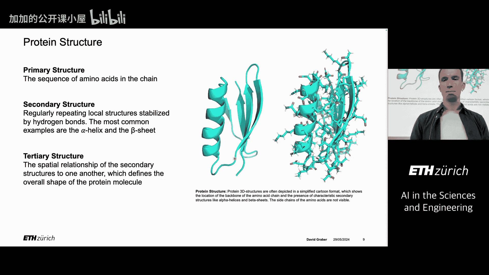

So now I will quickly talk about like， how， like。Engineering of proteins and small molecules and what。

 what the goals are of this field。

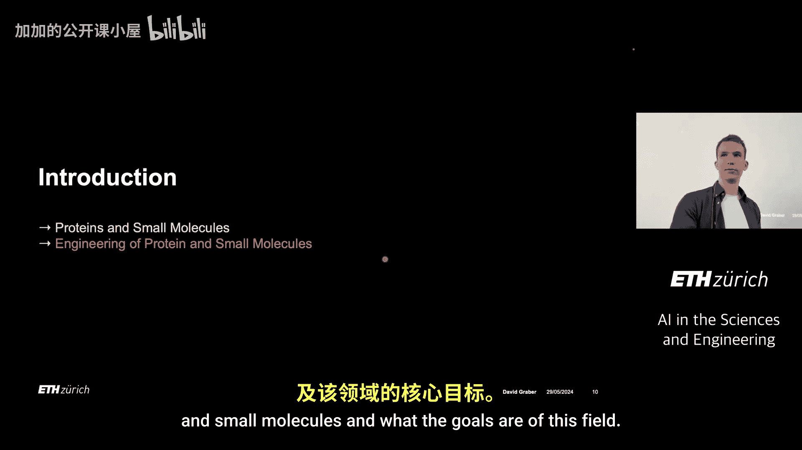

So。As I told you， most drugs are small molecules， and they can bind to。

To proteins and affect biological processes。And the chemical structure and the composition of these small molecules define their function and their binding preferences。

So small molecule drugs are usually engineered to interact with some specific desired target。

And to bind to it to inhibit it and modulate some disease pathway。 So the small molecule might。

 for example， inhibit an enzyme or block a receptor。Like you can see here。

 this molecule here is aspirin that binds to this enzyme cycloxygenase， which would。Otherwise， like。

Form prostaglands and lead to inflammation and fever。So。Engineering of small molecules。

 like happens through altering like the size and the composition of these organic compounds to get some desired properties and binding preferences。

And then， in engineering of proteins。It's all about changing the sequence of the amino acids in the chain to achieve a specific。

Function of the resulting protein。So， for example， in the field of biocatalysis。 So in the field of。

The research of enzymes。嗯。You could， for example， change an amino acid sequence of an enzyme to accept a new substrate。

 For example， here， you want this substrate to be catalyzed or this to be processed by this enzyme。

 you might change some of these amino acids here so that this substrate can like enter the active site or this pocket in。

 in the protein structure。And if you think about like therapeutics， a very common example would be。

That you change the sequence of an antibody so that it can， for example， bind2。

Sours of 2 spike protein。And there are kind of two。

 like a couple of strategies to do protein engineering。 So there is like rational design。

 which is just， you use very detailed knowledge that you have about your protein or your。

 your system。To make desired changes。 So， again， in this picture， you might think， for example。

 that in order for this substrate here to bind into the enzyme。

 I might need some hydrophobic amino acident。 and you might make this change。嗯。

But semirational design would be kind of。You want this substrate to bind。

 So you think that this amino acid is important。 And then you just replace it by like all possible amino acids。

 So you make kind of a combinatorial library of protein variants where。whichch are identical。

 except for like 1，2 or three locations where you just try out all。All possible amino acids。And。

Maybe you've heard of directed evolution， which is also commonly used。So。In this process。

 you start with a protein that already has kind of。Desired function。

 And you would like to improve it。 So you introduce random mutations。

 And from the pool of generated variants， you try them， you test them for their function。

 and you pick out the one that performs best and restart the whole process。

 So it's kind of accelerated evolution。And this process also got， got a Nobel Pri， couple of。

Years ago。 but all of these like rational design and direct evolutionution。

 they are really time consuming and expensive and are usually only suited to like optimize existing proteins。

 like make small changes to make protein more performant。

But the main challenge about these engineering tasks is like the incredible size of the search space for optimizing like proteins and amino acid sequences。

So if you consider that there are 20 naturally occurring amino acids and each of which can occupy each position in a protein or in a amino acid chain of length 100。

 then this protein already has 20 to the power of 100 possible sequences and。

Proteins are usually amino acid chains longer than 100 amino acids or a couple of hundred up to a few thousand。

 So yeah， you can see what I mean。And that's where， like， AI。Comes in。

 and AI can like help to better navigate this， this search space and like filter it down。

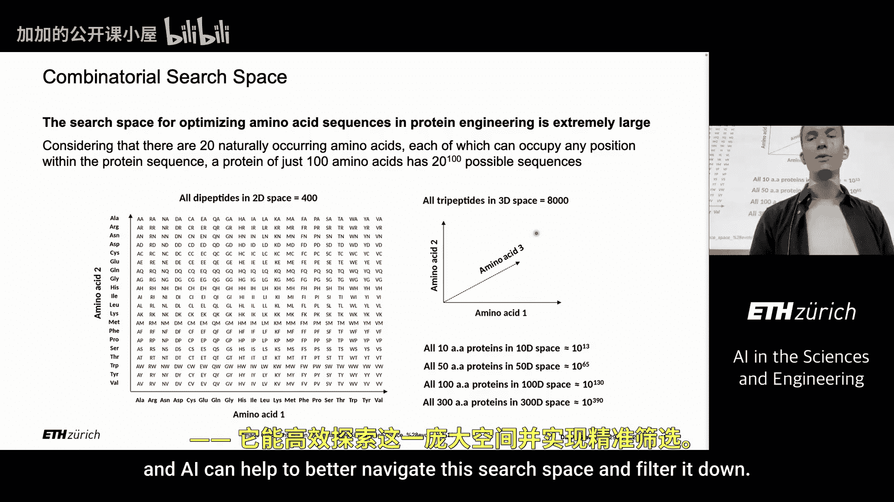

And。That's。Now， where I will start talking about text based AI models。

 And I call this text based AI models because the inputs to these models are text representations of proteins in small molecules。

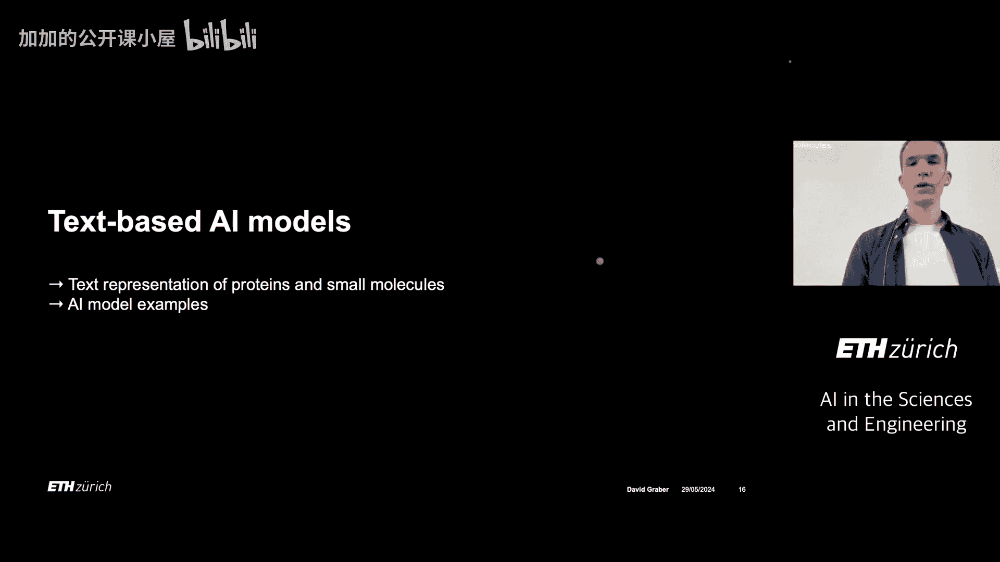

So I will give a very quick introduction to this。 So for proteins。

 the representation in text is really straightforward because we have the amino acid sequence。

 And this is like a text representation of the protein。And for machine learning。

 amino acid sequences like this one you can see here。

Or then encode it into some numerical representation。 For example。

 with one hot encoding or other kind of tokenization， which just。

Each amino acid is treated as a separate token， and like words in text processing。And for。

 for small molecules， it's a bit more complicated。 So what is very often used or in a smiles code。

This is like a linear notation representing the molecular structure， using some characters。

So atoms are kind of represented by their chemical symbols。 single bonds are are omitted。

 but double bonds are equal signs。And branches are described with parenthses， and rings or like。

 be noted by， by。By numbers， like indicate their connection points。

So you can see then you can translate a small molecule like this into like a linear。

Text representation。And for machine learning， these smiles coats are also like tokenized and mapped to。

 to a fixed vocabulary。And you might have noticed it's already like with tokenization and text representations。

 It sounds like natural language processing。And。These methods have really had like a big impact on this field。

Because there is this analogy between like the building blocks of language and those of proteins and small molecules。

So in proteins， like in natural language。Protein sequences have their own kind of grammar。

 and they also contain these long range dependencies。 So you can， for example。

 think of amino acids as words。Sequences of amino acids as sentences and proteins as， for example。

 a text paragraph。And for small molecules， it's similar。

 They also are linear sequences that consist of a fixed vocabulary。

 And there are also rules and patterns of how they， how they are written， basically。

So both protein sequences and smiles， codes are compatible with language model architectures designed to handle such linear sequences。

 And that's why the， the methods of NLP are very often applied to proteins and small molecules。

And at this point， I would like to give you like a first。Oh there's a question， yes。自中呢。Yes， so in。

 in case of proteins， the， the like the library of tokens that you need is really。

 it's just the 20 possible amino acids， right。AndBut with smiles， it's a little bit more complicated。

You， but also there， I think they use a fixed vocabulary of tokens。Which is not that large。

 And then they just mapped these。Smiles like each， each recognizable。Group in。

 in the smiles to a token。Yes。I think it works。 It works fine， but I would need to look into。

 into this more， more closely。嗯。Alright。 so I would like to give you a first example of a model that has actually been generated by some chemists here at E T H。

 And it's a transformer model。Trained to predict the。Temperature dependented。

 limiting activity coefficients of molecules。 It's not very important。Right now to。

 to know what this is， it's just a property that small molecules have that describes their behavior in a solution with a given solvent solvent。

And the input to this to these models are smiles of the solute and the smiles code of the solvent。

And the output is basically just the predicted activity coefficient of， of the solute。So the smiles。

 coats of the， the solvent and the solute are tokenized into an input embedding。

 and the temperature information is added to this input matrix。And then， this transformer block。

Like transforms these this input embedding and feeds like the new representation into into a regression hat that outputs a single value representing。

This limiting activity， coefficientient prediction。And this model has been trained on。

Experimental data。 So for some molecules， you just know this， this limiting activity coefficient。

 So it has been trained in a supervised。Manner， and they have shown that they can quite well generalize to other molecules that the model has never seen。

So this just as a first example， how these smiles can be used。For a small molecule。

 molecular property prediction。And。Now， about protein， you might have heard about E SM。

 It's also quite famous。 It's the model that has been trained by， by Meta。

And it's basically a selfsupvised learning model with the masksed language model objective on protein sequences。

So it was trained on 250 million protein sequences。 So a lot and。

It works in a way that each input sequence， for example， of this protein here。

Is corrupted by replacing a small fraction of amino acids by a mosque。And then， this。

Msked sequence is encoded in a numerical representation。 And this E， SM transformer， like。

Generate a new representation of these， of this input sequence that allows it to make a prediction which amino acids have been masked in the sequence。

And if the prediction is correct， so it compares its prediction to what has actually been masked。

And if it's not correct， the prediction， then the model is improved。

 And that's how this model is trained。And。It turns out that if this model is like consistently。

 consistently performing well on this task of finding a couple of amino acids that have been masksed from the sequence。

Then it needs to know a lot about protein sequences and protein structures。 Also。

 you can imagine that。This is a really simple task， but it's not easy at all。 So if you， for example。

 want to fill like gap in a protein， you need to know a lot about the protein， too。Make a good guess。

 basically。 So you also need to know about the structure of the protein， for example。

 because some amino acids might actually fit in in there and some might not， right。

So it turns out that in this hidden state representation that the protein generates the E M model generates。

 sorry， there's a lot of intrinsic biological property information and also information about the protein structure。

 And this just encoded in this hidden state representation in this embedding。

And that's extremely interesting， also。嗯。To use these representation for downstream applications。

And the authors， they showed this， also with this。Ortageous proteins。

So they showed that if they take some data set of orologists， genes and proteins。 So these are。

Like related proteins。That come from like the same ancestral gene。 Basically。

 So orologistous proteins tend to have like the same function。

 And you can see the untrained transformer takes these orologistous genes。Each。

 like group of genes is colored in one color， and。Then the untrained transformer and generates a representation like this。

 If you， you take the representation and do some dimensionality reduction with T S， for example。

 you can see that the trained transformer is able to group orologist and proteins and cluster them。

 so。It learns something about the function of these proteins from。

These 250 million sequence that this is trained on。

So this shows that these latent space representation that this model generates are very useful for transfer learning。

嗯。So you can， for example。F tune this language model on a specific downstream task。

So you can use supervised learning with a potentially quite small dataset that is labeled to find tune in this model for a particular application。

 which。Might be like protein function， prediction， prediction of mutational effects。

 prediction of protein stability， or even the prediction of 3D structure。

And the potential of these selfsupvised transformer embeddings。

Are currently like starting to be exploited by more and more researchers and models。

So now I've already mentioned the protein structure。

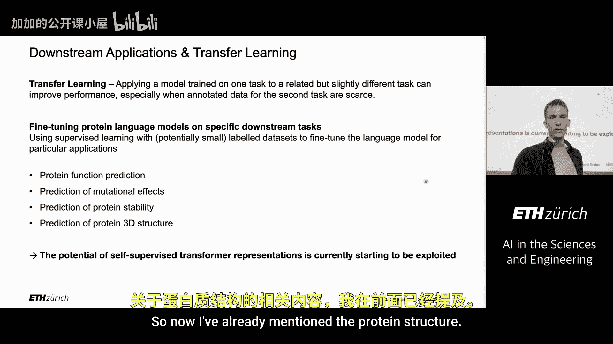

So I would like to transition to the next topic of protein structure prediction。So。First。

 before I start talking about alpha fold and， and again， E S M。

 I would like to just quickly say a few things about protein structure and why it is important。

 So protein structure simply said just refers to the 3D coordinates of all the atoms in the protein in its folded state。

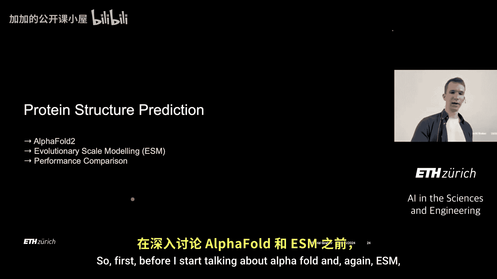

So， and this， knowing this is very useful and important because it gives us like more understanding of a protein。

 because the structure， as I said earlier， defines the function of the protein。

And so knowing the structure helps us to find like the biological role of a protein。

And for drug discovery， for example， knowing the protein structure might help us to identify some active sites or some pockets in the protein that we might。

 for example， target with a small molecule drug。For example。

If you have the structure of this protein。And this is a bad protein involved in some disease。

 You might see that there is some， some groove here and that this is a good like target site to target with a small molecule drug。

 for example。However， for many years， researchers have always relied on very time consuming methods to generate protein structures like X- ray。

 crystallography or N MR to find。These structures， for a given sequence。But。

Recently published models have like deep learning models have made huge progress in predicting structures。

Without these experimental procedures。So quickly about the task of folding a protein and predicting its fold from sequence。

 This is an extremely difficult and challenging task because these amino acids have a lot of degrees of freedom that can rotate around their backbone bonds and side chain bonds。

 So the number of possible structures for even a very small protein is astronomical and。

Folding is also driven by various different interactions。

Which happen between the side chains of amino acids。 And they are really difficult to model。

 like hydrogen bonds， hydrophobic interactions in Boderval forces。And。

There are also long range dependencies。 So the folding is influenced by interactions between amino acids that might be really far apart in the sequence of the protein。

 but then come close together in the 3D fold。 So if you。Use a model to process sequences。

 It needs to be a model that can handle such longer inch dependencies。And。Finally。

 the training data is relatively scarce， even though we have been characterizing protein structures with these experimental methods for。

 for decades。The number of。Solved protein structures is still relatively small。

 from a deep learning perspective。So， and for this task， because it's so important。

 there's also this critical assessment of protein structure prediction competition that takes place every couple of years and invites like researchers and machine learning experts to。

嗯。To give a try on predicting folding of proteins from， from sequences。

And this competition was like the 14th holding of this competition was。1 by Alpha4，2。

And by quite a large margin。And the predictions of alpha fold showed a root mean square deviation of the C alpha atoms。

 So the tips of these backbone triangles that each amino acid has of only 0。96 ostrms。

So this is the root mean square deviation of these C alpha atoms。 And to compare。

 like the width of carbon atom is 1。4 onngstrms， so。It is quite precise。

 The prediction of over fault。And you can see here also like an experimental structure in green。

 like aligned with an alpha fold prediction just as an example， how precise alpha fold can be。And。

This is。Really kind of a breakthrough in the field of structural bioinformatics。 And that's why。

I will now dive a little bit deeper into like the architecture of Al fold。

 but still I can't like explain everything because it's quite a complicated model。

 So I will explain it on quite a high level。嗯。But important to know is that the input to the model is basically the input sequence。

 the protein sequence that you want to fold。And then what the model does， it。

 it searches a genetic database for similar sequences。

AndPossibly in in other organisms and makes an alignment。

 And that's what what is called a multiple sequence alignments。 So it generates this。

 And then it also looks in a structure database for similar proteins that for which already a structure exists。

And using these templates。It generates a first。Guess kind of of the pairwise distances between all amino acids in the protein。

 So it kind of generates a first prediction of the structure based on these templates and some statistical statistical analysis of like known protein structures。

And then from this multiple sequence alignment and this pairwise distance matrix。

The model generates this MA representation， and the pair representation。

So the MSA representation is just the multiple sequence alignments translated into this。

Representation containing like a lot of sequence conversation。

 information and also about sequence entropy。And the pair representation is。As I said。

 based on the analysis of known protein structures called templates。

 And this kind of an initial prediction of the pairwise amino acid distances。

And then these two representations， they are passed to the A former。

 which is the core of the alpha fold architecture。And this transformer model updates these two representations through attention mechanisms and convolutional like operators and generates like a new representations。

With， like， updated representations。And。Then these are passed to， to the structure module。

 which con converts these updated representations into spatial coordinates。

 So it predicts the distances between all the residue pairs and the angles of bonds in the protein。

 And from this constructs a 3D model of the protein。And。

It also applies this interesting concept of recycling。That you see more and more often nowadays。

 So it's kind of an iterative refinement process where the output of the structure module is like fed back to the Avo former multiple times。

So if the model has made a first prediction， it's not outputting this prediction yet， but it's。

Giving it back and adds it to the pair and MSA representations and makes another pulse of the model。

 So this helps refine the predictions by allowing the network to reconsider its earlier outputs。

 basically。And this benefits， like。The model benefits of the additional contextual information that it gets from subsequent layers。

 So they do this recycling three times before they output the final structure and the 3D model。Okay。

 and awful training is also quite complex。There are several structural objectives。

 So where deviations from the true structure is like penalized with different lost terms。

And in addition to this， there's also like a bird a bird objective。

 What that's how the authors call it， because they randomly masked a part。

 mask a part of the multiple sequence alignment。 And the network is then required to like reconstruct the masksque regions。

 This is also like an additional training objective。

And then there's also an interesting principle applied to the training with self distillation。

So they have a certain data set of protein structures。

That have been resolved with these experimental methods over decades of hard work。

And they trained their model on this data set of known structures。Using conventional。

 supervised learning。嗯。But then once the model has achieved a certain level。

 they use sequences of another 350000 proteins of which we don't know the structure and make a prediction using their trained model。

 And then once they have made this prediction， they merge the two data sets。

 They take the experimentally derived structures and their predictions of this already trained model。

And retrain the model from scratch on this merged dataset。And。They。

 you can repeat this several times。And this apparently makes effective use of like unlabelled sequences of sequences of which we don't know the structure。

And apparently， this really improves the accuracy of the model， which I find very interesting。Good。

So。Just check the time。Maybe。Is it all right If we take like a 10 minute break now and continue after。

All right。 is everybody here。 Can we continue。Yes。So before the break。

 we talked about alpha fold to predict protein structures and。I would like to。

Remind you of this model here that I showed earlier， the self supervised。

Model trained on 250 million sequences with this masksque language model objective。And。

This model has been。嗯。Extend it， or first， the。The authors。

 they have shown that in these hidden state representations that are generated for this model。

 there is also information about the structure of the protein。

So the model cannot observe the protein structure directly because it only gets sequences。

 but the structure of the protein is kind of like a hidden variable that influences the patterns in the sequence。

 So the model can still learn about the structure of a protein。Only from the sequences。

And they showed this by using a data set of known of proteins with known structures。

And then added a label to each amino acid of these proteins。

 like whether they are part of a helix or a strand or a coil。

 So the type of secondary structure they are in。 So you can see this here like the。

 and the strands are in green， the helilicus are in red。

And then they derive this transformer hidden representation for all the proteins in their data。

And then they just fit a very simple logistic regression classifier to predict a secondary structure。

 like to classify each for each amino acid in the protein。

 whether it is part of a helix or of a strand。And they show that with this very simple classifier and using the the hidden state representation as input。

They can achieve quite high classification accuracy regarding these secondary structure elements。

And this shows that the self supervised training only on sequences， also like。

En codes information about the structure of the protein in the representations of the transformer。

And then there has been like a second version of this model released。So， E S M2。

And they have extended the， the， the model with a folding hat。And that。

That just extracts like atomic coordinates from the hidden stage representations of the E， SM model。

 So they take this E， SM model that has been pre traineded and on all these 250 million sequences with the maskque language model objective。

 and they。Find tune it and add this folding transformer block here。

They also apply this recycling strategy from Al fold。And then they train this。

 They fine tune in the model on。300000 experimentally determined P D B。

 like protein structures from the protein data bank。And they achieve prediction accuracy。

 similar to alpha fold。So。This is kind of remarkable because this model removes the most costly aspects of all of fold。

 So it doesn't need to access any databases to find look for templates in similar sequences。

 So it doesn't have to do this multiple sequence alignment。

 And this makes the model about 60 times faster too。

To predict protein structures compared to alpha fold。 And it's like completely standalone。

 So it doesn't need external databases。 So it just takes sequences and outputs a structure。And。

If we compare the performance。And we split this comparison into like backbone atoms and side chain atoms。

So you remember the backbones or these three three atoms， the links of the chain， right？

 So both models perform quite well to predict the structured the position of these backbone atoms。

 But all all is often a bit better。And regarding the site chain atoms， this is a bit more difficult。

 So the performance of both models drops because these positions of these side chains are usually harder to predict because。

They are more flexible。And Al fold still generally performs better in positioning these side chains。

So if you have an application where high accuracy of backbone atoms and side chains is really crucial。

 then I would recommend you use alpha fold。But E， S M and the E SM fold provides like a really valuable tool if quick predictions are needed。

Across， for example， a vast number of proteins。And just in general。

 the obtaining of protein structures is a lot easier thanks to such models。But you also。

Have to be careful because they are still only like， near experimental accuracy。And also。

 regarding protein dynamics， there's some things you have to like。

 consider that if a protein is very flexible and has like parts that can move and constantly。

Do this because proteins are dynamic。 Then from this whole range of dynamic movement of protein。

 Al fold and E S M will just give you some average confirmation， basically， so。It's a bit difficult。

 you might， for example。Predict the structure of an enzyme， of which， you know。

 it catalyzes a certain。Small molecule or substrate。

 And then you predict the structure of this enzyme。 And you find out that in this structure。

 the small molecule doesn't fit into the active site anymore。 This is because the protein in。

 in reality， like， can move a bit and can like open its active site a bit。

 And then it can be that your alpha fold or E SM structure。

Gives you a conformal state that doesn't allow for this substrate to enter the active site。

 So you have to make some。Some。Yeah， you have to think about this that。This can be a problem。

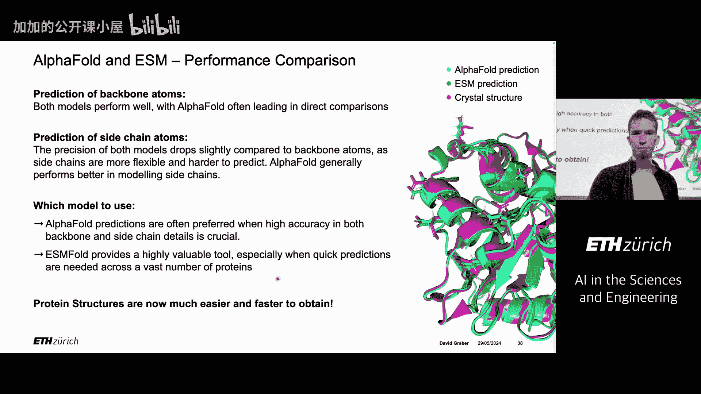

So now that we have， we know how to predict protein structures with deep learning。

 I would like to talk about AI models that use this structural information as input。So。I will， first。

Talk about 3D convolutional neural networks and then about graph based models。

But before I can do this， I will give a short。Not so short introduction to。

 to graphs and graph neural networks so that we all have like the basics to understand the models that will follow then。

 yes。嗯。So。If you take a protein that has tank。A few hundred amino acids。 Then it might take。

Like 15 minutes would be normal for alpha fold， for example。 But I think with E SM。

 it's less than a minute。 So or for small proteins might be 10 seconds， something like this。

All the right。So。First。

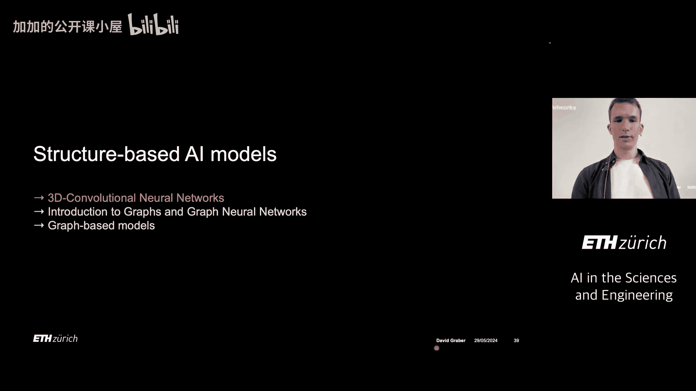

I would repeat some concept about the。Structure of proteins。 So the structure of proteins， as I said。

 determines the， the function of a protein and these proteins。

 they fold into these complex shapes that like， allow them to interact with other molecules。And。

 a protein sequence alone provides like， no information about the actual arrangement of the atoms in 3D space。

 right。So models that incorporate not only the sequence of a protein。

Should be superior at tasks that require an understanding of the physical placement of residues。

For example。Taskks of interaction prediction or enzyme activity prediction。

 So I guess you agree with me that。To make a prediction whether this substrate here can be processed by this enzyme。

 the information of the physical placement of these residues will be quite or should be really beneficial for。

 for a successful prediction。But there are also like challenges associated to using structural data。

So。Structural data is much。Less available。 So it's limited availability。

 and sequence based methods are usually more simple and more computationally efficient。

So about 3D C NNs， I will explain just the， the general procedures and how these can be used to。

 for example， processed proteins。And so if you have a protein structure like this to convert。

The atomic coordinates into a form and suitable for a 3D C N。

 The space around the protein is divided into a grid of so called voxels。

And then you can use different types of atomic properties to define multiple channels in the input data。

 For example， the types of the atoms here in this example。

 they have a carbon channel and a nitrogen channel and an oxygen channel and。

Then they use like convolution and pooling to extract the relevant information from these three dimensional grids。

And in the end， if they have reduced it to a single vector。

 they use a fully connected layer to derive like a global prediction。

And such3D C N Ns have been shown to perform well in tasks such as protein stability prediction。

 for example。And this example is also a model that。Some people here at E T H have developed。

 It's a three dimensional CNN N for the prediction of protein， ligan affinity prediction。

And lichned like refers to a small molecule that binds to a protein。So as you can see here。

 the small molecule binds， for example， to this protein structure and the affinity refers to death。

Stngth of this interaction。 So if this binding is strong or weak。And they want to predict。

 given an input structure like this So a protein with a bound， small molecule。

 if this interaction will be of high strength， basically。So what they do is they center a gridit。

Around the geometric center of this lid。And the position of each atom is then like mapped to one of the voxels。

And they also use additional chemical properties of the atoms and the structures to define additional channels。

 For example， here， they have a channel for aromatic carbon atoms。

1 for like hydrogen bond donors and for something else。

And then they use also a convolutional neural network that reduces this 3D grid to a single P K D value。

 which represents an affinity prediction。And such 3D C N Ns were the first structure based and models to outperform sequenced based affinity prediction。

Okay， but these3D C N Ns also have some drawbacks。 So the model sizes are usually much larger than compared to 2 D C N Ns。

 The parameters of the models they grow kind of cubically with the resolution of the grid。

And the size of the grid。And sparsity is also an issue because if you， for example。

 model such molecular interactions like。A portion of the。

 the voxels in your grid might just represent empty or homogeneous regions that don't really contribute any meaningful information。

 And the inefficiency arises because these。Boxes are still processed by the model。

And then rotational invariance is also a problem， so。To achieve invariant predictions。

Regardless of the spatial orientation of the 3D object in the input data。

 you have to present these objects in multiple orientation。

 which makes training of the model also a lot more computationally costly。So。

3D C NNs usually require large training dataset sets to perform well and to avoid overfitting and training and inference require significant memory and processing power。

 So the application to large data sets of structural data is limited。For example。

 if you do some molecular dynamic simulation and you want to process like the frames you generate during this simulation。

It would be better if you had something that is a bit more efficient。

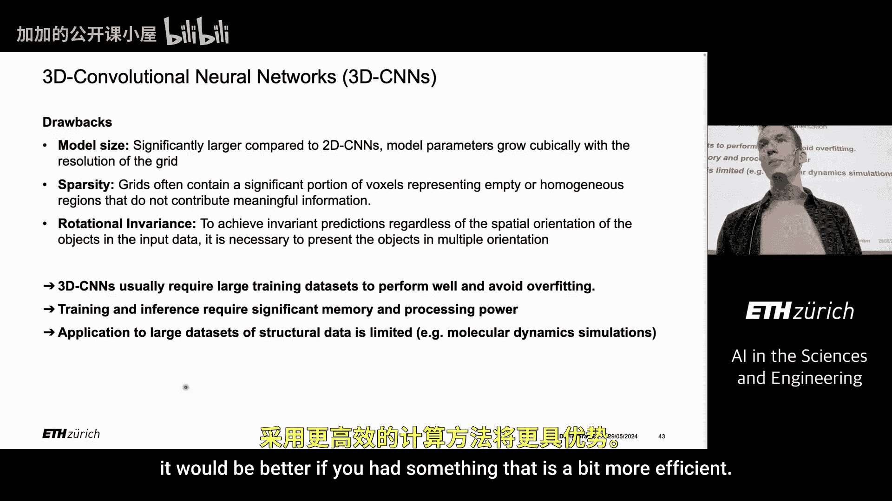

And a potential alternative to these3D C NNs are graphs。

 like graph modeling and graph neural networks。And。So I'll give you now a short introduction to this。

Before I start talking about graph based AI models。

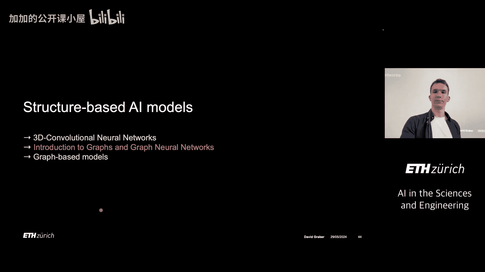

So。Gras describe a set of objects。That are then called nodes and the connections between these objects that are called ets。

And information in such a graph can be stored in each node of the graph and also in each edge of the graph。

 And you can， for example， also have some global context vector。

 some data that is associated with the graph。And this is a really powerful representation of data。

 especially for non Euclidean and unorder data。 For example。

 you can think of a social network with friendships。Or citation networks。

 Or also the atoms in a molecule。And graph neural networks are just neural networks that have been developed to process such graph structures。

So if we look at this， potentially a social network with some interactions， we can build a graph。

Representing like people as nodes and their relationships as edges， for example。

 And then if we have this， we can save the connectivity of this graph。

 So which individuals or nodes or like interacting with other individuals。

 we can save this connectivity in an adjacency matrix。

 which is a square matrix with the dimension the number of nodes in the graph times number of nodes。

 And the elements of the matrix indicate whether pairs of nodes are connected or not。

 So you have either a one or a0 in this matrix。And this tells you that， for example。

 this person is connected to this person。So a second example would be。

And this caffeine molecule here that you could represent， represent as a graph。And then it。

 this is a very convenient and natural abstraction to describe molecules。

Where atoms are translated to node and the bonds between atoms are translated to edges。

And for this molecule， a graph would then look like this。

 and the adjacency matrix would look like this。Then。To pass such graphs to an neural network。

 we have to。We need to bring this type of information that is associated with a graph into a matrix format。

 So the node features， the edge features， the connectivity and also the global context。

 So what you usually do is you assign each node and index。

And then you store the features of these nodes。 So the feature of node E in row E of the node feature matrix。

So。嗯。Then for the connectivity of the graphs， you have this adjacency matrix， as I explained before。

 but。We usually expect the number of connections to be much lower than the number of entries in this matrix。

 so。These adjacency matrices are usually very sparse， especially for large graphs。And， that's why。

Usually， this。Other representation， this et index， which is kind of an adjacency list， is often used。

 And it's like a more memory efficient way to represent the connect。

 the connections in the graph without using like memory for showing like saving the unconnected parts of the graph。

So you basically have a list of nodes that are connected。 So node 2 is connected to node 1。

 node 3 to node 1， node 3 to node 2， and so on。And this is a much more spaorous representation of the connectivity。

 right。And then if you have this et index， you can save the edge features in the et feature matrix in the same order as。

In the edge index， basically。And then the global context vector。

 you also just have it in a matrix format。 And then you can pass these information to。

 to a graph neural network。But。First， like， what kind of tasks do we want to solve with graph neural networks。

And。Something really common or is， is like a graph level task。 So you have an entire graph。

 and you want to predict the single property for this whole graph。 So， for example。

Taking this graph of a molecule， you might want to find out， is this molecule an antibiotic。And then。

 there is node level tasks。So you predict some property for each node in a graph。

So this is a super famous example of this， this toy data set。Of this karate club。

 where the two instructors， they have an argument and they split。 They have to split the club。

 And you have this graph of the social interactions between the members and the task is to predict like which member will stay loyal to which of the instructors。

 So it's a node level task because you want to predict something for each node in the graph。

And there are also edge level tasks which predict a property or the presence of edges in a graph。

So a good example would be like the friendship suggestions on Facebook。

So starting with graph neural networks， A G N N or graph neural network is kind of an optimizable transformation on all attributes of the graph。

 So the notes are transformed。 The edge features are transformed。

 and the global context vector can be transformed， but it preserves the graph connectivity。

So it's this graph in graph out principle that the model accept a graph as input with information loaded in the。

 in the node， edges and the global context vector， and then progressively transforms these embeddings without changing the connectivity of the graph。

And。If you， for example， want to do binary prediction on the notes， like for this karate dataset。

Then to get a prediction for each node in the graph。You could， for example。

 apply a linear classifier to the transformed node embeddings。

And then derive a prediction for each node。And the same could also be done for ets if you want to classify some relationships。

 for example， between the members。And。The edge features and the global context information。

 they can also be included if you， for example， want to make a prediction on the notes。

So to update and transform these features that are saved in the notes。

 in the ets and in the global context vector。GNNs usually apply this message processing neural network framework。

 so。That neighboring note。Or ets exchange information between them。

And influence each other's updated embeddings。And this makes。

The the learned embeddings aware of the graph connectivity and the aware of the neighborhood like of。

 of a given。Notode in the graph。And this message passing works in three steps。

 So if you look from the perspective of this node here。

 you want to update and transform its features。Then you gather all the neighboring node embeddings or messages。

Like those from these two nodes， it is connected to。

 and you aggregate these messages using an aggregation function here in this figure。

 it's just adding them up。And you usually include the node features of the node that is of the node in question。

 basically。So， and then once you have these aggregated messages。

 you pass them through an update function， Usually a learned neural network to like， generate the。

New node embeddings for this node。And you do the same thing for each node in the graph。

 collecting messages from。Other connected nodes， aggregating the messages and passing them through like a small neural network to generate new。

Noode embeddings。 The same can be done also for edges。

 You can also convolulve do message passing from edge to edge。And this。

Message passing process has some。Similarity to convolution on， on images， on 2 D images。

So both are operations that aggregate and process information of an element's neighbors to update the element's value。

 basically。So in graphs， the elements are neighboring notes， and in images。

 the elements are then neighboring pixels。So， in。In graphs。

 the number of neighboring elements or the number of neighboring nodes can be。Variable。

 but in an image， this is not the case。 So the neighbors in an image is just the adjacent pixels。

 right， So this is one difference， but。You could basically say that image convolution can be thought of a graph convolution on a graph with an ordered structure。

Where each node represents a pixel and is connected to its adjacent pixels。

So because of this similarity， this message passing process on graphs is also called graph convolution。

And as in2 the images that are processed with C N Ns， we can also stack graph convolutional layers。

 Then if we， for example， have three layers。A note after the three layers and well have information about。

Notes that are up to three steps away from it。Basically。Because in each layer。

 messages are sent like along all edges。And then if you do this three times。

 information will flow along three edges， basically。And。

There are several types of graph convolutional layers that are commonly used。

 and each has like a different aggregating function to aggregate information from neighboring node。

 So I have shown here just two basic ones。So this G C N con layer。

 it updates the node the node features of node E。For the next layer， L plus  one。

 using this formula here， so。For each neighbor of node E。Which includes， also， itself。

You take the features of this neighbor， the note features。

 you multiply them with a learnable weight matrix。 and then you。

Normalize with the degrees of the two nodes。 And you sum this term up for each neighbor of the given node。

 I。And pass this through an activation function。To get the new node embeddings for this node eye。

And this attention graph attention network layer works similarly。

 but it also sums over the neighbors， takes the features of the neighbors。

 multiplies them with a learnable weight matrix。And with an attention score。

So you compute an attention score， which refers to like the attention score between this node I and the node J。

So， and these attention scores are computed based on the features of the two nodes and the edge between them。

 So this is a convolutional layer with some attention scoring。 So from each node's perspective。

 you basically assign a certain weight to its neighbors。So。

 and these weights are taken into account in this aggregation function。

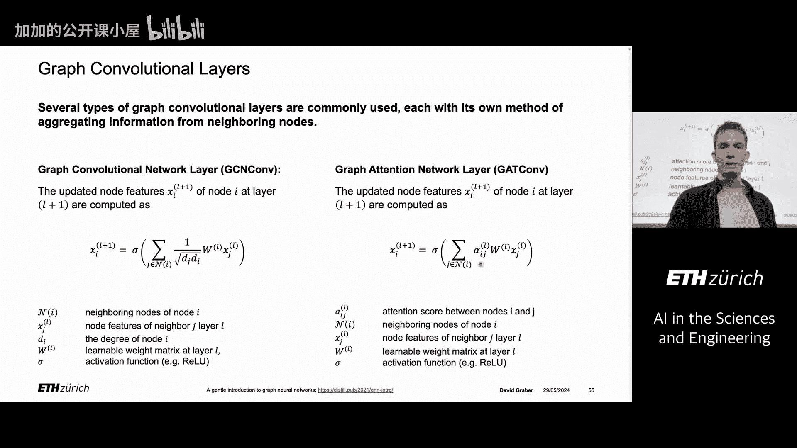

Goods。So。嗯。I will continue now with the graph based AI model。 give you one or two examples。

And hope that this introduction was， was enough to help you understand these models。

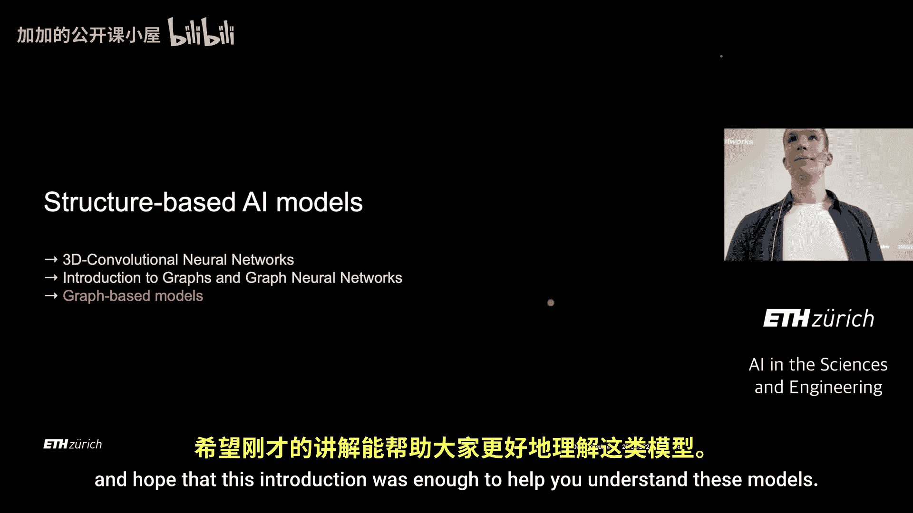

嗯。So this is a very nice paper from 2020， where they train the graph neural network to predict whether molecules have an antibiotic effect or not。

So it's kind of a graph level binary classification task。So。You generate a graph representation。

Of the molecules in your dataset set。And then they added also chemical data to the nodes and the edges。

 So for each node， which represents an atom， they added atomic properties like what type of atomy is。

 what， what if it's charged and this kind of information。 And for each et。

 they added information about the chemical bond it represents。So like。

 if it's part of a ring or like， if it's a single or a double bond。And。

Then they use these graph representations that are like feturized with this chemical information。

AndTo train a graph neural network。And the training set in this case was 2560 drug molecules of like diverse structure and function。

 And 120 them of them were labeled with known growth inhibition of E coli。

 So 120 of them are known antibiotics。And then they do very simple graph convolution on。

 on these molecules。And。Apply and global pooling。 So after the node features and edge features are transformed。

 they。Take the features of all notes and ets and pull them into a single representation and feed this into a neural network that outputs like the predicted probability of growth inhibition of E coli。

And。Then once they have trained this model， they applied it to a large or to a large library of molecular structures to the deryurposing hub with 6000 molecules。

So that did inference on this library of drug molecules。To do some classification。

 if some of them might be antibiotics。And it turns out that。

Among the 99 molecules for which the model。A predicteddic highest probability。 Actually。

51 of them showed growth inhibition against E coli。

 And just to compare among the 63 molecules that received the lowest probability predicted by the model。

 Only two of them displayed growth inhibition。 So this is。Quite a remarkable result。 I think， yes。

Yeah， the question is how they avoid over fi， given that the training data is like the training data set is really small and。

Yeah， I'm， I'm not exactly sure like about regularization techniques that they have used in their model architecture。

 but I know that the architecture of this model in this graph neural network is also like extremely simple。

 So it will also have very few parameters。But I don't know by heart how many， how many these。But。

That this certainly helps， I think。 But yes， given that the data set of for training is really small。

 I think this is quite a remarkable result。And it also。LED to the discovery of Holocene。

 which is like a new antitic that displays bacterial sideal effects like。

Against the wide range of different bacteria。And you can see， like here what they published in there。

In their paper that you have， you have a certain concentration of bacteria。嗯。

And if you incubate them with concentrations of this ho Holocene molecule， you will see that。

The concentration of bacteria declines， so they die。And then here。

 they also took the same bacteria and pre treatedreated them with amitin。

 Quite an old antibiotic for which some resisting bacteria strains exist already。 And you see that。

Some of the bacteria they persist after being treated with amitilin， And they just show that。

They can even kill these persistors， right， So if they apply these holocene。

 So it's just a functional antibiotic。That has been discovered。In a very simple manner， basically。

And interesting is also that this new antibiotic has kind of a low structural similarity to other known antibiotics。

Which suggests that the model was kind of capable to generalize。

 It didn't just predict molecules that have a similar structure to the antibiotic molecule molecules it has been trained on。

 but it kind of generalized and accessed somehow new antibiotic chemistry。Which， I think， is quite。

Interesting that this has worked。So。Then。This study has modeled small molecules as graphs。

 but you can theoretically extend these also two proteins， right。

 because proteins are just large molecules with a fixed。And vocabulary of building blocks。

So you can also model a whole protein as a graph， right。

And this here is like a a graph modeling on atom level。

 But this study I would like to show uses a a kind of different approach。

 So more coarse grained approach。 It's a graph convolutional neural network for the prediction of protein functions。

So it takes protein structures。And then it models them as a point cloud of amino acids。

 So it reduces each amino acid to its C alpha atom， basically。And。

Then connects these points representing the C alpha atoms of all amino acids。

 It connects them if they are less than 10 ostrs apart。 And then you get kind of this。Interconnected。

A graph that shows like the structure of the protein。 And it's kind of a contact map。

Which is the input to this convolutional neural network。So。They also feurize。

These amino acid node with embeddings derived。From a protein language model。 So they can。

 for example， use embeddings generated by the E， SM model and put these embeddings into the node features。

That represent， like the node that represent amino acids。So。

 and then they have like three layers of graph convolution with some skip connections。

 as you can see here。And the global ad pooling。 So they again pool the representations that transformed representations of all the notes in the graph。

And then。Generate like with this a single representation vector。

 basically and post this to a fully connected neural network to derive like probabilities of like class memberships for each protein。

 So like a prediction， what to what class the protein belongs。 And with this， also。

 like what function the protein might have。And。This simple GCN outperforms many machine learning tools for protein function classification。

 and。It suggests that the main reason why this model works so well is that。

This graph modeling that is applied of the protein structures， so。There are， basically。

The convolution sends messages between residues in this graph structure。

 between residues that are distant in the sequence of the protein。

 but end up being really close to each other in the。3D structure of the protein。

 So these residue are then connected because they are close to each other in the 3D structures。

 So the model has kind of a better awareness of the protein structure， right。

 And that's hypothesized that this is the main reason that this model has performed better。Yes。嗯。

Like a feature in the sense of， for example。like a graph level feature。 So how， for example。

A function of， of a molecule。Evolves over time。 That doesn't make sense now。嗯。I'm not， I'm not sure。

 actually。So。Would be interesting to look into。So。I already reach the summary of this part。

So graph neural networks offer many advantages for modeling and processing 3D objects。

 such as molecules。And they can handle data that is defined in irregular domains without mapping them onto a regular grid。

 and so。Graph representations are also invariant to translations and rotations。

 If you remember that in the 3DC N， you have to present the object in different orientations。

 But in graph neural networks， this is not the case。And。

It's also a much sparseer representation of 3D objects。

Then the these voxel grids that we talked about。And。

There are many possibilities for data integration。 You can save data in the nodes and the edges in a global context vector。

 and。Incorporate this information in， in the update mechanisms that graph neural networks have。

So these graph convolutional neural networks perform well in tasks where like an understanding of the structure of the inter and the interconnectivity of the data is is important。

 and they are usually， they usually perform quite well with relatively few parameters。

So to summarize the whole lecture。The text based AI models。

 So proteins and small molecules can be represented in in text and handled efficiently with methods of natural language processing。

And language models trained on these text representations can generate very informative latent space representations and are even able to predict the structure of proteins。

And structure based A AI models usually perform better in many tasks where information on the spatial placement of the elements in the data is crucial。

And graphs are ideally suited to， to model and process this kind of nonuclidean and onorder data。

 such as molecules and social networks。And。As an overall conclusion。

Like the engineering of proteins and small molecules is very。

 very challenging because the search space is just incredibly large。

 And these kind of AI models that I showed you， they。

 they can and will probably much more in the future。

 help to navigate these search space and accelerate development processes， for example。

 for new drugs or new functional enzymes。So。I suggest that we stop here。 And on Friday。

 I will talk about。

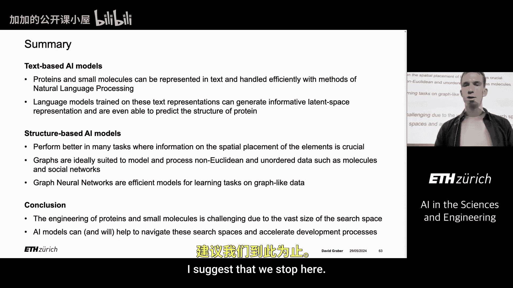

Very recent new models about that like generative AI models for like the novo design of proteins。

 So without having an actual protein that you change。

 But you just generate new structures from scratch， for example， with diffusion。Prosses。Yeah。

 will be interesting， so。Thanks for your attention and hopefully see you on， on Friday。

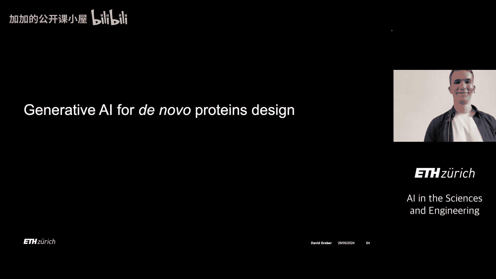