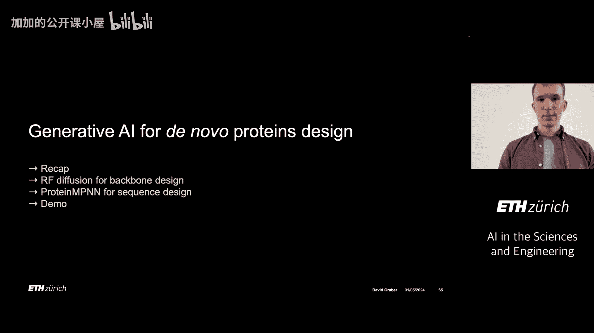
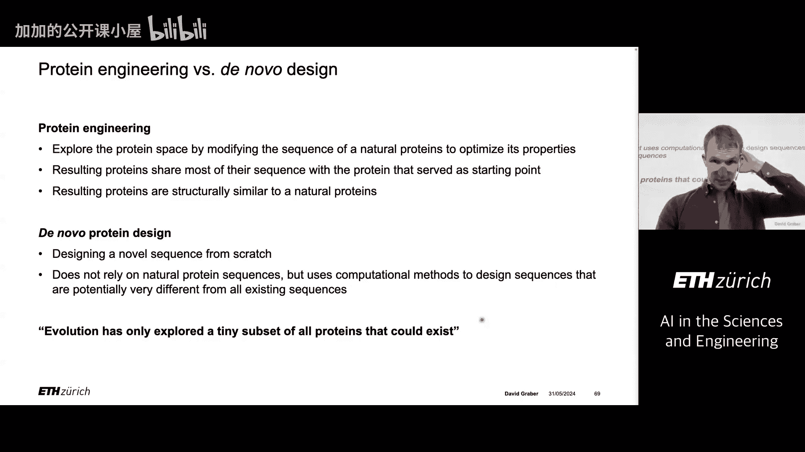
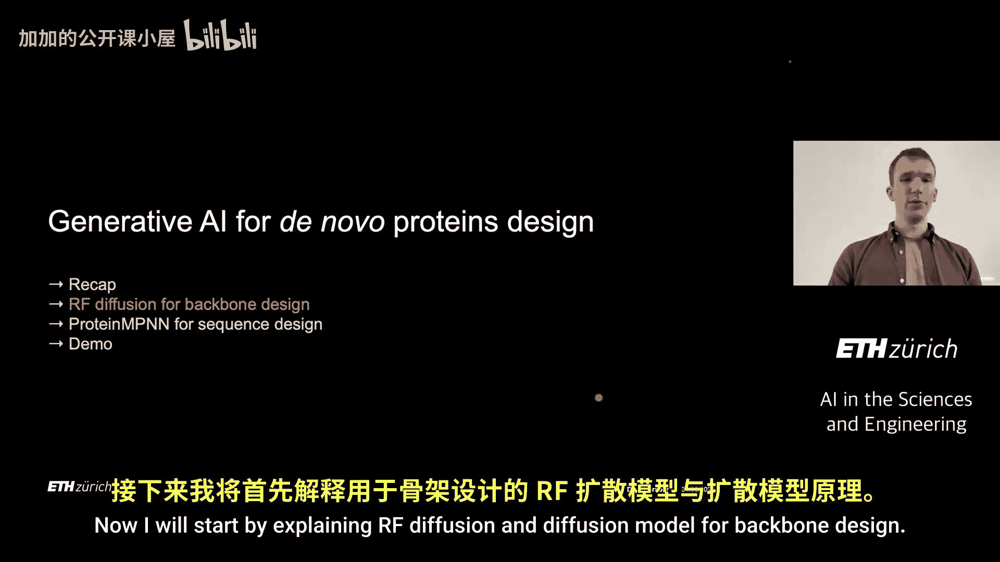
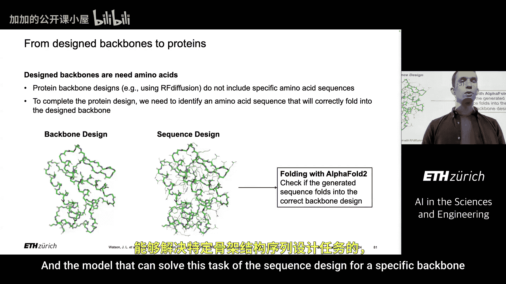
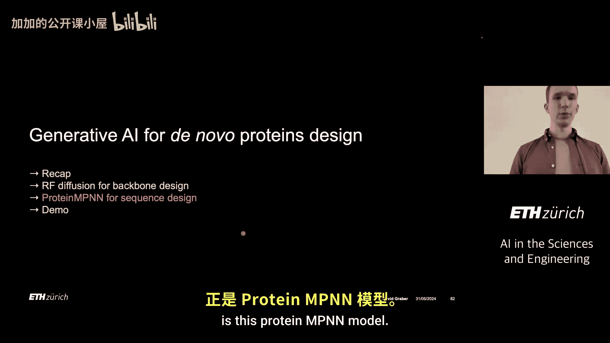
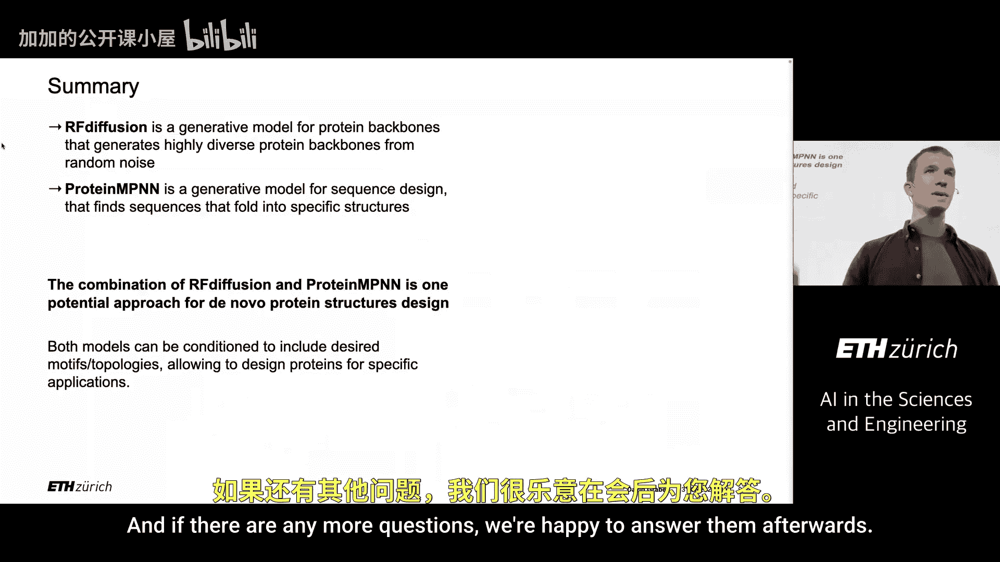

# 苏黎世联邦理工【中英⚡科学与工程中的人工智能｜2024 AI in the Sciences and Engineering】 p26 P26 Applications of AI in Chemistry and Biology Part 2 -BV1smxgzHEPC_p26-

All right， shall we start glad to see that some people came back after Wednesday。

The topic of today will be。Generative AI models for the novo protein design。But first。

 I will quickly recap some of the most important concepts that you will need to understand the models I will explain today and then I will explain RF diffusion。

Diffusion model for backbone design， and after that I will also explain protein and PNN。

Also a generative model for sequence design。And in the end。

 I will give a little short demomo demonstration of the power of these models。

So last Wednesday， we have learned that like proteins are chains of amino acids。

 and they fold into these complex 3D shapes based on the amino acid interactions。

And the backbone of such a protein consists of these linked triangles of N， C alpha， and C atoms。都。

This would look like this， for example， a backbone like a protein without side chains。

 or just amino acid backbones linked together and the difference between the  20 amino acids is basically just their side chains like what is attached to the C alpha atom。

 but this NC alpha and C triangle， this is common like to all amino acids。

And then we have also seen holding models like Alafol2。

 which predict protein structures from amino acid sequences。

And we have seen that alpha fold taking an input sequence first does like a genetic database search to look for similar sequences。

And makes in a multiple sequence alignment。And then it also does like a structure database search。

To generate the first structure prediction。From similar proteins that of which a structure already exists。

And then with these three inputs。It generates using this sophisticated model architecture trained on protein structures。

 generates a finally refined structure prediction。Then we have also looked at graph neural networks and graphs。

 which are ideally suited to model on order data， such as proteins or protein backbones。And。

In a graph like this， a graph neural network can transform the data that is stored in node and the data that is stored in edges through。

Message passing through graph convolutions。And the resulting embeddings in nodes and edges will then include information about the connectivity and the neighborhood of the nodes or the edges。

And as last week was mostly about protein engineering。嗯。

This refers like to explore the protein space by modifying the sequence of an existing natural protein to optimize its properties。

So the resulting proteins of when you engineer a protein usually share most of the sequence with the protein that' serve as a starting point。

And they also are structurally similar to。To the natural proteins you used as input。

And now today we want to talk about the novo protein design。

 which refers to designing a novel sequence from scratch。

 so this does not rely on natural protein sequences but uses computational methods to design sequences that might potentially be very different from all existing proteins。

So there's this famous statement that evolution has basically only explored a tiny subset of all possible proteins that could exist。

 so if you look at the whole space of possible combinations of amino acids then only a small part of this already exists and there's a lot of space left to generate new proteins。

嗯。That haven't been like seen or characterized before。

So。Now I will start by explaining RF diffusion， diffusion model for backbone design。

And for this， I will quickly repeat what we have learned in one of the previous lectures about like the principles behind diffusion models。

So these models have been shown to achieve state of the art performance in image generation。

And you basically。Start with images and over a number of time steps。

 you add increasing amounts of noise but at intermediate time steps。

You have these noisy images that still clearly resemble your input image。

But eventually you will reach。Time step where。The image shows no resemblance to your input image anymore。

 so you basically erased all the information in the image。And。

If you you then basically train a neural network to undo one step of noise and if you can successfully train these networks。

And you can then sample from your known gaussian distribution and feed this pure noise。

Into your models， which then do these repeated steps of denoing and eventually return like a distribution that closely resembles the one you trained on so they in this case they will return a realistic image to you。

And the same concepts can be applied。Through protein structures。So。You take a protein structure。

As training data， but you noise these structures that you take from the protein data bank and then the model is trained to recover the ground truth prediction the ground truth structures from the noise inputs。

And if you do this successfully and train these models， then you can generate new structures。

Through this iterative denoing from random noise。And to understand this RF diffusion model。

 we have to talk about how you can add noise to protein structures。

And there's this brain based modeling of protein backs that alpha fold and also RF diffusion use。

Where。You look at a backbone。as just triangles of NC alpha NC atoms。

 so these three atoms that are the backbone of a amino acid。

 they form a nearly planar rigid triangle basically。

 and each triangle in such a structure can then be described by a single translation and a single rotation。

So a protein backbone。Is then basically just a set of L translations and L rotations where L is the length of the protein or the number of amino acids in the protein。

And then。😊，Because all these triangles are described by a translation and the rotation。

 we we can add 3D Gaussian noise to the translation so basically pertuurbed the C alpha coordinates。

And they also use brownian motion on the manifold of rotation matrices。So。

This noising strategy basically transforms this set of triangles from neatly aligned along a protein backbone。

Into randomly distributed and oriented。And then they train a neural network to reverse this process。

So。The training aim is to recover original protein structures from the noise version of these structures。

And what you can see here is one training step of RF diffusion。So you always。

Take like at each time step， you take Xt， which is the current coordinates。

 which are initially random noise and then RF of diffusion always。

Directly makes a prediction for the ground truth structure of so it goes from xt to x0。

But then the next coordinate input。To the next time step of the model will not be this ground truth prediction。

 but it will be an interpolation。Between Xt and x0， so it takes the current coordinates。

And makes a step in the direction of its ground truth prediction。And then this。

Interpolations then pass to the next time step of the model。

And this ground truth prediction is not discarded， but it's also passed to the next time step。

So this is what they call self conditioning， the model can use the positions of the coordinates at the current time step。

 but also the predicted ground truth coordinates of the previous time step。

And this strategy markedly improved this RF diffusion performance。

And another interesting aspect of this model is that。

It is based on a protein structure prediction model， it's on a folding model。

Which is called Rosetta fold。And it's quite similar to alpha fold。

 and it also accurately predicts protein structures from input sequences。

Like the thinking behind is that we can achieve improved diffusion models。

For protein design by taking advantage of like the deep understanding of protein structures。

That are that is contained in these protein structure prediction models。 so we use just。

The weight of such a prediction model as like a training starting point。

 so RF diffusion was developed through fine tuning of the Roseta fold Str prediction network。

And this receptortta fault。Looks quite similar to like。Looking at the inputs。

 it is quite similar than alpha fold， so it takes in the input sequence that should be folded。

And then it also searches for homomlogous proteins in a database。

 so for template structures and creates a first。Prediction based on these homologous proteins。

 first prediction of the protein structures in form of like a pairwise residual distance matrix。

 and also it makes a first frame based representation that's thisreation of the backbone consisting of all these triangles that can be described with a translation and the rotation。

And then it outputs a predicted structure for this sequence。And。

Our affusion reuses this architecture with almost no changes。Except the sequence input。

To the folding model is now masked because we don't have an input sequence anymore and。

Instead of the first prediction of these frame based representation of the backbone。

 we now have these diffused coordinates， so the noise coordinates。

And then instead of this pairwise distance matrix， we have basically what comes from this self conditioning。

 so we have the prediction of the ground truth coordinates x0 of the previous time step。

So this was a structure prediction model。But now。It is fine tuned。

Using the same architecture to predict also a protein structure， but with noise coordinates as input。

And。This RF diffusion model can。Is a generative model for protein backbones and it's starting from random noise it can really generate protein backbones that are highly diverse you can see some examples here on the right side。

And。Many of the unconstrained designs show little similarity to structures seen during training。

 indicating that this model can really generalize beyond its training data。

And experimental characterization also showed that most of these proteins are really stable and soluble。

Yes， generation the it simply giving protein put exist。At the moment。

 what I explained now is just on constraints designs。

 but I will come to the point of like conditioned designs in a minute。So。

Or if diffusion can be like conditioned for specific designs。

So it can kind of be customized to specific design challenges by the addition of external potentials and by fine tuning the model。

So it's kind of like a guiding。Guiding of the trajectory and each step of this itruative denoizing process。

Toward a specific design objective。And as an example。

 RF diffusion was conditioned with the structure of a thin barrel protein。

 so a protein that has like this overall structure。

And then RF diffusion was able because it was conditioned with this input structure to produce like diverse designs。

With like。Roughly the same overall topology。And another interesting experiment that they did in this paper is they built scaffolds or backbones to hold a desired motif。

So。I have to explain this quickly， so P53 protein is a protein that suppresses cancer growth。

 so it's in a cancer cell this protein is supposed to like recognize when a cell becomes cancerous and initiates cell death so it should prevent tumors from growing and。

If tumors grow anyway。They have some kind of mechanisms to evade the cell death right and one of these aspects。

 one of these mechanisms is this MDM2 protein， so this is really often overexpressed in tumors。

And this MDM2 binds to P53 and prevents P53 from initiating cell death so the cancer cells can survive because they overexpress this MDM2。

 which keeps P53 from exhorting its function。And。The design task that they tackled was to design a competitor protein that binds to MDdM2 so that MDdM2 cannot binds2 P53 anymore。

So。What they did is staying。Took this MDM2 binding helix。From P53。Into their new designs。

So you can see here this is the MDM2 protein that usually binds to P53。

Like it binds to this helix of P533， so they take this helix。And。第。

Use RF of diffusion fine tuned on complexes。And condition it to include this helix。

So and then they generate designs， they were able to generate designs that strongly binds to this MDDM2。

 and this is like potentially。Like a candidate for a cancer drug， basically。And。

Some of you might be wonderinging because this was all about backbone design right so a backbone doesn't have amino acids yet。

 we just designed a structure of the backbone。With RF diffusion。

 but this backbone does not include any specific amino acid sequence yet。

So to complete the protein design， we need to identify an amino acid sequence that will actually fold into this backbone structure。

So the processes is。Depiced here， so far we have designed a backbone。

And now we also need to kind of equip this backbone with side chains。

 so we need to add an amino acid identity to each of these backbone triangles and。

What you can do is you design a backbone， then you run a model that designs a sequence for this backbone and then you can validate with alpha fold。

 so you take the sequence that has been designed for this backbone， give it to Al fold。

 which generates a structure for it and then you can see if this structure derived from the sequence actually has this backbone design。

And the model that。Can solve this task of the sequence design for a specific backbone is this protein MPNN model。

So it's also a generative model， but it's for sequence design。

And it follows this sequence from structure objective。

 so it takes a fixed backbone and designs a sequence that will fold into this backbone。

And it also uses like a graph based representation of the backbone structure within its architecture。

So this is kind of referred to as the inverse folding problem right so if you have a backbone like this here in the cartoon。

 but you could model the backbone like this， this is only the。

connected triangles of each amino acid like the backbone triangles and now we want to find a sequence that will fold into the given structure so we kind of equip this backbone with some side chains that make sure that if this amino acid chain is synthesized that guided through the side chain interactions。

The protein will fold in this。Backbone structure。And。For this。

 this protein MPn model models this backbone structure that you can see here on the right side as a graph。

And in this graph， node represent amino acid in this fixed structure。

 but more specifically see all four atoms of the unknown amino acids because it's only a backbone。

 it has no amino acid identities yet。The notes are positions of C alphapha atoms。

And then they just connect all nodes to its 32 nearest neighbors。

So basically each amino acid is connected。To its 32 neighboring amino acid。

And by a minus here I mean。InBackbone positions of amino acids。And then the。Sorry。

Then these node are the notess of the graph and the edges of the graph。Have to be feurized。

 so we put some input data into these nodes。And for the notes， these are just zeros。

 so the node features are initialized as zeros。And。😊。

The edge features remember that each edge connects basically two amino acids or C alphapha atoms。

Each edge。Is fuurized with a couple of distances and these distances refer to Dke。

All the distances that。You can like， compute between。Two triangles of these amino acids。

 so if you have these。To amino acid triangles， the edge features connecting these will contain like all these distances。

And this encodes somehow like the spatial orientation of these amino acids。

And then the first part of the model is this message passing neural network network。

 the graph convolution， where these initial node features。

 which are zeros and the initial edge features， which are these distances are transformed with graph convolutions。

So you can this is my like an example structure with these distances in the edge features and these zeros in the node features。

And through message passinging on this structure， the information about spatial environment of a node is encoded in its node features and same also count for edges。

And。The same you can basically see here， so what is in this red frame here is the message passing neural network part of the model。

So you can see we take these distances to edge features。And the note features。

And then we do this message passing， so we update the notes。

With an information flow from the edges to the nodes， then we update the edges again。

 we update the notes again this circle is repeated three times。

 so the graph this graph convolution generates new edge and node embeddings。

Which encodes information about nipat neighborhood of an amino acid。

And then in the second part of the model。This is basically the decoder。

 this does some kind of autoregress decomposition。そいです。嗯。By going through the protein sequence。

Which is still unknown and predicts like bone amino acid at the time。So。

It is run as many times as there are amino acids。So it always takes the edge features and the node features。

And from these embeddings that are saved in the respective。Notes of the graph for each amino acid。

 and the model predicts like a categorical probability distribution。

For the 20 amino acids from which the next amino acid in the sequence is sampled。And。

This takes in the edge features， the node features from the graph。

And also the sequence that has been predicted already， so it always predicts one sequence。

Using the edge of the node features and then goes on to the next amino acid and always takes into account the part of the sequence it has already predicted。

And。Yes， rock pollution at times doesn't mean that each amino acid is aware of the spatial information of the amino acid there at distance lesser equal than 3 from8。

And if that's the case， isn't there that limitation because we want every amino acid to be aware of every other amino acid？

那个。Linda I think when we were looking at graph con。

 we said that doing a graphvol we need to put in from the other neighbors。

 so doing a graph conution would me to that information flows from two neighbors and three neighbors if you do the graph three times as soon as for and I'm wondering if doing just three times is limited because we wouldn't have flow of information from an immuno acid four or five。

Pos on the line。Yes， that's a good point。嗯。So the question is whether more。

Like more rounds of convolution would be better because information would be flowing from harder in the graph like not only three steps away and I think。

Three times。Basically already encodes kind of the spatial neighborhood of this amino acid well enough。

 also considering that each amino acid is connected directly to its 32 nearest neighbors。

 so I'm not entirely sure but I guess they have like tested this and it's probably enough to do these three times。

嗯。But it's really important that also the edge features are changed so it's not only note features that are updated based on other notes and other edges it's also the edge features that are updated based on。

Other edges and other notes。嗯。And the training data for this model， as I said。

 is like proteins with known sequence and experimentally solved structures。

And then these from these solved structures and the amino acid side chains are removed to have only the backbone remaining。

And then the side chains should be or the amino acid identities should be rediscovered by protein NP PNN。

And the loss。For the training is basically a categorical cross entropy for all amino acids。

 so you just compare the true probability distribution。

To the probability distribution that the model outputs for a specific amino acid position。

And the training performance of this model is about 50%。And this refers to sequence recovery。

 so you take the protein with specific sequence， remove the side chains， so you basically。

Take away the sequence information。And。Then the model tries to recover this sequence。

 but it only has 50% recovery rates basically， and you might think that this is really low。

But we have to keep in mind that for many positions in a protein structure。

 several amino acids might be like a possible solution。

 like several amino acids might fit at a certain location。

So the important thing to do is this structure validation。

 so the sequences that the protein MN generates。We can。

Take them and check if they fold into the right structure because that's the actual target right？

So this workflow is depicted here， you have an input structure， you extract the backbone。

 remove all side chains。And then you use protein MPpinN to rediscover these amino acid identities。

 basically what side chains are attached where。And then given this sequence， you hand it to Al2。

 which predicts predicts a structure for the sequence and then you will。

You will see if the predicted structure by alpha fold closely matches the input structure。And。

For this， I have like a short demo。So this is basically the same figure that you've。Seecen just now。

 and this is a demonstration of protein MPNN。So。We can take an input structure and we will take here this one。

YCR， which is actually the MDM2 protein of this cancer example I showed you before。

 and then you have some settings here so you can say we want to redesign chain A。And。

Let's say we want to generate four new sequences for this backbone。

You will also have like a sampling temperature， so if you make this higher then the the sequence discovery will be kind of more creative and you will have more diverse sequences。

And then we can run this。And this will be quite fast because the model is really fast there's only 1。

7 million parameters， and then you will see here。This is our original sequence of this MDdn2 protein。

And these are the four sequences that protein amN has generated for this backbone。

 so these should fold into the same structure。And you can see here the recovery rate is 44 to 47 more or less。

 so these sequences have only。Less than 50% identity with the input。Protein this MDdM2。And。

To see if these sequences actually。Take on this backbone structure that we desire and the same as this MDM2 protein。

 we can now run alpha folds on all these sequences that have been generated。

But this will take a while， even though I chose a small protein， so I will。

Continue with the presentation in the meantime。So this protein MPn solves this sequence design problem。

So finding sequences that fold into specific backbone structures。

And in Sil experimental validation show that it can do this with high accuracy。

And this graph based modeling of the 3D backbone。嗯。

And this message passinging neural network derived。

 note features are crucial for this model's performance。And also very interesting is that。

Also here you can。Include desired motifs。嗯。By just keeping a part of the sequence fixed。So。

You just let a protein MPn only design the sequence around the parts that you want to keep fixed。

 so if we go back to the example of this P53 MBmbM2，Interaction。We have seen that using this Felx。

And RF diffussion， we have generated this backbone structure that holds this helix and then binds to MDdN2 as we desired。

And now that we have this backbone， we have to give it some amino acids because it's just the backbone so far so we can use protein MPNN but。

For example， we want this still to bind into MDN2 right。

 so it might be a good idea to keep the amino acids。

That are part of this helix in P53 to make sure it still binds to MDdM2 so we can use protein mpinn。

But。Give it as input also。But。Like a certain set of amino acids should be located here。

 and then it will just design the sequence， the remaining sequence around this fixed part。嗯。

So let's go back。This has finished now and you can see here。That we have。The four sequences。

And the root means square deviation， we can sort well for this。D you。

And see that sequence0 is the best one。The model is very confident about this prediction。

And the recovery is 44%， so the sequence has only 44% in sequence identity with MDM2。

And here you can see the structure。So in gray。You can see the input structure。

 so the template we used， the MDM2 protein。And。In blue。

 you can see the structure of our newly designed sequences， so even though these sequences are。

Very different somehow， only  44% sequence identity。Protein and PN has correctly。

Suggest the these sequences because they。Really fold into the spectrumbone structure。So to summarize。

 RF diffusion is like a generative model for protein backbones。

That generates highly diverse protein backbones from random noise。

And then protein MPNN is a generative model for sequence design that binds sequences that fold into these specific structures。

And so。This combination of RF diffusion and protein MpinN is just like one potential approach to the novo protein design。

 it's a powerful approach but this lecture has like in no way been like an exhaustive overview over this field this field is super dynamic you can hardly keep up with all the papers that are really released in protein design。

But these two models， they are super interesting because they work really well and they are publicly available for everyone to use。

You can also。Include desired motives or toppologies。

Which allows you to design proteins for specific application。

 which makes them a lot more interesting， I think。Good， I'm at the end of the presentation。

 if you have any questions， I'd be happy to try and answer them。

about the actual representation of the physical structure of the project we said sometimes it's just translations and orientation。

 is that always the case or。I。嗯。At least Alpha fold uses this kind of representation and also。

Rocetta hold as well and also RFff fusion does the same。Yeah。

 there would be other kind of representations， I think。嗯。Yeah。

 but it's hard to say and not nothing comes to my mind right now。

And if they do these unconstrained designs then I mean this is not specifically encoded in these representations。

 really just these rotations and translations， what they can do of course is they can condition or diffusion to form a helix or a beta sheet at a certain location by just adding some external potentials that in each denoicing time step just pushes pushes the coordinates a little bit in the correct direction like the one the direction they want and then they can end up with。

Designs that have some desired topologies。Another question yeah then I'll like to so all these four sequences。

You have the same background structure as the whatever's yes， I mean we can。This is the picture yeah。

 this is the sequence zero right。This is the sequence0 yes。

 so we can check maybe sequence three has the highest RMSD。

Of these four sequences that we generated so maybe we can show this one then I guess you will be able to see some more deviations from the。

It's not really the case。It's still quite similar today。Input structure and the M2。Actually。

 different sequences can have the same 3D structure once they're golden。Yes。I mean。

 we could maybe increase the。嗯。The temperature of the model and then generate more sequences。

 and then we will probably also get sequences that are not so precise and have。

Quite a different techbone。嗯。But the best predictions。嗯。As far as I've tried， it always looks quite。

Qu like the input structure。Okay。但呢。Thank you for your。Attention and。If there are any more questions。

 we can happy to answer them after。

Oward so。