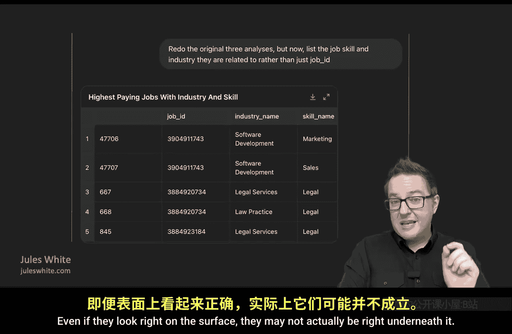

# 范德堡大学【中英⚡ChatGPT与Excel｜ChatGPT + Excel： AI-Enhanced Data Analysis & Insight】 -BV1PdVizZE1d_p4-

We don't always have all of our data stored in one file。

 So one of the capabilities that we get out of using chatGBT for analyzing data is that it can help us to merge multiple files together。

 We're basically join data across multiple files。 and I want to show you what this looks like and how powerful it can be particularly when we're taking data that may have been extracted。

 for example， from a database and we have one file representing each individual table and now we need to go and construct a picture of that data based on data that's spread out across multiple tables and we need to join them together。

 So we can do exactly this type of thing within chat GBT。 So what we do。

Is we go through and begin finding those places where we need to perform joins in order to bring in data now I'm going to continue this job data set analysis and we're going to see that we run into a you know some challenges with it because there's some missing data right and it's not that there's missing data it's that there's missing data in the file that we started with。

😡，So originally I told it my goal is to answer a couple of these questions and turn them into a really exciting and interesting post for LinkedIn and it had gone through and it said okay。

 here's some report titles， it come up with some selected questions that we could use for that report and it come up with a suggested analysis approach and then I went and I said yeah let's proceed with this analysis and it came back and it generated the analysis but something interesting happen。

Because when I look at the data， what I see is is I'm getting highest paying jobs。

 but by job I right， job I isn't very helpful right， It's some unique identifier in this data set。

Now I could take it like this， and then I could go and manually try to do something in an Excel or some other tool in order to fix this problem and try to produce names for these things。

 but what I really want to know is like you know the job of being a university professor pays the median or whatever it is and what actual readable things but I can't do it。

Now， within this data， there's multiple individual files。

 and my hunch is is that one of these files has something that I can join job ID against to maybe find that data。

😡，So what I'm going to do is I'm going to start incrementally giving it different parts of the data and seeing if it can identify something that it can join against。

Now notice what I'm not doing。 I'm not telling it how to do it。

 I did this as an exploratory example to show you， obviously。

 if you know exactly what you're looking for and that this file has this I and this file has this other I and there's a relationship between them。

 you can certainly go and upload both those files at the same time and explain the relationship and you should but what's kind of amazing is when you're doing this exploratory analysis across multiple files。

 it can help identify those places where things need to be joined。

 So I start off by giving it a file that wasn't quite what was needed。 I gave it this job industries。

 and it notices that there's a job I in job industries， but it's not quite right。

 right it represents the associated industry and that's not really enough for me。

 I don't want to just know what industry it's associated with。😊。

So I went back and I actually took all the files that I had in this data set and I gave it to them all at once。

 and I said， what about all of these， can we figure out the name of the jobs with this additional data？

And it comes back and it starts telling me for each of these individual files how it fits it。

 you know， Indu at CSV， it has an industry ID。Companies and In as a company ID。

The benefits has job I， Then we see proposed next steps and it see there's this job skills as well。

 which I admittedted the description of that， and it says we can use job skills to link to job Is and then we can map the skill abbreviations from skills。

 CSsv to skill names。And then we can put that together with industries and skills。

 So then you'll get a listing。 It may not be the exact job title。

 but it'll tell you the skill that's being looked for and the industry。

 And then when we go through and we run that now we get something more interesting。

 We get the highest paying jobs with industry and skill and now we can see well it's software development and its sales It's software development and marketing。

 and that actually makes a lot of sense to me right I would expect that enterprise software in sales is probably a pretty lucrative business to be in if you can make those really big sales and you can probably be a very wellcompensated person。

 So that's not that surprising， we also see legal on there。 So this looks like it makes sense。

 but you notice what it's done， it's basically gone and it's joined across multiple files and how did it do that。

Well， really importantly。When we started digging into the data， we got samples of job ID。So one。

 it could have looked at job IDs and the sample of data there and matched it by looking at samples of others and seeing that the same thing you know appeared in multiple places and was unlikely to be just some random number。

 but it was actually a unique identifier It's one way it can discover these relationships。

Another way it can discover these relationships is if we have consistent naming so if we have job ID in multiple places。

 then it can go and find those things and say I can link them together but in this case what it actually did is something even more sort of complex and sophisticated is it's linking job I to other things like skills and industry and then it's going to link into skill and then looking based on the skill abbreviation。

 what actual skill name that is and so it's actually having to perform multiple hops to do this join。

Now， it told me what it was going to do， that's a really important thing when it goes in and it starts explaining how it's going to join things together。

 you want to look at that and really make sure it makes sense。

 but it can help you to discover those relationships across files。 if you don't already know them。

 It can basically hypothesize what the relationships might be At the end of the day。

 you still have to go follow up just because it looks right。 It's named the same。

 The values look close does not mean that that's actually the case。

But it can help you to figure out what might be the case and then you can go and track it down for sure by finding out the real source of the data does that really mean what we think it means。

 but it can you notice spot things across multiple hops。

 multiple different points that things are being joined together and it's doing it in a way that's trying to achieve my goal because I told it look。

I don't just want to know jobb I。 I want to know what the job title is or something like that and it tells me I can't really give you job title。

 but what I can give you is industry and skill and now that we see industry and skill name that's actually good enough for me That's gonna give me what I want So it's helping to me to achieve my goal without necessarily directly translating that into what I asked for it it's trying to help me reach that goal So critical thing you can go through and you can use multiple files you go and upload and attach multiple files at once to the prompt and then have it begin exploring and explaining the relationships between different idea identifiers and columns and how they might be used to join data together it can do other really sophisticated and sometimes surprising things but at the end of the day you also always want to go and verify that these things that it's proposing are correct。

It is your job to follow up and make sure that those things really。

 really are true in terms of relationship， even if they look right on the surface。

 they may not actually be right underneath it。

