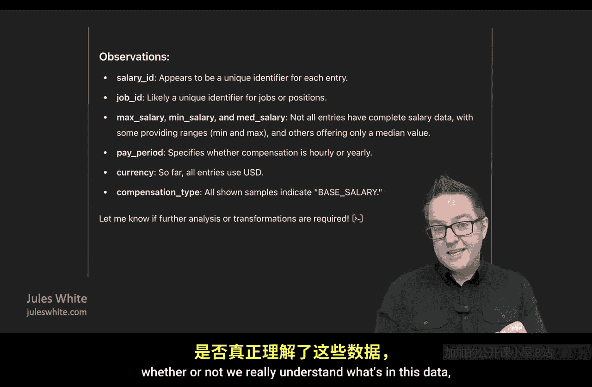

# 范德堡大学【中英⚡ChatGPT与Excel｜ChatGPT + Excel： AI-Enhanced Data Analysis & Insight】 p01 P1 01_利用ChatGPT进行Excel数据的自我反思与目标设定 -BV1PdVizZE1d_p1-

To get started with chatGBT for data exploration， what we want to do is we want to build a shared understanding of the data that we're working with。

 And I know this sounds a little bit crazy， but think about it if you were working with somebody who was an intern or somebody else and they had never seen that data before。

 right Cha GBT has probably never seen the data that you're about to give it。

And the first thing you're going to do is you're going to sit down and talk about the data and you're going to make sure that person understands it where they might go look at it。

 and then they might come back to you with questions about it。 And that's our goal， really。

 is to build the shared understanding to make sure that that intern that we're working with it。

 It's never seen the data before。 they're super skilled。

 but it doesn't matter how skilled they are and analyze the data。

 if they misinterpret it or if they're not clear that there's something in it that they haven't seen yet。

 or there's some column that they miss， that's really important or some relationship between the columns。

 If we don't provide that context that we don't make sure they have it。

 there's no way that they're going to be able to successfully perform the analysis that we're looking for the exploration。

 no matter how good they are。 and that's where we have to start。

So what we're going to do is three things。 we're going to dig into the data。

 and I'm going to talk about what this means and go through it step by step。

 but this process of digging into the data， it is that sitting down with that person who's never seen the data before and is getting ready to do that analysis and helping make sure that they are up to speed。

Now， we're going to start this process by getting a description of the data。

 And this is actually really quite simple with chat GT。

 What we're going to do is we're going to take the data that we're going to be working with。

 We're going to upload it。And then we're going to ask it to do something very specific。 Now。

 we're working with， you know， data that's tabular。 It's， it's rows and columns。

 We have attributes of that data that we're going to be looking at。

 And what we want to make sure is that it sees all the columns and it understands what's in each column。

So I've uploaded the data to chatGBT。 I've uploaded it as an Excel file。

 and I say list all the columns in the attached spreadsheet and show me a sample of data from each column。

And so what I'm trying to do is I'm trying to bring into the conversation。All the columns。

 This is like， if we SAT down with that person and we said， now。

 tell me all the columns that are there and tell me what each one is and show me some data from each one of them。

 right， that's a very sort of comprehensive way to make sure that they have actually looked at all of the columns that they have actually seen data in all of the columns。

 And then you can have a discussion around it。 And that's what you're trying to do is have that。

 So we ask for this。 And it brings in all the columns。

 Now I'm working with a data set that I pulled off of Caagle。

 And it's all kinds of interesting data about job descriptions and postings on LinkedIn。

 And what we're gonna do is we're gonna to be using this to explore the idea of you know。

 what can we learn from job postings。😊，So we pulled in all these columns。

 It's showing us samples of the data。 We're already beginning to see some things that are going to be helpful to us to know and probably helpful for chatGBT to understand。

 For example， max salary， it's pulled in a sample that's inN or not a number That's going to be important information to us because it means that this is not strictly formatted as a number。

 it probably has like a dollar sign in that column and it's like a string with commas or something that isn't parsing just directly as a number。

 We also see that pay period has hourly next to it。

 and that's going to be some interesting information。

 then we see compensation type based salary right And so that means we're going to start having to understand what are all of these these values and if we don't take the time to do that。

 we can get unexpected results。 Now， for example， if I see compensation type and I tell it to do a numerical analysis of that it's not going to work。

 And it might present something that worst case looks like it worked。It didn't。

 and so my own understanding is important， but its understanding of what's there as well is really important。

Another thing that we can deal with and head off at the past is issues with the data that we're uploading and the formatting of it one of the things that large language models can do is when we ask them questions。

 we ask them to do things，If they don't have the data to do it。

 they like to generate that is they like to please us。

 they like to try to give us an answer that we're going to be happy with。

 and so if they don't have the data， the way that they like to give us an answer is by guessing many。

 many times they will guess and generate and this is called hallucination right。

 it is trying to guess it's like being given a test。And not knowing the answers。 But boy。

 you're not going to just leave that thing blank。 You're going to try to fill it in and get some partial credit or something。

 And that's basically what the large language model is doing。

 So we want to make sure that if it doesn't get the data， that it doesn't do the wrong thing。

 which is hallucinate。 So we want to spot when it's unable to get the data so。

This is the type of thing that we're trying to make sure happens。

 So I uploaded some data that was an older form file format for Excel， which you can't read X L S。

 and it starts going through and it basically struggles with it。 Now。

 it's possible it could get it right， but it's possible in the process of converting it。

 there could be an error， but I want to know this up front， right。

 if it's struggling to load that data， I want to know that because if it fails to load it or it loads it incompte。

And it can't describe all the columns to me。 then I'm going know that I'm at risk of getting hallucination。

 And so I want to spot that。 So this step seems so simple， but it is critically important。

 De the data and all the columns。 the other reason that it's really important is because once we've describe the columns and brought them into the conversation。

 the LOM will know about them in order to help do analyses to help。

 you know suggest ways that we could explore the data and other things。 So really， really important。

😊，Now， describing the data is more than just listing the columns。

 One of the things that can be really helpful is to get multiple samples of the data because the column itself doesn't really tell us enough about that data in its format and there may be hidden relationships between the different rows and we want to try to surface them。

So one thing that's very， very effective is to have it describe all the columns first。

 and then to do something like this prompt， take a couple more random samples of the data for each column to make sure you understand the format and type of information in each column。

And the goal here is we want to pull that data out。 We want to get more than one sample。

 so we've seen a variety of different values。 We can see issues。

 maybe 99% of them are right and some percentage of them are wrong or have weird formatmatic。

 Now we might not capture that with a random sample。

 but it's helpful to us to at least have more confidence that we've seen a value that might be abnormal。

So if you look at max salary here， for example， in this table。

 we see some numeric values for max salary， but we also see NAN or not a number。

 And so that means that we have to be aware that that's a possibility and so anything we ask it to do。

 we have to account for the fact that it may encounter with max salary。

 something that is not a number for whatever reason and we might want to go and dig into that further and understand it further。

 it may also be that when it did the conversion or loaded the data。

 it was unable to successfully convert it， and so we might want to dig it in。

 but we will not know that unless we ask it to display the data so that we can look at it to describe it to give us a sample。

Now， it doesn't occur here necessarily because we can't see it。

But the other thing that can happen is we can have identifiers in rows。

 like we may have one row that refers to another row。

 So you can imagine if we were describing types of jobs or categories of jobs。

 particularly categories， we might have one category that is a subcategory of another thing。

 so we might have a column like parent I in that parent I might refer to an I of another row。

 And if we brought up a sample of that data， then it can begin discovering and seeing those things。

 And in fact， it can be pretty you know sophisticated in how it does this and spot those types of things。

 if we don't get a sample of the data。It's unlikely we're going to spot something like that。

If you look at it， it's actually gone through once we've given it the samples of the data。

 and it's made some observations。 And this is important。

 It's a salary idea appears to be a unique identifier for each entry。And so it's learning。

 it's essentially doing what that intern would do。 It's telling us about what it's seen。

And it's super important that we read through this and make sure that its understanding of the data is correct。

 Jo I D， likely a unique identifier for jobs or positions。 If I know that it is。

 I should tell it it is。 I should follow up and say， yes， that is correct。

If I see things that are wrong in here， I want to immediately follow up and correct it。

But the goal of this is。I am having that conversation with that person that's going to do the data Allison has never seen the data before。

 and I want to talk through it with them。This is what you want to do if you just dive in。

 say here's the data， show me this chart or whatever the visualization is。

 your likelihood that something goes wrong goes way up because you don't know if it properly extracted the data。

 you don't know if it properly understood it， you don't know if it had a misconception based on the way things were named。

And you have to have that conversation in order to make sure that its understanding of the data aligns with your understanding。

 It's also possible that you uploaded the wrong file or an incomplete file。

 whether the data that's in there is not what you think it is。

 And it's also important for you to understand if you've made a mistake or you have a misconception about the data。

 And this is that initial step， where we're gonna help discover， you know。

 whether or not we really understand what's in this data。

 whether or not it understands the data and help build that shared understanding。

