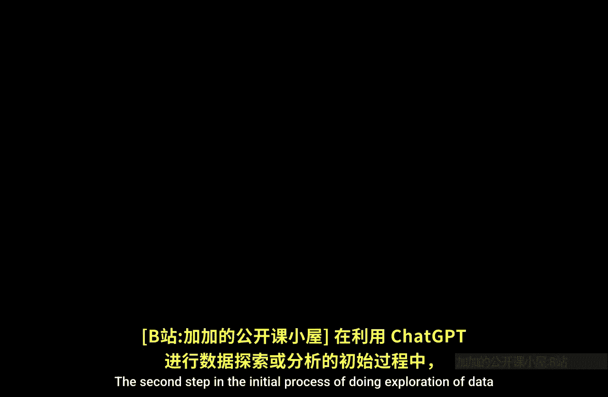
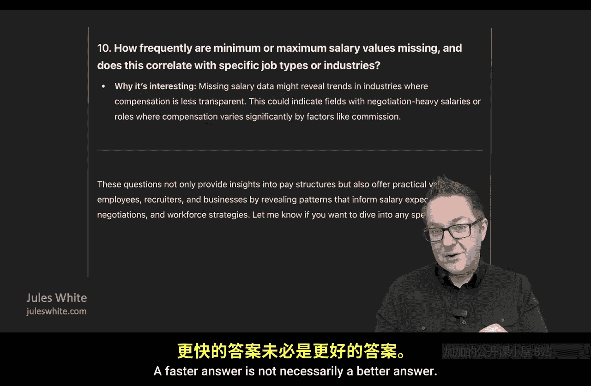

# 范德堡大学【中英⚡ChatGPT与Excel｜ChatGPT + Excel： AI-Enhanced Data Analysis & Insight】 p02 P2 02_让ChatGPT生成可用Excel数据回答的问题 -BV1PdVizZE1d_p2-

The second step in the initial process of doing exploration of data analysis of data。

 which had GPD is introspection， That is we wanted to look at the data that is just finished describing and think about like what are the patterns in that data。

 what are the relationships and very importantly， we wanted to start putting things together to try to think about what can it can it fuse together and tell us about that data set and what are the really effective ways to have it introspect the data is to have it come up with questions that it could answer about the data。

So the reason that questions are great is because imagine again。

 we go back and we're sitting down with that intern or that other person that's going to go and analyze the data and we have them go and look at the data。

 describe all the columns， describe all of the values and give us samples of them and then we ask them okay now tell us some questions that you could answer with this data。

 you know， tell me something about what you might be able to learn from this data set。

 and they could start describe。Now， this does some important things。 So one is。

When they tell us their questions， that'll help us know if they really understand the data or not because we can think about is it really possible to answer that question from this data。

 why or why not， if it's not possible， that's then an opportunity for us to go back and say， no。

 wait a minute that's not what this data means。 that's not the right format。

 Here's why we can't answer that question， and that allows us to clarify things。

The other reason is they may see something that we did not see。

 they may come up with a question that we did not think to ask。

 or do we not realize could be answered by the data， and then that informs our own thinking。

 so it becomes collaborative， but it's a collaborative opportunity one for us to see what we may have missed gaps in our own analysis。

 but also gaps in their understanding of the data。😡，So using the same job data。

 I've gone in and I said， tell me some interesting questions that we could answer with this data set and why they would be interesting。

And it comes back and it says what are the highest and lowest paying jobs and how do they vary by pay period。

 This is an interesting question， how does salaries cluster by men max and median values are there large disparities between men and max salaries for certain jobs？

That's a really interesting question like for example。

 if you where do you see the greatest range for the same role。

 that would be very interesting to know， how does pay distribution vary across different ranges？

Is there a relationship between compensation type， EG base salary and variability and salary ranges。

 which jobs provide only a median salary versus those that provide minimum maximum salary ranges？

Are there any noticeable patterns in salary data for different currencies if additional currencies exist。

 Now， notice it's also predicated this question on if additional currencies exist because it took one sample。

It may not know yet。 So it's maybe even hypothesizing something that it could answer if there is data that supports this type of analysis。

 So some of the， the questions that says it may answer may not actually be things that could be answered。

 And this might be a good， opportunity to follow up and say， hey， all of this。Data is in US dollars。

 Therefore， that analysis won't work。 it could take that into account。If that's not true。

 if we know there's 100 currencies in there， we could go in and state that。

How does salary range differ for the same job I， which roles have the smallest and largest pay ranges。

 You know， does the data suggest trends in hourly versus yearly compensation structures across industries and how frequently are our minimum or maximum salary values missing and does this correlate with specific job types or industries。

 So a whole bunch of different questions。 It's really given us a wealth of different questions that we can ask and then go and try to answer with the data set。

But it's also a wealth of opportunities for me as the human being to look at the question that is proposing it and say。

Could it really answer that with the data？Yes or no， if it cannot。

 then I can go back and explain to it why its question can't be answered。

 and then what I would typically go is ask it to generate。

 I would clarify what's in the data set I would say here's some misconceptions and reasons why you couldn't answer these questions。

Now generate 10 new questions。And the goal is you can iterate through this process several times。

 and questions become a very powerful way to quickly uncover misconceptions in the data。

 but also I'm getting a lot of ideas， right？In the process of making sure that it understands the data。

 I am essentially brainstorming and learning about the data myself。

 So it becomes a mutually beneficial process。 Now， could we jump into this data set and try to get there faster。

 Just visualize it now， do this now。 Yes， we could。

But I strongly encourage you not to do that and to take the time to go through these processes。

 and the reason being that the worst thing in data analysis that we can do is arrive at the wrong answer and be really confident that we got the right answer。

And there is tremendous risk of that when we run too fast with generative AI。

 and we just assume that everything is peachy and all is great and that， oh。

 these beautiful charts must be backed by reality when it's very possible that there was some misunderstanding。

It could be a tremendous misunderstanding me， it just flat out hallucinated data that is possible。

It could also be something subtle， right that there was a value that wasn't numeric， not a number。

 and its calculation didn't account for that because it didn't know that that was possible in that value。

And we never talked about it， or it could be something more subtle where it interpreted my question wrong or interpreted the meaning or names of columns wrong。

 in a subtle misinterpretation causes it to produce a calculation that isn't quite in alignment with what I'm really asking and this can happen in the real world with other human beings。

 right， If you SAT the end turn down and they have a misconception about that column。

 they could go and produce a really sophisticated looking calculation。 and great。

Data visualizations or analyses。That a really hard， hard to spot the air in。 And so those subtle。

 you know， mistakes and understanding can be really catastrophic。So。If you have a human being。

 it's a great idea to go through and have this conversation if you have ChGBT or another LLM that's doing the analysis and supporting you。

 incredibly important to do it as well and you want to make sure that you arrive at an answer that's actually correct。

The worst thing in the world is to arrive at the wrong answer and think it's correct。

 And that's why we do this。 A faster answer is not necessarily a better answer。 In fact。

 it can be a catastrophically worse answer。

