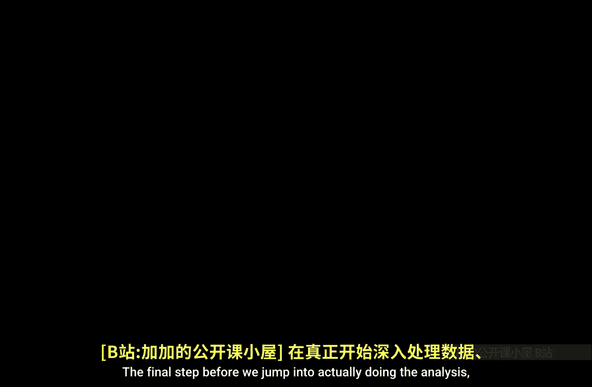
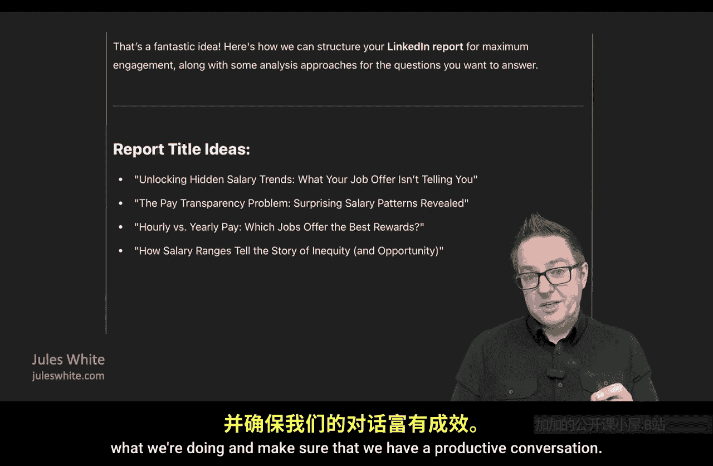

# 范德堡大学【中英⚡ChatGPT与Excel｜ChatGPT + Excel： AI-Enhanced Data Analysis & Insight】 p03 P3 03_设定目标以指导ChatGPT的Excel数据分析上下文 -BV1PdVizZE1d_p3-

The final step before we jump into actually doing the analysis in the deep sort of technical work of working with the data is we want to do some goal setting and why do we want to go and set goals and what does that mean what we want to do is we want to make sure that the AI understands what we're trying to achieve Now why would we care about the you know generative AI understanding our goals。

 Why would we want chat GBT， for example， to know what we're trying to achieve。Well。

 I'm going to give you my intuitive explanation of why I think this is super important。

 and I would love to see as the state of research in this area evolves whether or not this pans out。

 but this is my personal belief。And I want to kind of explain how this makes sense。So。

If you think about the origin of large language models， they really。

 if we think about it came from this paper， attention is all you need。

 which introduced the transformer model， which has revolutionized large language models and made all of this AI stuff that we're excited about possible。

And。The key idea in this is that this model can learn to pay attention to things that came before。

 statements， words， other things that provide context that help shape its output and what it does in the future。

 So when you go and see this input， it can decide that something in that input is really important and pay attention to it。

 when it starts producing its output。And that idea of intention that it can focus on something is why I think goal setting is really important。

 because if we can start analyzing data and there's many different columns。

 there's many different samples of data that we've seen。

 There's many different ways to take the analysis。If it knows in advance what the goal is。

 it allows it to pay attention to that goal as it goes forward and so intuitively。

 what we are doing is we are giving it something to pay attention to that can help shape its understanding of the columns and all of the statements and analyses we're giving it if we don't give it that context up front。

 it can't spot that maybe we're telling it something that could be interpreted in many different ways and then it might be interpreted it the wrong way。

 like it gives it context to understanding and interpret what we're asking it。It gives it。

 you know context to be able to spot when things might not be possible。

 And it's the same way if you sat down that intern and you said， okay， let's go and do this analysis。

 Here is our goal。Then that allows them to focus right， they know what to pay attention to。

 they know what questions to ask， they know what we probably have a better understanding of what we mean when we say certain things。

And I think that is the same case with large language models that are based on the transformer architecture。

 because attention allows them to pay attention to our goals so。

After I've done a description of the data， after I've done introspection。

 when introspection is going to bring out a wide variety of questions。

 we're going to get lots of columns， We're going to get lots of samples of data。

 we're going to expand out。 Now we need to focus。 And we're going to focus with attention by setting a goal。

 And so what we say is our high level goal。 now。😊，You can think of the goal as we're telling it what to pinch paid attention to the bounds of the conversation。

 the bounds of the analysis。 So we want to set it precise enough that it captures everything we're trying to do。

 but not so imprecise that it's meaningless。 For example。

 if we go in and we say I'm going analyze some data， that's my goal。 Well。

 your boundary is pretty big， and it may not help it in any way。

 If you go in and you say something like this， my goal is to answer a couple of these questions and turn them into a really exciting and interesting report to post on LinkedIn。

 it gives it a lot of context about what you're trying to do。

 You're really trying to come up with some flashy， interesting analysis related to one of those ideas。

😊，And the fact that it's going to be posted on LinkedIn also gives it context。

 But because it probably means that the end of the day。

 we're gonna have to boil this down into something pretty simple。

 Some simple statistics that would fit into a LinkedIn post。

 So there's a wealth of information there。That can help guide what it does Now。

 if I decide that I wanted to generate a really in-epth report for an academic paper。

 this goal is not going to work anymore right， and I would need to start a new conversation probably and go through this process again。

 reset the goal to something that is the appropriate scope for doing a deep dive for an academic paper。

Once you set this goal， yeah， you could go and try to just end the conversation， you know change it。

 and that might work， it might not， but you also have to realize that once you set the goal and starts doing a bunch of analysis。

 it's going to bring a bunch of things into the conversation and it's going to focus things in the conversation around that goal。

And that may lead to it being hard for it to take a step back and reset in some way now maybe it can。

 maybe it can。 so often if I'm going to reset the goal， I'm often resetting the conversation as well。

So once I say this is my goal， then it comes back and says that's a fantastic idea and it also does something interesting right it refines my goal with ideas for example。

 for the report title。😊，And you can see it's picked up on the idea that this is going go into LinkedIn。

 it probably needs to be flashing and exciting。 you know it's saying unlocking hidden salary trends。

 what your job offer isn't telling you right it sounds like the LinkedIn post if I was wanting to do an academic type paper with a deep dive that's the wrong sort of focus But for what I've told it to do this is exactly the right type of focus and then that will give it something to pay attention to if I say。

 oh， I really like this one title， then it's gotten even further goals。

 Now I'm going to try to build the data to support that title And so goal setting is a way to tap into that attention mechanism。

 help direct the conversation to focus on things that we care about and it also helps us again。

 the whole process like where it's proposing different titles is helping us to brainstorm as well and hopefully arrive at you a better solution that we would have before then if we just dive in and said here go and visualize this。

 do this， do this。😊，We're building better trust that understands the data。

 We're building trust that we understand the data。 We're building。

Trust and learning about the things that could be answered with that data。

 and then we're going and we're setting the goal to really refine what we're doing and make sure that we have a productive conversation。

