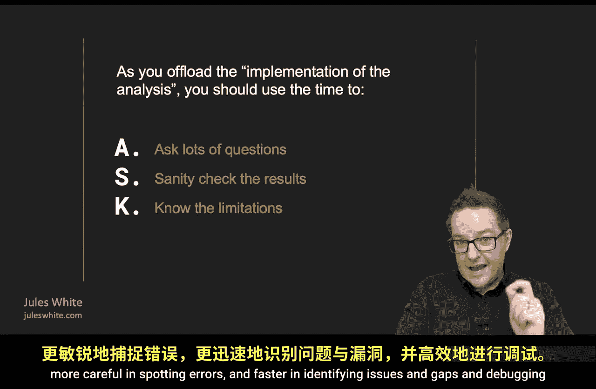

# 范德堡大学【中英⚡ChatGPT与Excel｜ChatGPT + Excel： AI-Enhanced Data Analysis & Insight】 p05 P5 06_通过提问让ChatGPT协助调试Excel数据分析问题 -BV1PdVizZE1d_p5-

Now， as the human being that's leading this process。

 you need to consistently be thinking about does this data make sense， Does it pass the smell test。

 this NF test， you know， if I sanity check this does it pass all those sanity checks。

 your job when it enables you to move faster is to really pay attention to the data and inevitably what you're going to do is you're going to find discrepancies or issues that you need to debug or it's going to do something that is unexpected。

And so one of the things that we can do is we can use the AI to support us in understanding what might be going wrong。

 So I'm going to take a look at an example of this in this job analysis。

 Now I've gone through and I've asked it to create these analyses。

 we added in by joining across multiple files， the industry name and the skill that was being looked for and now we've got something that looks pretty good。

 We have highest paying jobs with industry and skill。

 and we say we've got software development and marketing and software development and sales。

 we've got some legal things。 those all seem sensible as high paying jobs。😊。

But in the very next analysis that it does， it tells us lowest paying jobs with industry and skill。

 and we see things like software development and sales and software development and business development。

 And I just saw software development in sales on highest paying jobs， So it seems like to me。

 that at a high level， somethings wrong， Like what is the issue in this。

 Because is that really true that you are both the highest paid in software and sales and the lowest paid in software and sales or is there something wrong underneath that。

😊，Now it could be that it's variable compensation or something else。

 but I want to dig into this and really understand it。

 maybe there's some problems in the data that we haven't spotted yet。

So whenever you see issues like this， one of the amazing things that we can do is we can ask questions and in fact。

 asking questions is one of of the most powerful things we can do in the data analysis is rather than getting tripped up on trying to look at code or other things that it's producing immediately often we want to step back and ask questions。

 why is this the case， isn't that odd and see if there's an underlying explanation or some type of discrepancy that we need to dig into。

So I followed up in this conversation and I said it seems strange that highest and lowest paying jobs are seen in software。

 Look at the data and see if you spot any errors in the analysis or things we might want to account for。

 So this is really an incredible capability， is the ability to look into the data。😊。

And essentially try to spot things that might be an issue。What could the problem be？

Now you could do this and I encourage you to do it， of course。

 but oftentimes it's helpful to get a starting point of what might be going wrong。And it comes back。

 and it notices some important things， duplicate job entries with different salary values。

Issue identified several job Is appear multiple times with identical or very similar salary values。

 This suggests data redundancy where the same role is listed multiple times possibly with slight changes in skills or industries。

 impactmpact on analysis。 duplicate industries might have skewed the average and range calculations。

 especially for yearly salaries。 Okay， now I've got a potential issue that I need to dig into。

 and then it shows me examples of this issue。 We've got the duplications of this particular job I。

 We've got actually two job Is that are being duplicated and it's showing duplication that's now something I might want to follow up in and see if there's an issue with that。

Comes back， outliers and salary data， very high salaries， rolls with maximum salaries around 200，000。

 but unusually low minimums， E G 10，000。 This suggests either misiner data or roles with high variability such as consulting jobs or paid depends heavily on performance or hours worked。

Now， what's really fascinating about this is it's not just helping me identify a potential issue in terms of like just the nitty gritty of the data。

 like the formatting of it， it's actually helping me identify a potential issue in my overall analysis that I may not be comparing apples to oranges or I may be comparing apples to oranges rather than apples to apples。

 that is like， you know these might be consulting like roles where I'm thinking of it as a fixed salary but it may be a variable salary。

 and does that really make sense in what do I want to include those types of roles in the analysis。

 but it's essentially debugging it's finding discrepancies and issues and suggesting to me how these might be looked at and impact the analysis and then we can go and see。

Outliers and other things， we come back with outliers and then another really interesting one。

Pay period mismatch， and this is really important。Some roles listed with hourly pay may have been compared against yearly salaries。

 leading to incorrect insights。 This would be a really big problem， right so。

It may have made the assumption， and we would want to follow up on this。

 that it just needs to go and look at the salary category。

And come up with maximum and minimum for a particular column。 But in reality。

 there's different types of salaries。 And now we have to normalize in some way， right。

 because we can't just compare an hourly， you know。

 let's say it's a really high hourly salary of $500 an hour。 Well， that's super low。

 if you compare it Apple， you know， if you compare it directly against $200000 a year。

 But if you actually extrapolate this one out to $2000 hours。 Well， maybe it's now much higher。

 But if you don't do those adjustments and you don't spot them， there's a problem。

 And it's spoting those issues and helping us to identify that that might be a problem。

 Now we can go and follow up on this and think about how to go about fixing them。

And so we see some examples of pay period mismatch。And then the final thing is。

 now it's really helping us to suggest， here's what we might do differently。Remove duplicates。

 exclude repeated entries。 Okay， that seems like a reasonable thing potentially。

 but I have to think about it， is it a reasonable thing or not separate hourly and yearly pay。

That's a very interesting one that I definitely need to figure out how I want to do that。

 Do I want to have separate categories for hourally and yearly or do I want to normalize them in some way。

 How do we want to do that， handle outliers， Do we want to throw out the outliers in case they are just examples of misentry of data。

 And so now it's giving us the ability to look into this analysis Ask questions about it。

 Does that really make sense， I it really make sense that the highest and lowest salaries are both seen in software。

 It can then hypothesize and identify potential errors in the analysis。

And this is hugely valuable because a lot of times， as humans。

 it's hard to spot these types of things。 So having a partner that can go look at the data。

 and we can start at the high level and say。This seems like there might not be something right。

 Help me figure out why， and then it can go and hypothesize the reasons that it might be， you know。

 an issue that we can then run to ground。 Is this really an issue or not， Maybe it's not an issue。

 If it is an issue， though， it helps us spot those things And spotting where our gaps in our flaws are analysis is often one of the most difficult things to do。

Now， this brings me back to something really， really important that I want to emphasize。

As the human being， this is going to help you implement the analysis。

 it's going to help you find gaps in your analysis or problems in your analysis。

 and what this is going to do is it's going to help you to move fast in a lot of cases。

Your goal is not to save time。Your goal is to do a better analysis， a more thorough， more solid。

 more thoughtful analysis， and so to do that that time that you get back because it can go and instantly generate the code to do some you analysis of men in max salary because it does that so fast and you get the result so much faster and you save some time what you want to do is you want to invest that time in ask basically ask questions number one。

 ask lots of questions， does that make sense and when I say ask questions。

 I mean ask them to yourself ask them to other people and then bring them to chat GBT and say does that really make sense that we'd see highest and lowest salaries both in software and questions are a really powerful way of helping to sort out if is there some problem。

2 sanity check the results。 the more things that we can go and check does it make sense。

 Like does the maximum salary that's listed there make sense。 Is it a billion dollars。

 if it's a billion dollars， maybe that doesn't make sense。 if it's negative。

 maybe that doesn't make sense you know， go and do just basic sanity checks， you know， of course。

 you'd probably want more sophisticated or more， you know a smaller range on your sanity checks。

 but go into all kinds of sanity checks that checks to make sure this is right because what you're doing is you're freeing up time to do a better analysis to check it more thoroughly to make sure it's right before you make a decision with it。

And then finally， know the limitations。Really know are there fundamental limitations in this data that limit what we can say。

 For example， we know in this data that there's a lot of variation。

 So maybe there's just some outliers or misentry of data like it talked about Maybe there is no way to normalize these hourly salaries and really know and compare them to yearly salaries。

 maybe it's just not possible， that's just a limitation of the data because we can't go and assume that if it says that somebody's going to get paid $1000 an hour that they can automatically go and work $2000 hours you know。

 per year。 don't we can't make that assumption necessarily。

 And so there may be limitations of the fundamentally underneath the data。

 So ask is a really powerful thing that we should be doing。

 we should ask and ask and ask when we're working in Chad GBT because we're gonna to get time back。

 but we need to invest it in making sure that our answers is better。 The other reason is。

 is if you are using chatgBT to do your data analysis， there is gonna be a very high bar。

Scrtiny put on you。And you want to make sure that you come up with better results than the people who aren't using it and often the people who aren't using it are going to be so in the weeds of trying to just implement the analysis and get through one version of the analysis or one version of the report that they're not going to have time to be as thorough as you can be when you free up this additional time to go through and really dig deeply and ask a lot about the results that you're getting so make sure that you use that time you get back to get a better answer。

 use the tool in ways that help you to be more thoughtful in thinking through the data。

 more careful and spotting errors and faster in identifying issues and gaps in debugging them。

