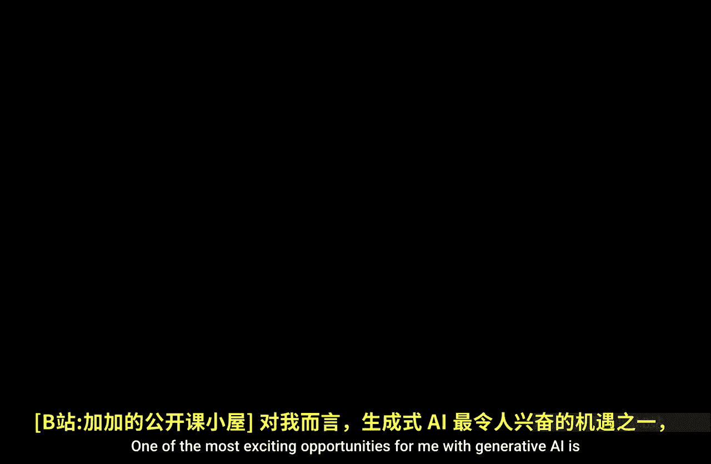
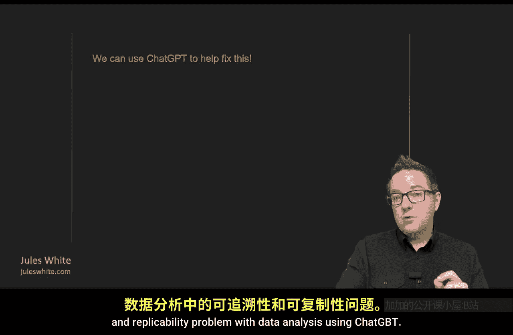

# 范德堡大学【中英⚡ChatGPT与Excel｜ChatGPT + Excel： AI-Enhanced Data Analysis & Insight】 p06 P6 07_提升决策能力：Excel数据分析的可追溯性与可复现性 -BV1PdVizZE1d_p6-

One of the most exciting opportunities for me with generative AI is that I think it can help us arrive at analyses of data that we actually trust much more than what we often do today。

Now this may seem counterintuitive because if you go and talk to most people。

 you know their assumption tends to be they don't trust AI right， it hallucinates。

 it makes things up all the time it misunderstands it。

 misinterprets it does all these things wrong and I think this is a gigantic opportunity because you know what else does these things all the time human beings。

 human beings do the equivalent of hallucination， misunderstand all kinds of things all the time。

 and I think it's a very， very prevalent problem when we start working with data because particularly the larger the volume of data that we're working with。

 the easier it becomes to make a mistake and not notice it and we look at some of these analysis that we've done where we've taken。

 for example， multiple files and we're looking across multiple files and we're trying to understand like how they all fit together。

 and we may not fully understand the sources of data。

 we may not fully understand the relationships between columns we may not not to thoroughly thought through all。

Sanity checks。And AI can help us fix this issue。But there's one thing in particular。

 one enormous opportunity that this lecture is about that I think AI can really help us with。

And it's that the biggest problem isn't the tools we're using。

The big problem with data is that we tend to perform analyses that are hard for other people to replicate。

 We don't capture the data and the analysis in a format that makes it easy for someone else and often what we get is like a spreadsheet handed off to us with a bunch of complex formulas that it's really unclear how it all fits together and is there an error in that formula。

 And in fact， we know all the time that there are errors in those formulas and there are errors in the analysis and it doesn't get spotted till much later。

 and replicability is a big， big， important problem that knew to solve。

 how do we make sure that once we've done the analysis。

 somebody else can rerun it and check it and see if it makes sense and they can understand the details of what was done and understand traceability。

 where did that data come from how is it used， How is it filtered。

 How is it all put together And what I often see is you basically look。

Get a presentation and somebody's got a big chart there。

And everybody takes it on faith that that chart was produced correctly or that analysis was done correctly。

 We don't ever question， like， should we check it， And then if we do decide to check it and we want to go and follow up and understand what went into it。

 It's often really hard to do。And I know this for myself because I've given presentations where I've shown things。

 I've given presentations where I've shown things with AI。

 and very early on I learned something important， which is。

That what happens when we don't capture all this information is when somebody asks a question and points out something that could be an issue in our chart or a data or something。

 then we're lost because we can't go back and figure out was that really an issue？

And when it comes to generative AI。We typically think and work in terms of conversations。

 and I think unfortunately conversations are a good way of representing and working through issues and things。

 and they can have a lot of really important contextual information if we saved all our conversations and we're able to go back to them and look at them for traceability purposes。

 I think they could be really valuable。 but I think there's something even better that we can do。

 And that's what I'm going to show you next。 is。😊，We。

 how do we use chat GBT to fix this traceability and replicability problem。

 And one way we could do it is just saving all the conversations we're having where we're doing this analysis。

There's some limitations with the tool to where I don't suggest you do it this way。

 but there's something even better that we can do。 So now we're going to take a look at how do we solve or begin addressing this traceability and unrelicicability problem with data analysis using ChaTBT。

