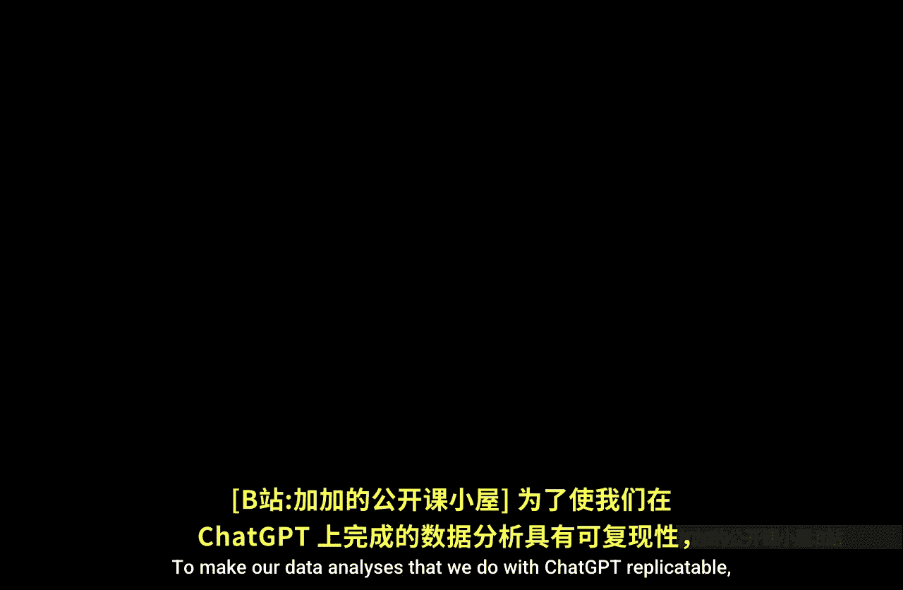
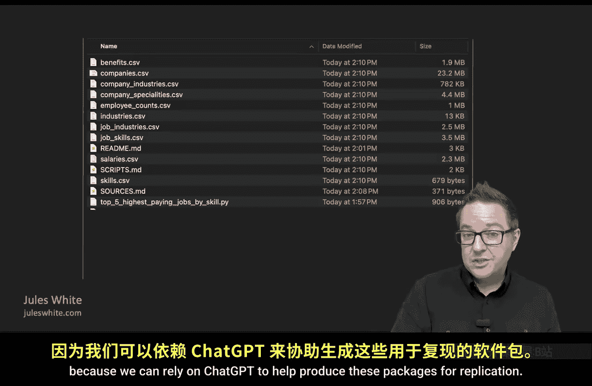

# 范德堡大学【中英⚡ChatGPT与Excel｜ChatGPT + Excel： AI-Enhanced Data Analysis & Insight】 p07 P7 08_创建数据分析复现包以增强可信度 -BV1PdVizZE1d_p7-

To make our data analyses that we do with ChaGBT replicable。

 we want somebody to be able to replicate what we've done。 we want them just to be replicable。

 you know analyses， we want them to be traceable back to the original data sources。

And we cand one really important thing at the end of every analysis with chatTBT that can transform this aspect of data analysis。

 And I'm going to walk you through it。 What we're going to do is build essentially a package at the end of every analysis that tells us what the analysis was and explains in detail to what the data sources were that were used to perform the analysis。

 the precise code that was written by chatTBT behind the scenes to do the analysis and finally。

 we're going to capture with that the actual data that chattBT was given and we're going to put all this together into a package that we can save separately from the conversation。

 and anytime somebody wants to know how did you arrive at that chart。

 How did you produce that an analysis we go and we can hand this package off and they can look through what we did。

 and maybe they can spot something that we got wrong or that the code got wrong or at the AI got wrong。

 but it creates traceability。 and this is something。

It's really important our ability to go back and see。Was it right， was a mistake made so。

We're going to start off at the end of analysis when we've got something we want。

 we start off with this prompt or something like it， I would encourage you to adapt this。

 include more things or artifacts， notice is nearly free to add individual or other things。

 but we'll start here。Let's create a traceability document to make sure that others can one know what data was used。

 two， how the analysis was performed and three threats， threats to validity。

 meaning basically what could we have gotten wrong in this that might make this not right？

We want a guide for someone else to be able to replicate and know the limitations of the analysis。

And it goes through at the end of the analysis， and it generates a very comprehensive document。

 Data sources in description。 We use the file Salaries set CSv job Id was used as a unique identifier for each job。

 We used max median salary， men's salary。 It goes in。 Here's the purpose of each data set。

 and it told what each of the files was used for。 It went in and data preparation and cleaning step so it explained what it did。

 For example， it said filtered out extreme salary values。 Ex jobs of men's salary less than $10000。

 That's an important thing that it surfacing here that we can now go and figure out was that appropriate and see it。

Also excluded jobs in men's salary below the US minimum wage。

Goes through and then gives us analysis steps， looks at the different questions that were asked。

Threats to validity， things that we've identified that could have been errors。

And a replication guide of explaining what to do in order to rerun this analysis。

And what are the steps that you would need to perform， We've just created that document。 Now。

 notice this was almost free， right， It was something where we went。 And we just said。

 now we're at the end of the analysis， capture this。 Now， of course。

 it's not completely free because you need to read it and make sure it's captured all the important information that you can really quickly iterate this to a very effective document。

 Even better。 if you have a sample of one of these of what you ideally would like to have and you give it and you say。

 here's a sample of the ideal one， Give me a new one that has exactly the same sections。

 exactly the same format and fill it in。😊，Once we've done that， we want to do something very。

 very important。We want to tell it to save that information as a file。

 Now I'm going to tell it to save it as a readme file。

 This is a common thing in software engineering， a readme do Md， which is a markdown file。

 basically it displays formatted text。 It's an easy way that it can produce that。

 And I say save the traceability information as a readme do M。

 So it's saving what it just wrote in a file。 and it says， okay。

 I've saved it and it gives me a link to download it。 I'm actually not going download it yet。

 And I'll show you why。😊，Then what I'm going to do is I'm want to capture the code that it used。

 So when I was going and asking to perform these analysis。

 it was writing Python code and executing it against those files。 So in this case。

 it was writing Python code that was reading those CSV files and then performing the analysis on them。

So what I want to do is I want to capture that code so that I have a copy of it。

 and if somebody needs to look at it or rerun it themselves to make sure nothing went wrong。

 they can do it。So what I say in my prompt is now for each analysis and visualization create a single Python script that could perform the analysis and produce the visualization the script can assume that the files were used that the files used are in the same directory as the script now so I want to basically create a special Python script that if I execute it and I've got all the original files in the same directory。

 it'll rerun the analysis。Save each Python file with a prefix that identifies the analysis that it is related to in an output table listing the analysis。

 the file name of the Python script and a one sentence description of what it does。

 so basically what I'm telling you it is name each script so that it's clear the relationship between the script and the analysis and then also just create a table for me here so that I can see how those analysis mapped to different scripts。

And then。I'm now got all of the code captured。So it's gone and it's taken each individual analysis it did across the conversation and condensed it down to one file that could be rerunt。

Now I say create a scripts file。That has that table listing what all the scripts are and what they do。

And then has a section in it for each individual scripts listing what it does。

 So I'm basically creating an index of all the code that was written， what each individual file does。

 how it runs， and what the analysis is， And then I'm saving that。

 So now I have basically this master index of all the code that was created and what the files do。😊。

Then I'm going to go and I'm going to create sources， sources。md。

 then is just fancy for essentially formatted text。

Create a file called sources Md that indicates all of the data can be downloaded from this URL。

 Now you can put whatever you want in here。 you can say that was obtained from this database using this query across these tables at this point in time from you know this file that was emailed to me by Bob that has this hash and this key this signature。

 whatever it is you're going go and capture some description of where you got that data from that you gave it to perform the analysis on So the idea behind this is we want to document some metadata about what did you hand to it。

 because you uploaded the data， it doesn't know where you got it from。

 So you're going to tell it where you got it from In this case I got this data from CAle。

 So I'm giving it the URL to document。So it's created a read me file。

It's created a scripts file that explains what all the different Python files are that it created。

 it' saved all those individual Python files， and now it's created this sources file for me that tells me where the data came from。

Now the real power happens and the real power for replicability and traceability of this data analysis。

 and this is the thing that gets me really excited because so often we just can't easily go back。

And we're going to fix that now with ChaGBT。 So here's what we say。 Now， combine the Readme sources。

 scripts， the scripts and the original data into a zip file that I can download that would allow others to replicate the analysis。

And it goes through and takes all those files that's created， puts them into a zip file。

 And then if you look at it， it says you can download it here in its response。

 And if you clicked on that here， it would download the zip file for you。

 And then when you unzip it and I'm showing you a part of it here。

 you start seeing all of these difference basically files that it created。

 now everything's wrapped up in one nice zip file， it has the description。

 the Readme file that tells you what was done and why and what are all the potential threats to validity that it's analyzed。

 it's got the sources of where it came from， it describes all the code in the scripts thats MD file。

 it's got the original data stored in here。 And now somebody else can download this。

 they can unzip it they can read through all of it。

 they can run each of the individual python scripts to reproduce the analysis or to look at the script and see that there's a flaw in there in some problem。

That is transformative in data analysis。 Now， the reason is。

 is because so often we go and we just focus on getting the analysis done that we don't capture all of the important information that is needed to so allow somebody else to replicate it。

 I've actually taken it， put it into a package that I can hand to somebody else for them to replicate it。

 It's not stuck in some tool or some dashboard where it's not easy for somebody else to go and figure out how it works。

 It's not stuck in a bunch of really complicated Excel formulas that I'm going to have a hard time explaining to somebody how they all fit together and make sure that there's no individual errors。

It's much， much more robustly documented and it's built into a standalone archive that ideally。

 if that becomes an important analysis or an important result。

 I go put that somewhere permanently like a ShaPo that's internal with a link and anybody who depends on that analysis can get a link to that thing and go download it and look at it and make sure they understand it where if it's scientific results。

 it's put on some public website where anybody else can go and download it。

 assuming that data can be released publicly and ideally it can。

 and then they can download it and they can run it for themselves and see if they arrive at the same result。

 and that is the transformative capability is that we can raise the bar in terms of how we do data analysis。

 we can raise the bar by making our results and our processes more replicable because we can rely on chatGBT to help produce these packages for replication。

😊。

