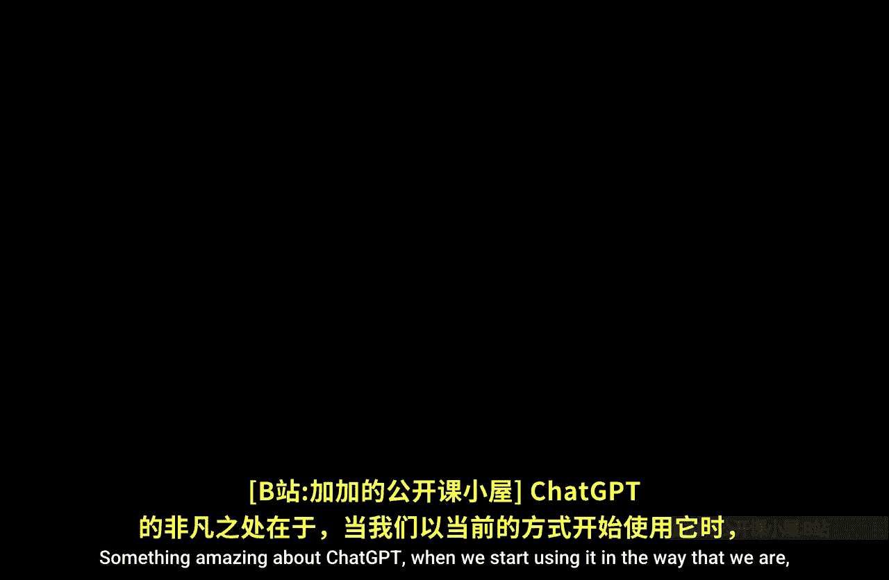
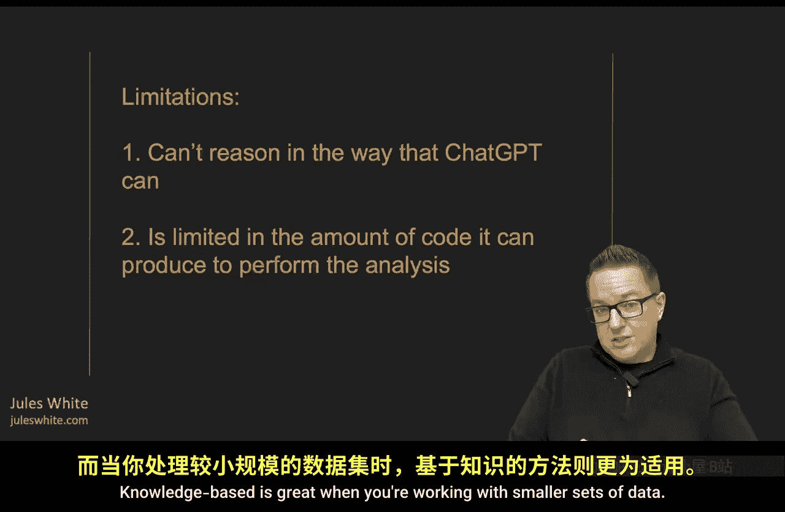

# 范德堡大学【中英⚡ChatGPT与Excel｜ChatGPT + Excel： AI-Enhanced Data Analysis & Insight】 p08 P8 09_利用ChatGPT和Excel实现数据转换与筛选方法 -BV1PdVizZE1d_p8-

Something amazing about ChadGBT when we start using it in the way that we are is that what it's actually doing is it's translating our goals and our statements and what we want to achieve into computation。

 that is we don't have to go and figure out how to mess around with a macro to do this stuff that we want to do we don't have to go and figure out how to do it in Python code。

 we just go and express what we're trying to achieve in terms of like the highle goals and it figures out how to translate it into computation。

 Now this actually makes a lot of sense because these models start off being based on the transformer architecture Now they've evolved in all kinds of interesting ways。

 but at the root of them is the transformer architecture and that is an architecture that was built and test it originally in the context of translation and that's what they're doing is they are translating what we want to do into computation Now there's two different ways that we can use this。

 particularly when we start thinking about working with data and we're working。

Data sources like in data from Excel or CSB。Is we can use it to transform and filter data where we're going to express and tell it what we're trying to do or achieve with our transformation or our filter。

 and then it's going to go and figure out how to realize that。

 Now there's two different ways that it can go about realizing what we're trying to achieve in computation。

And we're going to talk about those and go through them in detail in this video。

 we're going to really try to understand the differences and when we're going to use one versus the other so at a high level。

 the two ways that it can translate what we want our goals into computation。

Or either through a knowledge or reasoning based approach。

 And this is going to mean something very specific that we're going to show in a second or through a programmatic approach。

 And these things are essentially mutually exclusive。 It's going to do it one way or the other。 Now。

 it can figure out ways to chain these together so it may start here and then end here。

 and in general， basically， it's going to use one approach to the other。 And it's really。

 really important to understand these two approaches when you're going to use one versus the other。

 So we're going to start off by looking at this knowledge or reasoning based approach。

 Now there's many other things you could call it。😊。

I'm going to call it knowledge a reasoning based and the real fundamental idea behind this is that we're going to take data。

 we're going to put it into a prompt， we're going to feed that prompt to do one of the models in this case。

 ChatgiBT， and then it's going to output some data。

Now what we are doing is we are using the model itself to perform the computation。

 that is the model itself is going in performing reasoning。

 and this is really good for certain types of tasks， not necessarily all tasks。

 but some types of tasks is very， very effective。Now let me give you an example of this and then we're going to come back and talk about it。

 but one thing I want to sort of just go ahead and point out for a moment and you should pay attention to because we're going to talk about it at the end is you notice at the top I say data plus prompt right and data is big。

In this example up here， when it's coming in， it's big， but when it's going out， it's small。

And the reason for this is we can put a lot of information in the model。

 but we can only get a little bit out each time。 So typically what we will have is we measure these things in terms of the amount of information we can put in and usually we're going have something on the order of 100 or 300 times more information that can go in than can come out。

 So this means that we're always going to have this asymmetry where we're going to have more that we can put in than we can get out and that changes you know what we can do with the model and these sort of knowledge or reasoningbased task so。

😊，We're always going to be dealing with that。So here is a sample of what a knowledge or reasoningbased task looks like。

 so I'm going to give ChatGBT this sample of data that has a bunch of countries key crops from that country and what we call as key cultures Now I prompted for this I had ChatGBT generated it it may have some bias in here that I don't see but the point of this is we've got a data set that we're going to do a knowledge of reasoningbased transformation on one that would be very difficult if not impossible to do another way。

So I've gotten this and I've uploaded it to ChaGBT， and this is my prompt。

 this is a knowledge or reasoning based transformation。😊，For each row。

 add an additional column that contains one of the most popular dishes that people eat。

So what I'm having it do， and I want you to go back and look at this is I'm saying basically for each country。

I want you to add to the row because each country has got a separate row。 I want you to add a column。

That talks about a popular dish that people eat in that country， right。

 That's a really hard task to try to program。 You're going have a you know。

 a hard time doing this with an Excel macro， unless you already happen to have a list of dishes that are eaten in each country。

 But if you don't have that list of dishes that you're trying to fuse in if you're trying to you know conjure it up out of thin air。

 which is what we're trying to do here。It's a knowledge a reasoningbased task where basically it's almost like if you went and hired somebody who was an expert on world culture and you said go and try to figure out a dish to go with each country and that's what we're doing here and then ChatgBD comes back and it modifies the CSV and for each of the rows it goes and adds a dish so in USA it has hamburger I think that's a reasonable you know addition。

 India， brryanni， it's got a variety of different ones we've got Mexico， we've got tacos， France。

 Cocova， so we've got all these different ones that it's added。Now。

That is a task that's really hard to do with traditional code or macros or whatever it is that you're going to use as a knowledge or reasoning based task。

Now， there's certain times when you really want to use this because this is going to be super effective。

 One is you need it to really think deeply。 It requires like human level reasoning to perform the task。

 It's not something that's easy to write code for or easy to write a macro for。

It's something that really requires sort of thought and knowledge。

 in which case this is a really huge， powerful capability that you can use。

You can also use it for machine learning capabilities to go and do things like sentiment analysis。

 So I could have said go and I could have given a bunch of customer reviews as rows。

 and I could have said add a column to each row that's the sentiment in either positive。

 negative or neutral based on the review。😊，Where I could have gone and said， look at the products。

 the last three products that each customer bought and each customer is illustrated with a row and suggest or recommend a follow on product from this particular catalog or whatever it is and so you can see you can take this idea and you can scale it up to do basically anything you can think of anytime you have a bunch of rows and columns。

 you can simply go and say look at what's in already there。

 look at what's there in each row and add a new column and the new column can rely on sophisticated reasoning to create it。

So it can be conjuring up things based on knowledge almost like you would hire a human being。

 or it can go in doing traditional machine learning tasks， like trying to categorize something。

 do sentiment analysis， prediction， recommendation。

 all of these types of things fit within this model， super powerful。But there are limits。Now。

 one of the most important limits I want to take you back to is I said at the beginning when we had all this data coming in that we got little data out。

So we can give it a ton of information， but it can only give us back a little bit at a time。

So the way that we measure this is when we think about these models。

 they can typically take in a certain number of tokens。

 you can think of this as how many pages of text they can reason across。

And typically they can reason across like 100 times as much text as they can output。

 So often you'll see like 100，000 or 200，000 or 300，000 tokens as the input size。

 but only like 1000 tokens is the output size， so that means if you dump in you know10000 rows。

 it may be able to look at all those 10000 rows， but it'll only give you back like 50 because that's all little'll fit into the token window that comes out or however many it is。

 my math is probably off here， but you get the point is you're always going be you can take a lot but you can only output a little Now you'll have to experiment on what a little means in terms of your data know when you're talking about rows and columns。

 the more columns you have that means the fewer rows you're going to get into to output。

But also the more information that's packed into those columns。

 you know so there's a tradeoff you'd have to figure out what it is。

 but the key thing is is you're going to have to think about how do you basically break your data into chunks if you want to go and add a column to each row。

 you have to make sure that the amount of information you're putting in will lead to an equivalent amount of information coming out so you don't want to end up in a situation where you're putting in like 100 rows but you're only getting 99 out because it doesn't fit within the output size and that can lead to all kinds of problems but just know super powerful reasoning capability when you have a limited amount of data that you need to get out。

Now。The last point on here。Is really， really important。And therere prompting techniques。

Completely targeting this， and you should go and look at my other courses to learn about those prompting techniques。

 to try to mitigate this， but it can hallucinate。It can make something up when you do this type of transformation。

Now， the way I explain this is you can almost imagine somebody that you're giving a test and they've been given a problem and you say go and solve the problem for each one of these rows。

 and if it gets to a row and it doesn't know what to do。

 what it might do is try to guess and it may guess a value for the column So you always want to go back and check whenever you do this type of transformation that it didn't make a mistake in some way。

Now there's many ways that you can do this， one thing you also want to do is you want to be aware that if there's data that's missing from the row that's needed to derive the new row。

 you want to tell it what to do。So if you just say go and apply this transformation to every row and you don't tell it what to do if there's something that's missing from a row。

 then it may just go and hallucinate and dream something up if on the other hand you say if there's not enough information in the row to do what I've asked you to do。

 then just put in slash A is like not applicable。And you want to give it an out something that it can do。

So this is really good if you're going to get a really complex transformation， it's okay。

 potentially if it hallucininates like if we're thinking about the dishes for different countries。

 it's probably not the biggest deal in the world now people may have differ opinions on that but the point is is like if you have certain tasks where it doesn't require like perfect numerical precision or accuracy That's another case where you don't want to use this you don't want to use this when you're looking at numerical precision or complex math。

 complex formulas， that's not the right use case for this。

This is for sort of knowledge based things that deal with like you know， culture。

 arts or like looking at a sentence and stripping out certain words or rewriting it or making it more SEO friendly or you know these types of things。

Now。The other type of transformation we can do is really when we want like numerical precision and lots of data。

 and this is a programmatic transformation。 and we've actually done a lot of programmatic transformations already。

 we just didn't realize that they were happening。😊，So。

What happens when we use ChetGBT is it has this mode called advanced data analysis。

 and I previously created have created talks and videos on this and they've changed the name over time right now it's called chattGBT advanced data analysis it may change later。

 but the way it works is going to stay the same even if they change the name of it。

When you go in you prompt ChadGBT to do something numerical with data， you know。

 some type of very concrete numerical task。What it does is it does not put the data into the model like we saw in the last example。

 but it actually writes code。To go and perform the cast。

 So what ChadGBT does is it reasons about can I write code， in this case， Python code。

That can perform the task that the person wants。 Now， at the beginning of this talk， I said， look。

It's about it translating our goals and desires into computation。

 so one way it can do that is it can just directly reason on whatever data we give it。

 but the second way it can do it is it can translate what we're trying to do into code so in this case Python code and then it can take our data and it can execute that code against our data in order to produce the output。

Now， this is really great when we want to deal with things that deal with numbers or things that look more like the traditional filter and transformation that we've done in the past。

So let's assume， for example， I have this data。I've got these rows and columns and now I want to apply some type of numerical or sort of straightforward transformation that we could program。

What I can do is I can go in and say something like this。

 can you reformat Mac salary to be expressed in thousands？EG1。0 equals 1000。Now。

 I could go and program this。 You could probably go and program this。 You could write a macro for it。

 You could do all kinds of things to do it。 You could have some formula。

But I'm asking it to realize it and to transform the data。Now。

 what it does is it comes back and it says， okay， here it is。

 and it's transformed the max salary into max salary thousands is a new column。

 it's added it to the data。It's also nicely handled the appropriate case when we have not a number。

But it's done that transformation for us。Now。How did it do that。

 What it did was it it went and it wrote Python code to perform this transformation on the data。

 It executed the Python code。And it gave the Python code your data as input。

It got a new basically file or set of data out， and then it's showing it to you right here。

And so it's executing code Now the good thing about this is this means that we're back to the where we were before with programming right is it has numerical precision。

 it has known boundaries and repeatability and all of those things。

 unlike putting stuff into the model where it may not be repeatable。

 it may hallucinate may do all kinds of things。Once we write code and execute it， it's repeatable。

 it's predictable， it's good at numerical precision， those types of things。

 and so it can do a good job， and it does an excellent job of coding。Now， it does an excellent job。

 but you still need to check it and look at the data and make sure insanity check it。But。

The advantage that this gives us is when we look at code like this。

It's only writing a small amount of output， so I talked about how it has to go and it has to take what we're doing and it has to fit it within the model and then get whatever we want out in a small amount right well if we dumped all this data and it would be more than the model could output。

 But if you look at the code that's needed to express the idea of what we're trying to achieve。

 it's very small so this is the Python code that it created for what we just saw。

 it's a very small amount of text so we can write that and generate that very easily within the thousand tokens or whatever its limit is。

But this also does go back to a point if you tell it to do something so complex in terms of the transportation or the computation that it can't fit within 1 thousand0 tokens。

 meaning the code for it if it writes it out in Python can't fit in 100 tokens and this stops working so you should be if you should know about that and you have to kind of figure out how do I get around this bound。

 this is something you'll always be working on。And then。

The key benefit of this is when it writes code and executes it， it's very precise。

 has numerical precision， we can replicate it， we can look at the Python code。

 we can check the Python code。It has a very， very large limit on data， you know。

 practically speaking， you're unlikely if you're starting from something like Excel to run into the limits on the data。

 this is the key advantage that you get out of is that numerical precision。

 huge amounts of data that you can work with。Now。The downside to this is that it can't reason。

As effectively as like the model itself， like the code will never be as smart as the model。

 So the model can get really sophisticated and smart about how it writes the code。

 but there's just fundamental limitations on what we can do in code or in an Excel formula or macro or whatever it is or VB script。

 There's just some limits to what we can do in that。

 The model isn't bound by those limits as much when we deal with these knowledge or reasoning based tasks。

 But the code is。So what this means is it can't necessarily reason effectively。

 do you tell it go and filter all the text to remove anything that might be considered a vegetable or could be a metaphor for a vegetable。

 no way it's going to be able to write code to do that Do you tell it to go and divide something by 100 or apply a particular you know numeric formula to it very easy to do。

We are so limit on the amount of code that we can output， but practically speaking。

 that's going to be less of a concern for these types of data transformation analysis things。Now。

 we are going to run into cases where it's hard to figure out how to get it to solve the problem in the way that we want。

 And this particularly is the case when we're trying to have it do knowledge based transformations。

 but on large data sets。 So it's something that we can't do in code。

But it doesn't fit within what we can do within the model itself。 So often in those cases。

 we'll actually have to manually ourselves break the data set into multiple pieces and feed it to it one piece at a time or tell it to do that sort of incrementally。

 and we have to go back and forth with it in order to achieve that goal。

 We can also run into other situations where what we're asking it to do requires writing out code。

That。Has a lot of information in it， a lot of text in it and ends up being too big for the code。

 Or there are cases where it tries to go and do something we really want it to do in the model。

 but it tries to do it by writing out Python code。 And sometimes we have to give it a hint and say。

 don't do that in Python。 So just know that this is something that you will have to work with。

 But this is like a key thing that we're going be working with。 is trying to decide。

 you know which type of transformation do we need in general。

 you're going to want to err on the side of using the codebased where you're doing it a programmatic transformation or filtering because that's very precise。

 It's very repeatable。 you can take it out of the model。

Knowledge based is great when you're working with smaller sets of data。

