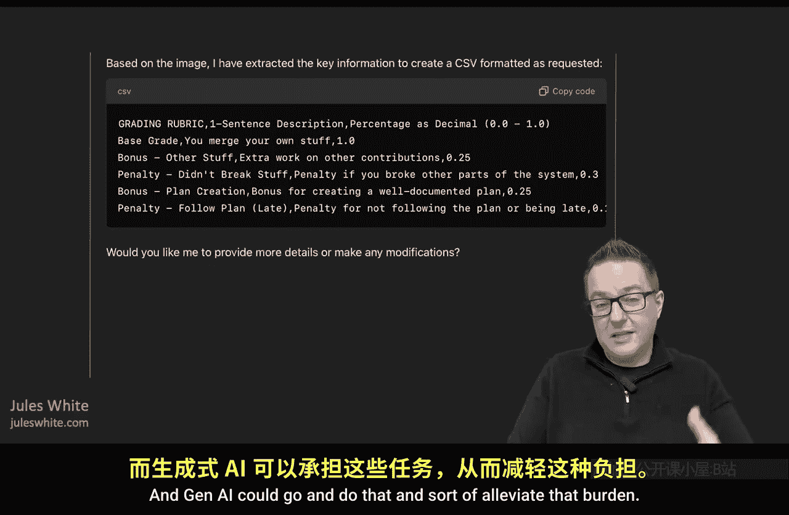

# 范德堡大学【中英⚡ChatGPT与Excel｜ChatGPT + Excel： AI-Enhanced Data Analysis & Insight】 p09 P9 10_从非结构化源（原始文本、照片等）提取结构化Excel数据 -BV1PdVizZE1d_p9-

One of the amazing things that we can do with ChadBT is we can actually use it to help us， you know。

 extract and create the data sets that we need to reason on。 Now。

 this may seem crazy Like why would we let one of these models create the data for us。

 What if it hallucininates。 Well， there's certain cases where it's actually much more effective and efficient to try to use the model to do this。

 because it may be really， you know， potentially impossible to do it any other way。

 or it's super expensive to get the data some other way。 Now。

 I'm gonna give you an example of what I mean by this。

 And we're gonna see the power of what we can do。 So what I've got here。😊。

Is I have gone to my LinkedIn page。And I have copied for my feed and I've pasted all the LinkedIn posts with all the raw formatting and everything from my LinkedIn feed into chat GBT。

 and I say， here's the LinkedIn post and I have a dotted line and then I have all this just raw information with all the weird author and like you know the1W for one week and how old it is and all this stuff just dumped in there。

And then a dotted line， and at the end， I say， please convert this into CSV in the format name。

 comma1 sentence summary of post comma topic one word。And it comes back。

And it gives me formatted CSV out of the posts。Now。Could you do this another way， Potentially。

 one way to do it would be to hire a human being to read every post and manually do data entry into an Excel file。

 for example， And you could get it that way。 But you're also subject to potential errors。

 This is subject to potential errors， too， although it tends to be really effective。

 if you structure it appropriately。But it can go and extract data from all kinds of sources that are very hard to get data from。

And it's not that the data isn't in them。 The data is already in them。

 but it's hard to get the data out of them and turn it into a format that we can reason with or categorize or calculate on。

 Now， I want to go back and talk about this prompt for a second because this is sort of the rough structure。

Of what you're going to want to do。I。We're going to start off with the data。

 the sort of raw material that we're trying to extract from。

 So we've got data that's mixed in with other stuff and there's many ways that it can be mixed in with other stuff。

And we're trying to extract it。 So what we're going to always do is we're going to have some data source。

 An easy way to do this is just copy and paste whatever it is。

You could be a copy and paste of your LinkedIn feed。 It could be a copy and paste of reviews。

 It could be uploading documents that are product feedback。 It could be attaching a bunch of emails。

 you know， you dream it up。 the goal is you get a whole bunch of raw material just you know。

 with no common format structure anything。 It does not matter。

 and this is what's so amazing about it。😊，Then after you attach it or copy and paste it like I have here with separators。

You tell it the format that you want it to extract enforce the data into。So in this case， I say。

 please convert this into CSV in the format。And then I define the columns that I want。 So name。

 comma， one sentence summary of post comma topic， and then have in Pries one word。

 And then I say insert row， dot dot dot， and then dot dot， dot。 Now。

 there's a whole bunch that's happening。Down here。 And I want to unpack it for a moment and talk about。

So when I'm doing this， when I'm doing this， I' creating a template for what it's going to output。

The starting point of our template。Is we're going to give it the columns that we're trying to get out。

Now， the columns can be as simple as name。Or they can be richer descriptions like one sentence summary of post。

In order to generate that column one sentence summary of post。

 it's actually going to have to read the post， apply a transformation。

 I mean it's going to have to read it and summarize it in one sentence。

 so our column name can just be like name， like pull the name of the person directly。

 or it can be something more sophisticated， like one sentence summary of post that literally spells out what you want it to do。

You can also have something like topic topic is sort of just a。A very， you know， concise name。

 But then I'm telling it in parentheses behind it。 I'm giving it some hints。

 I'm saying I want one word。 I don't want 10 words。 I don't want three words。

 I don't want a sentence。 I want one word。 And so this is the starting point of what we're going to do。

 is we're going to spell out。 What the column should be。 And where appropriate。

 We'll give it like a richer description of the column。

 like one sentence summary of post or sentiment of customer reviews or predicted next product that the person would buy。

 You see where I'm going with this。So you specify what the columns are going to be。

 And then beneath it， you say basically insert row with something like less than greater than。

 And this is telling us， telling the generative AI。

 go and fill in rows here that match this this format in the dot dot dot。

Is basically a way of telling it fill in the blank， Keep going， etc ceter。

 just like if you had a human being。 and you said， look， you know， Mary had a little dot dot dot。

 they would know， you know that they're kind of supposed to fill in。 like here's what comes next。

 And so that is a prompt engineering technique， it's it's basically telling the model going complete this。

 So what we're doing is we're building a prompt that tells the model go and extract from all these LinkedIn posts and then pull out data in this format。

 Now if we go back and we look， it has taken the name of the people that posted publicly on LinkedIn。

It's taking a summary of their post in one Senate， so Alan Carnes。

 my collaborator in the CTO of Amplify， wrote a post in the one Senate summary is invites highered Friend to E you cause to discuss generative AI。

 and then we have the topic is generative AI， and then we have similar other things like that。Now。

We can also go and work with we don't have to copy and paste。

 we can also go and do things like take a screenshot。So I screenshoted Alan's post。

 and then I used exactly the same prompt beneath it。

And what we get is it comes back and it extracts CSV now when it's outputted it。

 it hasn't done the fancy table， but it's still given us roughly the same thing we are getting the name。

 the summary and the topic now the more description and information you get it around。

 you can have much more sophisticated prompts in this to try to get more consistency and you know the formatting。

 but it's still giving us the right information in the right format that we want。

We can also go and use this。 This is an awesome tool。

 If you have like meetings and brainstorm I mean， or whatever it is。

 it can also be pictures of the real world， right， You can take a picture of a construction site and say。

 list how many construction vehicles are as rows。 Every individual construction vehicle list。

 you know， create an inventory of what's on my desk。 Now， there are limits to this。

 And it will hallucinate if you're not careful。 So you need to be careful with this。

 So it doesn't work perfectly once you get back a certain number of items， it often will hallucinate。

 So you are not， as of the filming of this video。 This may have changed。 You're not gonna you know。

 take a picture of a shelf in a grocery store and have it do a perfect inventory of it。

 That's beyond the capabilities。 Small numbers of items。😊。

Should work pretty well one item at a time absolutely you know1 thousand items forget it it's not going to really do it it's probably going to start hallucinating but one thing you can also do is you can go in and have a meeting you can write on the board I've written this grading policy on the board now I need to translate that grading policy maybe into a spreadsheet that I can use to calculate people's grades。

😊，So I say please convert this into CSV in this format， grading rubric， one sentence description。

 percentage is decimal， and then it comes back and it extracts the grading policy from the picture。

And now I have it in Excel， where I can go and take it in inside of Excel。

 and I can do calculations with it， and I can map it to maybe another Excel file。

 I got of people's grades and emerge these things together into different sheets。

 and I use this to perform calculations， but it helps me get data So we can take data from many different types of sources。

 It can be text where we just copy and paste。 It can be documents that we attach to the prompt。

 It can be screenshots of things。 It can be photos that we take of realwor objects and things around us。

😊，And it can do an excellent job of extracting information。 We always。

 always will go and check that information， but inherently because we can can only get a limited amount out at each time。

 the sort of the benefit of this is we can always go and typically spot check it because we're not going to be getting thousands of rows out。

 we're usually going to be getting a fairly small set of rows out。😊。

Of course we want to do things to， particularly if we need numerical precision。

 go and do statistical checks， standardity checks， these types of things， but a super effective tool。

 especially if we're dealing with things like product reviews， comments on social media。

 these types of things where there's not a numerical like precision component to it。You know。

 this is it's highly， highly effective at turning that type of stuff into data。

 we're turning things into data where it's hard to get anyways and we'd probably employ humans to do it and humans would probably potentially miscount or misrepresent or miss things anyways。

 because they would get tired or whatever and GenAI could go and do that and sort of alleviate that burden。

