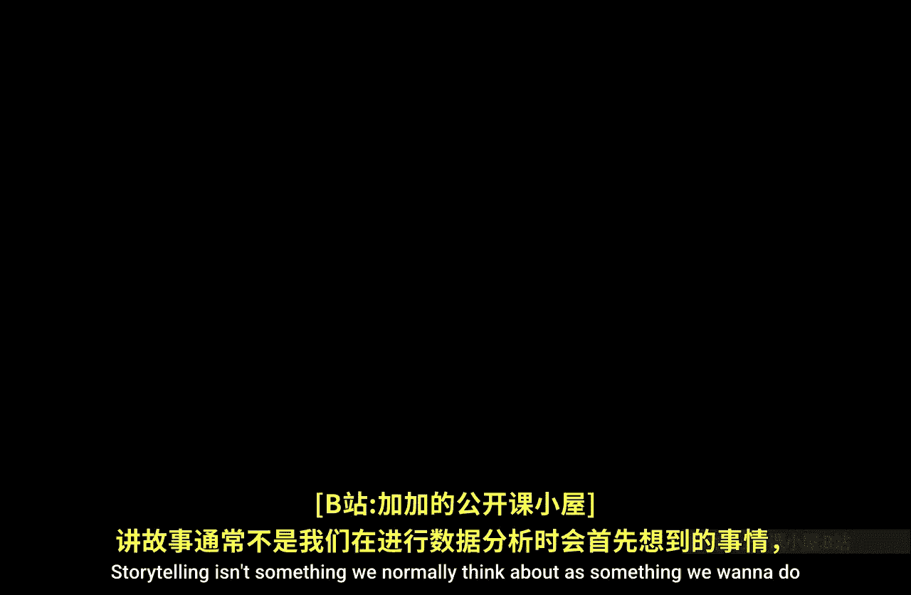
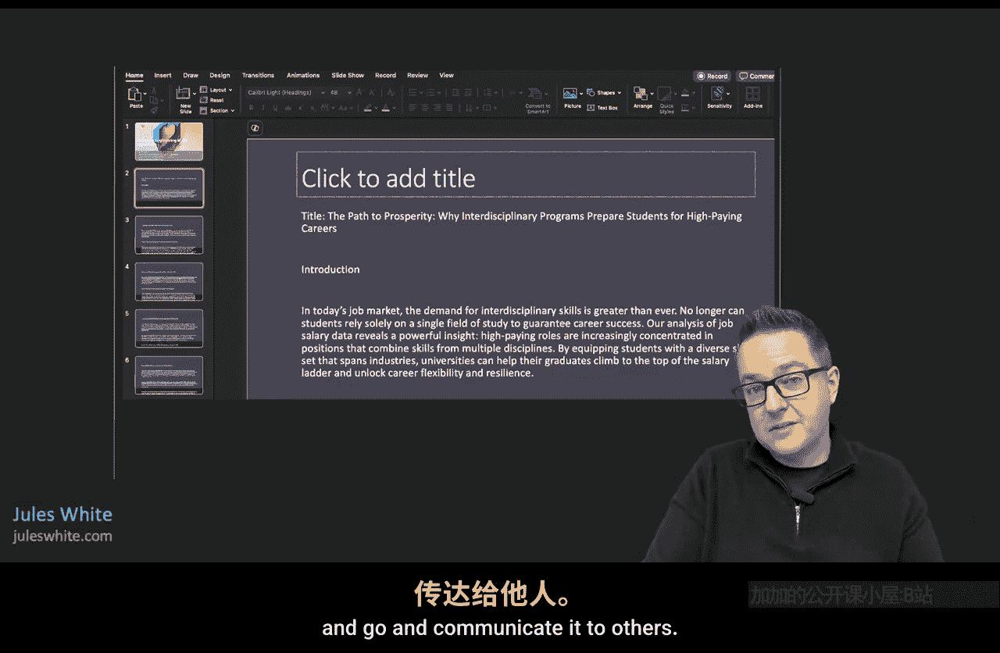

# 范德堡大学【中英⚡ChatGPT与Excel｜ChatGPT + Excel： AI-Enhanced Data Analysis & Insight】 p10 P10 11_用ChatGPT和Excel数据分析讲故事 -BV1PdVizZE1d_p10-

Storytelling isn't something we normally think about as something we want to do when we're doing data analysis。

 but oftentimes the reason we're doing the data analysis is because we're going to go and do some type of presentation。

 tell some type of story， help somebody make a decision and we want to explain the context of the data。

 we want to explain why the data is important， we want to explain the relevance and importance of all the work that we've just been done and one of the things that's interesting is that generative AI is supremely good at storytelling。

And it's one of the sort of secret superpowers when you combine things like chattGBT and Excel or CSB data together is not only can you go in and dive in and explore the data。

 but then you can think about how do you take the data and all of the analysis you've done and tell a really important story with it because the data itself。

 if you just create all these visualizations if you just create all these facts and figures。

 no one may ever look at it or pay attention to you or care and so we want to motivate to them why they should care Now this sometimes scares people to death when you're thinking about data analysis and then generative AI and getting it to tell stories and we're gonna to show you how to do this and sort of an effective sort of safe way to do it Now our goal is not to get it to hallucinate stories about the data。

 our goal is not to have it make up facts and figures。

 our goal is to help us produce the narrative around the data and then to go back and make sure that we go and do extra analysis。

😊，So to really make sure our story is accurate。So I'm going to show you how to do this。

 I'm going to continue this analysis of this jobs data set。

And I'm going to go in and I'm going to start prompting ChaGBT to tell me and help me develop a story around it and brainstorm what the story around this data could be Now I'm in a university so I'm going to be building a story that's going to be relevant to the university in the context。

 so I'm going to take this jobs data and I'm going to tell somebody something important about what's going on in the world based on this jobs data。

So here is my prompt for ChatGBT， let's focus on telling the story of why interdisciplinary programs can help set students up for high paying careers。

 help me build out a compelling narrative， and then insert placeholders like insert XYZ visualization where I should put the visualizations that were created。

 make sure incite key statistics in bold。Now my goal behind this is I don't want it to regenerate all the visualizations。

 I want it to focus on writing the text and the story that's going to go around it。

And wherever it cites statistics， I want those things in bold one so I can spot them and I can go and fact check them and make sure that they are correct。

But also because I want to emphasize the data in this。

 I don't want it to just be a bunch of generative AI stuff。

So it comes back and starts writing the narrative around the data within the focus of what I want。

Titled the pathway to prosperity， Why interdisciplinary programs prepare students for high paying careers。

 Now， my inspiration for this was looking at that， you know， marketing and software， right。

 that was a unique， really high paying job。 And so I want to tell a story that interdisciplinary work really matters because that sets you up as a unique expert。

 When you sit at the in the intersection of two fields that are in high demand。

 you become even more demand is sort of the story that I believe I can tell。😊。

And I've done some initial analysis， so now it's helping me to write this story around it。

In today's job market， the demand for interdisciplinaryary skills is greater than ever。

 no longer can students rely solely on a single field， a study to guarantee career， success。

 our analysis of job salary， data reveals a powerful insight。

 high paying rules are increasingly concentrated in positions that combine skills from multiple disciplines。

And then it goes on， it talks about the salary landscape for example。

 and you notice it's starting to cite in bold from the analysis that we did For example。

 marketing roles within software development average salaries of over $200000。

 This is a testament to the value of combining analytical and strategic expertise with creativity。

 a skill set that few single discipline programs fully cultivate。😊。

And then it goes on and it gives other ideas by encouraging students to integrate skills from fields like marketing。

 information， technology and data analysis， universities are not only preparing them to secure high paying jobs but also to lead and innovate within their industries。

 so it's beginning to tell the story around the data and helping me to fill that in。

Wide salary disparities highlight the value of versatile skills。

 When striking insight from our analysis， this is significant salary disparities within certain fields。

 For instance， marketing roles within I services exbitate salary ranges that span from 70。

000 to nearly 300000。This wide gap suggests that advanced specialized skills often developed through interdisciplinary training and can propel employees to the higher end。

And then it has a placeholder where we could insert a graphic that shows this and supports this story。

And then it goes on and starts talking about it like things like blending computer science with business strategy or marketing marketing with data analytics。

The foundation in the solo is so it has this interesting sort of you know analogy that it's giving。

 and then it says legal roles within technology focused industries can command salaries well above 150。

000 so it's going in pulling from the data and showing examples of where interdisciplinary intersections lead to higher salaries。

Comes back with key insights， you know， focus on virtual skill development。

 equip students for salary range flexibility， prepare students to lead in interdisciplinary environments。

And then conclusion， embrace the power of interdisciplinary education。 so this is a nice。

 compelling story that it's told。And so as we begin shaping the story。

 then what we might want to ask ourselves is。Now weve built this narrative， is this narrative true？

Because one of the things we often do is we get these nice narratives and we want them to be true。

 right？And so we're going to， because the narrative is so great。

 we're just going cite the statistics we want and we're going to run for it and tell this great story。

 And I think one of the things that's beautiful about generative AI is it allows us to go back and do more thorough digging is this really true because we can go and analyze and analyze really rapidly and quickly So once we start building our narrative。

 I think a key question or key instruction that we could give to chatTBT is。😊。

What are some additional analyses we could run on the data that would either support our narrative help or show us that it isn't really accurate because that's what we want to do is we want to go start building the narrative and once we start building the narrative。

 we want to make sure that this really is true。And we do that by going in further testing sort of the underlying data further analyzing it to make sure that this is really true and not just our wishes and dreams。

 and we're getting confirmation bias。So it comes back with skill combinations and salary analysis。

 goal'll identify which specific combinations of skills are associated with highest salaries。

Group jobs by unique skill combinations and calculate average salaries for each combination。

Soalary progression by industry and skill level goal assess how salaries。

Progress for jobs requiring foundational versus interdisciplinary skills over time。

 method use available data， men medium max salaries to approximate entry mid and senior level salaries。

Frequency and salary range and it goes on and on and on and comes up all these additional analyses that we could run。

 So it's not only going and helping us to shape the narrative and communicate the importance of the data and what we're doing。

 but it's also helping us to step back for a moment and say。

 well what else can we do to be more rigorous about this to make sure that before we tell the story that we're really accurate with what we're saying。

 or at least have a higher level of confidence。Now once we get there。

 one of the things we might want to do with telling the story is figuring out how to present it like how do we produce a PowerPoint presentation And this is really just sort of a fun little thing you can do。

 You can do all kinds of variations on this But one of the things you're going to do is you're going to want to take that story and you're going to package it into some format It could be you're going to produce a web page。

 it could be you're going produce markdown it could be that you're going produce some type of video and a script for the video。

 all kinds of things but you're going to take the story and now you're going turn out。

 figure out how to package it for other people Now I'm going to go and package it up in PowerPoint。😊。

Now to do this， what I'm going to do is I'm going to take that story and I'm going to break it into pieces。

 you can think of this as parts of the story。And I'm going to just do that by saying save each element of the narrative that is separated by horizontal rule。

 because there are a bunch of horizontal rules in that narrative as a separate text file。

And so my goal is to split this thing up now there's a reason I'm doing this and you'll see it in a second。

And it goes and it splits it up and then it gives me a link where I could go and download the individual pieces。

Now， the reason I'm splitting it up is because the next thing I'm going to do is I've uploaded my PowerPoint template that I want it to use。

And I say now read each file in one by one and insert the text as a slide in the attached PowerPoint template。

Put the text into a title and content slide as the content。 So what I'm doing is I'm telling it。

 go and read through each of those files that you saved。

 basically by writing a Python program that can read through each of those files， read it in。

 turn it， turn the contents of that file into。😊，The contents of the slide and I'm telling you the the format to use for that basically the layout name to use for each of the slides it creates Now。

 the reason I saved that thing into individual pieces is because like it's going to have to go and write all of this code to do this。

 but it also if is going to have to insert all the narrative。

And I don't want it to write a big program that has the narrative within the code。

 because the problem with that is is that the code that it needs to output may be too long。

 so we talked about how there's a limit to how much it can output at one time。

So I don't want it to end up with code that's too long because the whole story is baked into the code。

 so what I want it to do is to write code that goes and reads from those files so that way the story is separate from the code that's what I'm trying to do。

And it goes through。Reads through each of those files， generates the PowerPoint presentation。

 and then here's the link for me to download it and then when I go and download it and open it。

 it's done when I've asked it's taken each file， each part of it， it's pulled it into a slide。

 It's put it as the content in a title and content layout Now I should have told it go and populate the title but I didn't do that I just said pull it in and put it into the content of the content and title that was my fault。

 I could go and improve upon that， but the key is is I can go and tell the narrative。

 I can go and further make sure that my narrative really is true by doing additional analysis to either back up my narrative with additional data and analysis or by spotting errors in it。

 and then finally when I've got my narrative， I can use the tool to help me package the narrative into whatever format I need to go and present it。

 It may be building a web page to show it， it may turn it into a social media post。

 it may be turned it into a PowerPoint presentation。😊，Like this。

 it may be turning it into a video and I made scripts and other artifacts。

 so there's many different ways I can then take that narrative and go and communicate it to others。

