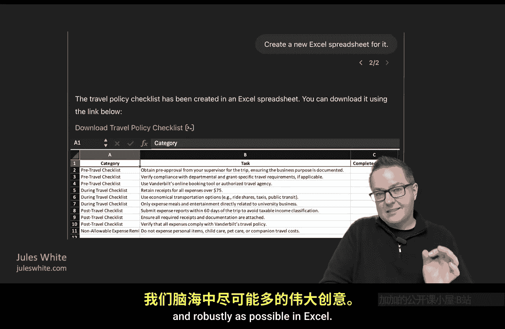

# 范德堡大学【中英⚡ChatGPT与Excel｜ChatGPT + Excel： AI-Enhanced Data Analysis & Insight】 p11 P11 01_化不可能为可能：将政策、程序和其他文档转化为可执行方案 -BV1PdVizZE1d_p11-

When you start working with chattGBT in Excel， I want you to think about using it in ways that make things that should be impossible。

 suddenly possible that go and take computing and suddenly make it possible to do things that we never imagined would be within the realm of capability of a computer and I think a great example of this is when we start building Excel spreadsheets but we use documents as the source of the inspiration for the spreadsheet Now we could go and read the documents。

 build them by hand， think about it， try to collect it all。

 but we want to be able to iterate and prototype faster right we want to spend more time thinking about all the different ways and permutations that we could build that spreadsheet so that we get an amazing spreadsheet。

 not just a spreadsheet and that's what I think we can do with chatGBT when we start thinking about using documents to help design spreadsheets Now what do I mean by this what does that mean to turn a document into a spreadsheet。

😊，Well， I'm going to give you some examples in this and hopefully inspire you to think differently about how you're going to use ChatGBT and Excel together to really go and push the boundaries of what's possible。

So this is the Vanderbilt travel and business expense policy I think it's a roughly 2017 to 20 page PDF and it lays out all of the policies and rules for travel expenses Now what if I want to go and create a spreadsheet to track this information Well。

 I could go and read the document and try to catalog all the different things and then manually build a spreadsheet。

But there's a new way to do it， So I'm going to upload this to chatGBT。

And I'm just uploading the raw PDF of the Travel and business expense policy。

 and I'm going to say design an Excel spreadsheet to track expenses that comply with this policy。

Now what does ChadGBT do Well， it reads the policy and it comes back and starts imagining what the structure of that spreadsheet should be informed by Vanderbilt's travel and expense policy so it's looking at。

 for example business type you know expense or expense types in there and business purpose which is something that you know I always have to fill out every time I submitted an expense I have to say what is the business purpose and all this information it's coming back with the all the things that could go into this approval documentation。

 and then it starts designing what the sheet design could be talking about input validation。

 and that's all super exciting but what gets really exciting as I want you to look at the last sentence down here would you like me to create a prototype of this spreadsheet。

And this is something that is truly amazing that we can now do is we can begin rapidly prototyping spreadsheets。

 We're having a conversation where we're imagining what this spreadsheet should have in and what it should look like and what it structure should be。

 but we can also at any moment that we see something interesting， we can prototype it like this。 Yes。

 please create the Excel spreadsheet and it goes and creates a spreadsheet and then gives me this link to download it。

 download expense tracking template And when I open this， what do I get。

 I get a spreadsheet that is based on the design that it's spelled out。😊，Now。

 what does this do for us， This gives us the ability to go and start rapidly prototyping and thinking about what needs to go into a spreadsheet。

 how do we design it， Because a lot of times we're so focused on like what should the formulas be in everything else that we may not even realize that we've missed critical information in the spreadsheet until it's too late or that there's another way to design it or maybe we should have broken it up into separate worksheets or whatever it is。

But this gives us the ability to go and rapidly prototype and imagine based on real documents。

 real business processes， whatever it is， give it policies， give it procedures。

 give it best practices， give it checklists， give it whatever it is you want。

And have it use that as you be go in rapidly prototype。 Now， this is kind of interesting。

 But what I think of as when you have an empty spreadsheet， it's a sad spreadsheet， right。

 And I have trouble looking at empty spreadsheets， right。

 because I can't really feel how it's going to be used。 I can't see it。So let's go and fix that。

 And this is one of again， the amazing things when we start thinking about designing spreadsheets is that we can use it to help populate it with sample data so that we can get a feel for how this spreadsheet is going to work because it's a lot harder to just kind of reason about columns than it is to see data and understand does that really make sense So I just follow up in the conversation and I say。

 can you populate it with some sample data and it says， okay。

 and it goes and it regenerates the spreadsheet。😊，And now I can open it and I can see the sample data。

 Does this make sense， does it look right？It looks pretty good。

 I'm actually starting to feel good about this spreadsheet， right。

 but it's a lot easier to see it now that it's not a sad spreadsheet that's empty。

 It's much happier now。 it's got some data in it， but I'm also much happier because I can think about it better。

 I can reason about is this spreadsheet going work or not or is it going to be problematic in some way。

 And I'm looking at this and I'm like this is pretty good。 But then I think about it。 And you know。

 this isn't really what I wanted， right， What I really wanted was I go and I travel as an individual traveler。

 and I want a spreadsheet to help me track an individual trip。

 How do I build a spreadsheet to track a trip。 but make sure I've captured the information that I need to be compliant with the Vanderbilt travel and business expense policy。

😊，And this is where the rapid prototyping aspect comes in。

 I say redesign the ship to be redesign the sheet to be for an individual traveler tracking expenses for a specific trip and it goes and it reformats the sheet。

Or the the spreadsheet。 And then I open it up again。 And now I've got separate。

Now worksheets to deal with， I've got the trip details where I can put in the name。

 the destination start end date and business purpose。

 which is what I'm going to need to submit my expense report。

 and then I've got a separate place so that I can go and track all of the individual expenses capturing the key information that I'm going to need to submit my expense report。

And so what it's allowing me to do is to rapidly prototype and imagine and try to build a better spreadsheet at the end of the day。

 that's what I want to do is create a better spreadsheet。I want to create a spreadsheet。 Yes。

 I could go in by hand try to create this spreadsheet， but I might miss some aspect of the policy。

 It's going take me a lot longer to do it。 I'm not gonna to iterate as many times。 In fact。

 if I had started on that first one， and I realized， oh wait I'm missing stuff。

 It might it's gonna take a lot of work to reshape it。

 But now I can reshape it and reformat it and explore what should it look like and not be trapped by what is the work in the sunk cost I've already got in it。

 I can instead say， no no a better way would be this or let's reshape it this way and as fast as I can think through the design。

 it can go and help reflect that design in the Excel that I'm creating。😊。

Now one of the things that it can also do is it can help sort of brainstorm what we can do with the sheet to make it even better。

 And at the beginning， it actually had some interesting things。

 It said sheet design input validation That's actually really good idea right。

 I might not even do that normally myself， I might say I don't know if I'm going to implement input validation。

 but I like that idea that it came up with I think that's a good idea and I should implement input validation。

So I'm going to follow up in the conversation， I'm going to say。

 can you implement the input validation that you mentioned？

Because now what I'm doing is I'm taking its own words and ideas and I'm saying yeah yeah。

 that was a great idea that you had Now go and reflect it in the spreadsheet and I want you to think about having a really talented spreadsheet designer who's coming up with ideas of how to implement them but at the end of the day you're the boss right they're coming and presenting their ideas to you you're telling them they'll go off and I have another crazy idea I want you to implement but oh that idea that you came up with yeah。

 I really like it go and implement it and that's what we're doing here and it goes in it redesigns the spreadsheet。

😊，Now， when I go back， if I implement and I put in airfare as an expense type。

 which is a valid Vanderbilt expense type。 No problem。 Everything's good。 If I go and。

 I put snack in like we see here。 Sudden it says， wait a minute S is not a valid expense type。

 And so it had a good idea which was that I should implement input validation。

 and now I just tell it you go implement that good idea that you had。 I can tell it my good ideas。

 I can be inspired by its ideas and then I can tell it what I want。 but at the end of the day。

 I'm the arbiter of the spreadsheet。 and I'm rapidly through a conversation evolving this spreadsheet to capture important information that is informed and inspired by the policy。

 Now in this case， the input validation is based on the valid types of expenses spelled out in the policy。

 Now I could have gone and tried to read through it and extract all the valid expense types and find that there。

 but it's much more effective for me to say the important point。😊，We want input validation。

Whether or not I was the one。That， you know， went through the spreadsheet and identified each of the types is less important。

 Now， at the end of this， I am going to go and look at the input validation。

 and I'm going to check is what it did correct。 Did it miss a category or something like that。

 I'm always gonna check it。 But even if I had been the one that had read through all the types。

 at the end， I would have gone back and double check anyways。

 So all I'm doing is I'm helping speed up the design and iteration process。

 but we always do the checking no matter what we do， no matter how fast we move。

 we always take the time to be rigorous in our checking。 and we should have done that anyways。

 Now we may not always have done that。 we know from all the errors in Excel spreadsheets that humans have created that many。

 many people don't go back and check carefully。 and we're gonna to correct that。

 We're gonna do work to do that。😊，But we also can think more creatively about how we dream up spreadsheets。

 it doesn't have to be just a direct reflection of tracking expenses， what about for example。

 if we want to turn that policy into a checklist for travelers so that they can go and go into a spreadsheet and check off that they followed all the appropriate rules。

So I just follow up and I say turn the travel policy into a checklist that a traveler should follow when booking their travel。

And it comes back and it gives me a checklist with a whole long list of things。

 and I'm not going to read all these to you， but then I can follow up and say， okay。

 now create a spreadsheet for it and it turns that policy into a checklist and then here's the checklist open in Excel。

But what this also shows us is one of the powers of this idea that a document can be the source of rapid prototyping is a document contains a lot of information and we create documents all the time。

 but now we can transform them into many different things。

 I can transform a travel expense policy into a worksheet to track expenses。

 I can do one that's based on a traveler's perspective。

 but I can also chart it into a checklist for a traveler before they travel or any of the other things can I can imagine as many things as I can imagine that I could do with this travel and business expense policy。

 I can now realize in an Excel spreadsheet， that is my limit on what I can create the bottleneck is my imagination and my creativity and my critical thinking。

 not my ability to go and type into Excel or create formulas anymore。

 It's unbounding us in allowing us to go and dream bigger， do more with Excel。😊。

It is not going to replace your thought process and inspiration and critical thinking in this。

 it's not going to automate everything for you， you're still got to be involved。

 but it unlocks us to do more with Excel。 It unlocks us to take that travel policy document or whatever document it is and turn it into something amazing。

And then to turn it into something else amazing and turn it into yet another amazing thing and to allow us to go and realize essentially as many different great ideas as we have as rapidly and robustly as possible in Excel and that's what we're going explore all the different ways to do that。

😊。

