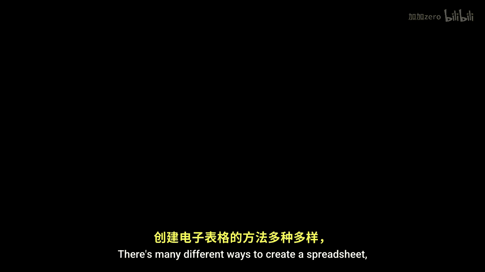
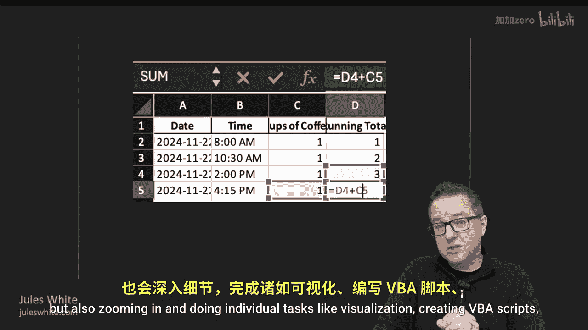

# 范德堡大学【中英⚡ChatGPT与Excel｜ChatGPT + Excel： AI-Enhanced Data Analysis & Insight】 p12 P12 02_通过与ChatGPT对话设计和创建Excel电子表格 -BV1PdVizZE1d_p12-

There's many different ways to create a spreadsheet and one of the ways we can do it is by just going and having a chat or conversation with chatTBT。

 and this can be a highly effective way of thinking through what the design of a spreadsheet should be because whenever we go and we start working with Excel。

 one of the most important things is did we design it correctly did。

 we really think through what data should be captured and how and how it should be represented And it turns out chat is a very effective way of helping us think through and brainstorm ways of doing this。

😊，So let's get started。 You know， the other day， I realized I have no idea how much coffee I drink。

 but it's probably way too much。 and I have too much this morning。

 So maybe I should start tracking that， Well， would my spreadsheet look like if I began tracking that。

 So I said design a very simple spreadsheet to help me track my coffee consumption each day。

 One of the columns should be a running total of the number of cups of coffee， I've had to drink。

 And so I want to go and kind of think about visually， what is this going to look like？ Now。

 one of the things you can also do to make this really effective if you're somebody who's very visual is you can go and say format it as a table to make sure it gives it to you in a table。

 I'm not doing in that in in case， but I get kind of lucky because it goes ahead and designs it as a table。

😊，And I look at this and I'm like， oh yeah， this looks pretty good， right。

 I've got date and time and cups of coffee， and it also has the running total which I asked for。

And it also gives me an explanation， you know， and it tells me how to go and build this spreadsheet。

 So if I want to realize it， here's the explanation of the columns。

 here's how I would create the formula for running total。

 and it's referencing the cells that would be there。

And so now I can go off and think about building it。 Now。

 I think this part right here is really amazing， right， because when I'm building spreadsheets。

 un often thinking about data。😊，I also need to know what are the formulas that I'm going to need to realize the different columns that I want to create。

And often when I'm thinking about it， it's harder to know what those things are。

 but the other thing that's really amazing right is I told it like what the column is going to do and it recognizes that a computation needs to happen to make this column possible。

 And it's telling me and then translating my idea into computation and that's a really important concept that we're going to see is that it can go in trans our highlevel ideas and thoughts into computation On the one hand。

 it's going in designing the structure of the data。

 so it's translating our goals and ideas into a structure of data that we need to capture。

 but it's also translating our ideas and goals into computation。

 and that's going to be really important for us to be able to go and create and do amazing things with Excel and chattBt together。

😊，Now， of course， once we've begun designing， then we can go and rapidly generate prototypes that we can go and experiment with and touch and feel to understand if we've gotten the right design。

 so I just follow up and say okay， create it is an Excel spreadsheet and use a formula for running total and it goes and creates the spreadsheet and now I've got a sample spreadsheet Now luckily for this one I didn't even I think well did I tell it sample data。

😊，No， I didn't even tell it sample data， so it kind of probably got it then and realized that I like to have sample data。

 and so it generated a spreadsheet with sample data。

And if you go and you look at the running total column， it is a formula。

 So it has implemented the formula， the simple formula for me to go and create that now。

This is a really simple example， but it begins to show the potential of how we can go and I could go back and say。

 you know what， I only want it to be the running total for the current day。You know。

 redo the spreadsheet。 I'd like to highlight in red using conditional formatting any day where I drink more than two cups of coffee。

 capture that。 And you see how we can start， you know， thinking about what do we want。

 getting a prototype looking at it。 How could we make it better。

 Then we go back and we rapidly refine and iterate on it to make it better so that we end up with something great now。

😊，What we're going to see is that as we get bigger and better ideas。

 we're going to come up with more and more complex computations and goals that are going to need to back up our spreadsheets。

 And so this is all in good for a running total。 what we're going to see。😊。

Is that as the computations get more complex， we're not going to be able to do everything all at once。

 We're going to have to go and focus on individual formulas and figure out how to express them and have chat GT build them incrementally in a way that it is tractable。

 but also as a way that's tractable for us to go and implement because not everything can be generated at one go into a spreadsheet Often what we're going do is we're going to generate a prototype。

 and then we're going to focus on one particular aspect of that spreadsheet like one column or one visualization that we want to add to it。

Because what happens is you can think of chatGBT as something that's good at writing one page at a time right and really complex spreadsheets are really more than a page worth of stuff just a formula could be more than a page of stuff。

And ChadGBT can only give us about a page of stuff at a time。

 so what we're going to have to do is we're going to have to use that page efficiently。At the start。

 what we're going to be using it to do is to dream up the overall structure。

 sort of the outline the overall columns and set of sheets we're going to have。

And then as we get more and more detailed， we're gonna to zoom in and we're gonna to use that page of output that it can create to focus on one formula or one visualization or one set of columns。

 And so what we're trying to do is we're always trying to be efficient and how we use that space when we're talking at a high level about a spreadsheet as a whole。

 we're gonna be getting sort of like you know a high level of detail， like columns overall。

 but we may not be able to have really detailed information on how to do something when we want to drill into a specific visualization。

 we're going to need to know a lot of details and step bystep information on how to realize that visualization。

 so we're going to need all that page that it can output describing what is needed to create that visualization and so when we do that we're gonna to have to focus on that one task at a time and so what we're gonna to be doing is we're going to when we're designing a spreadsheet as a whole。

 we're working at sort of a high level of abstraction。

 not a ton of detail and then when we go into more complex things like visualizations that are complex we're going focus。

😊，All our work down on that one task， that one visualization。

 so we'll always be zooming you in and out and in and out to try to figure out how to implement that particular idea that we have。

 that computation， that data structure， whatever it is。

So we throughout the class will explore all the different ways of doing things at a high level。

 but also zooming in and doing individual tasks like visualization， creating VBA scripts。

 creating formulas， debugging things。

